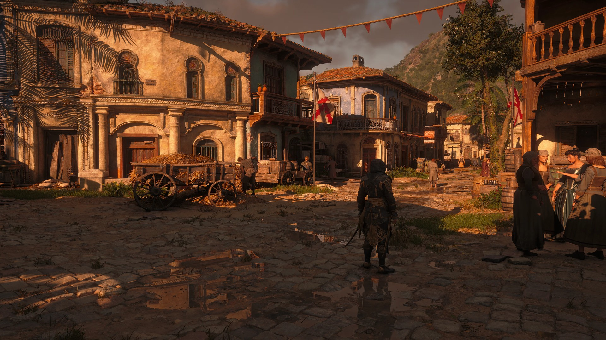
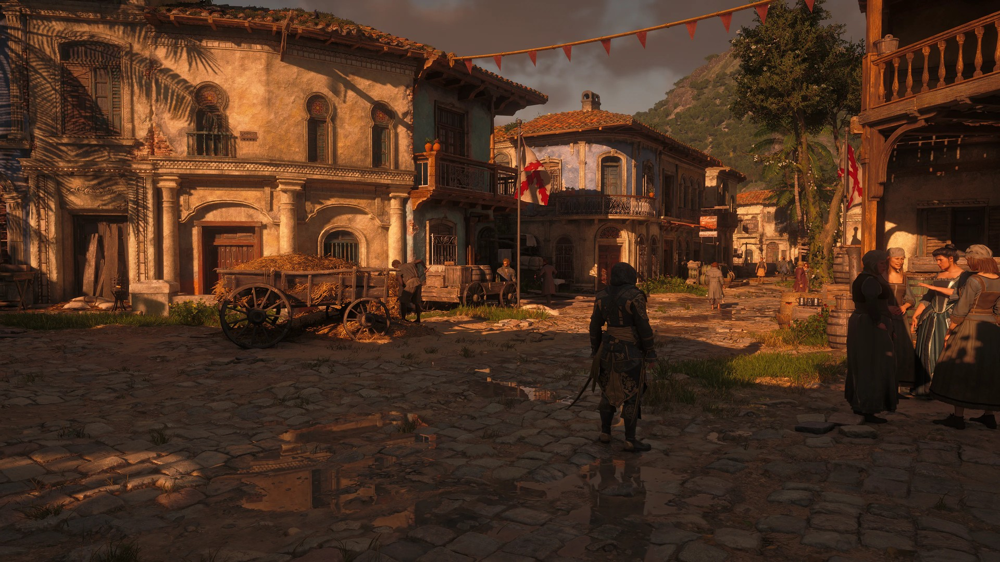
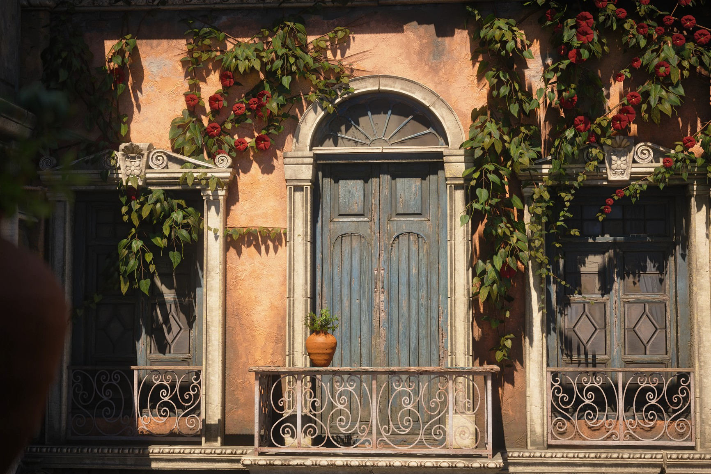
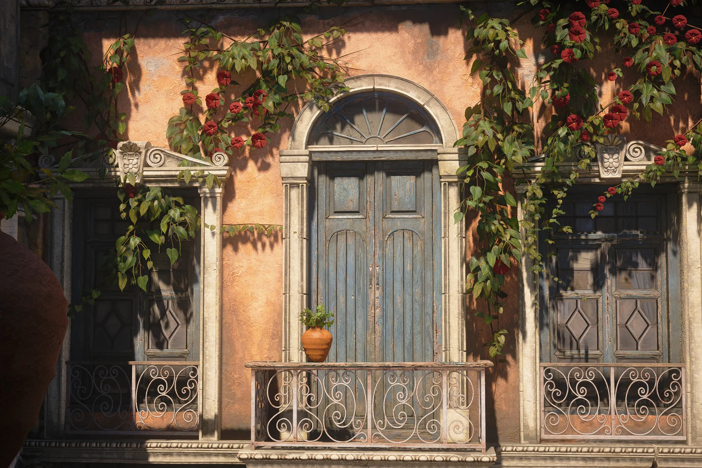

{.shadowed .autosize}

## Summary

Feature | Supported
--|--
Vanilla Photo Mode | Yes
Hotsampling | Yes (with tools)
DSR | -
Custom Aspect Ratios | Yes (with tools)
Reshade | Yes
Ansel | No
Graphics API | DirectX 12
Game version | Latest  S 

## Tools

* [Camera tools by ghostinthecamera](https://patreon.com/ghostinthecamera)  
**Dynamic light spawning** (Advanced tools): create spot and omni lights anywhere in the world, with full control over colour, intensity, range, falloff and shadows  
**[Features](https://ghostinthecamera.co.uk/tools/assassins-creed-black-flag-resynced/index.html)**: Typical camera tools features (camera, hotsampling, HUD etc), time control, photomode range removal, time of day, weather, fog and sun/moon control, post-process toggles, fixed exposure, near-camera fade removal, full-resolution ray-traced GI and reflections, LOD, shadow and grass enhancements

## ghostinthecamera tools comparisons

  

    
ghostinthecamera tools

    
  

  

    
Game default

    
  

  <input type="range" min="0" max="100" value="50" step="0.01" 
    id="slider" class="slider__input" 
    autocomplete="off" onwheel="this.blur()" 
  />

Full rate RT Reflections; Enhanced shadows; Enhanced far details. Shots by ghostinthecamera

  

    
ghostinthecamera tools

    
  

  

    
Game default

    
  

  <input type="range" min="0" max="100" value="50" step="0.01" 
    id="slider" class="slider__input" 
    autocomplete="off" onwheel="this.blur()" 
  />

Enhanced and correct shadows; Full resolution RTGI; Enhanced shadows / Full rate RTGI. Shots by ghostinthecamera

## Tips and Tricks

### LOD and grass enhancements

Change the level of detail multipliers one class at a time, and return every control to 1x before changing the game's graphics preset. Don't change the grass controls rapidly: each change re-streams the grass, and exceeding the resource budget leaves you with *less* grass than you started with.

### Weather and fog

Lightning frequency only works if the current weather preset has lightning. The Sky & Fog override holds the sun, moon and fog values, so the time-of-day tint will not follow the clock while it is on.

## Useful Links

* [PC Gaming Wiki](https://www.pcgamingwiki.com/wiki/Assassin%27s_Creed_IV:_Black_Flag_Resynced)
