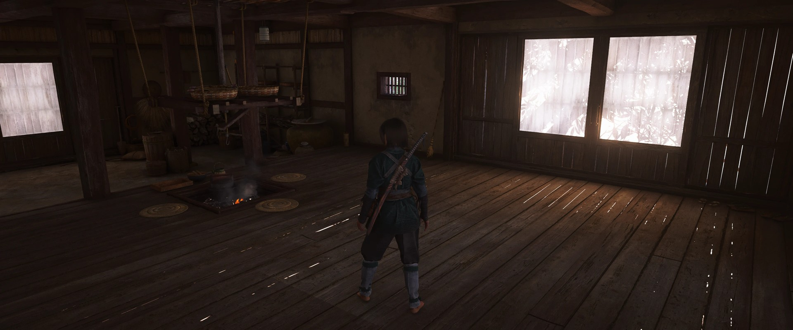
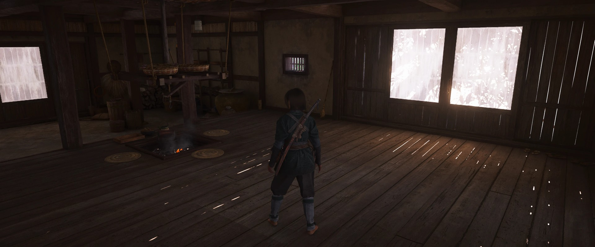
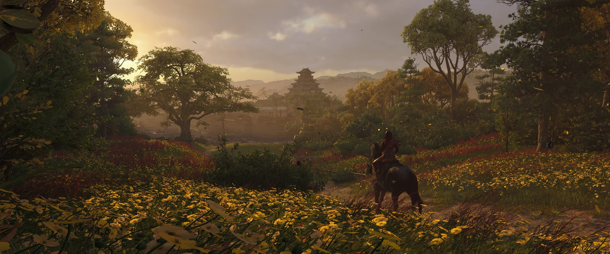
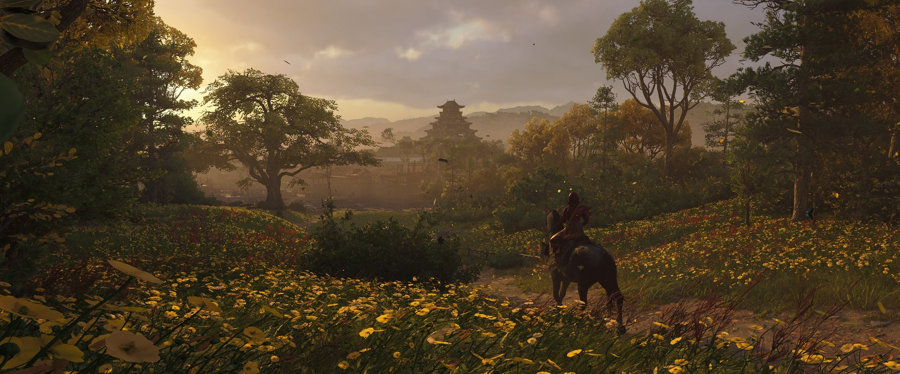
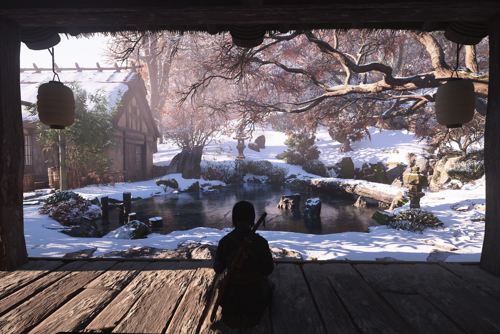

{.shadowed .autosize}

## Summary

Feature | Supported
--|--
Vanilla Photo Mode | Yes
Hotsampling | Yes (with tools)
DSR | Yes
Custom Aspect Ratios | Yes
Reshade | Yes
Ansel | No
Graphics API | DirectX 12
Game version | 1.1.8 (Ubisoft Connect)
 
## Tools

* [Camera tools by Otis_Inf](https://patreon.com/Otis_Inf)  
**[Features](https://opm.fransbouma.com/Cameras/acshadows.htm)**: Camera control, FoV control, timestop, game speed control, HUD toggle, hotsampling, time of day control, cutscene DOF removal, letterbox removal in custom aspect ratios, fog control, exposure control, higher LoD selection, photomode range removal, outline removal
* [Camera tools by ghostinthecamera](https://patreon.com/ghostinthecamera)  
**Dynamic light spawning** (Advanced tools): create spot and omni lights anywhere in the world, with full control over colour, intensity, range, falloff and shadows  
**[Features](https://ghostinthecamera.co.uk/tools/assassins-creed-shadows/index.html)**: Typical camera tools features (camera, hotsampling, HUD etc), world time and season, weather and fog control, enhanced shadows, full-resolution RTGI, increased grass and level of detail distance

## ghostinthecamera tools comparisons

  

    
ghostinthecamera tools

    
  

  

    
Game default

    
  

  <input type="range" min="0" max="100" value="50" step="0.01" 
    id="slider" class="slider__input" 
    autocomplete="off" onwheel="this.blur()" 
  />

Enhanced shadows; Full resolution RTGI (mitigates light leaks). Shots by ghostinthecamera

  

    
ghostinthecamera tools

    
  

  

    
Game default

    
  

  <input type="range" min="0" max="100" value="50" step="0.01" 
    id="slider" class="slider__input" 
    autocomplete="off" onwheel="this.blur()" 
  />

Increased grass draw distance; Increased very far level of detail; Increased near-mid level of detail. Shots by ghostinthecamera

  

    
ghostinthecamera tools

    
  

  

    
Game default

    
  

  <input type="range" min="0" max="100" value="50" step="0.01" 
    id="slider" class="slider__input" 
    autocomplete="off" onwheel="this.blur()" 
  />

Shots by ghostinthecamera

## Tips and Tricks

* For cleaner visuals, select the DLSS upscaler and then use the game’s native anti‑aliasing; this combination tends to reduce unwanted sharpening.

## Useful Links

* [PC Gaming Wiki](https://www.pcgamingwiki.com/wiki/Assassin%27s_Creed_Shadows)
* [Lyall's ACShadowsFix](https://codeberg.org/Lyall/ACShadowsFix)  
  Adds various fixes to the game.
  * Skip intro videos.
  * Extend in-game FOV slider.
  * Disable frame rate cap in cutscenes/FMVs/menus.
  * Enable dynamic cloth physics frame rate.
  * Allow cutscene frame generation.
  * Disable pillarboxing/letterboxing in cutscenes.
  * Option to center the gameplay camera.
* [Stutter Fix (2026 Update)](https://www.nexusmods.com/assassinscreedshadows/mods/183)  
  Adds DirectStorage patch to reduce stuttering.
