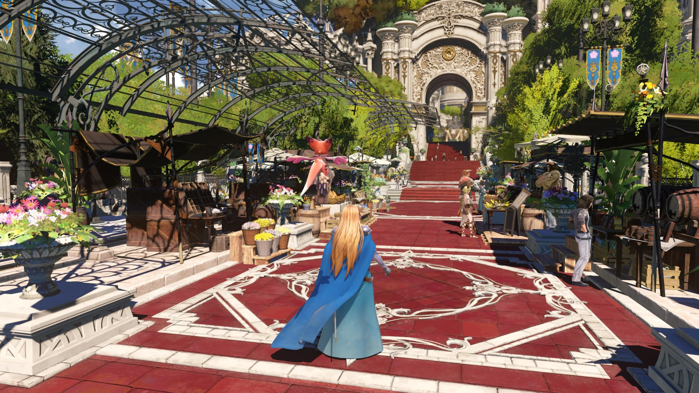
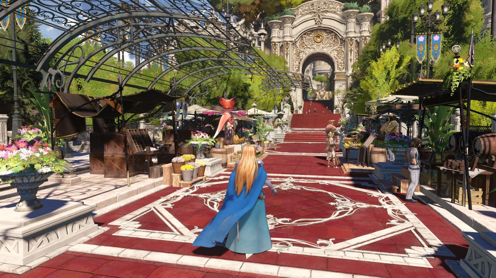
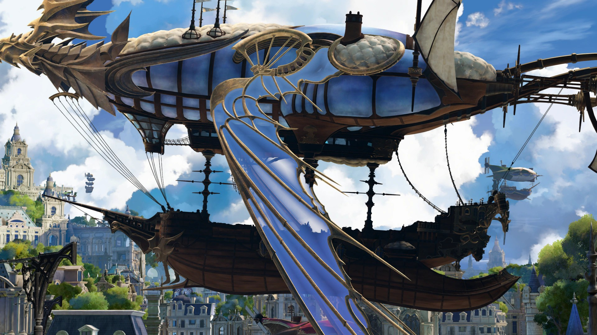
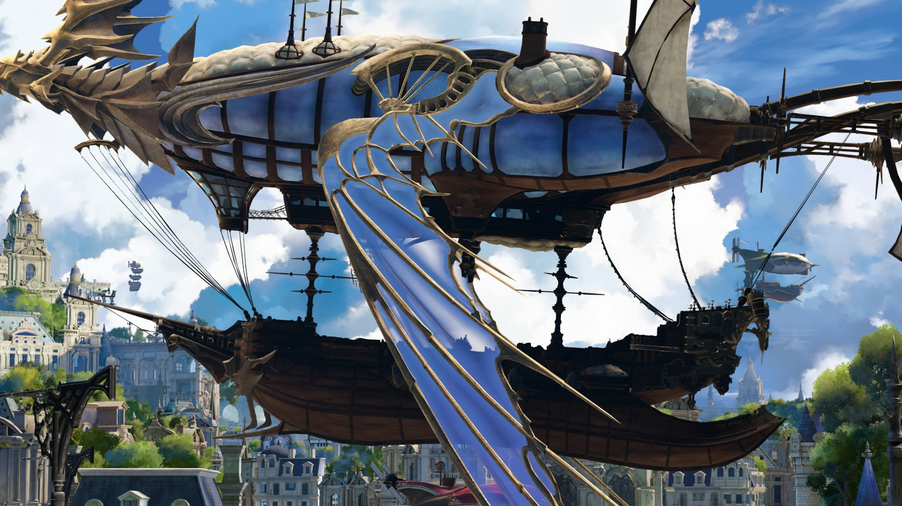
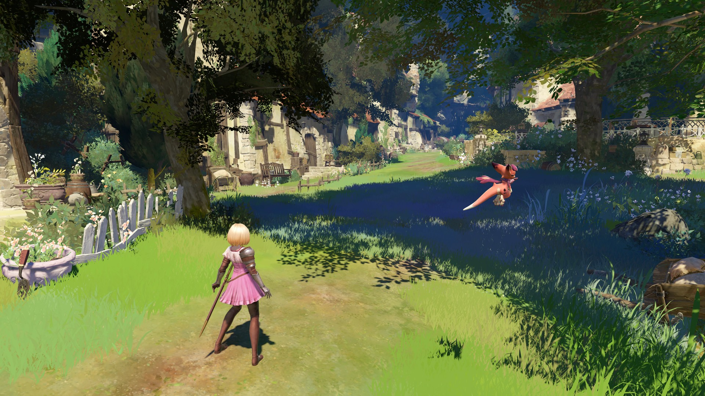
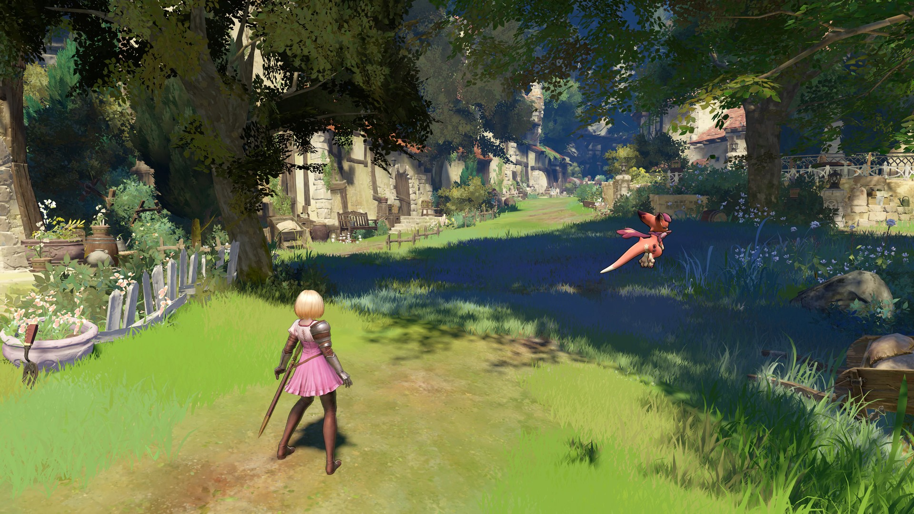

{.shadowed .autosize}

## Summary

Feature | Supported
--|--
Vanilla Photo Mode | No
Hotsampling | Yes (with tools)
DSR | -
Custom Aspect Ratios | Yes (with tools)
Reshade | Yes
Ansel | No
Graphics API | DirectX 11
Game version | Latest  S 

## Tools

* [Camera tools by ghostinthecamera](https://patreon.com/ghostinthecamera)  
**[Features](https://ghostinthecamera.co.uk/tools/granblue-fantasy-relink/index.html)**: Typical camera tools features (camera, hotsampling, HUD etc), time control everywhere including cutscenes (three pause methods), shadow resolution up to 8192, forced highest model LOD, near-camera fade removal, outline removal, depth of field and bloom toggles, extended colour correction volume in cutscenes, ultrawide HUD and post-process scaling fixes

## ghostinthecamera tools comparisons

  

    
ghostinthecamera tools

    
  

  

    
Game default

    
  

  <input type="range" min="0" max="100" value="50" step="0.01" 
    id="slider" class="slider__input" 
    autocomplete="off" onwheel="this.blur()" 
  />

Far detail and enhanced shadows; Enhanced shadows; No player outlines. Shots by ghostinthecamera

  

    
ghostinthecamera tools

    
  

  

    
Game default

    
  

  <input type="range" min="0" max="100" value="50" step="0.01" 
    id="slider" class="slider__input" 
    autocomplete="off" onwheel="this.blur()" 
  />

Enhanced Mesh Detail; Enhanced Shadows; Enhanced far detail (meshes and shadows). Shots by ghostinthecamera

  

    
ghostinthecamera tools

    
  

  

    
Game default

    
  

  <input type="range" min="0" max="100" value="50" step="0.01" 
    id="slider" class="slider__input" 
    autocomplete="off" onwheel="this.blur()" 
  />

Enhanced shadows; New shadow detail; Far detail enhancement. Shots by ghostinthecamera

## Tips and Tricks

### Pause methods

Combined Pause stops game clocks, cinematics, world simulation and VFX. Timescale Pause stops clocks and cinematics but some VFX keep running. World/VFX Pause stops the world while cinematics keep playing.

### VRAM

8192 shadows and forced LOD 0 both use extra VRAM and stack with hotsampled resolutions. If textures stop loading, lower the shadow resolution first.

## Useful Links

* [PC Gaming Wiki](https://www.pcgamingwiki.com/wiki/Granblue_Fantasy:_Relink)
