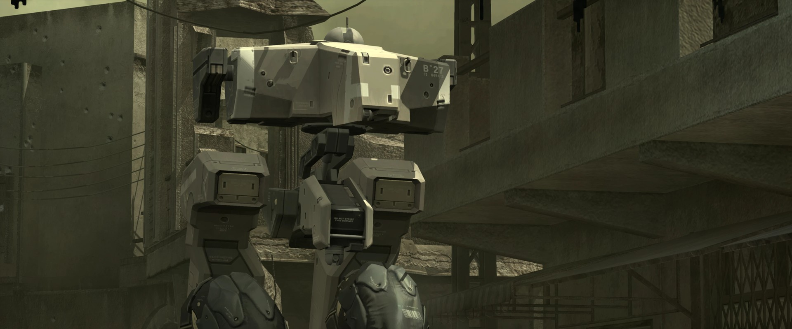
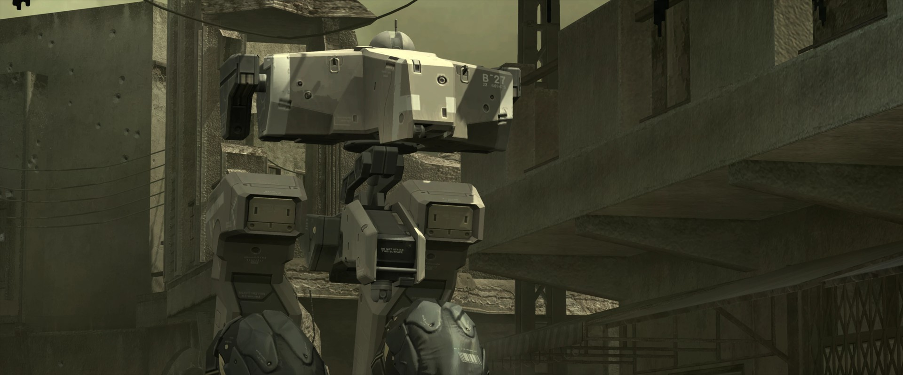
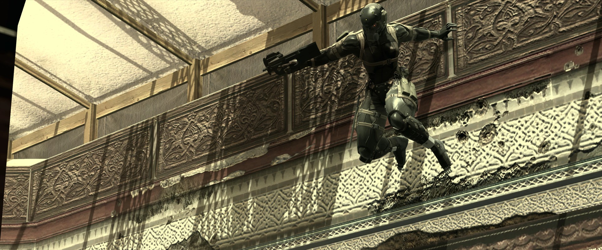

{.shadowed .autosize}

## Summary

Feature | Supported
--|--
Vanilla Photo Mode | No
Hotsampling | Yes (with tools)
DSR | -
Custom Aspect Ratios | Yes (with tools)
Reshade | Yes
Ansel | No
Graphics API | DirectX 12
Game version | Latest  S 

## Tools

* [Camera tools by ghostinthecamera](https://patreon.com/ghostinthecamera)  
**[Features](https://ghostinthecamera.co.uk/tools/metal-gear-solid-4/index.html)**: Typical camera tools features (camera, hotsampling, HUD etc), time control in gameplay and cutscenes, post-process toggles, shadow sharpness, distance and resolution enhancements, player exclusion (enemies hold fire while you set up a shot), ultrawide FOV correction

@alert info
The camera tools are for the DirectX 12 version of the game. Select it in the launcher before starting the game, and inject the tools once the game has launched (not while the launcher is open).
@end

## ghostinthecamera tools comparisons

  

    
ghostinthecamera tools

    
  

  

    
Game default

    
  

  <input type="range" min="0" max="100" value="50" step="0.01" 
    id="slider" class="slider__input" 
    autocomplete="off" onwheel="this.blur()" 
  />

Improved shadow bias and detail; Improved shadow details in distance. Shots by ghostinthecamera

  

    
ghostinthecamera tools

    
  

  

    
Game default

    
  

  <input type="range" min="0" max="100" value="50" step="0.01" 
    id="slider" class="slider__input" 
    autocomplete="off" onwheel="this.blur()" 
  />

Enhanced Shadows; Enhanced Shadow Detail; Enhanced Shadow Bias. Shots by ghostinthecamera

## Tips and Tricks

### Player exclusion

Enemies won't raise alarms or shoot until Snake fires, but they can still see him. Firing a weapon ends the exclusion.

### HUD

Hiding the HUD also removes the blood overlay, threat rings and head markers.

## Useful Links

* [PC Gaming Wiki](https://www.pcgamingwiki.com/wiki/Metal_Gear_Solid_4:_Guns_of_the_Patriots)
