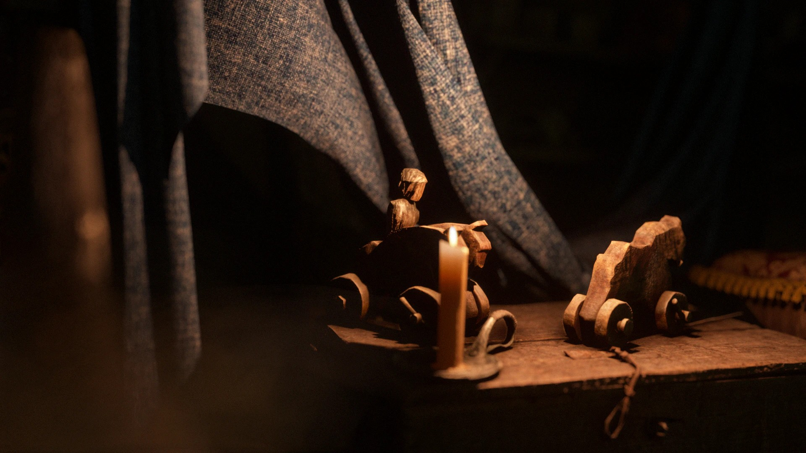
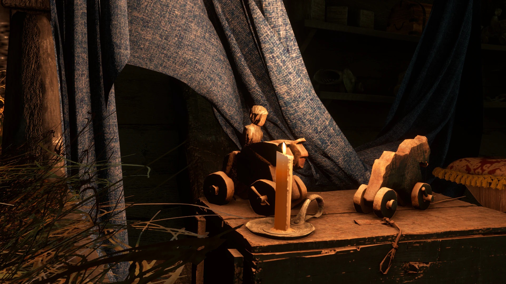
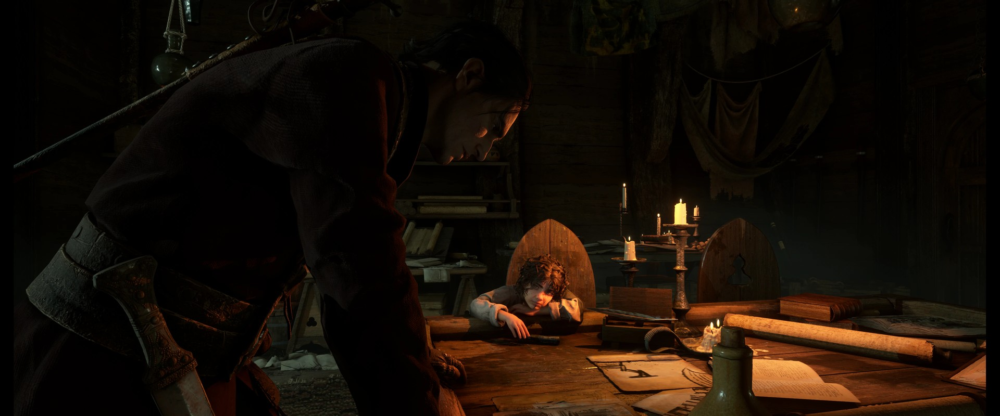
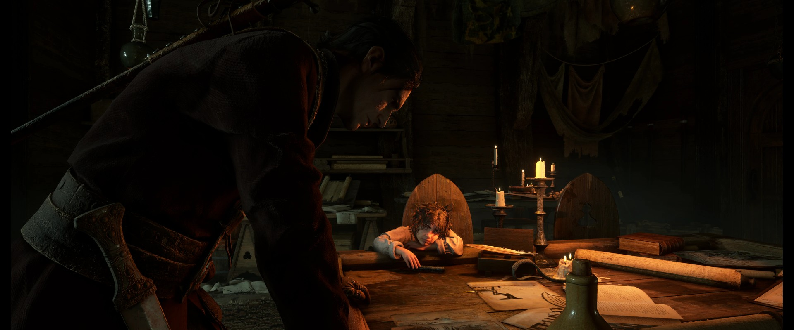

{.shadowed .autosize}

## Summary

Feature | Supported
--|--
Vanilla Photo Mode | Yes
Hotsampling | Yes (with tools)
DSR | -
Custom Aspect Ratios | Yes (with tools)
Reshade | Yes
Ansel | No
Graphics API | DirectX 12
Game version | Latest  S 

## Tools

* [Camera tools by ghostinthecamera](https://patreon.com/ghostinthecamera)  
**Dynamic light spawning** (Advanced tools): omni, spot, disk and orthographic lights, plus a scene light viewer that can switch off the game's own lights or make them cast shadows  
**[Features](https://ghostinthecamera.co.uk/tools/resonance-a-plague-tale-legacy/index.html)**: Typical camera tools features (camera, hotsampling, HUD etc), post-process toggles, ray-traced shadows, 8192 directional shadows, LOD distance and full-resolution SSAO

## ghostinthecamera tools comparisons

  

    
ghostinthecamera tools

    
  

  

    
Game default

    
  

  <input type="range" min="0" max="100" value="50" step="0.01" 
    id="slider" class="slider__input" 
    autocomplete="off" onwheel="this.blur()" 
  />

Enabled shadow casting for scene lights; More accurate lighting. Shots by ghostinthecamera

  

    
ghostinthecamera tools

    
  

  

    
Game default

    
  

  <input type="range" min="0" max="100" value="50" step="0.01" 
    id="slider" class="slider__input" 
    autocomplete="off" onwheel="this.blur()" 
  />

Enhanced shadows. Shots by ghostinthecamera

## Tips and Tricks

### Depth buffer

The depth buffer is unreliable, especially with DLSS or frame generation. The GITC Depth Buffer ReShade addon lets the tools use whichever depth buffer you've selected in ReShade.

### Performance

LOD distance, full-resolution SSAO and 8192 shadows are heavy. Turn them on to set up a shot and off again for normal play.

## Useful Links

* [PC Gaming Wiki](https://www.pcgamingwiki.com/wiki/Resonance:_A_Plague_Tale_Legacy)
