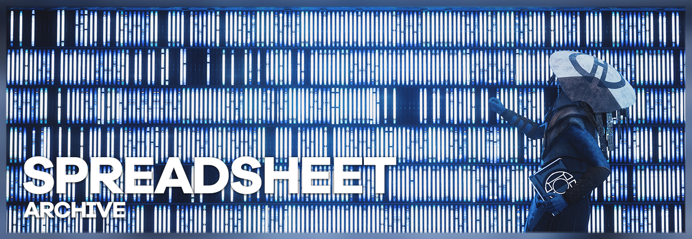

<i>Star Wars Jedi: Survivor</i>, shot by originalnicodr

Over the years we have been collecting a lot of mods that are at least tangential related to virtual photography, in an attempt cover as many games as possible by documenting all the resources we could find on [this spreadsheet](https://docs.google.com/spreadsheets/d/1lnM2SM_RBzqile870zG70E39wuuseqQE0AaPW-P1p5E/edit?usp=sharing). These go from simple freecam mods, all over to debug menus, HD textures, or entire photomode suites with posing and lighting tools.

Ideally, these would have their own guides on this site (whenever the offered URL doesn't include one of its own), but documenting them all in detail would be a monumental effort. So in the meantime, we thought that we could expose what we have on that sheet unto the site so the information can not only be searchable here, but also be indexed by search engines. Given that these were meant to be just notes lying around, our notes on them might not be the cleanest, so we appreciate your understanding.

Having said that, if you end up using one of these mods and learn more tips and tricks on how to shoot a game, please feel free to [create a guide](./contribute.htm) on the game! Or update it if there is already one.

Also, if you happen to have found some mods or tools that you want to include here, send us a DM to one of our social profiles listed [here](./joinus.htm). Or better yet, try to write a guide about it to include it on the [game guides](Gameguides.htm)!

<table style="
    width: 100%;
    table-layout: fixed;
    border-collapse: collapse;
    border: 1px solid #272727;
    box-shadow: 2px 2px 5px rgba(0, 0, 0, 0.15);
">
<colgroup>
<col style="width: auto;">
<col style="width: auto;">
<col style="width: auto;">
<col style="width: auto;">
</colgroup>
<thead>
<tr>
<th style="
    padding: 8px;
    border: 1px solid #272727;
    vertical-align: top;
    overflow-wrap: anywhere;
    word-wrap: break-word;
 text-align: left;">Games</th>
<th style="
    padding: 8px;
    border: 1px solid #272727;
    vertical-align: top;
    overflow-wrap: anywhere;
    word-wrap: break-word;
 text-align: left;">Links</th>
<th style="
    padding: 8px;
    border: 1px solid #272727;
    vertical-align: top;
    overflow-wrap: anywhere;
    word-wrap: break-word;
 text-align: left;">Description</th>
<th style="
    padding: 8px;
    border: 1px solid #272727;
    vertical-align: top;
    overflow-wrap: anywhere;
    word-wrap: break-word;
 text-align: left;">Additional Notes</th>
</tr>
</thead>
<tbody>
<tr>
<td rowspan="2" style="
    padding: 8px;
    border: 1px solid #272727;
    vertical-align: top;
    overflow-wrap: anywhere;
    word-wrap: break-word;
">007 First Light</td>
<td style="
    padding: 8px;
    border: 1px solid #272727;
    vertical-align: top;
    overflow-wrap: anywhere;
    word-wrap: break-word;
"><a href="https://www.nexusmods.com/007firstlight/mods/166">https://www.nexusmods.com/007firstlight/mods/166</a></td>
<td style="
    padding: 8px;
    border: 1px solid #272727;
    vertical-align: top;
    overflow-wrap: anywhere;
    word-wrap: break-word;
"></td>
<td style="
    padding: 8px;
    border: 1px solid #272727;
    vertical-align: top;
    overflow-wrap: anywhere;
    word-wrap: break-word;
"></td>
</tr>
<tr>
<td style="
    padding: 8px;
    border: 1px solid #272727;
    vertical-align: top;
    overflow-wrap: anywhere;
    word-wrap: break-word;
"><a href="https://www.patreon.com/cw/Otis_Inf">https://www.patreon.com/cw/Otis_Inf</a></td>
<td style="
    padding: 8px;
    border: 1px solid #272727;
    vertical-align: top;
    overflow-wrap: anywhere;
    word-wrap: break-word;
"></td>
<td style="
    padding: 8px;
    border: 1px solid #272727;
    vertical-align: top;
    overflow-wrap: anywhere;
    word-wrap: break-word;
"></td>
</tr>
<tr>
<td rowspan="1" style="
    padding: 8px;
    border: 1px solid #272727;
    vertical-align: top;
    overflow-wrap: anywhere;
    word-wrap: break-word;
">1971 Project Helios</td>
<td style="
    padding: 8px;
    border: 1px solid #272727;
    vertical-align: top;
    overflow-wrap: anywhere;
    word-wrap: break-word;
"><a href="https://fearlessrevolution.com/viewtopic.php?t=12793">https://fearlessrevolution.com/viewtopic.php?t=127…</a></td>
<td style="
    padding: 8px;
    border: 1px solid #272727;
    vertical-align: top;
    overflow-wrap: anywhere;
    word-wrap: break-word;
"></td>
<td style="
    padding: 8px;
    border: 1px solid #272727;
    vertical-align: top;
    overflow-wrap: anywhere;
    word-wrap: break-word;
"></td>
</tr>
<tr>
<td rowspan="1" style="
    padding: 8px;
    border: 1px solid #272727;
    vertical-align: top;
    overflow-wrap: anywhere;
    word-wrap: break-word;
">&gt;observer_</td>
<td style="
    padding: 8px;
    border: 1px solid #272727;
    vertical-align: top;
    overflow-wrap: anywhere;
    word-wrap: break-word;
"><a href="https://drive.google.com/file/d/15LPFtarhV0nqTXiJkcd2wcCpEQrIZbrh/view">https://drive.google.com/file/d/15LPFtarhV0nqTXiJk…</a></td>
<td style="
    padding: 8px;
    border: 1px solid #272727;
    vertical-align: top;
    overflow-wrap: anywhere;
    word-wrap: break-word;
"></td>
<td style="
    padding: 8px;
    border: 1px solid #272727;
    vertical-align: top;
    overflow-wrap: anywhere;
    word-wrap: break-word;
">Cams and scripts made by IDK31 <a href="https://steamcommunity.com/sharedfiles/filedetails/?id=682947327">https://steamcommunity.com/sharedfiles/filedetails…</a></td>
</tr>
<tr>
<td rowspan="1" style="
    padding: 8px;
    border: 1px solid #272727;
    vertical-align: top;
    overflow-wrap: anywhere;
    word-wrap: break-word;
">[NINJA GAIDEN: Master Collection] NINJA GAIDEN 3: Razor&#x27;s Edge</td>
<td style="
    padding: 8px;
    border: 1px solid #272727;
    vertical-align: top;
    overflow-wrap: anywhere;
    word-wrap: break-word;
"><a href="https://www.nexusmods.com/ninjagaidenmastercollection/mods/244">https://www.nexusmods.com/ninjagaidenmastercollect…</a></td>
<td style="
    padding: 8px;
    border: 1px solid #272727;
    vertical-align: top;
    overflow-wrap: anywhere;
    word-wrap: break-word;
"></td>
<td style="
    padding: 8px;
    border: 1px solid #272727;
    vertical-align: top;
    overflow-wrap: anywhere;
    word-wrap: break-word;
"></td>
</tr>
<tr>
<td rowspan="1" style="
    padding: 8px;
    border: 1px solid #272727;
    vertical-align: top;
    overflow-wrap: anywhere;
    word-wrap: break-word;
">[NINJA GAIDEN: Master Collection] NINJA GAIDEN Σ</td>
<td style="
    padding: 8px;
    border: 1px solid #272727;
    vertical-align: top;
    overflow-wrap: anywhere;
    word-wrap: break-word;
"><a href="https://www.nexusmods.com/ninjagaidenmastercollection/mods/244">https://www.nexusmods.com/ninjagaidenmastercollect…</a></td>
<td style="
    padding: 8px;
    border: 1px solid #272727;
    vertical-align: top;
    overflow-wrap: anywhere;
    word-wrap: break-word;
"></td>
<td style="
    padding: 8px;
    border: 1px solid #272727;
    vertical-align: top;
    overflow-wrap: anywhere;
    word-wrap: break-word;
"></td>
</tr>
<tr>
<td rowspan="1" style="
    padding: 8px;
    border: 1px solid #272727;
    vertical-align: top;
    overflow-wrap: anywhere;
    word-wrap: break-word;
">[NINJA GAIDEN: Master Collection] NINJA GAIDEN Σ2</td>
<td style="
    padding: 8px;
    border: 1px solid #272727;
    vertical-align: top;
    overflow-wrap: anywhere;
    word-wrap: break-word;
"><a href="https://www.nexusmods.com/ninjagaidenmastercollection/mods/244">https://www.nexusmods.com/ninjagaidenmastercollect…</a></td>
<td style="
    padding: 8px;
    border: 1px solid #272727;
    vertical-align: top;
    overflow-wrap: anywhere;
    word-wrap: break-word;
"></td>
<td style="
    padding: 8px;
    border: 1px solid #272727;
    vertical-align: top;
    overflow-wrap: anywhere;
    word-wrap: break-word;
"></td>
</tr>
<tr>
<td rowspan="1" style="
    padding: 8px;
    border: 1px solid #272727;
    vertical-align: top;
    overflow-wrap: anywhere;
    word-wrap: break-word;
">A Plague Tale: Innocence</td>
<td style="
    padding: 8px;
    border: 1px solid #272727;
    vertical-align: top;
    overflow-wrap: anywhere;
    word-wrap: break-word;
"><a href="https://www.patreon.com/Otis_Inf">https://www.patreon.com/Otis_Inf</a></td>
<td style="
    padding: 8px;
    border: 1px solid #272727;
    vertical-align: top;
    overflow-wrap: anywhere;
    word-wrap: break-word;
"></td>
<td style="
    padding: 8px;
    border: 1px solid #272727;
    vertical-align: top;
    overflow-wrap: anywhere;
    word-wrap: break-word;
"></td>
</tr>
<tr>
<td rowspan="2" style="
    padding: 8px;
    border: 1px solid #272727;
    vertical-align: top;
    overflow-wrap: anywhere;
    word-wrap: break-word;
">A Plague Tale: Requiem</td>
<td style="
    padding: 8px;
    border: 1px solid #272727;
    vertical-align: top;
    overflow-wrap: anywhere;
    word-wrap: break-word;
"><a href="https://www.patreon.com/Otis_Inf">https://www.patreon.com/Otis_Inf</a></td>
<td style="
    padding: 8px;
    border: 1px solid #272727;
    vertical-align: top;
    overflow-wrap: anywhere;
    word-wrap: break-word;
"></td>
<td style="
    padding: 8px;
    border: 1px solid #272727;
    vertical-align: top;
    overflow-wrap: anywhere;
    word-wrap: break-word;
"></td>
</tr>
<tr>
<td style="
    padding: 8px;
    border: 1px solid #272727;
    vertical-align: top;
    overflow-wrap: anywhere;
    word-wrap: break-word;
"><a href="https://fearlessrevolution.com/viewtopic.php?t=21752">https://fearlessrevolution.com/viewtopic.php?t=217…</a></td>
<td style="
    padding: 8px;
    border: 1px solid #272727;
    vertical-align: top;
    overflow-wrap: anywhere;
    word-wrap: break-word;
">console, here are the list of commands: &lt;<a href="https://pastebin.com/94FEW6D3">https://pastebin.com/94FEW6D3</a>&gt;</td>
<td style="
    padding: 8px;
    border: 1px solid #272727;
    vertical-align: top;
    overflow-wrap: anywhere;
    word-wrap: break-word;
"></td>
</tr>
<tr>
<td rowspan="1" style="
    padding: 8px;
    border: 1px solid #272727;
    vertical-align: top;
    overflow-wrap: anywhere;
    word-wrap: break-word;
">A Short Hike</td>
<td style="
    padding: 8px;
    border: 1px solid #272727;
    vertical-align: top;
    overflow-wrap: anywhere;
    word-wrap: break-word;
"><a href="https://ingame.miraheze.org/wiki/A_Short_Hike">https://ingame.miraheze.org/wiki/A_Short_Hike</a></td>
<td style="
    padding: 8px;
    border: 1px solid #272727;
    vertical-align: top;
    overflow-wrap: anywhere;
    word-wrap: break-word;
">Unity game, so the unity explorer should work with it. Russian wiki, needs translation.</td>
<td style="
    padding: 8px;
    border: 1px solid #272727;
    vertical-align: top;
    overflow-wrap: anywhere;
    word-wrap: break-word;
"></td>
</tr>
<tr>
<td rowspan="2" style="
    padding: 8px;
    border: 1px solid #272727;
    vertical-align: top;
    overflow-wrap: anywhere;
    word-wrap: break-word;
">A Story About My Uncle</td>
<td style="
    padding: 8px;
    border: 1px solid #272727;
    vertical-align: top;
    overflow-wrap: anywhere;
    word-wrap: break-word;
"><a href="https://steamcommunity.com/sharedfiles/filedetails/?id=553753101">https://steamcommunity.com/sharedfiles/filedetails…</a></td>
<td style="
    padding: 8px;
    border: 1px solid #272727;
    vertical-align: top;
    overflow-wrap: anywhere;
    word-wrap: break-word;
">HUD off, Free Camera</td>
<td style="
    padding: 8px;
    border: 1px solid #272727;
    vertical-align: top;
    overflow-wrap: anywhere;
    word-wrap: break-word;
">&quot;Cams&quot; from steam guides, most of them lack one feature or another like timestop or FOV control</td>
</tr>
<tr>
<td style="
    padding: 8px;
    border: 1px solid #272727;
    vertical-align: top;
    overflow-wrap: anywhere;
    word-wrap: break-word;
"><a href="https://nohud.fandom.com/wiki/A_Story_About_My_Uncle_No_Hud">https://nohud.fandom.com/wiki/A_Story_About_My_Unc…</a></td>
<td style="
    padding: 8px;
    border: 1px solid #272727;
    vertical-align: top;
    overflow-wrap: anywhere;
    word-wrap: break-word;
"></td>
<td style="
    padding: 8px;
    border: 1px solid #272727;
    vertical-align: top;
    overflow-wrap: anywhere;
    word-wrap: break-word;
">&quot;Cams&quot; from steam guides, most of them lack one feature or another like timestop or FOV control</td>
</tr>
<tr>
<td rowspan="1" style="
    padding: 8px;
    border: 1px solid #272727;
    vertical-align: top;
    overflow-wrap: anywhere;
    word-wrap: break-word;
">Abzu</td>
<td style="
    padding: 8px;
    border: 1px solid #272727;
    vertical-align: top;
    overflow-wrap: anywhere;
    word-wrap: break-word;
"><a href="https://anticowl.github.io/2025/06/24/Abzu/">https://anticowl.github.io/2025/06/24/Abzu/</a></td>
<td style="
    padding: 8px;
    border: 1px solid #272727;
    vertical-align: top;
    overflow-wrap: anywhere;
    word-wrap: break-word;
"></td>
<td style="
    padding: 8px;
    border: 1px solid #272727;
    vertical-align: top;
    overflow-wrap: anywhere;
    word-wrap: break-word;
"></td>
</tr>
<tr>
<td rowspan="1" style="
    padding: 8px;
    border: 1px solid #272727;
    vertical-align: top;
    overflow-wrap: anywhere;
    word-wrap: break-word;
">Accounting+</td>
<td style="
    padding: 8px;
    border: 1px solid #272727;
    vertical-align: top;
    overflow-wrap: anywhere;
    word-wrap: break-word;
"><a href="https://github.com/SumOfAllN00bs/AP_DebugAndFreecam">https://github.com/SumOfAllN00bs/AP_DebugAndFreeca…</a></td>
<td style="
    padding: 8px;
    border: 1px solid #272727;
    vertical-align: top;
    overflow-wrap: anywhere;
    word-wrap: break-word;
"></td>
<td style="
    padding: 8px;
    border: 1px solid #272727;
    vertical-align: top;
    overflow-wrap: anywhere;
    word-wrap: break-word;
"></td>
</tr>
<tr>
<td rowspan="1" style="
    padding: 8px;
    border: 1px solid #272727;
    vertical-align: top;
    overflow-wrap: anywhere;
    word-wrap: break-word;
">Ace Combat 5: The Unsung War</td>
<td style="
    padding: 8px;
    border: 1px solid #272727;
    vertical-align: top;
    overflow-wrap: anywhere;
    word-wrap: break-word;
"><a href="https://github.com/deaththed0g/AC5GCT">https://github.com/deaththed0g/AC5GCT</a></td>
<td style="
    padding: 8px;
    border: 1px solid #272727;
    vertical-align: top;
    overflow-wrap: anywhere;
    word-wrap: break-word;
">Freecam cheat table</td>
<td style="
    padding: 8px;
    border: 1px solid #272727;
    vertical-align: top;
    overflow-wrap: anywhere;
    word-wrap: break-word;
"></td>
</tr>
<tr>
<td rowspan="1" style="
    padding: 8px;
    border: 1px solid #272727;
    vertical-align: top;
    overflow-wrap: anywhere;
    word-wrap: break-word;
">Ace Combat 7</td>
<td style="
    padding: 8px;
    border: 1px solid #272727;
    vertical-align: top;
    overflow-wrap: anywhere;
    word-wrap: break-word;
"><a href="https://github.com/ghostinthecamera/IGCS-GITC/releases/tag/AC7v1.4">https://github.com/ghostinthecamera/IGCS-GITC/rele…</a></td>
<td style="
    padding: 8px;
    border: 1px solid #272727;
    vertical-align: top;
    overflow-wrap: anywhere;
    word-wrap: break-word;
">Injectable Generic Camera System</td>
<td style="
    padding: 8px;
    border: 1px solid #272727;
    vertical-align: top;
    overflow-wrap: anywhere;
    word-wrap: break-word;
">Camera made by ghostinthecamera <a href="https://github.com/ghostinthecamera/IGCS-GITC">https://github.com/ghostinthecamera/IGCS-GITC</a></td>
</tr>
<tr>
<td rowspan="1" style="
    padding: 8px;
    border: 1px solid #272727;
    vertical-align: top;
    overflow-wrap: anywhere;
    word-wrap: break-word;
">Ace Combat Zero: The Belkan War</td>
<td style="
    padding: 8px;
    border: 1px solid #272727;
    vertical-align: top;
    overflow-wrap: anywhere;
    word-wrap: break-word;
"><a href="https://github.com/deaththed0g/Ace-Combat-Zero-The-Belkan-War-CE-repository">https://github.com/deaththed0g/Ace-Combat-Zero-The…</a></td>
<td style="
    padding: 8px;
    border: 1px solid #272727;
    vertical-align: top;
    overflow-wrap: anywhere;
    word-wrap: break-word;
">Freecam cheat tables</td>
<td style="
    padding: 8px;
    border: 1px solid #272727;
    vertical-align: top;
    overflow-wrap: anywhere;
    word-wrap: break-word;
"></td>
</tr>
<tr>
<td rowspan="1" style="
    padding: 8px;
    border: 1px solid #272727;
    vertical-align: top;
    overflow-wrap: anywhere;
    word-wrap: break-word;
">ADR1FT</td>
<td style="
    padding: 8px;
    border: 1px solid #272727;
    vertical-align: top;
    overflow-wrap: anywhere;
    word-wrap: break-word;
"><a href="https://drive.google.com/file/d/0B0Ad-GMKCuiNQURkd0ZxZjFJQ2c/view?resourcekey=0-kkqINvVgJQjEgitdJ3guOw">https://drive.google.com/file/d/0B0Ad-GMKCuiNQURkd…</a></td>
<td style="
    padding: 8px;
    border: 1px solid #272727;
    vertical-align: top;
    overflow-wrap: anywhere;
    word-wrap: break-word;
"></td>
<td style="
    padding: 8px;
    border: 1px solid #272727;
    vertical-align: top;
    overflow-wrap: anywhere;
    word-wrap: break-word;
"></td>
</tr>
<tr>
<td rowspan="1" style="
    padding: 8px;
    border: 1px solid #272727;
    vertical-align: top;
    overflow-wrap: anywhere;
    word-wrap: break-word;
">Age of Time</td>
<td style="
    padding: 8px;
    border: 1px solid #272727;
    vertical-align: top;
    overflow-wrap: anywhere;
    word-wrap: break-word;
"><a href="https://ingame.miraheze.org/wiki/Age_of_Time">https://ingame.miraheze.org/wiki/Age_of_Time</a></td>
<td style="
    padding: 8px;
    border: 1px solid #272727;
    vertical-align: top;
    overflow-wrap: anywhere;
    word-wrap: break-word;
">Russian wiki, needs translation.</td>
<td style="
    padding: 8px;
    border: 1px solid #272727;
    vertical-align: top;
    overflow-wrap: anywhere;
    word-wrap: break-word;
"></td>
</tr>
<tr>
<td rowspan="1" style="
    padding: 8px;
    border: 1px solid #272727;
    vertical-align: top;
    overflow-wrap: anywhere;
    word-wrap: break-word;
">Age of Wonders 3</td>
<td style="
    padding: 8px;
    border: 1px solid #272727;
    vertical-align: top;
    overflow-wrap: anywhere;
    word-wrap: break-word;
"><a href="https://nohud.fandom.com/wiki/Age_of_Wonders_3_Nohud">https://nohud.fandom.com/wiki/Age_of_Wonders_3_Noh…</a></td>
<td style="
    padding: 8px;
    border: 1px solid #272727;
    vertical-align: top;
    overflow-wrap: anywhere;
    word-wrap: break-word;
">Debug Mode (enables HUD Toggle and Freecam)</td>
<td style="
    padding: 8px;
    border: 1px solid #272727;
    vertical-align: top;
    overflow-wrap: anywhere;
    word-wrap: break-word;
"></td>
</tr>
<tr>
<td rowspan="2" style="
    padding: 8px;
    border: 1px solid #272727;
    vertical-align: top;
    overflow-wrap: anywhere;
    word-wrap: break-word;
">Alan Wake 2</td>
<td style="
    padding: 8px;
    border: 1px solid #272727;
    vertical-align: top;
    overflow-wrap: anywhere;
    word-wrap: break-word;
"><a href="https://www.patreon.com/Otis_Inf">https://www.patreon.com/Otis_Inf</a></td>
<td style="
    padding: 8px;
    border: 1px solid #272727;
    vertical-align: top;
    overflow-wrap: anywhere;
    word-wrap: break-word;
"></td>
<td style="
    padding: 8px;
    border: 1px solid #272727;
    vertical-align: top;
    overflow-wrap: anywhere;
    word-wrap: break-word;
"></td>
</tr>
<tr>
<td style="
    padding: 8px;
    border: 1px solid #272727;
    vertical-align: top;
    overflow-wrap: anywhere;
    word-wrap: break-word;
"><a href="https://ghostinthecamera.co.uk/tools/alan-wake-2/index.html">https://ghostinthecamera.co.uk/tools/alan-wake-2/i…</a></td>
<td style="
    padding: 8px;
    border: 1px solid #272727;
    vertical-align: top;
    overflow-wrap: anywhere;
    word-wrap: break-word;
"></td>
<td style="
    padding: 8px;
    border: 1px solid #272727;
    vertical-align: top;
    overflow-wrap: anywhere;
    word-wrap: break-word;
"></td>
</tr>
<tr>
<td rowspan="4" style="
    padding: 8px;
    border: 1px solid #272727;
    vertical-align: top;
    overflow-wrap: anywhere;
    word-wrap: break-word;
">Alice: Madness Returns</td>
<td style="
    padding: 8px;
    border: 1px solid #272727;
    vertical-align: top;
    overflow-wrap: anywhere;
    word-wrap: break-word;
"><a href="https://drive.google.com/file/d/0Bz1PTpaR0llTWjVQek00WlZpYmM/view?resourcekey=0-iLkBfrd8R04HNhr-1Tkwig">https://drive.google.com/file/d/0Bz1PTpaR0llTWjVQe…</a></td>
<td style="
    padding: 8px;
    border: 1px solid #272727;
    vertical-align: top;
    overflow-wrap: anywhere;
    word-wrap: break-word;
">Cheat Table</td>
<td style="
    padding: 8px;
    border: 1px solid #272727;
    vertical-align: top;
    overflow-wrap: anywhere;
    word-wrap: break-word;
">Cams and scripts made by IDK31 <a href="https://steamcommunity.com/sharedfiles/filedetails/?id=682947327">https://steamcommunity.com/sharedfiles/filedetails…</a></td>
</tr>
<tr>
<td style="
    padding: 8px;
    border: 1px solid #272727;
    vertical-align: top;
    overflow-wrap: anywhere;
    word-wrap: break-word;
"><a href="https://nohud.fandom.com/wiki/Alice:_Madness_Returns_No_Hud">https://nohud.fandom.com/wiki/Alice:_Madness_Retur…</a></td>
<td style="
    padding: 8px;
    border: 1px solid #272727;
    vertical-align: top;
    overflow-wrap: anywhere;
    word-wrap: break-word;
">HUD Toggle (and Alternative Freecam)</td>
<td style="
    padding: 8px;
    border: 1px solid #272727;
    vertical-align: top;
    overflow-wrap: anywhere;
    word-wrap: break-word;
"></td>
</tr>
<tr>
<td style="
    padding: 8px;
    border: 1px solid #272727;
    vertical-align: top;
    overflow-wrap: anywhere;
    word-wrap: break-word;
"><a href="https://screenarchery.fandom.com/wiki/Alice:_Madness_Returns">https://screenarchery.fandom.com/wiki/Alice:_Madne…</a></td>
<td style="
    padding: 8px;
    border: 1px solid #272727;
    vertical-align: top;
    overflow-wrap: anywhere;
    word-wrap: break-word;
"></td>
<td style="
    padding: 8px;
    border: 1px solid #272727;
    vertical-align: top;
    overflow-wrap: anywhere;
    word-wrap: break-word;
"></td>
</tr>
<tr>
<td style="
    padding: 8px;
    border: 1px solid #272727;
    vertical-align: top;
    overflow-wrap: anywhere;
    word-wrap: break-word;
"><a href="https://anticowl.github.io/2026/06/03/AMR/">https://anticowl.github.io/2026/06/03/AMR/</a></td>
<td style="
    padding: 8px;
    border: 1px solid #272727;
    vertical-align: top;
    overflow-wrap: anywhere;
    word-wrap: break-word;
"></td>
<td style="
    padding: 8px;
    border: 1px solid #272727;
    vertical-align: top;
    overflow-wrap: anywhere;
    word-wrap: break-word;
"></td>
</tr>
<tr>
<td rowspan="1" style="
    padding: 8px;
    border: 1px solid #272727;
    vertical-align: top;
    overflow-wrap: anywhere;
    word-wrap: break-word;
">Alien Breed</td>
<td style="
    padding: 8px;
    border: 1px solid #272727;
    vertical-align: top;
    overflow-wrap: anywhere;
    word-wrap: break-word;
"><a href="https://nohud.fandom.com/wiki/Alien_Breed_No_Hud">https://nohud.fandom.com/wiki/Alien_Breed_No_Hud</a></td>
<td style="
    padding: 8px;
    border: 1px solid #272727;
    vertical-align: top;
    overflow-wrap: anywhere;
    word-wrap: break-word;
">HUD Toggle and NoClip</td>
<td style="
    padding: 8px;
    border: 1px solid #272727;
    vertical-align: top;
    overflow-wrap: anywhere;
    word-wrap: break-word;
"></td>
</tr>
<tr>
<td rowspan="1" style="
    padding: 8px;
    border: 1px solid #272727;
    vertical-align: top;
    overflow-wrap: anywhere;
    word-wrap: break-word;
">Alien Breed 2: Assault</td>
<td style="
    padding: 8px;
    border: 1px solid #272727;
    vertical-align: top;
    overflow-wrap: anywhere;
    word-wrap: break-word;
"><a href="https://nohud.fandom.com/wiki/Alien_Breed_2:_Assault_No_Hud">https://nohud.fandom.com/wiki/Alien_Breed_2:_Assau…</a></td>
<td style="
    padding: 8px;
    border: 1px solid #272727;
    vertical-align: top;
    overflow-wrap: anywhere;
    word-wrap: break-word;
">HUD Toggle and NoClip</td>
<td style="
    padding: 8px;
    border: 1px solid #272727;
    vertical-align: top;
    overflow-wrap: anywhere;
    word-wrap: break-word;
"></td>
</tr>
<tr>
<td rowspan="1" style="
    padding: 8px;
    border: 1px solid #272727;
    vertical-align: top;
    overflow-wrap: anywhere;
    word-wrap: break-word;
">Alien Breed 3: Descent</td>
<td style="
    padding: 8px;
    border: 1px solid #272727;
    vertical-align: top;
    overflow-wrap: anywhere;
    word-wrap: break-word;
"><a href="https://nohud.fandom.com/wiki/Alien_Breed_3:_Descent_No_Hud">https://nohud.fandom.com/wiki/Alien_Breed_3:_Desce…</a></td>
<td style="
    padding: 8px;
    border: 1px solid #272727;
    vertical-align: top;
    overflow-wrap: anywhere;
    word-wrap: break-word;
">HUD Toggle and NoClip</td>
<td style="
    padding: 8px;
    border: 1px solid #272727;
    vertical-align: top;
    overflow-wrap: anywhere;
    word-wrap: break-word;
"></td>
</tr>
<tr>
<td rowspan="7" style="
    padding: 8px;
    border: 1px solid #272727;
    vertical-align: top;
    overflow-wrap: anywhere;
    word-wrap: break-word;
">Alien Isolation</td>
<td style="
    padding: 8px;
    border: 1px solid #272727;
    vertical-align: top;
    overflow-wrap: anywhere;
    word-wrap: break-word;
"><a href="https://www.mediafire.com/file/mtwv6pwndrsyz68/CT_AlienIsolation_20180802.rar/file">https://www.mediafire.com/file/mtwv6pwndrsyz68/CT_…</a></td>
<td style="
    padding: 8px;
    border: 1px solid #272727;
    vertical-align: top;
    overflow-wrap: anywhere;
    word-wrap: break-word;
">Cheat Table</td>
<td style="
    padding: 8px;
    border: 1px solid #272727;
    vertical-align: top;
    overflow-wrap: anywhere;
    word-wrap: break-word;
">Tools by Hattiwat from the site cinetools.xyz. Password for all files is &quot;CinematicTools&quot; Old source code (isnt the last version): <a href="https://github.com/Hattiwatti/CinematicTools">https://github.com/Hattiwatti/CinematicTools</a></td>
</tr>
<tr>
<td style="
    padding: 8px;
    border: 1px solid #272727;
    vertical-align: top;
    overflow-wrap: anywhere;
    word-wrap: break-word;
"><a href="https://www.pcgamingwiki.com/wiki/Alien:_Isolation#Increased_planar_reflections">https://www.pcgamingwiki.com/wiki/Alien:_Isolation…</a></td>
<td style="
    padding: 8px;
    border: 1px solid #272727;
    vertical-align: top;
    overflow-wrap: anywhere;
    word-wrap: break-word;
">Guide to Tweaking VFX</td>
<td style="
    padding: 8px;
    border: 1px solid #272727;
    vertical-align: top;
    overflow-wrap: anywhere;
    word-wrap: break-word;
"></td>
</tr>
<tr>
<td style="
    padding: 8px;
    border: 1px solid #272727;
    vertical-align: top;
    overflow-wrap: anywhere;
    word-wrap: break-word;
">Res tips</td>
<td style="
    padding: 8px;
    border: 1px solid #272727;
    vertical-align: top;
    overflow-wrap: anywhere;
    word-wrap: break-word;
">Go to Alien Isolation\DATA in your Steam folder and edit ENGINE_SETTINGS.xml There&#x27;s a list of resolutions - edit them or add your own, any resolutions will do. Must run the game in Windowed mode</td>
<td style="
    padding: 8px;
    border: 1px solid #272727;
    vertical-align: top;
    overflow-wrap: anywhere;
    word-wrap: break-word;
"></td>
</tr>
<tr>
<td style="
    padding: 8px;
    border: 1px solid #272727;
    vertical-align: top;
    overflow-wrap: anywhere;
    word-wrap: break-word;
"><a href="https://web.archive.org/web/20151211105021/http://deadendthrills.com/forum/discussion/comment/5920/">https://web.archive.org/web/20151211105021/http://…</a></td>
<td style="
    padding: 8px;
    border: 1px solid #272727;
    vertical-align: top;
    overflow-wrap: anywhere;
    word-wrap: break-word;
">Miscellaneous Guides</td>
<td style="
    padding: 8px;
    border: 1px solid #272727;
    vertical-align: top;
    overflow-wrap: anywhere;
    word-wrap: break-word;
"></td>
</tr>
<tr>
<td style="
    padding: 8px;
    border: 1px solid #272727;
    vertical-align: top;
    overflow-wrap: anywhere;
    word-wrap: break-word;
"><a href="https://web.archive.org/web/20151211105021/http://deadendthrills.com/forum/discussion/comment/5920/">https://web.archive.org/web/20151211105021/http://…</a></td>
<td style="
    padding: 8px;
    border: 1px solid #272727;
    vertical-align: top;
    overflow-wrap: anywhere;
    word-wrap: break-word;
"></td>
<td style="
    padding: 8px;
    border: 1px solid #272727;
    vertical-align: top;
    overflow-wrap: anywhere;
    word-wrap: break-word;
"></td>
</tr>
<tr>
<td style="
    padding: 8px;
    border: 1px solid #272727;
    vertical-align: top;
    overflow-wrap: anywhere;
    word-wrap: break-word;
"><a href="https://www.nexusmods.com/alienisolation/mods/19">https://www.nexusmods.com/alienisolation/mods/19</a></td>
<td style="
    padding: 8px;
    border: 1px solid #272727;
    vertical-align: top;
    overflow-wrap: anywhere;
    word-wrap: break-word;
"></td>
<td style="
    padding: 8px;
    border: 1px solid #272727;
    vertical-align: top;
    overflow-wrap: anywhere;
    word-wrap: break-word;
"></td>
</tr>
<tr>
<td style="
    padding: 8px;
    border: 1px solid #272727;
    vertical-align: top;
    overflow-wrap: anywhere;
    word-wrap: break-word;
"><a href="https://github.com/OpenCAGE/CinematicTools">https://github.com/OpenCAGE/CinematicTools</a></td>
<td style="
    padding: 8px;
    border: 1px solid #272727;
    vertical-align: top;
    overflow-wrap: anywhere;
    word-wrap: break-word;
">improved hattis camera</td>
<td style="
    padding: 8px;
    border: 1px solid #272727;
    vertical-align: top;
    overflow-wrap: anywhere;
    word-wrap: break-word;
"></td>
</tr>
<tr>
<td rowspan="1" style="
    padding: 8px;
    border: 1px solid #272727;
    vertical-align: top;
    overflow-wrap: anywhere;
    word-wrap: break-word;
">Aliens vs. Predator (2010)</td>
<td style="
    padding: 8px;
    border: 1px solid #272727;
    vertical-align: top;
    overflow-wrap: anywhere;
    word-wrap: break-word;
"><a href="https://github.com/Kelthic/avp2010_photomode">https://github.com/Kelthic/avp2010_photomode</a></td>
<td style="
    padding: 8px;
    border: 1px solid #272727;
    vertical-align: top;
    overflow-wrap: anywhere;
    word-wrap: break-word;
">no source code uploaded, use at your own risk</td>
<td style="
    padding: 8px;
    border: 1px solid #272727;
    vertical-align: top;
    overflow-wrap: anywhere;
    word-wrap: break-word;
"></td>
</tr>
<tr>
<td rowspan="1" style="
    padding: 8px;
    border: 1px solid #272727;
    vertical-align: top;
    overflow-wrap: anywhere;
    word-wrap: break-word;
">All Zombies Must Die!</td>
<td style="
    padding: 8px;
    border: 1px solid #272727;
    vertical-align: top;
    overflow-wrap: anywhere;
    word-wrap: break-word;
"><a href="https://nohud.fandom.com/wiki/All_Zombies_Must_Die!_No_Hud">https://nohud.fandom.com/wiki/All_Zombies_Must_Die…</a></td>
<td style="
    padding: 8px;
    border: 1px solid #272727;
    vertical-align: top;
    overflow-wrap: anywhere;
    word-wrap: break-word;
"></td>
<td style="
    padding: 8px;
    border: 1px solid #272727;
    vertical-align: top;
    overflow-wrap: anywhere;
    word-wrap: break-word;
"></td>
</tr>
<tr>
<td rowspan="1" style="
    padding: 8px;
    border: 1px solid #272727;
    vertical-align: top;
    overflow-wrap: anywhere;
    word-wrap: break-word;
">Alone in the Dark (2008)</td>
<td style="
    padding: 8px;
    border: 1px solid #272727;
    vertical-align: top;
    overflow-wrap: anywhere;
    word-wrap: break-word;
"><a href="https://ingame.miraheze.org/wiki/Alone_in_the_Dark_(2008)">https://ingame.miraheze.org/wiki/Alone_in_the_Dark…</a></td>
<td style="
    padding: 8px;
    border: 1px solid #272727;
    vertical-align: top;
    overflow-wrap: anywhere;
    word-wrap: break-word;
">Russian wiki, needs translation.</td>
<td style="
    padding: 8px;
    border: 1px solid #272727;
    vertical-align: top;
    overflow-wrap: anywhere;
    word-wrap: break-word;
"></td>
</tr>
<tr>
<td rowspan="1" style="
    padding: 8px;
    border: 1px solid #272727;
    vertical-align: top;
    overflow-wrap: anywhere;
    word-wrap: break-word;
">Alpha Outer Wilds</td>
<td style="
    padding: 8px;
    border: 1px solid #272727;
    vertical-align: top;
    overflow-wrap: anywhere;
    word-wrap: break-word;
"><a href="https://github.com/ShoosGun/FreeCamMod">https://github.com/ShoosGun/FreeCamMod</a></td>
<td style="
    padding: 8px;
    border: 1px solid #272727;
    vertical-align: top;
    overflow-wrap: anywhere;
    word-wrap: break-word;
"></td>
<td style="
    padding: 8px;
    border: 1px solid #272727;
    vertical-align: top;
    overflow-wrap: anywhere;
    word-wrap: break-word;
"></td>
</tr>
<tr>
<td rowspan="2" style="
    padding: 8px;
    border: 1px solid #272727;
    vertical-align: top;
    overflow-wrap: anywhere;
    word-wrap: break-word;
">Alpha Protocol</td>
<td style="
    padding: 8px;
    border: 1px solid #272727;
    vertical-align: top;
    overflow-wrap: anywhere;
    word-wrap: break-word;
"><a href="https://web.archive.org/web/20180625133717/http://www.deadendthrills.com/forum/discussion/274/guide-alpha-protocol">https://web.archive.org/web/20180625133717/http://…</a></td>
<td style="
    padding: 8px;
    border: 1px solid #272727;
    vertical-align: top;
    overflow-wrap: anywhere;
    word-wrap: break-word;
">INI Tweaking Guide</td>
<td style="
    padding: 8px;
    border: 1px solid #272727;
    vertical-align: top;
    overflow-wrap: anywhere;
    word-wrap: break-word;
">These are the guides from the DET forums that didn&#x27;t use any CE table, so no need to use the CE archive with these.</td>
</tr>
<tr>
<td style="
    padding: 8px;
    border: 1px solid #272727;
    vertical-align: top;
    overflow-wrap: anywhere;
    word-wrap: break-word;
"><a href="https://nohud.fandom.com/wiki/Alpha_Protocol_No_Hud">https://nohud.fandom.com/wiki/Alpha_Protocol_No_Hu…</a></td>
<td style="
    padding: 8px;
    border: 1px solid #272727;
    vertical-align: top;
    overflow-wrap: anywhere;
    word-wrap: break-word;
">HUD Toggle and NoClip</td>
<td style="
    padding: 8px;
    border: 1px solid #272727;
    vertical-align: top;
    overflow-wrap: anywhere;
    word-wrap: break-word;
"></td>
</tr>
<tr>
<td rowspan="1" style="
    padding: 8px;
    border: 1px solid #272727;
    vertical-align: top;
    overflow-wrap: anywhere;
    word-wrap: break-word;
">American McGee&#x27;s Grimm</td>
<td style="
    padding: 8px;
    border: 1px solid #272727;
    vertical-align: top;
    overflow-wrap: anywhere;
    word-wrap: break-word;
"><a href="https://nohud.fandom.com/wiki/American_McGee%27s_Grimm_No_Hud">https://nohud.fandom.com/wiki/American_McGee%27s_G…</a></td>
<td style="
    padding: 8px;
    border: 1px solid #272727;
    vertical-align: top;
    overflow-wrap: anywhere;
    word-wrap: break-word;
">HUD Toggle and Debug Camera</td>
<td style="
    padding: 8px;
    border: 1px solid #272727;
    vertical-align: top;
    overflow-wrap: anywhere;
    word-wrap: break-word;
"></td>
</tr>
<tr>
<td rowspan="2" style="
    padding: 8px;
    border: 1px solid #272727;
    vertical-align: top;
    overflow-wrap: anywhere;
    word-wrap: break-word;
">American Truck Simulator</td>
<td style="
    padding: 8px;
    border: 1px solid #272727;
    vertical-align: top;
    overflow-wrap: anywhere;
    word-wrap: break-word;
"><a href="https://steamcommunity.com/workshop/filedetails/?id=920467474">https://steamcommunity.com/workshop/filedetails/?i…</a></td>
<td style="
    padding: 8px;
    border: 1px solid #272727;
    vertical-align: top;
    overflow-wrap: anywhere;
    word-wrap: break-word;
"></td>
<td style="
    padding: 8px;
    border: 1px solid #272727;
    vertical-align: top;
    overflow-wrap: anywhere;
    word-wrap: break-word;
"></td>
</tr>
<tr>
<td style="
    padding: 8px;
    border: 1px solid #272727;
    vertical-align: top;
    overflow-wrap: anywhere;
    word-wrap: break-word;
"><a href="https://steamcommunity.com/sharedfiles/filedetails/?id=1565364987">https://steamcommunity.com/sharedfiles/filedetails…</a></td>
<td style="
    padding: 8px;
    border: 1px solid #272727;
    vertical-align: top;
    overflow-wrap: anywhere;
    word-wrap: break-word;
"></td>
<td style="
    padding: 8px;
    border: 1px solid #272727;
    vertical-align: top;
    overflow-wrap: anywhere;
    word-wrap: break-word;
"></td>
</tr>
<tr>
<td rowspan="2" style="
    padding: 8px;
    border: 1px solid #272727;
    vertical-align: top;
    overflow-wrap: anywhere;
    word-wrap: break-word;
">Amnesia Rebirth</td>
<td style="
    padding: 8px;
    border: 1px solid #272727;
    vertical-align: top;
    overflow-wrap: anywhere;
    word-wrap: break-word;
"><a href="https://gameplay.tips/guides/8724-amnesia-rebirth.html">https://gameplay.tips/guides/8724-amnesia-rebirth.…</a></td>
<td style="
    padding: 8px;
    border: 1px solid #272727;
    vertical-align: top;
    overflow-wrap: anywhere;
    word-wrap: break-word;
">Enables Debug Console</td>
<td style="
    padding: 8px;
    border: 1px solid #272727;
    vertical-align: top;
    overflow-wrap: anywhere;
    word-wrap: break-word;
"></td>
</tr>
<tr>
<td style="
    padding: 8px;
    border: 1px solid #272727;
    vertical-align: top;
    overflow-wrap: anywhere;
    word-wrap: break-word;
"><a href="https://fearlessrevolution.com/viewtopic.php?t=14959">https://fearlessrevolution.com/viewtopic.php?t=149…</a></td>
<td style="
    padding: 8px;
    border: 1px solid #272727;
    vertical-align: top;
    overflow-wrap: anywhere;
    word-wrap: break-word;
">Cheat Table</td>
<td style="
    padding: 8px;
    border: 1px solid #272727;
    vertical-align: top;
    overflow-wrap: anywhere;
    word-wrap: break-word;
"></td>
</tr>
<tr>
<td rowspan="1" style="
    padding: 8px;
    border: 1px solid #272727;
    vertical-align: top;
    overflow-wrap: anywhere;
    word-wrap: break-word;
">Ancient Wars: Sparta Definitive Edition</td>
<td style="
    padding: 8px;
    border: 1px solid #272727;
    vertical-align: top;
    overflow-wrap: anywhere;
    word-wrap: break-word;
"><a href="https://ingame.miraheze.org/wiki/%D0%92%D0%BE%D0%B9%D0%BD%D1%8B_%D0%B4%D1%80%D0%B5%D0%B2%D0%BD%D0%BE%D1%81%D1%82%D0%B8:_%D0%A1%D0%BF%D0%B0%D1%80%D1%82%D0%B0">https://ingame.miraheze.org/wiki/%D0%92%D0%BE%D0%B…</a></td>
<td style="
    padding: 8px;
    border: 1px solid #272727;
    vertical-align: top;
    overflow-wrap: anywhere;
    word-wrap: break-word;
">Russian wiki, needs translation.</td>
<td style="
    padding: 8px;
    border: 1px solid #272727;
    vertical-align: top;
    overflow-wrap: anywhere;
    word-wrap: break-word;
"></td>
</tr>
<tr>
<td rowspan="1" style="
    padding: 8px;
    border: 1px solid #272727;
    vertical-align: top;
    overflow-wrap: anywhere;
    word-wrap: break-word;
">Animal Crossing: New Horizons</td>
<td style="
    padding: 8px;
    border: 1px solid #272727;
    vertical-align: top;
    overflow-wrap: anywhere;
    word-wrap: break-word;
"><a href="https://gamebanana.com/mods/54546">https://gamebanana.com/mods/54546</a></td>
<td style="
    padding: 8px;
    border: 1px solid #272727;
    vertical-align: top;
    overflow-wrap: anywhere;
    word-wrap: break-word;
">FreeCam Mod by Alree</td>
<td style="
    padding: 8px;
    border: 1px solid #272727;
    vertical-align: top;
    overflow-wrap: anywhere;
    word-wrap: break-word;
"></td>
</tr>
<tr>
<td rowspan="1" style="
    padding: 8px;
    border: 1px solid #272727;
    vertical-align: top;
    overflow-wrap: anywhere;
    word-wrap: break-word;
">Anno 1404</td>
<td style="
    padding: 8px;
    border: 1px solid #272727;
    vertical-align: top;
    overflow-wrap: anywhere;
    word-wrap: break-word;
"><a href="https://ingame.miraheze.org/wiki/Anno_1404">https://ingame.miraheze.org/wiki/Anno_1404</a></td>
<td style="
    padding: 8px;
    border: 1px solid #272727;
    vertical-align: top;
    overflow-wrap: anywhere;
    word-wrap: break-word;
">Russian wiki, needs translation.</td>
<td style="
    padding: 8px;
    border: 1px solid #272727;
    vertical-align: top;
    overflow-wrap: anywhere;
    word-wrap: break-word;
"></td>
</tr>
<tr>
<td rowspan="1" style="
    padding: 8px;
    border: 1px solid #272727;
    vertical-align: top;
    overflow-wrap: anywhere;
    word-wrap: break-word;
">Ape Escape</td>
<td style="
    padding: 8px;
    border: 1px solid #272727;
    vertical-align: top;
    overflow-wrap: anywhere;
    word-wrap: break-word;
"><a href="https://github.com/Meos4/Enhanced-Freecam">https://github.com/Meos4/Enhanced-Freecam</a></td>
<td style="
    padding: 8px;
    border: 1px solid #272727;
    vertical-align: top;
    overflow-wrap: anywhere;
    word-wrap: break-word;
"></td>
<td style="
    padding: 8px;
    border: 1px solid #272727;
    vertical-align: top;
    overflow-wrap: anywhere;
    word-wrap: break-word;
"></td>
</tr>
<tr>
<td rowspan="1" style="
    padding: 8px;
    border: 1px solid #272727;
    vertical-align: top;
    overflow-wrap: anywhere;
    word-wrap: break-word;
">Aperture Tag: The Paint Gun Testing Initiative</td>
<td style="
    padding: 8px;
    border: 1px solid #272727;
    vertical-align: top;
    overflow-wrap: anywhere;
    word-wrap: break-word;
"><a href="https://nohud.fandom.com/wiki/Aperture_Tag:_The_Paint_Gun_Testing_Initiative_No_Hud">https://nohud.fandom.com/wiki/Aperture_Tag:_The_Pa…</a></td>
<td style="
    padding: 8px;
    border: 1px solid #272727;
    vertical-align: top;
    overflow-wrap: anywhere;
    word-wrap: break-word;
"></td>
<td style="
    padding: 8px;
    border: 1px solid #272727;
    vertical-align: top;
    overflow-wrap: anywhere;
    word-wrap: break-word;
"></td>
</tr>
<tr>
<td rowspan="1" style="
    padding: 8px;
    border: 1px solid #272727;
    vertical-align: top;
    overflow-wrap: anywhere;
    word-wrap: break-word;
">Apotheon</td>
<td style="
    padding: 8px;
    border: 1px solid #272727;
    vertical-align: top;
    overflow-wrap: anywhere;
    word-wrap: break-word;
"><a href="https://nohud.fandom.com/wiki/Apotheon_No_Hud">https://nohud.fandom.com/wiki/Apotheon_No_Hud</a></td>
<td style="
    padding: 8px;
    border: 1px solid #272727;
    vertical-align: top;
    overflow-wrap: anywhere;
    word-wrap: break-word;
">Enables Debug Console</td>
<td style="
    padding: 8px;
    border: 1px solid #272727;
    vertical-align: top;
    overflow-wrap: anywhere;
    word-wrap: break-word;
"></td>
</tr>
<tr>
<td rowspan="1" style="
    padding: 8px;
    border: 1px solid #272727;
    vertical-align: top;
    overflow-wrap: anywhere;
    word-wrap: break-word;
">ArcaniA</td>
<td style="
    padding: 8px;
    border: 1px solid #272727;
    vertical-align: top;
    overflow-wrap: anywhere;
    word-wrap: break-word;
"><a href="https://steamcommunity.com/sharedfiles/filedetails/?id=610278104">https://steamcommunity.com/sharedfiles/filedetails…</a></td>
<td style="
    padding: 8px;
    border: 1px solid #272727;
    vertical-align: top;
    overflow-wrap: anywhere;
    word-wrap: break-word;
">HUD Toggle and Freecam</td>
<td style="
    padding: 8px;
    border: 1px solid #272727;
    vertical-align: top;
    overflow-wrap: anywhere;
    word-wrap: break-word;
">These are &quot;Cams&quot; from Steam guides, but most of them lack one feature or another like timestop or FOV control. This is in Russian, so it might need translation.</td>
</tr>
<tr>
<td rowspan="1" style="
    padding: 8px;
    border: 1px solid #272727;
    vertical-align: top;
    overflow-wrap: anywhere;
    word-wrap: break-word;
">Ark: Survival Evolved</td>
<td style="
    padding: 8px;
    border: 1px solid #272727;
    vertical-align: top;
    overflow-wrap: anywhere;
    word-wrap: break-word;
"><a href="https://nohud.fandom.com/wiki/Ark:_Survival_Evolved_No_Hud">https://nohud.fandom.com/wiki/Ark:_Survival_Evolve…</a></td>
<td style="
    padding: 8px;
    border: 1px solid #272727;
    vertical-align: top;
    overflow-wrap: anywhere;
    word-wrap: break-word;
">HUD Toggle and NoClip</td>
<td style="
    padding: 8px;
    border: 1px solid #272727;
    vertical-align: top;
    overflow-wrap: anywhere;
    word-wrap: break-word;
"></td>
</tr>
<tr>
<td rowspan="1" style="
    padding: 8px;
    border: 1px solid #272727;
    vertical-align: top;
    overflow-wrap: anywhere;
    word-wrap: break-word;
">ARMA 2 &amp; 3</td>
<td style="
    padding: 8px;
    border: 1px solid #272727;
    vertical-align: top;
    overflow-wrap: anywhere;
    word-wrap: break-word;
"><a href="https://web.archive.org/web/20170821090615/http://www.deadendthrills.com/forum/discussion/225/script-arma-2-3-camera-w-ppeffects-tod-game-speed-etc">https://web.archive.org/web/20170821090615/http://…</a></td>
<td style="
    padding: 8px;
    border: 1px solid #272727;
    vertical-align: top;
    overflow-wrap: anywhere;
    word-wrap: break-word;
"></td>
<td style="
    padding: 8px;
    border: 1px solid #272727;
    vertical-align: top;
    overflow-wrap: anywhere;
    word-wrap: break-word;
">These are the guides from the DET forums that didn&#x27;t use any CE table, so no need to use the CE archive with these.</td>
</tr>
<tr>
<td rowspan="2" style="
    padding: 8px;
    border: 1px solid #272727;
    vertical-align: top;
    overflow-wrap: anywhere;
    word-wrap: break-word;
">ARMA 3</td>
<td style="
    padding: 8px;
    border: 1px solid #272727;
    vertical-align: top;
    overflow-wrap: anywhere;
    word-wrap: break-word;
"><a href="https://nohud.fandom.com/wiki/ARMA_3_No_Hud">https://nohud.fandom.com/wiki/ARMA_3_No_Hud</a></td>
<td style="
    padding: 8px;
    border: 1px solid #272727;
    vertical-align: top;
    overflow-wrap: anywhere;
    word-wrap: break-word;
"></td>
<td style="
    padding: 8px;
    border: 1px solid #272727;
    vertical-align: top;
    overflow-wrap: anywhere;
    word-wrap: break-word;
"></td>
</tr>
<tr>
<td style="
    padding: 8px;
    border: 1px solid #272727;
    vertical-align: top;
    overflow-wrap: anywhere;
    word-wrap: break-word;
"><a href="https://steamcommunity.com/sharedfiles/filedetails/?id=909893746">https://steamcommunity.com/sharedfiles/filedetails…</a></td>
<td style="
    padding: 8px;
    border: 1px solid #272727;
    vertical-align: top;
    overflow-wrap: anywhere;
    word-wrap: break-word;
"></td>
<td style="
    padding: 8px;
    border: 1px solid #272727;
    vertical-align: top;
    overflow-wrap: anywhere;
    word-wrap: break-word;
"></td>
</tr>
<tr>
<td rowspan="3" style="
    padding: 8px;
    border: 1px solid #272727;
    vertical-align: top;
    overflow-wrap: anywhere;
    word-wrap: break-word;
">ARMORED CORE VI FIRES OF RUBICON</td>
<td style="
    padding: 8px;
    border: 1px solid #272727;
    vertical-align: top;
    overflow-wrap: anywhere;
    word-wrap: break-word;
"><a href="https://github.com/vswarte/ac6-freecam">https://github.com/vswarte/ac6-freecam</a></td>
<td style="
    padding: 8px;
    border: 1px solid #272727;
    vertical-align: top;
    overflow-wrap: anywhere;
    word-wrap: break-word;
">freecam with extras</td>
<td style="
    padding: 8px;
    border: 1px solid #272727;
    vertical-align: top;
    overflow-wrap: anywhere;
    word-wrap: break-word;
"></td>
</tr>
<tr>
<td style="
    padding: 8px;
    border: 1px solid #272727;
    vertical-align: top;
    overflow-wrap: anywhere;
    word-wrap: break-word;
"><a href="https://ghostinthecamera.co.uk/armored-core-6-tools">https://ghostinthecamera.co.uk/armored-core-6-tool…</a></td>
<td style="
    padding: 8px;
    border: 1px solid #272727;
    vertical-align: top;
    overflow-wrap: anywhere;
    word-wrap: break-word;
">ghost freecam</td>
<td style="
    padding: 8px;
    border: 1px solid #272727;
    vertical-align: top;
    overflow-wrap: anywhere;
    word-wrap: break-word;
"></td>
</tr>
<tr>
<td style="
    padding: 8px;
    border: 1px solid #272727;
    vertical-align: top;
    overflow-wrap: anywhere;
    word-wrap: break-word;
"><a href="https://github.com/picturelox/ACVI">https://github.com/picturelox/ACVI</a></td>
<td style="
    padding: 8px;
    border: 1px solid #272727;
    vertical-align: top;
    overflow-wrap: anywhere;
    word-wrap: break-word;
"></td>
<td style="
    padding: 8px;
    border: 1px solid #272727;
    vertical-align: top;
    overflow-wrap: anywhere;
    word-wrap: break-word;
"></td>
</tr>
<tr>
<td rowspan="1" style="
    padding: 8px;
    border: 1px solid #272727;
    vertical-align: top;
    overflow-wrap: anywhere;
    word-wrap: break-word;
">ARMS</td>
<td style="
    padding: 8px;
    border: 1px solid #272727;
    vertical-align: top;
    overflow-wrap: anywhere;
    word-wrap: break-word;
"><a href="https://gamebanana.com/mods/489587">https://gamebanana.com/mods/489587</a></td>
<td style="
    padding: 8px;
    border: 1px solid #272727;
    vertical-align: top;
    overflow-wrap: anywhere;
    word-wrap: break-word;
"></td>
<td style="
    padding: 8px;
    border: 1px solid #272727;
    vertical-align: top;
    overflow-wrap: anywhere;
    word-wrap: break-word;
"></td>
</tr>
<tr>
<td rowspan="1" style="
    padding: 8px;
    border: 1px solid #272727;
    vertical-align: top;
    overflow-wrap: anywhere;
    word-wrap: break-word;
">ARSLAN: THE WARRIORS OF LEGEND</td>
<td style="
    padding: 8px;
    border: 1px solid #272727;
    vertical-align: top;
    overflow-wrap: anywhere;
    word-wrap: break-word;
"><a href="https://www.dropbox.com/s/1ulbksas1rt7rh1/nc_atwol_180902.ct?dl=0">https://www.dropbox.com/s/1ulbksas1rt7rh1/nc_atwol…</a></td>
<td style="
    padding: 8px;
    border: 1px solid #272727;
    vertical-align: top;
    overflow-wrap: anywhere;
    word-wrap: break-word;
">Posing script, see additional notes</td>
<td style="
    padding: 8px;
    border: 1px solid #272727;
    vertical-align: top;
    overflow-wrap: anywhere;
    word-wrap: break-word;
"><a href="https://web.archive.org/web/20180909224228/http://nakayoc5c5.blog.shinobi.jp/cheat%20engine%20.ct/arslan-%20the%20warriors%20of%20legend">https://web.archive.org/web/20180909224228/http://…</a></td>
</tr>
<tr>
<td rowspan="1" style="
    padding: 8px;
    border: 1px solid #272727;
    vertical-align: top;
    overflow-wrap: anywhere;
    word-wrap: break-word;
">art of rally</td>
<td style="
    padding: 8px;
    border: 1px solid #272727;
    vertical-align: top;
    overflow-wrap: anywhere;
    word-wrap: break-word;
"><a href="https://github.com/thoxx/aor-camera-mod">https://github.com/thoxx/aor-camera-mod</a></td>
<td style="
    padding: 8px;
    border: 1px solid #272727;
    vertical-align: top;
    overflow-wrap: anywhere;
    word-wrap: break-word;
"></td>
<td style="
    padding: 8px;
    border: 1px solid #272727;
    vertical-align: top;
    overflow-wrap: anywhere;
    word-wrap: break-word;
"></td>
</tr>
<tr>
<td rowspan="2" style="
    padding: 8px;
    border: 1px solid #272727;
    vertical-align: top;
    overflow-wrap: anywhere;
    word-wrap: break-word;
">Assassin&#x27;s Creed 2</td>
<td style="
    padding: 8px;
    border: 1px solid #272727;
    vertical-align: top;
    overflow-wrap: anywhere;
    word-wrap: break-word;
"><a href="https://www.mixmods.com.br/2021/08/ac2-mixsets/">https://www.mixmods.com.br/2021/08/ac2-mixsets/</a></td>
<td style="
    padding: 8px;
    border: 1px solid #272727;
    vertical-align: top;
    overflow-wrap: anywhere;
    word-wrap: break-word;
">better shadows</td>
<td style="
    padding: 8px;
    border: 1px solid #272727;
    vertical-align: top;
    overflow-wrap: anywhere;
    word-wrap: break-word;
"></td>
</tr>
<tr>
<td style="
    padding: 8px;
    border: 1px solid #272727;
    vertical-align: top;
    overflow-wrap: anywhere;
    word-wrap: break-word;
"><a href="https://www.nexusmods.com/assassinscreedii/mods/233?tab=description">https://www.nexusmods.com/assassinscreedii/mods/23…</a></td>
<td style="
    padding: 8px;
    border: 1px solid #272727;
    vertical-align: top;
    overflow-wrap: anywhere;
    word-wrap: break-word;
">freecam, lod and more</td>
<td style="
    padding: 8px;
    border: 1px solid #272727;
    vertical-align: top;
    overflow-wrap: anywhere;
    word-wrap: break-word;
"></td>
</tr>
<tr>
<td rowspan="2" style="
    padding: 8px;
    border: 1px solid #272727;
    vertical-align: top;
    overflow-wrap: anywhere;
    word-wrap: break-word;
">Assassin&#x27;s Creed 3</td>
<td style="
    padding: 8px;
    border: 1px solid #272727;
    vertical-align: top;
    overflow-wrap: anywhere;
    word-wrap: break-word;
"><a href="https://github.com/FransBouma/InjectableGenericCameraSystem/tree/master/Cameras/AssassinsCreed3">https://github.com/FransBouma/InjectableGenericCam…</a></td>
<td style="
    padding: 8px;
    border: 1px solid #272727;
    vertical-align: top;
    overflow-wrap: anywhere;
    word-wrap: break-word;
">Injectable Generic Camera System</td>
<td style="
    padding: 8px;
    border: 1px solid #272727;
    vertical-align: top;
    overflow-wrap: anywhere;
    word-wrap: break-word;
">If this doesn&#x27;t work, use the Cheat table from the website archive</td>
</tr>
<tr>
<td style="
    padding: 8px;
    border: 1px solid #272727;
    vertical-align: top;
    overflow-wrap: anywhere;
    word-wrap: break-word;
"><a href="https://www.patreon.com/Otis_Inf">https://www.patreon.com/Otis_Inf</a></td>
<td style="
    padding: 8px;
    border: 1px solid #272727;
    vertical-align: top;
    overflow-wrap: anywhere;
    word-wrap: break-word;
">Otis Tools on Patreon</td>
<td style="
    padding: 8px;
    border: 1px solid #272727;
    vertical-align: top;
    overflow-wrap: anywhere;
    word-wrap: break-word;
"></td>
</tr>
<tr>
<td rowspan="6" style="
    padding: 8px;
    border: 1px solid #272727;
    vertical-align: top;
    overflow-wrap: anywhere;
    word-wrap: break-word;
">Assassin&#x27;s Creed 4: Black Flag</td>
<td style="
    padding: 8px;
    border: 1px solid #272727;
    vertical-align: top;
    overflow-wrap: anywhere;
    word-wrap: break-word;
"><a href="https://nohud.fandom.com/wiki/Assassin%27s_Creed_IV:_Black_Flag_No_Hud">https://nohud.fandom.com/wiki/Assassin%27s_Creed_I…</a></td>
<td style="
    padding: 8px;
    border: 1px solid #272727;
    vertical-align: top;
    overflow-wrap: anywhere;
    word-wrap: break-word;
">Camera Controls Cheat Table</td>
<td style="
    padding: 8px;
    border: 1px solid #272727;
    vertical-align: top;
    overflow-wrap: anywhere;
    word-wrap: break-word;
"></td>
</tr>
<tr>
<td style="
    padding: 8px;
    border: 1px solid #272727;
    vertical-align: top;
    overflow-wrap: anywhere;
    word-wrap: break-word;
"><a href="https://community.pcgamingwiki.com/files/file/1094-assassins-creed-iv-black-flag-window-mode-patcher/">https://community.pcgamingwiki.com/files/file/1094…</a></td>
<td style="
    padding: 8px;
    border: 1px solid #272727;
    vertical-align: top;
    overflow-wrap: anywhere;
    word-wrap: break-word;
">Window Mode Patcher</td>
<td style="
    padding: 8px;
    border: 1px solid #272727;
    vertical-align: top;
    overflow-wrap: anywhere;
    word-wrap: break-word;
"></td>
</tr>
<tr>
<td style="
    padding: 8px;
    border: 1px solid #272727;
    vertical-align: top;
    overflow-wrap: anywhere;
    word-wrap: break-word;
"><a href="https://drive.google.com/file/d/1q7kTpAvWveOdq2msJ58uMw2higXYXxqz/view">https://drive.google.com/file/d/1q7kTpAvWveOdq2msJ…</a></td>
<td style="
    padding: 8px;
    border: 1px solid #272727;
    vertical-align: top;
    overflow-wrap: anywhere;
    word-wrap: break-word;
">Aspect Ratio Cheat Table</td>
<td style="
    padding: 8px;
    border: 1px solid #272727;
    vertical-align: top;
    overflow-wrap: anywhere;
    word-wrap: break-word;
"></td>
</tr>
<tr>
<td style="
    padding: 8px;
    border: 1px solid #272727;
    vertical-align: top;
    overflow-wrap: anywhere;
    word-wrap: break-word;
"><a href="https://drive.google.com/file/d/1NwBOm1HyzFzw42qUDzv5kWNqBO6-X87c/view">https://drive.google.com/file/d/1NwBOm1HyzFzw42qUD…</a></td>
<td style="
    padding: 8px;
    border: 1px solid #272727;
    vertical-align: top;
    overflow-wrap: anywhere;
    word-wrap: break-word;
">Visual Effects Cheat Table</td>
<td style="
    padding: 8px;
    border: 1px solid #272727;
    vertical-align: top;
    overflow-wrap: anywhere;
    word-wrap: break-word;
"></td>
</tr>
<tr>
<td style="
    padding: 8px;
    border: 1px solid #272727;
    vertical-align: top;
    overflow-wrap: anywhere;
    word-wrap: break-word;
"><a href="https://github.com/LionAG/ACBlackFlag-CameraTool">https://github.com/LionAG/ACBlackFlag-CameraTool</a></td>
<td style="
    padding: 8px;
    border: 1px solid #272727;
    vertical-align: top;
    overflow-wrap: anywhere;
    word-wrap: break-word;
">cam</td>
<td style="
    padding: 8px;
    border: 1px solid #272727;
    vertical-align: top;
    overflow-wrap: anywhere;
    word-wrap: break-word;
"></td>
</tr>
<tr>
<td style="
    padding: 8px;
    border: 1px solid #272727;
    vertical-align: top;
    overflow-wrap: anywhere;
    word-wrap: break-word;
"><a href="https://www.nexusmods.com/assassinscreedivblackflag/mods/371">https://www.nexusmods.com/assassinscreedivblackfla…</a></td>
<td style="
    padding: 8px;
    border: 1px solid #272727;
    vertical-align: top;
    overflow-wrap: anywhere;
    word-wrap: break-word;
">lod, freecam, fov</td>
<td style="
    padding: 8px;
    border: 1px solid #272727;
    vertical-align: top;
    overflow-wrap: anywhere;
    word-wrap: break-word;
"></td>
</tr>
<tr>
<td rowspan="2" style="
    padding: 8px;
    border: 1px solid #272727;
    vertical-align: top;
    overflow-wrap: anywhere;
    word-wrap: break-word;
">Assassin&#x27;s Creed Black Flag Resynce</td>
<td style="
    padding: 8px;
    border: 1px solid #272727;
    vertical-align: top;
    overflow-wrap: anywhere;
    word-wrap: break-word;
"><a href="https://www.patreon.com/cw/Otis_Inf">https://www.patreon.com/cw/Otis_Inf</a></td>
<td style="
    padding: 8px;
    border: 1px solid #272727;
    vertical-align: top;
    overflow-wrap: anywhere;
    word-wrap: break-word;
"></td>
<td style="
    padding: 8px;
    border: 1px solid #272727;
    vertical-align: top;
    overflow-wrap: anywhere;
    word-wrap: break-word;
"></td>
</tr>
<tr>
<td style="
    padding: 8px;
    border: 1px solid #272727;
    vertical-align: top;
    overflow-wrap: anywhere;
    word-wrap: break-word;
"><a href="https://ghostinthecamera.co.uk/tools/assassins-creed-black-flag-resynced/index.html">https://ghostinthecamera.co.uk/tools/assassins-cre…</a></td>
<td style="
    padding: 8px;
    border: 1px solid #272727;
    vertical-align: top;
    overflow-wrap: anywhere;
    word-wrap: break-word;
"></td>
<td style="
    padding: 8px;
    border: 1px solid #272727;
    vertical-align: top;
    overflow-wrap: anywhere;
    word-wrap: break-word;
"></td>
</tr>
<tr>
<td rowspan="1" style="
    padding: 8px;
    border: 1px solid #272727;
    vertical-align: top;
    overflow-wrap: anywhere;
    word-wrap: break-word;
">Assassin&#x27;s Creed Mirage</td>
<td style="
    padding: 8px;
    border: 1px solid #272727;
    vertical-align: top;
    overflow-wrap: anywhere;
    word-wrap: break-word;
"><a href="https://www.patreon.com/Otis_Inf">https://www.patreon.com/Otis_Inf</a></td>
<td style="
    padding: 8px;
    border: 1px solid #272727;
    vertical-align: top;
    overflow-wrap: anywhere;
    word-wrap: break-word;
">freecam, fov, res scaling, and fog control</td>
<td style="
    padding: 8px;
    border: 1px solid #272727;
    vertical-align: top;
    overflow-wrap: anywhere;
    word-wrap: break-word;
"></td>
</tr>
<tr>
<td rowspan="1" style="
    padding: 8px;
    border: 1px solid #272727;
    vertical-align: top;
    overflow-wrap: anywhere;
    word-wrap: break-word;
">Assassin&#x27;s Creed Odyssey</td>
<td style="
    padding: 8px;
    border: 1px solid #272727;
    vertical-align: top;
    overflow-wrap: anywhere;
    word-wrap: break-word;
"><a href="https://github.com/FransBouma/InjectableGenericCameraSystem/tree/master/Cameras/AssassinsCreedOdyssey">https://github.com/FransBouma/InjectableGenericCam…</a></td>
<td style="
    padding: 8px;
    border: 1px solid #272727;
    vertical-align: top;
    overflow-wrap: anywhere;
    word-wrap: break-word;
"></td>
<td style="
    padding: 8px;
    border: 1px solid #272727;
    vertical-align: top;
    overflow-wrap: anywhere;
    word-wrap: break-word;
"></td>
</tr>
<tr>
<td rowspan="1" style="
    padding: 8px;
    border: 1px solid #272727;
    vertical-align: top;
    overflow-wrap: anywhere;
    word-wrap: break-word;
">Assassin&#x27;s Creed Origins</td>
<td style="
    padding: 8px;
    border: 1px solid #272727;
    vertical-align: top;
    overflow-wrap: anywhere;
    word-wrap: break-word;
"><a href="https://github.com/FransBouma/InjectableGenericCameraSystem/tree/master/Cameras/AssassinsCreedOrigins">https://github.com/FransBouma/InjectableGenericCam…</a></td>
<td style="
    padding: 8px;
    border: 1px solid #272727;
    vertical-align: top;
    overflow-wrap: anywhere;
    word-wrap: break-word;
">Injectable Generic Camera System</td>
<td style="
    padding: 8px;
    border: 1px solid #272727;
    vertical-align: top;
    overflow-wrap: anywhere;
    word-wrap: break-word;
">(Compilation needed, or subscribe to Otis patreon at <a href="https://www.patreon.com/Otis_Inf)">https://www.patreon.com/Otis_Inf)</a></td>
</tr>
<tr>
<td rowspan="1" style="
    padding: 8px;
    border: 1px solid #272727;
    vertical-align: top;
    overflow-wrap: anywhere;
    word-wrap: break-word;
">Assassin&#x27;s Creed Revelations</td>
<td style="
    padding: 8px;
    border: 1px solid #272727;
    vertical-align: top;
    overflow-wrap: anywhere;
    word-wrap: break-word;
"><a href="https://github.com/Nesae-avi/AC-Modding">https://github.com/Nesae-avi/AC-Modding</a></td>
<td style="
    padding: 8px;
    border: 1px solid #272727;
    vertical-align: top;
    overflow-wrap: anywhere;
    word-wrap: break-word;
"></td>
<td style="
    padding: 8px;
    border: 1px solid #272727;
    vertical-align: top;
    overflow-wrap: anywhere;
    word-wrap: break-word;
"></td>
</tr>
<tr>
<td rowspan="1" style="
    padding: 8px;
    border: 1px solid #272727;
    vertical-align: top;
    overflow-wrap: anywhere;
    word-wrap: break-word;
">Assassin&#x27;s Creed Rogue</td>
<td style="
    padding: 8px;
    border: 1px solid #272727;
    vertical-align: top;
    overflow-wrap: anywhere;
    word-wrap: break-word;
"><a href="https://nohud.fandom.com/wiki/Assassin%27s_Creed_Rogue_No_Hud">https://nohud.fandom.com/wiki/Assassin%27s_Creed_R…</a></td>
<td style="
    padding: 8px;
    border: 1px solid #272727;
    vertical-align: top;
    overflow-wrap: anywhere;
    word-wrap: break-word;
">Cheat Table</td>
<td style="
    padding: 8px;
    border: 1px solid #272727;
    vertical-align: top;
    overflow-wrap: anywhere;
    word-wrap: break-word;
"></td>
</tr>
<tr>
<td rowspan="1" style="
    padding: 8px;
    border: 1px solid #272727;
    vertical-align: top;
    overflow-wrap: anywhere;
    word-wrap: break-word;
">Assassin&#x27;s Creed Rogue</td>
<td style="
    padding: 8px;
    border: 1px solid #272727;
    vertical-align: top;
    overflow-wrap: anywhere;
    word-wrap: break-word;
"><a href="https://github.com/LionAG/ACRogue-CameraTool">https://github.com/LionAG/ACRogue-CameraTool</a></td>
<td style="
    padding: 8px;
    border: 1px solid #272727;
    vertical-align: top;
    overflow-wrap: anywhere;
    word-wrap: break-word;
"></td>
<td style="
    padding: 8px;
    border: 1px solid #272727;
    vertical-align: top;
    overflow-wrap: anywhere;
    word-wrap: break-word;
"></td>
</tr>
<tr>
<td rowspan="2" style="
    padding: 8px;
    border: 1px solid #272727;
    vertical-align: top;
    overflow-wrap: anywhere;
    word-wrap: break-word;
">Assassin&#x27;s Creed Shadows</td>
<td style="
    padding: 8px;
    border: 1px solid #272727;
    vertical-align: top;
    overflow-wrap: anywhere;
    word-wrap: break-word;
"><a href="https://www.patreon.com/Otis_Inf">https://www.patreon.com/Otis_Inf</a></td>
<td style="
    padding: 8px;
    border: 1px solid #272727;
    vertical-align: top;
    overflow-wrap: anywhere;
    word-wrap: break-word;
"></td>
<td style="
    padding: 8px;
    border: 1px solid #272727;
    vertical-align: top;
    overflow-wrap: anywhere;
    word-wrap: break-word;
"></td>
</tr>
<tr>
<td style="
    padding: 8px;
    border: 1px solid #272727;
    vertical-align: top;
    overflow-wrap: anywhere;
    word-wrap: break-word;
"><a href="https://ghostinthecamera.co.uk/tools/assassins-creed-shadows/index.html">https://ghostinthecamera.co.uk/tools/assassins-cre…</a></td>
<td style="
    padding: 8px;
    border: 1px solid #272727;
    vertical-align: top;
    overflow-wrap: anywhere;
    word-wrap: break-word;
"></td>
<td style="
    padding: 8px;
    border: 1px solid #272727;
    vertical-align: top;
    overflow-wrap: anywhere;
    word-wrap: break-word;
"></td>
</tr>
<tr>
<td rowspan="2" style="
    padding: 8px;
    border: 1px solid #272727;
    vertical-align: top;
    overflow-wrap: anywhere;
    word-wrap: break-word;
">Assassin&#x27;s Creed Syndicate</td>
<td style="
    padding: 8px;
    border: 1px solid #272727;
    vertical-align: top;
    overflow-wrap: anywhere;
    word-wrap: break-word;
"><a href="https://www.mediafire.com/file/e74f8n4f0p59fe3/AC-f043a6.rar/file">https://www.mediafire.com/file/e74f8n4f0p59fe3/AC-…</a></td>
<td style="
    padding: 8px;
    border: 1px solid #272727;
    vertical-align: top;
    overflow-wrap: anywhere;
    word-wrap: break-word;
">Camera Tools</td>
<td style="
    padding: 8px;
    border: 1px solid #272727;
    vertical-align: top;
    overflow-wrap: anywhere;
    word-wrap: break-word;
"></td>
</tr>
<tr>
<td style="
    padding: 8px;
    border: 1px solid #272727;
    vertical-align: top;
    overflow-wrap: anywhere;
    word-wrap: break-word;
"><a href="https://github.com/Nesae-avi/AC-Modding">https://github.com/Nesae-avi/AC-Modding</a></td>
<td style="
    padding: 8px;
    border: 1px solid #272727;
    vertical-align: top;
    overflow-wrap: anywhere;
    word-wrap: break-word;
"></td>
<td style="
    padding: 8px;
    border: 1px solid #272727;
    vertical-align: top;
    overflow-wrap: anywhere;
    word-wrap: break-word;
"></td>
</tr>
<tr>
<td rowspan="8" style="
    padding: 8px;
    border: 1px solid #272727;
    vertical-align: top;
    overflow-wrap: anywhere;
    word-wrap: break-word;
">Assassin&#x27;s Creed Unity</td>
<td style="
    padding: 8px;
    border: 1px solid #272727;
    vertical-align: top;
    overflow-wrap: anywhere;
    word-wrap: break-word;
"><a href="https://www.mediafire.com/file/e74f8n4f0p59fe3/AC-f043a6.rar/file">https://www.mediafire.com/file/e74f8n4f0p59fe3/AC-…</a></td>
<td style="
    padding: 8px;
    border: 1px solid #272727;
    vertical-align: top;
    overflow-wrap: anywhere;
    word-wrap: break-word;
">Camera Tools</td>
<td style="
    padding: 8px;
    border: 1px solid #272727;
    vertical-align: top;
    overflow-wrap: anywhere;
    word-wrap: break-word;
"></td>
</tr>
<tr>
<td style="
    padding: 8px;
    border: 1px solid #272727;
    vertical-align: top;
    overflow-wrap: anywhere;
    word-wrap: break-word;
"><a href="https://drive.google.com/file/d/1cTlGYjxJky5390uox5pRlUi0i7sDUlon/view">https://drive.google.com/file/d/1cTlGYjxJky5390uox…</a></td>
<td style="
    padding: 8px;
    border: 1px solid #272727;
    vertical-align: top;
    overflow-wrap: anywhere;
    word-wrap: break-word;
"></td>
<td style="
    padding: 8px;
    border: 1px solid #272727;
    vertical-align: top;
    overflow-wrap: anywhere;
    word-wrap: break-word;
"></td>
</tr>
<tr>
<td style="
    padding: 8px;
    border: 1px solid #272727;
    vertical-align: top;
    overflow-wrap: anywhere;
    word-wrap: break-word;
"><a href="https://cdn.discordapp.com/attachments/549986543650078725/877991132871680090/ACU_Varia_v3.2_Released.rar">https://cdn.discordapp.com/attachments/54998654365…</a></td>
<td style="
    padding: 8px;
    border: 1px solid #272727;
    vertical-align: top;
    overflow-wrap: anywhere;
    word-wrap: break-word;
">A bypass needed for using the Cheat Table.</td>
<td style="
    padding: 8px;
    border: 1px solid #272727;
    vertical-align: top;
    overflow-wrap: anywhere;
    word-wrap: break-word;
"></td>
</tr>
<tr>
<td style="
    padding: 8px;
    border: 1px solid #272727;
    vertical-align: top;
    overflow-wrap: anywhere;
    word-wrap: break-word;
"><a href="https://www.nexusmods.com/assassinscreedunity/mods/2">https://www.nexusmods.com/assassinscreedunity/mods…</a></td>
<td style="
    padding: 8px;
    border: 1px solid #272727;
    vertical-align: top;
    overflow-wrap: anywhere;
    word-wrap: break-word;
">HUD Toggle</td>
<td style="
    padding: 8px;
    border: 1px solid #272727;
    vertical-align: top;
    overflow-wrap: anywhere;
    word-wrap: break-word;
"></td>
</tr>
<tr>
<td style="
    padding: 8px;
    border: 1px solid #272727;
    vertical-align: top;
    overflow-wrap: anywhere;
    word-wrap: break-word;
"><a href="https://fearlessrevolution.com/viewtopic.php?t=560">https://fearlessrevolution.com/viewtopic.php?t=560</a></td>
<td style="
    padding: 8px;
    border: 1px solid #272727;
    vertical-align: top;
    overflow-wrap: anywhere;
    word-wrap: break-word;
">Assorted Gameplay Cheat Table</td>
<td style="
    padding: 8px;
    border: 1px solid #272727;
    vertical-align: top;
    overflow-wrap: anywhere;
    word-wrap: break-word;
"></td>
</tr>
<tr>
<td style="
    padding: 8px;
    border: 1px solid #272727;
    vertical-align: top;
    overflow-wrap: anywhere;
    word-wrap: break-word;
"><a href="https://www.nexusmods.com/assassinscreedunity/mods/125/">https://www.nexusmods.com/assassinscreedunity/mods…</a></td>
<td style="
    padding: 8px;
    border: 1px solid #272727;
    vertical-align: top;
    overflow-wrap: anywhere;
    word-wrap: break-word;
">Physics Patch and Other Improvements</td>
<td style="
    padding: 8px;
    border: 1px solid #272727;
    vertical-align: top;
    overflow-wrap: anywhere;
    word-wrap: break-word;
"></td>
</tr>
<tr>
<td style="
    padding: 8px;
    border: 1px solid #272727;
    vertical-align: top;
    overflow-wrap: anywhere;
    word-wrap: break-word;
"><a href="https://www.nexusmods.com/assassinscreedunity/mods/126/">https://www.nexusmods.com/assassinscreedunity/mods…</a></td>
<td style="
    padding: 8px;
    border: 1px solid #272727;
    vertical-align: top;
    overflow-wrap: anywhere;
    word-wrap: break-word;
">Halzoid&#x27;s Outfit Manager</td>
<td style="
    padding: 8px;
    border: 1px solid #272727;
    vertical-align: top;
    overflow-wrap: anywhere;
    word-wrap: break-word;
"></td>
</tr>
<tr>
<td style="
    padding: 8px;
    border: 1px solid #272727;
    vertical-align: top;
    overflow-wrap: anywhere;
    word-wrap: break-word;
"><a href="https://www.nexusmods.com/assassinscreedunity/mods/131/">https://www.nexusmods.com/assassinscreedunity/mods…</a></td>
<td style="
    padding: 8px;
    border: 1px solid #272727;
    vertical-align: top;
    overflow-wrap: anywhere;
    word-wrap: break-word;
">ACUFixes</td>
<td style="
    padding: 8px;
    border: 1px solid #272727;
    vertical-align: top;
    overflow-wrap: anywhere;
    word-wrap: break-word;
"></td>
</tr>
<tr>
<td rowspan="2" style="
    padding: 8px;
    border: 1px solid #272727;
    vertical-align: top;
    overflow-wrap: anywhere;
    word-wrap: break-word;
">Assassin&#x27;s Creed Valhalla</td>
<td style="
    padding: 8px;
    border: 1px solid #272727;
    vertical-align: top;
    overflow-wrap: anywhere;
    word-wrap: break-word;
"><a href="https://www.patreon.com/Otis_Inf">https://www.patreon.com/Otis_Inf</a></td>
<td style="
    padding: 8px;
    border: 1px solid #272727;
    vertical-align: top;
    overflow-wrap: anywhere;
    word-wrap: break-word;
">Otis Tools on Patreon</td>
<td style="
    padding: 8px;
    border: 1px solid #272727;
    vertical-align: top;
    overflow-wrap: anywhere;
    word-wrap: break-word;
"></td>
</tr>
<tr>
<td style="
    padding: 8px;
    border: 1px solid #272727;
    vertical-align: top;
    overflow-wrap: anywhere;
    word-wrap: break-word;
"><a href="https://www.nexusmods.com/assassinscreedvalhalla/mods/142">https://www.nexusmods.com/assassinscreedvalhalla/m…</a></td>
<td style="
    padding: 8px;
    border: 1px solid #272727;
    vertical-align: top;
    overflow-wrap: anywhere;
    word-wrap: break-word;
">Weather Control</td>
<td style="
    padding: 8px;
    border: 1px solid #272727;
    vertical-align: top;
    overflow-wrap: anywhere;
    word-wrap: break-word;
"></td>
</tr>
<tr>
<td rowspan="2" style="
    padding: 8px;
    border: 1px solid #272727;
    vertical-align: top;
    overflow-wrap: anywhere;
    word-wrap: break-word;
">Assassin&#x27;s Creed: Brotherhood</td>
<td style="
    padding: 8px;
    border: 1px solid #272727;
    vertical-align: top;
    overflow-wrap: anywhere;
    word-wrap: break-word;
"><a href="https://github.com/Nesae-avi/AC-Modding">https://github.com/Nesae-avi/AC-Modding</a></td>
<td style="
    padding: 8px;
    border: 1px solid #272727;
    vertical-align: top;
    overflow-wrap: anywhere;
    word-wrap: break-word;
"></td>
<td style="
    padding: 8px;
    border: 1px solid #272727;
    vertical-align: top;
    overflow-wrap: anywhere;
    word-wrap: break-word;
"></td>
</tr>
<tr>
<td style="
    padding: 8px;
    border: 1px solid #272727;
    vertical-align: top;
    overflow-wrap: anywhere;
    word-wrap: break-word;
"><a href="https://www.nexusmods.com/assassinscreedbrotherhood/mods/254">https://www.nexusmods.com/assassinscreedbrotherhoo…</a></td>
<td style="
    padding: 8px;
    border: 1px solid #272727;
    vertical-align: top;
    overflow-wrap: anywhere;
    word-wrap: break-word;
">freecam, lod and more</td>
<td style="
    padding: 8px;
    border: 1px solid #272727;
    vertical-align: top;
    overflow-wrap: anywhere;
    word-wrap: break-word;
"></td>
</tr>
<tr>
<td rowspan="3" style="
    padding: 8px;
    border: 1px solid #272727;
    vertical-align: top;
    overflow-wrap: anywhere;
    word-wrap: break-word;
">Assetto Corsa</td>
<td style="
    padding: 8px;
    border: 1px solid #272727;
    vertical-align: top;
    overflow-wrap: anywhere;
    word-wrap: break-word;
"><a href="https://www.reddit.com/r/assettocorsa/comments/g2ck82/photo_mode_clarification/">https://www.reddit.com/r/assettocorsa/comments/g2c…</a></td>
<td style="
    padding: 8px;
    border: 1px solid #272727;
    vertical-align: top;
    overflow-wrap: anywhere;
    word-wrap: break-word;
"></td>
<td style="
    padding: 8px;
    border: 1px solid #272727;
    vertical-align: top;
    overflow-wrap: anywhere;
    word-wrap: break-word;
"></td>
</tr>
<tr>
<td style="
    padding: 8px;
    border: 1px solid #272727;
    vertical-align: top;
    overflow-wrap: anywhere;
    word-wrap: break-word;
"><a href="https://www.racedepartment.com/threads/free-camera-in-ac.183712/">https://www.racedepartment.com/threads/free-camera…</a></td>
<td style="
    padding: 8px;
    border: 1px solid #272727;
    vertical-align: top;
    overflow-wrap: anywhere;
    word-wrap: break-word;
"></td>
<td style="
    padding: 8px;
    border: 1px solid #272727;
    vertical-align: top;
    overflow-wrap: anywhere;
    word-wrap: break-word;
"></td>
</tr>
<tr>
<td style="
    padding: 8px;
    border: 1px solid #272727;
    vertical-align: top;
    overflow-wrap: anywhere;
    word-wrap: break-word;
"><a href="https://www.racedepartment.com/downloads/camtool-2.15062/">https://www.racedepartment.com/downloads/camtool-2…</a></td>
<td style="
    padding: 8px;
    border: 1px solid #272727;
    vertical-align: top;
    overflow-wrap: anywhere;
    word-wrap: break-word;
"></td>
<td style="
    padding: 8px;
    border: 1px solid #272727;
    vertical-align: top;
    overflow-wrap: anywhere;
    word-wrap: break-word;
"></td>
</tr>
<tr>
<td rowspan="1" style="
    padding: 8px;
    border: 1px solid #272727;
    vertical-align: top;
    overflow-wrap: anywhere;
    word-wrap: break-word;
">Atelier Ryza</td>
<td style="
    padding: 8px;
    border: 1px solid #272727;
    vertical-align: top;
    overflow-wrap: anywhere;
    word-wrap: break-word;
"><a href="https://drive.google.com/file/d/1oAHppYih8gEjFKhjqF1ZF5TiKNKvjsKg/view">https://drive.google.com/file/d/1oAHppYih8gEjFKhjq…</a></td>
<td style="
    padding: 8px;
    border: 1px solid #272727;
    vertical-align: top;
    overflow-wrap: anywhere;
    word-wrap: break-word;
"></td>
<td style="
    padding: 8px;
    border: 1px solid #272727;
    vertical-align: top;
    overflow-wrap: anywhere;
    word-wrap: break-word;
">Cams and stuff made by nepafu <a href="https://twitter.com/somberness/status/1154019797522419712">https://twitter.com/somberness/status/115401979752…</a> <a href="https://drive.google.com/drive/u/0/folders/0B1C4-Ir8bNmUS0JDaWU3X2tXb2M?resourcekey=0-Eg8L1SwSR2RD-e9jWkOuSw">https://drive.google.com/drive/u/0/folders/0B1C4-I…</a></td>
</tr>
<tr>
<td rowspan="1" style="
    padding: 8px;
    border: 1px solid #272727;
    vertical-align: top;
    overflow-wrap: anywhere;
    word-wrap: break-word;
">Atelier Ryza ~Ever Darkness &amp; the Secret Hideout~</td>
<td style="
    padding: 8px;
    border: 1px solid #272727;
    vertical-align: top;
    overflow-wrap: anywhere;
    word-wrap: break-word;
"></td>
<td style="
    padding: 8px;
    border: 1px solid #272727;
    vertical-align: top;
    overflow-wrap: anywhere;
    word-wrap: break-word;
"></td>
<td style="
    padding: 8px;
    border: 1px solid #272727;
    vertical-align: top;
    overflow-wrap: anywhere;
    word-wrap: break-word;
"></td>
</tr>
<tr>
<td rowspan="2" style="
    padding: 8px;
    border: 1px solid #272727;
    vertical-align: top;
    overflow-wrap: anywhere;
    word-wrap: break-word;
">Atelier Sophie: The Alchemist of the Mysterious Book DX</td>
<td style="
    padding: 8px;
    border: 1px solid #272727;
    vertical-align: top;
    overflow-wrap: anywhere;
    word-wrap: break-word;
"><a href="https://github.com/oiyl/atelier-sophie-mysterious-book-freecam">https://github.com/oiyl/atelier-sophie-mysterious-…</a></td>
<td style="
    padding: 8px;
    border: 1px solid #272727;
    vertical-align: top;
    overflow-wrap: anywhere;
    word-wrap: break-word;
"></td>
<td style="
    padding: 8px;
    border: 1px solid #272727;
    vertical-align: top;
    overflow-wrap: anywhere;
    word-wrap: break-word;
"></td>
</tr>
<tr>
<td style="
    padding: 8px;
    border: 1px solid #272727;
    vertical-align: top;
    overflow-wrap: anywhere;
    word-wrap: break-word;
"><a href="https://github.com/oiyl/atelier_sophie_dx_freecam">https://github.com/oiyl/atelier_sophie_dx_freecam</a></td>
<td style="
    padding: 8px;
    border: 1px solid #272727;
    vertical-align: top;
    overflow-wrap: anywhere;
    word-wrap: break-word;
"></td>
<td style="
    padding: 8px;
    border: 1px solid #272727;
    vertical-align: top;
    overflow-wrap: anywhere;
    word-wrap: break-word;
"></td>
</tr>
<tr>
<td rowspan="3" style="
    padding: 8px;
    border: 1px solid #272727;
    vertical-align: top;
    overflow-wrap: anywhere;
    word-wrap: break-word;
">Atomic Heart</td>
<td style="
    padding: 8px;
    border: 1px solid #272727;
    vertical-align: top;
    overflow-wrap: anywhere;
    word-wrap: break-word;
"><a href="https://www.nexusmods.com/atomicheart/mods/9">https://www.nexusmods.com/atomicheart/mods/9</a></td>
<td style="
    padding: 8px;
    border: 1px solid #272727;
    vertical-align: top;
    overflow-wrap: anywhere;
    word-wrap: break-word;
"></td>
<td style="
    padding: 8px;
    border: 1px solid #272727;
    vertical-align: top;
    overflow-wrap: anywhere;
    word-wrap: break-word;
"></td>
</tr>
<tr>
<td style="
    padding: 8px;
    border: 1px solid #272727;
    vertical-align: top;
    overflow-wrap: anywhere;
    word-wrap: break-word;
"><a href="https://www.nexusmods.com/atomicheart/mods/27">https://www.nexusmods.com/atomicheart/mods/27</a></td>
<td style="
    padding: 8px;
    border: 1px solid #272727;
    vertical-align: top;
    overflow-wrap: anywhere;
    word-wrap: break-word;
"></td>
<td style="
    padding: 8px;
    border: 1px solid #272727;
    vertical-align: top;
    overflow-wrap: anywhere;
    word-wrap: break-word;
"></td>
</tr>
<tr>
<td style="
    padding: 8px;
    border: 1px solid #272727;
    vertical-align: top;
    overflow-wrap: anywhere;
    word-wrap: break-word;
"><a href="https://www.nexusmods.com/atomicheart/mods/13">https://www.nexusmods.com/atomicheart/mods/13</a></td>
<td style="
    padding: 8px;
    border: 1px solid #272727;
    vertical-align: top;
    overflow-wrap: anywhere;
    word-wrap: break-word;
">hidden debug</td>
<td style="
    padding: 8px;
    border: 1px solid #272727;
    vertical-align: top;
    overflow-wrap: anywhere;
    word-wrap: break-word;
"></td>
</tr>
<tr>
<td rowspan="1" style="
    padding: 8px;
    border: 1px solid #272727;
    vertical-align: top;
    overflow-wrap: anywhere;
    word-wrap: break-word;
">Attack on Titan 2</td>
<td style="
    padding: 8px;
    border: 1px solid #272727;
    vertical-align: top;
    overflow-wrap: anywhere;
    word-wrap: break-word;
"><a href="https://www.dropbox.com/s/2xvaxpwepywza3e/nc_aot2_jp_180427.ct?dl=0">https://www.dropbox.com/s/2xvaxpwepywza3e/nc_aot2_…</a></td>
<td style="
    padding: 8px;
    border: 1px solid #272727;
    vertical-align: top;
    overflow-wrap: anywhere;
    word-wrap: break-word;
"></td>
<td style="
    padding: 8px;
    border: 1px solid #272727;
    vertical-align: top;
    overflow-wrap: anywhere;
    word-wrap: break-word;
"></td>
</tr>
<tr>
<td rowspan="2" style="
    padding: 8px;
    border: 1px solid #272727;
    vertical-align: top;
    overflow-wrap: anywhere;
    word-wrap: break-word;
">Attack on Titan: Wings of Freedom</td>
<td style="
    padding: 8px;
    border: 1px solid #272727;
    vertical-align: top;
    overflow-wrap: anywhere;
    word-wrap: break-word;
"><a href="https://www.dropbox.com/s/s82kxsfjrcbex3m/nc_aotwof_170421.ct?dl=0">https://www.dropbox.com/s/s82kxsfjrcbex3m/nc_aotwo…</a></td>
<td style="
    padding: 8px;
    border: 1px solid #272727;
    vertical-align: top;
    overflow-wrap: anywhere;
    word-wrap: break-word;
">Posing script, see additional notes</td>
<td style="
    padding: 8px;
    border: 1px solid #272727;
    vertical-align: top;
    overflow-wrap: anywhere;
    word-wrap: break-word;
"><a href="https://web.archive.org/web/20180929020040/http://nakayoc5c5.blog.shinobi.jp/Page/11">https://web.archive.org/web/20180929020040/http://…</a></td>
</tr>
<tr>
<td style="
    padding: 8px;
    border: 1px solid #272727;
    vertical-align: top;
    overflow-wrap: anywhere;
    word-wrap: break-word;
"></td>
<td style="
    padding: 8px;
    border: 1px solid #272727;
    vertical-align: top;
    overflow-wrap: anywhere;
    word-wrap: break-word;
"></td>
<td style="
    padding: 8px;
    border: 1px solid #272727;
    vertical-align: top;
    overflow-wrap: anywhere;
    word-wrap: break-word;
"><a href="https://web.archive.org/web/20180928230705/http://nakayoc5c5.blog.shinobi.jp/Page/12">https://web.archive.org/web/20180928230705/http://…</a></td>
</tr>
<tr>
<td rowspan="1" style="
    padding: 8px;
    border: 1px solid #272727;
    vertical-align: top;
    overflow-wrap: anywhere;
    word-wrap: break-word;
">Automobilista</td>
<td style="
    padding: 8px;
    border: 1px solid #272727;
    vertical-align: top;
    overflow-wrap: anywhere;
    word-wrap: break-word;
"><a href="https://steamcommunity.com/sharedfiles/filedetails/?id=725740806">https://steamcommunity.com/sharedfiles/filedetails…</a></td>
<td style="
    padding: 8px;
    border: 1px solid #272727;
    vertical-align: top;
    overflow-wrap: anywhere;
    word-wrap: break-word;
"></td>
<td style="
    padding: 8px;
    border: 1px solid #272727;
    vertical-align: top;
    overflow-wrap: anywhere;
    word-wrap: break-word;
"></td>
</tr>
<tr>
<td rowspan="2" style="
    padding: 8px;
    border: 1px solid #272727;
    vertical-align: top;
    overflow-wrap: anywhere;
    word-wrap: break-word;
">Avatar: Frontiers of Pandora</td>
<td style="
    padding: 8px;
    border: 1px solid #272727;
    vertical-align: top;
    overflow-wrap: anywhere;
    word-wrap: break-word;
"><a href="https://www.patreon.com/Otis_Inf">https://www.patreon.com/Otis_Inf</a></td>
<td style="
    padding: 8px;
    border: 1px solid #272727;
    vertical-align: top;
    overflow-wrap: anywhere;
    word-wrap: break-word;
"></td>
<td style="
    padding: 8px;
    border: 1px solid #272727;
    vertical-align: top;
    overflow-wrap: anywhere;
    word-wrap: break-word;
"></td>
</tr>
<tr>
<td style="
    padding: 8px;
    border: 1px solid #272727;
    vertical-align: top;
    overflow-wrap: anywhere;
    word-wrap: break-word;
"><a href="https://www.nexusmods.com/avatarfrontiersofpandora/mods/2699">https://www.nexusmods.com/avatarfrontiersofpandora…</a></td>
<td style="
    padding: 8px;
    border: 1px solid #272727;
    vertical-align: top;
    overflow-wrap: anywhere;
    word-wrap: break-word;
">poses, facial expressions, LOD, better photomode and more</td>
<td style="
    padding: 8px;
    border: 1px solid #272727;
    vertical-align: top;
    overflow-wrap: anywhere;
    word-wrap: break-word;
"></td>
</tr>
<tr>
<td rowspan="1" style="
    padding: 8px;
    border: 1px solid #272727;
    vertical-align: top;
    overflow-wrap: anywhere;
    word-wrap: break-word;
">Azurik: Rise of Perathia</td>
<td style="
    padding: 8px;
    border: 1px solid #272727;
    vertical-align: top;
    overflow-wrap: anywhere;
    word-wrap: break-word;
"><a href="https://github.com/Azurik-Modding-Hub/Azurik-Debug-Menu">https://github.com/Azurik-Modding-Hub/Azurik-Debug…</a></td>
<td style="
    padding: 8px;
    border: 1px solid #272727;
    vertical-align: top;
    overflow-wrap: anywhere;
    word-wrap: break-word;
">debug menu</td>
<td style="
    padding: 8px;
    border: 1px solid #272727;
    vertical-align: top;
    overflow-wrap: anywhere;
    word-wrap: break-word;
"></td>
</tr>
<tr>
<td rowspan="2" style="
    padding: 8px;
    border: 1px solid #272727;
    vertical-align: top;
    overflow-wrap: anywhere;
    word-wrap: break-word;
">Back 4 Blood</td>
<td style="
    padding: 8px;
    border: 1px solid #272727;
    vertical-align: top;
    overflow-wrap: anywhere;
    word-wrap: break-word;
"><a href="https://twitter.com/SkallEdit/status/1487111760943407108">https://twitter.com/SkallEdit/status/1487111760943…</a></td>
<td style="
    padding: 8px;
    border: 1px solid #272727;
    vertical-align: top;
    overflow-wrap: anywhere;
    word-wrap: break-word;
">Skall&#x27;s Cheat Table</td>
<td style="
    padding: 8px;
    border: 1px solid #272727;
    vertical-align: top;
    overflow-wrap: anywhere;
    word-wrap: break-word;
">It requires EAC bypass. Do it with &quot;WeMod&quot;.</td>
</tr>
<tr>
<td style="
    padding: 8px;
    border: 1px solid #272727;
    vertical-align: top;
    overflow-wrap: anywhere;
    word-wrap: break-word;
"><a href="https://drive.google.com/file/d/1fjjo8elRdn8Hxwr3OKXiUYjx3LgkwPV0/view">https://drive.google.com/file/d/1fjjo8elRdn8Hxwr3O…</a></td>
<td style="
    padding: 8px;
    border: 1px solid #272727;
    vertical-align: top;
    overflow-wrap: anywhere;
    word-wrap: break-word;
"></td>
<td style="
    padding: 8px;
    border: 1px solid #272727;
    vertical-align: top;
    overflow-wrap: anywhere;
    word-wrap: break-word;
"></td>
</tr>
<tr>
<td rowspan="3" style="
    padding: 8px;
    border: 1px solid #272727;
    vertical-align: top;
    overflow-wrap: anywhere;
    word-wrap: break-word;
">Baldur&#x27;s Gate III</td>
<td style="
    padding: 8px;
    border: 1px solid #272727;
    vertical-align: top;
    overflow-wrap: anywhere;
    word-wrap: break-word;
"><a href="https://www.patreon.com/Otis_Inf">https://www.patreon.com/Otis_Inf</a></td>
<td style="
    padding: 8px;
    border: 1px solid #272727;
    vertical-align: top;
    overflow-wrap: anywhere;
    word-wrap: break-word;
"></td>
<td style="
    padding: 8px;
    border: 1px solid #272727;
    vertical-align: top;
    overflow-wrap: anywhere;
    word-wrap: break-word;
"></td>
</tr>
<tr>
<td style="
    padding: 8px;
    border: 1px solid #272727;
    vertical-align: top;
    overflow-wrap: anywhere;
    word-wrap: break-word;
"><a href="https://www.nexusmods.com/baldursgate3/mods/14364">https://www.nexusmods.com/baldursgate3/mods/14364</a></td>
<td style="
    padding: 8px;
    border: 1px solid #272727;
    vertical-align: top;
    overflow-wrap: anywhere;
    word-wrap: break-word;
">lit mod</td>
<td style="
    padding: 8px;
    border: 1px solid #272727;
    vertical-align: top;
    overflow-wrap: anywhere;
    word-wrap: break-word;
"></td>
</tr>
<tr>
<td style="
    padding: 8px;
    border: 1px solid #272727;
    vertical-align: top;
    overflow-wrap: anywhere;
    word-wrap: break-word;
"><a href="https://www.nexusmods.com/baldursgate3/mods/18252">https://www.nexusmods.com/baldursgate3/mods/18252</a></td>
<td style="
    padding: 8px;
    border: 1px solid #272727;
    vertical-align: top;
    overflow-wrap: anywhere;
    word-wrap: break-word;
">hd textures</td>
<td style="
    padding: 8px;
    border: 1px solid #272727;
    vertical-align: top;
    overflow-wrap: anywhere;
    word-wrap: break-word;
"></td>
</tr>
<tr>
<td rowspan="1" style="
    padding: 8px;
    border: 1px solid #272727;
    vertical-align: top;
    overflow-wrap: anywhere;
    word-wrap: break-word;
">Ballance</td>
<td style="
    padding: 8px;
    border: 1px solid #272727;
    vertical-align: top;
    overflow-wrap: anywhere;
    word-wrap: break-word;
"><a href="https://github.com/Ghomist/DebugMod4Ballance">https://github.com/Ghomist/DebugMod4Ballance</a></td>
<td style="
    padding: 8px;
    border: 1px solid #272727;
    vertical-align: top;
    overflow-wrap: anywhere;
    word-wrap: break-word;
"></td>
<td style="
    padding: 8px;
    border: 1px solid #272727;
    vertical-align: top;
    overflow-wrap: anywhere;
    word-wrap: break-word;
"></td>
</tr>
<tr>
<td rowspan="3" style="
    padding: 8px;
    border: 1px solid #272727;
    vertical-align: top;
    overflow-wrap: anywhere;
    word-wrap: break-word;
">Batman Arkham Asylum</td>
<td style="
    padding: 8px;
    border: 1px solid #272727;
    vertical-align: top;
    overflow-wrap: anywhere;
    word-wrap: break-word;
"><a href="https://dron-3.blogspot.com/2020/10/batman-arkham-series-pc-debug-menu.html">https://dron-3.blogspot.com/2020/10/batman-arkham-…</a></td>
<td style="
    padding: 8px;
    border: 1px solid #272727;
    vertical-align: top;
    overflow-wrap: anywhere;
    word-wrap: break-word;
">debug menu</td>
<td style="
    padding: 8px;
    border: 1px solid #272727;
    vertical-align: top;
    overflow-wrap: anywhere;
    word-wrap: break-word;
"></td>
</tr>
<tr>
<td style="
    padding: 8px;
    border: 1px solid #272727;
    vertical-align: top;
    overflow-wrap: anywhere;
    word-wrap: break-word;
"><a href="https://www.nexusmods.com/batmanarkhamasylum/mods/177">https://www.nexusmods.com/batmanarkhamasylum/mods/…</a></td>
<td style="
    padding: 8px;
    border: 1px solid #272727;
    vertical-align: top;
    overflow-wrap: anywhere;
    word-wrap: break-word;
">hd textures</td>
<td style="
    padding: 8px;
    border: 1px solid #272727;
    vertical-align: top;
    overflow-wrap: anywhere;
    word-wrap: break-word;
"></td>
</tr>
<tr>
<td style="
    padding: 8px;
    border: 1px solid #272727;
    vertical-align: top;
    overflow-wrap: anywhere;
    word-wrap: break-word;
"><a href="https://anticowl.github.io/2026/05/02/BatmanArkham/">https://anticowl.github.io/2026/05/02/BatmanArkham…</a></td>
<td style="
    padding: 8px;
    border: 1px solid #272727;
    vertical-align: top;
    overflow-wrap: anywhere;
    word-wrap: break-word;
"></td>
<td style="
    padding: 8px;
    border: 1px solid #272727;
    vertical-align: top;
    overflow-wrap: anywhere;
    word-wrap: break-word;
"></td>
</tr>
<tr>
<td rowspan="2" style="
    padding: 8px;
    border: 1px solid #272727;
    vertical-align: top;
    overflow-wrap: anywhere;
    word-wrap: break-word;
">Batman: Arkham City</td>
<td style="
    padding: 8px;
    border: 1px solid #272727;
    vertical-align: top;
    overflow-wrap: anywhere;
    word-wrap: break-word;
"><a href="https://www.nexusmods.com/batmanarkhamcity/mods/27">https://www.nexusmods.com/batmanarkhamcity/mods/27</a></td>
<td style="
    padding: 8px;
    border: 1px solid #272727;
    vertical-align: top;
    overflow-wrap: anywhere;
    word-wrap: break-word;
">Debug Menu</td>
<td style="
    padding: 8px;
    border: 1px solid #272727;
    vertical-align: top;
    overflow-wrap: anywhere;
    word-wrap: break-word;
"></td>
</tr>
<tr>
<td style="
    padding: 8px;
    border: 1px solid #272727;
    vertical-align: top;
    overflow-wrap: anywhere;
    word-wrap: break-word;
"><a href="https://anticowl.github.io/2026/05/02/BatmanArkham/">https://anticowl.github.io/2026/05/02/BatmanArkham…</a></td>
<td style="
    padding: 8px;
    border: 1px solid #272727;
    vertical-align: top;
    overflow-wrap: anywhere;
    word-wrap: break-word;
"></td>
<td style="
    padding: 8px;
    border: 1px solid #272727;
    vertical-align: top;
    overflow-wrap: anywhere;
    word-wrap: break-word;
"></td>
</tr>
<tr>
<td rowspan="5" style="
    padding: 8px;
    border: 1px solid #272727;
    vertical-align: top;
    overflow-wrap: anywhere;
    word-wrap: break-word;
">Batman: Arkham Knight</td>
<td style="
    padding: 8px;
    border: 1px solid #272727;
    vertical-align: top;
    overflow-wrap: anywhere;
    word-wrap: break-word;
"><a href="https://github.com/FransBouma/InjectableGenericCameraSystem/tree/master/Cameras/BatmanArkhamKnight">https://github.com/FransBouma/InjectableGenericCam…</a></td>
<td style="
    padding: 8px;
    border: 1px solid #272727;
    vertical-align: top;
    overflow-wrap: anywhere;
    word-wrap: break-word;
">Injectable Generic Camera System</td>
<td style="
    padding: 8px;
    border: 1px solid #272727;
    vertical-align: top;
    overflow-wrap: anywhere;
    word-wrap: break-word;
">(Compilation needed, or subscribe to Otis patreon at <a href="https://www.patreon.com/Otis_Inf)">https://www.patreon.com/Otis_Inf)</a></td>
</tr>
<tr>
<td style="
    padding: 8px;
    border: 1px solid #272727;
    vertical-align: top;
    overflow-wrap: anywhere;
    word-wrap: break-word;
"><a href="https://www.patreon.com/posts/batman-arkham-21473484">https://www.patreon.com/posts/batman-arkham-214734…</a></td>
<td style="
    padding: 8px;
    border: 1px solid #272727;
    vertical-align: top;
    overflow-wrap: anywhere;
    word-wrap: break-word;
"></td>
<td style="
    padding: 8px;
    border: 1px solid #272727;
    vertical-align: top;
    overflow-wrap: anywhere;
    word-wrap: break-word;
"></td>
</tr>
<tr>
<td style="
    padding: 8px;
    border: 1px solid #272727;
    vertical-align: top;
    overflow-wrap: anywhere;
    word-wrap: break-word;
"><a href="https://fearlessrevolution.com/viewtopic.php?f=4&amp;t=9618">https://fearlessrevolution.com/viewtopic.php?f=4&amp;t…</a></td>
<td style="
    padding: 8px;
    border: 1px solid #272727;
    vertical-align: top;
    overflow-wrap: anywhere;
    word-wrap: break-word;
"></td>
<td style="
    padding: 8px;
    border: 1px solid #272727;
    vertical-align: top;
    overflow-wrap: anywhere;
    word-wrap: break-word;
"></td>
</tr>
<tr>
<td style="
    padding: 8px;
    border: 1px solid #272727;
    vertical-align: top;
    overflow-wrap: anywhere;
    word-wrap: break-word;
"><a href="https://www.dropbox.com/s/ezktl5eh0h503qg/nc_bmak_171030.ct?dl=0">https://www.dropbox.com/s/ezktl5eh0h503qg/nc_bmak_…</a></td>
<td style="
    padding: 8px;
    border: 1px solid #272727;
    vertical-align: top;
    overflow-wrap: anywhere;
    word-wrap: break-word;
">Posing script, see additional notes</td>
<td style="
    padding: 8px;
    border: 1px solid #272727;
    vertical-align: top;
    overflow-wrap: anywhere;
    word-wrap: break-word;
"><a href="https://web.archive.org/web/20180929015847/http://nakayoc5c5.blog.shinobi.jp/Page/6">https://web.archive.org/web/20180929015847/http://…</a></td>
</tr>
<tr>
<td style="
    padding: 8px;
    border: 1px solid #272727;
    vertical-align: top;
    overflow-wrap: anywhere;
    word-wrap: break-word;
"><a href="https://anticowl.github.io/2026/10/06/BAK-Tweaks/">https://anticowl.github.io/2026/10/06/BAK-Tweaks/</a></td>
<td style="
    padding: 8px;
    border: 1px solid #272727;
    vertical-align: top;
    overflow-wrap: anywhere;
    word-wrap: break-word;
"></td>
<td style="
    padding: 8px;
    border: 1px solid #272727;
    vertical-align: top;
    overflow-wrap: anywhere;
    word-wrap: break-word;
"></td>
</tr>
<tr>
<td rowspan="4" style="
    padding: 8px;
    border: 1px solid #272727;
    vertical-align: top;
    overflow-wrap: anywhere;
    word-wrap: break-word;
">Batman: Arkham Origins</td>
<td style="
    padding: 8px;
    border: 1px solid #272727;
    vertical-align: top;
    overflow-wrap: anywhere;
    word-wrap: break-word;
"><a href="https://www.flickr.com/photos/one3rd/albums/72157652088821303">https://www.flickr.com/photos/one3rd/albums/721576…</a></td>
<td style="
    padding: 8px;
    border: 1px solid #272727;
    vertical-align: top;
    overflow-wrap: anywhere;
    word-wrap: break-word;
">Cheat Table</td>
<td style="
    padding: 8px;
    border: 1px solid #272727;
    vertical-align: top;
    overflow-wrap: anywhere;
    word-wrap: break-word;
">Album description has the guide and download link</td>
</tr>
<tr>
<td style="
    padding: 8px;
    border: 1px solid #272727;
    vertical-align: top;
    overflow-wrap: anywhere;
    word-wrap: break-word;
"><a href="https://dron-3.blogspot.com/2020/10/batman-arkham-series-pc-debug-menu.html">https://dron-3.blogspot.com/2020/10/batman-arkham-…</a></td>
<td style="
    padding: 8px;
    border: 1px solid #272727;
    vertical-align: top;
    overflow-wrap: anywhere;
    word-wrap: break-word;
"><a href="https://dron-3.blogspot.com/2020/10/batman-arkham-series-pc-debug-menu.html">https://dron-3.blogspot.com/2020/10/batman-arkham-…</a></td>
<td style="
    padding: 8px;
    border: 1px solid #272727;
    vertical-align: top;
    overflow-wrap: anywhere;
    word-wrap: break-word;
">debug menu</td>
</tr>
<tr>
<td style="
    padding: 8px;
    border: 1px solid #272727;
    vertical-align: top;
    overflow-wrap: anywhere;
    word-wrap: break-word;
"><a href="https://www.nexusmods.com/batmanarkhamorigins/mods/451">https://www.nexusmods.com/batmanarkhamorigins/mods…</a></td>
<td style="
    padding: 8px;
    border: 1px solid #272727;
    vertical-align: top;
    overflow-wrap: anywhere;
    word-wrap: break-word;
"></td>
<td style="
    padding: 8px;
    border: 1px solid #272727;
    vertical-align: top;
    overflow-wrap: anywhere;
    word-wrap: break-word;
"></td>
</tr>
<tr>
<td style="
    padding: 8px;
    border: 1px solid #272727;
    vertical-align: top;
    overflow-wrap: anywhere;
    word-wrap: break-word;
"><a href="https://anticowl.github.io/2026/05/02/BatmanArkham/">https://anticowl.github.io/2026/05/02/BatmanArkham…</a></td>
<td style="
    padding: 8px;
    border: 1px solid #272727;
    vertical-align: top;
    overflow-wrap: anywhere;
    word-wrap: break-word;
"></td>
<td style="
    padding: 8px;
    border: 1px solid #272727;
    vertical-align: top;
    overflow-wrap: anywhere;
    word-wrap: break-word;
"></td>
</tr>
<tr>
<td rowspan="2" style="
    padding: 8px;
    border: 1px solid #272727;
    vertical-align: top;
    overflow-wrap: anywhere;
    word-wrap: break-word;
">Battlefield 1</td>
<td style="
    padding: 8px;
    border: 1px solid #272727;
    vertical-align: top;
    overflow-wrap: anywhere;
    word-wrap: break-word;
"><a href="https://cdn.discordapp.com/attachments/697797735381860463/872194914484617236/CT_BF1_20181022.rar">https://cdn.discordapp.com/attachments/69779773538…</a></td>
<td style="
    padding: 8px;
    border: 1px solid #272727;
    vertical-align: top;
    overflow-wrap: anywhere;
    word-wrap: break-word;
">Cheat Table</td>
<td style="
    padding: 8px;
    border: 1px solid #272727;
    vertical-align: top;
    overflow-wrap: anywhere;
    word-wrap: break-word;
"></td>
</tr>
<tr>
<td style="
    padding: 8px;
    border: 1px solid #272727;
    vertical-align: top;
    overflow-wrap: anywhere;
    word-wrap: break-word;
"><a href="https://www.unknowncheats.me/forum/battlefield-v/316864-settings-editor.html">https://www.unknowncheats.me/forum/battlefield-v/3…</a></td>
<td style="
    padding: 8px;
    border: 1px solid #272727;
    vertical-align: top;
    overflow-wrap: anywhere;
    word-wrap: break-word;
"></td>
<td style="
    padding: 8px;
    border: 1px solid #272727;
    vertical-align: top;
    overflow-wrap: anywhere;
    word-wrap: break-word;
"></td>
</tr>
<tr>
<td rowspan="1" style="
    padding: 8px;
    border: 1px solid #272727;
    vertical-align: top;
    overflow-wrap: anywhere;
    word-wrap: break-word;
">Battlefield 2042</td>
<td style="
    padding: 8px;
    border: 1px solid #272727;
    vertical-align: top;
    overflow-wrap: anywhere;
    word-wrap: break-word;
">ui.drawenable 0</td>
<td style="
    padding: 8px;
    border: 1px solid #272727;
    vertical-align: top;
    overflow-wrap: anywhere;
    word-wrap: break-word;
">free cam activator. Works on the menu only for like 10 seconds</td>
<td style="
    padding: 8px;
    border: 1px solid #272727;
    vertical-align: top;
    overflow-wrap: anywhere;
    word-wrap: break-word;
"></td>
</tr>
<tr>
<td rowspan="4" style="
    padding: 8px;
    border: 1px solid #272727;
    vertical-align: top;
    overflow-wrap: anywhere;
    word-wrap: break-word;
">Battlefield 3</td>
<td style="
    padding: 8px;
    border: 1px solid #272727;
    vertical-align: top;
    overflow-wrap: anywhere;
    word-wrap: break-word;
"><a href="https://www.mediafire.com/file/x5haebqei1rt7lq/CT_BF3_20180501-b0fdee.rar/file">https://www.mediafire.com/file/x5haebqei1rt7lq/CT_…</a></td>
<td style="
    padding: 8px;
    border: 1px solid #272727;
    vertical-align: top;
    overflow-wrap: anywhere;
    word-wrap: break-word;
"></td>
<td style="
    padding: 8px;
    border: 1px solid #272727;
    vertical-align: top;
    overflow-wrap: anywhere;
    word-wrap: break-word;
"></td>
</tr>
<tr>
<td style="
    padding: 8px;
    border: 1px solid #272727;
    vertical-align: top;
    overflow-wrap: anywhere;
    word-wrap: break-word;
"><a href="https://veniceunleashed.net/">https://veniceunleashed.net/</a></td>
<td style="
    padding: 8px;
    border: 1px solid #272727;
    vertical-align: top;
    overflow-wrap: anywhere;
    word-wrap: break-word;
"></td>
<td style="
    padding: 8px;
    border: 1px solid #272727;
    vertical-align: top;
    overflow-wrap: anywhere;
    word-wrap: break-word;
"></td>
</tr>
<tr>
<td style="
    padding: 8px;
    border: 1px solid #272727;
    vertical-align: top;
    overflow-wrap: anywhere;
    word-wrap: break-word;
"><a href="https://github.com/Powback/VEXT-CinematicTools">https://github.com/Powback/VEXT-CinematicTools</a></td>
<td style="
    padding: 8px;
    border: 1px solid #272727;
    vertical-align: top;
    overflow-wrap: anywhere;
    word-wrap: break-word;
"></td>
<td style="
    padding: 8px;
    border: 1px solid #272727;
    vertical-align: top;
    overflow-wrap: anywhere;
    word-wrap: break-word;
"></td>
</tr>
<tr>
<td style="
    padding: 8px;
    border: 1px solid #272727;
    vertical-align: top;
    overflow-wrap: anywhere;
    word-wrap: break-word;
"><a href="https://github.com/romunro/VU-Noclip">https://github.com/romunro/VU-Noclip</a></td>
<td style="
    padding: 8px;
    border: 1px solid #272727;
    vertical-align: top;
    overflow-wrap: anywhere;
    word-wrap: break-word;
"></td>
<td style="
    padding: 8px;
    border: 1px solid #272727;
    vertical-align: top;
    overflow-wrap: anywhere;
    word-wrap: break-word;
"></td>
</tr>
<tr>
<td rowspan="2" style="
    padding: 8px;
    border: 1px solid #272727;
    vertical-align: top;
    overflow-wrap: anywhere;
    word-wrap: break-word;
">Battlefield 4</td>
<td style="
    padding: 8px;
    border: 1px solid #272727;
    vertical-align: top;
    overflow-wrap: anywhere;
    word-wrap: break-word;
"><a href="https://web.archive.org/web/20180729155215/http://files.1337upload.net/BF_CT_20160520-6be60a.zip">https://web.archive.org/web/20180729155215/http://…</a></td>
<td style="
    padding: 8px;
    border: 1px solid #272727;
    vertical-align: top;
    overflow-wrap: anywhere;
    word-wrap: break-word;
">hattis tool</td>
<td style="
    padding: 8px;
    border: 1px solid #272727;
    vertical-align: top;
    overflow-wrap: anywhere;
    word-wrap: break-word;
"></td>
</tr>
<tr>
<td style="
    padding: 8px;
    border: 1px solid #272727;
    vertical-align: top;
    overflow-wrap: anywhere;
    word-wrap: break-word;
"><a href="https://www.unknowncheats.me/forum/battlefield-v/316864-settings-editor.html">https://www.unknowncheats.me/forum/battlefield-v/3…</a></td>
<td style="
    padding: 8px;
    border: 1px solid #272727;
    vertical-align: top;
    overflow-wrap: anywhere;
    word-wrap: break-word;
"></td>
<td style="
    padding: 8px;
    border: 1px solid #272727;
    vertical-align: top;
    overflow-wrap: anywhere;
    word-wrap: break-word;
"></td>
</tr>
<tr>
<td rowspan="1" style="
    padding: 8px;
    border: 1px solid #272727;
    vertical-align: top;
    overflow-wrap: anywhere;
    word-wrap: break-word;
">Battlefield Bad Company 2</td>
<td style="
    padding: 8px;
    border: 1px solid #272727;
    vertical-align: top;
    overflow-wrap: anywhere;
    word-wrap: break-word;
"><a href="https://www.mediafire.com/file/3xhhn3dvl8kqp5m/BC2_Cinematic_Tools_Origin_EADM-04c1ad.rar/file">https://www.mediafire.com/file/3xhhn3dvl8kqp5m/BC2…</a></td>
<td style="
    padding: 8px;
    border: 1px solid #272727;
    vertical-align: top;
    overflow-wrap: anywhere;
    word-wrap: break-word;
">Camera Tools</td>
<td style="
    padding: 8px;
    border: 1px solid #272727;
    vertical-align: top;
    overflow-wrap: anywhere;
    word-wrap: break-word;
">Tools by Hattiwat from the site cinetools.xyz. Password for all files is &quot;CinematicTools&quot; Old source code (isnt the last version): <a href="https://github.com/Hattiwatti/CinematicTools">https://github.com/Hattiwatti/CinematicTools</a></td>
</tr>
<tr>
<td rowspan="1" style="
    padding: 8px;
    border: 1px solid #272727;
    vertical-align: top;
    overflow-wrap: anywhere;
    word-wrap: break-word;
">Battlefield Heroes</td>
<td style="
    padding: 8px;
    border: 1px solid #272727;
    vertical-align: top;
    overflow-wrap: anywhere;
    word-wrap: break-word;
"><a href="https://github.com/WhiteZovix/BFHeroesFreeCamRHVersion">https://github.com/WhiteZovix/BFHeroesFreeCamRHVer…</a></td>
<td style="
    padding: 8px;
    border: 1px solid #272727;
    vertical-align: top;
    overflow-wrap: anywhere;
    word-wrap: break-word;
"></td>
<td style="
    padding: 8px;
    border: 1px solid #272727;
    vertical-align: top;
    overflow-wrap: anywhere;
    word-wrap: break-word;
"></td>
</tr>
<tr>
<td rowspan="1" style="
    padding: 8px;
    border: 1px solid #272727;
    vertical-align: top;
    overflow-wrap: anywhere;
    word-wrap: break-word;
">Battlefield V</td>
<td style="
    padding: 8px;
    border: 1px solid #272727;
    vertical-align: top;
    overflow-wrap: anywhere;
    word-wrap: break-word;
"><a href="https://www.unknowncheats.me/forum/battlefield-v/316864-settings-editor.html">https://www.unknowncheats.me/forum/battlefield-v/3…</a></td>
<td style="
    padding: 8px;
    border: 1px solid #272727;
    vertical-align: top;
    overflow-wrap: anywhere;
    word-wrap: break-word;
"></td>
<td style="
    padding: 8px;
    border: 1px solid #272727;
    vertical-align: top;
    overflow-wrap: anywhere;
    word-wrap: break-word;
"></td>
</tr>
<tr>
<td rowspan="1" style="
    padding: 8px;
    border: 1px solid #272727;
    vertical-align: top;
    overflow-wrap: anywhere;
    word-wrap: break-word;
">Battlefield: Bad Company 2</td>
<td style="
    padding: 8px;
    border: 1px solid #272727;
    vertical-align: top;
    overflow-wrap: anywhere;
    word-wrap: break-word;
"><a href="https://www.nexusmods.com/battlefieldbadcompany2/mods/66">https://www.nexusmods.com/battlefieldbadcompany2/m…</a></td>
<td style="
    padding: 8px;
    border: 1px solid #272727;
    vertical-align: top;
    overflow-wrap: anywhere;
    word-wrap: break-word;
">freecam</td>
<td style="
    padding: 8px;
    border: 1px solid #272727;
    vertical-align: top;
    overflow-wrap: anywhere;
    word-wrap: break-word;
"></td>
</tr>
<tr>
<td rowspan="1" style="
    padding: 8px;
    border: 1px solid #272727;
    vertical-align: top;
    overflow-wrap: anywhere;
    word-wrap: break-word;
">Battlefleet Gothic: Armada</td>
<td style="
    padding: 8px;
    border: 1px solid #272727;
    vertical-align: top;
    overflow-wrap: anywhere;
    word-wrap: break-word;
"><a href="https://drive.google.com/file/d/1rOBxW54dutFyw1NELYT3Vhq0QYohDVaA/view">https://drive.google.com/file/d/1rOBxW54dutFyw1NEL…</a></td>
<td style="
    padding: 8px;
    border: 1px solid #272727;
    vertical-align: top;
    overflow-wrap: anywhere;
    word-wrap: break-word;
"></td>
<td style="
    padding: 8px;
    border: 1px solid #272727;
    vertical-align: top;
    overflow-wrap: anywhere;
    word-wrap: break-word;
">Cams and scripts made by IDK31 <a href="https://steamcommunity.com/sharedfiles/filedetails/?id=682947327">https://steamcommunity.com/sharedfiles/filedetails…</a></td>
</tr>
<tr>
<td rowspan="1" style="
    padding: 8px;
    border: 1px solid #272727;
    vertical-align: top;
    overflow-wrap: anywhere;
    word-wrap: break-word;
">Battlezone 98 Redux</td>
<td style="
    padding: 8px;
    border: 1px solid #272727;
    vertical-align: top;
    overflow-wrap: anywhere;
    word-wrap: break-word;
"><a href="https://steamcommunity.com/sharedfiles/filedetails/?id=659720479">https://steamcommunity.com/sharedfiles/filedetails…</a></td>
<td style="
    padding: 8px;
    border: 1px solid #272727;
    vertical-align: top;
    overflow-wrap: anywhere;
    word-wrap: break-word;
"></td>
<td style="
    padding: 8px;
    border: 1px solid #272727;
    vertical-align: top;
    overflow-wrap: anywhere;
    word-wrap: break-word;
"></td>
</tr>
<tr>
<td rowspan="2" style="
    padding: 8px;
    border: 1px solid #272727;
    vertical-align: top;
    overflow-wrap: anywhere;
    word-wrap: break-word;
">Bayonetta</td>
<td style="
    padding: 8px;
    border: 1px solid #272727;
    vertical-align: top;
    overflow-wrap: anywhere;
    word-wrap: break-word;
"><a href="https://www.dropbox.com/s/pqjd61jy8ze91qq/Bayonetta%20Screenshot%20Table%201.4.CT?dl=0">https://www.dropbox.com/s/pqjd61jy8ze91qq/Bayonett…</a></td>
<td style="
    padding: 8px;
    border: 1px solid #272727;
    vertical-align: top;
    overflow-wrap: anywhere;
    word-wrap: break-word;
"></td>
<td style="
    padding: 8px;
    border: 1px solid #272727;
    vertical-align: top;
    overflow-wrap: anywhere;
    word-wrap: break-word;
">More info: <a href="https://www.flickr.com/photos/116494253@N05/33708207993/in/dateposted/">https://www.flickr.com/photos/116494253@N05/337082…</a></td>
</tr>
<tr>
<td style="
    padding: 8px;
    border: 1px solid #272727;
    vertical-align: top;
    overflow-wrap: anywhere;
    word-wrap: break-word;
"><a href="https://www.dropbox.com/s/vki0n5ylwgido5k/nc_bayonetta_171102.ct?dl=0">https://www.dropbox.com/s/vki0n5ylwgido5k/nc_bayon…</a></td>
<td style="
    padding: 8px;
    border: 1px solid #272727;
    vertical-align: top;
    overflow-wrap: anywhere;
    word-wrap: break-word;
">Posing script, see additional notes</td>
<td style="
    padding: 8px;
    border: 1px solid #272727;
    vertical-align: top;
    overflow-wrap: anywhere;
    word-wrap: break-word;
"><a href="https://web.archive.org/web/20180929015842/http://nakayoc5c5.blog.shinobi.jp/Page/5">https://web.archive.org/web/20180929015842/http://…</a></td>
</tr>
<tr>
<td rowspan="1" style="
    padding: 8px;
    border: 1px solid #272727;
    vertical-align: top;
    overflow-wrap: anywhere;
    word-wrap: break-word;
">BeamNG</td>
<td style="
    padding: 8px;
    border: 1px solid #272727;
    vertical-align: top;
    overflow-wrap: anywhere;
    word-wrap: break-word;
"><a href="https://github.com/BansheeAdministrator/beamng-external-menu">https://github.com/BansheeAdministrator/beamng-ext…</a></td>
<td style="
    padding: 8px;
    border: 1px solid #272727;
    vertical-align: top;
    overflow-wrap: anywhere;
    word-wrap: break-word;
"></td>
<td style="
    padding: 8px;
    border: 1px solid #272727;
    vertical-align: top;
    overflow-wrap: anywhere;
    word-wrap: break-word;
"></td>
</tr>
<tr>
<td rowspan="1" style="
    padding: 8px;
    border: 1px solid #272727;
    vertical-align: top;
    overflow-wrap: anywhere;
    word-wrap: break-word;
">Beltion_Svod_Ravnovesiya</td>
<td style="
    padding: 8px;
    border: 1px solid #272727;
    vertical-align: top;
    overflow-wrap: anywhere;
    word-wrap: break-word;
"><a href="https://ingame.miraheze.org/wiki/%D0%91%D0%B5%D0%BB%D1%8C%D1%82%D0%B8%D0%BE%D0%BD:_%D0%A1%D0%B2%D0%BE%D0%B4_%D0%A0%D0%B0%D0%B2%D0%BD%D0%BE%D0%B2%D0%B5%D1%81%D0%B8%D1%8F">https://ingame.miraheze.org/wiki/%D0%91%D0%B5%D0%B…</a></td>
<td style="
    padding: 8px;
    border: 1px solid #272727;
    vertical-align: top;
    overflow-wrap: anywhere;
    word-wrap: break-word;
">Russian wiki, needs translation.</td>
<td style="
    padding: 8px;
    border: 1px solid #272727;
    vertical-align: top;
    overflow-wrap: anywhere;
    word-wrap: break-word;
"></td>
</tr>
<tr>
<td rowspan="1" style="
    padding: 8px;
    border: 1px solid #272727;
    vertical-align: top;
    overflow-wrap: anywhere;
    word-wrap: break-word;
">BERSERK and the Band of the Hawk</td>
<td style="
    padding: 8px;
    border: 1px solid #272727;
    vertical-align: top;
    overflow-wrap: anywhere;
    word-wrap: break-word;
"><a href="https://www.dropbox.com/s/kbpn2qetsmzvyms/nc_berserk_170309.ct?dl=0">https://www.dropbox.com/s/kbpn2qetsmzvyms/nc_berse…</a></td>
<td style="
    padding: 8px;
    border: 1px solid #272727;
    vertical-align: top;
    overflow-wrap: anywhere;
    word-wrap: break-word;
">pose script for more info check <a href="https://web.archive.org/web/20180929020040/http://nakayoc5c5.blog.shinobi.jp/Page/11">https://web.archive.org/web/20180929020040/http://…</a></td>
<td style="
    padding: 8px;
    border: 1px solid #272727;
    vertical-align: top;
    overflow-wrap: anywhere;
    word-wrap: break-word;
"></td>
</tr>
<tr>
<td rowspan="1" style="
    padding: 8px;
    border: 1px solid #272727;
    vertical-align: top;
    overflow-wrap: anywhere;
    word-wrap: break-word;
">Betrayer</td>
<td style="
    padding: 8px;
    border: 1px solid #272727;
    vertical-align: top;
    overflow-wrap: anywhere;
    word-wrap: break-word;
"><a href="https://www.neogaf.com/threads/the-neogaf-screenshotters-compendium-thread.546220/page-5#post-80741069">https://www.neogaf.com/threads/the-neogaf-screensh…</a></td>
<td style="
    padding: 8px;
    border: 1px solid #272727;
    vertical-align: top;
    overflow-wrap: anywhere;
    word-wrap: break-word;
">Enables Debug Console</td>
<td style="
    padding: 8px;
    border: 1px solid #272727;
    vertical-align: top;
    overflow-wrap: anywhere;
    word-wrap: break-word;
"></td>
</tr>
<tr>
<td rowspan="1" style="
    padding: 8px;
    border: 1px solid #272727;
    vertical-align: top;
    overflow-wrap: anywhere;
    word-wrap: break-word;
">Beyond Good and Evil</td>
<td style="
    padding: 8px;
    border: 1px solid #272727;
    vertical-align: top;
    overflow-wrap: anywhere;
    word-wrap: break-word;
"><a href="https://github.com/4g3v/BGETool">https://github.com/4g3v/BGETool</a></td>
<td style="
    padding: 8px;
    border: 1px solid #272727;
    vertical-align: top;
    overflow-wrap: anywhere;
    word-wrap: break-word;
"></td>
<td style="
    padding: 8px;
    border: 1px solid #272727;
    vertical-align: top;
    overflow-wrap: anywhere;
    word-wrap: break-word;
"></td>
</tr>
<tr>
<td rowspan="1" style="
    padding: 8px;
    border: 1px solid #272727;
    vertical-align: top;
    overflow-wrap: anywhere;
    word-wrap: break-word;
">Beyond: Two Souls</td>
<td style="
    padding: 8px;
    border: 1px solid #272727;
    vertical-align: top;
    overflow-wrap: anywhere;
    word-wrap: break-word;
"><a href="https://www.youtube.com/watch?v=3970eAKYAF0">https://www.youtube.com/watch?v=3970eAKYAF0</a></td>
<td style="
    padding: 8px;
    border: 1px solid #272727;
    vertical-align: top;
    overflow-wrap: anywhere;
    word-wrap: break-word;
">Freecam</td>
<td style="
    padding: 8px;
    border: 1px solid #272727;
    vertical-align: top;
    overflow-wrap: anywhere;
    word-wrap: break-word;
"></td>
</tr>
<tr>
<td rowspan="3" style="
    padding: 8px;
    border: 1px solid #272727;
    vertical-align: top;
    overflow-wrap: anywhere;
    word-wrap: break-word;
">Bionic Commando</td>
<td style="
    padding: 8px;
    border: 1px solid #272727;
    vertical-align: top;
    overflow-wrap: anywhere;
    word-wrap: break-word;
"><a href="https://steamcommunity.com/sharedfiles/filedetails/?id=693410993">https://steamcommunity.com/sharedfiles/filedetails…</a></td>
<td style="
    padding: 8px;
    border: 1px solid #272727;
    vertical-align: top;
    overflow-wrap: anywhere;
    word-wrap: break-word;
">HUD Toggle + Free Camera</td>
<td style="
    padding: 8px;
    border: 1px solid #272727;
    vertical-align: top;
    overflow-wrap: anywhere;
    word-wrap: break-word;
">These are &quot;Cams&quot; from Steam guides, but most of them lack one feature or another like timestop or FOV control. This is in Russian, so it might need translation.</td>
</tr>
<tr>
<td style="
    padding: 8px;
    border: 1px solid #272727;
    vertical-align: top;
    overflow-wrap: anywhere;
    word-wrap: break-word;
"><a href="https://nohud.fandom.com/wiki/Bionic_Commando_No_Hud">https://nohud.fandom.com/wiki/Bionic_Commando_No_H…</a></td>
<td style="
    padding: 8px;
    border: 1px solid #272727;
    vertical-align: top;
    overflow-wrap: anywhere;
    word-wrap: break-word;
">Enables Debug Console</td>
<td style="
    padding: 8px;
    border: 1px solid #272727;
    vertical-align: top;
    overflow-wrap: anywhere;
    word-wrap: break-word;
"></td>
</tr>
<tr>
<td style="
    padding: 8px;
    border: 1px solid #272727;
    vertical-align: top;
    overflow-wrap: anywhere;
    word-wrap: break-word;
"><a href="https://gamebanana.com/mods/432683">https://gamebanana.com/mods/432683</a></td>
<td style="
    padding: 8px;
    border: 1px solid #272727;
    vertical-align: top;
    overflow-wrap: anywhere;
    word-wrap: break-word;
">debug menu</td>
<td style="
    padding: 8px;
    border: 1px solid #272727;
    vertical-align: top;
    overflow-wrap: anywhere;
    word-wrap: break-word;
"></td>
</tr>
<tr>
<td rowspan="1" style="
    padding: 8px;
    border: 1px solid #272727;
    vertical-align: top;
    overflow-wrap: anywhere;
    word-wrap: break-word;
">Bioshock</td>
<td style="
    padding: 8px;
    border: 1px solid #272727;
    vertical-align: top;
    overflow-wrap: anywhere;
    word-wrap: break-word;
"><a href="https://nohud.fandom.com/wiki/Bioshock_No_Hud">https://nohud.fandom.com/wiki/Bioshock_No_Hud</a></td>
<td style="
    padding: 8px;
    border: 1px solid #272727;
    vertical-align: top;
    overflow-wrap: anywhere;
    word-wrap: break-word;
">HUD Toggle and Console Commands</td>
<td style="
    padding: 8px;
    border: 1px solid #272727;
    vertical-align: top;
    overflow-wrap: anywhere;
    word-wrap: break-word;
"></td>
</tr>
<tr>
<td rowspan="1" style="
    padding: 8px;
    border: 1px solid #272727;
    vertical-align: top;
    overflow-wrap: anywhere;
    word-wrap: break-word;
">Bioshock 2</td>
<td style="
    padding: 8px;
    border: 1px solid #272727;
    vertical-align: top;
    overflow-wrap: anywhere;
    word-wrap: break-word;
"><a href="https://nohud.fandom.com/wiki/Bioshock_2_No_Hud">https://nohud.fandom.com/wiki/Bioshock_2_No_Hud</a></td>
<td style="
    padding: 8px;
    border: 1px solid #272727;
    vertical-align: top;
    overflow-wrap: anywhere;
    word-wrap: break-word;
"></td>
<td style="
    padding: 8px;
    border: 1px solid #272727;
    vertical-align: top;
    overflow-wrap: anywhere;
    word-wrap: break-word;
"></td>
</tr>
<tr>
<td rowspan="5" style="
    padding: 8px;
    border: 1px solid #272727;
    vertical-align: top;
    overflow-wrap: anywhere;
    word-wrap: break-word;
">BioShock 2 Remastered</td>
<td style="
    padding: 8px;
    border: 1px solid #272727;
    vertical-align: top;
    overflow-wrap: anywhere;
    word-wrap: break-word;
"><a href="https://www.dropbox.com/s/1sffmncz8iy63rm/DDDA_enb_reshade.7z?dl=0">https://www.dropbox.com/s/1sffmncz8iy63rm/DDDA_enb…</a></td>
<td style="
    padding: 8px;
    border: 1px solid #272727;
    vertical-align: top;
    overflow-wrap: anywhere;
    word-wrap: break-word;
"></td>
<td style="
    padding: 8px;
    border: 1px solid #272727;
    vertical-align: top;
    overflow-wrap: anywhere;
    word-wrap: break-word;
"></td>
</tr>
<tr>
<td style="
    padding: 8px;
    border: 1px solid #272727;
    vertical-align: top;
    overflow-wrap: anywhere;
    word-wrap: break-word;
"><a href="https://drive.google.com/file/d/0B0Ad-GMKCuiNLXdPQUZLQURDMTQ/view?resourcekey=0-83PMmnuRuTx86m7s2Bfqpw">https://drive.google.com/file/d/0B0Ad-GMKCuiNLXdPQ…</a></td>
<td style="
    padding: 8px;
    border: 1px solid #272727;
    vertical-align: top;
    overflow-wrap: anywhere;
    word-wrap: break-word;
">more info: <a href="https://www.flickr.com/photos/one3rd/29761231101/in/album-72157670669341333/">https://www.flickr.com/photos/one3rd/29761231101/i…</a></td>
<td style="
    padding: 8px;
    border: 1px solid #272727;
    vertical-align: top;
    overflow-wrap: anywhere;
    word-wrap: break-word;
"></td>
</tr>
<tr>
<td style="
    padding: 8px;
    border: 1px solid #272727;
    vertical-align: top;
    overflow-wrap: anywhere;
    word-wrap: break-word;
">skall table</td>
<td style="
    padding: 8px;
    border: 1px solid #272727;
    vertical-align: top;
    overflow-wrap: anywhere;
    word-wrap: break-word;
"><a href="https://www.flickr.com/photos/one3rd/29105104944/#comment72157674072613245">https://www.flickr.com/photos/one3rd/29105104944/#…</a></td>
<td style="
    padding: 8px;
    border: 1px solid #272727;
    vertical-align: top;
    overflow-wrap: anywhere;
    word-wrap: break-word;
"></td>
</tr>
<tr>
<td style="
    padding: 8px;
    border: 1px solid #272727;
    vertical-align: top;
    overflow-wrap: anywhere;
    word-wrap: break-word;
"><a href="https://drive.google.com/file/d/1ddR2V_9R81uG5e-8abDqAimZWQV0bw_a/view">https://drive.google.com/file/d/1ddR2V_9R81uG5e-8a…</a></td>
<td style="
    padding: 8px;
    border: 1px solid #272727;
    vertical-align: top;
    overflow-wrap: anywhere;
    word-wrap: break-word;
"></td>
<td style="
    padding: 8px;
    border: 1px solid #272727;
    vertical-align: top;
    overflow-wrap: anywhere;
    word-wrap: break-word;
"></td>
</tr>
<tr>
<td style="
    padding: 8px;
    border: 1px solid #272727;
    vertical-align: top;
    overflow-wrap: anywhere;
    word-wrap: break-word;
"><a href="https://www.nexusmods.com/bioshock2/mods/17">https://www.nexusmods.com/bioshock2/mods/17</a></td>
<td style="
    padding: 8px;
    border: 1px solid #272727;
    vertical-align: top;
    overflow-wrap: anywhere;
    word-wrap: break-word;
">hd textures</td>
<td style="
    padding: 8px;
    border: 1px solid #272727;
    vertical-align: top;
    overflow-wrap: anywhere;
    word-wrap: break-word;
"></td>
</tr>
<tr>
<td rowspan="3" style="
    padding: 8px;
    border: 1px solid #272727;
    vertical-align: top;
    overflow-wrap: anywhere;
    word-wrap: break-word;
">Bioshock Infinite</td>
<td style="
    padding: 8px;
    border: 1px solid #272727;
    vertical-align: top;
    overflow-wrap: anywhere;
    word-wrap: break-word;
"><a href="https://nohud.fandom.com/wiki/Bioshock_Infinite_No_Hud">https://nohud.fandom.com/wiki/Bioshock_Infinite_No…</a></td>
<td style="
    padding: 8px;
    border: 1px solid #272727;
    vertical-align: top;
    overflow-wrap: anywhere;
    word-wrap: break-word;
">HUD Toggle</td>
<td style="
    padding: 8px;
    border: 1px solid #272727;
    vertical-align: top;
    overflow-wrap: anywhere;
    word-wrap: break-word;
"></td>
</tr>
<tr>
<td style="
    padding: 8px;
    border: 1px solid #272727;
    vertical-align: top;
    overflow-wrap: anywhere;
    word-wrap: break-word;
"><a href="https://drive.google.com/file/d/1ddR2V_9R81uG5e-8abDqAimZWQV0bw_a/view">https://drive.google.com/file/d/1ddR2V_9R81uG5e-8a…</a></td>
<td style="
    padding: 8px;
    border: 1px solid #272727;
    vertical-align: top;
    overflow-wrap: anywhere;
    word-wrap: break-word;
">Cheat Table</td>
<td style="
    padding: 8px;
    border: 1px solid #272727;
    vertical-align: top;
    overflow-wrap: anywhere;
    word-wrap: break-word;
">Drive also includes Cheat Tables for the previous games</td>
</tr>
<tr>
<td style="
    padding: 8px;
    border: 1px solid #272727;
    vertical-align: top;
    overflow-wrap: anywhere;
    word-wrap: break-word;
"><a href="https://www.nexusmods.com/bioshockinfinite/mods/156">https://www.nexusmods.com/bioshockinfinite/mods/15…</a></td>
<td style="
    padding: 8px;
    border: 1px solid #272727;
    vertical-align: top;
    overflow-wrap: anywhere;
    word-wrap: break-word;
">hd textures</td>
<td style="
    padding: 8px;
    border: 1px solid #272727;
    vertical-align: top;
    overflow-wrap: anywhere;
    word-wrap: break-word;
"></td>
</tr>
<tr>
<td rowspan="3" style="
    padding: 8px;
    border: 1px solid #272727;
    vertical-align: top;
    overflow-wrap: anywhere;
    word-wrap: break-word;
">BioShock Remastered</td>
<td style="
    padding: 8px;
    border: 1px solid #272727;
    vertical-align: top;
    overflow-wrap: anywhere;
    word-wrap: break-word;
"><a href="https://steamcommunity.com/sharedfiles/filedetails/?id=766568802">https://steamcommunity.com/sharedfiles/filedetails…</a></td>
<td style="
    padding: 8px;
    border: 1px solid #272727;
    vertical-align: top;
    overflow-wrap: anywhere;
    word-wrap: break-word;
">HUD off, Free Camera, FOV</td>
<td style="
    padding: 8px;
    border: 1px solid #272727;
    vertical-align: top;
    overflow-wrap: anywhere;
    word-wrap: break-word;
">&quot;Cams&quot; from steam guides, most of them lack one feature or another like timestop or FOV control</td>
</tr>
<tr>
<td style="
    padding: 8px;
    border: 1px solid #272727;
    vertical-align: top;
    overflow-wrap: anywhere;
    word-wrap: break-word;
"><a href="https://drive.google.com/file/d/1ddR2V_9R81uG5e-8abDqAimZWQV0bw_a/view">https://drive.google.com/file/d/1ddR2V_9R81uG5e-8a…</a></td>
<td style="
    padding: 8px;
    border: 1px solid #272727;
    vertical-align: top;
    overflow-wrap: anywhere;
    word-wrap: break-word;
">skall table</td>
<td style="
    padding: 8px;
    border: 1px solid #272727;
    vertical-align: top;
    overflow-wrap: anywhere;
    word-wrap: break-word;
">&quot;Cams&quot; from steam guides, most of them lack one feature or another like timestop or FOV control</td>
</tr>
<tr>
<td style="
    padding: 8px;
    border: 1px solid #272727;
    vertical-align: top;
    overflow-wrap: anywhere;
    word-wrap: break-word;
"><a href="https://www.nexusmods.com/bioshock/mods/54">https://www.nexusmods.com/bioshock/mods/54</a></td>
<td style="
    padding: 8px;
    border: 1px solid #272727;
    vertical-align: top;
    overflow-wrap: anywhere;
    word-wrap: break-word;
">hd textures</td>
<td style="
    padding: 8px;
    border: 1px solid #272727;
    vertical-align: top;
    overflow-wrap: anywhere;
    word-wrap: break-word;
"></td>
</tr>
<tr>
<td rowspan="1" style="
    padding: 8px;
    border: 1px solid #272727;
    vertical-align: top;
    overflow-wrap: anywhere;
    word-wrap: break-word;
">Black Desert</td>
<td style="
    padding: 8px;
    border: 1px solid #272727;
    vertical-align: top;
    overflow-wrap: anywhere;
    word-wrap: break-word;
"><a href="https://nohud.fandom.com/wiki/Black_Desert_No_Hud">https://nohud.fandom.com/wiki/Black_Desert_No_Hud</a></td>
<td style="
    padding: 8px;
    border: 1px solid #272727;
    vertical-align: top;
    overflow-wrap: anywhere;
    word-wrap: break-word;
">HUD Toggle and Camera Adjustments</td>
<td style="
    padding: 8px;
    border: 1px solid #272727;
    vertical-align: top;
    overflow-wrap: anywhere;
    word-wrap: break-word;
"></td>
</tr>
<tr>
<td rowspan="1" style="
    padding: 8px;
    border: 1px solid #272727;
    vertical-align: top;
    overflow-wrap: anywhere;
    word-wrap: break-word;
">Black Desert Online</td>
<td style="
    padding: 8px;
    border: 1px solid #272727;
    vertical-align: top;
    overflow-wrap: anywhere;
    word-wrap: break-word;
"><a href="https://steamcommunity.com/sharedfiles/filedetails/?id=1262617674">https://steamcommunity.com/sharedfiles/filedetails…</a></td>
<td style="
    padding: 8px;
    border: 1px solid #272727;
    vertical-align: top;
    overflow-wrap: anywhere;
    word-wrap: break-word;
">Photo Mode guide</td>
<td style="
    padding: 8px;
    border: 1px solid #272727;
    vertical-align: top;
    overflow-wrap: anywhere;
    word-wrap: break-word;
"></td>
</tr>
<tr>
<td rowspan="1" style="
    padding: 8px;
    border: 1px solid #272727;
    vertical-align: top;
    overflow-wrap: anywhere;
    word-wrap: break-word;
">Blade &amp; Sorcery</td>
<td style="
    padding: 8px;
    border: 1px solid #272727;
    vertical-align: top;
    overflow-wrap: anywhere;
    word-wrap: break-word;
"><a href="https://www.nexusmods.com/bladeandsorcery/mods/2769">https://www.nexusmods.com/bladeandsorcery/mods/276…</a></td>
<td style="
    padding: 8px;
    border: 1px solid #272727;
    vertical-align: top;
    overflow-wrap: anywhere;
    word-wrap: break-word;
"></td>
<td style="
    padding: 8px;
    border: 1px solid #272727;
    vertical-align: top;
    overflow-wrap: anywhere;
    word-wrap: break-word;
"></td>
</tr>
<tr>
<td rowspan="1" style="
    padding: 8px;
    border: 1px solid #272727;
    vertical-align: top;
    overflow-wrap: anywhere;
    word-wrap: break-word;
">Blades of Fire</td>
<td style="
    padding: 8px;
    border: 1px solid #272727;
    vertical-align: top;
    overflow-wrap: anywhere;
    word-wrap: break-word;
"><a href="https://ghostinthecamera.co.uk/tools/blades-of-fire/index.html">https://ghostinthecamera.co.uk/tools/blades-of-fir…</a></td>
<td style="
    padding: 8px;
    border: 1px solid #272727;
    vertical-align: top;
    overflow-wrap: anywhere;
    word-wrap: break-word;
"></td>
<td style="
    padding: 8px;
    border: 1px solid #272727;
    vertical-align: top;
    overflow-wrap: anywhere;
    word-wrap: break-word;
"></td>
</tr>
<tr>
<td rowspan="1" style="
    padding: 8px;
    border: 1px solid #272727;
    vertical-align: top;
    overflow-wrap: anywhere;
    word-wrap: break-word;
">Blades of Time</td>
<td style="
    padding: 8px;
    border: 1px solid #272727;
    vertical-align: top;
    overflow-wrap: anywhere;
    word-wrap: break-word;
"><a href="https://fearlessrevolution.com/viewtopic.php?t=373">https://fearlessrevolution.com/viewtopic.php?t=373</a></td>
<td style="
    padding: 8px;
    border: 1px solid #272727;
    vertical-align: top;
    overflow-wrap: anywhere;
    word-wrap: break-word;
">Cheat Table</td>
<td style="
    padding: 8px;
    border: 1px solid #272727;
    vertical-align: top;
    overflow-wrap: anywhere;
    word-wrap: break-word;
"></td>
</tr>
<tr>
<td rowspan="1" style="
    padding: 8px;
    border: 1px solid #272727;
    vertical-align: top;
    overflow-wrap: anywhere;
    word-wrap: break-word;
">Bloodborne</td>
<td style="
    padding: 8px;
    border: 1px solid #272727;
    vertical-align: top;
    overflow-wrap: anywhere;
    word-wrap: break-word;
"><a href="https://www.nexusmods.com/bloodborne/mods/76?tab=description">https://www.nexusmods.com/bloodborne/mods/76?tab=d…</a></td>
<td style="
    padding: 8px;
    border: 1px solid #272727;
    vertical-align: top;
    overflow-wrap: anywhere;
    word-wrap: break-word;
">fov control</td>
<td style="
    padding: 8px;
    border: 1px solid #272727;
    vertical-align: top;
    overflow-wrap: anywhere;
    word-wrap: break-word;
"></td>
</tr>
<tr>
<td rowspan="1" style="
    padding: 8px;
    border: 1px solid #272727;
    vertical-align: top;
    overflow-wrap: anywhere;
    word-wrap: break-word;
">Blue Fire</td>
<td style="
    padding: 8px;
    border: 1px solid #272727;
    vertical-align: top;
    overflow-wrap: anywhere;
    word-wrap: break-word;
"><a href="https://www.nexusmods.com/bluefire/mods/18">https://www.nexusmods.com/bluefire/mods/18</a></td>
<td style="
    padding: 8px;
    border: 1px solid #272727;
    vertical-align: top;
    overflow-wrap: anywhere;
    word-wrap: break-word;
">Free Camera</td>
<td style="
    padding: 8px;
    border: 1px solid #272727;
    vertical-align: top;
    overflow-wrap: anywhere;
    word-wrap: break-word;
"></td>
</tr>
<tr>
<td rowspan="1" style="
    padding: 8px;
    border: 1px solid #272727;
    vertical-align: top;
    overflow-wrap: anywhere;
    word-wrap: break-word;
">Blue Reflection</td>
<td style="
    padding: 8px;
    border: 1px solid #272727;
    vertical-align: top;
    overflow-wrap: anywhere;
    word-wrap: break-word;
"><a href="https://www.dropbox.com/s/01mk5ysn17ngn5f/nc_blrf_171028.ct?dl=0">https://www.dropbox.com/s/01mk5ysn17ngn5f/nc_blrf_…</a></td>
<td style="
    padding: 8px;
    border: 1px solid #272727;
    vertical-align: top;
    overflow-wrap: anywhere;
    word-wrap: break-word;
">Posing script, see additional notes</td>
<td style="
    padding: 8px;
    border: 1px solid #272727;
    vertical-align: top;
    overflow-wrap: anywhere;
    word-wrap: break-word;
"><a href="https://web.archive.org/web/20180929023133/http://nakayoc5c5.blog.shinobi.jp/cheat%20engine%20.ct/blue%20reflection_104">https://web.archive.org/web/20180929023133/http://…</a> <a href="https://web.archive.org/web/20180929005253/http://nakayoc5c5.blog.shinobi.jp/cheat%20engine%20.ct/blue%20reflection">https://web.archive.org/web/20180929005253/http://…</a></td>
</tr>
<tr>
<td rowspan="1" style="
    padding: 8px;
    border: 1px solid #272727;
    vertical-align: top;
    overflow-wrap: anywhere;
    word-wrap: break-word;
">Bomb Rush Cyberfunk</td>
<td style="
    padding: 8px;
    border: 1px solid #272727;
    vertical-align: top;
    overflow-wrap: anywhere;
    word-wrap: break-word;
"><a href="https://github.com/NotNite/BombRushCamera">https://github.com/NotNite/BombRushCamera</a></td>
<td style="
    padding: 8px;
    border: 1px solid #272727;
    vertical-align: top;
    overflow-wrap: anywhere;
    word-wrap: break-word;
"></td>
<td style="
    padding: 8px;
    border: 1px solid #272727;
    vertical-align: top;
    overflow-wrap: anywhere;
    word-wrap: break-word;
"></td>
</tr>
<tr>
<td rowspan="1" style="
    padding: 8px;
    border: 1px solid #272727;
    vertical-align: top;
    overflow-wrap: anywhere;
    word-wrap: break-word;
">Bombshell</td>
<td style="
    padding: 8px;
    border: 1px solid #272727;
    vertical-align: top;
    overflow-wrap: anywhere;
    word-wrap: break-word;
"><a href="https://nohud.fandom.com/wiki/Bombshell_No_Hud">https://nohud.fandom.com/wiki/Bombshell_No_Hud</a></td>
<td style="
    padding: 8px;
    border: 1px solid #272727;
    vertical-align: top;
    overflow-wrap: anywhere;
    word-wrap: break-word;
">HUD Toggle and Console Commands</td>
<td style="
    padding: 8px;
    border: 1px solid #272727;
    vertical-align: top;
    overflow-wrap: anywhere;
    word-wrap: break-word;
"></td>
</tr>
<tr>
<td rowspan="1" style="
    padding: 8px;
    border: 1px solid #272727;
    vertical-align: top;
    overflow-wrap: anywhere;
    word-wrap: break-word;
">BONELAB</td>
<td style="
    padding: 8px;
    border: 1px solid #272727;
    vertical-align: top;
    overflow-wrap: anywhere;
    word-wrap: break-word;
"><a href="https://github.com/MillzyDev/BonelabFreecam">https://github.com/MillzyDev/BonelabFreecam</a></td>
<td style="
    padding: 8px;
    border: 1px solid #272727;
    vertical-align: top;
    overflow-wrap: anywhere;
    word-wrap: break-word;
"></td>
<td style="
    padding: 8px;
    border: 1px solid #272727;
    vertical-align: top;
    overflow-wrap: anywhere;
    word-wrap: break-word;
"></td>
</tr>
<tr>
<td rowspan="3" style="
    padding: 8px;
    border: 1px solid #272727;
    vertical-align: top;
    overflow-wrap: anywhere;
    word-wrap: break-word;
">Borderlands 2</td>
<td style="
    padding: 8px;
    border: 1px solid #272727;
    vertical-align: top;
    overflow-wrap: anywhere;
    word-wrap: break-word;
"><a href="https://bl-sdk.github.io/mods/Photomode/">https://bl-sdk.github.io/mods/Photomode/</a></td>
<td style="
    padding: 8px;
    border: 1px solid #272727;
    vertical-align: top;
    overflow-wrap: anywhere;
    word-wrap: break-word;
"></td>
<td style="
    padding: 8px;
    border: 1px solid #272727;
    vertical-align: top;
    overflow-wrap: anywhere;
    word-wrap: break-word;
"></td>
</tr>
<tr>
<td style="
    padding: 8px;
    border: 1px solid #272727;
    vertical-align: top;
    overflow-wrap: anywhere;
    word-wrap: break-word;
"><a href="https://bl-sdk.github.io/mods/Emotes/">https://bl-sdk.github.io/mods/Emotes/</a></td>
<td style="
    padding: 8px;
    border: 1px solid #272727;
    vertical-align: top;
    overflow-wrap: anywhere;
    word-wrap: break-word;
"></td>
<td style="
    padding: 8px;
    border: 1px solid #272727;
    vertical-align: top;
    overflow-wrap: anywhere;
    word-wrap: break-word;
"></td>
</tr>
<tr>
<td style="
    padding: 8px;
    border: 1px solid #272727;
    vertical-align: top;
    overflow-wrap: anywhere;
    word-wrap: break-word;
"><a href="https://anticowl.github.io/2024/08/14/Borderlands-2/">https://anticowl.github.io/2024/08/14/Borderlands-…</a></td>
<td style="
    padding: 8px;
    border: 1px solid #272727;
    vertical-align: top;
    overflow-wrap: anywhere;
    word-wrap: break-word;
"></td>
<td style="
    padding: 8px;
    border: 1px solid #272727;
    vertical-align: top;
    overflow-wrap: anywhere;
    word-wrap: break-word;
"></td>
</tr>
<tr>
<td rowspan="1" style="
    padding: 8px;
    border: 1px solid #272727;
    vertical-align: top;
    overflow-wrap: anywhere;
    word-wrap: break-word;
">Borderlands 3</td>
<td style="
    padding: 8px;
    border: 1px solid #272727;
    vertical-align: top;
    overflow-wrap: anywhere;
    word-wrap: break-word;
"><a href="https://github.com/BLCM/bl3mods/wiki/Photo-Mode-Unlock">https://github.com/BLCM/bl3mods/wiki/Photo-Mode-Un…</a></td>
<td style="
    padding: 8px;
    border: 1px solid #272727;
    vertical-align: top;
    overflow-wrap: anywhere;
    word-wrap: break-word;
">Photo Mode Range Unlocker</td>
<td style="
    padding: 8px;
    border: 1px solid #272727;
    vertical-align: top;
    overflow-wrap: anywhere;
    word-wrap: break-word;
">Can work together with UUU</td>
</tr>
<tr>
<td rowspan="1" style="
    padding: 8px;
    border: 1px solid #272727;
    vertical-align: top;
    overflow-wrap: anywhere;
    word-wrap: break-word;
">Borderlands Game of the Year Enhanced</td>
<td style="
    padding: 8px;
    border: 1px solid #272727;
    vertical-align: top;
    overflow-wrap: anywhere;
    word-wrap: break-word;
"><a href="https://steamcommunity.com/app/729040/discussions/0/1813170373235466951/">https://steamcommunity.com/app/729040/discussions/…</a></td>
<td style="
    padding: 8px;
    border: 1px solid #272727;
    vertical-align: top;
    overflow-wrap: anywhere;
    word-wrap: break-word;
">UE3 command instructions</td>
<td style="
    padding: 8px;
    border: 1px solid #272727;
    vertical-align: top;
    overflow-wrap: anywhere;
    word-wrap: break-word;
"></td>
</tr>
<tr>
<td rowspan="1" style="
    padding: 8px;
    border: 1px solid #272727;
    vertical-align: top;
    overflow-wrap: anywhere;
    word-wrap: break-word;
">Borderlands GOTY Enhanced</td>
<td style="
    padding: 8px;
    border: 1px solid #272727;
    vertical-align: top;
    overflow-wrap: anywhere;
    word-wrap: break-word;
"><a href="https://anticowl.github.io/2025/05/13/Borderlands-GOTY-Enhanced/">https://anticowl.github.io/2025/05/13/Borderlands-…</a></td>
<td style="
    padding: 8px;
    border: 1px solid #272727;
    vertical-align: top;
    overflow-wrap: anywhere;
    word-wrap: break-word;
"></td>
<td style="
    padding: 8px;
    border: 1px solid #272727;
    vertical-align: top;
    overflow-wrap: anywhere;
    word-wrap: break-word;
"></td>
</tr>
<tr>
<td rowspan="3" style="
    padding: 8px;
    border: 1px solid #272727;
    vertical-align: top;
    overflow-wrap: anywhere;
    word-wrap: break-word;
">Borderlands: The Pre-Sequel!</td>
<td style="
    padding: 8px;
    border: 1px solid #272727;
    vertical-align: top;
    overflow-wrap: anywhere;
    word-wrap: break-word;
"><a href="https://bl-sdk.github.io/mods/Photomode/">https://bl-sdk.github.io/mods/Photomode/</a></td>
<td style="
    padding: 8px;
    border: 1px solid #272727;
    vertical-align: top;
    overflow-wrap: anywhere;
    word-wrap: break-word;
"></td>
<td style="
    padding: 8px;
    border: 1px solid #272727;
    vertical-align: top;
    overflow-wrap: anywhere;
    word-wrap: break-word;
"></td>
</tr>
<tr>
<td style="
    padding: 8px;
    border: 1px solid #272727;
    vertical-align: top;
    overflow-wrap: anywhere;
    word-wrap: break-word;
"><a href="https://bl-sdk.github.io/mods/Emotes/">https://bl-sdk.github.io/mods/Emotes/</a></td>
<td style="
    padding: 8px;
    border: 1px solid #272727;
    vertical-align: top;
    overflow-wrap: anywhere;
    word-wrap: break-word;
"></td>
<td style="
    padding: 8px;
    border: 1px solid #272727;
    vertical-align: top;
    overflow-wrap: anywhere;
    word-wrap: break-word;
"></td>
</tr>
<tr>
<td style="
    padding: 8px;
    border: 1px solid #272727;
    vertical-align: top;
    overflow-wrap: anywhere;
    word-wrap: break-word;
"><a href="https://anticowl.github.io/2024/08/16/Borderlands-TPS/">https://anticowl.github.io/2024/08/16/Borderlands-…</a></td>
<td style="
    padding: 8px;
    border: 1px solid #272727;
    vertical-align: top;
    overflow-wrap: anywhere;
    word-wrap: break-word;
"></td>
<td style="
    padding: 8px;
    border: 1px solid #272727;
    vertical-align: top;
    overflow-wrap: anywhere;
    word-wrap: break-word;
"></td>
</tr>
<tr>
<td rowspan="1" style="
    padding: 8px;
    border: 1px solid #272727;
    vertical-align: top;
    overflow-wrap: anywhere;
    word-wrap: break-word;
">Bratz: Rock Angelz</td>
<td style="
    padding: 8px;
    border: 1px solid #272727;
    vertical-align: top;
    overflow-wrap: anywhere;
    word-wrap: break-word;
"><a href="https://ingame.miraheze.org/wiki/Bratz:_Rock_Angelz">https://ingame.miraheze.org/wiki/Bratz:_Rock_Angel…</a></td>
<td style="
    padding: 8px;
    border: 1px solid #272727;
    vertical-align: top;
    overflow-wrap: anywhere;
    word-wrap: break-word;
">Russian wiki, needs translation.</td>
<td style="
    padding: 8px;
    border: 1px solid #272727;
    vertical-align: top;
    overflow-wrap: anywhere;
    word-wrap: break-word;
"></td>
</tr>
<tr>
<td rowspan="2" style="
    padding: 8px;
    border: 1px solid #272727;
    vertical-align: top;
    overflow-wrap: anywhere;
    word-wrap: break-word;
">BRINK</td>
<td style="
    padding: 8px;
    border: 1px solid #272727;
    vertical-align: top;
    overflow-wrap: anywhere;
    word-wrap: break-word;
"><a href="https://steamcommunity.com/sharedfiles/filedetails/?id=679000097">https://steamcommunity.com/sharedfiles/filedetails…</a></td>
<td style="
    padding: 8px;
    border: 1px solid #272727;
    vertical-align: top;
    overflow-wrap: anywhere;
    word-wrap: break-word;
">HUD Toggle and Free Cam</td>
<td style="
    padding: 8px;
    border: 1px solid #272727;
    vertical-align: top;
    overflow-wrap: anywhere;
    word-wrap: break-word;
">These are &quot;Cams&quot; from Steam guides, but most of them lack one feature or another like timestop or FOV control. This is in Russian, so it might need translation.</td>
</tr>
<tr>
<td style="
    padding: 8px;
    border: 1px solid #272727;
    vertical-align: top;
    overflow-wrap: anywhere;
    word-wrap: break-word;
"><a href="https://nohud.fandom.com/wiki/Brink_No_Hud">https://nohud.fandom.com/wiki/Brink_No_Hud</a></td>
<td style="
    padding: 8px;
    border: 1px solid #272727;
    vertical-align: top;
    overflow-wrap: anywhere;
    word-wrap: break-word;
">Console Commands</td>
<td style="
    padding: 8px;
    border: 1px solid #272727;
    vertical-align: top;
    overflow-wrap: anywhere;
    word-wrap: break-word;
"></td>
</tr>
<tr>
<td rowspan="1" style="
    padding: 8px;
    border: 1px solid #272727;
    vertical-align: top;
    overflow-wrap: anywhere;
    word-wrap: break-word;
">Broken Reality</td>
<td style="
    padding: 8px;
    border: 1px solid #272727;
    vertical-align: top;
    overflow-wrap: anywhere;
    word-wrap: break-word;
"><a href="https://github.com/alwynwan/broken-reality-freecam">https://github.com/alwynwan/broken-reality-freecam</a></td>
<td style="
    padding: 8px;
    border: 1px solid #272727;
    vertical-align: top;
    overflow-wrap: anywhere;
    word-wrap: break-word;
"></td>
<td style="
    padding: 8px;
    border: 1px solid #272727;
    vertical-align: top;
    overflow-wrap: anywhere;
    word-wrap: break-word;
"></td>
</tr>
<tr>
<td rowspan="2" style="
    padding: 8px;
    border: 1px solid #272727;
    vertical-align: top;
    overflow-wrap: anywhere;
    word-wrap: break-word;
">Brothers in Arms: Earned in Blood</td>
<td style="
    padding: 8px;
    border: 1px solid #272727;
    vertical-align: top;
    overflow-wrap: anywhere;
    word-wrap: break-word;
"><a href="https://steamcommunity.com/sharedfiles/filedetails/?id=1559624386">https://steamcommunity.com/sharedfiles/filedetails…</a></td>
<td style="
    padding: 8px;
    border: 1px solid #272727;
    vertical-align: top;
    overflow-wrap: anywhere;
    word-wrap: break-word;
">Free Camera</td>
<td style="
    padding: 8px;
    border: 1px solid #272727;
    vertical-align: top;
    overflow-wrap: anywhere;
    word-wrap: break-word;
">These are &quot;Cams&quot; from Steam guides, but most of them lack one feature or another like timestop or FOV control. This is in Russian, so it might need translation.</td>
</tr>
<tr>
<td style="
    padding: 8px;
    border: 1px solid #272727;
    vertical-align: top;
    overflow-wrap: anywhere;
    word-wrap: break-word;
"><a href="https://www.nexusmods.com/brothersinarmsearnedinblood/mods/2">https://www.nexusmods.com/brothersinarmsearnedinbl…</a></td>
<td style="
    padding: 8px;
    border: 1px solid #272727;
    vertical-align: top;
    overflow-wrap: anywhere;
    word-wrap: break-word;
"></td>
<td style="
    padding: 8px;
    border: 1px solid #272727;
    vertical-align: top;
    overflow-wrap: anywhere;
    word-wrap: break-word;
"></td>
</tr>
<tr>
<td rowspan="1" style="
    padding: 8px;
    border: 1px solid #272727;
    vertical-align: top;
    overflow-wrap: anywhere;
    word-wrap: break-word;
">Brothers in Arms: Hell&#x27;s Highway</td>
<td style="
    padding: 8px;
    border: 1px solid #272727;
    vertical-align: top;
    overflow-wrap: anywhere;
    word-wrap: break-word;
"><a href="https://nohud.fandom.com/wiki/Brothers_in_Arms:_Hell%27s_Highway_No_Hud">https://nohud.fandom.com/wiki/Brothers_in_Arms:_He…</a></td>
<td style="
    padding: 8px;
    border: 1px solid #272727;
    vertical-align: top;
    overflow-wrap: anywhere;
    word-wrap: break-word;
">Console Commands</td>
<td style="
    padding: 8px;
    border: 1px solid #272727;
    vertical-align: top;
    overflow-wrap: anywhere;
    word-wrap: break-word;
"></td>
</tr>
<tr>
<td rowspan="2" style="
    padding: 8px;
    border: 1px solid #272727;
    vertical-align: top;
    overflow-wrap: anywhere;
    word-wrap: break-word;
">Brothers in Arms: Road to Hill 30</td>
<td style="
    padding: 8px;
    border: 1px solid #272727;
    vertical-align: top;
    overflow-wrap: anywhere;
    word-wrap: break-word;
"><a href="https://steamcommunity.com/sharedfiles/filedetails/?id=1557590023">https://steamcommunity.com/sharedfiles/filedetails…</a></td>
<td style="
    padding: 8px;
    border: 1px solid #272727;
    vertical-align: top;
    overflow-wrap: anywhere;
    word-wrap: break-word;
"></td>
<td style="
    padding: 8px;
    border: 1px solid #272727;
    vertical-align: top;
    overflow-wrap: anywhere;
    word-wrap: break-word;
"></td>
</tr>
<tr>
<td style="
    padding: 8px;
    border: 1px solid #272727;
    vertical-align: top;
    overflow-wrap: anywhere;
    word-wrap: break-word;
"><a href="https://www.nexusmods.com/brothersinarmsroadtohill30/mods/2">https://www.nexusmods.com/brothersinarmsroadtohill…</a></td>
<td style="
    padding: 8px;
    border: 1px solid #272727;
    vertical-align: top;
    overflow-wrap: anywhere;
    word-wrap: break-word;
">hd textures</td>
<td style="
    padding: 8px;
    border: 1px solid #272727;
    vertical-align: top;
    overflow-wrap: anywhere;
    word-wrap: break-word;
"></td>
</tr>
<tr>
<td rowspan="2" style="
    padding: 8px;
    border: 1px solid #272727;
    vertical-align: top;
    overflow-wrap: anywhere;
    word-wrap: break-word;
">Brothers: A Tale of Two Sons</td>
<td style="
    padding: 8px;
    border: 1px solid #272727;
    vertical-align: top;
    overflow-wrap: anywhere;
    word-wrap: break-word;
"><a href="https://web.archive.org/web/20170803045726/http://deadendthrills.com/forum/discussion/80/guide-brothers-a-tale-of-two-sons/p1">https://web.archive.org/web/20170803045726/http://…</a></td>
<td style="
    padding: 8px;
    border: 1px solid #272727;
    vertical-align: top;
    overflow-wrap: anywhere;
    word-wrap: break-word;
">Guide to enable Debug Camera</td>
<td style="
    padding: 8px;
    border: 1px solid #272727;
    vertical-align: top;
    overflow-wrap: anywhere;
    word-wrap: break-word;
">These are the guides from the DET forums that didnt use any CE table, so no need to use the CE archive with these.</td>
</tr>
<tr>
<td style="
    padding: 8px;
    border: 1px solid #272727;
    vertical-align: top;
    overflow-wrap: anywhere;
    word-wrap: break-word;
"><a href="https://nohud.fandom.com/wiki/Brothers:_A_Tale_of_Two_Sons_No_Hud">https://nohud.fandom.com/wiki/Brothers:_A_Tale_of_…</a></td>
<td style="
    padding: 8px;
    border: 1px solid #272727;
    vertical-align: top;
    overflow-wrap: anywhere;
    word-wrap: break-word;
">Console Commands</td>
<td style="
    padding: 8px;
    border: 1px solid #272727;
    vertical-align: top;
    overflow-wrap: anywhere;
    word-wrap: break-word;
"></td>
</tr>
<tr>
<td rowspan="1" style="
    padding: 8px;
    border: 1px solid #272727;
    vertical-align: top;
    overflow-wrap: anywhere;
    word-wrap: break-word;
">Brutal Legend</td>
<td style="
    padding: 8px;
    border: 1px solid #272727;
    vertical-align: top;
    overflow-wrap: anywhere;
    word-wrap: break-word;
"><a href="https://web.archive.org/web/20180625133524/http://www.deadendthrills.com/forum/discussion/444/guide-brutal-legend">https://web.archive.org/web/20180625133524/http://…</a></td>
<td style="
    padding: 8px;
    border: 1px solid #272727;
    vertical-align: top;
    overflow-wrap: anywhere;
    word-wrap: break-word;
">Sort of a freecam, not really finished</td>
<td style="
    padding: 8px;
    border: 1px solid #272727;
    vertical-align: top;
    overflow-wrap: anywhere;
    word-wrap: break-word;
">These are the guides from the DET forums that didn;t use any CE table, so no need to use the CE archive with these.</td>
</tr>
<tr>
<td rowspan="1" style="
    padding: 8px;
    border: 1px solid #272727;
    vertical-align: top;
    overflow-wrap: anywhere;
    word-wrap: break-word;
">BSG Deadlock (Resrruction DLC)</td>
<td style="
    padding: 8px;
    border: 1px solid #272727;
    vertical-align: top;
    overflow-wrap: anywhere;
    word-wrap: break-word;
"><a href="https://github.com/ghostinthecamera/IGCS-GITC/releases/tag/BSGDv2.01">https://github.com/ghostinthecamera/IGCS-GITC/rele…</a></td>
<td style="
    padding: 8px;
    border: 1px solid #272727;
    vertical-align: top;
    overflow-wrap: anywhere;
    word-wrap: break-word;
">Injectable Generic Camera System</td>
<td style="
    padding: 8px;
    border: 1px solid #272727;
    vertical-align: top;
    overflow-wrap: anywhere;
    word-wrap: break-word;
">Cameras made by ghostinthecamera <a href="https://github.com/ghostinthecamera/IGCS-GITC">https://github.com/ghostinthecamera/IGCS-GITC</a></td>
</tr>
<tr>
<td rowspan="1" style="
    padding: 8px;
    border: 1px solid #272727;
    vertical-align: top;
    overflow-wrap: anywhere;
    word-wrap: break-word;
">Bulletstorm</td>
<td style="
    padding: 8px;
    border: 1px solid #272727;
    vertical-align: top;
    overflow-wrap: anywhere;
    word-wrap: break-word;
"><a href="https://nohud.fandom.com/wiki/Bulletstorm_No_Hud">https://nohud.fandom.com/wiki/Bulletstorm_No_Hud</a></td>
<td style="
    padding: 8px;
    border: 1px solid #272727;
    vertical-align: top;
    overflow-wrap: anywhere;
    word-wrap: break-word;
"></td>
<td style="
    padding: 8px;
    border: 1px solid #272727;
    vertical-align: top;
    overflow-wrap: anywhere;
    word-wrap: break-word;
">Trainer +6 by Geri, info on .ini edits</td>
</tr>
<tr>
<td rowspan="1" style="
    padding: 8px;
    border: 1px solid #272727;
    vertical-align: top;
    overflow-wrap: anywhere;
    word-wrap: break-word;
">Bulletstorm: Full Clip Edition</td>
<td style="
    padding: 8px;
    border: 1px solid #272727;
    vertical-align: top;
    overflow-wrap: anywhere;
    word-wrap: break-word;
"><a href="https://github.com/FransBouma/InjectableGenericCameraSystem/tree/master/Cameras/BulletstormFCE">https://github.com/FransBouma/InjectableGenericCam…</a></td>
<td style="
    padding: 8px;
    border: 1px solid #272727;
    vertical-align: top;
    overflow-wrap: anywhere;
    word-wrap: break-word;
">Injectable Generic Camera System</td>
<td style="
    padding: 8px;
    border: 1px solid #272727;
    vertical-align: top;
    overflow-wrap: anywhere;
    word-wrap: break-word;
">(Compilation needed, or subscribe to Otis patreon at <a href="https://www.patreon.com/Otis_Inf)">https://www.patreon.com/Otis_Inf)</a></td>
</tr>
<tr>
<td rowspan="3" style="
    padding: 8px;
    border: 1px solid #272727;
    vertical-align: top;
    overflow-wrap: anywhere;
    word-wrap: break-word;
">Bully Anniversary Edition Mod</td>
<td style="
    padding: 8px;
    border: 1px solid #272727;
    vertical-align: top;
    overflow-wrap: anywhere;
    word-wrap: break-word;
"><a href="https://www.youtube.com/watch?v=KTk0JNM4TYo">https://www.youtube.com/watch?v=KTk0JNM4TYo</a></td>
<td style="
    padding: 8px;
    border: 1px solid #272727;
    vertical-align: top;
    overflow-wrap: anywhere;
    word-wrap: break-word;
"></td>
<td style="
    padding: 8px;
    border: 1px solid #272727;
    vertical-align: top;
    overflow-wrap: anywhere;
    word-wrap: break-word;
"></td>
</tr>
<tr>
<td style="
    padding: 8px;
    border: 1px solid #272727;
    vertical-align: top;
    overflow-wrap: anywhere;
    word-wrap: break-word;
"><a href="https://bully-board.com/index.php?topic=24069.0">https://bully-board.com/index.php?topic=24069.0</a></td>
<td style="
    padding: 8px;
    border: 1px solid #272727;
    vertical-align: top;
    overflow-wrap: anywhere;
    word-wrap: break-word;
"></td>
<td style="
    padding: 8px;
    border: 1px solid #272727;
    vertical-align: top;
    overflow-wrap: anywhere;
    word-wrap: break-word;
"></td>
</tr>
<tr>
<td style="
    padding: 8px;
    border: 1px solid #272727;
    vertical-align: top;
    overflow-wrap: anywhere;
    word-wrap: break-word;
"><a href="https://www.nexusmods.com/bullyscholarshipedition/mods/520">https://www.nexusmods.com/bullyscholarshipedition/…</a></td>
<td style="
    padding: 8px;
    border: 1px solid #272727;
    vertical-align: top;
    overflow-wrap: anywhere;
    word-wrap: break-word;
">photomode mod</td>
<td style="
    padding: 8px;
    border: 1px solid #272727;
    vertical-align: top;
    overflow-wrap: anywhere;
    word-wrap: break-word;
"></td>
</tr>
<tr>
<td rowspan="1" style="
    padding: 8px;
    border: 1px solid #272727;
    vertical-align: top;
    overflow-wrap: anywhere;
    word-wrap: break-word;
">Burnout Paradise Remastered</td>
<td style="
    padding: 8px;
    border: 1px solid #272727;
    vertical-align: top;
    overflow-wrap: anywhere;
    word-wrap: break-word;
"><a href="https://matty-ross.github.io/bpr-mods/?mod=free-camera">https://matty-ross.github.io/bpr-mods/?mod=free-ca…</a></td>
<td style="
    padding: 8px;
    border: 1px solid #272727;
    vertical-align: top;
    overflow-wrap: anywhere;
    word-wrap: break-word;
"></td>
<td style="
    padding: 8px;
    border: 1px solid #272727;
    vertical-align: top;
    overflow-wrap: anywhere;
    word-wrap: break-word;
"></td>
</tr>
<tr>
<td rowspan="1" style="
    padding: 8px;
    border: 1px solid #272727;
    vertical-align: top;
    overflow-wrap: anywhere;
    word-wrap: break-word;
">Cabela&#x27;s Alaskan Adventures</td>
<td style="
    padding: 8px;
    border: 1px solid #272727;
    vertical-align: top;
    overflow-wrap: anywhere;
    word-wrap: break-word;
"><a href="https://ingame.miraheze.org/wiki/Cabela%27s_Alaskan_Adventures">https://ingame.miraheze.org/wiki/Cabela%27s_Alaska…</a></td>
<td style="
    padding: 8px;
    border: 1px solid #272727;
    vertical-align: top;
    overflow-wrap: anywhere;
    word-wrap: break-word;
">Russian wiki, needs translation.</td>
<td style="
    padding: 8px;
    border: 1px solid #272727;
    vertical-align: top;
    overflow-wrap: anywhere;
    word-wrap: break-word;
"></td>
</tr>
<tr>
<td rowspan="1" style="
    padding: 8px;
    border: 1px solid #272727;
    vertical-align: top;
    overflow-wrap: anywhere;
    word-wrap: break-word;
">Cabela&#x27;s Dangerous Hunts</td>
<td style="
    padding: 8px;
    border: 1px solid #272727;
    vertical-align: top;
    overflow-wrap: anywhere;
    word-wrap: break-word;
"><a href="https://ingame.miraheze.org/wiki/Cabela%27s_Dangerous_Hunts">https://ingame.miraheze.org/wiki/Cabela%27s_Danger…</a></td>
<td style="
    padding: 8px;
    border: 1px solid #272727;
    vertical-align: top;
    overflow-wrap: anywhere;
    word-wrap: break-word;
">Russian wiki, needs translation.</td>
<td style="
    padding: 8px;
    border: 1px solid #272727;
    vertical-align: top;
    overflow-wrap: anywhere;
    word-wrap: break-word;
"></td>
</tr>
<tr>
<td rowspan="2" style="
    padding: 8px;
    border: 1px solid #272727;
    vertical-align: top;
    overflow-wrap: anywhere;
    word-wrap: break-word;
">Call of Duty 4: Modern Warfare</td>
<td style="
    padding: 8px;
    border: 1px solid #272727;
    vertical-align: top;
    overflow-wrap: anywhere;
    word-wrap: break-word;
"><a href="https://codmvm.com/mod/iw3mvm">https://codmvm.com/mod/iw3mvm</a></td>
<td style="
    padding: 8px;
    border: 1px solid #272727;
    vertical-align: top;
    overflow-wrap: anywhere;
    word-wrap: break-word;
"></td>
<td style="
    padding: 8px;
    border: 1px solid #272727;
    vertical-align: top;
    overflow-wrap: anywhere;
    word-wrap: break-word;
"></td>
</tr>
<tr>
<td style="
    padding: 8px;
    border: 1px solid #272727;
    vertical-align: top;
    overflow-wrap: anywhere;
    word-wrap: break-word;
"><a href="http://cfgfactory.com/downloads/show/512268adeb5ee">http://cfgfactory.com/downloads/show/512268adeb5ee</a></td>
<td style="
    padding: 8px;
    border: 1px solid #272727;
    vertical-align: top;
    overflow-wrap: anywhere;
    word-wrap: break-word;
"></td>
<td style="
    padding: 8px;
    border: 1px solid #272727;
    vertical-align: top;
    overflow-wrap: anywhere;
    word-wrap: break-word;
"></td>
</tr>
<tr>
<td rowspan="3" style="
    padding: 8px;
    border: 1px solid #272727;
    vertical-align: top;
    overflow-wrap: anywhere;
    word-wrap: break-word;
">Call of Duty: Black Ops</td>
<td style="
    padding: 8px;
    border: 1px solid #272727;
    vertical-align: top;
    overflow-wrap: anywhere;
    word-wrap: break-word;
"><a href="https://nohud.fandom.com/wiki/Call_of_Duty:_Black_Ops_No_Hud">https://nohud.fandom.com/wiki/Call_of_Duty:_Black_…</a></td>
<td style="
    padding: 8px;
    border: 1px solid #272727;
    vertical-align: top;
    overflow-wrap: anywhere;
    word-wrap: break-word;
"></td>
<td style="
    padding: 8px;
    border: 1px solid #272727;
    vertical-align: top;
    overflow-wrap: anywhere;
    word-wrap: break-word;
"></td>
</tr>
<tr>
<td style="
    padding: 8px;
    border: 1px solid #272727;
    vertical-align: top;
    overflow-wrap: anywhere;
    word-wrap: break-word;
"><a href="https://codmvm.com/mod/bo1mvm">https://codmvm.com/mod/bo1mvm</a></td>
<td style="
    padding: 8px;
    border: 1px solid #272727;
    vertical-align: top;
    overflow-wrap: anywhere;
    word-wrap: break-word;
"></td>
<td style="
    padding: 8px;
    border: 1px solid #272727;
    vertical-align: top;
    overflow-wrap: anywhere;
    word-wrap: break-word;
"></td>
</tr>
<tr>
<td style="
    padding: 8px;
    border: 1px solid #272727;
    vertical-align: top;
    overflow-wrap: anywhere;
    word-wrap: break-word;
"><a href="http://airyz.xyz/external-console1.html">http://airyz.xyz/external-console1.html</a></td>
<td style="
    padding: 8px;
    border: 1px solid #272727;
    vertical-align: top;
    overflow-wrap: anywhere;
    word-wrap: break-word;
"></td>
<td style="
    padding: 8px;
    border: 1px solid #272727;
    vertical-align: top;
    overflow-wrap: anywhere;
    word-wrap: break-word;
"></td>
</tr>
<tr>
<td rowspan="3" style="
    padding: 8px;
    border: 1px solid #272727;
    vertical-align: top;
    overflow-wrap: anywhere;
    word-wrap: break-word;
">Call of Duty: Black Ops 2</td>
<td style="
    padding: 8px;
    border: 1px solid #272727;
    vertical-align: top;
    overflow-wrap: anywhere;
    word-wrap: break-word;
"><a href="http://airyz.xyz/advanced-dolly-cam.html">http://airyz.xyz/advanced-dolly-cam.html</a></td>
<td style="
    padding: 8px;
    border: 1px solid #272727;
    vertical-align: top;
    overflow-wrap: anywhere;
    word-wrap: break-word;
"></td>
<td style="
    padding: 8px;
    border: 1px solid #272727;
    vertical-align: top;
    overflow-wrap: anywhere;
    word-wrap: break-word;
"></td>
</tr>
<tr>
<td style="
    padding: 8px;
    border: 1px solid #272727;
    vertical-align: top;
    overflow-wrap: anywhere;
    word-wrap: break-word;
"><a href="http://airyz.xyz/dvar-animator.html">http://airyz.xyz/dvar-animator.html</a></td>
<td style="
    padding: 8px;
    border: 1px solid #272727;
    vertical-align: top;
    overflow-wrap: anywhere;
    word-wrap: break-word;
"></td>
<td style="
    padding: 8px;
    border: 1px solid #272727;
    vertical-align: top;
    overflow-wrap: anywhere;
    word-wrap: break-word;
"></td>
</tr>
<tr>
<td style="
    padding: 8px;
    border: 1px solid #272727;
    vertical-align: top;
    overflow-wrap: anywhere;
    word-wrap: break-word;
"><a href="http://airyz.xyz/aspect-ratio.html">http://airyz.xyz/aspect-ratio.html</a></td>
<td style="
    padding: 8px;
    border: 1px solid #272727;
    vertical-align: top;
    overflow-wrap: anywhere;
    word-wrap: break-word;
"></td>
<td style="
    padding: 8px;
    border: 1px solid #272727;
    vertical-align: top;
    overflow-wrap: anywhere;
    word-wrap: break-word;
"></td>
</tr>
<tr>
<td rowspan="2" style="
    padding: 8px;
    border: 1px solid #272727;
    vertical-align: top;
    overflow-wrap: anywhere;
    word-wrap: break-word;
">Call of Duty: Black Ops III</td>
<td style="
    padding: 8px;
    border: 1px solid #272727;
    vertical-align: top;
    overflow-wrap: anywhere;
    word-wrap: break-word;
"><a href="http://airyz.xyz/t7-advanced-dolly-cam.html">http://airyz.xyz/t7-advanced-dolly-cam.html</a></td>
<td style="
    padding: 8px;
    border: 1px solid #272727;
    vertical-align: top;
    overflow-wrap: anywhere;
    word-wrap: break-word;
"></td>
<td style="
    padding: 8px;
    border: 1px solid #272727;
    vertical-align: top;
    overflow-wrap: anywhere;
    word-wrap: break-word;
"></td>
</tr>
<tr>
<td style="
    padding: 8px;
    border: 1px solid #272727;
    vertical-align: top;
    overflow-wrap: anywhere;
    word-wrap: break-word;
"><a href="http://airyz.xyz/bo3-editing-tool.html">http://airyz.xyz/bo3-editing-tool.html</a></td>
<td style="
    padding: 8px;
    border: 1px solid #272727;
    vertical-align: top;
    overflow-wrap: anywhere;
    word-wrap: break-word;
"></td>
<td style="
    padding: 8px;
    border: 1px solid #272727;
    vertical-align: top;
    overflow-wrap: anywhere;
    word-wrap: break-word;
"></td>
</tr>
<tr>
<td rowspan="2" style="
    padding: 8px;
    border: 1px solid #272727;
    vertical-align: top;
    overflow-wrap: anywhere;
    word-wrap: break-word;
">Call of Duty: Modern Warfare 2</td>
<td style="
    padding: 8px;
    border: 1px solid #272727;
    vertical-align: top;
    overflow-wrap: anywhere;
    word-wrap: break-word;
"><a href="https://nohud.fandom.com/wiki/Call_of_Duty:_Modern_Warfare_2_No_Hud">https://nohud.fandom.com/wiki/Call_of_Duty:_Modern…</a></td>
<td style="
    padding: 8px;
    border: 1px solid #272727;
    vertical-align: top;
    overflow-wrap: anywhere;
    word-wrap: break-word;
"></td>
<td style="
    padding: 8px;
    border: 1px solid #272727;
    vertical-align: top;
    overflow-wrap: anywhere;
    word-wrap: break-word;
"></td>
</tr>
<tr>
<td style="
    padding: 8px;
    border: 1px solid #272727;
    vertical-align: top;
    overflow-wrap: anywhere;
    word-wrap: break-word;
"><a href="https://codmvm.com/mod/iw4mvm">https://codmvm.com/mod/iw4mvm</a></td>
<td style="
    padding: 8px;
    border: 1px solid #272727;
    vertical-align: top;
    overflow-wrap: anywhere;
    word-wrap: break-word;
"></td>
<td style="
    padding: 8px;
    border: 1px solid #272727;
    vertical-align: top;
    overflow-wrap: anywhere;
    word-wrap: break-word;
"></td>
</tr>
<tr>
<td rowspan="1" style="
    padding: 8px;
    border: 1px solid #272727;
    vertical-align: top;
    overflow-wrap: anywhere;
    word-wrap: break-word;
">Call of Duty: Modern Warfare 3</td>
<td style="
    padding: 8px;
    border: 1px solid #272727;
    vertical-align: top;
    overflow-wrap: anywhere;
    word-wrap: break-word;
"><a href="https://codmvm.com/mod/iw5mvm">https://codmvm.com/mod/iw5mvm</a></td>
<td style="
    padding: 8px;
    border: 1px solid #272727;
    vertical-align: top;
    overflow-wrap: anywhere;
    word-wrap: break-word;
"></td>
<td style="
    padding: 8px;
    border: 1px solid #272727;
    vertical-align: top;
    overflow-wrap: anywhere;
    word-wrap: break-word;
"></td>
</tr>
<tr>
<td rowspan="1" style="
    padding: 8px;
    border: 1px solid #272727;
    vertical-align: top;
    overflow-wrap: anywhere;
    word-wrap: break-word;
">Call of Duty: Modern Warfare Remastered</td>
<td style="
    padding: 8px;
    border: 1px solid #272727;
    vertical-align: top;
    overflow-wrap: anywhere;
    word-wrap: break-word;
"><a href="https://github.com/Politohh/H1MVM">https://github.com/Politohh/H1MVM</a></td>
<td style="
    padding: 8px;
    border: 1px solid #272727;
    vertical-align: top;
    overflow-wrap: anywhere;
    word-wrap: break-word;
"></td>
<td style="
    padding: 8px;
    border: 1px solid #272727;
    vertical-align: top;
    overflow-wrap: anywhere;
    word-wrap: break-word;
"></td>
</tr>
<tr>
<td rowspan="1" style="
    padding: 8px;
    border: 1px solid #272727;
    vertical-align: top;
    overflow-wrap: anywhere;
    word-wrap: break-word;
">Call of Duty: World at War</td>
<td style="
    padding: 8px;
    border: 1px solid #272727;
    vertical-align: top;
    overflow-wrap: anywhere;
    word-wrap: break-word;
"><a href="https://codmvm.com/mod/wawmvm">https://codmvm.com/mod/wawmvm</a></td>
<td style="
    padding: 8px;
    border: 1px solid #272727;
    vertical-align: top;
    overflow-wrap: anywhere;
    word-wrap: break-word;
"></td>
<td style="
    padding: 8px;
    border: 1px solid #272727;
    vertical-align: top;
    overflow-wrap: anywhere;
    word-wrap: break-word;
"></td>
</tr>
<tr>
<td rowspan="1" style="
    padding: 8px;
    border: 1px solid #272727;
    vertical-align: top;
    overflow-wrap: anywhere;
    word-wrap: break-word;
">Call of Juarez: Bound in Blood</td>
<td style="
    padding: 8px;
    border: 1px solid #272727;
    vertical-align: top;
    overflow-wrap: anywhere;
    word-wrap: break-word;
"><a href="https://steamcommunity.com/sharedfiles/filedetails/?id=629448812">https://steamcommunity.com/sharedfiles/filedetails…</a></td>
<td style="
    padding: 8px;
    border: 1px solid #272727;
    vertical-align: top;
    overflow-wrap: anywhere;
    word-wrap: break-word;
">HUD Toggle, Freecam, Timestop</td>
<td style="
    padding: 8px;
    border: 1px solid #272727;
    vertical-align: top;
    overflow-wrap: anywhere;
    word-wrap: break-word;
">These are &quot;Cams&quot; from Steam guides, but most of them lack one feature or another like timestop or FOV control.</td>
</tr>
<tr>
<td rowspan="3" style="
    padding: 8px;
    border: 1px solid #272727;
    vertical-align: top;
    overflow-wrap: anywhere;
    word-wrap: break-word;
">Call of Juarez: Gunslinger</td>
<td style="
    padding: 8px;
    border: 1px solid #272727;
    vertical-align: top;
    overflow-wrap: anywhere;
    word-wrap: break-word;
"><a href="https://steamcommunity.com/sharedfiles/filedetails/?id=606063811">https://steamcommunity.com/sharedfiles/filedetails…</a></td>
<td style="
    padding: 8px;
    border: 1px solid #272727;
    vertical-align: top;
    overflow-wrap: anywhere;
    word-wrap: break-word;
"></td>
<td style="
    padding: 8px;
    border: 1px solid #272727;
    vertical-align: top;
    overflow-wrap: anywhere;
    word-wrap: break-word;
"></td>
</tr>
<tr>
<td style="
    padding: 8px;
    border: 1px solid #272727;
    vertical-align: top;
    overflow-wrap: anywhere;
    word-wrap: break-word;
"><a href="https://nohud.fandom.com/wiki/Call_of_Juarez:_Gunslinger_No_Hud">https://nohud.fandom.com/wiki/Call_of_Juarez:_Guns…</a></td>
<td style="
    padding: 8px;
    border: 1px solid #272727;
    vertical-align: top;
    overflow-wrap: anywhere;
    word-wrap: break-word;
"></td>
<td style="
    padding: 8px;
    border: 1px solid #272727;
    vertical-align: top;
    overflow-wrap: anywhere;
    word-wrap: break-word;
"></td>
</tr>
<tr>
<td style="
    padding: 8px;
    border: 1px solid #272727;
    vertical-align: top;
    overflow-wrap: anywhere;
    word-wrap: break-word;
"><a href="https://www.nexusmods.com/callofjuarezgunslinger/mods/1">https://www.nexusmods.com/callofjuarezgunslinger/m…</a></td>
<td style="
    padding: 8px;
    border: 1px solid #272727;
    vertical-align: top;
    overflow-wrap: anywhere;
    word-wrap: break-word;
">dev menu</td>
<td style="
    padding: 8px;
    border: 1px solid #272727;
    vertical-align: top;
    overflow-wrap: anywhere;
    word-wrap: break-word;
"></td>
</tr>
<tr>
<td rowspan="1" style="
    padding: 8px;
    border: 1px solid #272727;
    vertical-align: top;
    overflow-wrap: anywhere;
    word-wrap: break-word;
">Call of Juarez: The Cartel</td>
<td style="
    padding: 8px;
    border: 1px solid #272727;
    vertical-align: top;
    overflow-wrap: anywhere;
    word-wrap: break-word;
"><a href="https://steamcommunity.com/sharedfiles/filedetails/?id=615836598">https://steamcommunity.com/sharedfiles/filedetails…</a></td>
<td style="
    padding: 8px;
    border: 1px solid #272727;
    vertical-align: top;
    overflow-wrap: anywhere;
    word-wrap: break-word;
"></td>
<td style="
    padding: 8px;
    border: 1px solid #272727;
    vertical-align: top;
    overflow-wrap: anywhere;
    word-wrap: break-word;
"></td>
</tr>
<tr>
<td rowspan="1" style="
    padding: 8px;
    border: 1px solid #272727;
    vertical-align: top;
    overflow-wrap: anywhere;
    word-wrap: break-word;
">Captain of Industry</td>
<td style="
    padding: 8px;
    border: 1px solid #272727;
    vertical-align: top;
    overflow-wrap: anywhere;
    word-wrap: break-word;
"><a href="https://github.com/Penca53/coi-free-camera-mod">https://github.com/Penca53/coi-free-camera-mod</a></td>
<td style="
    padding: 8px;
    border: 1px solid #272727;
    vertical-align: top;
    overflow-wrap: anywhere;
    word-wrap: break-word;
"></td>
<td style="
    padding: 8px;
    border: 1px solid #272727;
    vertical-align: top;
    overflow-wrap: anywhere;
    word-wrap: break-word;
"></td>
</tr>
<tr>
<td rowspan="2" style="
    padding: 8px;
    border: 1px solid #272727;
    vertical-align: top;
    overflow-wrap: anywhere;
    word-wrap: break-word;
">CarX Drift Racing Online</td>
<td style="
    padding: 8px;
    border: 1px solid #272727;
    vertical-align: top;
    overflow-wrap: anywhere;
    word-wrap: break-word;
"><a href="https://zi9.github.io/zml/">https://zi9.github.io/zml/</a></td>
<td style="
    padding: 8px;
    border: 1px solid #272727;
    vertical-align: top;
    overflow-wrap: anywhere;
    word-wrap: break-word;
"></td>
<td style="
    padding: 8px;
    border: 1px solid #272727;
    vertical-align: top;
    overflow-wrap: anywhere;
    word-wrap: break-word;
"></td>
</tr>
<tr>
<td style="
    padding: 8px;
    border: 1px solid #272727;
    vertical-align: top;
    overflow-wrap: anywhere;
    word-wrap: break-word;
"><a href="https://github.com/Zi9/Zi9.github.io">https://github.com/Zi9/Zi9.github.io</a></td>
<td style="
    padding: 8px;
    border: 1px solid #272727;
    vertical-align: top;
    overflow-wrap: anywhere;
    word-wrap: break-word;
"></td>
<td style="
    padding: 8px;
    border: 1px solid #272727;
    vertical-align: top;
    overflow-wrap: anywhere;
    word-wrap: break-word;
"></td>
</tr>
<tr>
<td rowspan="1" style="
    padding: 8px;
    border: 1px solid #272727;
    vertical-align: top;
    overflow-wrap: anywhere;
    word-wrap: break-word;
">Castle Strike</td>
<td style="
    padding: 8px;
    border: 1px solid #272727;
    vertical-align: top;
    overflow-wrap: anywhere;
    word-wrap: break-word;
"><a href="https://ingame.miraheze.org/wiki/Castle_Strike">https://ingame.miraheze.org/wiki/Castle_Strike</a></td>
<td style="
    padding: 8px;
    border: 1px solid #272727;
    vertical-align: top;
    overflow-wrap: anywhere;
    word-wrap: break-word;
">Russian wiki, needs translation.</td>
<td style="
    padding: 8px;
    border: 1px solid #272727;
    vertical-align: top;
    overflow-wrap: anywhere;
    word-wrap: break-word;
"></td>
</tr>
<tr>
<td rowspan="1" style="
    padding: 8px;
    border: 1px solid #272727;
    vertical-align: top;
    overflow-wrap: anywhere;
    word-wrap: break-word;
">Castlevania Lord of Shadows 2</td>
<td style="
    padding: 8px;
    border: 1px solid #272727;
    vertical-align: top;
    overflow-wrap: anywhere;
    word-wrap: break-word;
"><a href="https://mega.nz/file/LcoUjLha#CQbWDlZRYTlCLUGQrfBiwAFoJR00o4YR5hry-bYSNks">https://mega.nz/file/LcoUjLha#CQbWDlZRYTlCLUGQrfBi…</a></td>
<td style="
    padding: 8px;
    border: 1px solid #272727;
    vertical-align: top;
    overflow-wrap: anywhere;
    word-wrap: break-word;
"></td>
<td style="
    padding: 8px;
    border: 1px solid #272727;
    vertical-align: top;
    overflow-wrap: anywhere;
    word-wrap: break-word;
"></td>
</tr>
<tr>
<td rowspan="1" style="
    padding: 8px;
    border: 1px solid #272727;
    vertical-align: top;
    overflow-wrap: anywhere;
    word-wrap: break-word;
">CAT Interstellar</td>
<td style="
    padding: 8px;
    border: 1px solid #272727;
    vertical-align: top;
    overflow-wrap: anywhere;
    word-wrap: break-word;
"><a href="https://steamcommunity.com/sharedfiles/filedetails/?id=721744133">https://steamcommunity.com/sharedfiles/filedetails…</a></td>
<td style="
    padding: 8px;
    border: 1px solid #272727;
    vertical-align: top;
    overflow-wrap: anywhere;
    word-wrap: break-word;
">HUD Toggle and Freecam</td>
<td style="
    padding: 8px;
    border: 1px solid #272727;
    vertical-align: top;
    overflow-wrap: anywhere;
    word-wrap: break-word;
">These are &quot;Cams&quot; from Steam guides, but most of them lack one feature or another like timestop or FOV control.</td>
</tr>
<tr>
<td rowspan="1" style="
    padding: 8px;
    border: 1px solid #272727;
    vertical-align: top;
    overflow-wrap: anywhere;
    word-wrap: break-word;
">Chameleon</td>
<td style="
    padding: 8px;
    border: 1px solid #272727;
    vertical-align: top;
    overflow-wrap: anywhere;
    word-wrap: break-word;
"><a href="https://ingame.miraheze.org/wiki/Chameleon">https://ingame.miraheze.org/wiki/Chameleon</a></td>
<td style="
    padding: 8px;
    border: 1px solid #272727;
    vertical-align: top;
    overflow-wrap: anywhere;
    word-wrap: break-word;
">Russian wiki, needs translation.</td>
<td style="
    padding: 8px;
    border: 1px solid #272727;
    vertical-align: top;
    overflow-wrap: anywhere;
    word-wrap: break-word;
"></td>
</tr>
<tr>
<td rowspan="1" style="
    padding: 8px;
    border: 1px solid #272727;
    vertical-align: top;
    overflow-wrap: anywhere;
    word-wrap: break-word;
">Chernobylite</td>
<td style="
    padding: 8px;
    border: 1px solid #272727;
    vertical-align: top;
    overflow-wrap: anywhere;
    word-wrap: break-word;
"><a href="https://www.mediafire.com/file/a0x83sjieegmywy/Chernobylite_Hud_Vignette_Toggle.rar/file">https://www.mediafire.com/file/a0x83sjieegmywy/Che…</a></td>
<td style="
    padding: 8px;
    border: 1px solid #272727;
    vertical-align: top;
    overflow-wrap: anywhere;
    word-wrap: break-word;
">Can toogle HUD if you preffer ansel instead of UU for some reason</td>
<td style="
    padding: 8px;
    border: 1px solid #272727;
    vertical-align: top;
    overflow-wrap: anywhere;
    word-wrap: break-word;
"></td>
</tr>
<tr>
<td rowspan="1" style="
    padding: 8px;
    border: 1px solid #272727;
    vertical-align: top;
    overflow-wrap: anywhere;
    word-wrap: break-word;
">Chivalry: Deadliest Warrior</td>
<td style="
    padding: 8px;
    border: 1px solid #272727;
    vertical-align: top;
    overflow-wrap: anywhere;
    word-wrap: break-word;
"><a href="https://www.neogaf.com/threads/the-neogaf-screenshotters-compendium-thread.546220/page-7#post-91334908">https://www.neogaf.com/threads/the-neogaf-screensh…</a></td>
<td style="
    padding: 8px;
    border: 1px solid #272727;
    vertical-align: top;
    overflow-wrap: anywhere;
    word-wrap: break-word;
"></td>
<td style="
    padding: 8px;
    border: 1px solid #272727;
    vertical-align: top;
    overflow-wrap: anywhere;
    word-wrap: break-word;
"></td>
</tr>
<tr>
<td rowspan="3" style="
    padding: 8px;
    border: 1px solid #272727;
    vertical-align: top;
    overflow-wrap: anywhere;
    word-wrap: break-word;
">Chivalry: Medieval Warfare</td>
<td style="
    padding: 8px;
    border: 1px solid #272727;
    vertical-align: top;
    overflow-wrap: anywhere;
    word-wrap: break-word;
"><a href="https://www.neogaf.com/threads/the-neogaf-screenshotters-compendium-thread.546220/page-3#post-65019156">https://www.neogaf.com/threads/the-neogaf-screensh…</a></td>
<td style="
    padding: 8px;
    border: 1px solid #272727;
    vertical-align: top;
    overflow-wrap: anywhere;
    word-wrap: break-word;
"></td>
<td style="
    padding: 8px;
    border: 1px solid #272727;
    vertical-align: top;
    overflow-wrap: anywhere;
    word-wrap: break-word;
"></td>
</tr>
<tr>
<td style="
    padding: 8px;
    border: 1px solid #272727;
    vertical-align: top;
    overflow-wrap: anywhere;
    word-wrap: break-word;
"><a href="https://nohud.fandom.com/wiki/Chivalry:_Medieval_Warfare_No_Hud">https://nohud.fandom.com/wiki/Chivalry:_Medieval_W…</a></td>
<td style="
    padding: 8px;
    border: 1px solid #272727;
    vertical-align: top;
    overflow-wrap: anywhere;
    word-wrap: break-word;
"></td>
<td style="
    padding: 8px;
    border: 1px solid #272727;
    vertical-align: top;
    overflow-wrap: anywhere;
    word-wrap: break-word;
"></td>
</tr>
<tr>
<td style="
    padding: 8px;
    border: 1px solid #272727;
    vertical-align: top;
    overflow-wrap: anywhere;
    word-wrap: break-word;
"><a href="https://ingame.miraheze.org/wiki/Chivalry:_Medieval_Warfare">https://ingame.miraheze.org/wiki/Chivalry:_Medieva…</a></td>
<td style="
    padding: 8px;
    border: 1px solid #272727;
    vertical-align: top;
    overflow-wrap: anywhere;
    word-wrap: break-word;
">Russian wiki, needs translation.</td>
<td style="
    padding: 8px;
    border: 1px solid #272727;
    vertical-align: top;
    overflow-wrap: anywhere;
    word-wrap: break-word;
"></td>
</tr>
<tr>
<td rowspan="1" style="
    padding: 8px;
    border: 1px solid #272727;
    vertical-align: top;
    overflow-wrap: anywhere;
    word-wrap: break-word;
">Chronicles of Riddick: Escape from Butcher Bay</td>
<td style="
    padding: 8px;
    border: 1px solid #272727;
    vertical-align: top;
    overflow-wrap: anywhere;
    word-wrap: break-word;
"><a href="https://nohud.fandom.com/wiki/Chronicles_of_Riddick:_Escape_from_Butcher_Bay_No_Hud">https://nohud.fandom.com/wiki/Chronicles_of_Riddic…</a></td>
<td style="
    padding: 8px;
    border: 1px solid #272727;
    vertical-align: top;
    overflow-wrap: anywhere;
    word-wrap: break-word;
"></td>
<td style="
    padding: 8px;
    border: 1px solid #272727;
    vertical-align: top;
    overflow-wrap: anywhere;
    word-wrap: break-word;
"></td>
</tr>
<tr>
<td rowspan="1" style="
    padding: 8px;
    border: 1px solid #272727;
    vertical-align: top;
    overflow-wrap: anywhere;
    word-wrap: break-word;
">CICADAMATA&quot;</td>
<td style="
    padding: 8px;
    border: 1px solid #272727;
    vertical-align: top;
    overflow-wrap: anywhere;
    word-wrap: break-word;
"><a href="https://github.com/elysiaisalive/cicadamata-mataviewer">https://github.com/elysiaisalive/cicadamata-matavi…</a></td>
<td style="
    padding: 8px;
    border: 1px solid #272727;
    vertical-align: top;
    overflow-wrap: anywhere;
    word-wrap: break-word;
"></td>
<td style="
    padding: 8px;
    border: 1px solid #272727;
    vertical-align: top;
    overflow-wrap: anywhere;
    word-wrap: break-word;
"></td>
</tr>
<tr>
<td rowspan="1" style="
    padding: 8px;
    border: 1px solid #272727;
    vertical-align: top;
    overflow-wrap: anywhere;
    word-wrap: break-word;
">Cities: Skylines</td>
<td style="
    padding: 8px;
    border: 1px solid #272727;
    vertical-align: top;
    overflow-wrap: anywhere;
    word-wrap: break-word;
"><a href="https://github.com/Asu4ni/CitiesSkylines-FPSCamera">https://github.com/Asu4ni/CitiesSkylines-FPSCamera</a></td>
<td style="
    padding: 8px;
    border: 1px solid #272727;
    vertical-align: top;
    overflow-wrap: anywhere;
    word-wrap: break-word;
"></td>
<td style="
    padding: 8px;
    border: 1px solid #272727;
    vertical-align: top;
    overflow-wrap: anywhere;
    word-wrap: break-word;
"></td>
</tr>
<tr>
<td rowspan="2" style="
    padding: 8px;
    border: 1px solid #272727;
    vertical-align: top;
    overflow-wrap: anywhere;
    word-wrap: break-word;
">Cities: Skylines II</td>
<td style="
    padding: 8px;
    border: 1px solid #272727;
    vertical-align: top;
    overflow-wrap: anywhere;
    word-wrap: break-word;
"><a href="https://thunderstore.io/c/cities-skylines-ii/p/Nyoko/Preserve_Photo_Mode/">https://thunderstore.io/c/cities-skylines-ii/p/Nyo…</a></td>
<td style="
    padding: 8px;
    border: 1px solid #272727;
    vertical-align: top;
    overflow-wrap: anywhere;
    word-wrap: break-word;
"></td>
<td style="
    padding: 8px;
    border: 1px solid #272727;
    vertical-align: top;
    overflow-wrap: anywhere;
    word-wrap: break-word;
"></td>
</tr>
<tr>
<td style="
    padding: 8px;
    border: 1px solid #272727;
    vertical-align: top;
    overflow-wrap: anywhere;
    word-wrap: break-word;
"><a href="https://github.com/NyokoDev/PhotoModePreserve">https://github.com/NyokoDev/PhotoModePreserve</a></td>
<td style="
    padding: 8px;
    border: 1px solid #272727;
    vertical-align: top;
    overflow-wrap: anywhere;
    word-wrap: break-word;
"></td>
<td style="
    padding: 8px;
    border: 1px solid #272727;
    vertical-align: top;
    overflow-wrap: anywhere;
    word-wrap: break-word;
"></td>
</tr>
<tr>
<td rowspan="1" style="
    padding: 8px;
    border: 1px solid #272727;
    vertical-align: top;
    overflow-wrap: anywhere;
    word-wrap: break-word;
">Clive Barker&#x27;s Undying</td>
<td style="
    padding: 8px;
    border: 1px solid #272727;
    vertical-align: top;
    overflow-wrap: anywhere;
    word-wrap: break-word;
"><a href="https://ingame.miraheze.org/wiki/Clive_Barker%27s_Undying">https://ingame.miraheze.org/wiki/Clive_Barker%27s_…</a></td>
<td style="
    padding: 8px;
    border: 1px solid #272727;
    vertical-align: top;
    overflow-wrap: anywhere;
    word-wrap: break-word;
">Russian wiki, needs translation.</td>
<td style="
    padding: 8px;
    border: 1px solid #272727;
    vertical-align: top;
    overflow-wrap: anywhere;
    word-wrap: break-word;
"></td>
</tr>
<tr>
<td rowspan="1" style="
    padding: 8px;
    border: 1px solid #272727;
    vertical-align: top;
    overflow-wrap: anywhere;
    word-wrap: break-word;
">Cloudpunk</td>
<td style="
    padding: 8px;
    border: 1px solid #272727;
    vertical-align: top;
    overflow-wrap: anywhere;
    word-wrap: break-word;
"><a href="https://steamcommunity.com/sharedfiles/filedetails/?id=2073015818">https://steamcommunity.com/sharedfiles/filedetails…</a></td>
<td style="
    padding: 8px;
    border: 1px solid #272727;
    vertical-align: top;
    overflow-wrap: anywhere;
    word-wrap: break-word;
"></td>
<td style="
    padding: 8px;
    border: 1px solid #272727;
    vertical-align: top;
    overflow-wrap: anywhere;
    word-wrap: break-word;
">These are &quot;Cams&quot; from Steam guides, but most of them lack one feature or another like timestop or FOV control.</td>
</tr>
<tr>
<td rowspan="1" style="
    padding: 8px;
    border: 1px solid #272727;
    vertical-align: top;
    overflow-wrap: anywhere;
    word-wrap: break-word;
">Colin McRae Rally 04</td>
<td style="
    padding: 8px;
    border: 1px solid #272727;
    vertical-align: top;
    overflow-wrap: anywhere;
    word-wrap: break-word;
"><a href="https://mega.nz/folder/iORliCIK#53Vv--UOAR77w6yXlihD-A/folder/CbQDWYLS">https://mega.nz/folder/iORliCIK#53Vv--UOAR77w6yXli…</a></td>
<td style="
    padding: 8px;
    border: 1px solid #272727;
    vertical-align: top;
    overflow-wrap: anywhere;
    word-wrap: break-word;
"></td>
<td style="
    padding: 8px;
    border: 1px solid #272727;
    vertical-align: top;
    overflow-wrap: anywhere;
    word-wrap: break-word;
"></td>
</tr>
<tr>
<td rowspan="1" style="
    padding: 8px;
    border: 1px solid #272727;
    vertical-align: top;
    overflow-wrap: anywhere;
    word-wrap: break-word;
">Collapse</td>
<td style="
    padding: 8px;
    border: 1px solid #272727;
    vertical-align: top;
    overflow-wrap: anywhere;
    word-wrap: break-word;
"><a href="https://ingame.miraheze.org/wiki/Collapse">https://ingame.miraheze.org/wiki/Collapse</a></td>
<td style="
    padding: 8px;
    border: 1px solid #272727;
    vertical-align: top;
    overflow-wrap: anywhere;
    word-wrap: break-word;
">Russian wiki, needs translation.</td>
<td style="
    padding: 8px;
    border: 1px solid #272727;
    vertical-align: top;
    overflow-wrap: anywhere;
    word-wrap: break-word;
"></td>
</tr>
<tr>
<td rowspan="1" style="
    padding: 8px;
    border: 1px solid #272727;
    vertical-align: top;
    overflow-wrap: anywhere;
    word-wrap: break-word;
">Condemned: Criminal Origins</td>
<td style="
    padding: 8px;
    border: 1px solid #272727;
    vertical-align: top;
    overflow-wrap: anywhere;
    word-wrap: break-word;
"><a href="https://www.flickr.com/photos/one3rd/albums/72157646061945481">https://www.flickr.com/photos/one3rd/albums/721576…</a></td>
<td style="
    padding: 8px;
    border: 1px solid #272727;
    vertical-align: top;
    overflow-wrap: anywhere;
    word-wrap: break-word;
">info is in the description of the album</td>
<td style="
    padding: 8px;
    border: 1px solid #272727;
    vertical-align: top;
    overflow-wrap: anywhere;
    word-wrap: break-word;
"></td>
</tr>
<tr>
<td rowspan="1" style="
    padding: 8px;
    border: 1px solid #272727;
    vertical-align: top;
    overflow-wrap: anywhere;
    word-wrap: break-word;
">Contagion</td>
<td style="
    padding: 8px;
    border: 1px solid #272727;
    vertical-align: top;
    overflow-wrap: anywhere;
    word-wrap: break-word;
"><a href="https://steamcommunity.com/sharedfiles/filedetails/?id=567343181">https://steamcommunity.com/sharedfiles/filedetails…</a></td>
<td style="
    padding: 8px;
    border: 1px solid #272727;
    vertical-align: top;
    overflow-wrap: anywhere;
    word-wrap: break-word;
"></td>
<td style="
    padding: 8px;
    border: 1px solid #272727;
    vertical-align: top;
    overflow-wrap: anywhere;
    word-wrap: break-word;
"></td>
</tr>
<tr>
<td rowspan="2" style="
    padding: 8px;
    border: 1px solid #272727;
    vertical-align: top;
    overflow-wrap: anywhere;
    word-wrap: break-word;
">Contrast</td>
<td style="
    padding: 8px;
    border: 1px solid #272727;
    vertical-align: top;
    overflow-wrap: anywhere;
    word-wrap: break-word;
"><a href="https://web.archive.org/web/20161102050437/http://deadendthrills.com/forum/discussion/227/guide-contrast/p1">https://web.archive.org/web/20161102050437/http://…</a></td>
<td style="
    padding: 8px;
    border: 1px solid #272727;
    vertical-align: top;
    overflow-wrap: anywhere;
    word-wrap: break-word;
"></td>
<td style="
    padding: 8px;
    border: 1px solid #272727;
    vertical-align: top;
    overflow-wrap: anywhere;
    word-wrap: break-word;
"></td>
</tr>
<tr>
<td style="
    padding: 8px;
    border: 1px solid #272727;
    vertical-align: top;
    overflow-wrap: anywhere;
    word-wrap: break-word;
"><a href="https://nohud.fandom.com/wiki/Contrast_No_Hud">https://nohud.fandom.com/wiki/Contrast_No_Hud</a></td>
<td style="
    padding: 8px;
    border: 1px solid #272727;
    vertical-align: top;
    overflow-wrap: anywhere;
    word-wrap: break-word;
"></td>
<td style="
    padding: 8px;
    border: 1px solid #272727;
    vertical-align: top;
    overflow-wrap: anywhere;
    word-wrap: break-word;
">These are the guides from the DET forums that didnt use any CE table, so no need to use the CE archive with these.</td>
</tr>
<tr>
<td rowspan="8" style="
    padding: 8px;
    border: 1px solid #272727;
    vertical-align: top;
    overflow-wrap: anywhere;
    word-wrap: break-word;
">Control</td>
<td style="
    padding: 8px;
    border: 1px solid #272727;
    vertical-align: top;
    overflow-wrap: anywhere;
    word-wrap: break-word;
"><a href="https://www.nexusmods.com/control/mods/23">https://www.nexusmods.com/control/mods/23</a></td>
<td style="
    padding: 8px;
    border: 1px solid #272727;
    vertical-align: top;
    overflow-wrap: anywhere;
    word-wrap: break-word;
">Range unlocker</td>
<td style="
    padding: 8px;
    border: 1px solid #272727;
    vertical-align: top;
    overflow-wrap: anywhere;
    word-wrap: break-word;
"></td>
</tr>
<tr>
<td style="
    padding: 8px;
    border: 1px solid #272727;
    vertical-align: top;
    overflow-wrap: anywhere;
    word-wrap: break-word;
"><a href="https://www.nexusmods.com/control/mods/51?tab=files">https://www.nexusmods.com/control/mods/51?tab=file…</a></td>
<td style="
    padding: 8px;
    border: 1px solid #272727;
    vertical-align: top;
    overflow-wrap: anywhere;
    word-wrap: break-word;
">Freecam</td>
<td style="
    padding: 8px;
    border: 1px solid #272727;
    vertical-align: top;
    overflow-wrap: anywhere;
    word-wrap: break-word;
"></td>
</tr>
<tr>
<td style="
    padding: 8px;
    border: 1px solid #272727;
    vertical-align: top;
    overflow-wrap: anywhere;
    word-wrap: break-word;
"><a href="https://www.gamepressure.com/download.asp?ID=75929">https://www.gamepressure.com/download.asp?ID=75929</a></td>
<td style="
    padding: 8px;
    border: 1px solid #272727;
    vertical-align: top;
    overflow-wrap: anywhere;
    word-wrap: break-word;
"></td>
<td style="
    padding: 8px;
    border: 1px solid #272727;
    vertical-align: top;
    overflow-wrap: anywhere;
    word-wrap: break-word;
"></td>
</tr>
<tr>
<td style="
    padding: 8px;
    border: 1px solid #272727;
    vertical-align: top;
    overflow-wrap: anywhere;
    word-wrap: break-word;
"><a href="https://www.nexusmods.com/control/mods/14">https://www.nexusmods.com/control/mods/14</a></td>
<td style="
    padding: 8px;
    border: 1px solid #272727;
    vertical-align: top;
    overflow-wrap: anywhere;
    word-wrap: break-word;
">edit a lot of game variables, some of them are graphics</td>
<td style="
    padding: 8px;
    border: 1px solid #272727;
    vertical-align: top;
    overflow-wrap: anywhere;
    word-wrap: break-word;
"></td>
</tr>
<tr>
<td style="
    padding: 8px;
    border: 1px solid #272727;
    vertical-align: top;
    overflow-wrap: anywhere;
    word-wrap: break-word;
"><a href="https://www.nexusmods.com/control/mods/28">https://www.nexusmods.com/control/mods/28</a></td>
<td style="
    padding: 8px;
    border: 1px solid #272727;
    vertical-align: top;
    overflow-wrap: anywhere;
    word-wrap: break-word;
">debug menu</td>
<td style="
    padding: 8px;
    border: 1px solid #272727;
    vertical-align: top;
    overflow-wrap: anywhere;
    word-wrap: break-word;
"></td>
</tr>
<tr>
<td style="
    padding: 8px;
    border: 1px solid #272727;
    vertical-align: top;
    overflow-wrap: anywhere;
    word-wrap: break-word;
"><a href="https://community.pcgamingwiki.com/files/file/2581-control-hdrultrawidedlssrt-patch/">https://community.pcgamingwiki.com/files/file/2581…</a></td>
<td style="
    padding: 8px;
    border: 1px solid #272727;
    vertical-align: top;
    overflow-wrap: anywhere;
    word-wrap: break-word;
">Improved RT, better shadows, unlocked AR, and more (patch made by one of the devs)</td>
<td style="
    padding: 8px;
    border: 1px solid #272727;
    vertical-align: top;
    overflow-wrap: anywhere;
    word-wrap: break-word;
"></td>
</tr>
<tr>
<td style="
    padding: 8px;
    border: 1px solid #272727;
    vertical-align: top;
    overflow-wrap: anywhere;
    word-wrap: break-word;
"><a href="https://ghostinthecamera.co.uk/tools/control/index.html">https://ghostinthecamera.co.uk/tools/control/index…</a></td>
<td style="
    padding: 8px;
    border: 1px solid #272727;
    vertical-align: top;
    overflow-wrap: anywhere;
    word-wrap: break-word;
"></td>
<td style="
    padding: 8px;
    border: 1px solid #272727;
    vertical-align: top;
    overflow-wrap: anywhere;
    word-wrap: break-word;
"></td>
</tr>
<tr>
<td style="
    padding: 8px;
    border: 1px solid #272727;
    vertical-align: top;
    overflow-wrap: anywhere;
    word-wrap: break-word;
"><a href="https://anticowl.github.io/2026/10/23/ControlToolkit/">https://anticowl.github.io/2026/10/23/ControlToolk…</a></td>
<td style="
    padding: 8px;
    border: 1px solid #272727;
    vertical-align: top;
    overflow-wrap: anywhere;
    word-wrap: break-word;
"></td>
<td style="
    padding: 8px;
    border: 1px solid #272727;
    vertical-align: top;
    overflow-wrap: anywhere;
    word-wrap: break-word;
"></td>
</tr>
<tr>
<td rowspan="3" style="
    padding: 8px;
    border: 1px solid #272727;
    vertical-align: top;
    overflow-wrap: anywhere;
    word-wrap: break-word;
">Control Resonant</td>
<td style="
    padding: 8px;
    border: 1px solid #272727;
    vertical-align: top;
    overflow-wrap: anywhere;
    word-wrap: break-word;
"><a href="https://www.patreon.com/cw/Otis_Inf">https://www.patreon.com/cw/Otis_Inf</a></td>
<td style="
    padding: 8px;
    border: 1px solid #272727;
    vertical-align: top;
    overflow-wrap: anywhere;
    word-wrap: break-word;
"></td>
<td style="
    padding: 8px;
    border: 1px solid #272727;
    vertical-align: top;
    overflow-wrap: anywhere;
    word-wrap: break-word;
"></td>
</tr>
<tr>
<td style="
    padding: 8px;
    border: 1px solid #272727;
    vertical-align: top;
    overflow-wrap: anywhere;
    word-wrap: break-word;
"><a href="https://ghostinthecamera.co.uk/tools/control-resonant/index.html">https://ghostinthecamera.co.uk/tools/control-reson…</a></td>
<td style="
    padding: 8px;
    border: 1px solid #272727;
    vertical-align: top;
    overflow-wrap: anywhere;
    word-wrap: break-word;
"></td>
<td style="
    padding: 8px;
    border: 1px solid #272727;
    vertical-align: top;
    overflow-wrap: anywhere;
    word-wrap: break-word;
"></td>
</tr>
<tr>
<td style="
    padding: 8px;
    border: 1px solid #272727;
    vertical-align: top;
    overflow-wrap: anywhere;
    word-wrap: break-word;
"><a href="https://anticowl.github.io/2026/10/17/ResonantTool/">https://anticowl.github.io/2026/10/17/ResonantTool…</a></td>
<td style="
    padding: 8px;
    border: 1px solid #272727;
    vertical-align: top;
    overflow-wrap: anywhere;
    word-wrap: break-word;
"></td>
<td style="
    padding: 8px;
    border: 1px solid #272727;
    vertical-align: top;
    overflow-wrap: anywhere;
    word-wrap: break-word;
"></td>
</tr>
<tr>
<td rowspan="1" style="
    padding: 8px;
    border: 1px solid #272727;
    vertical-align: top;
    overflow-wrap: anywhere;
    word-wrap: break-word;
">Crash Bandicoot N Sane Trilogy</td>
<td style="
    padding: 8px;
    border: 1px solid #272727;
    vertical-align: top;
    overflow-wrap: anywhere;
    word-wrap: break-word;
"><a href="https://www.patreon.com/posts/cngs-ultimate-n-19921478">https://www.patreon.com/posts/cngs-ultimate-n-1992…</a></td>
<td style="
    padding: 8px;
    border: 1px solid #272727;
    vertical-align: top;
    overflow-wrap: anywhere;
    word-wrap: break-word;
"></td>
<td style="
    padding: 8px;
    border: 1px solid #272727;
    vertical-align: top;
    overflow-wrap: anywhere;
    word-wrap: break-word;
"></td>
</tr>
<tr>
<td rowspan="1" style="
    padding: 8px;
    border: 1px solid #272727;
    vertical-align: top;
    overflow-wrap: anywhere;
    word-wrap: break-word;
">Crash Bandicoot: Warped</td>
<td style="
    padding: 8px;
    border: 1px solid #272727;
    vertical-align: top;
    overflow-wrap: anywhere;
    word-wrap: break-word;
"><a href="https://tcrf.net/Proto:Crash_Bandicoot:_Warped/September_26th,_1998_build#Freecam_Controls">https://tcrf.net/Proto:Crash_Bandicoot:_Warped/Sep…</a></td>
<td style="
    padding: 8px;
    border: 1px solid #272727;
    vertical-align: top;
    overflow-wrap: anywhere;
    word-wrap: break-word;
">freecam</td>
<td style="
    padding: 8px;
    border: 1px solid #272727;
    vertical-align: top;
    overflow-wrap: anywhere;
    word-wrap: break-word;
"></td>
</tr>
<tr>
<td rowspan="1" style="
    padding: 8px;
    border: 1px solid #272727;
    vertical-align: top;
    overflow-wrap: anywhere;
    word-wrap: break-word;
">Crashday 1.2 (2006)</td>
<td style="
    padding: 8px;
    border: 1px solid #272727;
    vertical-align: top;
    overflow-wrap: anywhere;
    word-wrap: break-word;
"><a href="https://github.com/St1ngLeR/CD_TrackCam">https://github.com/St1ngLeR/CD_TrackCam</a></td>
<td style="
    padding: 8px;
    border: 1px solid #272727;
    vertical-align: top;
    overflow-wrap: anywhere;
    word-wrap: break-word;
"></td>
<td style="
    padding: 8px;
    border: 1px solid #272727;
    vertical-align: top;
    overflow-wrap: anywhere;
    word-wrap: break-word;
"></td>
</tr>
<tr>
<td rowspan="1" style="
    padding: 8px;
    border: 1px solid #272727;
    vertical-align: top;
    overflow-wrap: anywhere;
    word-wrap: break-word;
">Crime Boss: Rockay City</td>
<td style="
    padding: 8px;
    border: 1px solid #272727;
    vertical-align: top;
    overflow-wrap: anywhere;
    word-wrap: break-word;
"><a href="https://www.nexusmods.com/crimebossrockaycity/mods/58">https://www.nexusmods.com/crimebossrockaycity/mods…</a></td>
<td style="
    padding: 8px;
    border: 1px solid #272727;
    vertical-align: top;
    overflow-wrap: anywhere;
    word-wrap: break-word;
"></td>
<td style="
    padding: 8px;
    border: 1px solid #272727;
    vertical-align: top;
    overflow-wrap: anywhere;
    word-wrap: break-word;
"></td>
</tr>
<tr>
<td rowspan="1" style="
    padding: 8px;
    border: 1px solid #272727;
    vertical-align: top;
    overflow-wrap: anywhere;
    word-wrap: break-word;
">Crimson Desert</td>
<td style="
    padding: 8px;
    border: 1px solid #272727;
    vertical-align: top;
    overflow-wrap: anywhere;
    word-wrap: break-word;
"><a href="https://www.patreon.com/Otis_Inf">https://www.patreon.com/Otis_Inf</a></td>
<td style="
    padding: 8px;
    border: 1px solid #272727;
    vertical-align: top;
    overflow-wrap: anywhere;
    word-wrap: break-word;
"></td>
<td style="
    padding: 8px;
    border: 1px solid #272727;
    vertical-align: top;
    overflow-wrap: anywhere;
    word-wrap: break-word;
"></td>
</tr>
<tr>
<td rowspan="1" style="
    padding: 8px;
    border: 1px solid #272727;
    vertical-align: top;
    overflow-wrap: anywhere;
    word-wrap: break-word;
">Crisis Core Final Fantasy VII Reunion</td>
<td style="
    padding: 8px;
    border: 1px solid #272727;
    vertical-align: top;
    overflow-wrap: anywhere;
    word-wrap: break-word;
"><a href="https://www.nexusmods.com/crisiscoreff7reunion/mods/31">https://www.nexusmods.com/crisiscoreff7reunion/mod…</a></td>
<td style="
    padding: 8px;
    border: 1px solid #272727;
    vertical-align: top;
    overflow-wrap: anywhere;
    word-wrap: break-word;
"></td>
<td style="
    padding: 8px;
    border: 1px solid #272727;
    vertical-align: top;
    overflow-wrap: anywhere;
    word-wrap: break-word;
"></td>
</tr>
<tr>
<td rowspan="1" style="
    padding: 8px;
    border: 1px solid #272727;
    vertical-align: top;
    overflow-wrap: anywhere;
    word-wrap: break-word;
">Cryostasis: Sleep of Reason</td>
<td style="
    padding: 8px;
    border: 1px solid #272727;
    vertical-align: top;
    overflow-wrap: anywhere;
    word-wrap: break-word;
"><a href="https://nohud.fandom.com/wiki/Cryostasis:_Sleep_of_Reason_No_Hud">https://nohud.fandom.com/wiki/Cryostasis:_Sleep_of…</a></td>
<td style="
    padding: 8px;
    border: 1px solid #272727;
    vertical-align: top;
    overflow-wrap: anywhere;
    word-wrap: break-word;
"></td>
<td style="
    padding: 8px;
    border: 1px solid #272727;
    vertical-align: top;
    overflow-wrap: anywhere;
    word-wrap: break-word;
"></td>
</tr>
<tr>
<td rowspan="1" style="
    padding: 8px;
    border: 1px solid #272727;
    vertical-align: top;
    overflow-wrap: anywhere;
    word-wrap: break-word;
">Crypt Worlds</td>
<td style="
    padding: 8px;
    border: 1px solid #272727;
    vertical-align: top;
    overflow-wrap: anywhere;
    word-wrap: break-word;
"><a href="https://ingame.miraheze.org/wiki/Crypt_Worlds">https://ingame.miraheze.org/wiki/Crypt_Worlds</a></td>
<td style="
    padding: 8px;
    border: 1px solid #272727;
    vertical-align: top;
    overflow-wrap: anywhere;
    word-wrap: break-word;
">Russian wiki, needs translation.</td>
<td style="
    padding: 8px;
    border: 1px solid #272727;
    vertical-align: top;
    overflow-wrap: anywhere;
    word-wrap: break-word;
"></td>
</tr>
<tr>
<td rowspan="1" style="
    padding: 8px;
    border: 1px solid #272727;
    vertical-align: top;
    overflow-wrap: anywhere;
    word-wrap: break-word;
">Crysis</td>
<td style="
    padding: 8px;
    border: 1px solid #272727;
    vertical-align: top;
    overflow-wrap: anywhere;
    word-wrap: break-word;
"><a href="https://steamcommunity.com/sharedfiles/filedetails/?id=674551318">https://steamcommunity.com/sharedfiles/filedetails…</a></td>
<td style="
    padding: 8px;
    border: 1px solid #272727;
    vertical-align: top;
    overflow-wrap: anywhere;
    word-wrap: break-word;
">HUD off, Free Camera, HD Textures, Tiledshot</td>
<td style="
    padding: 8px;
    border: 1px solid #272727;
    vertical-align: top;
    overflow-wrap: anywhere;
    word-wrap: break-word;
">&quot;Cams&quot; from steam guides, most of them lack one feature or another like timestop or FOV control</td>
</tr>
<tr>
<td rowspan="1" style="
    padding: 8px;
    border: 1px solid #272727;
    vertical-align: top;
    overflow-wrap: anywhere;
    word-wrap: break-word;
">Crysis 2 Remastered</td>
<td style="
    padding: 8px;
    border: 1px solid #272727;
    vertical-align: top;
    overflow-wrap: anywhere;
    word-wrap: break-word;
"><a href="https://www.patreon.com/Otis_Inf">https://www.patreon.com/Otis_Inf</a></td>
<td style="
    padding: 8px;
    border: 1px solid #272727;
    vertical-align: top;
    overflow-wrap: anywhere;
    word-wrap: break-word;
"></td>
<td style="
    padding: 8px;
    border: 1px solid #272727;
    vertical-align: top;
    overflow-wrap: anywhere;
    word-wrap: break-word;
"></td>
</tr>
<tr>
<td rowspan="1" style="
    padding: 8px;
    border: 1px solid #272727;
    vertical-align: top;
    overflow-wrap: anywhere;
    word-wrap: break-word;
">Crysis 3 Remastered</td>
<td style="
    padding: 8px;
    border: 1px solid #272727;
    vertical-align: top;
    overflow-wrap: anywhere;
    word-wrap: break-word;
"><a href="https://www.patreon.com/Otis_Inf">https://www.patreon.com/Otis_Inf</a></td>
<td style="
    padding: 8px;
    border: 1px solid #272727;
    vertical-align: top;
    overflow-wrap: anywhere;
    word-wrap: break-word;
"></td>
<td style="
    padding: 8px;
    border: 1px solid #272727;
    vertical-align: top;
    overflow-wrap: anywhere;
    word-wrap: break-word;
"></td>
</tr>
<tr>
<td rowspan="1" style="
    padding: 8px;
    border: 1px solid #272727;
    vertical-align: top;
    overflow-wrap: anywhere;
    word-wrap: break-word;
">Crysis Remastered</td>
<td style="
    padding: 8px;
    border: 1px solid #272727;
    vertical-align: top;
    overflow-wrap: anywhere;
    word-wrap: break-word;
"><a href="https://www.nexusmods.com/crysisremastered/mods/3">https://www.nexusmods.com/crysisremastered/mods/3</a></td>
<td style="
    padding: 8px;
    border: 1px solid #272727;
    vertical-align: top;
    overflow-wrap: anywhere;
    word-wrap: break-word;
"></td>
<td style="
    padding: 8px;
    border: 1px solid #272727;
    vertical-align: top;
    overflow-wrap: anywhere;
    word-wrap: break-word;
"></td>
</tr>
<tr>
<td rowspan="1" style="
    padding: 8px;
    border: 1px solid #272727;
    vertical-align: top;
    overflow-wrap: anywhere;
    word-wrap: break-word;
">Crysis Warhead</td>
<td style="
    padding: 8px;
    border: 1px solid #272727;
    vertical-align: top;
    overflow-wrap: anywhere;
    word-wrap: break-word;
"><a href="https://steamcommunity.com/sharedfiles/filedetails/?id=680907452">https://steamcommunity.com/sharedfiles/filedetails…</a></td>
<td style="
    padding: 8px;
    border: 1px solid #272727;
    vertical-align: top;
    overflow-wrap: anywhere;
    word-wrap: break-word;
">HUD off, Free Camera, Tiledshot</td>
<td style="
    padding: 8px;
    border: 1px solid #272727;
    vertical-align: top;
    overflow-wrap: anywhere;
    word-wrap: break-word;
">&quot;Cams&quot; from steam guides, most of them lack one feature or another like timestop or FOV control</td>
</tr>
<tr>
<td rowspan="1" style="
    padding: 8px;
    border: 1px solid #272727;
    vertical-align: top;
    overflow-wrap: anywhere;
    word-wrap: break-word;
">Cube World</td>
<td style="
    padding: 8px;
    border: 1px solid #272727;
    vertical-align: top;
    overflow-wrap: anywhere;
    word-wrap: break-word;
"><a href="https://github.com/ToufouMaster/CubeWorld-CubeCameraMod">https://github.com/ToufouMaster/CubeWorld-CubeCame…</a></td>
<td style="
    padding: 8px;
    border: 1px solid #272727;
    vertical-align: top;
    overflow-wrap: anywhere;
    word-wrap: break-word;
"></td>
<td style="
    padding: 8px;
    border: 1px solid #272727;
    vertical-align: top;
    overflow-wrap: anywhere;
    word-wrap: break-word;
"></td>
</tr>
<tr>
<td rowspan="12" style="
    padding: 8px;
    border: 1px solid #272727;
    vertical-align: top;
    overflow-wrap: anywhere;
    word-wrap: break-word;
">Cyberpunk2077</td>
<td style="
    padding: 8px;
    border: 1px solid #272727;
    vertical-align: top;
    overflow-wrap: anywhere;
    word-wrap: break-word;
"><a href="https://github.com/FransBouma/InjectableGenericCameraSystem/tree/master/Cameras/Cyberpunk2077">https://github.com/FransBouma/InjectableGenericCam…</a></td>
<td style="
    padding: 8px;
    border: 1px solid #272727;
    vertical-align: top;
    overflow-wrap: anywhere;
    word-wrap: break-word;
">(Compilation needed, or subscribe to Otis patreon)</td>
<td style="
    padding: 8px;
    border: 1px solid #272727;
    vertical-align: top;
    overflow-wrap: anywhere;
    word-wrap: break-word;
"><a href="https://www.patreon.com/Otis_Inf">https://www.patreon.com/Otis_Inf</a></td>
</tr>
<tr>
<td style="
    padding: 8px;
    border: 1px solid #272727;
    vertical-align: top;
    overflow-wrap: anywhere;
    word-wrap: break-word;
">DET CE table in frans patreon</td>
<td style="
    padding: 8px;
    border: 1px solid #272727;
    vertical-align: top;
    overflow-wrap: anywhere;
    word-wrap: break-word;
"></td>
<td style="
    padding: 8px;
    border: 1px solid #272727;
    vertical-align: top;
    overflow-wrap: anywhere;
    word-wrap: break-word;
"><a href="https://www.patreon.com/Otis_Inf">https://www.patreon.com/Otis_Inf</a></td>
</tr>
<tr>
<td style="
    padding: 8px;
    border: 1px solid #272727;
    vertical-align: top;
    overflow-wrap: anywhere;
    word-wrap: break-word;
"><a href="https://www.nexusmods.com/cyberpunk2077/mods/107">https://www.nexusmods.com/cyberpunk2077/mods/107</a></td>
<td style="
    padding: 8px;
    border: 1px solid #272727;
    vertical-align: top;
    overflow-wrap: anywhere;
    word-wrap: break-word;
">CET</td>
<td style="
    padding: 8px;
    border: 1px solid #272727;
    vertical-align: top;
    overflow-wrap: anywhere;
    word-wrap: break-word;
"><a href="https://www.patreon.com/Otis_Inf">https://www.patreon.com/Otis_Inf</a></td>
</tr>
<tr>
<td style="
    padding: 8px;
    border: 1px solid #272727;
    vertical-align: top;
    overflow-wrap: anywhere;
    word-wrap: break-word;
"><a href="https://www.nexusmods.com/cyberpunk2077/mods/790">https://www.nexusmods.com/cyberpunk2077/mods/790</a></td>
<td style="
    padding: 8px;
    border: 1px solid #272727;
    vertical-align: top;
    overflow-wrap: anywhere;
    word-wrap: break-word;
">AMM</td>
<td style="
    padding: 8px;
    border: 1px solid #272727;
    vertical-align: top;
    overflow-wrap: anywhere;
    word-wrap: break-word;
"><a href="https://www.patreon.com/Otis_Inf">https://www.patreon.com/Otis_Inf</a></td>
</tr>
<tr>
<td style="
    padding: 8px;
    border: 1px solid #272727;
    vertical-align: top;
    overflow-wrap: anywhere;
    word-wrap: break-word;
"><a href="https://www.nexusmods.com/cyberpunk2077/mods/2833">https://www.nexusmods.com/cyberpunk2077/mods/2833</a></td>
<td style="
    padding: 8px;
    border: 1px solid #272727;
    vertical-align: top;
    overflow-wrap: anywhere;
    word-wrap: break-word;
">object spawner</td>
<td style="
    padding: 8px;
    border: 1px solid #272727;
    vertical-align: top;
    overflow-wrap: anywhere;
    word-wrap: break-word;
"><a href="https://www.patreon.com/Otis_Inf">https://www.patreon.com/Otis_Inf</a></td>
</tr>
<tr>
<td style="
    padding: 8px;
    border: 1px solid #272727;
    vertical-align: top;
    overflow-wrap: anywhere;
    word-wrap: break-word;
"><a href="https://www.nexusmods.com/cyberpunk2077/mods/2718">https://www.nexusmods.com/cyberpunk2077/mods/2718</a></td>
<td style="
    padding: 8px;
    border: 1px solid #272727;
    vertical-align: top;
    overflow-wrap: anywhere;
    word-wrap: break-word;
">There are PM poses and animations (the animations replace the AMM expressions) mods on the Nexus, like this one. The animations you can stop with time or character freeze to get some nice expressions/poses.</td>
<td style="
    padding: 8px;
    border: 1px solid #272727;
    vertical-align: top;
    overflow-wrap: anywhere;
    word-wrap: break-word;
"><a href="https://www.patreon.com/Otis_Inf">https://www.patreon.com/Otis_Inf</a></td>
</tr>
<tr>
<td style="
    padding: 8px;
    border: 1px solid #272727;
    vertical-align: top;
    overflow-wrap: anywhere;
    word-wrap: break-word;
"><a href="https://www.nexusmods.com/cyberpunk2077/mods/2332">https://www.nexusmods.com/cyberpunk2077/mods/2332</a></td>
<td style="
    padding: 8px;
    border: 1px solid #272727;
    vertical-align: top;
    overflow-wrap: anywhere;
    word-wrap: break-word;
">Settings Manager, lets you change graphics settings with 1 click. Good for turning everything up if it isn&#x27;t already once you&#x27;re ready</td>
<td style="
    padding: 8px;
    border: 1px solid #272727;
    vertical-align: top;
    overflow-wrap: anywhere;
    word-wrap: break-word;
"><a href="https://www.patreon.com/Otis_Inf">https://www.patreon.com/Otis_Inf</a></td>
</tr>
<tr>
<td style="
    padding: 8px;
    border: 1px solid #272727;
    vertical-align: top;
    overflow-wrap: anywhere;
    word-wrap: break-word;
"><a href="https://www.nexusmods.com/cyberpunk2077/mods/2831">https://www.nexusmods.com/cyberpunk2077/mods/2831</a></td>
<td style="
    padding: 8px;
    border: 1px solid #272727;
    vertical-align: top;
    overflow-wrap: anywhere;
    word-wrap: break-word;
"></td>
<td style="
    padding: 8px;
    border: 1px solid #272727;
    vertical-align: top;
    overflow-wrap: anywhere;
    word-wrap: break-word;
"><a href="https://www.patreon.com/Otis_Inf">https://www.patreon.com/Otis_Inf</a></td>
</tr>
<tr>
<td style="
    padding: 8px;
    border: 1px solid #272727;
    vertical-align: top;
    overflow-wrap: anywhere;
    word-wrap: break-word;
"><a href="https://www.nexusmods.com/cyberpunk2077/mods/2504">https://www.nexusmods.com/cyberpunk2077/mods/2504</a></td>
<td style="
    padding: 8px;
    border: 1px solid #272727;
    vertical-align: top;
    overflow-wrap: anywhere;
    word-wrap: break-word;
"></td>
<td style="
    padding: 8px;
    border: 1px solid #272727;
    vertical-align: top;
    overflow-wrap: anywhere;
    word-wrap: break-word;
"><a href="https://www.patreon.com/Otis_Inf">https://www.patreon.com/Otis_Inf</a></td>
</tr>
<tr>
<td style="
    padding: 8px;
    border: 1px solid #272727;
    vertical-align: top;
    overflow-wrap: anywhere;
    word-wrap: break-word;
">There&#x27;s some &#x27;discord exclusive&#x27; pose mods on the CP77 modding server</td>
<td style="
    padding: 8px;
    border: 1px solid #272727;
    vertical-align: top;
    overflow-wrap: anywhere;
    word-wrap: break-word;
"></td>
<td style="
    padding: 8px;
    border: 1px solid #272727;
    vertical-align: top;
    overflow-wrap: anywhere;
    word-wrap: break-word;
"><a href="https://www.patreon.com/Otis_Inf">https://www.patreon.com/Otis_Inf</a></td>
</tr>
<tr>
<td style="
    padding: 8px;
    border: 1px solid #272727;
    vertical-align: top;
    overflow-wrap: anywhere;
    word-wrap: break-word;
"><a href="https://www.nexusmods.com/cyberpunk2077/mods/3631">https://www.nexusmods.com/cyberpunk2077/mods/3631</a></td>
<td style="
    padding: 8px;
    border: 1px solid #272727;
    vertical-align: top;
    overflow-wrap: anywhere;
    word-wrap: break-word;
"></td>
<td style="
    padding: 8px;
    border: 1px solid #272727;
    vertical-align: top;
    overflow-wrap: anywhere;
    word-wrap: break-word;
"><a href="https://www.patreon.com/Otis_Inf">https://www.patreon.com/Otis_Inf</a></td>
</tr>
<tr>
<td style="
    padding: 8px;
    border: 1px solid #272727;
    vertical-align: top;
    overflow-wrap: anywhere;
    word-wrap: break-word;
"><a href="https://github.com/erikatschinkel/RedEngine-ResTool">https://github.com/erikatschinkel/RedEngine-ResToo…</a></td>
<td style="
    padding: 8px;
    border: 1px solid #272727;
    vertical-align: top;
    overflow-wrap: anywhere;
    word-wrap: break-word;
">hotsampling unlock</td>
<td style="
    padding: 8px;
    border: 1px solid #272727;
    vertical-align: top;
    overflow-wrap: anywhere;
    word-wrap: break-word;
"></td>
</tr>
<tr>
<td rowspan="1" style="
    padding: 8px;
    border: 1px solid #272727;
    vertical-align: top;
    overflow-wrap: anywhere;
    word-wrap: break-word;
">Damnation</td>
<td style="
    padding: 8px;
    border: 1px solid #272727;
    vertical-align: top;
    overflow-wrap: anywhere;
    word-wrap: break-word;
"><a href="https://nohud.fandom.com/wiki/Damnation_No_Hud">https://nohud.fandom.com/wiki/Damnation_No_Hud</a></td>
<td style="
    padding: 8px;
    border: 1px solid #272727;
    vertical-align: top;
    overflow-wrap: anywhere;
    word-wrap: break-word;
"></td>
<td style="
    padding: 8px;
    border: 1px solid #272727;
    vertical-align: top;
    overflow-wrap: anywhere;
    word-wrap: break-word;
"></td>
</tr>
<tr>
<td rowspan="11" style="
    padding: 8px;
    border: 1px solid #272727;
    vertical-align: top;
    overflow-wrap: anywhere;
    word-wrap: break-word;
">Dark Souls 3</td>
<td style="
    padding: 8px;
    border: 1px solid #272727;
    vertical-align: top;
    overflow-wrap: anywhere;
    word-wrap: break-word;
"><a href="https://www.mediafire.com/file/gsc2ri2ehhqmma5/DSIII_20160420-aa09dd.rar/file">https://www.mediafire.com/file/gsc2ri2ehhqmma5/DSI…</a></td>
<td style="
    padding: 8px;
    border: 1px solid #272727;
    vertical-align: top;
    overflow-wrap: anywhere;
    word-wrap: break-word;
"></td>
<td style="
    padding: 8px;
    border: 1px solid #272727;
    vertical-align: top;
    overflow-wrap: anywhere;
    word-wrap: break-word;
">Tools by Hattiwat from the site cinetools.xyz. Password for all files is &quot;CinematicTools&quot; Old source code (isnt the last version): <a href="https://github.com/Hattiwatti/CinematicTools">https://github.com/Hattiwatti/CinematicTools</a></td>
</tr>
<tr>
<td style="
    padding: 8px;
    border: 1px solid #272727;
    vertical-align: top;
    overflow-wrap: anywhere;
    word-wrap: break-word;
"><a href="https://steamcommunity.com/sharedfiles/filedetails/?id=767409626">https://steamcommunity.com/sharedfiles/filedetails…</a></td>
<td style="
    padding: 8px;
    border: 1px solid #272727;
    vertical-align: top;
    overflow-wrap: anywhere;
    word-wrap: break-word;
"></td>
<td style="
    padding: 8px;
    border: 1px solid #272727;
    vertical-align: top;
    overflow-wrap: anywhere;
    word-wrap: break-word;
">Tools by Hattiwat from the site cinetools.xyz. Password for all files is &quot;CinematicTools&quot; Old source code (isnt the last version): <a href="https://github.com/Hattiwatti/CinematicTools">https://github.com/Hattiwatti/CinematicTools</a></td>
</tr>
<tr>
<td style="
    padding: 8px;
    border: 1px solid #272727;
    vertical-align: top;
    overflow-wrap: anywhere;
    word-wrap: break-word;
"><a href="http://ds3-guide.igromanru.com/">http://ds3-guide.igromanru.com/</a></td>
<td style="
    padding: 8px;
    border: 1px solid #272727;
    vertical-align: top;
    overflow-wrap: anywhere;
    word-wrap: break-word;
">free cam, HUD removal</td>
<td style="
    padding: 8px;
    border: 1px solid #272727;
    vertical-align: top;
    overflow-wrap: anywhere;
    word-wrap: break-word;
">Tools by Hattiwat from the site cinetools.xyz. Password for all files is &quot;CinematicTools&quot; Old source code (isnt the last version): <a href="https://github.com/Hattiwatti/CinematicTools">https://github.com/Hattiwatti/CinematicTools</a></td>
</tr>
<tr>
<td style="
    padding: 8px;
    border: 1px solid #272727;
    vertical-align: top;
    overflow-wrap: anywhere;
    word-wrap: break-word;
"><a href="https://www.nexusmods.com/darksouls3/mods/136">https://www.nexusmods.com/darksouls3/mods/136</a></td>
<td style="
    padding: 8px;
    border: 1px solid #272727;
    vertical-align: top;
    overflow-wrap: anywhere;
    word-wrap: break-word;
"></td>
<td style="
    padding: 8px;
    border: 1px solid #272727;
    vertical-align: top;
    overflow-wrap: anywhere;
    word-wrap: break-word;
">Tools by Hattiwat from the site cinetools.xyz. Password for all files is &quot;CinematicTools&quot; Old source code (isnt the last version): <a href="https://github.com/Hattiwatti/CinematicTools">https://github.com/Hattiwatti/CinematicTools</a></td>
</tr>
<tr>
<td style="
    padding: 8px;
    border: 1px solid #272727;
    vertical-align: top;
    overflow-wrap: anywhere;
    word-wrap: break-word;
"><a href="https://drive.google.com/file/d/1wmOAlSadOTUEeLHAj_fFlDUwry-XPX5Y/view">https://drive.google.com/file/d/1wmOAlSadOTUEeLHAj…</a></td>
<td style="
    padding: 8px;
    border: 1px solid #272727;
    vertical-align: top;
    overflow-wrap: anywhere;
    word-wrap: break-word;
">The Convergence Mod Chromatic Aberration and the Vignette removal by skall</td>
<td style="
    padding: 8px;
    border: 1px solid #272727;
    vertical-align: top;
    overflow-wrap: anywhere;
    word-wrap: break-word;
">Tools by Hattiwat from the site cinetools.xyz. Password for all files is &quot;CinematicTools&quot; Old source code (isnt the last version): <a href="https://github.com/Hattiwatti/CinematicTools">https://github.com/Hattiwatti/CinematicTools</a></td>
</tr>
<tr>
<td style="
    padding: 8px;
    border: 1px solid #272727;
    vertical-align: top;
    overflow-wrap: anywhere;
    word-wrap: break-word;
"><a href="https://www.nexusmods.com/darksouls3/mods/473">https://www.nexusmods.com/darksouls3/mods/473</a> <a href="https://www.nexusmods.com/darksouls3/mods/424">https://www.nexusmods.com/darksouls3/mods/424</a></td>
<td style="
    padding: 8px;
    border: 1px solid #272727;
    vertical-align: top;
    overflow-wrap: anywhere;
    word-wrap: break-word;
">Debug menu</td>
<td style="
    padding: 8px;
    border: 1px solid #272727;
    vertical-align: top;
    overflow-wrap: anywhere;
    word-wrap: break-word;
">Tools by Hattiwat from the site cinetools.xyz. Password for all files is &quot;CinematicTools&quot; Old source code (isnt the last version): <a href="https://github.com/Hattiwatti/CinematicTools">https://github.com/Hattiwatti/CinematicTools</a></td>
</tr>
<tr>
<td style="
    padding: 8px;
    border: 1px solid #272727;
    vertical-align: top;
    overflow-wrap: anywhere;
    word-wrap: break-word;
"><a href="https://www.nexusmods.com/darksouls3/mods/1216">https://www.nexusmods.com/darksouls3/mods/1216</a></td>
<td style="
    padding: 8px;
    border: 1px solid #272727;
    vertical-align: top;
    overflow-wrap: anywhere;
    word-wrap: break-word;
"></td>
<td style="
    padding: 8px;
    border: 1px solid #272727;
    vertical-align: top;
    overflow-wrap: anywhere;
    word-wrap: break-word;
"></td>
</tr>
<tr>
<td style="
    padding: 8px;
    border: 1px solid #272727;
    vertical-align: top;
    overflow-wrap: anywhere;
    word-wrap: break-word;
"><a href="https://github.com/RunDevelopment/DS3DebugGuide">https://github.com/RunDevelopment/DS3DebugGuide</a></td>
<td style="
    padding: 8px;
    border: 1px solid #272727;
    vertical-align: top;
    overflow-wrap: anywhere;
    word-wrap: break-word;
">debug menu guide</td>
<td style="
    padding: 8px;
    border: 1px solid #272727;
    vertical-align: top;
    overflow-wrap: anywhere;
    word-wrap: break-word;
"></td>
</tr>
<tr>
<td style="
    padding: 8px;
    border: 1px solid #272727;
    vertical-align: top;
    overflow-wrap: anywhere;
    word-wrap: break-word;
"><a href="https://www.nexusmods.com/darksouls3/mods/1649">https://www.nexusmods.com/darksouls3/mods/1649</a></td>
<td style="
    padding: 8px;
    border: 1px solid #272727;
    vertical-align: top;
    overflow-wrap: anywhere;
    word-wrap: break-word;
">dynamic shadows</td>
<td style="
    padding: 8px;
    border: 1px solid #272727;
    vertical-align: top;
    overflow-wrap: anywhere;
    word-wrap: break-word;
"></td>
</tr>
<tr>
<td style="
    padding: 8px;
    border: 1px solid #272727;
    vertical-align: top;
    overflow-wrap: anywhere;
    word-wrap: break-word;
"><a href="https://www.nexusmods.com/darksouls3/mods/1571">https://www.nexusmods.com/darksouls3/mods/1571</a></td>
<td style="
    padding: 8px;
    border: 1px solid #272727;
    vertical-align: top;
    overflow-wrap: anywhere;
    word-wrap: break-word;
">dynamic shadows</td>
<td style="
    padding: 8px;
    border: 1px solid #272727;
    vertical-align: top;
    overflow-wrap: anywhere;
    word-wrap: break-word;
"></td>
</tr>
<tr>
<td style="
    padding: 8px;
    border: 1px solid #272727;
    vertical-align: top;
    overflow-wrap: anywhere;
    word-wrap: break-word;
"><a href="https://ghostinthecamera.co.uk/tools/dark-souls-3/index.html">https://ghostinthecamera.co.uk/tools/dark-souls-3/…</a></td>
<td style="
    padding: 8px;
    border: 1px solid #272727;
    vertical-align: top;
    overflow-wrap: anywhere;
    word-wrap: break-word;
">ghost camera tools</td>
<td style="
    padding: 8px;
    border: 1px solid #272727;
    vertical-align: top;
    overflow-wrap: anywhere;
    word-wrap: break-word;
"></td>
</tr>
<tr>
<td rowspan="8" style="
    padding: 8px;
    border: 1px solid #272727;
    vertical-align: top;
    overflow-wrap: anywhere;
    word-wrap: break-word;
">Dark Souls II: Scholar of The First Sin</td>
<td style="
    padding: 8px;
    border: 1px solid #272727;
    vertical-align: top;
    overflow-wrap: anywhere;
    word-wrap: break-word;
"><a href="https://drive.google.com/file/d/1MT7XCiToPeEj8lDD3JtkM3hrRy0M0gRR/view">https://drive.google.com/file/d/1MT7XCiToPeEj8lDD3…</a></td>
<td style="
    padding: 8px;
    border: 1px solid #272727;
    vertical-align: top;
    overflow-wrap: anywhere;
    word-wrap: break-word;
"></td>
<td style="
    padding: 8px;
    border: 1px solid #272727;
    vertical-align: top;
    overflow-wrap: anywhere;
    word-wrap: break-word;
"></td>
</tr>
<tr>
<td style="
    padding: 8px;
    border: 1px solid #272727;
    vertical-align: top;
    overflow-wrap: anywhere;
    word-wrap: break-word;
"><a href="https://github.com/samsonpianofingers/DS2Cam">https://github.com/samsonpianofingers/DS2Cam</a></td>
<td style="
    padding: 8px;
    border: 1px solid #272727;
    vertical-align: top;
    overflow-wrap: anywhere;
    word-wrap: break-word;
"></td>
<td style="
    padding: 8px;
    border: 1px solid #272727;
    vertical-align: top;
    overflow-wrap: anywhere;
    word-wrap: break-word;
"></td>
</tr>
<tr>
<td style="
    padding: 8px;
    border: 1px solid #272727;
    vertical-align: top;
    overflow-wrap: anywhere;
    word-wrap: break-word;
"><a href="https://www.nexusmods.com/darksouls2/mods/996/">https://www.nexusmods.com/darksouls2/mods/996/</a></td>
<td style="
    padding: 8px;
    border: 1px solid #272727;
    vertical-align: top;
    overflow-wrap: anywhere;
    word-wrap: break-word;
"></td>
<td style="
    padding: 8px;
    border: 1px solid #272727;
    vertical-align: top;
    overflow-wrap: anywhere;
    word-wrap: break-word;
"></td>
</tr>
<tr>
<td style="
    padding: 8px;
    border: 1px solid #272727;
    vertical-align: top;
    overflow-wrap: anywhere;
    word-wrap: break-word;
"><a href="https://github.com/GrandpaGameHacker/DS2Cam">https://github.com/GrandpaGameHacker/DS2Cam</a></td>
<td style="
    padding: 8px;
    border: 1px solid #272727;
    vertical-align: top;
    overflow-wrap: anywhere;
    word-wrap: break-word;
"></td>
<td style="
    padding: 8px;
    border: 1px solid #272727;
    vertical-align: top;
    overflow-wrap: anywhere;
    word-wrap: break-word;
"></td>
</tr>
<tr>
<td style="
    padding: 8px;
    border: 1px solid #272727;
    vertical-align: top;
    overflow-wrap: anywhere;
    word-wrap: break-word;
"><a href="https://github.com/LordRadai/DebugManager-v2.0-Release">https://github.com/LordRadai/DebugManager-v2.0-Rel…</a></td>
<td style="
    padding: 8px;
    border: 1px solid #272727;
    vertical-align: top;
    overflow-wrap: anywhere;
    word-wrap: break-word;
">debug menu, freecam</td>
<td style="
    padding: 8px;
    border: 1px solid #272727;
    vertical-align: top;
    overflow-wrap: anywhere;
    word-wrap: break-word;
"></td>
</tr>
<tr>
<td style="
    padding: 8px;
    border: 1px solid #272727;
    vertical-align: top;
    overflow-wrap: anywhere;
    word-wrap: break-word;
"><a href="https://www.nexusmods.com/darksouls2/mods/1146">https://www.nexusmods.com/darksouls2/mods/1146</a></td>
<td style="
    padding: 8px;
    border: 1px solid #272727;
    vertical-align: top;
    overflow-wrap: anywhere;
    word-wrap: break-word;
">lighting mod, a must. More info here: &lt;<a href="https://docs.google.com/document/d/1d8qcIwYjS9ekKrOJezvPan_Nkah3ByiPV_c-RyoU_b8/edit#heading=h.6jynaot9cbnq">https://docs.google.com/document/d/1d8qcIwYjS9ekKr…</a>&gt;</td>
<td style="
    padding: 8px;
    border: 1px solid #272727;
    vertical-align: top;
    overflow-wrap: anywhere;
    word-wrap: break-word;
"></td>
</tr>
<tr>
<td style="
    padding: 8px;
    border: 1px solid #272727;
    vertical-align: top;
    overflow-wrap: anywhere;
    word-wrap: break-word;
"><a href="https://www.nexusmods.com/darksouls2/mods/1160">https://www.nexusmods.com/darksouls2/mods/1160</a></td>
<td style="
    padding: 8px;
    border: 1px solid #272727;
    vertical-align: top;
    overflow-wrap: anywhere;
    word-wrap: break-word;
">hd textures mod</td>
<td style="
    padding: 8px;
    border: 1px solid #272727;
    vertical-align: top;
    overflow-wrap: anywhere;
    word-wrap: break-word;
"></td>
</tr>
<tr>
<td style="
    padding: 8px;
    border: 1px solid #272727;
    vertical-align: top;
    overflow-wrap: anywhere;
    word-wrap: break-word;
"><a href="https://www.nexusmods.com/darksouls2/mods/1165">https://www.nexusmods.com/darksouls2/mods/1165</a></td>
<td style="
    padding: 8px;
    border: 1px solid #272727;
    vertical-align: top;
    overflow-wrap: anywhere;
    word-wrap: break-word;
"></td>
<td style="
    padding: 8px;
    border: 1px solid #272727;
    vertical-align: top;
    overflow-wrap: anywhere;
    word-wrap: break-word;
"></td>
</tr>
<tr>
<td rowspan="4" style="
    padding: 8px;
    border: 1px solid #272727;
    vertical-align: top;
    overflow-wrap: anywhere;
    word-wrap: break-word;
">Dark Souls Remastered</td>
<td style="
    padding: 8px;
    border: 1px solid #272727;
    vertical-align: top;
    overflow-wrap: anywhere;
    word-wrap: break-word;
"><a href="https://www.nexusmods.com/darksoulsremastered/mods/266">https://www.nexusmods.com/darksoulsremastered/mods…</a></td>
<td style="
    padding: 8px;
    border: 1px solid #272727;
    vertical-align: top;
    overflow-wrap: anywhere;
    word-wrap: break-word;
">debug menu</td>
<td style="
    padding: 8px;
    border: 1px solid #272727;
    vertical-align: top;
    overflow-wrap: anywhere;
    word-wrap: break-word;
"></td>
</tr>
<tr>
<td style="
    padding: 8px;
    border: 1px solid #272727;
    vertical-align: top;
    overflow-wrap: anywhere;
    word-wrap: break-word;
"><a href="https://www.nexusmods.com/darksoulsremastered/mods/642">https://www.nexusmods.com/darksoulsremastered/mods…</a></td>
<td style="
    padding: 8px;
    border: 1px solid #272727;
    vertical-align: top;
    overflow-wrap: anywhere;
    word-wrap: break-word;
">dynamic shadows and lighting</td>
<td style="
    padding: 8px;
    border: 1px solid #272727;
    vertical-align: top;
    overflow-wrap: anywhere;
    word-wrap: break-word;
"></td>
</tr>
<tr>
<td style="
    padding: 8px;
    border: 1px solid #272727;
    vertical-align: top;
    overflow-wrap: anywhere;
    word-wrap: break-word;
"><a href="https://www.nexusmods.com/darksoulsremastered/mods/735">https://www.nexusmods.com/darksoulsremastered/mods…</a></td>
<td style="
    padding: 8px;
    border: 1px solid #272727;
    vertical-align: top;
    overflow-wrap: anywhere;
    word-wrap: break-word;
"></td>
<td style="
    padding: 8px;
    border: 1px solid #272727;
    vertical-align: top;
    overflow-wrap: anywhere;
    word-wrap: break-word;
"></td>
</tr>
<tr>
<td style="
    padding: 8px;
    border: 1px solid #272727;
    vertical-align: top;
    overflow-wrap: anywhere;
    word-wrap: break-word;
"><a href="https://github.com/CakeDEV777/SoulCam-ActorReplay">https://github.com/CakeDEV777/SoulCam-ActorReplay</a></td>
<td style="
    padding: 8px;
    border: 1px solid #272727;
    vertical-align: top;
    overflow-wrap: anywhere;
    word-wrap: break-word;
">FreeCam, Camera Timeline, Actor Replay, Actor Director e Spawner.</td>
<td style="
    padding: 8px;
    border: 1px solid #272727;
    vertical-align: top;
    overflow-wrap: anywhere;
    word-wrap: break-word;
"></td>
</tr>
<tr>
<td rowspan="2" style="
    padding: 8px;
    border: 1px solid #272727;
    vertical-align: top;
    overflow-wrap: anywhere;
    word-wrap: break-word;
">Dark Void</td>
<td style="
    padding: 8px;
    border: 1px solid #272727;
    vertical-align: top;
    overflow-wrap: anywhere;
    word-wrap: break-word;
"><a href="https://nohud.fandom.com/wiki/Dark_Void_No_Hud">https://nohud.fandom.com/wiki/Dark_Void_No_Hud</a></td>
<td style="
    padding: 8px;
    border: 1px solid #272727;
    vertical-align: top;
    overflow-wrap: anywhere;
    word-wrap: break-word;
"></td>
<td style="
    padding: 8px;
    border: 1px solid #272727;
    vertical-align: top;
    overflow-wrap: anywhere;
    word-wrap: break-word;
"></td>
</tr>
<tr>
<td style="
    padding: 8px;
    border: 1px solid #272727;
    vertical-align: top;
    overflow-wrap: anywhere;
    word-wrap: break-word;
"><a href="https://www.neogaf.com/threads/the-neogaf-screenshotters-compendium-thread.546220/page-5#post-77471781">https://www.neogaf.com/threads/the-neogaf-screensh…</a></td>
<td style="
    padding: 8px;
    border: 1px solid #272727;
    vertical-align: top;
    overflow-wrap: anywhere;
    word-wrap: break-word;
"></td>
<td style="
    padding: 8px;
    border: 1px solid #272727;
    vertical-align: top;
    overflow-wrap: anywhere;
    word-wrap: break-word;
"></td>
</tr>
<tr>
<td rowspan="1" style="
    padding: 8px;
    border: 1px solid #272727;
    vertical-align: top;
    overflow-wrap: anywhere;
    word-wrap: break-word;
">Darksiders 2</td>
<td style="
    padding: 8px;
    border: 1px solid #272727;
    vertical-align: top;
    overflow-wrap: anywhere;
    word-wrap: break-word;
"><a href="https://nohud.fandom.com/wiki/Darksiders_2_No_Hud">https://nohud.fandom.com/wiki/Darksiders_2_No_Hud</a></td>
<td style="
    padding: 8px;
    border: 1px solid #272727;
    vertical-align: top;
    overflow-wrap: anywhere;
    word-wrap: break-word;
"></td>
<td style="
    padding: 8px;
    border: 1px solid #272727;
    vertical-align: top;
    overflow-wrap: anywhere;
    word-wrap: break-word;
"></td>
</tr>
<tr>
<td rowspan="2" style="
    padding: 8px;
    border: 1px solid #272727;
    vertical-align: top;
    overflow-wrap: anywhere;
    word-wrap: break-word;
">Darksiders 2 - Deathinitive Edition</td>
<td style="
    padding: 8px;
    border: 1px solid #272727;
    vertical-align: top;
    overflow-wrap: anywhere;
    word-wrap: break-word;
"><a href="https://fearlessrevolution.com/viewtopic.php?t=675">https://fearlessrevolution.com/viewtopic.php?t=675</a></td>
<td style="
    padding: 8px;
    border: 1px solid #272727;
    vertical-align: top;
    overflow-wrap: anywhere;
    word-wrap: break-word;
">freecam, fov, hud</td>
<td style="
    padding: 8px;
    border: 1px solid #272727;
    vertical-align: top;
    overflow-wrap: anywhere;
    word-wrap: break-word;
"></td>
</tr>
<tr>
<td style="
    padding: 8px;
    border: 1px solid #272727;
    vertical-align: top;
    overflow-wrap: anywhere;
    word-wrap: break-word;
"><a href="https://www.patreon.com/Otis_Inf">https://www.patreon.com/Otis_Inf</a></td>
<td style="
    padding: 8px;
    border: 1px solid #272727;
    vertical-align: top;
    overflow-wrap: anywhere;
    word-wrap: break-word;
"></td>
<td style="
    padding: 8px;
    border: 1px solid #272727;
    vertical-align: top;
    overflow-wrap: anywhere;
    word-wrap: break-word;
"></td>
</tr>
<tr>
<td rowspan="1" style="
    padding: 8px;
    border: 1px solid #272727;
    vertical-align: top;
    overflow-wrap: anywhere;
    word-wrap: break-word;
">Darksiders Warmastered Edition</td>
<td style="
    padding: 8px;
    border: 1px solid #272727;
    vertical-align: top;
    overflow-wrap: anywhere;
    word-wrap: break-word;
"><a href="https://github.com/whatisaphone/war-is-here">https://github.com/whatisaphone/war-is-here</a></td>
<td style="
    padding: 8px;
    border: 1px solid #272727;
    vertical-align: top;
    overflow-wrap: anywhere;
    word-wrap: break-word;
">Console. The code points out to GameCamera data being present in the exes pdb. Maybe there is a console command (not a custom one) that has freecam capabilities, or it helps us out in building a freecam. Either case is worth checking out.</td>
<td style="
    padding: 8px;
    border: 1px solid #272727;
    vertical-align: top;
    overflow-wrap: anywhere;
    word-wrap: break-word;
"></td>
</tr>
<tr>
<td rowspan="2" style="
    padding: 8px;
    border: 1px solid #272727;
    vertical-align: top;
    overflow-wrap: anywhere;
    word-wrap: break-word;
">Days Gone</td>
<td style="
    padding: 8px;
    border: 1px solid #272727;
    vertical-align: top;
    overflow-wrap: anywhere;
    word-wrap: break-word;
"><a href="https://fearlessrevolution.com/viewtopic.php?f=4&amp;t=16159">https://fearlessrevolution.com/viewtopic.php?f=4&amp;t…</a></td>
<td style="
    padding: 8px;
    border: 1px solid #272727;
    vertical-align: top;
    overflow-wrap: anywhere;
    word-wrap: break-word;
"></td>
<td style="
    padding: 8px;
    border: 1px solid #272727;
    vertical-align: top;
    overflow-wrap: anywhere;
    word-wrap: break-word;
"></td>
</tr>
<tr>
<td style="
    padding: 8px;
    border: 1px solid #272727;
    vertical-align: top;
    overflow-wrap: anywhere;
    word-wrap: break-word;
"><a href="https://www.nexusmods.com/daysgone/mods/798">https://www.nexusmods.com/daysgone/mods/798</a></td>
<td style="
    padding: 8px;
    border: 1px solid #272727;
    vertical-align: top;
    overflow-wrap: anywhere;
    word-wrap: break-word;
">debug menu</td>
<td style="
    padding: 8px;
    border: 1px solid #272727;
    vertical-align: top;
    overflow-wrap: anywhere;
    word-wrap: break-word;
"></td>
</tr>
<tr>
<td rowspan="2" style="
    padding: 8px;
    border: 1px solid #272727;
    vertical-align: top;
    overflow-wrap: anywhere;
    word-wrap: break-word;
">DayZ</td>
<td style="
    padding: 8px;
    border: 1px solid #272727;
    vertical-align: top;
    overflow-wrap: anywhere;
    word-wrap: break-word;
"><a href="https://github.com/VanillaPlusPlus/VPP-Admin-Tools">https://github.com/VanillaPlusPlus/VPP-Admin-Tools</a></td>
<td style="
    padding: 8px;
    border: 1px solid #272727;
    vertical-align: top;
    overflow-wrap: anywhere;
    word-wrap: break-word;
"></td>
<td style="
    padding: 8px;
    border: 1px solid #272727;
    vertical-align: top;
    overflow-wrap: anywhere;
    word-wrap: break-word;
"></td>
</tr>
<tr>
<td style="
    padding: 8px;
    border: 1px solid #272727;
    vertical-align: top;
    overflow-wrap: anywhere;
    word-wrap: break-word;
"><a href="https://github.com/NAEMNIK77/DayZ-cheat-source-">https://github.com/NAEMNIK77/DayZ-cheat-source-</a></td>
<td style="
    padding: 8px;
    border: 1px solid #272727;
    vertical-align: top;
    overflow-wrap: anywhere;
    word-wrap: break-word;
"></td>
<td style="
    padding: 8px;
    border: 1px solid #272727;
    vertical-align: top;
    overflow-wrap: anywhere;
    word-wrap: break-word;
"></td>
</tr>
<tr>
<td rowspan="2" style="
    padding: 8px;
    border: 1px solid #272727;
    vertical-align: top;
    overflow-wrap: anywhere;
    word-wrap: break-word;
">DBZ: Kakarot</td>
<td style="
    padding: 8px;
    border: 1px solid #272727;
    vertical-align: top;
    overflow-wrap: anywhere;
    word-wrap: break-word;
"><a href="https://videogamemods.com/kakarot/mods/dbz-kakarot-debug-mode-enabler/">https://videogamemods.com/kakarot/mods/dbz-kakarot…</a> <a href="https://www.nexusmods.com/dragonballzkakarot/mods/22">https://www.nexusmods.com/dragonballzkakarot/mods/…</a></td>
<td style="
    padding: 8px;
    border: 1px solid #272727;
    vertical-align: top;
    overflow-wrap: anywhere;
    word-wrap: break-word;
">UUU works in the game</td>
<td style="
    padding: 8px;
    border: 1px solid #272727;
    vertical-align: top;
    overflow-wrap: anywhere;
    word-wrap: break-word;
"></td>
</tr>
<tr>
<td style="
    padding: 8px;
    border: 1px solid #272727;
    vertical-align: top;
    overflow-wrap: anywhere;
    word-wrap: break-word;
"><a href="https://videogamemods.com/kakarot/mods/character-switcher/">https://videogamemods.com/kakarot/mods/character-s…</a></td>
<td style="
    padding: 8px;
    border: 1px solid #272727;
    vertical-align: top;
    overflow-wrap: anywhere;
    word-wrap: break-word;
"></td>
<td style="
    padding: 8px;
    border: 1px solid #272727;
    vertical-align: top;
    overflow-wrap: anywhere;
    word-wrap: break-word;
"></td>
</tr>
<tr>
<td rowspan="1" style="
    padding: 8px;
    border: 1px solid #272727;
    vertical-align: top;
    overflow-wrap: anywhere;
    word-wrap: break-word;
">Dead Block</td>
<td style="
    padding: 8px;
    border: 1px solid #272727;
    vertical-align: top;
    overflow-wrap: anywhere;
    word-wrap: break-word;
"><a href="https://nohud.fandom.com/wiki/Dead_Block_No_Hud">https://nohud.fandom.com/wiki/Dead_Block_No_Hud</a></td>
<td style="
    padding: 8px;
    border: 1px solid #272727;
    vertical-align: top;
    overflow-wrap: anywhere;
    word-wrap: break-word;
"></td>
<td style="
    padding: 8px;
    border: 1px solid #272727;
    vertical-align: top;
    overflow-wrap: anywhere;
    word-wrap: break-word;
"></td>
</tr>
<tr>
<td rowspan="3" style="
    padding: 8px;
    border: 1px solid #272727;
    vertical-align: top;
    overflow-wrap: anywhere;
    word-wrap: break-word;
">Dead Island Definitive Edition</td>
<td style="
    padding: 8px;
    border: 1px solid #272727;
    vertical-align: top;
    overflow-wrap: anywhere;
    word-wrap: break-word;
"><a href="https://web.archive.org/web/20180625082353/http://www.deadendthrills.com/forum/discussion/486/dead-island-riptide-definitive-edition">https://web.archive.org/web/20180625082353/http://…</a></td>
<td style="
    padding: 8px;
    border: 1px solid #272727;
    vertical-align: top;
    overflow-wrap: anywhere;
    word-wrap: break-word;
"></td>
<td style="
    padding: 8px;
    border: 1px solid #272727;
    vertical-align: top;
    overflow-wrap: anywhere;
    word-wrap: break-word;
">These are the guides from the DET forums that didnt use any CE table, so no need to use the CE archive with these.</td>
</tr>
<tr>
<td style="
    padding: 8px;
    border: 1px solid #272727;
    vertical-align: top;
    overflow-wrap: anywhere;
    word-wrap: break-word;
"><a href="https://fearlessrevolution.com/viewtopic.php?t=1992">https://fearlessrevolution.com/viewtopic.php?t=199…</a></td>
<td style="
    padding: 8px;
    border: 1px solid #272727;
    vertical-align: top;
    overflow-wrap: anywhere;
    word-wrap: break-word;
"></td>
<td style="
    padding: 8px;
    border: 1px solid #272727;
    vertical-align: top;
    overflow-wrap: anywhere;
    word-wrap: break-word;
"></td>
</tr>
<tr>
<td style="
    padding: 8px;
    border: 1px solid #272727;
    vertical-align: top;
    overflow-wrap: anywhere;
    word-wrap: break-word;
"><a href="https://www.nexusmods.com/deadisland/mods/16?tab=description">https://www.nexusmods.com/deadisland/mods/16?tab=d…</a></td>
<td style="
    padding: 8px;
    border: 1px solid #272727;
    vertical-align: top;
    overflow-wrap: anywhere;
    word-wrap: break-word;
"></td>
<td style="
    padding: 8px;
    border: 1px solid #272727;
    vertical-align: top;
    overflow-wrap: anywhere;
    word-wrap: break-word;
"></td>
</tr>
<tr>
<td rowspan="3" style="
    padding: 8px;
    border: 1px solid #272727;
    vertical-align: top;
    overflow-wrap: anywhere;
    word-wrap: break-word;
">Dead Island: Riptide Definitive Edition</td>
<td style="
    padding: 8px;
    border: 1px solid #272727;
    vertical-align: top;
    overflow-wrap: anywhere;
    word-wrap: break-word;
"><a href="https://web.archive.org/web/20180625082353/http://www.deadendthrills.com/forum/discussion/486/dead-island-riptide-definitive-edition">https://web.archive.org/web/20180625082353/http://…</a></td>
<td style="
    padding: 8px;
    border: 1px solid #272727;
    vertical-align: top;
    overflow-wrap: anywhere;
    word-wrap: break-word;
"></td>
<td style="
    padding: 8px;
    border: 1px solid #272727;
    vertical-align: top;
    overflow-wrap: anywhere;
    word-wrap: break-word;
">These are the guides from the DET forums that didnt use any CE table, so no need to use the CE archive with these.</td>
</tr>
<tr>
<td style="
    padding: 8px;
    border: 1px solid #272727;
    vertical-align: top;
    overflow-wrap: anywhere;
    word-wrap: break-word;
"><a href="https://fearlessrevolution.com/viewtopic.php?t=1992">https://fearlessrevolution.com/viewtopic.php?t=199…</a></td>
<td style="
    padding: 8px;
    border: 1px solid #272727;
    vertical-align: top;
    overflow-wrap: anywhere;
    word-wrap: break-word;
"></td>
<td style="
    padding: 8px;
    border: 1px solid #272727;
    vertical-align: top;
    overflow-wrap: anywhere;
    word-wrap: break-word;
"></td>
</tr>
<tr>
<td style="
    padding: 8px;
    border: 1px solid #272727;
    vertical-align: top;
    overflow-wrap: anywhere;
    word-wrap: break-word;
"><a href="https://www.nexusmods.com/deadisland/mods/16?tab=description">https://www.nexusmods.com/deadisland/mods/16?tab=d…</a></td>
<td style="
    padding: 8px;
    border: 1px solid #272727;
    vertical-align: top;
    overflow-wrap: anywhere;
    word-wrap: break-word;
"></td>
<td style="
    padding: 8px;
    border: 1px solid #272727;
    vertical-align: top;
    overflow-wrap: anywhere;
    word-wrap: break-word;
"></td>
</tr>
<tr>
<td rowspan="1" style="
    padding: 8px;
    border: 1px solid #272727;
    vertical-align: top;
    overflow-wrap: anywhere;
    word-wrap: break-word;
">Dead Man&#x27;s Hand</td>
<td style="
    padding: 8px;
    border: 1px solid #272727;
    vertical-align: top;
    overflow-wrap: anywhere;
    word-wrap: break-word;
"><a href="https://nohud.fandom.com/wiki/Dead_Man%27s_Hand_No_Hud">https://nohud.fandom.com/wiki/Dead_Man%27s_Hand_No…</a></td>
<td style="
    padding: 8px;
    border: 1px solid #272727;
    vertical-align: top;
    overflow-wrap: anywhere;
    word-wrap: break-word;
"></td>
<td style="
    padding: 8px;
    border: 1px solid #272727;
    vertical-align: top;
    overflow-wrap: anywhere;
    word-wrap: break-word;
"></td>
</tr>
<tr>
<td rowspan="2" style="
    padding: 8px;
    border: 1px solid #272727;
    vertical-align: top;
    overflow-wrap: anywhere;
    word-wrap: break-word;
">Dead or Alive 5</td>
<td style="
    padding: 8px;
    border: 1px solid #272727;
    vertical-align: top;
    overflow-wrap: anywhere;
    word-wrap: break-word;
"><a href="https://nohud.fandom.com/wiki/Dead_or_Alive_5_No_Hud">https://nohud.fandom.com/wiki/Dead_or_Alive_5_No_H…</a></td>
<td style="
    padding: 8px;
    border: 1px solid #272727;
    vertical-align: top;
    overflow-wrap: anywhere;
    word-wrap: break-word;
"></td>
<td style="
    padding: 8px;
    border: 1px solid #272727;
    vertical-align: top;
    overflow-wrap: anywhere;
    word-wrap: break-word;
"></td>
</tr>
<tr>
<td style="
    padding: 8px;
    border: 1px solid #272727;
    vertical-align: top;
    overflow-wrap: anywhere;
    word-wrap: break-word;
"><a href="https://www.dropbox.com/s/ah5c7wbz4qnz756/nc_doa5lr_180107.ct?dl=0">https://www.dropbox.com/s/ah5c7wbz4qnz756/nc_doa5l…</a></td>
<td style="
    padding: 8px;
    border: 1px solid #272727;
    vertical-align: top;
    overflow-wrap: anywhere;
    word-wrap: break-word;
">pose script for more info check <a href="https://web.archive.org/web/20180929011704/http://nakayoc5c5.blog.shinobi.jp/Page/4">https://web.archive.org/web/20180929011704/http://…</a> <a href="https://web.archive.org/web/20190305224147/http://nakayoc5c5.blog.shinobi.jp/cheat%20engine%20.ct/dead%20or%20alive%205%20last%20round_83">https://web.archive.org/web/20190305224147/http://…</a> <a href="https://web.archive.org/web/20180909221418/http://nakayoc5c5.blog.shinobi.jp/cheat%20engine%20.ct/dead%20or%20alive%205%20last%20round_63">https://web.archive.org/web/20180909221418/http://…</a></td>
<td style="
    padding: 8px;
    border: 1px solid #272727;
    vertical-align: top;
    overflow-wrap: anywhere;
    word-wrap: break-word;
"></td>
</tr>
<tr>
<td rowspan="4" style="
    padding: 8px;
    border: 1px solid #272727;
    vertical-align: top;
    overflow-wrap: anywhere;
    word-wrap: break-word;
">Dead or Alive 6</td>
<td style="
    padding: 8px;
    border: 1px solid #272727;
    vertical-align: top;
    overflow-wrap: anywhere;
    word-wrap: break-word;
"><a href="https://drive.google.com/file/d/1N-dtPZL_YKoUECc5nQLnEvonvrLNzwoA/view">https://drive.google.com/file/d/1N-dtPZL_YKoUECc5n…</a></td>
<td style="
    padding: 8px;
    border: 1px solid #272727;
    vertical-align: top;
    overflow-wrap: anywhere;
    word-wrap: break-word;
">not a freecam yet but this script is for the pose tool in DOA6 to allow posing while the character is not moving the movement script is to prevent drifting, or movement when it works nakayoshi&#x27;s pose script</td>
<td style="
    padding: 8px;
    border: 1px solid #272727;
    vertical-align: top;
    overflow-wrap: anywhere;
    word-wrap: break-word;
">Cams and stuff made by nepafu <a href="https://twitter.com/somberness/status/1154019797522419712">https://twitter.com/somberness/status/115401979752…</a> <a href="https://drive.google.com/drive/u/0/folders/0B1C4-Ir8bNmUS0JDaWU3X2tXb2M?resourcekey=0-Eg8L1SwSR2RD-e9jWkOuSw">https://drive.google.com/drive/u/0/folders/0B1C4-I…</a></td>
</tr>
<tr>
<td style="
    padding: 8px;
    border: 1px solid #272727;
    vertical-align: top;
    overflow-wrap: anywhere;
    word-wrap: break-word;
"><a href="https://drive.google.com/file/d/1p7lrUjllAmxNGUDvDKFIxlWbxOJE9QNj/view">https://drive.google.com/file/d/1p7lrUjllAmxNGUDvD…</a></td>
<td style="
    padding: 8px;
    border: 1px solid #272727;
    vertical-align: top;
    overflow-wrap: anywhere;
    word-wrap: break-word;
"></td>
<td style="
    padding: 8px;
    border: 1px solid #272727;
    vertical-align: top;
    overflow-wrap: anywhere;
    word-wrap: break-word;
">Cams and stuff made by nepafu <a href="https://twitter.com/somberness/status/1154019797522419712">https://twitter.com/somberness/status/115401979752…</a> <a href="https://drive.google.com/drive/u/0/folders/0B1C4-Ir8bNmUS0JDaWU3X2tXb2M?resourcekey=0-Eg8L1SwSR2RD-e9jWkOuSw">https://drive.google.com/drive/u/0/folders/0B1C4-I…</a></td>
</tr>
<tr>
<td style="
    padding: 8px;
    border: 1px solid #272727;
    vertical-align: top;
    overflow-wrap: anywhere;
    word-wrap: break-word;
"><a href="https://github.com/Doa6Vr/Doa6Vr">https://github.com/Doa6Vr/Doa6Vr</a></td>
<td style="
    padding: 8px;
    border: 1px solid #272727;
    vertical-align: top;
    overflow-wrap: anywhere;
    word-wrap: break-word;
"></td>
<td style="
    padding: 8px;
    border: 1px solid #272727;
    vertical-align: top;
    overflow-wrap: anywhere;
    word-wrap: break-word;
">Cams and stuff made by nepafu <a href="https://twitter.com/somberness/status/1154019797522419712">https://twitter.com/somberness/status/115401979752…</a> <a href="https://drive.google.com/drive/u/0/folders/0B1C4-Ir8bNmUS0JDaWU3X2tXb2M?resourcekey=0-Eg8L1SwSR2RD-e9jWkOuSw">https://drive.google.com/drive/u/0/folders/0B1C4-I…</a></td>
</tr>
<tr>
<td style="
    padding: 8px;
    border: 1px solid #272727;
    vertical-align: top;
    overflow-wrap: anywhere;
    word-wrap: break-word;
"><a href="https://www.dropbox.com/s/5zimtbtb43tz1cf/nc_doa6_1906241.ct?dl=0">https://www.dropbox.com/s/5zimtbtb43tz1cf/nc_doa6_…</a></td>
<td style="
    padding: 8px;
    border: 1px solid #272727;
    vertical-align: top;
    overflow-wrap: anywhere;
    word-wrap: break-word;
"></td>
<td style="
    padding: 8px;
    border: 1px solid #272727;
    vertical-align: top;
    overflow-wrap: anywhere;
    word-wrap: break-word;
">Cams and stuff made by nepafu <a href="https://twitter.com/somberness/status/1154019797522419712">https://twitter.com/somberness/status/115401979752…</a> <a href="https://drive.google.com/drive/u/0/folders/0B1C4-Ir8bNmUS0JDaWU3X2tXb2M?resourcekey=0-Eg8L1SwSR2RD-e9jWkOuSw">https://drive.google.com/drive/u/0/folders/0B1C4-I…</a></td>
</tr>
<tr>
<td rowspan="1" style="
    padding: 8px;
    border: 1px solid #272727;
    vertical-align: top;
    overflow-wrap: anywhere;
    word-wrap: break-word;
">Dead Rising</td>
<td style="
    padding: 8px;
    border: 1px solid #272727;
    vertical-align: top;
    overflow-wrap: anywhere;
    word-wrap: break-word;
"><a href="https://deadrising2mods.proboards.com/thread/3038/dead-rising-watchdog-trainer-release">https://deadrising2mods.proboards.com/thread/3038/…</a></td>
<td style="
    padding: 8px;
    border: 1px solid #272727;
    vertical-align: top;
    overflow-wrap: anywhere;
    word-wrap: break-word;
">debug freecam, freeze time, hud toggle, force LOD, and more</td>
<td style="
    padding: 8px;
    border: 1px solid #272727;
    vertical-align: top;
    overflow-wrap: anywhere;
    word-wrap: break-word;
"></td>
</tr>
<tr>
<td rowspan="2" style="
    padding: 8px;
    border: 1px solid #272727;
    vertical-align: top;
    overflow-wrap: anywhere;
    word-wrap: break-word;
">Dead Rising 2</td>
<td style="
    padding: 8px;
    border: 1px solid #272727;
    vertical-align: top;
    overflow-wrap: anywhere;
    word-wrap: break-word;
"><a href="https://deadrising2mods.proboards.com/thread/3192/dead-rising-greene-menu-trainer">https://deadrising2mods.proboards.com/thread/3192/…</a></td>
<td style="
    padding: 8px;
    border: 1px solid #272727;
    vertical-align: top;
    overflow-wrap: anywhere;
    word-wrap: break-word;
">trainer with a bunch of stuff</td>
<td style="
    padding: 8px;
    border: 1px solid #272727;
    vertical-align: top;
    overflow-wrap: anywhere;
    word-wrap: break-word;
"></td>
</tr>
<tr>
<td style="
    padding: 8px;
    border: 1px solid #272727;
    vertical-align: top;
    overflow-wrap: anywhere;
    word-wrap: break-word;
"><a href="https://deadrisingwiki.fandom.com/wiki/Mod:Debug_Mode">https://deadrisingwiki.fandom.com/wiki/Mod:Debug_M…</a></td>
<td style="
    padding: 8px;
    border: 1px solid #272727;
    vertical-align: top;
    overflow-wrap: anywhere;
    word-wrap: break-word;
">debug menu</td>
<td style="
    padding: 8px;
    border: 1px solid #272727;
    vertical-align: top;
    overflow-wrap: anywhere;
    word-wrap: break-word;
"></td>
</tr>
<tr>
<td rowspan="1" style="
    padding: 8px;
    border: 1px solid #272727;
    vertical-align: top;
    overflow-wrap: anywhere;
    word-wrap: break-word;
">Dead Rising 3</td>
<td style="
    padding: 8px;
    border: 1px solid #272727;
    vertical-align: top;
    overflow-wrap: anywhere;
    word-wrap: break-word;
"><a href="https://ermaccer.github.io//posts/dr3hook/">https://ermaccer.github.io//posts/dr3hook/</a></td>
<td style="
    padding: 8px;
    border: 1px solid #272727;
    vertical-align: top;
    overflow-wrap: anywhere;
    word-wrap: break-word;
">freecam, fov, spawner and more</td>
<td style="
    padding: 8px;
    border: 1px solid #272727;
    vertical-align: top;
    overflow-wrap: anywhere;
    word-wrap: break-word;
"></td>
</tr>
<tr>
<td rowspan="2" style="
    padding: 8px;
    border: 1px solid #272727;
    vertical-align: top;
    overflow-wrap: anywhere;
    word-wrap: break-word;
">Dead Space 2</td>
<td style="
    padding: 8px;
    border: 1px solid #272727;
    vertical-align: top;
    overflow-wrap: anywhere;
    word-wrap: break-word;
"><a href="https://www.nexusmods.com/deadspace2/mods/92">https://www.nexusmods.com/deadspace2/mods/92</a></td>
<td style="
    padding: 8px;
    border: 1px solid #272727;
    vertical-align: top;
    overflow-wrap: anywhere;
    word-wrap: break-word;
">photomode mod</td>
<td style="
    padding: 8px;
    border: 1px solid #272727;
    vertical-align: top;
    overflow-wrap: anywhere;
    word-wrap: break-word;
"></td>
</tr>
<tr>
<td style="
    padding: 8px;
    border: 1px solid #272727;
    vertical-align: top;
    overflow-wrap: anywhere;
    word-wrap: break-word;
"><a href="https://www.nexusmods.com/deadspace2/mods/125">https://www.nexusmods.com/deadspace2/mods/125</a></td>
<td style="
    padding: 8px;
    border: 1px solid #272727;
    vertical-align: top;
    overflow-wrap: anywhere;
    word-wrap: break-word;
">debug menu</td>
<td style="
    padding: 8px;
    border: 1px solid #272727;
    vertical-align: top;
    overflow-wrap: anywhere;
    word-wrap: break-word;
"></td>
</tr>
<tr>
<td rowspan="2" style="
    padding: 8px;
    border: 1px solid #272727;
    vertical-align: top;
    overflow-wrap: anywhere;
    word-wrap: break-word;
">Dead Space 3</td>
<td style="
    padding: 8px;
    border: 1px solid #272727;
    vertical-align: top;
    overflow-wrap: anywhere;
    word-wrap: break-word;
"><a href="https://www.nexusmods.com/deadspace3/mods/83">https://www.nexusmods.com/deadspace3/mods/83</a></td>
<td style="
    padding: 8px;
    border: 1px solid #272727;
    vertical-align: top;
    overflow-wrap: anywhere;
    word-wrap: break-word;
">photomode mod</td>
<td style="
    padding: 8px;
    border: 1px solid #272727;
    vertical-align: top;
    overflow-wrap: anywhere;
    word-wrap: break-word;
"></td>
</tr>
<tr>
<td style="
    padding: 8px;
    border: 1px solid #272727;
    vertical-align: top;
    overflow-wrap: anywhere;
    word-wrap: break-word;
"><a href="https://www.nexusmods.com/deadspace3/mods/88">https://www.nexusmods.com/deadspace3/mods/88</a></td>
<td style="
    padding: 8px;
    border: 1px solid #272727;
    vertical-align: top;
    overflow-wrap: anywhere;
    word-wrap: break-word;
">debug menu</td>
<td style="
    padding: 8px;
    border: 1px solid #272727;
    vertical-align: top;
    overflow-wrap: anywhere;
    word-wrap: break-word;
"></td>
</tr>
<tr>
<td rowspan="1" style="
    padding: 8px;
    border: 1px solid #272727;
    vertical-align: top;
    overflow-wrap: anywhere;
    word-wrap: break-word;
">Dead Space Remake</td>
<td style="
    padding: 8px;
    border: 1px solid #272727;
    vertical-align: top;
    overflow-wrap: anywhere;
    word-wrap: break-word;
"><a href="https://www.patreon.com/Otis_Inf">https://www.patreon.com/Otis_Inf</a></td>
<td style="
    padding: 8px;
    border: 1px solid #272727;
    vertical-align: top;
    overflow-wrap: anywhere;
    word-wrap: break-word;
">frans tools</td>
<td style="
    padding: 8px;
    border: 1px solid #272727;
    vertical-align: top;
    overflow-wrap: anywhere;
    word-wrap: break-word;
"></td>
</tr>
<tr>
<td rowspan="3" style="
    padding: 8px;
    border: 1px solid #272727;
    vertical-align: top;
    overflow-wrap: anywhere;
    word-wrap: break-word;
">Deadfall Adventures</td>
<td style="
    padding: 8px;
    border: 1px solid #272727;
    vertical-align: top;
    overflow-wrap: anywhere;
    word-wrap: break-word;
"><a href="https://steamcommunity.com/sharedfiles/filedetails/?id=773726545">https://steamcommunity.com/sharedfiles/filedetails…</a></td>
<td style="
    padding: 8px;
    border: 1px solid #272727;
    vertical-align: top;
    overflow-wrap: anywhere;
    word-wrap: break-word;
">HUD off, FOV, Tiledshot</td>
<td style="
    padding: 8px;
    border: 1px solid #272727;
    vertical-align: top;
    overflow-wrap: anywhere;
    word-wrap: break-word;
">&quot;Cams&quot; from steam guides, most of them lack one feature or another like timestop or FOV control</td>
</tr>
<tr>
<td style="
    padding: 8px;
    border: 1px solid #272727;
    vertical-align: top;
    overflow-wrap: anywhere;
    word-wrap: break-word;
"><a href="https://www.flickr.com/photos/71866538@N04/16527680617/in/album-72157650723297887/">https://www.flickr.com/photos/71866538@N04/1652768…</a></td>
<td style="
    padding: 8px;
    border: 1px solid #272727;
    vertical-align: top;
    overflow-wrap: anywhere;
    word-wrap: break-word;
">Link with information (xSGSSAA , Custom F0V (via flawless widescreen , Fly (Lingon trainer) , pause (menu hide glitch)), should look up further</td>
<td style="
    padding: 8px;
    border: 1px solid #272727;
    vertical-align: top;
    overflow-wrap: anywhere;
    word-wrap: break-word;
">&quot;Cams&quot; from steam guides, most of them lack one feature or another like timestop or FOV control</td>
</tr>
<tr>
<td style="
    padding: 8px;
    border: 1px solid #272727;
    vertical-align: top;
    overflow-wrap: anywhere;
    word-wrap: break-word;
"><a href="https://www.gamepressure.com/download.asp?ID=48379">https://www.gamepressure.com/download.asp?ID=48379</a></td>
<td style="
    padding: 8px;
    border: 1px solid #272727;
    vertical-align: top;
    overflow-wrap: anywhere;
    word-wrap: break-word;
"></td>
<td style="
    padding: 8px;
    border: 1px solid #272727;
    vertical-align: top;
    overflow-wrap: anywhere;
    word-wrap: break-word;
">&quot;Cams&quot; from steam guides, most of them lack one feature or another like timestop or FOV control</td>
</tr>
<tr>
<td rowspan="1" style="
    padding: 8px;
    border: 1px solid #272727;
    vertical-align: top;
    overflow-wrap: anywhere;
    word-wrap: break-word;
">Deadly Premonition: The Director&#x27;s Cut</td>
<td style="
    padding: 8px;
    border: 1px solid #272727;
    vertical-align: top;
    overflow-wrap: anywhere;
    word-wrap: break-word;
"><a href="https://github.com/Behelit09/DeadlyPremonition-FreeCam">https://github.com/Behelit09/DeadlyPremonition-Fre…</a></td>
<td style="
    padding: 8px;
    border: 1px solid #272727;
    vertical-align: top;
    overflow-wrap: anywhere;
    word-wrap: break-word;
"></td>
<td style="
    padding: 8px;
    border: 1px solid #272727;
    vertical-align: top;
    overflow-wrap: anywhere;
    word-wrap: break-word;
"></td>
</tr>
<tr>
<td rowspan="2" style="
    padding: 8px;
    border: 1px solid #272727;
    vertical-align: top;
    overflow-wrap: anywhere;
    word-wrap: break-word;
">Deadly Tower of Monsters</td>
<td style="
    padding: 8px;
    border: 1px solid #272727;
    vertical-align: top;
    overflow-wrap: anywhere;
    word-wrap: break-word;
"><a href="https://nohud.fandom.com/wiki/Deadly_Tower_of_Monsters_No_Hud">https://nohud.fandom.com/wiki/Deadly_Tower_of_Mons…</a></td>
<td style="
    padding: 8px;
    border: 1px solid #272727;
    vertical-align: top;
    overflow-wrap: anywhere;
    word-wrap: break-word;
"></td>
<td style="
    padding: 8px;
    border: 1px solid #272727;
    vertical-align: top;
    overflow-wrap: anywhere;
    word-wrap: break-word;
"></td>
</tr>
<tr>
<td style="
    padding: 8px;
    border: 1px solid #272727;
    vertical-align: top;
    overflow-wrap: anywhere;
    word-wrap: break-word;
"><a href="https://ingame.miraheze.org/wiki/The_Deadly_Tower_of_Monsters">https://ingame.miraheze.org/wiki/The_Deadly_Tower_…</a></td>
<td style="
    padding: 8px;
    border: 1px solid #272727;
    vertical-align: top;
    overflow-wrap: anywhere;
    word-wrap: break-word;
">Russian wiki, needs translation.</td>
<td style="
    padding: 8px;
    border: 1px solid #272727;
    vertical-align: top;
    overflow-wrap: anywhere;
    word-wrap: break-word;
"></td>
</tr>
<tr>
<td rowspan="1" style="
    padding: 8px;
    border: 1px solid #272727;
    vertical-align: top;
    overflow-wrap: anywhere;
    word-wrap: break-word;
">Deadpool</td>
<td style="
    padding: 8px;
    border: 1px solid #272727;
    vertical-align: top;
    overflow-wrap: anywhere;
    word-wrap: break-word;
"><a href="https://drive.google.com/file/d/1jxwpPBXo0m9hTztqPn9VN0b5KICFjq5H/view">https://drive.google.com/file/d/1jxwpPBXo0m9hTztqP…</a></td>
<td style="
    padding: 8px;
    border: 1px solid #272727;
    vertical-align: top;
    overflow-wrap: anywhere;
    word-wrap: break-word;
"></td>
<td style="
    padding: 8px;
    border: 1px solid #272727;
    vertical-align: top;
    overflow-wrap: anywhere;
    word-wrap: break-word;
"></td>
</tr>
<tr>
<td rowspan="1" style="
    padding: 8px;
    border: 1px solid #272727;
    vertical-align: top;
    overflow-wrap: anywhere;
    word-wrap: break-word;
">Dear Esther</td>
<td style="
    padding: 8px;
    border: 1px solid #272727;
    vertical-align: top;
    overflow-wrap: anywhere;
    word-wrap: break-word;
"><a href="https://steamcommunity.com/sharedfiles/filedetails/?id=887038013">https://steamcommunity.com/sharedfiles/filedetails…</a></td>
<td style="
    padding: 8px;
    border: 1px solid #272727;
    vertical-align: top;
    overflow-wrap: anywhere;
    word-wrap: break-word;
">Free Camera, FOV</td>
<td style="
    padding: 8px;
    border: 1px solid #272727;
    vertical-align: top;
    overflow-wrap: anywhere;
    word-wrap: break-word;
">&quot;Cams&quot; from steam guides, most of them lack one feature or another like timestop or FOV control</td>
</tr>
<tr>
<td rowspan="1" style="
    padding: 8px;
    border: 1px solid #272727;
    vertical-align: top;
    overflow-wrap: anywhere;
    word-wrap: break-word;
">Death Stranding</td>
<td style="
    padding: 8px;
    border: 1px solid #272727;
    vertical-align: top;
    overflow-wrap: anywhere;
    word-wrap: break-word;
"><a href="https://www.patreon.com/Otis_Inf">https://www.patreon.com/Otis_Inf</a></td>
<td style="
    padding: 8px;
    border: 1px solid #272727;
    vertical-align: top;
    overflow-wrap: anywhere;
    word-wrap: break-word;
"></td>
<td style="
    padding: 8px;
    border: 1px solid #272727;
    vertical-align: top;
    overflow-wrap: anywhere;
    word-wrap: break-word;
"><a href="https://www.patreon.com/Otis_Inf">https://www.patreon.com/Otis_Inf</a></td>
</tr>
<tr>
<td rowspan="1" style="
    padding: 8px;
    border: 1px solid #272727;
    vertical-align: top;
    overflow-wrap: anywhere;
    word-wrap: break-word;
">Death Stranding 2: On The Beach</td>
<td style="
    padding: 8px;
    border: 1px solid #272727;
    vertical-align: top;
    overflow-wrap: anywhere;
    word-wrap: break-word;
"><a href="https://www.patreon.com/Otis_Inf">https://www.patreon.com/Otis_Inf</a></td>
<td style="
    padding: 8px;
    border: 1px solid #272727;
    vertical-align: top;
    overflow-wrap: anywhere;
    word-wrap: break-word;
"></td>
<td style="
    padding: 8px;
    border: 1px solid #272727;
    vertical-align: top;
    overflow-wrap: anywhere;
    word-wrap: break-word;
"></td>
</tr>
<tr>
<td rowspan="1" style="
    padding: 8px;
    border: 1px solid #272727;
    vertical-align: top;
    overflow-wrap: anywhere;
    word-wrap: break-word;
">DEATH STRANDING DIRECTOR&#x27;S CUT</td>
<td style="
    padding: 8px;
    border: 1px solid #272727;
    vertical-align: top;
    overflow-wrap: anywhere;
    word-wrap: break-word;
"><a href="https://www.patreon.com/Otis_Inf">https://www.patreon.com/Otis_Inf</a></td>
<td style="
    padding: 8px;
    border: 1px solid #272727;
    vertical-align: top;
    overflow-wrap: anywhere;
    word-wrap: break-word;
"></td>
<td style="
    padding: 8px;
    border: 1px solid #272727;
    vertical-align: top;
    overflow-wrap: anywhere;
    word-wrap: break-word;
"></td>
</tr>
<tr>
<td rowspan="2" style="
    padding: 8px;
    border: 1px solid #272727;
    vertical-align: top;
    overflow-wrap: anywhere;
    word-wrap: break-word;
">Deep Rock Galactic</td>
<td style="
    padding: 8px;
    border: 1px solid #272727;
    vertical-align: top;
    overflow-wrap: anywhere;
    word-wrap: break-word;
"><a href="https://drg.old.mod.io/sandbox-utilities">https://drg.old.mod.io/sandbox-utilities</a></td>
<td style="
    padding: 8px;
    border: 1px solid #272727;
    vertical-align: top;
    overflow-wrap: anywhere;
    word-wrap: break-word;
">freecam</td>
<td style="
    padding: 8px;
    border: 1px solid #272727;
    vertical-align: top;
    overflow-wrap: anywhere;
    word-wrap: break-word;
"></td>
</tr>
<tr>
<td style="
    padding: 8px;
    border: 1px solid #272727;
    vertical-align: top;
    overflow-wrap: anywhere;
    word-wrap: break-word;
"><a href="https://drg.mod.io/custom-shader">https://drg.mod.io/custom-shader</a></td>
<td style="
    padding: 8px;
    border: 1px solid #272727;
    vertical-align: top;
    overflow-wrap: anywhere;
    word-wrap: break-word;
"></td>
<td style="
    padding: 8px;
    border: 1px solid #272727;
    vertical-align: top;
    overflow-wrap: anywhere;
    word-wrap: break-word;
"></td>
</tr>
<tr>
<td rowspan="2" style="
    padding: 8px;
    border: 1px solid #272727;
    vertical-align: top;
    overflow-wrap: anywhere;
    word-wrap: break-word;
">Demon&#x27;s Souls (2009)</td>
<td style="
    padding: 8px;
    border: 1px solid #272727;
    vertical-align: top;
    overflow-wrap: anywhere;
    word-wrap: break-word;
"><a href="https://wiki.rpcs3.net/index.php?title=Demon%27s_Souls">https://wiki.rpcs3.net/index.php?title=Demon%27s_S…</a></td>
<td style="
    padding: 8px;
    border: 1px solid #272727;
    vertical-align: top;
    overflow-wrap: anywhere;
    word-wrap: break-word;
">freecam patch</td>
<td style="
    padding: 8px;
    border: 1px solid #272727;
    vertical-align: top;
    overflow-wrap: anywhere;
    word-wrap: break-word;
"></td>
</tr>
<tr>
<td style="
    padding: 8px;
    border: 1px solid #272727;
    vertical-align: top;
    overflow-wrap: anywhere;
    word-wrap: break-word;
"><a href="https://github.com/gibbed/DemonsSoulsDebug">https://github.com/gibbed/DemonsSoulsDebug</a></td>
<td style="
    padding: 8px;
    border: 1px solid #272727;
    vertical-align: top;
    overflow-wrap: anywhere;
    word-wrap: break-word;
">debug menu</td>
<td style="
    padding: 8px;
    border: 1px solid #272727;
    vertical-align: top;
    overflow-wrap: anywhere;
    word-wrap: break-word;
"></td>
</tr>
<tr>
<td rowspan="1" style="
    padding: 8px;
    border: 1px solid #272727;
    vertical-align: top;
    overflow-wrap: anywhere;
    word-wrap: break-word;
">Derail Valley</td>
<td style="
    padding: 8px;
    border: 1px solid #272727;
    vertical-align: top;
    overflow-wrap: anywhere;
    word-wrap: break-word;
"><a href="https://github.com/fauxnik/DerailValleySmoothCameraMod">https://github.com/fauxnik/DerailValleySmoothCamer…</a></td>
<td style="
    padding: 8px;
    border: 1px solid #272727;
    vertical-align: top;
    overflow-wrap: anywhere;
    word-wrap: break-word;
"></td>
<td style="
    padding: 8px;
    border: 1px solid #272727;
    vertical-align: top;
    overflow-wrap: anywhere;
    word-wrap: break-word;
"></td>
</tr>
<tr>
<td rowspan="1" style="
    padding: 8px;
    border: 1px solid #272727;
    vertical-align: top;
    overflow-wrap: anywhere;
    word-wrap: break-word;
">Deserts of Kharak</td>
<td style="
    padding: 8px;
    border: 1px solid #272727;
    vertical-align: top;
    overflow-wrap: anywhere;
    word-wrap: break-word;
"><a href="https://github.com/ghostinthecamera/IGCS-GITC/releases/tag/DoKv1.0">https://github.com/ghostinthecamera/IGCS-GITC/rele…</a></td>
<td style="
    padding: 8px;
    border: 1px solid #272727;
    vertical-align: top;
    overflow-wrap: anywhere;
    word-wrap: break-word;
"></td>
<td style="
    padding: 8px;
    border: 1px solid #272727;
    vertical-align: top;
    overflow-wrap: anywhere;
    word-wrap: break-word;
">Cameras made by ghostinthecamera <a href="https://github.com/ghostinthecamera/IGCS-GITC">https://github.com/ghostinthecamera/IGCS-GITC</a></td>
</tr>
<tr>
<td rowspan="3" style="
    padding: 8px;
    border: 1px solid #272727;
    vertical-align: top;
    overflow-wrap: anywhere;
    word-wrap: break-word;
">Detroit: Become Human</td>
<td style="
    padding: 8px;
    border: 1px solid #272727;
    vertical-align: top;
    overflow-wrap: anywhere;
    word-wrap: break-word;
"><a href="https://www.patreon.com/Otis_Inf">https://www.patreon.com/Otis_Inf</a></td>
<td style="
    padding: 8px;
    border: 1px solid #272727;
    vertical-align: top;
    overflow-wrap: anywhere;
    word-wrap: break-word;
"></td>
<td style="
    padding: 8px;
    border: 1px solid #272727;
    vertical-align: top;
    overflow-wrap: anywhere;
    word-wrap: break-word;
"><a href="https://www.patreon.com/Otis_Inf">https://www.patreon.com/Otis_Inf</a></td>
</tr>
<tr>
<td style="
    padding: 8px;
    border: 1px solid #272727;
    vertical-align: top;
    overflow-wrap: anywhere;
    word-wrap: break-word;
"><a href="https://github.com/noutik/detroit-freecam">https://github.com/noutik/detroit-freecam</a></td>
<td style="
    padding: 8px;
    border: 1px solid #272727;
    vertical-align: top;
    overflow-wrap: anywhere;
    word-wrap: break-word;
">freecam</td>
<td style="
    padding: 8px;
    border: 1px solid #272727;
    vertical-align: top;
    overflow-wrap: anywhere;
    word-wrap: break-word;
"></td>
</tr>
<tr>
<td style="
    padding: 8px;
    border: 1px solid #272727;
    vertical-align: top;
    overflow-wrap: anywhere;
    word-wrap: break-word;
"><a href="https://www.nexusmods.com/detroitbecomehuman/mods/149">https://www.nexusmods.com/detroitbecomehuman/mods/…</a></td>
<td style="
    padding: 8px;
    border: 1px solid #272727;
    vertical-align: top;
    overflow-wrap: anywhere;
    word-wrap: break-word;
"></td>
<td style="
    padding: 8px;
    border: 1px solid #272727;
    vertical-align: top;
    overflow-wrap: anywhere;
    word-wrap: break-word;
"></td>
</tr>
<tr>
<td rowspan="3" style="
    padding: 8px;
    border: 1px solid #272727;
    vertical-align: top;
    overflow-wrap: anywhere;
    word-wrap: break-word;
">Deus Ex: Human Revolution</td>
<td style="
    padding: 8px;
    border: 1px solid #272727;
    vertical-align: top;
    overflow-wrap: anywhere;
    word-wrap: break-word;
"><a href="https://drive.google.com/file/d/0Bz1PTpaR0llTeVRSLWlxeTZKWVE/view?resourcekey=0-usVlipeRY_ORUdhUuyMIiw">https://drive.google.com/file/d/0Bz1PTpaR0llTeVRSL…</a></td>
<td style="
    padding: 8px;
    border: 1px solid #272727;
    vertical-align: top;
    overflow-wrap: anywhere;
    word-wrap: break-word;
"></td>
<td style="
    padding: 8px;
    border: 1px solid #272727;
    vertical-align: top;
    overflow-wrap: anywhere;
    word-wrap: break-word;
">Cams and scripts made by IDK31 <a href="https://steamcommunity.com/sharedfiles/filedetails/?id=682947327">https://steamcommunity.com/sharedfiles/filedetails…</a></td>
</tr>
<tr>
<td style="
    padding: 8px;
    border: 1px solid #272727;
    vertical-align: top;
    overflow-wrap: anywhere;
    word-wrap: break-word;
"><a href="https://www.nexusmods.com/deusexhumanrevolution/mods/42">https://www.nexusmods.com/deusexhumanrevolution/mo…</a></td>
<td style="
    padding: 8px;
    border: 1px solid #272727;
    vertical-align: top;
    overflow-wrap: anywhere;
    word-wrap: break-word;
"></td>
<td style="
    padding: 8px;
    border: 1px solid #272727;
    vertical-align: top;
    overflow-wrap: anywhere;
    word-wrap: break-word;
"></td>
</tr>
<tr>
<td style="
    padding: 8px;
    border: 1px solid #272727;
    vertical-align: top;
    overflow-wrap: anywhere;
    word-wrap: break-word;
"><a href="https://anticowl.github.io/2026/10/25/Deus-Ex-Human-Revolution-Freecam/">https://anticowl.github.io/2026/10/25/Deus-Ex-Huma…</a></td>
<td style="
    padding: 8px;
    border: 1px solid #272727;
    vertical-align: top;
    overflow-wrap: anywhere;
    word-wrap: break-word;
"></td>
<td style="
    padding: 8px;
    border: 1px solid #272727;
    vertical-align: top;
    overflow-wrap: anywhere;
    word-wrap: break-word;
"></td>
</tr>
<tr>
<td rowspan="3" style="
    padding: 8px;
    border: 1px solid #272727;
    vertical-align: top;
    overflow-wrap: anywhere;
    word-wrap: break-word;
">Deus Ex: Mankind Divided</td>
<td style="
    padding: 8px;
    border: 1px solid #272727;
    vertical-align: top;
    overflow-wrap: anywhere;
    word-wrap: break-word;
"><a href="https://github.com/FransBouma/InjectableGenericCameraSystem/tree/master/Cameras/DXMD">https://github.com/FransBouma/InjectableGenericCam…</a></td>
<td style="
    padding: 8px;
    border: 1px solid #272727;
    vertical-align: top;
    overflow-wrap: anywhere;
    word-wrap: break-word;
">(Compilation needed, or subscribe to Otis patreon)</td>
<td style="
    padding: 8px;
    border: 1px solid #272727;
    vertical-align: top;
    overflow-wrap: anywhere;
    word-wrap: break-word;
"><a href="https://www.patreon.com/Otis_Inf">https://www.patreon.com/Otis_Inf</a></td>
</tr>
<tr>
<td style="
    padding: 8px;
    border: 1px solid #272727;
    vertical-align: top;
    overflow-wrap: anywhere;
    word-wrap: break-word;
"><a href="https://github.com/SeanPesce/DXMD-FoV-Changer">https://github.com/SeanPesce/DXMD-FoV-Changer</a></td>
<td style="
    padding: 8px;
    border: 1px solid #272727;
    vertical-align: top;
    overflow-wrap: anywhere;
    word-wrap: break-word;
"></td>
<td style="
    padding: 8px;
    border: 1px solid #272727;
    vertical-align: top;
    overflow-wrap: anywhere;
    word-wrap: break-word;
"><a href="https://www.patreon.com/Otis_Inf">https://www.patreon.com/Otis_Inf</a></td>
</tr>
<tr>
<td style="
    padding: 8px;
    border: 1px solid #272727;
    vertical-align: top;
    overflow-wrap: anywhere;
    word-wrap: break-word;
"><a href="https://www.nexusmods.com/deusexmankinddivided/mods/19">https://www.nexusmods.com/deusexmankinddivided/mod…</a></td>
<td style="
    padding: 8px;
    border: 1px solid #272727;
    vertical-align: top;
    overflow-wrap: anywhere;
    word-wrap: break-word;
"></td>
<td style="
    padding: 8px;
    border: 1px solid #272727;
    vertical-align: top;
    overflow-wrap: anywhere;
    word-wrap: break-word;
"></td>
</tr>
<tr>
<td rowspan="1" style="
    padding: 8px;
    border: 1px solid #272727;
    vertical-align: top;
    overflow-wrap: anywhere;
    word-wrap: break-word;
">Devastation</td>
<td style="
    padding: 8px;
    border: 1px solid #272727;
    vertical-align: top;
    overflow-wrap: anywhere;
    word-wrap: break-word;
"><a href="https://nohud.fandom.com/wiki/Devastation_No_Hud">https://nohud.fandom.com/wiki/Devastation_No_Hud</a></td>
<td style="
    padding: 8px;
    border: 1px solid #272727;
    vertical-align: top;
    overflow-wrap: anywhere;
    word-wrap: break-word;
"></td>
<td style="
    padding: 8px;
    border: 1px solid #272727;
    vertical-align: top;
    overflow-wrap: anywhere;
    word-wrap: break-word;
"></td>
</tr>
<tr>
<td rowspan="1" style="
    padding: 8px;
    border: 1px solid #272727;
    vertical-align: top;
    overflow-wrap: anywhere;
    word-wrap: break-word;
">Devil May Cry 3</td>
<td style="
    padding: 8px;
    border: 1px solid #272727;
    vertical-align: top;
    overflow-wrap: anywhere;
    word-wrap: break-word;
"><a href="https://steamcommunity.com/sharedfiles/filedetails/?id=2037819057">https://steamcommunity.com/sharedfiles/filedetails…</a></td>
<td style="
    padding: 8px;
    border: 1px solid #272727;
    vertical-align: top;
    overflow-wrap: anywhere;
    word-wrap: break-word;
"></td>
<td style="
    padding: 8px;
    border: 1px solid #272727;
    vertical-align: top;
    overflow-wrap: anywhere;
    word-wrap: break-word;
"></td>
</tr>
<tr>
<td rowspan="1" style="
    padding: 8px;
    border: 1px solid #272727;
    vertical-align: top;
    overflow-wrap: anywhere;
    word-wrap: break-word;
">Devil May Cry 4</td>
<td style="
    padding: 8px;
    border: 1px solid #272727;
    vertical-align: top;
    overflow-wrap: anywhere;
    word-wrap: break-word;
"><a href="https://www.tapatalk.com/groups/infernalworks/camera-hack-infernal-designs-t3347.html">https://www.tapatalk.com/groups/infernalworks/came…</a></td>
<td style="
    padding: 8px;
    border: 1px solid #272727;
    vertical-align: top;
    overflow-wrap: anywhere;
    word-wrap: break-word;
"></td>
<td style="
    padding: 8px;
    border: 1px solid #272727;
    vertical-align: top;
    overflow-wrap: anywhere;
    word-wrap: break-word;
"></td>
</tr>
<tr>
<td rowspan="6" style="
    padding: 8px;
    border: 1px solid #272727;
    vertical-align: top;
    overflow-wrap: anywhere;
    word-wrap: break-word;
">Devil May Cry 4: Special Edition</td>
<td style="
    padding: 8px;
    border: 1px solid #272727;
    vertical-align: top;
    overflow-wrap: anywhere;
    word-wrap: break-word;
"><a href="https://www.reddit.com/r/DevilMayCry/comments/aonsth/a_few_tips_for_those_who_want_to_use_supertrainer/">https://www.reddit.com/r/DevilMayCry/comments/aons…</a></td>
<td style="
    padding: 8px;
    border: 1px solid #272727;
    vertical-align: top;
    overflow-wrap: anywhere;
    word-wrap: break-word;
"></td>
<td style="
    padding: 8px;
    border: 1px solid #272727;
    vertical-align: top;
    overflow-wrap: anywhere;
    word-wrap: break-word;
"></td>
</tr>
<tr>
<td style="
    padding: 8px;
    border: 1px solid #272727;
    vertical-align: top;
    overflow-wrap: anywhere;
    word-wrap: break-word;
"><a href="https://www.tapatalk.com/groups/infernalworks/super-trainer-v9-for-dmc4se-en-ver-updated-11-19-2-t3115.html">https://www.tapatalk.com/groups/infernalworks/supe…</a></td>
<td style="
    padding: 8px;
    border: 1px solid #272727;
    vertical-align: top;
    overflow-wrap: anywhere;
    word-wrap: break-word;
"></td>
<td style="
    padding: 8px;
    border: 1px solid #272727;
    vertical-align: top;
    overflow-wrap: anywhere;
    word-wrap: break-word;
"></td>
</tr>
<tr>
<td style="
    padding: 8px;
    border: 1px solid #272727;
    vertical-align: top;
    overflow-wrap: anywhere;
    word-wrap: break-word;
"><a href="https://www.tapatalk.com/groups/infernalworks/devil-may-cry-4-se-multi-trainer-mod-by-flemia-t2676.html">https://www.tapatalk.com/groups/infernalworks/devi…</a></td>
<td style="
    padding: 8px;
    border: 1px solid #272727;
    vertical-align: top;
    overflow-wrap: anywhere;
    word-wrap: break-word;
"></td>
<td style="
    padding: 8px;
    border: 1px solid #272727;
    vertical-align: top;
    overflow-wrap: anywhere;
    word-wrap: break-word;
"></td>
</tr>
<tr>
<td style="
    padding: 8px;
    border: 1px solid #272727;
    vertical-align: top;
    overflow-wrap: anywhere;
    word-wrap: break-word;
"><a href="https://github.com/serpentiem/ddmk/releases">https://github.com/serpentiem/ddmk/releases</a></td>
<td style="
    padding: 8px;
    border: 1px solid #272727;
    vertical-align: top;
    overflow-wrap: anywhere;
    word-wrap: break-word;
"></td>
<td style="
    padding: 8px;
    border: 1px solid #272727;
    vertical-align: top;
    overflow-wrap: anywhere;
    word-wrap: break-word;
"></td>
</tr>
<tr>
<td style="
    padding: 8px;
    border: 1px solid #272727;
    vertical-align: top;
    overflow-wrap: anywhere;
    word-wrap: break-word;
"><a href="https://www.dropbox.com/s/dw4h656xdnrkkt4/nc_dmc4se_180105.ct?dl=0">https://www.dropbox.com/s/dw4h656xdnrkkt4/nc_dmc4s…</a></td>
<td style="
    padding: 8px;
    border: 1px solid #272727;
    vertical-align: top;
    overflow-wrap: anywhere;
    word-wrap: break-word;
">pose script for more info check <a href="https://web.archive.org/web/20180929011704/http://nakayoc5c5.blog.shinobi.jp/Page/4">https://web.archive.org/web/20180929011704/http://…</a> <a href="https://web.archive.org/web/20180929015842/http://nakayoc5c5.blog.shinobi.jp/Page/5">https://web.archive.org/web/20180929015842/http://…</a></td>
<td style="
    padding: 8px;
    border: 1px solid #272727;
    vertical-align: top;
    overflow-wrap: anywhere;
    word-wrap: break-word;
"></td>
</tr>
<tr>
<td style="
    padding: 8px;
    border: 1px solid #272727;
    vertical-align: top;
    overflow-wrap: anywhere;
    word-wrap: break-word;
"><a href="https://www.nexusmods.com/devilmaycry4/mods/333">https://www.nexusmods.com/devilmaycry4/mods/333</a></td>
<td style="
    padding: 8px;
    border: 1px solid #272727;
    vertical-align: top;
    overflow-wrap: anywhere;
    word-wrap: break-word;
">hd textures</td>
<td style="
    padding: 8px;
    border: 1px solid #272727;
    vertical-align: top;
    overflow-wrap: anywhere;
    word-wrap: break-word;
"></td>
</tr>
<tr>
<td rowspan="3" style="
    padding: 8px;
    border: 1px solid #272727;
    vertical-align: top;
    overflow-wrap: anywhere;
    word-wrap: break-word;
">Devil May Cry 5</td>
<td style="
    padding: 8px;
    border: 1px solid #272727;
    vertical-align: top;
    overflow-wrap: anywhere;
    word-wrap: break-word;
"><a href="https://github.com/FransBouma/InjectableGenericCameraSystem/tree/master/Cameras/DMC5">https://github.com/FransBouma/InjectableGenericCam…</a></td>
<td style="
    padding: 8px;
    border: 1px solid #272727;
    vertical-align: top;
    overflow-wrap: anywhere;
    word-wrap: break-word;
">(Compilation needed, or subscribe to Otis patreon)</td>
<td style="
    padding: 8px;
    border: 1px solid #272727;
    vertical-align: top;
    overflow-wrap: anywhere;
    word-wrap: break-word;
"><a href="https://www.patreon.com/Otis_Inf">https://www.patreon.com/Otis_Inf</a></td>
</tr>
<tr>
<td style="
    padding: 8px;
    border: 1px solid #272727;
    vertical-align: top;
    overflow-wrap: anywhere;
    word-wrap: break-word;
"><a href="https://www.gamewatcher.com/mods/devil-may-cry-5-mod/adjustable-graphics-mod">https://www.gamewatcher.com/mods/devil-may-cry-5-m…</a></td>
<td style="
    padding: 8px;
    border: 1px solid #272727;
    vertical-align: top;
    overflow-wrap: anywhere;
    word-wrap: break-word;
"></td>
<td style="
    padding: 8px;
    border: 1px solid #272727;
    vertical-align: top;
    overflow-wrap: anywhere;
    word-wrap: break-word;
"><a href="https://www.patreon.com/Otis_Inf">https://www.patreon.com/Otis_Inf</a></td>
</tr>
<tr>
<td style="
    padding: 8px;
    border: 1px solid #272727;
    vertical-align: top;
    overflow-wrap: anywhere;
    word-wrap: break-word;
"><a href="https://github.com/praydog/REFramework">https://github.com/praydog/REFramework</a></td>
<td style="
    padding: 8px;
    border: 1px solid #272727;
    vertical-align: top;
    overflow-wrap: anywhere;
    word-wrap: break-word;
"></td>
<td style="
    padding: 8px;
    border: 1px solid #272727;
    vertical-align: top;
    overflow-wrap: anywhere;
    word-wrap: break-word;
"><a href="https://www.patreon.com/Otis_Inf">https://www.patreon.com/Otis_Inf</a></td>
</tr>
<tr>
<td rowspan="1" style="
    padding: 8px;
    border: 1px solid #272727;
    vertical-align: top;
    overflow-wrap: anywhere;
    word-wrap: break-word;
">Devil May Cry HD Collection</td>
<td style="
    padding: 8px;
    border: 1px solid #272727;
    vertical-align: top;
    overflow-wrap: anywhere;
    word-wrap: break-word;
"><a href="https://www.nexusmods.com/devilmaycryhdcollection/mods/297">https://www.nexusmods.com/devilmaycryhdcollection/…</a></td>
<td style="
    padding: 8px;
    border: 1px solid #272727;
    vertical-align: top;
    overflow-wrap: anywhere;
    word-wrap: break-word;
">hd textures for dmc3</td>
<td style="
    padding: 8px;
    border: 1px solid #272727;
    vertical-align: top;
    overflow-wrap: anywhere;
    word-wrap: break-word;
"></td>
</tr>
<tr>
<td rowspan="1" style="
    padding: 8px;
    border: 1px solid #272727;
    vertical-align: top;
    overflow-wrap: anywhere;
    word-wrap: break-word;
">Diamond Mystery of Rosemond Valley</td>
<td style="
    padding: 8px;
    border: 1px solid #272727;
    vertical-align: top;
    overflow-wrap: anywhere;
    word-wrap: break-word;
"><a href="https://ingame.miraheze.org/wiki/Diamond_Mystery_of_Rosemond_Valley">https://ingame.miraheze.org/wiki/Diamond_Mystery_o…</a></td>
<td style="
    padding: 8px;
    border: 1px solid #272727;
    vertical-align: top;
    overflow-wrap: anywhere;
    word-wrap: break-word;
">Russian wiki, needs translation.</td>
<td style="
    padding: 8px;
    border: 1px solid #272727;
    vertical-align: top;
    overflow-wrap: anywhere;
    word-wrap: break-word;
"></td>
</tr>
<tr>
<td rowspan="1" style="
    padding: 8px;
    border: 1px solid #272727;
    vertical-align: top;
    overflow-wrap: anywhere;
    word-wrap: break-word;
">Die Young</td>
<td style="
    padding: 8px;
    border: 1px solid #272727;
    vertical-align: top;
    overflow-wrap: anywhere;
    word-wrap: break-word;
"><a href="https://fearlessrevolution.com/viewtopic.php?t=11855">https://fearlessrevolution.com/viewtopic.php?t=118…</a></td>
<td style="
    padding: 8px;
    border: 1px solid #272727;
    vertical-align: top;
    overflow-wrap: anywhere;
    word-wrap: break-word;
">You can use UUU in this game</td>
<td style="
    padding: 8px;
    border: 1px solid #272727;
    vertical-align: top;
    overflow-wrap: anywhere;
    word-wrap: break-word;
"></td>
</tr>
<tr>
<td rowspan="1" style="
    padding: 8px;
    border: 1px solid #272727;
    vertical-align: top;
    overflow-wrap: anywhere;
    word-wrap: break-word;
">Dino Crisis</td>
<td style="
    padding: 8px;
    border: 1px solid #272727;
    vertical-align: top;
    overflow-wrap: anywhere;
    word-wrap: break-word;
"><a href="https://github.com/Meos4/Enhanced-Freecam">https://github.com/Meos4/Enhanced-Freecam</a></td>
<td style="
    padding: 8px;
    border: 1px solid #272727;
    vertical-align: top;
    overflow-wrap: anywhere;
    word-wrap: break-word;
"></td>
<td style="
    padding: 8px;
    border: 1px solid #272727;
    vertical-align: top;
    overflow-wrap: anywhere;
    word-wrap: break-word;
"></td>
</tr>
<tr>
<td rowspan="1" style="
    padding: 8px;
    border: 1px solid #272727;
    vertical-align: top;
    overflow-wrap: anywhere;
    word-wrap: break-word;
">Directive 8020</td>
<td style="
    padding: 8px;
    border: 1px solid #272727;
    vertical-align: top;
    overflow-wrap: anywhere;
    word-wrap: break-word;
"><a href="https://github.com/HoppersPS4/Directive-8020-DebugMenuEnabler">https://github.com/HoppersPS4/Directive-8020-Debug…</a></td>
<td style="
    padding: 8px;
    border: 1px solid #272727;
    vertical-align: top;
    overflow-wrap: anywhere;
    word-wrap: break-word;
">debug menu</td>
<td style="
    padding: 8px;
    border: 1px solid #272727;
    vertical-align: top;
    overflow-wrap: anywhere;
    word-wrap: break-word;
"></td>
</tr>
<tr>
<td rowspan="1" style="
    padding: 8px;
    border: 1px solid #272727;
    vertical-align: top;
    overflow-wrap: anywhere;
    word-wrap: break-word;
">DiRT 3</td>
<td style="
    padding: 8px;
    border: 1px solid #272727;
    vertical-align: top;
    overflow-wrap: anywhere;
    word-wrap: break-word;
"><a href="https://steamcommunity.com/sharedfiles/filedetails/?id=419584388">https://steamcommunity.com/sharedfiles/filedetails…</a></td>
<td style="
    padding: 8px;
    border: 1px solid #272727;
    vertical-align: top;
    overflow-wrap: anywhere;
    word-wrap: break-word;
"></td>
<td style="
    padding: 8px;
    border: 1px solid #272727;
    vertical-align: top;
    overflow-wrap: anywhere;
    word-wrap: break-word;
"></td>
</tr>
<tr>
<td rowspan="1" style="
    padding: 8px;
    border: 1px solid #272727;
    vertical-align: top;
    overflow-wrap: anywhere;
    word-wrap: break-word;
">Dirt 4</td>
<td style="
    padding: 8px;
    border: 1px solid #272727;
    vertical-align: top;
    overflow-wrap: anywhere;
    word-wrap: break-word;
"><a href="https://github.com/ghostinthecamera/IGCS-GITC/releases/tag/DR2v2.11">https://github.com/ghostinthecamera/IGCS-GITC/rele…</a></td>
<td style="
    padding: 8px;
    border: 1px solid #272727;
    vertical-align: top;
    overflow-wrap: anywhere;
    word-wrap: break-word;
">Dirt Rally 2.0 tools works (partially) on Dirt 4 too, looks like the same engine.</td>
<td style="
    padding: 8px;
    border: 1px solid #272727;
    vertical-align: top;
    overflow-wrap: anywhere;
    word-wrap: break-word;
">Cameras made by ghostinthecamera <a href="https://github.com/ghostinthecamera/IGCS-GITC">https://github.com/ghostinthecamera/IGCS-GITC</a></td>
</tr>
<tr>
<td rowspan="1" style="
    padding: 8px;
    border: 1px solid #272727;
    vertical-align: top;
    overflow-wrap: anywhere;
    word-wrap: break-word;
">Dirt Rally 2.0</td>
<td style="
    padding: 8px;
    border: 1px solid #272727;
    vertical-align: top;
    overflow-wrap: anywhere;
    word-wrap: break-word;
"><a href="https://github.com/ghostinthecamera/IGCS-GITC/releases/tag/DR2v2.11">https://github.com/ghostinthecamera/IGCS-GITC/rele…</a></td>
<td style="
    padding: 8px;
    border: 1px solid #272727;
    vertical-align: top;
    overflow-wrap: anywhere;
    word-wrap: break-word;
"></td>
<td style="
    padding: 8px;
    border: 1px solid #272727;
    vertical-align: top;
    overflow-wrap: anywhere;
    word-wrap: break-word;
">Cameras made by ghostinthecamera <a href="https://github.com/ghostinthecamera/IGCS-GITC">https://github.com/ghostinthecamera/IGCS-GITC</a></td>
</tr>
<tr>
<td rowspan="1" style="
    padding: 8px;
    border: 1px solid #272727;
    vertical-align: top;
    overflow-wrap: anywhere;
    word-wrap: break-word;
">Disco Elysium</td>
<td style="
    padding: 8px;
    border: 1px solid #272727;
    vertical-align: top;
    overflow-wrap: anywhere;
    word-wrap: break-word;
"><a href="https://fearlessrevolution.com/viewtopic.php?t=10530&amp;start=45">https://fearlessrevolution.com/viewtopic.php?t=105…</a></td>
<td style="
    padding: 8px;
    border: 1px solid #272727;
    vertical-align: top;
    overflow-wrap: anywhere;
    word-wrap: break-word;
">debug menu</td>
<td style="
    padding: 8px;
    border: 1px solid #272727;
    vertical-align: top;
    overflow-wrap: anywhere;
    word-wrap: break-word;
"></td>
</tr>
<tr>
<td rowspan="4" style="
    padding: 8px;
    border: 1px solid #272727;
    vertical-align: top;
    overflow-wrap: anywhere;
    word-wrap: break-word;
">Dishonored</td>
<td style="
    padding: 8px;
    border: 1px solid #272727;
    vertical-align: top;
    overflow-wrap: anywhere;
    word-wrap: break-word;
"><a href="https://www.nexusmods.com/dishonored/mods/51">https://www.nexusmods.com/dishonored/mods/51</a></td>
<td style="
    padding: 8px;
    border: 1px solid #272727;
    vertical-align: top;
    overflow-wrap: anywhere;
    word-wrap: break-word;
">HD texture pack</td>
<td style="
    padding: 8px;
    border: 1px solid #272727;
    vertical-align: top;
    overflow-wrap: anywhere;
    word-wrap: break-word;
"></td>
</tr>
<tr>
<td style="
    padding: 8px;
    border: 1px solid #272727;
    vertical-align: top;
    overflow-wrap: anywhere;
    word-wrap: break-word;
"><a href="https://www.nexusmods.com/dishonored/mods/123">https://www.nexusmods.com/dishonored/mods/123</a></td>
<td style="
    padding: 8px;
    border: 1px solid #272727;
    vertical-align: top;
    overflow-wrap: anywhere;
    word-wrap: break-word;
">debug console</td>
<td style="
    padding: 8px;
    border: 1px solid #272727;
    vertical-align: top;
    overflow-wrap: anywhere;
    word-wrap: break-word;
"></td>
</tr>
<tr>
<td style="
    padding: 8px;
    border: 1px solid #272727;
    vertical-align: top;
    overflow-wrap: anywhere;
    word-wrap: break-word;
"><a href="https://anticowl.github.io/2026/01/19/Dishonored-Steam/">https://anticowl.github.io/2026/01/19/Dishonored-S…</a></td>
<td style="
    padding: 8px;
    border: 1px solid #272727;
    vertical-align: top;
    overflow-wrap: anywhere;
    word-wrap: break-word;
"></td>
<td style="
    padding: 8px;
    border: 1px solid #272727;
    vertical-align: top;
    overflow-wrap: anywhere;
    word-wrap: break-word;
"></td>
</tr>
<tr>
<td style="
    padding: 8px;
    border: 1px solid #272727;
    vertical-align: top;
    overflow-wrap: anywhere;
    word-wrap: break-word;
"><a href="https://anticowl.github.io/2025/06/01/Dishonored/">https://anticowl.github.io/2025/06/01/Dishonored/</a></td>
<td style="
    padding: 8px;
    border: 1px solid #272727;
    vertical-align: top;
    overflow-wrap: anywhere;
    word-wrap: break-word;
"></td>
<td style="
    padding: 8px;
    border: 1px solid #272727;
    vertical-align: top;
    overflow-wrap: anywhere;
    word-wrap: break-word;
"></td>
</tr>
<tr>
<td rowspan="3" style="
    padding: 8px;
    border: 1px solid #272727;
    vertical-align: top;
    overflow-wrap: anywhere;
    word-wrap: break-word;
">Dishonored 2</td>
<td style="
    padding: 8px;
    border: 1px solid #272727;
    vertical-align: top;
    overflow-wrap: anywhere;
    word-wrap: break-word;
"><a href="https://github.com/ghostinthecamera/PhotomodeCheatTables/tree/master/Current/Dishonored%202">https://github.com/ghostinthecamera/PhotomodeCheat…</a></td>
<td style="
    padding: 8px;
    border: 1px solid #272727;
    vertical-align: top;
    overflow-wrap: anywhere;
    word-wrap: break-word;
"></td>
<td style="
    padding: 8px;
    border: 1px solid #272727;
    vertical-align: top;
    overflow-wrap: anywhere;
    word-wrap: break-word;
">Cameras made by ghostinthecamera <a href="https://github.com/ghostinthecamera/IGCS-GITC">https://github.com/ghostinthecamera/IGCS-GITC</a></td>
</tr>
<tr>
<td style="
    padding: 8px;
    border: 1px solid #272727;
    vertical-align: top;
    overflow-wrap: anywhere;
    word-wrap: break-word;
"><a href="https://github.com/FransBouma/InjectableGenericCameraSystem/tree/master/Cameras/Dishonored2">https://github.com/FransBouma/InjectableGenericCam…</a></td>
<td style="
    padding: 8px;
    border: 1px solid #272727;
    vertical-align: top;
    overflow-wrap: anywhere;
    word-wrap: break-word;
">(Compilation needed, or subscribe to Otis patreon)</td>
<td style="
    padding: 8px;
    border: 1px solid #272727;
    vertical-align: top;
    overflow-wrap: anywhere;
    word-wrap: break-word;
">Cameras made by ghostinthecamera <a href="https://github.com/ghostinthecamera/IGCS-GITC">https://github.com/ghostinthecamera/IGCS-GITC</a></td>
</tr>
<tr>
<td style="
    padding: 8px;
    border: 1px solid #272727;
    vertical-align: top;
    overflow-wrap: anywhere;
    word-wrap: break-word;
"><a href="https://guidedhacking.com/threads/rehonored-restoring-the-developer-console-in-dishonored-2.13622/">https://guidedhacking.com/threads/rehonored-restor…</a></td>
<td style="
    padding: 8px;
    border: 1px solid #272727;
    vertical-align: top;
    overflow-wrap: anywhere;
    word-wrap: break-word;
">Guide on how to restore the developer console in Dishonored 2</td>
<td style="
    padding: 8px;
    border: 1px solid #272727;
    vertical-align: top;
    overflow-wrap: anywhere;
    word-wrap: break-word;
">Cameras made by ghostinthecamera <a href="https://github.com/ghostinthecamera/IGCS-GITC">https://github.com/ghostinthecamera/IGCS-GITC</a></td>
</tr>
<tr>
<td rowspan="1" style="
    padding: 8px;
    border: 1px solid #272727;
    vertical-align: top;
    overflow-wrap: anywhere;
    word-wrap: break-word;
">Distortions</td>
<td style="
    padding: 8px;
    border: 1px solid #272727;
    vertical-align: top;
    overflow-wrap: anywhere;
    word-wrap: break-word;
"><a href="https://drive.google.com/file/d/1uuTeS4xekMy3slOVdayopbR8ejpEHLmg/view">https://drive.google.com/file/d/1uuTeS4xekMy3slOVd…</a></td>
<td style="
    padding: 8px;
    border: 1px solid #272727;
    vertical-align: top;
    overflow-wrap: anywhere;
    word-wrap: break-word;
"></td>
<td style="
    padding: 8px;
    border: 1px solid #272727;
    vertical-align: top;
    overflow-wrap: anywhere;
    word-wrap: break-word;
">Cams and scripts made by IDK31 <a href="https://steamcommunity.com/sharedfiles/filedetails/?id=682947327">https://steamcommunity.com/sharedfiles/filedetails…</a></td>
</tr>
<tr>
<td rowspan="1" style="
    padding: 8px;
    border: 1px solid #272727;
    vertical-align: top;
    overflow-wrap: anywhere;
    word-wrap: break-word;
">Divinity II: Developer&#x27;s Cut</td>
<td style="
    padding: 8px;
    border: 1px solid #272727;
    vertical-align: top;
    overflow-wrap: anywhere;
    word-wrap: break-word;
"><a href="https://nohud.fandom.com/wiki/Divinity_II:_Developer%27s_Cut_No_Hud">https://nohud.fandom.com/wiki/Divinity_II:_Develop…</a></td>
<td style="
    padding: 8px;
    border: 1px solid #272727;
    vertical-align: top;
    overflow-wrap: anywhere;
    word-wrap: break-word;
"></td>
<td style="
    padding: 8px;
    border: 1px solid #272727;
    vertical-align: top;
    overflow-wrap: anywhere;
    word-wrap: break-word;
"></td>
</tr>
<tr>
<td rowspan="2" style="
    padding: 8px;
    border: 1px solid #272727;
    vertical-align: top;
    overflow-wrap: anywhere;
    word-wrap: break-word;
">Divinity: Original Sin 2</td>
<td style="
    padding: 8px;
    border: 1px solid #272727;
    vertical-align: top;
    overflow-wrap: anywhere;
    word-wrap: break-word;
"><a href="https://www.reddit.com/r/DivinityOriginalSin/comments/70zmy5/mod_original_sin_2_camera_hack/?utm_medium=android_app&amp;utm_source=share">https://www.reddit.com/r/DivinityOriginalSin/comme…</a></td>
<td style="
    padding: 8px;
    border: 1px solid #272727;
    vertical-align: top;
    overflow-wrap: anywhere;
    word-wrap: break-word;
"></td>
<td style="
    padding: 8px;
    border: 1px solid #272727;
    vertical-align: top;
    overflow-wrap: anywhere;
    word-wrap: break-word;
"></td>
</tr>
<tr>
<td style="
    padding: 8px;
    border: 1px solid #272727;
    vertical-align: top;
    overflow-wrap: anywhere;
    word-wrap: break-word;
"><a href="https://steamcommunity.com/sharedfiles/filedetails/?id=894764479">https://steamcommunity.com/sharedfiles/filedetails…</a></td>
<td style="
    padding: 8px;
    border: 1px solid #272727;
    vertical-align: top;
    overflow-wrap: anywhere;
    word-wrap: break-word;
"></td>
<td style="
    padding: 8px;
    border: 1px solid #272727;
    vertical-align: top;
    overflow-wrap: anywhere;
    word-wrap: break-word;
"></td>
</tr>
<tr>
<td rowspan="4" style="
    padding: 8px;
    border: 1px solid #272727;
    vertical-align: top;
    overflow-wrap: anywhere;
    word-wrap: break-word;
">DmC: Devil May Cry</td>
<td style="
    padding: 8px;
    border: 1px solid #272727;
    vertical-align: top;
    overflow-wrap: anywhere;
    word-wrap: break-word;
"><a href="https://drive.google.com/file/d/0Bz1PTpaR0llTTkZkekRrNTV0XzQ/view?resourcekey=0-1tKrxl4Gk7v9wAMLFKsuEw">https://drive.google.com/file/d/0Bz1PTpaR0llTTkZke…</a></td>
<td style="
    padding: 8px;
    border: 1px solid #272727;
    vertical-align: top;
    overflow-wrap: anywhere;
    word-wrap: break-word;
"></td>
<td style="
    padding: 8px;
    border: 1px solid #272727;
    vertical-align: top;
    overflow-wrap: anywhere;
    word-wrap: break-word;
">Cams and scripts made by IDK31 <a href="https://steamcommunity.com/sharedfiles/filedetails/?id=682947327">https://steamcommunity.com/sharedfiles/filedetails…</a></td>
</tr>
<tr>
<td style="
    padding: 8px;
    border: 1px solid #272727;
    vertical-align: top;
    overflow-wrap: anywhere;
    word-wrap: break-word;
"><a href="https://www.nexusmods.com/dmcdevilmaycry/mods/71">https://www.nexusmods.com/dmcdevilmaycry/mods/71</a></td>
<td style="
    padding: 8px;
    border: 1px solid #272727;
    vertical-align: top;
    overflow-wrap: anywhere;
    word-wrap: break-word;
">debug menu</td>
<td style="
    padding: 8px;
    border: 1px solid #272727;
    vertical-align: top;
    overflow-wrap: anywhere;
    word-wrap: break-word;
"></td>
</tr>
<tr>
<td style="
    padding: 8px;
    border: 1px solid #272727;
    vertical-align: top;
    overflow-wrap: anywhere;
    word-wrap: break-word;
"><a href="https://www.nexusmods.com/dmcdevilmaycry/mods/187">https://www.nexusmods.com/dmcdevilmaycry/mods/187</a></td>
<td style="
    padding: 8px;
    border: 1px solid #272727;
    vertical-align: top;
    overflow-wrap: anywhere;
    word-wrap: break-word;
">debug menu</td>
<td style="
    padding: 8px;
    border: 1px solid #272727;
    vertical-align: top;
    overflow-wrap: anywhere;
    word-wrap: break-word;
"></td>
</tr>
<tr>
<td style="
    padding: 8px;
    border: 1px solid #272727;
    vertical-align: top;
    overflow-wrap: anywhere;
    word-wrap: break-word;
"><a href="https://www.nexusmods.com/dmcdevilmaycry/mods/385">https://www.nexusmods.com/dmcdevilmaycry/mods/385</a></td>
<td style="
    padding: 8px;
    border: 1px solid #272727;
    vertical-align: top;
    overflow-wrap: anywhere;
    word-wrap: break-word;
">debug menu</td>
<td style="
    padding: 8px;
    border: 1px solid #272727;
    vertical-align: top;
    overflow-wrap: anywhere;
    word-wrap: break-word;
"></td>
</tr>
<tr>
<td rowspan="1" style="
    padding: 8px;
    border: 1px solid #272727;
    vertical-align: top;
    overflow-wrap: anywhere;
    word-wrap: break-word;
">Dog&#x27;s Life</td>
<td style="
    padding: 8px;
    border: 1px solid #272727;
    vertical-align: top;
    overflow-wrap: anywhere;
    word-wrap: break-word;
"><a href="https://tcrf.net/Dog%27s_Life/Debug_Functions">https://tcrf.net/Dog%27s_Life/Debug_Functions</a></td>
<td style="
    padding: 8px;
    border: 1px solid #272727;
    vertical-align: top;
    overflow-wrap: anywhere;
    word-wrap: break-word;
">debug menu and freecam</td>
<td style="
    padding: 8px;
    border: 1px solid #272727;
    vertical-align: top;
    overflow-wrap: anywhere;
    word-wrap: break-word;
"></td>
</tr>
<tr>
<td rowspan="5" style="
    padding: 8px;
    border: 1px solid #272727;
    vertical-align: top;
    overflow-wrap: anywhere;
    word-wrap: break-word;
">Doom (2016)</td>
<td style="
    padding: 8px;
    border: 1px solid #272727;
    vertical-align: top;
    overflow-wrap: anywhere;
    word-wrap: break-word;
"><a href="https://www.mediafire.com/file/j1yzlsbvjcetjc2/DOOM_CT_20160530-a374d9.rar/file">https://www.mediafire.com/file/j1yzlsbvjcetjc2/DOO…</a></td>
<td style="
    padding: 8px;
    border: 1px solid #272727;
    vertical-align: top;
    overflow-wrap: anywhere;
    word-wrap: break-word;
"></td>
<td style="
    padding: 8px;
    border: 1px solid #272727;
    vertical-align: top;
    overflow-wrap: anywhere;
    word-wrap: break-word;
">Tools by Hattiwat from the site cinetools.xyz. Password for all files is &quot;CinematicTools&quot; Old source code (isnt the last version): <a href="https://github.com/Hattiwatti/CinematicTools">https://github.com/Hattiwatti/CinematicTools</a></td>
</tr>
<tr>
<td style="
    padding: 8px;
    border: 1px solid #272727;
    vertical-align: top;
    overflow-wrap: anywhere;
    word-wrap: break-word;
"><a href="https://github.com/FransBouma/InjectableGenericCameraSystem/tree/master/Cameras/DOOM">https://github.com/FransBouma/InjectableGenericCam…</a></td>
<td style="
    padding: 8px;
    border: 1px solid #272727;
    vertical-align: top;
    overflow-wrap: anywhere;
    word-wrap: break-word;
">(Compilation needed, or subscribe to Otis patreon)</td>
<td style="
    padding: 8px;
    border: 1px solid #272727;
    vertical-align: top;
    overflow-wrap: anywhere;
    word-wrap: break-word;
">Tools by Hattiwat from the site cinetools.xyz. Password for all files is &quot;CinematicTools&quot; Old source code (isnt the last version): <a href="https://github.com/Hattiwatti/CinematicTools">https://github.com/Hattiwatti/CinematicTools</a></td>
</tr>
<tr>
<td style="
    padding: 8px;
    border: 1px solid #272727;
    vertical-align: top;
    overflow-wrap: anywhere;
    word-wrap: break-word;
"><a href="https://www.patreon.com/posts/doom-2016-break-20964893">https://www.patreon.com/posts/doom-2016-break-2096…</a></td>
<td style="
    padding: 8px;
    border: 1px solid #272727;
    vertical-align: top;
    overflow-wrap: anywhere;
    word-wrap: break-word;
"></td>
<td style="
    padding: 8px;
    border: 1px solid #272727;
    vertical-align: top;
    overflow-wrap: anywhere;
    word-wrap: break-word;
">Tools by Hattiwat from the site cinetools.xyz. Password for all files is &quot;CinematicTools&quot; Old source code (isnt the last version): <a href="https://github.com/Hattiwatti/CinematicTools">https://github.com/Hattiwatti/CinematicTools</a></td>
</tr>
<tr>
<td style="
    padding: 8px;
    border: 1px solid #272727;
    vertical-align: top;
    overflow-wrap: anywhere;
    word-wrap: break-word;
"><a href="https://anticowl.github.io/2024/07/19/Doom2016/">https://anticowl.github.io/2024/07/19/Doom2016/</a></td>
<td style="
    padding: 8px;
    border: 1px solid #272727;
    vertical-align: top;
    overflow-wrap: anywhere;
    word-wrap: break-word;
"></td>
<td style="
    padding: 8px;
    border: 1px solid #272727;
    vertical-align: top;
    overflow-wrap: anywhere;
    word-wrap: break-word;
"></td>
</tr>
<tr>
<td style="
    padding: 8px;
    border: 1px solid #272727;
    vertical-align: top;
    overflow-wrap: anywhere;
    word-wrap: break-word;
"><a href="https://anticowl.github.io/2026/08/12/IGCSRelay/">https://anticowl.github.io/2026/08/12/IGCSRelay/</a></td>
<td style="
    padding: 8px;
    border: 1px solid #272727;
    vertical-align: top;
    overflow-wrap: anywhere;
    word-wrap: break-word;
"></td>
<td style="
    padding: 8px;
    border: 1px solid #272727;
    vertical-align: top;
    overflow-wrap: anywhere;
    word-wrap: break-word;
"></td>
</tr>
<tr>
<td rowspan="1" style="
    padding: 8px;
    border: 1px solid #272727;
    vertical-align: top;
    overflow-wrap: anywhere;
    word-wrap: break-word;
">Doom 3</td>
<td style="
    padding: 8px;
    border: 1px solid #272727;
    vertical-align: top;
    overflow-wrap: anywhere;
    word-wrap: break-word;
"><a href="https://nohud.fandom.com/wiki/Doom_3_No_Hud">https://nohud.fandom.com/wiki/Doom_3_No_Hud</a></td>
<td style="
    padding: 8px;
    border: 1px solid #272727;
    vertical-align: top;
    overflow-wrap: anywhere;
    word-wrap: break-word;
"></td>
<td style="
    padding: 8px;
    border: 1px solid #272727;
    vertical-align: top;
    overflow-wrap: anywhere;
    word-wrap: break-word;
"></td>
</tr>
<tr>
<td rowspan="2" style="
    padding: 8px;
    border: 1px solid #272727;
    vertical-align: top;
    overflow-wrap: anywhere;
    word-wrap: break-word;
">DOOM 3 BFG</td>
<td style="
    padding: 8px;
    border: 1px solid #272727;
    vertical-align: top;
    overflow-wrap: anywhere;
    word-wrap: break-word;
"><a href="https://web.archive.org/web/20180710052116/http://www.deadendthrills.com/forum/discussion/282/guide-doom-3-bfg">https://web.archive.org/web/20180710052116/http://…</a></td>
<td style="
    padding: 8px;
    border: 1px solid #272727;
    vertical-align: top;
    overflow-wrap: anywhere;
    word-wrap: break-word;
"></td>
<td style="
    padding: 8px;
    border: 1px solid #272727;
    vertical-align: top;
    overflow-wrap: anywhere;
    word-wrap: break-word;
">These are the guides from the DET forums that didnt use any CE table, so no need to use the CE archive with these.</td>
</tr>
<tr>
<td style="
    padding: 8px;
    border: 1px solid #272727;
    vertical-align: top;
    overflow-wrap: anywhere;
    word-wrap: break-word;
"><a href="https://anticowl.github.io/2025/01/01/DOOM3BFG/">https://anticowl.github.io/2025/01/01/DOOM3BFG/</a></td>
<td style="
    padding: 8px;
    border: 1px solid #272727;
    vertical-align: top;
    overflow-wrap: anywhere;
    word-wrap: break-word;
"></td>
<td style="
    padding: 8px;
    border: 1px solid #272727;
    vertical-align: top;
    overflow-wrap: anywhere;
    word-wrap: break-word;
"></td>
</tr>
<tr>
<td rowspan="3" style="
    padding: 8px;
    border: 1px solid #272727;
    vertical-align: top;
    overflow-wrap: anywhere;
    word-wrap: break-word;
">Doom Eternal</td>
<td style="
    padding: 8px;
    border: 1px solid #272727;
    vertical-align: top;
    overflow-wrap: anywhere;
    word-wrap: break-word;
"><a href="https://www.patreon.com/posts/doom-2016-break-20964893">https://www.patreon.com/posts/doom-2016-break-2096…</a></td>
<td style="
    padding: 8px;
    border: 1px solid #272727;
    vertical-align: top;
    overflow-wrap: anywhere;
    word-wrap: break-word;
">I think the post has a file for a cheat table for doom eternal too</td>
<td style="
    padding: 8px;
    border: 1px solid #272727;
    vertical-align: top;
    overflow-wrap: anywhere;
    word-wrap: break-word;
"></td>
</tr>
<tr>
<td style="
    padding: 8px;
    border: 1px solid #272727;
    vertical-align: top;
    overflow-wrap: anywhere;
    word-wrap: break-word;
">SunBeam CT for spawning lights (in his discord)</td>
<td style="
    padding: 8px;
    border: 1px solid #272727;
    vertical-align: top;
    overflow-wrap: anywhere;
    word-wrap: break-word;
"></td>
<td style="
    padding: 8px;
    border: 1px solid #272727;
    vertical-align: top;
    overflow-wrap: anywhere;
    word-wrap: break-word;
"></td>
</tr>
<tr>
<td style="
    padding: 8px;
    border: 1px solid #272727;
    vertical-align: top;
    overflow-wrap: anywhere;
    word-wrap: break-word;
"><a href="https://anticowl.github.io/2024/07/21/Doom-Eternal/">https://anticowl.github.io/2024/07/21/Doom-Eternal…</a></td>
<td style="
    padding: 8px;
    border: 1px solid #272727;
    vertical-align: top;
    overflow-wrap: anywhere;
    word-wrap: break-word;
"></td>
<td style="
    padding: 8px;
    border: 1px solid #272727;
    vertical-align: top;
    overflow-wrap: anywhere;
    word-wrap: break-word;
"></td>
</tr>
<tr>
<td rowspan="1" style="
    padding: 8px;
    border: 1px solid #272727;
    vertical-align: top;
    overflow-wrap: anywhere;
    word-wrap: break-word;
">DOOM: The Dark Ages</td>
<td style="
    padding: 8px;
    border: 1px solid #272727;
    vertical-align: top;
    overflow-wrap: anywhere;
    word-wrap: break-word;
"><a href="https://www.patreon.com/Otis_Inf">https://www.patreon.com/Otis_Inf</a></td>
<td style="
    padding: 8px;
    border: 1px solid #272727;
    vertical-align: top;
    overflow-wrap: anywhere;
    word-wrap: break-word;
"></td>
<td style="
    padding: 8px;
    border: 1px solid #272727;
    vertical-align: top;
    overflow-wrap: anywhere;
    word-wrap: break-word;
"></td>
</tr>
<tr>
<td rowspan="1" style="
    padding: 8px;
    border: 1px solid #272727;
    vertical-align: top;
    overflow-wrap: anywhere;
    word-wrap: break-word;
">Dr. Langeskov, The Tiger, and The Terribly Cursed Emerald: A Whirlwind Heist</td>
<td style="
    padding: 8px;
    border: 1px solid #272727;
    vertical-align: top;
    overflow-wrap: anywhere;
    word-wrap: break-word;
"><a href="https://github.com/SumOfAllN00bs/Dr_Langeskov_Simple_Freecam">https://github.com/SumOfAllN00bs/Dr_Langeskov_Simp…</a></td>
<td style="
    padding: 8px;
    border: 1px solid #272727;
    vertical-align: top;
    overflow-wrap: anywhere;
    word-wrap: break-word;
"></td>
<td style="
    padding: 8px;
    border: 1px solid #272727;
    vertical-align: top;
    overflow-wrap: anywhere;
    word-wrap: break-word;
"></td>
</tr>
<tr>
<td rowspan="1" style="
    padding: 8px;
    border: 1px solid #272727;
    vertical-align: top;
    overflow-wrap: anywhere;
    word-wrap: break-word;
">Dragon Age 2</td>
<td style="
    padding: 8px;
    border: 1px solid #272727;
    vertical-align: top;
    overflow-wrap: anywhere;
    word-wrap: break-word;
"><a href="https://www.nexusmods.com/dragonage2/mods/4539">https://www.nexusmods.com/dragonage2/mods/4539</a></td>
<td style="
    padding: 8px;
    border: 1px solid #272727;
    vertical-align: top;
    overflow-wrap: anywhere;
    word-wrap: break-word;
">flycam</td>
<td style="
    padding: 8px;
    border: 1px solid #272727;
    vertical-align: top;
    overflow-wrap: anywhere;
    word-wrap: break-word;
"></td>
</tr>
<tr>
<td rowspan="4" style="
    padding: 8px;
    border: 1px solid #272727;
    vertical-align: top;
    overflow-wrap: anywhere;
    word-wrap: break-word;
">Dragon Age: Inquisition</td>
<td style="
    padding: 8px;
    border: 1px solid #272727;
    vertical-align: top;
    overflow-wrap: anywhere;
    word-wrap: break-word;
"><a href="https://www.mediafire.com/file/vf6tvoc5rqanhbd/CT_DragonAgeInquisition.rar/file">https://www.mediafire.com/file/vf6tvoc5rqanhbd/CT_…</a></td>
<td style="
    padding: 8px;
    border: 1px solid #272727;
    vertical-align: top;
    overflow-wrap: anywhere;
    word-wrap: break-word;
"></td>
<td style="
    padding: 8px;
    border: 1px solid #272727;
    vertical-align: top;
    overflow-wrap: anywhere;
    word-wrap: break-word;
">Tools by Hattiwat from the site cinetools.xyz. Password for all files is &quot;CinematicTools&quot; Old source code (isnt the last version): <a href="https://github.com/Hattiwatti/CinematicTools">https://github.com/Hattiwatti/CinematicTools</a></td>
</tr>
<tr>
<td style="
    padding: 8px;
    border: 1px solid #272727;
    vertical-align: top;
    overflow-wrap: anywhere;
    word-wrap: break-word;
"><a href="https://www.mediafire.com/file/tna9aslwdqqiqja/CT_DragonAgeInquisition20180807.rar/file">https://www.mediafire.com/file/tna9aslwdqqiqja/CT_…</a></td>
<td style="
    padding: 8px;
    border: 1px solid #272727;
    vertical-align: top;
    overflow-wrap: anywhere;
    word-wrap: break-word;
"></td>
<td style="
    padding: 8px;
    border: 1px solid #272727;
    vertical-align: top;
    overflow-wrap: anywhere;
    word-wrap: break-word;
">Tools by Hattiwat from the site cinetools.xyz. Password for all files is &quot;CinematicTools&quot; Old source code (isnt the last version): <a href="https://github.com/Hattiwatti/CinematicTools">https://github.com/Hattiwatti/CinematicTools</a></td>
</tr>
<tr>
<td style="
    padding: 8px;
    border: 1px solid #272727;
    vertical-align: top;
    overflow-wrap: anywhere;
    word-wrap: break-word;
"><a href="https://drive.google.com/file/d/0Bz1PTpaR0llTSDVweE04RnZsUkE/view?resourcekey=0-I7zlXmHWR8fBM_w0n_e1lg">https://drive.google.com/file/d/0Bz1PTpaR0llTSDVwe…</a></td>
<td style="
    padding: 8px;
    border: 1px solid #272727;
    vertical-align: top;
    overflow-wrap: anywhere;
    word-wrap: break-word;
">AR unlocker</td>
<td style="
    padding: 8px;
    border: 1px solid #272727;
    vertical-align: top;
    overflow-wrap: anywhere;
    word-wrap: break-word;
">Tools by Hattiwat from the site cinetools.xyz. Password for all files is &quot;CinematicTools&quot; Old source code (isnt the last version): <a href="https://github.com/Hattiwatti/CinematicTools">https://github.com/Hattiwatti/CinematicTools</a></td>
</tr>
<tr>
<td style="
    padding: 8px;
    border: 1px solid #272727;
    vertical-align: top;
    overflow-wrap: anywhere;
    word-wrap: break-word;
"><a href="https://www.patreon.com/posts/107537452?collection=12940">https://www.patreon.com/posts/107537452?collection…</a></td>
<td style="
    padding: 8px;
    border: 1px solid #272727;
    vertical-align: top;
    overflow-wrap: anywhere;
    word-wrap: break-word;
"></td>
<td style="
    padding: 8px;
    border: 1px solid #272727;
    vertical-align: top;
    overflow-wrap: anywhere;
    word-wrap: break-word;
"></td>
</tr>
<tr>
<td rowspan="2" style="
    padding: 8px;
    border: 1px solid #272727;
    vertical-align: top;
    overflow-wrap: anywhere;
    word-wrap: break-word;
">Dragon Age: Origins</td>
<td style="
    padding: 8px;
    border: 1px solid #272727;
    vertical-align: top;
    overflow-wrap: anywhere;
    word-wrap: break-word;
"><a href="https://www.nexusmods.com/dragonage/mods/6007">https://www.nexusmods.com/dragonage/mods/6007</a></td>
<td style="
    padding: 8px;
    border: 1px solid #272727;
    vertical-align: top;
    overflow-wrap: anywhere;
    word-wrap: break-word;
">flycam</td>
<td style="
    padding: 8px;
    border: 1px solid #272727;
    vertical-align: top;
    overflow-wrap: anywhere;
    word-wrap: break-word;
"></td>
</tr>
<tr>
<td style="
    padding: 8px;
    border: 1px solid #272727;
    vertical-align: top;
    overflow-wrap: anywhere;
    word-wrap: break-word;
"><a href="https://www.nexusmods.com/dragonage/mods/6015">https://www.nexusmods.com/dragonage/mods/6015</a></td>
<td style="
    padding: 8px;
    border: 1px solid #272727;
    vertical-align: top;
    overflow-wrap: anywhere;
    word-wrap: break-word;
"></td>
<td style="
    padding: 8px;
    border: 1px solid #272727;
    vertical-align: top;
    overflow-wrap: anywhere;
    word-wrap: break-word;
"></td>
</tr>
<tr>
<td rowspan="1" style="
    padding: 8px;
    border: 1px solid #272727;
    vertical-align: top;
    overflow-wrap: anywhere;
    word-wrap: break-word;
">Dragon Age: The Veilguard</td>
<td style="
    padding: 8px;
    border: 1px solid #272727;
    vertical-align: top;
    overflow-wrap: anywhere;
    word-wrap: break-word;
"><a href="https://www.patreon.com/Otis_Inf">https://www.patreon.com/Otis_Inf</a></td>
<td style="
    padding: 8px;
    border: 1px solid #272727;
    vertical-align: top;
    overflow-wrap: anywhere;
    word-wrap: break-word;
"></td>
<td style="
    padding: 8px;
    border: 1px solid #272727;
    vertical-align: top;
    overflow-wrap: anywhere;
    word-wrap: break-word;
"></td>
</tr>
<tr>
<td rowspan="2" style="
    padding: 8px;
    border: 1px solid #272727;
    vertical-align: top;
    overflow-wrap: anywhere;
    word-wrap: break-word;
">Dragon Ball FighterZ</td>
<td style="
    padding: 8px;
    border: 1px solid #272727;
    vertical-align: top;
    overflow-wrap: anywhere;
    word-wrap: break-word;
"><a href="https://drive.google.com/file/d/1P5TOBSMhxoxJ_HIZq9VBXoewmK7OZVF4/view">https://drive.google.com/file/d/1P5TOBSMhxoxJ_HIZq…</a></td>
<td style="
    padding: 8px;
    border: 1px solid #272727;
    vertical-align: top;
    overflow-wrap: anywhere;
    word-wrap: break-word;
"></td>
<td style="
    padding: 8px;
    border: 1px solid #272727;
    vertical-align: top;
    overflow-wrap: anywhere;
    word-wrap: break-word;
">Cams and stuff made by nepafu <a href="https://twitter.com/somberness/status/1154019797522419712">https://twitter.com/somberness/status/115401979752…</a> <a href="https://drive.google.com/drive/u/0/folders/0B1C4-Ir8bNmUS0JDaWU3X2tXb2M?resourcekey=0-Eg8L1SwSR2RD-e9jWkOuSw">https://drive.google.com/drive/u/0/folders/0B1C4-I…</a></td>
</tr>
<tr>
<td style="
    padding: 8px;
    border: 1px solid #272727;
    vertical-align: top;
    overflow-wrap: anywhere;
    word-wrap: break-word;
"><a href="https://gamebanana.com/mods/382349">https://gamebanana.com/mods/382349</a></td>
<td style="
    padding: 8px;
    border: 1px solid #272727;
    vertical-align: top;
    overflow-wrap: anywhere;
    word-wrap: break-word;
">freecam and more stuff</td>
<td style="
    padding: 8px;
    border: 1px solid #272727;
    vertical-align: top;
    overflow-wrap: anywhere;
    word-wrap: break-word;
"></td>
</tr>
<tr>
<td rowspan="2" style="
    padding: 8px;
    border: 1px solid #272727;
    vertical-align: top;
    overflow-wrap: anywhere;
    word-wrap: break-word;
">Dragon Ball Xenoverse 2</td>
<td style="
    padding: 8px;
    border: 1px solid #272727;
    vertical-align: top;
    overflow-wrap: anywhere;
    word-wrap: break-word;
"><a href="https://www.dropbox.com/s/uag5e98tctj5ite/nc_dbxv2_170603.ct?dl=0">https://www.dropbox.com/s/uag5e98tctj5ite/nc_dbxv2…</a></td>
<td style="
    padding: 8px;
    border: 1px solid #272727;
    vertical-align: top;
    overflow-wrap: anywhere;
    word-wrap: break-word;
">pose script for more info check <a href="https://web.archive.org/web/20180208220640/http://nakayoc5c5.blog.shinobi.jp/cheat%20engine%20.ct/dragon%20ball%20xenoverse%202_62">https://web.archive.org/web/20180208220640/http://…</a> <a href="https://web.archive.org/web/20171210003115/http://nakayoc5c5.blog.shinobi.jp/cheat%20engine%20.ct/dragon%20ball%20xenoverse%202_55">https://web.archive.org/web/20171210003115/http://…</a> <a href="https://web.archive.org/web/20171210003957/http://nakayoc5c5.blog.shinobi.jp/cheat%20engine%20.ct/dragon%20ball%20xenoverse%202">https://web.archive.org/web/20171210003957/http://…</a></td>
<td style="
    padding: 8px;
    border: 1px solid #272727;
    vertical-align: top;
    overflow-wrap: anywhere;
    word-wrap: break-word;
"></td>
</tr>
<tr>
<td style="
    padding: 8px;
    border: 1px solid #272727;
    vertical-align: top;
    overflow-wrap: anywhere;
    word-wrap: break-word;
"><a href="https://videogamemods.com/xenoverse/mods/lobby-pose-skill-pack-for-photo-mode/">https://videogamemods.com/xenoverse/mods/lobby-pos…</a></td>
<td style="
    padding: 8px;
    border: 1px solid #272727;
    vertical-align: top;
    overflow-wrap: anywhere;
    word-wrap: break-word;
"></td>
<td style="
    padding: 8px;
    border: 1px solid #272727;
    vertical-align: top;
    overflow-wrap: anywhere;
    word-wrap: break-word;
"></td>
</tr>
<tr>
<td rowspan="1" style="
    padding: 8px;
    border: 1px solid #272727;
    vertical-align: top;
    overflow-wrap: anywhere;
    word-wrap: break-word;
">Dragon Ball Z Budokai 3</td>
<td style="
    padding: 8px;
    border: 1px solid #272727;
    vertical-align: top;
    overflow-wrap: anywhere;
    word-wrap: break-word;
"><a href="https://github.com/Meos4/Enhanced-Freecam">https://github.com/Meos4/Enhanced-Freecam</a></td>
<td style="
    padding: 8px;
    border: 1px solid #272727;
    vertical-align: top;
    overflow-wrap: anywhere;
    word-wrap: break-word;
"></td>
<td style="
    padding: 8px;
    border: 1px solid #272727;
    vertical-align: top;
    overflow-wrap: anywhere;
    word-wrap: break-word;
"></td>
</tr>
<tr>
<td rowspan="1" style="
    padding: 8px;
    border: 1px solid #272727;
    vertical-align: top;
    overflow-wrap: anywhere;
    word-wrap: break-word;
">Dragon Ball Z Infinite World</td>
<td style="
    padding: 8px;
    border: 1px solid #272727;
    vertical-align: top;
    overflow-wrap: anywhere;
    word-wrap: break-word;
"><a href="https://github.com/Meos4/Enhanced-Freecam">https://github.com/Meos4/Enhanced-Freecam</a></td>
<td style="
    padding: 8px;
    border: 1px solid #272727;
    vertical-align: top;
    overflow-wrap: anywhere;
    word-wrap: break-word;
"></td>
<td style="
    padding: 8px;
    border: 1px solid #272727;
    vertical-align: top;
    overflow-wrap: anywhere;
    word-wrap: break-word;
"></td>
</tr>
<tr>
<td rowspan="1" style="
    padding: 8px;
    border: 1px solid #272727;
    vertical-align: top;
    overflow-wrap: anywhere;
    word-wrap: break-word;
">DRAGON QUEST HEROES II</td>
<td style="
    padding: 8px;
    border: 1px solid #272727;
    vertical-align: top;
    overflow-wrap: anywhere;
    word-wrap: break-word;
"><a href="https://www.dropbox.com/s/ft6zfiszc86bjdt/nc_dqh2_170601.ct?dl=0">https://www.dropbox.com/s/ft6zfiszc86bjdt/nc_dqh2_…</a></td>
<td style="
    padding: 8px;
    border: 1px solid #272727;
    vertical-align: top;
    overflow-wrap: anywhere;
    word-wrap: break-word;
"></td>
<td style="
    padding: 8px;
    border: 1px solid #272727;
    vertical-align: top;
    overflow-wrap: anywhere;
    word-wrap: break-word;
"></td>
</tr>
<tr>
<td rowspan="1" style="
    padding: 8px;
    border: 1px solid #272727;
    vertical-align: top;
    overflow-wrap: anywhere;
    word-wrap: break-word;
">Dragon Quest VIII - Journey of the Cursed King</td>
<td style="
    padding: 8px;
    border: 1px solid #272727;
    vertical-align: top;
    overflow-wrap: anywhere;
    word-wrap: break-word;
"><a href="https://github.com/Meos4/Enhanced-Freecam">https://github.com/Meos4/Enhanced-Freecam</a></td>
<td style="
    padding: 8px;
    border: 1px solid #272727;
    vertical-align: top;
    overflow-wrap: anywhere;
    word-wrap: break-word;
"></td>
<td style="
    padding: 8px;
    border: 1px solid #272727;
    vertical-align: top;
    overflow-wrap: anywhere;
    word-wrap: break-word;
"></td>
</tr>
<tr>
<td rowspan="2" style="
    padding: 8px;
    border: 1px solid #272727;
    vertical-align: top;
    overflow-wrap: anywhere;
    word-wrap: break-word;
">Dragon Quest XI</td>
<td style="
    padding: 8px;
    border: 1px solid #272727;
    vertical-align: top;
    overflow-wrap: anywhere;
    word-wrap: break-word;
"><a href="https://www.nexusmods.com/dragonquestxi/mods/85">https://www.nexusmods.com/dragonquestxi/mods/85</a></td>
<td style="
    padding: 8px;
    border: 1px solid #272727;
    vertical-align: top;
    overflow-wrap: anywhere;
    word-wrap: break-word;
"></td>
<td style="
    padding: 8px;
    border: 1px solid #272727;
    vertical-align: top;
    overflow-wrap: anywhere;
    word-wrap: break-word;
"></td>
</tr>
<tr>
<td style="
    padding: 8px;
    border: 1px solid #272727;
    vertical-align: top;
    overflow-wrap: anywhere;
    word-wrap: break-word;
"><a href="https://github.com/dsasmblr/cheat-engine/blob/master/Cheat%20Tables/Dragon%20Quest%20XI%20-%20FlyCam%20Script%20from%20Tutorial.CT">https://github.com/dsasmblr/cheat-engine/blob/mast…</a></td>
<td style="
    padding: 8px;
    border: 1px solid #272727;
    vertical-align: top;
    overflow-wrap: anywhere;
    word-wrap: break-word;
"></td>
<td style="
    padding: 8px;
    border: 1px solid #272727;
    vertical-align: top;
    overflow-wrap: anywhere;
    word-wrap: break-word;
"></td>
</tr>
<tr>
<td rowspan="1" style="
    padding: 8px;
    border: 1px solid #272727;
    vertical-align: top;
    overflow-wrap: anywhere;
    word-wrap: break-word;
">Dragon Quest XI S - Definitive Edition</td>
<td style="
    padding: 8px;
    border: 1px solid #272727;
    vertical-align: top;
    overflow-wrap: anywhere;
    word-wrap: break-word;
"><a href="https://www.nexusmods.com/dragonquestxisdefinitiveedition/mods/142">https://www.nexusmods.com/dragonquestxisdefinitive…</a></td>
<td style="
    padding: 8px;
    border: 1px solid #272727;
    vertical-align: top;
    overflow-wrap: anywhere;
    word-wrap: break-word;
"></td>
<td style="
    padding: 8px;
    border: 1px solid #272727;
    vertical-align: top;
    overflow-wrap: anywhere;
    word-wrap: break-word;
"></td>
</tr>
<tr>
<td rowspan="1" style="
    padding: 8px;
    border: 1px solid #272727;
    vertical-align: top;
    overflow-wrap: anywhere;
    word-wrap: break-word;
">Dragon&#x27;s Dogma 2</td>
<td style="
    padding: 8px;
    border: 1px solid #272727;
    vertical-align: top;
    overflow-wrap: anywhere;
    word-wrap: break-word;
"><a href="https://www.patreon.com/Otis_Inf">https://www.patreon.com/Otis_Inf</a></td>
<td style="
    padding: 8px;
    border: 1px solid #272727;
    vertical-align: top;
    overflow-wrap: anywhere;
    word-wrap: break-word;
"></td>
<td style="
    padding: 8px;
    border: 1px solid #272727;
    vertical-align: top;
    overflow-wrap: anywhere;
    word-wrap: break-word;
"></td>
</tr>
<tr>
<td rowspan="5" style="
    padding: 8px;
    border: 1px solid #272727;
    vertical-align: top;
    overflow-wrap: anywhere;
    word-wrap: break-word;
">Dragons Dogma</td>
<td style="
    padding: 8px;
    border: 1px solid #272727;
    vertical-align: top;
    overflow-wrap: anywhere;
    word-wrap: break-word;
"><a href="https://drive.google.com/file/d/0B0Ad-GMKCuiNYTZ3QTU4NkxsRFU/view?resourcekey=0-uGHBx-EbJS_Hphl4YZu5Jg">https://drive.google.com/file/d/0B0Ad-GMKCuiNYTZ3Q…</a></td>
<td style="
    padding: 8px;
    border: 1px solid #272727;
    vertical-align: top;
    overflow-wrap: anywhere;
    word-wrap: break-word;
">more info: <a href="https://www.flickr.com/photos/one3rd/35719521730/">https://www.flickr.com/photos/one3rd/35719521730/</a></td>
<td style="
    padding: 8px;
    border: 1px solid #272727;
    vertical-align: top;
    overflow-wrap: anywhere;
    word-wrap: break-word;
"></td>
</tr>
<tr>
<td style="
    padding: 8px;
    border: 1px solid #272727;
    vertical-align: top;
    overflow-wrap: anywhere;
    word-wrap: break-word;
"><a href="https://fearlessrevolution.com/viewtopic.php?t=184">https://fearlessrevolution.com/viewtopic.php?t=184</a></td>
<td style="
    padding: 8px;
    border: 1px solid #272727;
    vertical-align: top;
    overflow-wrap: anywhere;
    word-wrap: break-word;
"></td>
<td style="
    padding: 8px;
    border: 1px solid #272727;
    vertical-align: top;
    overflow-wrap: anywhere;
    word-wrap: break-word;
"></td>
</tr>
<tr>
<td style="
    padding: 8px;
    border: 1px solid #272727;
    vertical-align: top;
    overflow-wrap: anywhere;
    word-wrap: break-word;
"><a href="https://fearlessrevolution.com/viewtopic.php?t=371">https://fearlessrevolution.com/viewtopic.php?t=371</a></td>
<td style="
    padding: 8px;
    border: 1px solid #272727;
    vertical-align: top;
    overflow-wrap: anywhere;
    word-wrap: break-word;
"></td>
<td style="
    padding: 8px;
    border: 1px solid #272727;
    vertical-align: top;
    overflow-wrap: anywhere;
    word-wrap: break-word;
"></td>
</tr>
<tr>
<td style="
    padding: 8px;
    border: 1px solid #272727;
    vertical-align: top;
    overflow-wrap: anywhere;
    word-wrap: break-word;
"><a href="https://www.nexusmods.com/dragonsdogma/mods/663?tab=files&amp;file_id=3056">https://www.nexusmods.com/dragonsdogma/mods/663?ta…</a></td>
<td style="
    padding: 8px;
    border: 1px solid #272727;
    vertical-align: top;
    overflow-wrap: anywhere;
    word-wrap: break-word;
">pose script, more info here <a href="https://web.archive.org/web/20210731011721/https://www.nexusmods.com/dragonsdogma/mods/663/">https://web.archive.org/web/20210731011721/https:/…</a></td>
<td style="
    padding: 8px;
    border: 1px solid #272727;
    vertical-align: top;
    overflow-wrap: anywhere;
    word-wrap: break-word;
"></td>
</tr>
<tr>
<td style="
    padding: 8px;
    border: 1px solid #272727;
    vertical-align: top;
    overflow-wrap: anywhere;
    word-wrap: break-word;
"><a href="https://www.dropbox.com/s/jiwiu470xrc9zdx/nc_ddda_171203.ct?dl=0">https://www.dropbox.com/s/jiwiu470xrc9zdx/nc_ddda_…</a></td>
<td style="
    padding: 8px;
    border: 1px solid #272727;
    vertical-align: top;
    overflow-wrap: anywhere;
    word-wrap: break-word;
">pose script, more info here: <a href="https://web.archive.org/web/20180929015842/http://nakayoc5c5.blog.shinobi.jp/Page/5">https://web.archive.org/web/20180929015842/http://…</a> Guide on the .rar</td>
<td style="
    padding: 8px;
    border: 1px solid #272727;
    vertical-align: top;
    overflow-wrap: anywhere;
    word-wrap: break-word;
"></td>
</tr>
<tr>
<td rowspan="2" style="
    padding: 8px;
    border: 1px solid #272727;
    vertical-align: top;
    overflow-wrap: anywhere;
    word-wrap: break-word;
">Dredge</td>
<td style="
    padding: 8px;
    border: 1px solid #272727;
    vertical-align: top;
    overflow-wrap: anywhere;
    word-wrap: break-word;
"><a href="https://github.com/xen-42/dredge-free-cam">https://github.com/xen-42/dredge-free-cam</a></td>
<td style="
    padding: 8px;
    border: 1px solid #272727;
    vertical-align: top;
    overflow-wrap: anywhere;
    word-wrap: break-word;
">free cam</td>
<td style="
    padding: 8px;
    border: 1px solid #272727;
    vertical-align: top;
    overflow-wrap: anywhere;
    word-wrap: break-word;
"></td>
</tr>
<tr>
<td style="
    padding: 8px;
    border: 1px solid #272727;
    vertical-align: top;
    overflow-wrap: anywhere;
    word-wrap: break-word;
"><a href="https://github.com/xen-42/dredge-freecam">https://github.com/xen-42/dredge-freecam</a></td>
<td style="
    padding: 8px;
    border: 1px solid #272727;
    vertical-align: top;
    overflow-wrap: anywhere;
    word-wrap: break-word;
"></td>
<td style="
    padding: 8px;
    border: 1px solid #272727;
    vertical-align: top;
    overflow-wrap: anywhere;
    word-wrap: break-word;
"></td>
</tr>
<tr>
<td rowspan="2" style="
    padding: 8px;
    border: 1px solid #272727;
    vertical-align: top;
    overflow-wrap: anywhere;
    word-wrap: break-word;
">Driv3r</td>
<td style="
    padding: 8px;
    border: 1px solid #272727;
    vertical-align: top;
    overflow-wrap: anywhere;
    word-wrap: break-word;
"><a href="https://forum.driver-dimension.com/viewtopic.php?id=2147">https://forum.driver-dimension.com/viewtopic.php?i…</a></td>
<td style="
    padding: 8px;
    border: 1px solid #272727;
    vertical-align: top;
    overflow-wrap: anywhere;
    word-wrap: break-word;
"></td>
<td style="
    padding: 8px;
    border: 1px solid #272727;
    vertical-align: top;
    overflow-wrap: anywhere;
    word-wrap: break-word;
"></td>
</tr>
<tr>
<td style="
    padding: 8px;
    border: 1px solid #272727;
    vertical-align: top;
    overflow-wrap: anywhere;
    word-wrap: break-word;
"><a href="https://github.com/Fireboyd78/driver-tools">https://github.com/Fireboyd78/driver-tools</a></td>
<td style="
    padding: 8px;
    border: 1px solid #272727;
    vertical-align: top;
    overflow-wrap: anywhere;
    word-wrap: break-word;
"></td>
<td style="
    padding: 8px;
    border: 1px solid #272727;
    vertical-align: top;
    overflow-wrap: anywhere;
    word-wrap: break-word;
"></td>
</tr>
<tr>
<td rowspan="1" style="
    padding: 8px;
    border: 1px solid #272727;
    vertical-align: top;
    overflow-wrap: anywhere;
    word-wrap: break-word;
">Driver Parallel Lines</td>
<td style="
    padding: 8px;
    border: 1px solid #272727;
    vertical-align: top;
    overflow-wrap: anywhere;
    word-wrap: break-word;
"><a href="https://ermaccer.github.io/posts/dplhook/">https://ermaccer.github.io/posts/dplhook/</a></td>
<td style="
    padding: 8px;
    border: 1px solid #272727;
    vertical-align: top;
    overflow-wrap: anywhere;
    word-wrap: break-word;
"></td>
<td style="
    padding: 8px;
    border: 1px solid #272727;
    vertical-align: top;
    overflow-wrap: anywhere;
    word-wrap: break-word;
"></td>
</tr>
<tr>
<td rowspan="2" style="
    padding: 8px;
    border: 1px solid #272727;
    vertical-align: top;
    overflow-wrap: anywhere;
    word-wrap: break-word;
">Driver: San Francisco</td>
<td style="
    padding: 8px;
    border: 1px solid #272727;
    vertical-align: top;
    overflow-wrap: anywhere;
    word-wrap: break-word;
"><a href="https://www.youtube.com/redirect?event=video_description&amp;redir_token=QUFFLUhqbDk0STY5TWFMOU5OS3RDM0VvbzZYWU9MWnNsUXxBQ3Jtc0tuWFhGcEhscGZrQnA1WjhmNjY5Mmdwa1Z0MmZpbDBYb3pOb1hGTlpDcmw1VWo5cWpkNkxneWlfRThpamMyNkFYRnRkbDk5RENHbFI2LW1CY2tyRHVkQm9qS3ljOFc3bmI2T1NhbzFSaW9rVkppbUVJMA&amp;q=https%3A%2F%2Fcdn.discordapp.com%2Fattachments%2F341399028933853194%2F803449484096831488%2FMoMods0.2.7z">https://www.youtube.com/redirect?event=video_descr…</a></td>
<td style="
    padding: 8px;
    border: 1px solid #272727;
    vertical-align: top;
    overflow-wrap: anywhere;
    word-wrap: break-word;
">Link from this video: <a href="https://www.youtube.com/watch?v=ZdeQxogTuqw">https://www.youtube.com/watch?v=ZdeQxogTuqw</a></td>
<td style="
    padding: 8px;
    border: 1px solid #272727;
    vertical-align: top;
    overflow-wrap: anywhere;
    word-wrap: break-word;
"></td>
</tr>
<tr>
<td style="
    padding: 8px;
    border: 1px solid #272727;
    vertical-align: top;
    overflow-wrap: anywhere;
    word-wrap: break-word;
"><a href="https://github.com/Fireboyd78/driver-tools">https://github.com/Fireboyd78/driver-tools</a></td>
<td style="
    padding: 8px;
    border: 1px solid #272727;
    vertical-align: top;
    overflow-wrap: anywhere;
    word-wrap: break-word;
"></td>
<td style="
    padding: 8px;
    border: 1px solid #272727;
    vertical-align: top;
    overflow-wrap: anywhere;
    word-wrap: break-word;
"></td>
</tr>
<tr>
<td rowspan="1" style="
    padding: 8px;
    border: 1px solid #272727;
    vertical-align: top;
    overflow-wrap: anywhere;
    word-wrap: break-word;
">Dune: Awakening</td>
<td style="
    padding: 8px;
    border: 1px solid #272727;
    vertical-align: top;
    overflow-wrap: anywhere;
    word-wrap: break-word;
"><a href="https://www.nexusmods.com/duneawakening/mods/39">https://www.nexusmods.com/duneawakening/mods/39</a></td>
<td style="
    padding: 8px;
    border: 1px solid #272727;
    vertical-align: top;
    overflow-wrap: anywhere;
    word-wrap: break-word;
"></td>
<td style="
    padding: 8px;
    border: 1px solid #272727;
    vertical-align: top;
    overflow-wrap: anywhere;
    word-wrap: break-word;
"></td>
</tr>
<tr>
<td rowspan="12" style="
    padding: 8px;
    border: 1px solid #272727;
    vertical-align: top;
    overflow-wrap: anywhere;
    word-wrap: break-word;
">Dying Light</td>
<td style="
    padding: 8px;
    border: 1px solid #272727;
    vertical-align: top;
    overflow-wrap: anywhere;
    word-wrap: break-word;
"><a href="https://github.com/FransBouma/InjectableGenericCameraSystem/tree/master/Cameras/DyingLight">https://github.com/FransBouma/InjectableGenericCam…</a></td>
<td style="
    padding: 8px;
    border: 1px solid #272727;
    vertical-align: top;
    overflow-wrap: anywhere;
    word-wrap: break-word;
">(Compilation needed, or subscribe to Otis patreon). Outdated.</td>
<td style="
    padding: 8px;
    border: 1px solid #272727;
    vertical-align: top;
    overflow-wrap: anywhere;
    word-wrap: break-word;
"><a href="https://www.patreon.com/Otis_Inf">https://www.patreon.com/Otis_Inf</a></td>
</tr>
<tr>
<td style="
    padding: 8px;
    border: 1px solid #272727;
    vertical-align: top;
    overflow-wrap: anywhere;
    word-wrap: break-word;
"><a href="https://www.nexusmods.com/dyinglight/mods/563">https://www.nexusmods.com/dyinglight/mods/563</a></td>
<td style="
    padding: 8px;
    border: 1px solid #272727;
    vertical-align: top;
    overflow-wrap: anywhere;
    word-wrap: break-word;
">dev menu</td>
<td style="
    padding: 8px;
    border: 1px solid #272727;
    vertical-align: top;
    overflow-wrap: anywhere;
    word-wrap: break-word;
"></td>
</tr>
<tr>
<td style="
    padding: 8px;
    border: 1px solid #272727;
    vertical-align: top;
    overflow-wrap: anywhere;
    word-wrap: break-word;
"><a href="https://www.gamepressure.com/download.asp?ID=74339">https://www.gamepressure.com/download.asp?ID=74339</a></td>
<td style="
    padding: 8px;
    border: 1px solid #272727;
    vertical-align: top;
    overflow-wrap: anywhere;
    word-wrap: break-word;
">dev menu</td>
<td style="
    padding: 8px;
    border: 1px solid #272727;
    vertical-align: top;
    overflow-wrap: anywhere;
    word-wrap: break-word;
"></td>
</tr>
<tr>
<td style="
    padding: 8px;
    border: 1px solid #272727;
    vertical-align: top;
    overflow-wrap: anywhere;
    word-wrap: break-word;
"><a href="https://www.nexusmods.com/dyinglight/mods/655">https://www.nexusmods.com/dyinglight/mods/655</a></td>
<td style="
    padding: 8px;
    border: 1px solid #272727;
    vertical-align: top;
    overflow-wrap: anywhere;
    word-wrap: break-word;
">dev menu</td>
<td style="
    padding: 8px;
    border: 1px solid #272727;
    vertical-align: top;
    overflow-wrap: anywhere;
    word-wrap: break-word;
"></td>
</tr>
<tr>
<td style="
    padding: 8px;
    border: 1px solid #272727;
    vertical-align: top;
    overflow-wrap: anywhere;
    word-wrap: break-word;
"><a href="https://www.nexusmods.com/dyinglight/mods/298">https://www.nexusmods.com/dyinglight/mods/298</a></td>
<td style="
    padding: 8px;
    border: 1px solid #272727;
    vertical-align: top;
    overflow-wrap: anywhere;
    word-wrap: break-word;
">dev menu</td>
<td style="
    padding: 8px;
    border: 1px solid #272727;
    vertical-align: top;
    overflow-wrap: anywhere;
    word-wrap: break-word;
"></td>
</tr>
<tr>
<td style="
    padding: 8px;
    border: 1px solid #272727;
    vertical-align: top;
    overflow-wrap: anywhere;
    word-wrap: break-word;
"><a href="https://www.nexusmods.com/dyinglight/mods/459">https://www.nexusmods.com/dyinglight/mods/459</a></td>
<td style="
    padding: 8px;
    border: 1px solid #272727;
    vertical-align: top;
    overflow-wrap: anywhere;
    word-wrap: break-word;
">dev menu</td>
<td style="
    padding: 8px;
    border: 1px solid #272727;
    vertical-align: top;
    overflow-wrap: anywhere;
    word-wrap: break-word;
"></td>
</tr>
<tr>
<td style="
    padding: 8px;
    border: 1px solid #272727;
    vertical-align: top;
    overflow-wrap: anywhere;
    word-wrap: break-word;
"><a href="https://www.nexusmods.com/dyinglight/mods/110">https://www.nexusmods.com/dyinglight/mods/110</a></td>
<td style="
    padding: 8px;
    border: 1px solid #272727;
    vertical-align: top;
    overflow-wrap: anywhere;
    word-wrap: break-word;
">graphics mod</td>
<td style="
    padding: 8px;
    border: 1px solid #272727;
    vertical-align: top;
    overflow-wrap: anywhere;
    word-wrap: break-word;
"></td>
</tr>
<tr>
<td style="
    padding: 8px;
    border: 1px solid #272727;
    vertical-align: top;
    overflow-wrap: anywhere;
    word-wrap: break-word;
"><a href="https://www.nexusmods.com/dyinglight/mods/101">https://www.nexusmods.com/dyinglight/mods/101</a></td>
<td style="
    padding: 8px;
    border: 1px solid #272727;
    vertical-align: top;
    overflow-wrap: anywhere;
    word-wrap: break-word;
">chromatic abberration</td>
<td style="
    padding: 8px;
    border: 1px solid #272727;
    vertical-align: top;
    overflow-wrap: anywhere;
    word-wrap: break-word;
"></td>
</tr>
<tr>
<td style="
    padding: 8px;
    border: 1px solid #272727;
    vertical-align: top;
    overflow-wrap: anywhere;
    word-wrap: break-word;
"><a href="https://www.nexusmods.com/dyinglight/mods/333">https://www.nexusmods.com/dyinglight/mods/333</a></td>
<td style="
    padding: 8px;
    border: 1px solid #272727;
    vertical-align: top;
    overflow-wrap: anywhere;
    word-wrap: break-word;
">fov control</td>
<td style="
    padding: 8px;
    border: 1px solid #272727;
    vertical-align: top;
    overflow-wrap: anywhere;
    word-wrap: break-word;
"></td>
</tr>
<tr>
<td style="
    padding: 8px;
    border: 1px solid #272727;
    vertical-align: top;
    overflow-wrap: anywhere;
    word-wrap: break-word;
"><a href="https://www.nexusmods.com/dyinglight/mods/180">https://www.nexusmods.com/dyinglight/mods/180</a></td>
<td style="
    padding: 8px;
    border: 1px solid #272727;
    vertical-align: top;
    overflow-wrap: anywhere;
    word-wrap: break-word;
">3rd person</td>
<td style="
    padding: 8px;
    border: 1px solid #272727;
    vertical-align: top;
    overflow-wrap: anywhere;
    word-wrap: break-word;
"></td>
</tr>
<tr>
<td style="
    padding: 8px;
    border: 1px solid #272727;
    vertical-align: top;
    overflow-wrap: anywhere;
    word-wrap: break-word;
"><a href="https://www.nexusmods.com/dyinglight/mods/70">https://www.nexusmods.com/dyinglight/mods/70</a></td>
<td style="
    padding: 8px;
    border: 1px solid #272727;
    vertical-align: top;
    overflow-wrap: anywhere;
    word-wrap: break-word;
">no hud</td>
<td style="
    padding: 8px;
    border: 1px solid #272727;
    vertical-align: top;
    overflow-wrap: anywhere;
    word-wrap: break-word;
"></td>
</tr>
<tr>
<td style="
    padding: 8px;
    border: 1px solid #272727;
    vertical-align: top;
    overflow-wrap: anywhere;
    word-wrap: break-word;
"><a href="https://www.nexusmods.com/dyinglight/mods/201">https://www.nexusmods.com/dyinglight/mods/201</a></td>
<td style="
    padding: 8px;
    border: 1px solid #272727;
    vertical-align: top;
    overflow-wrap: anywhere;
    word-wrap: break-word;
">lighting mod</td>
<td style="
    padding: 8px;
    border: 1px solid #272727;
    vertical-align: top;
    overflow-wrap: anywhere;
    word-wrap: break-word;
"></td>
</tr>
<tr>
<td rowspan="3" style="
    padding: 8px;
    border: 1px solid #272727;
    vertical-align: top;
    overflow-wrap: anywhere;
    word-wrap: break-word;
">Dying Light 2</td>
<td style="
    padding: 8px;
    border: 1px solid #272727;
    vertical-align: top;
    overflow-wrap: anywhere;
    word-wrap: break-word;
"><a href="https://www.nexusmods.com/dyinglight2/mods/11">https://www.nexusmods.com/dyinglight2/mods/11</a></td>
<td style="
    padding: 8px;
    border: 1px solid #272727;
    vertical-align: top;
    overflow-wrap: anywhere;
    word-wrap: break-word;
">dev menu</td>
<td style="
    padding: 8px;
    border: 1px solid #272727;
    vertical-align: top;
    overflow-wrap: anywhere;
    word-wrap: break-word;
"></td>
</tr>
<tr>
<td style="
    padding: 8px;
    border: 1px solid #272727;
    vertical-align: top;
    overflow-wrap: anywhere;
    word-wrap: break-word;
"><a href="https://www.patreon.com/Otis_Inf">https://www.patreon.com/Otis_Inf</a></td>
<td style="
    padding: 8px;
    border: 1px solid #272727;
    vertical-align: top;
    overflow-wrap: anywhere;
    word-wrap: break-word;
"></td>
<td style="
    padding: 8px;
    border: 1px solid #272727;
    vertical-align: top;
    overflow-wrap: anywhere;
    word-wrap: break-word;
"></td>
</tr>
<tr>
<td style="
    padding: 8px;
    border: 1px solid #272727;
    vertical-align: top;
    overflow-wrap: anywhere;
    word-wrap: break-word;
"><a href="https://github.com/EricPlayZ/EGameTools">https://github.com/EricPlayZ/EGameTools</a></td>
<td style="
    padding: 8px;
    border: 1px solid #272727;
    vertical-align: top;
    overflow-wrap: anywhere;
    word-wrap: break-word;
">freecam, fov, weather, tod, etc</td>
<td style="
    padding: 8px;
    border: 1px solid #272727;
    vertical-align: top;
    overflow-wrap: anywhere;
    word-wrap: break-word;
"></td>
</tr>
<tr>
<td rowspan="2" style="
    padding: 8px;
    border: 1px solid #272727;
    vertical-align: top;
    overflow-wrap: anywhere;
    word-wrap: break-word;
">Dying Light: The Beast</td>
<td style="
    padding: 8px;
    border: 1px solid #272727;
    vertical-align: top;
    overflow-wrap: anywhere;
    word-wrap: break-word;
"><a href="https://www.patreon.com/Otis_Inf">https://www.patreon.com/Otis_Inf</a></td>
<td style="
    padding: 8px;
    border: 1px solid #272727;
    vertical-align: top;
    overflow-wrap: anywhere;
    word-wrap: break-word;
"></td>
<td style="
    padding: 8px;
    border: 1px solid #272727;
    vertical-align: top;
    overflow-wrap: anywhere;
    word-wrap: break-word;
"></td>
</tr>
<tr>
<td style="
    padding: 8px;
    border: 1px solid #272727;
    vertical-align: top;
    overflow-wrap: anywhere;
    word-wrap: break-word;
"><a href="https://www.nexusmods.com/dyinglightthebeast/mods/996">https://www.nexusmods.com/dyinglightthebeast/mods/…</a></td>
<td style="
    padding: 8px;
    border: 1px solid #272727;
    vertical-align: top;
    overflow-wrap: anywhere;
    word-wrap: break-word;
">debug menu</td>
<td style="
    padding: 8px;
    border: 1px solid #272727;
    vertical-align: top;
    overflow-wrap: anywhere;
    word-wrap: break-word;
"></td>
</tr>
<tr>
<td rowspan="1" style="
    padding: 8px;
    border: 1px solid #272727;
    vertical-align: top;
    overflow-wrap: anywhere;
    word-wrap: break-word;
">Dynasty Warriors 8 Empires</td>
<td style="
    padding: 8px;
    border: 1px solid #272727;
    vertical-align: top;
    overflow-wrap: anywhere;
    word-wrap: break-word;
"><a href="https://www.dropbox.com/s/14u2ywb3gi1zu4u/nc_dw8e_151016.ct?dl=0">https://www.dropbox.com/s/14u2ywb3gi1zu4u/nc_dw8e_…</a></td>
<td style="
    padding: 8px;
    border: 1px solid #272727;
    vertical-align: top;
    overflow-wrap: anywhere;
    word-wrap: break-word;
">pose script for more info check <a href="https://web.archive.org/web/20190609031935/http://nakayoc5c5.blog.shinobi.jp/cheat%20engine%20.ct/dynasty%20warriors%208%20empires_19">https://web.archive.org/web/20190609031935/http://…</a></td>
<td style="
    padding: 8px;
    border: 1px solid #272727;
    vertical-align: top;
    overflow-wrap: anywhere;
    word-wrap: break-word;
"></td>
</tr>
<tr>
<td rowspan="3" style="
    padding: 8px;
    border: 1px solid #272727;
    vertical-align: top;
    overflow-wrap: anywhere;
    word-wrap: break-word;
">Dynasty Warriors 9</td>
<td style="
    padding: 8px;
    border: 1px solid #272727;
    vertical-align: top;
    overflow-wrap: anywhere;
    word-wrap: break-word;
"><a href="https://drive.google.com/file/d/1rOdphy_yd3Uv0sKUldU1hrN7NtjVxuOe/view">https://drive.google.com/file/d/1rOdphy_yd3Uv0sKUl…</a></td>
<td style="
    padding: 8px;
    border: 1px solid #272727;
    vertical-align: top;
    overflow-wrap: anywhere;
    word-wrap: break-word;
"></td>
<td style="
    padding: 8px;
    border: 1px solid #272727;
    vertical-align: top;
    overflow-wrap: anywhere;
    word-wrap: break-word;
">Cams and stuff made by nepafu <a href="https://twitter.com/somberness/status/1154019797522419712">https://twitter.com/somberness/status/115401979752…</a> <a href="https://drive.google.com/drive/u/0/folders/0B1C4-Ir8bNmUS0JDaWU3X2tXb2M?resourcekey=0-Eg8L1SwSR2RD-e9jWkOuSw">https://drive.google.com/drive/u/0/folders/0B1C4-I…</a></td>
</tr>
<tr>
<td style="
    padding: 8px;
    border: 1px solid #272727;
    vertical-align: top;
    overflow-wrap: anywhere;
    word-wrap: break-word;
"><a href="https://drive.google.com/file/d/186XfOuU53Y16A37AplkBMPQXZpxTBiAz/view">https://drive.google.com/file/d/186XfOuU53Y16A37Ap…</a></td>
<td style="
    padding: 8px;
    border: 1px solid #272727;
    vertical-align: top;
    overflow-wrap: anywhere;
    word-wrap: break-word;
">pose script from nakayoshi code</td>
<td style="
    padding: 8px;
    border: 1px solid #272727;
    vertical-align: top;
    overflow-wrap: anywhere;
    word-wrap: break-word;
">Cams and stuff made by nepafu <a href="https://twitter.com/somberness/status/1154019797522419712">https://twitter.com/somberness/status/115401979752…</a> <a href="https://drive.google.com/drive/u/0/folders/0B1C4-Ir8bNmUS0JDaWU3X2tXb2M?resourcekey=0-Eg8L1SwSR2RD-e9jWkOuSw">https://drive.google.com/drive/u/0/folders/0B1C4-I…</a></td>
</tr>
<tr>
<td style="
    padding: 8px;
    border: 1px solid #272727;
    vertical-align: top;
    overflow-wrap: anywhere;
    word-wrap: break-word;
"><a href="https://www.dropbox.com/s/niclolzrunf2ei8/nc_dw9_181031.ct?dl=0">https://www.dropbox.com/s/niclolzrunf2ei8/nc_dw9_1…</a></td>
<td style="
    padding: 8px;
    border: 1px solid #272727;
    vertical-align: top;
    overflow-wrap: anywhere;
    word-wrap: break-word;
">pose script from nakayoshi code For more info check <a href="https://web.archive.org/web/20180928234944/http://nakayoc5c5.blog.shinobi.jp/Page/1">https://web.archive.org/web/20180928234944/http://…</a> <a href="https://web.archive.org/web/20180929011659/http://nakayoc5c5.blog.shinobi.jp/Page/3">https://web.archive.org/web/20180929011659/http://…</a> <a href="https://web.archive.org/web/20181104105353/http://nakayoc5c5.blog.shinobi.jp/cheat%20engine%20.ct/dynasty%20warriors%209_192">https://web.archive.org/web/20181104105353/http://…</a></td>
<td style="
    padding: 8px;
    border: 1px solid #272727;
    vertical-align: top;
    overflow-wrap: anywhere;
    word-wrap: break-word;
"></td>
</tr>
<tr>
<td rowspan="1" style="
    padding: 8px;
    border: 1px solid #272727;
    vertical-align: top;
    overflow-wrap: anywhere;
    word-wrap: break-word;
">DYSMANTLE</td>
<td style="
    padding: 8px;
    border: 1px solid #272727;
    vertical-align: top;
    overflow-wrap: anywhere;
    word-wrap: break-word;
"><a href="https://www.nexusmods.com/dysmantle/mods/60">https://www.nexusmods.com/dysmantle/mods/60</a></td>
<td style="
    padding: 8px;
    border: 1px solid #272727;
    vertical-align: top;
    overflow-wrap: anywhere;
    word-wrap: break-word;
"></td>
<td style="
    padding: 8px;
    border: 1px solid #272727;
    vertical-align: top;
    overflow-wrap: anywhere;
    word-wrap: break-word;
"></td>
</tr>
<tr>
<td rowspan="1" style="
    padding: 8px;
    border: 1px solid #272727;
    vertical-align: top;
    overflow-wrap: anywhere;
    word-wrap: break-word;
">E.T. Armies</td>
<td style="
    padding: 8px;
    border: 1px solid #272727;
    vertical-align: top;
    overflow-wrap: anywhere;
    word-wrap: break-word;
"><a href="https://nohud.fandom.com/wiki/E.T._Armies_No_Hud">https://nohud.fandom.com/wiki/E.T._Armies_No_Hud</a></td>
<td style="
    padding: 8px;
    border: 1px solid #272727;
    vertical-align: top;
    overflow-wrap: anywhere;
    word-wrap: break-word;
"></td>
<td style="
    padding: 8px;
    border: 1px solid #272727;
    vertical-align: top;
    overflow-wrap: anywhere;
    word-wrap: break-word;
"></td>
</tr>
<tr>
<td rowspan="1" style="
    padding: 8px;
    border: 1px solid #272727;
    vertical-align: top;
    overflow-wrap: anywhere;
    word-wrap: break-word;
">Eastshade</td>
<td style="
    padding: 8px;
    border: 1px solid #272727;
    vertical-align: top;
    overflow-wrap: anywhere;
    word-wrap: break-word;
"><a href="https://www.nexusmods.com/eastshade/mods/1">https://www.nexusmods.com/eastshade/mods/1</a></td>
<td style="
    padding: 8px;
    border: 1px solid #272727;
    vertical-align: top;
    overflow-wrap: anywhere;
    word-wrap: break-word;
"></td>
<td style="
    padding: 8px;
    border: 1px solid #272727;
    vertical-align: top;
    overflow-wrap: anywhere;
    word-wrap: break-word;
"></td>
</tr>
<tr>
<td rowspan="1" style="
    padding: 8px;
    border: 1px solid #272727;
    vertical-align: top;
    overflow-wrap: anywhere;
    word-wrap: break-word;
">Ecstatica</td>
<td style="
    padding: 8px;
    border: 1px solid #272727;
    vertical-align: top;
    overflow-wrap: anywhere;
    word-wrap: break-word;
"><a href="https://github.com/igoriilla-projects/Ecstatica-2026-freecam">https://github.com/igoriilla-projects/Ecstatica-20…</a></td>
<td style="
    padding: 8px;
    border: 1px solid #272727;
    vertical-align: top;
    overflow-wrap: anywhere;
    word-wrap: break-word;
"></td>
<td style="
    padding: 8px;
    border: 1px solid #272727;
    vertical-align: top;
    overflow-wrap: anywhere;
    word-wrap: break-word;
"></td>
</tr>
<tr>
<td rowspan="4" style="
    padding: 8px;
    border: 1px solid #272727;
    vertical-align: top;
    overflow-wrap: anywhere;
    word-wrap: break-word;
">Elden Ring</td>
<td style="
    padding: 8px;
    border: 1px solid #272727;
    vertical-align: top;
    overflow-wrap: anywhere;
    word-wrap: break-word;
"><a href="https://www.patreon.com/Otis_Inf">https://www.patreon.com/Otis_Inf</a></td>
<td style="
    padding: 8px;
    border: 1px solid #272727;
    vertical-align: top;
    overflow-wrap: anywhere;
    word-wrap: break-word;
"></td>
<td style="
    padding: 8px;
    border: 1px solid #272727;
    vertical-align: top;
    overflow-wrap: anywhere;
    word-wrap: break-word;
"></td>
</tr>
<tr>
<td style="
    padding: 8px;
    border: 1px solid #272727;
    vertical-align: top;
    overflow-wrap: anywhere;
    word-wrap: break-word;
"><a href="https://flingtrainer.com/trainer/elden-ring-trainer/">https://flingtrainer.com/trainer/elden-ring-traine…</a></td>
<td style="
    padding: 8px;
    border: 1px solid #272727;
    vertical-align: top;
    overflow-wrap: anywhere;
    word-wrap: break-word;
">tod and weather control</td>
<td style="
    padding: 8px;
    border: 1px solid #272727;
    vertical-align: top;
    overflow-wrap: anywhere;
    word-wrap: break-word;
"></td>
</tr>
<tr>
<td style="
    padding: 8px;
    border: 1px solid #272727;
    vertical-align: top;
    overflow-wrap: anywhere;
    word-wrap: break-word;
"><a href="https://raw.githubusercontent.com/KodyJKing/eldenring-flycam/main/eldenring.CT">https://raw.githubusercontent.com/KodyJKing/eldenr…</a></td>
<td style="
    padding: 8px;
    border: 1px solid #272727;
    vertical-align: top;
    overflow-wrap: anywhere;
    word-wrap: break-word;
"></td>
<td style="
    padding: 8px;
    border: 1px solid #272727;
    vertical-align: top;
    overflow-wrap: anywhere;
    word-wrap: break-word;
"></td>
</tr>
<tr>
<td style="
    padding: 8px;
    border: 1px solid #272727;
    vertical-align: top;
    overflow-wrap: anywhere;
    word-wrap: break-word;
"><a href="https://github.com/vswarte/eldenring_force_dynamic_shadows">https://github.com/vswarte/eldenring_force_dynamic…</a></td>
<td style="
    padding: 8px;
    border: 1px solid #272727;
    vertical-align: top;
    overflow-wrap: anywhere;
    word-wrap: break-word;
"></td>
<td style="
    padding: 8px;
    border: 1px solid #272727;
    vertical-align: top;
    overflow-wrap: anywhere;
    word-wrap: break-word;
"></td>
</tr>
<tr>
<td rowspan="2" style="
    padding: 8px;
    border: 1px solid #272727;
    vertical-align: top;
    overflow-wrap: anywhere;
    word-wrap: break-word;
">ELDEN RING NIGHTREIGN</td>
<td style="
    padding: 8px;
    border: 1px solid #272727;
    vertical-align: top;
    overflow-wrap: anywhere;
    word-wrap: break-word;
"><a href="https://www.reddit.com/r/EldenRingMods/comments/1l372gk/nightreign_any_possible_chance_for_a_camera_mod/">https://www.reddit.com/r/EldenRingMods/comments/1l…</a></td>
<td style="
    padding: 8px;
    border: 1px solid #272727;
    vertical-align: top;
    overflow-wrap: anywhere;
    word-wrap: break-word;
">cheat engine freecam</td>
<td style="
    padding: 8px;
    border: 1px solid #272727;
    vertical-align: top;
    overflow-wrap: anywhere;
    word-wrap: break-word;
"></td>
</tr>
<tr>
<td style="
    padding: 8px;
    border: 1px solid #272727;
    vertical-align: top;
    overflow-wrap: anywhere;
    word-wrap: break-word;
"><a href="https://github.com/carlosjrgit/Nightreign_Freecam">https://github.com/carlosjrgit/Nightreign_Freecam</a></td>
<td style="
    padding: 8px;
    border: 1px solid #272727;
    vertical-align: top;
    overflow-wrap: anywhere;
    word-wrap: break-word;
"></td>
<td style="
    padding: 8px;
    border: 1px solid #272727;
    vertical-align: top;
    overflow-wrap: anywhere;
    word-wrap: break-word;
"></td>
</tr>
<tr>
<td rowspan="1" style="
    padding: 8px;
    border: 1px solid #272727;
    vertical-align: top;
    overflow-wrap: anywhere;
    word-wrap: break-word;
">Elex</td>
<td style="
    padding: 8px;
    border: 1px solid #272727;
    vertical-align: top;
    overflow-wrap: anywhere;
    word-wrap: break-word;
"><a href="https://fearlessrevolution.com/viewtopic.php?t=6433">https://fearlessrevolution.com/viewtopic.php?t=643…</a></td>
<td style="
    padding: 8px;
    border: 1px solid #272727;
    vertical-align: top;
    overflow-wrap: anywhere;
    word-wrap: break-word;
">debug menu</td>
<td style="
    padding: 8px;
    border: 1px solid #272727;
    vertical-align: top;
    overflow-wrap: anywhere;
    word-wrap: break-word;
"></td>
</tr>
<tr>
<td rowspan="1" style="
    padding: 8px;
    border: 1px solid #272727;
    vertical-align: top;
    overflow-wrap: anywhere;
    word-wrap: break-word;
">Endless Space 2</td>
<td style="
    padding: 8px;
    border: 1px solid #272727;
    vertical-align: top;
    overflow-wrap: anywhere;
    word-wrap: break-word;
"><a href="https://fearlessrevolution.com/viewtopic.php?t=2631">https://fearlessrevolution.com/viewtopic.php?t=263…</a></td>
<td style="
    padding: 8px;
    border: 1px solid #272727;
    vertical-align: top;
    overflow-wrap: anywhere;
    word-wrap: break-word;
">debug menu</td>
<td style="
    padding: 8px;
    border: 1px solid #272727;
    vertical-align: top;
    overflow-wrap: anywhere;
    word-wrap: break-word;
"></td>
</tr>
<tr>
<td rowspan="1" style="
    padding: 8px;
    border: 1px solid #272727;
    vertical-align: top;
    overflow-wrap: anywhere;
    word-wrap: break-word;
">Enola</td>
<td style="
    padding: 8px;
    border: 1px solid #272727;
    vertical-align: top;
    overflow-wrap: anywhere;
    word-wrap: break-word;
"><a href="https://steamcommunity.com/sharedfiles/filedetails/?id=570159710">https://steamcommunity.com/sharedfiles/filedetails…</a></td>
<td style="
    padding: 8px;
    border: 1px solid #272727;
    vertical-align: top;
    overflow-wrap: anywhere;
    word-wrap: break-word;
"></td>
<td style="
    padding: 8px;
    border: 1px solid #272727;
    vertical-align: top;
    overflow-wrap: anywhere;
    word-wrap: break-word;
"></td>
</tr>
<tr>
<td rowspan="2" style="
    padding: 8px;
    border: 1px solid #272727;
    vertical-align: top;
    overflow-wrap: anywhere;
    word-wrap: break-word;
">Enslaved: Odyssey To The West</td>
<td style="
    padding: 8px;
    border: 1px solid #272727;
    vertical-align: top;
    overflow-wrap: anywhere;
    word-wrap: break-word;
"><a href="https://nohud.fandom.com/wiki/Enslaved:_Odyssey_To_The_West_No_Hud">https://nohud.fandom.com/wiki/Enslaved:_Odyssey_To…</a></td>
<td style="
    padding: 8px;
    border: 1px solid #272727;
    vertical-align: top;
    overflow-wrap: anywhere;
    word-wrap: break-word;
"></td>
<td style="
    padding: 8px;
    border: 1px solid #272727;
    vertical-align: top;
    overflow-wrap: anywhere;
    word-wrap: break-word;
"></td>
</tr>
<tr>
<td style="
    padding: 8px;
    border: 1px solid #272727;
    vertical-align: top;
    overflow-wrap: anywhere;
    word-wrap: break-word;
"><a href="https://dron-3.blogspot.com/2020/11/enslaved-odyssey-to-west-pc-debug-menu.html">https://dron-3.blogspot.com/2020/11/enslaved-odyss…</a></td>
<td style="
    padding: 8px;
    border: 1px solid #272727;
    vertical-align: top;
    overflow-wrap: anywhere;
    word-wrap: break-word;
">debug menu</td>
<td style="
    padding: 8px;
    border: 1px solid #272727;
    vertical-align: top;
    overflow-wrap: anywhere;
    word-wrap: break-word;
"></td>
</tr>
<tr>
<td rowspan="2" style="
    padding: 8px;
    border: 1px solid #272727;
    vertical-align: top;
    overflow-wrap: anywhere;
    word-wrap: break-word;
">Escape from Tarkov</td>
<td style="
    padding: 8px;
    border: 1px solid #272727;
    vertical-align: top;
    overflow-wrap: anywhere;
    word-wrap: break-word;
"><a href="https://mods.sp-tarkov.com/files/file/209-freecam/">https://mods.sp-tarkov.com/files/file/209-freecam/</a></td>
<td style="
    padding: 8px;
    border: 1px solid #272727;
    vertical-align: top;
    overflow-wrap: anywhere;
    word-wrap: break-word;
"></td>
<td style="
    padding: 8px;
    border: 1px solid #272727;
    vertical-align: top;
    overflow-wrap: anywhere;
    word-wrap: break-word;
"></td>
</tr>
<tr>
<td style="
    padding: 8px;
    border: 1px solid #272727;
    vertical-align: top;
    overflow-wrap: anywhere;
    word-wrap: break-word;
"><a href="https://github.com/S3RAPH-1M/EFTDebugMenu-OLD">https://github.com/S3RAPH-1M/EFTDebugMenu-OLD</a></td>
<td style="
    padding: 8px;
    border: 1px solid #272727;
    vertical-align: top;
    overflow-wrap: anywhere;
    word-wrap: break-word;
">debug menu</td>
<td style="
    padding: 8px;
    border: 1px solid #272727;
    vertical-align: top;
    overflow-wrap: anywhere;
    word-wrap: break-word;
"></td>
</tr>
<tr>
<td rowspan="2" style="
    padding: 8px;
    border: 1px solid #272727;
    vertical-align: top;
    overflow-wrap: anywhere;
    word-wrap: break-word;
">Ether One</td>
<td style="
    padding: 8px;
    border: 1px solid #272727;
    vertical-align: top;
    overflow-wrap: anywhere;
    word-wrap: break-word;
"><a href="https://drive.google.com/file/d/0Bz1PTpaR0llTeUtSQ3Jwa1dXbDQ/view?resourcekey=0-dSMxncy8LnaH0ULtxc9ubQ">https://drive.google.com/file/d/0Bz1PTpaR0llTeUtSQ…</a></td>
<td style="
    padding: 8px;
    border: 1px solid #272727;
    vertical-align: top;
    overflow-wrap: anywhere;
    word-wrap: break-word;
"></td>
<td style="
    padding: 8px;
    border: 1px solid #272727;
    vertical-align: top;
    overflow-wrap: anywhere;
    word-wrap: break-word;
">Cams and scripts made by IDK31 <a href="https://steamcommunity.com/sharedfiles/filedetails/?id=682947327">https://steamcommunity.com/sharedfiles/filedetails…</a></td>
</tr>
<tr>
<td style="
    padding: 8px;
    border: 1px solid #272727;
    vertical-align: top;
    overflow-wrap: anywhere;
    word-wrap: break-word;
"><a href="https://nohud.fandom.com/wiki/Ether_One_No_Hud">https://nohud.fandom.com/wiki/Ether_One_No_Hud</a></td>
<td style="
    padding: 8px;
    border: 1px solid #272727;
    vertical-align: top;
    overflow-wrap: anywhere;
    word-wrap: break-word;
"></td>
<td style="
    padding: 8px;
    border: 1px solid #272727;
    vertical-align: top;
    overflow-wrap: anywhere;
    word-wrap: break-word;
">Cams and scripts made by IDK31 <a href="https://steamcommunity.com/sharedfiles/filedetails/?id=682947327">https://steamcommunity.com/sharedfiles/filedetails…</a></td>
</tr>
<tr>
<td rowspan="1" style="
    padding: 8px;
    border: 1px solid #272727;
    vertical-align: top;
    overflow-wrap: anywhere;
    word-wrap: break-word;
">Eurotruck Simulator 2</td>
<td style="
    padding: 8px;
    border: 1px solid #272727;
    vertical-align: top;
    overflow-wrap: anywhere;
    word-wrap: break-word;
"><a href="https://steamcommunity.com/sharedfiles/filedetails/?id=171359712">https://steamcommunity.com/sharedfiles/filedetails…</a></td>
<td style="
    padding: 8px;
    border: 1px solid #272727;
    vertical-align: top;
    overflow-wrap: anywhere;
    word-wrap: break-word;
"></td>
<td style="
    padding: 8px;
    border: 1px solid #272727;
    vertical-align: top;
    overflow-wrap: anywhere;
    word-wrap: break-word;
"></td>
</tr>
<tr>
<td rowspan="1" style="
    padding: 8px;
    border: 1px solid #272727;
    vertical-align: top;
    overflow-wrap: anywhere;
    word-wrap: break-word;
">Evolution GT</td>
<td style="
    padding: 8px;
    border: 1px solid #272727;
    vertical-align: top;
    overflow-wrap: anywhere;
    word-wrap: break-word;
"><a href="https://mega.nz/folder/iORliCIK#53Vv--UOAR77w6yXlihD-A/folder/yORlACTT">https://mega.nz/folder/iORliCIK#53Vv--UOAR77w6yXli…</a></td>
<td style="
    padding: 8px;
    border: 1px solid #272727;
    vertical-align: top;
    overflow-wrap: anywhere;
    word-wrap: break-word;
"></td>
<td style="
    padding: 8px;
    border: 1px solid #272727;
    vertical-align: top;
    overflow-wrap: anywhere;
    word-wrap: break-word;
"></td>
</tr>
<tr>
<td rowspan="4" style="
    padding: 8px;
    border: 1px solid #272727;
    vertical-align: top;
    overflow-wrap: anywhere;
    word-wrap: break-word;
">F.E.A.R.</td>
<td style="
    padding: 8px;
    border: 1px solid #272727;
    vertical-align: top;
    overflow-wrap: anywhere;
    word-wrap: break-word;
"><a href="https://web.archive.org/web/20170512180912/http://deadendthrills.com/forum/discussion/186/guide-f-e-a-r-first-encounter-assault-recon/p1">https://web.archive.org/web/20170512180912/http://…</a></td>
<td style="
    padding: 8px;
    border: 1px solid #272727;
    vertical-align: top;
    overflow-wrap: anywhere;
    word-wrap: break-word;
"></td>
<td style="
    padding: 8px;
    border: 1px solid #272727;
    vertical-align: top;
    overflow-wrap: anywhere;
    word-wrap: break-word;
">These are the guides from the DET forums that didnt use any CE table, so no need to use the CE archive with these.</td>
</tr>
<tr>
<td style="
    padding: 8px;
    border: 1px solid #272727;
    vertical-align: top;
    overflow-wrap: anywhere;
    word-wrap: break-word;
"><a href="https://nohud.fandom.com/wiki/F.E.A.R._No_Hud">https://nohud.fandom.com/wiki/F.E.A.R._No_Hud</a></td>
<td style="
    padding: 8px;
    border: 1px solid #272727;
    vertical-align: top;
    overflow-wrap: anywhere;
    word-wrap: break-word;
"></td>
<td style="
    padding: 8px;
    border: 1px solid #272727;
    vertical-align: top;
    overflow-wrap: anywhere;
    word-wrap: break-word;
">These are the guides from the DET forums that didnt use any CE table, so no need to use the CE archive with these.</td>
</tr>
<tr>
<td style="
    padding: 8px;
    border: 1px solid #272727;
    vertical-align: top;
    overflow-wrap: anywhere;
    word-wrap: break-word;
"><a href="https://www.moddb.com/mods/fear-xp-rivarez-mod/downloads/fear-hd">https://www.moddb.com/mods/fear-xp-rivarez-mod/dow…</a></td>
<td style="
    padding: 8px;
    border: 1px solid #272727;
    vertical-align: top;
    overflow-wrap: anywhere;
    word-wrap: break-word;
">hd textures</td>
<td style="
    padding: 8px;
    border: 1px solid #272727;
    vertical-align: top;
    overflow-wrap: anywhere;
    word-wrap: break-word;
"></td>
</tr>
<tr>
<td style="
    padding: 8px;
    border: 1px solid #272727;
    vertical-align: top;
    overflow-wrap: anywhere;
    word-wrap: break-word;
"><a href="https://www.flickr.com/photos/one3rd/albums/72157644110548895">https://www.flickr.com/photos/one3rd/albums/721576…</a></td>
<td style="
    padding: 8px;
    border: 1px solid #272727;
    vertical-align: top;
    overflow-wrap: anywhere;
    word-wrap: break-word;
">guide on the description of the album</td>
<td style="
    padding: 8px;
    border: 1px solid #272727;
    vertical-align: top;
    overflow-wrap: anywhere;
    word-wrap: break-word;
">These are the guides from the DET forums that didnt use any CE table, so no need to use the CE archive with these.</td>
</tr>
<tr>
<td rowspan="1" style="
    padding: 8px;
    border: 1px solid #272727;
    vertical-align: top;
    overflow-wrap: anywhere;
    word-wrap: break-word;
">F1 2017</td>
<td style="
    padding: 8px;
    border: 1px solid #272727;
    vertical-align: top;
    overflow-wrap: anywhere;
    word-wrap: break-word;
"><a href="https://github.com/ghostinthecamera/PhotomodeCheatTables/tree/master/Current/F1%202017">https://github.com/ghostinthecamera/PhotomodeCheat…</a></td>
<td style="
    padding: 8px;
    border: 1px solid #272727;
    vertical-align: top;
    overflow-wrap: anywhere;
    word-wrap: break-word;
"></td>
<td style="
    padding: 8px;
    border: 1px solid #272727;
    vertical-align: top;
    overflow-wrap: anywhere;
    word-wrap: break-word;
">Cameras made by ghostinthecamera <a href="https://github.com/ghostinthecamera/IGCS-GITC">https://github.com/ghostinthecamera/IGCS-GITC</a></td>
</tr>
<tr>
<td rowspan="1" style="
    padding: 8px;
    border: 1px solid #272727;
    vertical-align: top;
    overflow-wrap: anywhere;
    word-wrap: break-word;
">Fable Anniversary</td>
<td style="
    padding: 8px;
    border: 1px solid #272727;
    vertical-align: top;
    overflow-wrap: anywhere;
    word-wrap: break-word;
"><a href="https://github.com/ermaccer/FableAnniversary.FreeCamera/">https://github.com/ermaccer/FableAnniversary.FreeC…</a></td>
<td style="
    padding: 8px;
    border: 1px solid #272727;
    vertical-align: top;
    overflow-wrap: anywhere;
    word-wrap: break-word;
"></td>
<td style="
    padding: 8px;
    border: 1px solid #272727;
    vertical-align: top;
    overflow-wrap: anywhere;
    word-wrap: break-word;
"></td>
</tr>
<tr>
<td rowspan="1" style="
    padding: 8px;
    border: 1px solid #272727;
    vertical-align: top;
    overflow-wrap: anywhere;
    word-wrap: break-word;
">Fable II</td>
<td style="
    padding: 8px;
    border: 1px solid #272727;
    vertical-align: top;
    overflow-wrap: anywhere;
    word-wrap: break-word;
"><a href="https://github.com/JustSomeGuy1234/Fable2Modding/tree/main/Fable%202%20Lua%20Scripts/Debug%20Menu%20Mod">https://github.com/JustSomeGuy1234/Fable2Modding/t…</a></td>
<td style="
    padding: 8px;
    border: 1px solid #272727;
    vertical-align: top;
    overflow-wrap: anywhere;
    word-wrap: break-word;
">debug menu (freecam and fov)</td>
<td style="
    padding: 8px;
    border: 1px solid #272727;
    vertical-align: top;
    overflow-wrap: anywhere;
    word-wrap: break-word;
"></td>
</tr>
<tr>
<td rowspan="1" style="
    padding: 8px;
    border: 1px solid #272727;
    vertical-align: top;
    overflow-wrap: anywhere;
    word-wrap: break-word;
">Fable III</td>
<td style="
    padding: 8px;
    border: 1px solid #272727;
    vertical-align: top;
    overflow-wrap: anywhere;
    word-wrap: break-word;
"><a href="https://www.nexusmods.com/fableIII/mods/34">https://www.nexusmods.com/fableIII/mods/34</a></td>
<td style="
    padding: 8px;
    border: 1px solid #272727;
    vertical-align: top;
    overflow-wrap: anywhere;
    word-wrap: break-word;
">debug menu (includes freecam)</td>
<td style="
    padding: 8px;
    border: 1px solid #272727;
    vertical-align: top;
    overflow-wrap: anywhere;
    word-wrap: break-word;
"></td>
</tr>
<tr>
<td rowspan="4" style="
    padding: 8px;
    border: 1px solid #272727;
    vertical-align: top;
    overflow-wrap: anywhere;
    word-wrap: break-word;
">Fable: The Lost Chapters</td>
<td style="
    padding: 8px;
    border: 1px solid #272727;
    vertical-align: top;
    overflow-wrap: anywhere;
    word-wrap: break-word;
"><a href="https://github.com/ermaccer/FableTLC.FreeCamera">https://github.com/ermaccer/FableTLC.FreeCamera</a></td>
<td style="
    padding: 8px;
    border: 1px solid #272727;
    vertical-align: top;
    overflow-wrap: anywhere;
    word-wrap: break-word;
"></td>
<td style="
    padding: 8px;
    border: 1px solid #272727;
    vertical-align: top;
    overflow-wrap: anywhere;
    word-wrap: break-word;
"></td>
</tr>
<tr>
<td style="
    padding: 8px;
    border: 1px solid #272727;
    vertical-align: top;
    overflow-wrap: anywhere;
    word-wrap: break-word;
"><a href="https://github.com/ermaccer/FableMenu/">https://github.com/ermaccer/FableMenu/</a></td>
<td style="
    padding: 8px;
    border: 1px solid #272727;
    vertical-align: top;
    overflow-wrap: anywhere;
    word-wrap: break-word;
"></td>
<td style="
    padding: 8px;
    border: 1px solid #272727;
    vertical-align: top;
    overflow-wrap: anywhere;
    word-wrap: break-word;
"></td>
</tr>
<tr>
<td style="
    padding: 8px;
    border: 1px solid #272727;
    vertical-align: top;
    overflow-wrap: anywhere;
    word-wrap: break-word;
"><a href="https://ingame.miraheze.org/wiki/Fable:_The_Lost_Chapters">https://ingame.miraheze.org/wiki/Fable:_The_Lost_C…</a></td>
<td style="
    padding: 8px;
    border: 1px solid #272727;
    vertical-align: top;
    overflow-wrap: anywhere;
    word-wrap: break-word;
">Russian wiki, needs translation.</td>
<td style="
    padding: 8px;
    border: 1px solid #272727;
    vertical-align: top;
    overflow-wrap: anywhere;
    word-wrap: break-word;
"></td>
</tr>
<tr>
<td style="
    padding: 8px;
    border: 1px solid #272727;
    vertical-align: top;
    overflow-wrap: anywhere;
    word-wrap: break-word;
"><a href="https://ermaccer.github.io/posts/fable-menu/">https://ermaccer.github.io/posts/fable-menu/</a></td>
<td style="
    padding: 8px;
    border: 1px solid #272727;
    vertical-align: top;
    overflow-wrap: anywhere;
    word-wrap: break-word;
">free camera</td>
<td style="
    padding: 8px;
    border: 1px solid #272727;
    vertical-align: top;
    overflow-wrap: anywhere;
    word-wrap: break-word;
"></td>
</tr>
<tr>
<td rowspan="2" style="
    padding: 8px;
    border: 1px solid #272727;
    vertical-align: top;
    overflow-wrap: anywhere;
    word-wrap: break-word;
">Fallout 3</td>
<td style="
    padding: 8px;
    border: 1px solid #272727;
    vertical-align: top;
    overflow-wrap: anywhere;
    word-wrap: break-word;
"><a href="https://nohud.fandom.com/wiki/Fallout_3_No_Hud">https://nohud.fandom.com/wiki/Fallout_3_No_Hud</a></td>
<td style="
    padding: 8px;
    border: 1px solid #272727;
    vertical-align: top;
    overflow-wrap: anywhere;
    word-wrap: break-word;
"></td>
<td style="
    padding: 8px;
    border: 1px solid #272727;
    vertical-align: top;
    overflow-wrap: anywhere;
    word-wrap: break-word;
"></td>
</tr>
<tr>
<td style="
    padding: 8px;
    border: 1px solid #272727;
    vertical-align: top;
    overflow-wrap: anywhere;
    word-wrap: break-word;
"><a href="https://drive.google.com/file/d/0B4mCL5g3XAFMOHJxYTZDUWFLdVk/view?resourcekey=0-_JXVa-3Gp3AVNtgkf_fO-Q">https://drive.google.com/file/d/0B4mCL5g3XAFMOHJxY…</a></td>
<td style="
    padding: 8px;
    border: 1px solid #272727;
    vertical-align: top;
    overflow-wrap: anywhere;
    word-wrap: break-word;
"></td>
<td style="
    padding: 8px;
    border: 1px solid #272727;
    vertical-align: top;
    overflow-wrap: anywhere;
    word-wrap: break-word;
"></td>
</tr>
<tr>
<td rowspan="6" style="
    padding: 8px;
    border: 1px solid #272727;
    vertical-align: top;
    overflow-wrap: anywhere;
    word-wrap: break-word;
">Fallout 4</td>
<td style="
    padding: 8px;
    border: 1px solid #272727;
    vertical-align: top;
    overflow-wrap: anywhere;
    word-wrap: break-word;
"><a href="https://steamcommunity.com/sharedfiles/filedetails/?id=551619011">https://steamcommunity.com/sharedfiles/filedetails…</a></td>
<td style="
    padding: 8px;
    border: 1px solid #272727;
    vertical-align: top;
    overflow-wrap: anywhere;
    word-wrap: break-word;
"></td>
<td style="
    padding: 8px;
    border: 1px solid #272727;
    vertical-align: top;
    overflow-wrap: anywhere;
    word-wrap: break-word;
"></td>
</tr>
<tr>
<td style="
    padding: 8px;
    border: 1px solid #272727;
    vertical-align: top;
    overflow-wrap: anywhere;
    word-wrap: break-word;
"><a href="https://www.nexusmods.com/fallout4/mods/49997">https://www.nexusmods.com/fallout4/mods/49997</a></td>
<td style="
    padding: 8px;
    border: 1px solid #272727;
    vertical-align: top;
    overflow-wrap: anywhere;
    word-wrap: break-word;
"></td>
<td style="
    padding: 8px;
    border: 1px solid #272727;
    vertical-align: top;
    overflow-wrap: anywhere;
    word-wrap: break-word;
"></td>
</tr>
<tr>
<td style="
    padding: 8px;
    border: 1px solid #272727;
    vertical-align: top;
    overflow-wrap: anywhere;
    word-wrap: break-word;
"><a href="https://nohud.fandom.com/wiki/Fallout_4_No_Hud">https://nohud.fandom.com/wiki/Fallout_4_No_Hud</a></td>
<td style="
    padding: 8px;
    border: 1px solid #272727;
    vertical-align: top;
    overflow-wrap: anywhere;
    word-wrap: break-word;
"></td>
<td style="
    padding: 8px;
    border: 1px solid #272727;
    vertical-align: top;
    overflow-wrap: anywhere;
    word-wrap: break-word;
"></td>
</tr>
<tr>
<td style="
    padding: 8px;
    border: 1px solid #272727;
    vertical-align: top;
    overflow-wrap: anywhere;
    word-wrap: break-word;
"><a href="https://www.nexusmods.com/fallout4/mods/20713">https://www.nexusmods.com/fallout4/mods/20713</a></td>
<td style="
    padding: 8px;
    border: 1px solid #272727;
    vertical-align: top;
    overflow-wrap: anywhere;
    word-wrap: break-word;
">draw distance mod</td>
<td style="
    padding: 8px;
    border: 1px solid #272727;
    vertical-align: top;
    overflow-wrap: anywhere;
    word-wrap: break-word;
"></td>
</tr>
<tr>
<td style="
    padding: 8px;
    border: 1px solid #272727;
    vertical-align: top;
    overflow-wrap: anywhere;
    word-wrap: break-word;
"><a href="https://www.nexusmods.com/fallout4/mods/51188">https://www.nexusmods.com/fallout4/mods/51188</a></td>
<td style="
    padding: 8px;
    border: 1px solid #272727;
    vertical-align: top;
    overflow-wrap: anywhere;
    word-wrap: break-word;
">FalloutLit. Use in conjuntion with the &quot;Place Everywhere&quot; linked in the description. You will probably still need a mod to make a settlement anywhere to fully spawn lights wherever you want.</td>
<td style="
    padding: 8px;
    border: 1px solid #272727;
    vertical-align: top;
    overflow-wrap: anywhere;
    word-wrap: break-word;
"></td>
</tr>
<tr>
<td style="
    padding: 8px;
    border: 1px solid #272727;
    vertical-align: top;
    overflow-wrap: anywhere;
    word-wrap: break-word;
"><a href="https://www.nexusmods.com/fallout4/mods/66047">https://www.nexusmods.com/fallout4/mods/66047</a></td>
<td style="
    padding: 8px;
    border: 1px solid #272727;
    vertical-align: top;
    overflow-wrap: anywhere;
    word-wrap: break-word;
">Posing, lights, face expressions, etc.</td>
<td style="
    padding: 8px;
    border: 1px solid #272727;
    vertical-align: top;
    overflow-wrap: anywhere;
    word-wrap: break-word;
"></td>
</tr>
<tr>
<td rowspan="1" style="
    padding: 8px;
    border: 1px solid #272727;
    vertical-align: top;
    overflow-wrap: anywhere;
    word-wrap: break-word;
">Fallout 76</td>
<td style="
    padding: 8px;
    border: 1px solid #272727;
    vertical-align: top;
    overflow-wrap: anywhere;
    word-wrap: break-word;
"><a href="https://www.nexusmods.com/fallout76/mods/1529">https://www.nexusmods.com/fallout76/mods/1529</a></td>
<td style="
    padding: 8px;
    border: 1px solid #272727;
    vertical-align: top;
    overflow-wrap: anywhere;
    word-wrap: break-word;
"></td>
<td style="
    padding: 8px;
    border: 1px solid #272727;
    vertical-align: top;
    overflow-wrap: anywhere;
    word-wrap: break-word;
"></td>
</tr>
<tr>
<td rowspan="4" style="
    padding: 8px;
    border: 1px solid #272727;
    vertical-align: top;
    overflow-wrap: anywhere;
    word-wrap: break-word;
">Fallout: New Vegas</td>
<td style="
    padding: 8px;
    border: 1px solid #272727;
    vertical-align: top;
    overflow-wrap: anywhere;
    word-wrap: break-word;
"><a href="https://nohud.fandom.com/wiki/Fallout:_New_Vegas_No_Hud">https://nohud.fandom.com/wiki/Fallout:_New_Vegas_N…</a></td>
<td style="
    padding: 8px;
    border: 1px solid #272727;
    vertical-align: top;
    overflow-wrap: anywhere;
    word-wrap: break-word;
"></td>
<td style="
    padding: 8px;
    border: 1px solid #272727;
    vertical-align: top;
    overflow-wrap: anywhere;
    word-wrap: break-word;
"></td>
</tr>
<tr>
<td style="
    padding: 8px;
    border: 1px solid #272727;
    vertical-align: top;
    overflow-wrap: anywhere;
    word-wrap: break-word;
"><a href="https://www.nexusmods.com/newvegas/mods/56676">https://www.nexusmods.com/newvegas/mods/56676</a></td>
<td style="
    padding: 8px;
    border: 1px solid #272727;
    vertical-align: top;
    overflow-wrap: anywhere;
    word-wrap: break-word;
"></td>
<td style="
    padding: 8px;
    border: 1px solid #272727;
    vertical-align: top;
    overflow-wrap: anywhere;
    word-wrap: break-word;
"></td>
</tr>
<tr>
<td style="
    padding: 8px;
    border: 1px solid #272727;
    vertical-align: top;
    overflow-wrap: anywhere;
    word-wrap: break-word;
"><a href="https://www.nexusmods.com/newvegas/mods/68108">https://www.nexusmods.com/newvegas/mods/68108</a></td>
<td style="
    padding: 8px;
    border: 1px solid #272727;
    vertical-align: top;
    overflow-wrap: anywhere;
    word-wrap: break-word;
"></td>
<td style="
    padding: 8px;
    border: 1px solid #272727;
    vertical-align: top;
    overflow-wrap: anywhere;
    word-wrap: break-word;
"></td>
</tr>
<tr>
<td style="
    padding: 8px;
    border: 1px solid #272727;
    vertical-align: top;
    overflow-wrap: anywhere;
    word-wrap: break-word;
"><a href="https://www.nexusmods.com/newvegas/mods/93775?tab=description">https://www.nexusmods.com/newvegas/mods/93775?tab=…</a></td>
<td style="
    padding: 8px;
    border: 1px solid #272727;
    vertical-align: top;
    overflow-wrap: anywhere;
    word-wrap: break-word;
">hd textures</td>
<td style="
    padding: 8px;
    border: 1px solid #272727;
    vertical-align: top;
    overflow-wrap: anywhere;
    word-wrap: break-word;
"></td>
</tr>
<tr>
<td rowspan="1" style="
    padding: 8px;
    border: 1px solid #272727;
    vertical-align: top;
    overflow-wrap: anywhere;
    word-wrap: break-word;
">Far Cry 2</td>
<td style="
    padding: 8px;
    border: 1px solid #272727;
    vertical-align: top;
    overflow-wrap: anywhere;
    word-wrap: break-word;
"><a href="https://ingame.miraheze.org/wiki/Far_Cry_2">https://ingame.miraheze.org/wiki/Far_Cry_2</a></td>
<td style="
    padding: 8px;
    border: 1px solid #272727;
    vertical-align: top;
    overflow-wrap: anywhere;
    word-wrap: break-word;
">Russian wiki, needs translation.</td>
<td style="
    padding: 8px;
    border: 1px solid #272727;
    vertical-align: top;
    overflow-wrap: anywhere;
    word-wrap: break-word;
"></td>
</tr>
<tr>
<td rowspan="3" style="
    padding: 8px;
    border: 1px solid #272727;
    vertical-align: top;
    overflow-wrap: anywhere;
    word-wrap: break-word;
">Far Cry 3</td>
<td style="
    padding: 8px;
    border: 1px solid #272727;
    vertical-align: top;
    overflow-wrap: anywhere;
    word-wrap: break-word;
"><a href="https://www.unknowncheats.me/forum/far-cry/237567-cry-3-script-loader-norway-_-1999-pc.html">https://www.unknowncheats.me/forum/far-cry/237567-…</a></td>
<td style="
    padding: 8px;
    border: 1px solid #272727;
    vertical-align: top;
    overflow-wrap: anywhere;
    word-wrap: break-word;
"></td>
<td style="
    padding: 8px;
    border: 1px solid #272727;
    vertical-align: top;
    overflow-wrap: anywhere;
    word-wrap: break-word;
"></td>
</tr>
<tr>
<td style="
    padding: 8px;
    border: 1px solid #272727;
    vertical-align: top;
    overflow-wrap: anywhere;
    word-wrap: break-word;
"><a href="https://web.archive.org/web/20180430093318/https://www.nextgenupdate.com/forums/far-cry-series/955438-far-cry-3-script-loader-norway-_-1999-pc.html">https://web.archive.org/web/20180430093318/https:/…</a></td>
<td style="
    padding: 8px;
    border: 1px solid #272727;
    vertical-align: top;
    overflow-wrap: anywhere;
    word-wrap: break-word;
"></td>
<td style="
    padding: 8px;
    border: 1px solid #272727;
    vertical-align: top;
    overflow-wrap: anywhere;
    word-wrap: break-word;
"></td>
</tr>
<tr>
<td style="
    padding: 8px;
    border: 1px solid #272727;
    vertical-align: top;
    overflow-wrap: anywhere;
    word-wrap: break-word;
"><a href="https://www.nexusmods.com/farcry3/mods/291">https://www.nexusmods.com/farcry3/mods/291</a></td>
<td style="
    padding: 8px;
    border: 1px solid #272727;
    vertical-align: top;
    overflow-wrap: anywhere;
    word-wrap: break-word;
">hd textures</td>
<td style="
    padding: 8px;
    border: 1px solid #272727;
    vertical-align: top;
    overflow-wrap: anywhere;
    word-wrap: break-word;
"></td>
</tr>
<tr>
<td rowspan="2" style="
    padding: 8px;
    border: 1px solid #272727;
    vertical-align: top;
    overflow-wrap: anywhere;
    word-wrap: break-word;
">Far Cry 3: Blood Dragon</td>
<td style="
    padding: 8px;
    border: 1px solid #272727;
    vertical-align: top;
    overflow-wrap: anywhere;
    word-wrap: break-word;
"><a href="https://mega.nz/file/HUhmmAhJ#V9AOcjKATnw9YIwjLc6IBS2N0OqY1Ex-I1Vb_3zzc9Q">https://mega.nz/file/HUhmmAhJ#V9AOcjKATnw9YIwjLc6I…</a></td>
<td style="
    padding: 8px;
    border: 1px solid #272727;
    vertical-align: top;
    overflow-wrap: anywhere;
    word-wrap: break-word;
">camera</td>
<td style="
    padding: 8px;
    border: 1px solid #272727;
    vertical-align: top;
    overflow-wrap: anywhere;
    word-wrap: break-word;
"></td>
</tr>
<tr>
<td style="
    padding: 8px;
    border: 1px solid #272727;
    vertical-align: top;
    overflow-wrap: anywhere;
    word-wrap: break-word;
"><a href="https://mega.nz/file/6Nh31AYC#8KP2BAD2_Uo7nnOgTY3TpSFn7YoJV2c4_Moy3WoibOM">https://mega.nz/file/6Nh31AYC#8KP2BAD2_Uo7nnOgTY3T…</a></td>
<td style="
    padding: 8px;
    border: 1px solid #272727;
    vertical-align: top;
    overflow-wrap: anywhere;
    word-wrap: break-word;
">hud toggle</td>
<td style="
    padding: 8px;
    border: 1px solid #272727;
    vertical-align: top;
    overflow-wrap: anywhere;
    word-wrap: break-word;
"></td>
</tr>
<tr>
<td rowspan="6" style="
    padding: 8px;
    border: 1px solid #272727;
    vertical-align: top;
    overflow-wrap: anywhere;
    word-wrap: break-word;
">Far Cry 5</td>
<td style="
    padding: 8px;
    border: 1px solid #272727;
    vertical-align: top;
    overflow-wrap: anywhere;
    word-wrap: break-word;
"><a href="https://www.mediafire.com/file/txc8xutttkvb1zb/CT_FC5_20180417-595001.rar/file">https://www.mediafire.com/file/txc8xutttkvb1zb/CT_…</a></td>
<td style="
    padding: 8px;
    border: 1px solid #272727;
    vertical-align: top;
    overflow-wrap: anywhere;
    word-wrap: break-word;
">I think it isnt working, check the framed guide of the game</td>
<td style="
    padding: 8px;
    border: 1px solid #272727;
    vertical-align: top;
    overflow-wrap: anywhere;
    word-wrap: break-word;
">Tools by Hattiwat from the site cinetools.xyz. Password for all files is &quot;CinematicTools&quot; Old source code (isnt the last version): <a href="https://github.com/Hattiwatti/CinematicTools">https://github.com/Hattiwatti/CinematicTools</a></td>
</tr>
<tr>
<td style="
    padding: 8px;
    border: 1px solid #272727;
    vertical-align: top;
    overflow-wrap: anywhere;
    word-wrap: break-word;
"><a href="https://github.com/ghostinthecamera/PhotomodeCheatTables/tree/master/Current/Far%20Cry%205">https://github.com/ghostinthecamera/PhotomodeCheat…</a></td>
<td style="
    padding: 8px;
    border: 1px solid #272727;
    vertical-align: top;
    overflow-wrap: anywhere;
    word-wrap: break-word;
"></td>
<td style="
    padding: 8px;
    border: 1px solid #272727;
    vertical-align: top;
    overflow-wrap: anywhere;
    word-wrap: break-word;
">Tools by Hattiwat from the site cinetools.xyz. Password for all files is &quot;CinematicTools&quot; Old source code (isnt the last version): <a href="https://github.com/Hattiwatti/CinematicTools">https://github.com/Hattiwatti/CinematicTools</a></td>
</tr>
<tr>
<td style="
    padding: 8px;
    border: 1px solid #272727;
    vertical-align: top;
    overflow-wrap: anywhere;
    word-wrap: break-word;
"><a href="https://fearlessrevolution.com/viewtopic.php?f=5&amp;t=6393">https://fearlessrevolution.com/viewtopic.php?f=5&amp;t…</a> <a href="https://github.com/Force67/CryHook5">https://github.com/Force67/CryHook5</a></td>
<td style="
    padding: 8px;
    border: 1px solid #272727;
    vertical-align: top;
    overflow-wrap: anywhere;
    word-wrap: break-word;
"></td>
<td style="
    padding: 8px;
    border: 1px solid #272727;
    vertical-align: top;
    overflow-wrap: anywhere;
    word-wrap: break-word;
">Tools by Hattiwat from the site cinetools.xyz. Password for all files is &quot;CinematicTools&quot; Old source code (isnt the last version): <a href="https://github.com/Hattiwatti/CinematicTools">https://github.com/Hattiwatti/CinematicTools</a></td>
</tr>
<tr>
<td style="
    padding: 8px;
    border: 1px solid #272727;
    vertical-align: top;
    overflow-wrap: anywhere;
    word-wrap: break-word;
"><a href="https://www.nexusmods.com/farcry5/mods/31">https://www.nexusmods.com/farcry5/mods/31</a></td>
<td style="
    padding: 8px;
    border: 1px solid #272727;
    vertical-align: top;
    overflow-wrap: anywhere;
    word-wrap: break-word;
"></td>
<td style="
    padding: 8px;
    border: 1px solid #272727;
    vertical-align: top;
    overflow-wrap: anywhere;
    word-wrap: break-word;
">Tools by Hattiwat from the site cinetools.xyz. Password for all files is &quot;CinematicTools&quot; Old source code (isnt the last version): <a href="https://github.com/Hattiwatti/CinematicTools">https://github.com/Hattiwatti/CinematicTools</a></td>
</tr>
<tr>
<td style="
    padding: 8px;
    border: 1px solid #272727;
    vertical-align: top;
    overflow-wrap: anywhere;
    word-wrap: break-word;
"><a href="https://www.nexusmods.com/farcry5/mods/18">https://www.nexusmods.com/farcry5/mods/18</a></td>
<td style="
    padding: 8px;
    border: 1px solid #272727;
    vertical-align: top;
    overflow-wrap: anywhere;
    word-wrap: break-word;
"></td>
<td style="
    padding: 8px;
    border: 1px solid #272727;
    vertical-align: top;
    overflow-wrap: anywhere;
    word-wrap: break-word;
">Tools by Hattiwat from the site cinetools.xyz. Password for all files is &quot;CinematicTools&quot; Old source code (isnt the last version): <a href="https://github.com/Hattiwatti/CinematicTools">https://github.com/Hattiwatti/CinematicTools</a></td>
</tr>
<tr>
<td style="
    padding: 8px;
    border: 1px solid #272727;
    vertical-align: top;
    overflow-wrap: anywhere;
    word-wrap: break-word;
"><a href="https://drive.google.com/file/d/17TAoBxcFt4IT_Uw42L0_SqTuo_7YVIT-/view">https://drive.google.com/file/d/17TAoBxcFt4IT_Uw42…</a></td>
<td style="
    padding: 8px;
    border: 1px solid #272727;
    vertical-align: top;
    overflow-wrap: anywhere;
    word-wrap: break-word;
">skall table &lt;<a href="https://twitter.com/SkallEdit/status/1608861301815791616">https://twitter.com/SkallEdit/status/1608861301815…</a>&gt;</td>
<td style="
    padding: 8px;
    border: 1px solid #272727;
    vertical-align: top;
    overflow-wrap: anywhere;
    word-wrap: break-word;
"></td>
</tr>
<tr>
<td rowspan="1" style="
    padding: 8px;
    border: 1px solid #272727;
    vertical-align: top;
    overflow-wrap: anywhere;
    word-wrap: break-word;
">Far Cry 6</td>
<td style="
    padding: 8px;
    border: 1px solid #272727;
    vertical-align: top;
    overflow-wrap: anywhere;
    word-wrap: break-word;
"><a href="https://www.patreon.com/Otis_Inf">https://www.patreon.com/Otis_Inf</a></td>
<td style="
    padding: 8px;
    border: 1px solid #272727;
    vertical-align: top;
    overflow-wrap: anywhere;
    word-wrap: break-word;
"></td>
<td style="
    padding: 8px;
    border: 1px solid #272727;
    vertical-align: top;
    overflow-wrap: anywhere;
    word-wrap: break-word;
"></td>
</tr>
<tr>
<td rowspan="1" style="
    padding: 8px;
    border: 1px solid #272727;
    vertical-align: top;
    overflow-wrap: anywhere;
    word-wrap: break-word;
">Far Cry New Dawn</td>
<td style="
    padding: 8px;
    border: 1px solid #272727;
    vertical-align: top;
    overflow-wrap: anywhere;
    word-wrap: break-word;
"><a href="https://github.com/Force67/DawnHook">https://github.com/Force67/DawnHook</a></td>
<td style="
    padding: 8px;
    border: 1px solid #272727;
    vertical-align: top;
    overflow-wrap: anywhere;
    word-wrap: break-word;
"></td>
<td style="
    padding: 8px;
    border: 1px solid #272727;
    vertical-align: top;
    overflow-wrap: anywhere;
    word-wrap: break-word;
"></td>
</tr>
<tr>
<td rowspan="1" style="
    padding: 8px;
    border: 1px solid #272727;
    vertical-align: top;
    overflow-wrap: anywhere;
    word-wrap: break-word;
">FAR: Lone Sails</td>
<td style="
    padding: 8px;
    border: 1px solid #272727;
    vertical-align: top;
    overflow-wrap: anywhere;
    word-wrap: break-word;
"><a href="https://github.com/abarichello/far-lone-sails-noclip">https://github.com/abarichello/far-lone-sails-nocl…</a></td>
<td style="
    padding: 8px;
    border: 1px solid #272727;
    vertical-align: top;
    overflow-wrap: anywhere;
    word-wrap: break-word;
"></td>
<td style="
    padding: 8px;
    border: 1px solid #272727;
    vertical-align: top;
    overflow-wrap: anywhere;
    word-wrap: break-word;
"></td>
</tr>
<tr>
<td rowspan="1" style="
    padding: 8px;
    border: 1px solid #272727;
    vertical-align: top;
    overflow-wrap: anywhere;
    word-wrap: break-word;
">Farewell North</td>
<td style="
    padding: 8px;
    border: 1px solid #272727;
    vertical-align: top;
    overflow-wrap: anywhere;
    word-wrap: break-word;
"><a href="https://github.com/hippolippo/Farewell-North-Freecam-Mod">https://github.com/hippolippo/Farewell-North-Freec…</a></td>
<td style="
    padding: 8px;
    border: 1px solid #272727;
    vertical-align: top;
    overflow-wrap: anywhere;
    word-wrap: break-word;
"></td>
<td style="
    padding: 8px;
    border: 1px solid #272727;
    vertical-align: top;
    overflow-wrap: anywhere;
    word-wrap: break-word;
"></td>
</tr>
<tr>
<td rowspan="1" style="
    padding: 8px;
    border: 1px solid #272727;
    vertical-align: top;
    overflow-wrap: anywhere;
    word-wrap: break-word;
">Farming Simulator 19</td>
<td style="
    padding: 8px;
    border: 1px solid #272727;
    vertical-align: top;
    overflow-wrap: anywhere;
    word-wrap: break-word;
"><a href="https://www.farming-simulator.com/mod.php?lang=en&amp;country=us&amp;mod_id=195692&amp;title=fs2019">https://www.farming-simulator.com/mod.php?lang=en&amp;…</a></td>
<td style="
    padding: 8px;
    border: 1px solid #272727;
    vertical-align: top;
    overflow-wrap: anywhere;
    word-wrap: break-word;
"></td>
<td style="
    padding: 8px;
    border: 1px solid #272727;
    vertical-align: top;
    overflow-wrap: anywhere;
    word-wrap: break-word;
"></td>
</tr>
<tr>
<td rowspan="2" style="
    padding: 8px;
    border: 1px solid #272727;
    vertical-align: top;
    overflow-wrap: anywhere;
    word-wrap: break-word;
">Farming Simulator 22</td>
<td style="
    padding: 8px;
    border: 1px solid #272727;
    vertical-align: top;
    overflow-wrap: anywhere;
    word-wrap: break-word;
"><a href="https://github.com/JanCraymer/FS22_AdjustableCamera">https://github.com/JanCraymer/FS22_AdjustableCamer…</a></td>
<td style="
    padding: 8px;
    border: 1px solid #272727;
    vertical-align: top;
    overflow-wrap: anywhere;
    word-wrap: break-word;
"></td>
<td style="
    padding: 8px;
    border: 1px solid #272727;
    vertical-align: top;
    overflow-wrap: anywhere;
    word-wrap: break-word;
"></td>
</tr>
<tr>
<td style="
    padding: 8px;
    border: 1px solid #272727;
    vertical-align: top;
    overflow-wrap: anywhere;
    word-wrap: break-word;
"><a href="https://www.farming-simulator.com/mod.php?mod_id=241677">https://www.farming-simulator.com/mod.php?mod_id=2…</a></td>
<td style="
    padding: 8px;
    border: 1px solid #272727;
    vertical-align: top;
    overflow-wrap: anywhere;
    word-wrap: break-word;
"></td>
<td style="
    padding: 8px;
    border: 1px solid #272727;
    vertical-align: top;
    overflow-wrap: anywhere;
    word-wrap: break-word;
"></td>
</tr>
<tr>
<td rowspan="1" style="
    padding: 8px;
    border: 1px solid #272727;
    vertical-align: top;
    overflow-wrap: anywhere;
    word-wrap: break-word;
">Farthest Frontier</td>
<td style="
    padding: 8px;
    border: 1px solid #272727;
    vertical-align: top;
    overflow-wrap: anywhere;
    word-wrap: break-word;
"><a href="https://github.com/seedpodsw/FFCameraMod">https://github.com/seedpodsw/FFCameraMod</a></td>
<td style="
    padding: 8px;
    border: 1px solid #272727;
    vertical-align: top;
    overflow-wrap: anywhere;
    word-wrap: break-word;
"></td>
<td style="
    padding: 8px;
    border: 1px solid #272727;
    vertical-align: top;
    overflow-wrap: anywhere;
    word-wrap: break-word;
"></td>
</tr>
<tr>
<td rowspan="1" style="
    padding: 8px;
    border: 1px solid #272727;
    vertical-align: top;
    overflow-wrap: anywhere;
    word-wrap: break-word;
">Fatal Frame II Crimson Butterfly Remake</td>
<td style="
    padding: 8px;
    border: 1px solid #272727;
    vertical-align: top;
    overflow-wrap: anywhere;
    word-wrap: break-word;
"><a href="https://www.patreon.com/Otis_Inf">https://www.patreon.com/Otis_Inf</a></td>
<td style="
    padding: 8px;
    border: 1px solid #272727;
    vertical-align: top;
    overflow-wrap: anywhere;
    word-wrap: break-word;
"></td>
<td style="
    padding: 8px;
    border: 1px solid #272727;
    vertical-align: top;
    overflow-wrap: anywhere;
    word-wrap: break-word;
"></td>
</tr>
<tr>
<td rowspan="1" style="
    padding: 8px;
    border: 1px solid #272727;
    vertical-align: top;
    overflow-wrap: anywhere;
    word-wrap: break-word;
">Fifa 17</td>
<td style="
    padding: 8px;
    border: 1px solid #272727;
    vertical-align: top;
    overflow-wrap: anywhere;
    word-wrap: break-word;
"><a href="https://www.mediafire.com/file/k6jmackrk6j8qr8/CT_FIFA17_20170513-3df46a.rar/file">https://www.mediafire.com/file/k6jmackrk6j8qr8/CT_…</a></td>
<td style="
    padding: 8px;
    border: 1px solid #272727;
    vertical-align: top;
    overflow-wrap: anywhere;
    word-wrap: break-word;
"></td>
<td style="
    padding: 8px;
    border: 1px solid #272727;
    vertical-align: top;
    overflow-wrap: anywhere;
    word-wrap: break-word;
">Tools by Hattiwat from the site cinetools.xyz. Password for all files is &quot;CinematicTools&quot; Old source code (isnt the last version): <a href="https://github.com/Hattiwatti/CinematicTools">https://github.com/Hattiwatti/CinematicTools</a></td>
</tr>
<tr>
<td rowspan="1" style="
    padding: 8px;
    border: 1px solid #272727;
    vertical-align: top;
    overflow-wrap: anywhere;
    word-wrap: break-word;
">Fifa 19</td>
<td style="
    padding: 8px;
    border: 1px solid #272727;
    vertical-align: top;
    overflow-wrap: anywhere;
    word-wrap: break-word;
"><a href="https://fearlessrevolution.com/viewtopic.php?t=8022&amp;start=210">https://fearlessrevolution.com/viewtopic.php?t=802…</a></td>
<td style="
    padding: 8px;
    border: 1px solid #272727;
    vertical-align: top;
    overflow-wrap: anywhere;
    word-wrap: break-word;
"></td>
<td style="
    padding: 8px;
    border: 1px solid #272727;
    vertical-align: top;
    overflow-wrap: anywhere;
    word-wrap: break-word;
"></td>
</tr>
<tr>
<td rowspan="1" style="
    padding: 8px;
    border: 1px solid #272727;
    vertical-align: top;
    overflow-wrap: anywhere;
    word-wrap: break-word;
">FIGHTING EX LAYER</td>
<td style="
    padding: 8px;
    border: 1px solid #272727;
    vertical-align: top;
    overflow-wrap: anywhere;
    word-wrap: break-word;
"><a href="https://drive.google.com/file/d/1BANSk8vOUKrp_rOWMWH5sarNHfEPTnc6/view">https://drive.google.com/file/d/1BANSk8vOUKrp_rOWM…</a></td>
<td style="
    padding: 8px;
    border: 1px solid #272727;
    vertical-align: top;
    overflow-wrap: anywhere;
    word-wrap: break-word;
"></td>
<td style="
    padding: 8px;
    border: 1px solid #272727;
    vertical-align: top;
    overflow-wrap: anywhere;
    word-wrap: break-word;
">Cams and stuff made by nepafu <a href="https://twitter.com/somberness/status/1154019797522419712">https://twitter.com/somberness/status/115401979752…</a> <a href="https://drive.google.com/drive/u/0/folders/0B1C4-Ir8bNmUS0JDaWU3X2tXb2M?resourcekey=0-Eg8L1SwSR2RD-e9jWkOuSw">https://drive.google.com/drive/u/0/folders/0B1C4-I…</a></td>
</tr>
<tr>
<td rowspan="4" style="
    padding: 8px;
    border: 1px solid #272727;
    vertical-align: top;
    overflow-wrap: anywhere;
    word-wrap: break-word;
">Final Fantasy VII Remake</td>
<td style="
    padding: 8px;
    border: 1px solid #272727;
    vertical-align: top;
    overflow-wrap: anywhere;
    word-wrap: break-word;
"><a href="https://www.nexusmods.com/finalfantasy7remake/mods/92?tab=posts">https://www.nexusmods.com/finalfantasy7remake/mods…</a></td>
<td style="
    padding: 8px;
    border: 1px solid #272727;
    vertical-align: top;
    overflow-wrap: anywhere;
    word-wrap: break-word;
"></td>
<td style="
    padding: 8px;
    border: 1px solid #272727;
    vertical-align: top;
    overflow-wrap: anywhere;
    word-wrap: break-word;
"></td>
</tr>
<tr>
<td style="
    padding: 8px;
    border: 1px solid #272727;
    vertical-align: top;
    overflow-wrap: anywhere;
    word-wrap: break-word;
"><a href="https://www.nexusmods.com/finalfantasy7remake/mods/804">https://www.nexusmods.com/finalfantasy7remake/mods…</a></td>
<td style="
    padding: 8px;
    border: 1px solid #272727;
    vertical-align: top;
    overflow-wrap: anywhere;
    word-wrap: break-word;
">Upscaled textures</td>
<td style="
    padding: 8px;
    border: 1px solid #272727;
    vertical-align: top;
    overflow-wrap: anywhere;
    word-wrap: break-word;
"></td>
</tr>
<tr>
<td style="
    padding: 8px;
    border: 1px solid #272727;
    vertical-align: top;
    overflow-wrap: anywhere;
    word-wrap: break-word;
"><a href="https://www.dsogaming.com/mods/this-45gb-final-fantasy-7-remake-mod-overhauls-over-6150-textures/">https://www.dsogaming.com/mods/this-45gb-final-fan…</a></td>
<td style="
    padding: 8px;
    border: 1px solid #272727;
    vertical-align: top;
    overflow-wrap: anywhere;
    word-wrap: break-word;
"></td>
<td style="
    padding: 8px;
    border: 1px solid #272727;
    vertical-align: top;
    overflow-wrap: anywhere;
    word-wrap: break-word;
"></td>
</tr>
<tr>
<td style="
    padding: 8px;
    border: 1px solid #272727;
    vertical-align: top;
    overflow-wrap: anywhere;
    word-wrap: break-word;
"><a href="https://www.nexusmods.com/finalfantasy7remake/mods/764">https://www.nexusmods.com/finalfantasy7remake/mods…</a></td>
<td style="
    padding: 8px;
    border: 1px solid #272727;
    vertical-align: top;
    overflow-wrap: anywhere;
    word-wrap: break-word;
">hd textures</td>
<td style="
    padding: 8px;
    border: 1px solid #272727;
    vertical-align: top;
    overflow-wrap: anywhere;
    word-wrap: break-word;
"></td>
</tr>
<tr>
<td rowspan="2" style="
    padding: 8px;
    border: 1px solid #272727;
    vertical-align: top;
    overflow-wrap: anywhere;
    word-wrap: break-word;
">Final Fantasy X</td>
<td style="
    padding: 8px;
    border: 1px solid #272727;
    vertical-align: top;
    overflow-wrap: anywhere;
    word-wrap: break-word;
"><a href="https://github.com/Pika15959/FFX_WorkerDirecto">https://github.com/Pika15959/FFX_WorkerDirecto</a></td>
<td style="
    padding: 8px;
    border: 1px solid #272727;
    vertical-align: top;
    overflow-wrap: anywhere;
    word-wrap: break-word;
">freecam run with python it seems?</td>
<td style="
    padding: 8px;
    border: 1px solid #272727;
    vertical-align: top;
    overflow-wrap: anywhere;
    word-wrap: break-word;
"></td>
</tr>
<tr>
<td style="
    padding: 8px;
    border: 1px solid #272727;
    vertical-align: top;
    overflow-wrap: anywhere;
    word-wrap: break-word;
"><a href="https://steamcommunity.com/app/359870/discussions/0/357288572112797714/#c357288572112841619">https://steamcommunity.com/app/359870/discussions/…</a></td>
<td style="
    padding: 8px;
    border: 1px solid #272727;
    vertical-align: top;
    overflow-wrap: anywhere;
    word-wrap: break-word;
">freecam cheat table</td>
<td style="
    padding: 8px;
    border: 1px solid #272727;
    vertical-align: top;
    overflow-wrap: anywhere;
    word-wrap: break-word;
"></td>
</tr>
<tr>
<td rowspan="1" style="
    padding: 8px;
    border: 1px solid #272727;
    vertical-align: top;
    overflow-wrap: anywhere;
    word-wrap: break-word;
">Final Fantasy XII: The Zodiac Age</td>
<td style="
    padding: 8px;
    border: 1px solid #272727;
    vertical-align: top;
    overflow-wrap: anywhere;
    word-wrap: break-word;
"><a href="https://www.nexusmods.com/finalfantasy12/mods/220">https://www.nexusmods.com/finalfantasy12/mods/220</a></td>
<td style="
    padding: 8px;
    border: 1px solid #272727;
    vertical-align: top;
    overflow-wrap: anywhere;
    word-wrap: break-word;
">freecam, fov, pause, and more</td>
<td style="
    padding: 8px;
    border: 1px solid #272727;
    vertical-align: top;
    overflow-wrap: anywhere;
    word-wrap: break-word;
"></td>
</tr>
<tr>
<td rowspan="3" style="
    padding: 8px;
    border: 1px solid #272727;
    vertical-align: top;
    overflow-wrap: anywhere;
    word-wrap: break-word;
">Final Fantasy XIII</td>
<td style="
    padding: 8px;
    border: 1px solid #272727;
    vertical-align: top;
    overflow-wrap: anywhere;
    word-wrap: break-word;
"><a href="https://github.com/ghostinthecamera/IGCS-GITC/releases/tag/FFXIII_v2.0.1">https://github.com/ghostinthecamera/IGCS-GITC/rele…</a></td>
<td style="
    padding: 8px;
    border: 1px solid #272727;
    vertical-align: top;
    overflow-wrap: anywhere;
    word-wrap: break-word;
"></td>
<td style="
    padding: 8px;
    border: 1px solid #272727;
    vertical-align: top;
    overflow-wrap: anywhere;
    word-wrap: break-word;
">Cameras made by ghostinthecamera <a href="https://github.com/ghostinthecamera/IGCS-GITC">https://github.com/ghostinthecamera/IGCS-GITC</a></td>
</tr>
<tr>
<td style="
    padding: 8px;
    border: 1px solid #272727;
    vertical-align: top;
    overflow-wrap: anywhere;
    word-wrap: break-word;
"><a href="https://www.nexusmods.com/finalfantasy13/mods/17">https://www.nexusmods.com/finalfantasy13/mods/17</a></td>
<td style="
    padding: 8px;
    border: 1px solid #272727;
    vertical-align: top;
    overflow-wrap: anywhere;
    word-wrap: break-word;
">hd textures</td>
<td style="
    padding: 8px;
    border: 1px solid #272727;
    vertical-align: top;
    overflow-wrap: anywhere;
    word-wrap: break-word;
"></td>
</tr>
<tr>
<td style="
    padding: 8px;
    border: 1px solid #272727;
    vertical-align: top;
    overflow-wrap: anywhere;
    word-wrap: break-word;
"><a href="https://www.nexusmods.com/finalfantasy13/mods/11">https://www.nexusmods.com/finalfantasy13/mods/11</a></td>
<td style="
    padding: 8px;
    border: 1px solid #272727;
    vertical-align: top;
    overflow-wrap: anywhere;
    word-wrap: break-word;
">hd models</td>
<td style="
    padding: 8px;
    border: 1px solid #272727;
    vertical-align: top;
    overflow-wrap: anywhere;
    word-wrap: break-word;
"></td>
</tr>
<tr>
<td rowspan="2" style="
    padding: 8px;
    border: 1px solid #272727;
    vertical-align: top;
    overflow-wrap: anywhere;
    word-wrap: break-word;
">Final Fantasy XIII-2</td>
<td style="
    padding: 8px;
    border: 1px solid #272727;
    vertical-align: top;
    overflow-wrap: anywhere;
    word-wrap: break-word;
"><a href="https://github.com/ghostinthecamera/IGCS-GITC/releases/tag/FFXIII-2_v1.0">https://github.com/ghostinthecamera/IGCS-GITC/rele…</a></td>
<td style="
    padding: 8px;
    border: 1px solid #272727;
    vertical-align: top;
    overflow-wrap: anywhere;
    word-wrap: break-word;
"></td>
<td style="
    padding: 8px;
    border: 1px solid #272727;
    vertical-align: top;
    overflow-wrap: anywhere;
    word-wrap: break-word;
"></td>
</tr>
<tr>
<td style="
    padding: 8px;
    border: 1px solid #272727;
    vertical-align: top;
    overflow-wrap: anywhere;
    word-wrap: break-word;
"><a href="https://www.nexusmods.com/finalfantasyxiii2/mods/1">https://www.nexusmods.com/finalfantasyxiii2/mods/1</a></td>
<td style="
    padding: 8px;
    border: 1px solid #272727;
    vertical-align: top;
    overflow-wrap: anywhere;
    word-wrap: break-word;
">hd textures and models</td>
<td style="
    padding: 8px;
    border: 1px solid #272727;
    vertical-align: top;
    overflow-wrap: anywhere;
    word-wrap: break-word;
"></td>
</tr>
<tr>
<td rowspan="8" style="
    padding: 8px;
    border: 1px solid #272727;
    vertical-align: top;
    overflow-wrap: anywhere;
    word-wrap: break-word;
">Final Fantasy XIV</td>
<td style="
    padding: 8px;
    border: 1px solid #272727;
    vertical-align: top;
    overflow-wrap: anywhere;
    word-wrap: break-word;
"><a href="https://github.com/imchillin/CMTool">https://github.com/imchillin/CMTool</a></td>
<td style="
    padding: 8px;
    border: 1px solid #272727;
    vertical-align: top;
    overflow-wrap: anywhere;
    word-wrap: break-word;
">Poses and change models</td>
<td style="
    padding: 8px;
    border: 1px solid #272727;
    vertical-align: top;
    overflow-wrap: anywhere;
    word-wrap: break-word;
"></td>
</tr>
<tr>
<td style="
    padding: 8px;
    border: 1px solid #272727;
    vertical-align: top;
    overflow-wrap: anywhere;
    word-wrap: break-word;
"><a href="https://github.com/imchillin/Anamnesis">https://github.com/imchillin/Anamnesis</a></td>
<td style="
    padding: 8px;
    border: 1px solid #272727;
    vertical-align: top;
    overflow-wrap: anywhere;
    word-wrap: break-word;
"></td>
<td style="
    padding: 8px;
    border: 1px solid #272727;
    vertical-align: top;
    overflow-wrap: anywhere;
    word-wrap: break-word;
"></td>
</tr>
<tr>
<td style="
    padding: 8px;
    border: 1px solid #272727;
    vertical-align: top;
    overflow-wrap: anywhere;
    word-wrap: break-word;
"><a href="https://www.ffxiv-textools.net/">https://www.ffxiv-textools.net/</a></td>
<td style="
    padding: 8px;
    border: 1px solid #272727;
    vertical-align: top;
    overflow-wrap: anywhere;
    word-wrap: break-word;
">Mod Tool</td>
<td style="
    padding: 8px;
    border: 1px solid #272727;
    vertical-align: top;
    overflow-wrap: anywhere;
    word-wrap: break-word;
"></td>
</tr>
<tr>
<td style="
    padding: 8px;
    border: 1px solid #272727;
    vertical-align: top;
    overflow-wrap: anywhere;
    word-wrap: break-word;
"><a href="https://www.nexusmods.com/finalfantasy14/mods/88">https://www.nexusmods.com/finalfantasy14/mods/88</a></td>
<td style="
    padding: 8px;
    border: 1px solid #272727;
    vertical-align: top;
    overflow-wrap: anywhere;
    word-wrap: break-word;
">Hair Mod</td>
<td style="
    padding: 8px;
    border: 1px solid #272727;
    vertical-align: top;
    overflow-wrap: anywhere;
    word-wrap: break-word;
"></td>
</tr>
<tr>
<td style="
    padding: 8px;
    border: 1px solid #272727;
    vertical-align: top;
    overflow-wrap: anywhere;
    word-wrap: break-word;
"><a href="https://www.xivmodarchive.com/modid/56413">https://www.xivmodarchive.com/modid/56413</a></td>
<td style="
    padding: 8px;
    border: 1px solid #272727;
    vertical-align: top;
    overflow-wrap: anywhere;
    word-wrap: break-word;
"></td>
<td style="
    padding: 8px;
    border: 1px solid #272727;
    vertical-align: top;
    overflow-wrap: anywhere;
    word-wrap: break-word;
"></td>
</tr>
<tr>
<td style="
    padding: 8px;
    border: 1px solid #272727;
    vertical-align: top;
    overflow-wrap: anywhere;
    word-wrap: break-word;
"><a href="https://github.com/Etheirys/Brio">https://github.com/Etheirys/Brio</a></td>
<td style="
    padding: 8px;
    border: 1px solid #272727;
    vertical-align: top;
    overflow-wrap: anywhere;
    word-wrap: break-word;
">spawn actors, freecam, change weathe (needs Dalamud/XIVLauncher)</td>
<td style="
    padding: 8px;
    border: 1px solid #272727;
    vertical-align: top;
    overflow-wrap: anywhere;
    word-wrap: break-word;
"></td>
</tr>
<tr>
<td style="
    padding: 8px;
    border: 1px solid #272727;
    vertical-align: top;
    overflow-wrap: anywhere;
    word-wrap: break-word;
"><a href="https://github.com/ktisis-tools/Ktisis">https://github.com/ktisis-tools/Ktisis</a></td>
<td style="
    padding: 8px;
    border: 1px solid #272727;
    vertical-align: top;
    overflow-wrap: anywhere;
    word-wrap: break-word;
">spawn actors, freecam, change weathe (needs Dalamud/XIVLauncher)</td>
<td style="
    padding: 8px;
    border: 1px solid #272727;
    vertical-align: top;
    overflow-wrap: anywhere;
    word-wrap: break-word;
"></td>
</tr>
<tr>
<td style="
    padding: 8px;
    border: 1px solid #272727;
    vertical-align: top;
    overflow-wrap: anywhere;
    word-wrap: break-word;
"><a href="https://reniguide.carrd.co/">https://reniguide.carrd.co/</a></td>
<td style="
    padding: 8px;
    border: 1px solid #272727;
    vertical-align: top;
    overflow-wrap: anywhere;
    word-wrap: break-word;
"></td>
<td style="
    padding: 8px;
    border: 1px solid #272727;
    vertical-align: top;
    overflow-wrap: anywhere;
    word-wrap: break-word;
"></td>
</tr>
<tr>
<td rowspan="7" style="
    padding: 8px;
    border: 1px solid #272727;
    vertical-align: top;
    overflow-wrap: anywhere;
    word-wrap: break-word;
">Final Fantasy XV</td>
<td style="
    padding: 8px;
    border: 1px solid #272727;
    vertical-align: top;
    overflow-wrap: anywhere;
    word-wrap: break-word;
"><a href="https://steamcommunity.com/sharedfiles/filedetails/?id=1325152608">https://steamcommunity.com/sharedfiles/filedetails…</a></td>
<td style="
    padding: 8px;
    border: 1px solid #272727;
    vertical-align: top;
    overflow-wrap: anywhere;
    word-wrap: break-word;
"></td>
<td style="
    padding: 8px;
    border: 1px solid #272727;
    vertical-align: top;
    overflow-wrap: anywhere;
    word-wrap: break-word;
"></td>
</tr>
<tr>
<td style="
    padding: 8px;
    border: 1px solid #272727;
    vertical-align: top;
    overflow-wrap: anywhere;
    word-wrap: break-word;
"><a href="https://www.nexusmods.com/finalfantasy15/mods/17">https://www.nexusmods.com/finalfantasy15/mods/17</a></td>
<td style="
    padding: 8px;
    border: 1px solid #272727;
    vertical-align: top;
    overflow-wrap: anywhere;
    word-wrap: break-word;
"></td>
<td style="
    padding: 8px;
    border: 1px solid #272727;
    vertical-align: top;
    overflow-wrap: anywhere;
    word-wrap: break-word;
"></td>
</tr>
<tr>
<td style="
    padding: 8px;
    border: 1px solid #272727;
    vertical-align: top;
    overflow-wrap: anywhere;
    word-wrap: break-word;
"><a href="https://www.skacikpl.pl/downloads/FFXV/XVAnselPatch.zip">https://www.skacikpl.pl/downloads/FFXV/XVAnselPatc…</a></td>
<td style="
    padding: 8px;
    border: 1px solid #272727;
    vertical-align: top;
    overflow-wrap: anywhere;
    word-wrap: break-word;
"></td>
<td style="
    padding: 8px;
    border: 1px solid #272727;
    vertical-align: top;
    overflow-wrap: anywhere;
    word-wrap: break-word;
"></td>
</tr>
<tr>
<td style="
    padding: 8px;
    border: 1px solid #272727;
    vertical-align: top;
    overflow-wrap: anywhere;
    word-wrap: break-word;
"><a href="https://www.skacikpl.pl/downloads/FFXV/Prompty.zip">https://www.skacikpl.pl/downloads/FFXV/Prompty.zip</a></td>
<td style="
    padding: 8px;
    border: 1px solid #272727;
    vertical-align: top;
    overflow-wrap: anywhere;
    word-wrap: break-word;
"></td>
<td style="
    padding: 8px;
    border: 1px solid #272727;
    vertical-align: top;
    overflow-wrap: anywhere;
    word-wrap: break-word;
"></td>
</tr>
<tr>
<td style="
    padding: 8px;
    border: 1px solid #272727;
    vertical-align: top;
    overflow-wrap: anywhere;
    word-wrap: break-word;
"><a href="https://mega.nz/file/CcR0CKhY#NNjgRVwef0aiDGRXQied0faK0iFNcsmmkzo4y86EB6Q">https://mega.nz/file/CcR0CKhY#NNjgRVwef0aiDGRXQied…</a></td>
<td style="
    padding: 8px;
    border: 1px solid #272727;
    vertical-align: top;
    overflow-wrap: anywhere;
    word-wrap: break-word;
">Debug menu: &lt;<a href="https://www.youtube.com/watch?v=5Sd--LDsyuQ">https://www.youtube.com/watch?v=5Sd--LDsyuQ</a>&gt; Keyboard: Shift+Tab or X + 5 X360: L3+RB</td>
<td style="
    padding: 8px;
    border: 1px solid #272727;
    vertical-align: top;
    overflow-wrap: anywhere;
    word-wrap: break-word;
"></td>
</tr>
<tr>
<td style="
    padding: 8px;
    border: 1px solid #272727;
    vertical-align: top;
    overflow-wrap: anywhere;
    word-wrap: break-word;
"><a href="https://www.nexusmods.com/finalfantasy15/mods/31">https://www.nexusmods.com/finalfantasy15/mods/31</a></td>
<td style="
    padding: 8px;
    border: 1px solid #272727;
    vertical-align: top;
    overflow-wrap: anywhere;
    word-wrap: break-word;
">engine config tool</td>
<td style="
    padding: 8px;
    border: 1px solid #272727;
    vertical-align: top;
    overflow-wrap: anywhere;
    word-wrap: break-word;
"></td>
</tr>
<tr>
<td style="
    padding: 8px;
    border: 1px solid #272727;
    vertical-align: top;
    overflow-wrap: anywhere;
    word-wrap: break-word;
"><a href="https://ghostinthecamera.co.uk/tools/final-fantasy-xv/index.html">https://ghostinthecamera.co.uk/tools/final-fantasy…</a></td>
<td style="
    padding: 8px;
    border: 1px solid #272727;
    vertical-align: top;
    overflow-wrap: anywhere;
    word-wrap: break-word;
">camera tools</td>
<td style="
    padding: 8px;
    border: 1px solid #272727;
    vertical-align: top;
    overflow-wrap: anywhere;
    word-wrap: break-word;
"></td>
</tr>
<tr>
<td rowspan="1" style="
    padding: 8px;
    border: 1px solid #272727;
    vertical-align: top;
    overflow-wrap: anywhere;
    word-wrap: break-word;
">Final Fantasy XVI</td>
<td style="
    padding: 8px;
    border: 1px solid #272727;
    vertical-align: top;
    overflow-wrap: anywhere;
    word-wrap: break-word;
"><a href="https://www.patreon.com/Otis_Inf">https://www.patreon.com/Otis_Inf</a></td>
<td style="
    padding: 8px;
    border: 1px solid #272727;
    vertical-align: top;
    overflow-wrap: anywhere;
    word-wrap: break-word;
"></td>
<td style="
    padding: 8px;
    border: 1px solid #272727;
    vertical-align: top;
    overflow-wrap: anywhere;
    word-wrap: break-word;
"></td>
</tr>
<tr>
<td rowspan="1" style="
    padding: 8px;
    border: 1px solid #272727;
    vertical-align: top;
    overflow-wrap: anywhere;
    word-wrap: break-word;
">Firewatch</td>
<td style="
    padding: 8px;
    border: 1px solid #272727;
    vertical-align: top;
    overflow-wrap: anywhere;
    word-wrap: break-word;
"><a href="https://github.com/abarichello/Firewatch-noclip">https://github.com/abarichello/Firewatch-noclip</a></td>
<td style="
    padding: 8px;
    border: 1px solid #272727;
    vertical-align: top;
    overflow-wrap: anywhere;
    word-wrap: break-word;
"></td>
<td style="
    padding: 8px;
    border: 1px solid #272727;
    vertical-align: top;
    overflow-wrap: anywhere;
    word-wrap: break-word;
"></td>
</tr>
<tr>
<td rowspan="2" style="
    padding: 8px;
    border: 1px solid #272727;
    vertical-align: top;
    overflow-wrap: anywhere;
    word-wrap: break-word;
">FlatOut</td>
<td style="
    padding: 8px;
    border: 1px solid #272727;
    vertical-align: top;
    overflow-wrap: anywhere;
    word-wrap: break-word;
"><a href="https://zolika1351.pages.dev/mods/fo1menu">https://zolika1351.pages.dev/mods/fo1menu</a></td>
<td style="
    padding: 8px;
    border: 1px solid #272727;
    vertical-align: top;
    overflow-wrap: anywhere;
    word-wrap: break-word;
">mod menu with freecam and fov</td>
<td style="
    padding: 8px;
    border: 1px solid #272727;
    vertical-align: top;
    overflow-wrap: anywhere;
    word-wrap: break-word;
"></td>
</tr>
<tr>
<td style="
    padding: 8px;
    border: 1px solid #272727;
    vertical-align: top;
    overflow-wrap: anywhere;
    word-wrap: break-word;
"><a href="https://zolika1351.pages.dev/mods/fo1patch">https://zolika1351.pages.dev/mods/fo1patch</a></td>
<td style="
    padding: 8px;
    border: 1px solid #272727;
    vertical-align: top;
    overflow-wrap: anywhere;
    word-wrap: break-word;
">patch that fixes wide AR</td>
<td style="
    padding: 8px;
    border: 1px solid #272727;
    vertical-align: top;
    overflow-wrap: anywhere;
    word-wrap: break-word;
"></td>
</tr>
<tr>
<td rowspan="2" style="
    padding: 8px;
    border: 1px solid #272727;
    vertical-align: top;
    overflow-wrap: anywhere;
    word-wrap: break-word;
">Flatout 2</td>
<td style="
    padding: 8px;
    border: 1px solid #272727;
    vertical-align: top;
    overflow-wrap: anywhere;
    word-wrap: break-word;
"><a href="https://mega.nz/folder/iORliCIK#53Vv--UOAR77w6yXlihD-A/folder/OCZllKpD">https://mega.nz/folder/iORliCIK#53Vv--UOAR77w6yXli…</a></td>
<td style="
    padding: 8px;
    border: 1px solid #272727;
    vertical-align: top;
    overflow-wrap: anywhere;
    word-wrap: break-word;
"></td>
<td style="
    padding: 8px;
    border: 1px solid #272727;
    vertical-align: top;
    overflow-wrap: anywhere;
    word-wrap: break-word;
"></td>
</tr>
<tr>
<td style="
    padding: 8px;
    border: 1px solid #272727;
    vertical-align: top;
    overflow-wrap: anywhere;
    word-wrap: break-word;
"><a href="https://zolika1351.pages.dev/mods/fo2menu">https://zolika1351.pages.dev/mods/fo2menu</a></td>
<td style="
    padding: 8px;
    border: 1px solid #272727;
    vertical-align: top;
    overflow-wrap: anywhere;
    word-wrap: break-word;
">mod menuw ith freecam, dov and more</td>
<td style="
    padding: 8px;
    border: 1px solid #272727;
    vertical-align: top;
    overflow-wrap: anywhere;
    word-wrap: break-word;
"></td>
</tr>
<tr>
<td rowspan="1" style="
    padding: 8px;
    border: 1px solid #272727;
    vertical-align: top;
    overflow-wrap: anywhere;
    word-wrap: break-word;
">FlatOut: Ultimate Carnage</td>
<td style="
    padding: 8px;
    border: 1px solid #272727;
    vertical-align: top;
    overflow-wrap: anywhere;
    word-wrap: break-word;
"><a href="https://zolika1351.pages.dev/mods/foucmenu">https://zolika1351.pages.dev/mods/foucmenu</a></td>
<td style="
    padding: 8px;
    border: 1px solid #272727;
    vertical-align: top;
    overflow-wrap: anywhere;
    word-wrap: break-word;
">mod menu with freecam, fov and more</td>
<td style="
    padding: 8px;
    border: 1px solid #272727;
    vertical-align: top;
    overflow-wrap: anywhere;
    word-wrap: break-word;
"></td>
</tr>
<tr>
<td rowspan="1" style="
    padding: 8px;
    border: 1px solid #272727;
    vertical-align: top;
    overflow-wrap: anywhere;
    word-wrap: break-word;
">Forgotten Land</td>
<td style="
    padding: 8px;
    border: 1px solid #272727;
    vertical-align: top;
    overflow-wrap: anywhere;
    word-wrap: break-word;
"><a href="https://steamcommunity.com/sharedfiles/filedetails/?id=1192365359">https://steamcommunity.com/sharedfiles/filedetails…</a></td>
<td style="
    padding: 8px;
    border: 1px solid #272727;
    vertical-align: top;
    overflow-wrap: anywhere;
    word-wrap: break-word;
"></td>
<td style="
    padding: 8px;
    border: 1px solid #272727;
    vertical-align: top;
    overflow-wrap: anywhere;
    word-wrap: break-word;
"></td>
</tr>
<tr>
<td rowspan="1" style="
    padding: 8px;
    border: 1px solid #272727;
    vertical-align: top;
    overflow-wrap: anywhere;
    word-wrap: break-word;
">Forspoken</td>
<td style="
    padding: 8px;
    border: 1px solid #272727;
    vertical-align: top;
    overflow-wrap: anywhere;
    word-wrap: break-word;
"><a href="https://ghostinthecamera.co.uk/tools/forspoken/index.html">https://ghostinthecamera.co.uk/tools/forspoken/ind…</a></td>
<td style="
    padding: 8px;
    border: 1px solid #272727;
    vertical-align: top;
    overflow-wrap: anywhere;
    word-wrap: break-word;
"></td>
<td style="
    padding: 8px;
    border: 1px solid #272727;
    vertical-align: top;
    overflow-wrap: anywhere;
    word-wrap: break-word;
"></td>
</tr>
<tr>
<td rowspan="1" style="
    padding: 8px;
    border: 1px solid #272727;
    vertical-align: top;
    overflow-wrap: anywhere;
    word-wrap: break-word;
">Forza Horizon 4</td>
<td style="
    padding: 8px;
    border: 1px solid #272727;
    vertical-align: top;
    overflow-wrap: anywhere;
    word-wrap: break-word;
"><a href="https://forzamods.dev/tools/aio">https://forzamods.dev/tools/aio</a></td>
<td style="
    padding: 8px;
    border: 1px solid #272727;
    vertical-align: top;
    overflow-wrap: anywhere;
    word-wrap: break-word;
">pm range unlocker, tod, weather, etc</td>
<td style="
    padding: 8px;
    border: 1px solid #272727;
    vertical-align: top;
    overflow-wrap: anywhere;
    word-wrap: break-word;
"></td>
</tr>
<tr>
<td rowspan="3" style="
    padding: 8px;
    border: 1px solid #272727;
    vertical-align: top;
    overflow-wrap: anywhere;
    word-wrap: break-word;
">Forza Horizon 5</td>
<td style="
    padding: 8px;
    border: 1px solid #272727;
    vertical-align: top;
    overflow-wrap: anywhere;
    word-wrap: break-word;
"><a href="https://www.nexusmods.com/forzahorizon5/mods/151">https://www.nexusmods.com/forzahorizon5/mods/151</a></td>
<td style="
    padding: 8px;
    border: 1px solid #272727;
    vertical-align: top;
    overflow-wrap: anywhere;
    word-wrap: break-word;
"></td>
<td style="
    padding: 8px;
    border: 1px solid #272727;
    vertical-align: top;
    overflow-wrap: anywhere;
    word-wrap: break-word;
"></td>
</tr>
<tr>
<td style="
    padding: 8px;
    border: 1px solid #272727;
    vertical-align: top;
    overflow-wrap: anywhere;
    word-wrap: break-word;
"><a href="https://www.nexusmods.com/forzahorizon5/mods/16">https://www.nexusmods.com/forzahorizon5/mods/16</a></td>
<td style="
    padding: 8px;
    border: 1px solid #272727;
    vertical-align: top;
    overflow-wrap: anywhere;
    word-wrap: break-word;
"></td>
<td style="
    padding: 8px;
    border: 1px solid #272727;
    vertical-align: top;
    overflow-wrap: anywhere;
    word-wrap: break-word;
"></td>
</tr>
<tr>
<td style="
    padding: 8px;
    border: 1px solid #272727;
    vertical-align: top;
    overflow-wrap: anywhere;
    word-wrap: break-word;
"><a href="https://forzamods.dev/tools/aio">https://forzamods.dev/tools/aio</a></td>
<td style="
    padding: 8px;
    border: 1px solid #272727;
    vertical-align: top;
    overflow-wrap: anywhere;
    word-wrap: break-word;
">pm range unlocker, tod, weather, etc</td>
<td style="
    padding: 8px;
    border: 1px solid #272727;
    vertical-align: top;
    overflow-wrap: anywhere;
    word-wrap: break-word;
"></td>
</tr>
<tr>
<td rowspan="1" style="
    padding: 8px;
    border: 1px solid #272727;
    vertical-align: top;
    overflow-wrap: anywhere;
    word-wrap: break-word;
">Forza Horizon 6</td>
<td style="
    padding: 8px;
    border: 1px solid #272727;
    vertical-align: top;
    overflow-wrap: anywhere;
    word-wrap: break-word;
"><a href="https://www.nexusmods.com/forzahorizon6/mods/612">https://www.nexusmods.com/forzahorizon6/mods/612</a></td>
<td style="
    padding: 8px;
    border: 1px solid #272727;
    vertical-align: top;
    overflow-wrap: anywhere;
    word-wrap: break-word;
"></td>
<td style="
    padding: 8px;
    border: 1px solid #272727;
    vertical-align: top;
    overflow-wrap: anywhere;
    word-wrap: break-word;
"></td>
</tr>
<tr>
<td rowspan="1" style="
    padding: 8px;
    border: 1px solid #272727;
    vertical-align: top;
    overflow-wrap: anywhere;
    word-wrap: break-word;
">Forza Motorsport (2023)</td>
<td style="
    padding: 8px;
    border: 1px solid #272727;
    vertical-align: top;
    overflow-wrap: anywhere;
    word-wrap: break-word;
"><a href="https://www.nexusmods.com/forzamotorsport/mods/12">https://www.nexusmods.com/forzamotorsport/mods/12</a></td>
<td style="
    padding: 8px;
    border: 1px solid #272727;
    vertical-align: top;
    overflow-wrap: anywhere;
    word-wrap: break-word;
"></td>
<td style="
    padding: 8px;
    border: 1px solid #272727;
    vertical-align: top;
    overflow-wrap: anywhere;
    word-wrap: break-word;
"></td>
</tr>
<tr>
<td rowspan="1" style="
    padding: 8px;
    border: 1px solid #272727;
    vertical-align: top;
    overflow-wrap: anywhere;
    word-wrap: break-word;
">From The Depths</td>
<td style="
    padding: 8px;
    border: 1px solid #272727;
    vertical-align: top;
    overflow-wrap: anywhere;
    word-wrap: break-word;
"><a href="https://github.com/Cappycot/FTDFilmTheDepthsMod">https://github.com/Cappycot/FTDFilmTheDepthsMod</a></td>
<td style="
    padding: 8px;
    border: 1px solid #272727;
    vertical-align: top;
    overflow-wrap: anywhere;
    word-wrap: break-word;
"></td>
<td style="
    padding: 8px;
    border: 1px solid #272727;
    vertical-align: top;
    overflow-wrap: anywhere;
    word-wrap: break-word;
"></td>
</tr>
<tr>
<td rowspan="1" style="
    padding: 8px;
    border: 1px solid #272727;
    vertical-align: top;
    overflow-wrap: anywhere;
    word-wrap: break-word;
">Frontlines: Fuel of War</td>
<td style="
    padding: 8px;
    border: 1px solid #272727;
    vertical-align: top;
    overflow-wrap: anywhere;
    word-wrap: break-word;
"><a href="https://nohud.fandom.com/wiki/Frontlines:_Fuel_of_War_No_Hud">https://nohud.fandom.com/wiki/Frontlines:_Fuel_of_…</a></td>
<td style="
    padding: 8px;
    border: 1px solid #272727;
    vertical-align: top;
    overflow-wrap: anywhere;
    word-wrap: break-word;
"></td>
<td style="
    padding: 8px;
    border: 1px solid #272727;
    vertical-align: top;
    overflow-wrap: anywhere;
    word-wrap: break-word;
"></td>
</tr>
<tr>
<td rowspan="1" style="
    padding: 8px;
    border: 1px solid #272727;
    vertical-align: top;
    overflow-wrap: anywhere;
    word-wrap: break-word;
">Furi</td>
<td style="
    padding: 8px;
    border: 1px solid #272727;
    vertical-align: top;
    overflow-wrap: anywhere;
    word-wrap: break-word;
"><a href="https://drive.google.com/file/d/1TCNQoo_4bRzKs0DBbV8GHdKU1P5JgIoV/view">https://drive.google.com/file/d/1TCNQoo_4bRzKs0DBb…</a></td>
<td style="
    padding: 8px;
    border: 1px solid #272727;
    vertical-align: top;
    overflow-wrap: anywhere;
    word-wrap: break-word;
"></td>
<td style="
    padding: 8px;
    border: 1px solid #272727;
    vertical-align: top;
    overflow-wrap: anywhere;
    word-wrap: break-word;
">Cams and scripts made by IDK31 <a href="https://steamcommunity.com/sharedfiles/filedetails/?id=682947327">https://steamcommunity.com/sharedfiles/filedetails…</a></td>
</tr>
<tr>
<td rowspan="1" style="
    padding: 8px;
    border: 1px solid #272727;
    vertical-align: top;
    overflow-wrap: anywhere;
    word-wrap: break-word;
">Game of Thrones</td>
<td style="
    padding: 8px;
    border: 1px solid #272727;
    vertical-align: top;
    overflow-wrap: anywhere;
    word-wrap: break-word;
"><a href="https://nohud.fandom.com/wiki/Game_of_Thrones_No_Hud">https://nohud.fandom.com/wiki/Game_of_Thrones_No_H…</a></td>
<td style="
    padding: 8px;
    border: 1px solid #272727;
    vertical-align: top;
    overflow-wrap: anywhere;
    word-wrap: break-word;
"></td>
<td style="
    padding: 8px;
    border: 1px solid #272727;
    vertical-align: top;
    overflow-wrap: anywhere;
    word-wrap: break-word;
"></td>
</tr>
<tr>
<td rowspan="1" style="
    padding: 8px;
    border: 1px solid #272727;
    vertical-align: top;
    overflow-wrap: anywhere;
    word-wrap: break-word;
">Garfield Kart</td>
<td style="
    padding: 8px;
    border: 1px solid #272727;
    vertical-align: top;
    overflow-wrap: anywhere;
    word-wrap: break-word;
"><a href="https://github.com/nonparallel/GKFreecam">https://github.com/nonparallel/GKFreecam</a></td>
<td style="
    padding: 8px;
    border: 1px solid #272727;
    vertical-align: top;
    overflow-wrap: anywhere;
    word-wrap: break-word;
"></td>
<td style="
    padding: 8px;
    border: 1px solid #272727;
    vertical-align: top;
    overflow-wrap: anywhere;
    word-wrap: break-word;
"></td>
</tr>
<tr>
<td rowspan="3" style="
    padding: 8px;
    border: 1px solid #272727;
    vertical-align: top;
    overflow-wrap: anywhere;
    word-wrap: break-word;
">Garry&#x27;s Mod</td>
<td style="
    padding: 8px;
    border: 1px solid #272727;
    vertical-align: top;
    overflow-wrap: anywhere;
    word-wrap: break-word;
"><a href="https://steamcommunity.com/sharedfiles/filedetails/?id=1791610561">https://steamcommunity.com/sharedfiles/filedetails…</a></td>
<td style="
    padding: 8px;
    border: 1px solid #272727;
    vertical-align: top;
    overflow-wrap: anywhere;
    word-wrap: break-word;
"></td>
<td style="
    padding: 8px;
    border: 1px solid #272727;
    vertical-align: top;
    overflow-wrap: anywhere;
    word-wrap: break-word;
"></td>
</tr>
<tr>
<td style="
    padding: 8px;
    border: 1px solid #272727;
    vertical-align: top;
    overflow-wrap: anywhere;
    word-wrap: break-word;
"><a href="https://steamcommunity.com/sharedfiles/filedetails/?id=493751477">https://steamcommunity.com/sharedfiles/filedetails…</a></td>
<td style="
    padding: 8px;
    border: 1px solid #272727;
    vertical-align: top;
    overflow-wrap: anywhere;
    word-wrap: break-word;
"></td>
<td style="
    padding: 8px;
    border: 1px solid #272727;
    vertical-align: top;
    overflow-wrap: anywhere;
    word-wrap: break-word;
"></td>
</tr>
<tr>
<td style="
    padding: 8px;
    border: 1px solid #272727;
    vertical-align: top;
    overflow-wrap: anywhere;
    word-wrap: break-word;
"><a href="https://github.com/WilliamVenner/gmod-smoothcam">https://github.com/WilliamVenner/gmod-smoothcam</a></td>
<td style="
    padding: 8px;
    border: 1px solid #272727;
    vertical-align: top;
    overflow-wrap: anywhere;
    word-wrap: break-word;
"></td>
<td style="
    padding: 8px;
    border: 1px solid #272727;
    vertical-align: top;
    overflow-wrap: anywhere;
    word-wrap: break-word;
"></td>
</tr>
<tr>
<td rowspan="1" style="
    padding: 8px;
    border: 1px solid #272727;
    vertical-align: top;
    overflow-wrap: anywhere;
    word-wrap: break-word;
">Gears of War 5</td>
<td style="
    padding: 8px;
    border: 1px solid #272727;
    vertical-align: top;
    overflow-wrap: anywhere;
    word-wrap: break-word;
"><a href="https://www.patreon.com/Otis_Inf">https://www.patreon.com/Otis_Inf</a></td>
<td style="
    padding: 8px;
    border: 1px solid #272727;
    vertical-align: top;
    overflow-wrap: anywhere;
    word-wrap: break-word;
"></td>
<td style="
    padding: 8px;
    border: 1px solid #272727;
    vertical-align: top;
    overflow-wrap: anywhere;
    word-wrap: break-word;
"><a href="https://www.patreon.com/Otis_Inf">https://www.patreon.com/Otis_Inf</a></td>
</tr>
<tr>
<td rowspan="1" style="
    padding: 8px;
    border: 1px solid #272727;
    vertical-align: top;
    overflow-wrap: anywhere;
    word-wrap: break-word;
">Gears of War: Reloaded</td>
<td style="
    padding: 8px;
    border: 1px solid #272727;
    vertical-align: top;
    overflow-wrap: anywhere;
    word-wrap: break-word;
"><a href="https://anticowl.github.io/2026/01/10/GOWReloaded/">https://anticowl.github.io/2026/01/10/GOWReloaded/</a></td>
<td style="
    padding: 8px;
    border: 1px solid #272727;
    vertical-align: top;
    overflow-wrap: anywhere;
    word-wrap: break-word;
"></td>
<td style="
    padding: 8px;
    border: 1px solid #272727;
    vertical-align: top;
    overflow-wrap: anywhere;
    word-wrap: break-word;
"></td>
</tr>
<tr>
<td rowspan="5" style="
    padding: 8px;
    border: 1px solid #272727;
    vertical-align: top;
    overflow-wrap: anywhere;
    word-wrap: break-word;
">Genshin Impact</td>
<td style="
    padding: 8px;
    border: 1px solid #272727;
    vertical-align: top;
    overflow-wrap: anywhere;
    word-wrap: break-word;
"><a href="https://github.com/portra400nc/CameraTools">https://github.com/portra400nc/CameraTools</a></td>
<td style="
    padding: 8px;
    border: 1px solid #272727;
    vertical-align: top;
    overflow-wrap: anywhere;
    word-wrap: break-word;
"></td>
<td style="
    padding: 8px;
    border: 1px solid #272727;
    vertical-align: top;
    overflow-wrap: anywhere;
    word-wrap: break-word;
"></td>
</tr>
<tr>
<td style="
    padding: 8px;
    border: 1px solid #272727;
    vertical-align: top;
    overflow-wrap: anywhere;
    word-wrap: break-word;
"><a href="https://github.com/Akebi-Group/Akebi-GC">https://github.com/Akebi-Group/Akebi-GC</a></td>
<td style="
    padding: 8px;
    border: 1px solid #272727;
    vertical-align: top;
    overflow-wrap: anywhere;
    word-wrap: break-word;
"></td>
<td style="
    padding: 8px;
    border: 1px solid #272727;
    vertical-align: top;
    overflow-wrap: anywhere;
    word-wrap: break-word;
"></td>
</tr>
<tr>
<td style="
    padding: 8px;
    border: 1px solid #272727;
    vertical-align: top;
    overflow-wrap: anywhere;
    word-wrap: break-word;
"><a href="https://github.com/NoiRC256/CameraWorks">https://github.com/NoiRC256/CameraWorks</a></td>
<td style="
    padding: 8px;
    border: 1px solid #272727;
    vertical-align: top;
    overflow-wrap: anywhere;
    word-wrap: break-word;
"></td>
<td style="
    padding: 8px;
    border: 1px solid #272727;
    vertical-align: top;
    overflow-wrap: anywhere;
    word-wrap: break-word;
"></td>
</tr>
<tr>
<td style="
    padding: 8px;
    border: 1px solid #272727;
    vertical-align: top;
    overflow-wrap: anywhere;
    word-wrap: break-word;
"><a href="https://d1xhrf0qmvurrp.cloudfront.net/ctools/Release.7z">https://d1xhrf0qmvurrp.cloudfront.net/ctools/Relea…</a></td>
<td style="
    padding: 8px;
    border: 1px solid #272727;
    vertical-align: top;
    overflow-wrap: anywhere;
    word-wrap: break-word;
">Freecam, hud toggle TOD control and more. More info: &lt;<a href="https://twitter.com/Mowent85/status/1589933385186963458">https://twitter.com/Mowent85/status/15899333851869…</a>&gt;</td>
<td style="
    padding: 8px;
    border: 1px solid #272727;
    vertical-align: top;
    overflow-wrap: anywhere;
    word-wrap: break-word;
"></td>
</tr>
<tr>
<td style="
    padding: 8px;
    border: 1px solid #272727;
    vertical-align: top;
    overflow-wrap: anywhere;
    word-wrap: break-word;
"><a href="https://gamebanana.com/mods/452063">https://gamebanana.com/mods/452063</a></td>
<td style="
    padding: 8px;
    border: 1px solid #272727;
    vertical-align: top;
    overflow-wrap: anywhere;
    word-wrap: break-word;
">Freecam</td>
<td style="
    padding: 8px;
    border: 1px solid #272727;
    vertical-align: top;
    overflow-wrap: anywhere;
    word-wrap: break-word;
"></td>
</tr>
<tr>
<td rowspan="1" style="
    padding: 8px;
    border: 1px solid #272727;
    vertical-align: top;
    overflow-wrap: anywhere;
    word-wrap: break-word;
">Ghost of Tsushima</td>
<td style="
    padding: 8px;
    border: 1px solid #272727;
    vertical-align: top;
    overflow-wrap: anywhere;
    word-wrap: break-word;
"><a href="https://www.patreon.com/Otis_Inf">https://www.patreon.com/Otis_Inf</a></td>
<td style="
    padding: 8px;
    border: 1px solid #272727;
    vertical-align: top;
    overflow-wrap: anywhere;
    word-wrap: break-word;
"></td>
<td style="
    padding: 8px;
    border: 1px solid #272727;
    vertical-align: top;
    overflow-wrap: anywhere;
    word-wrap: break-word;
"></td>
</tr>
<tr>
<td rowspan="2" style="
    padding: 8px;
    border: 1px solid #272727;
    vertical-align: top;
    overflow-wrap: anywhere;
    word-wrap: break-word;
">Ghost Recon Wildlands</td>
<td style="
    padding: 8px;
    border: 1px solid #272727;
    vertical-align: top;
    overflow-wrap: anywhere;
    word-wrap: break-word;
"><a href="https://www.nexusmods.com/ghostreconwildlands/mods/107">https://www.nexusmods.com/ghostreconwildlands/mods…</a></td>
<td style="
    padding: 8px;
    border: 1px solid #272727;
    vertical-align: top;
    overflow-wrap: anywhere;
    word-wrap: break-word;
">scripthook</td>
<td style="
    padding: 8px;
    border: 1px solid #272727;
    vertical-align: top;
    overflow-wrap: anywhere;
    word-wrap: break-word;
"></td>
</tr>
<tr>
<td style="
    padding: 8px;
    border: 1px solid #272727;
    vertical-align: top;
    overflow-wrap: anywhere;
    word-wrap: break-word;
"><a href="https://www.nexusmods.com/ghostreconwildlands/mods/110">https://www.nexusmods.com/ghostreconwildlands/mods…</a></td>
<td style="
    padding: 8px;
    border: 1px solid #272727;
    vertical-align: top;
    overflow-wrap: anywhere;
    word-wrap: break-word;
">freecam</td>
<td style="
    padding: 8px;
    border: 1px solid #272727;
    vertical-align: top;
    overflow-wrap: anywhere;
    word-wrap: break-word;
"></td>
</tr>
<tr>
<td rowspan="1" style="
    padding: 8px;
    border: 1px solid #272727;
    vertical-align: top;
    overflow-wrap: anywhere;
    word-wrap: break-word;
">Ghostwire: Tokyo</td>
<td style="
    padding: 8px;
    border: 1px solid #272727;
    vertical-align: top;
    overflow-wrap: anywhere;
    word-wrap: break-word;
"><a href="https://anticowl.github.io/2025/05/03/GhostwireTokyo/">https://anticowl.github.io/2025/05/03/GhostwireTok…</a></td>
<td style="
    padding: 8px;
    border: 1px solid #272727;
    vertical-align: top;
    overflow-wrap: anywhere;
    word-wrap: break-word;
"></td>
<td style="
    padding: 8px;
    border: 1px solid #272727;
    vertical-align: top;
    overflow-wrap: anywhere;
    word-wrap: break-word;
"></td>
</tr>
<tr>
<td rowspan="1" style="
    padding: 8px;
    border: 1px solid #272727;
    vertical-align: top;
    overflow-wrap: anywhere;
    word-wrap: break-word;
">God of War (2018)</td>
<td style="
    padding: 8px;
    border: 1px solid #272727;
    vertical-align: top;
    overflow-wrap: anywhere;
    word-wrap: break-word;
"><a href="https://www.patreon.com/Otis_Inf">https://www.patreon.com/Otis_Inf</a></td>
<td style="
    padding: 8px;
    border: 1px solid #272727;
    vertical-align: top;
    overflow-wrap: anywhere;
    word-wrap: break-word;
"></td>
<td style="
    padding: 8px;
    border: 1px solid #272727;
    vertical-align: top;
    overflow-wrap: anywhere;
    word-wrap: break-word;
"></td>
</tr>
<tr>
<td rowspan="1" style="
    padding: 8px;
    border: 1px solid #272727;
    vertical-align: top;
    overflow-wrap: anywhere;
    word-wrap: break-word;
">God of War (PS3)</td>
<td style="
    padding: 8px;
    border: 1px solid #272727;
    vertical-align: top;
    overflow-wrap: anywhere;
    word-wrap: break-word;
"><a href="https://github.com/Wulf2k/Game-MemLocs/blob/master/Memlocs/GoW1-PS3-NPUA80490_101-UnlockCam.txt">https://github.com/Wulf2k/Game-MemLocs/blob/master…</a></td>
<td style="
    padding: 8px;
    border: 1px solid #272727;
    vertical-align: top;
    overflow-wrap: anywhere;
    word-wrap: break-word;
">Need to patch the iso with this, with this tool apparently: &lt;<a href="https://www.mediafire.com/file/namksrfky3ol5r5/TrueAncestor.rar/file">https://www.mediafire.com/file/namksrfky3ol5r5/Tru…</a>&gt;</td>
<td style="
    padding: 8px;
    border: 1px solid #272727;
    vertical-align: top;
    overflow-wrap: anywhere;
    word-wrap: break-word;
"></td>
</tr>
<tr>
<td rowspan="1" style="
    padding: 8px;
    border: 1px solid #272727;
    vertical-align: top;
    overflow-wrap: anywhere;
    word-wrap: break-word;
">God of War Ragnarök</td>
<td style="
    padding: 8px;
    border: 1px solid #272727;
    vertical-align: top;
    overflow-wrap: anywhere;
    word-wrap: break-word;
"><a href="https://www.patreon.com/Otis_Inf">https://www.patreon.com/Otis_Inf</a></td>
<td style="
    padding: 8px;
    border: 1px solid #272727;
    vertical-align: top;
    overflow-wrap: anywhere;
    word-wrap: break-word;
"></td>
<td style="
    padding: 8px;
    border: 1px solid #272727;
    vertical-align: top;
    overflow-wrap: anywhere;
    word-wrap: break-word;
"></td>
</tr>
<tr>
<td rowspan="1" style="
    padding: 8px;
    border: 1px solid #272727;
    vertical-align: top;
    overflow-wrap: anywhere;
    word-wrap: break-word;
">Gothic 2</td>
<td style="
    padding: 8px;
    border: 1px solid #272727;
    vertical-align: top;
    overflow-wrap: anywhere;
    word-wrap: break-word;
"><a href="https://steamcommunity.com/sharedfiles/filedetails/?id=906611365">https://steamcommunity.com/sharedfiles/filedetails…</a></td>
<td style="
    padding: 8px;
    border: 1px solid #272727;
    vertical-align: top;
    overflow-wrap: anywhere;
    word-wrap: break-word;
"></td>
<td style="
    padding: 8px;
    border: 1px solid #272727;
    vertical-align: top;
    overflow-wrap: anywhere;
    word-wrap: break-word;
"></td>
</tr>
<tr>
<td rowspan="1" style="
    padding: 8px;
    border: 1px solid #272727;
    vertical-align: top;
    overflow-wrap: anywhere;
    word-wrap: break-word;
">Gothic 3</td>
<td style="
    padding: 8px;
    border: 1px solid #272727;
    vertical-align: top;
    overflow-wrap: anywhere;
    word-wrap: break-word;
"><a href="https://steamcommunity.com/sharedfiles/filedetails/?id=406194557">https://steamcommunity.com/sharedfiles/filedetails…</a></td>
<td style="
    padding: 8px;
    border: 1px solid #272727;
    vertical-align: top;
    overflow-wrap: anywhere;
    word-wrap: break-word;
">HUD off, Free Camera</td>
<td style="
    padding: 8px;
    border: 1px solid #272727;
    vertical-align: top;
    overflow-wrap: anywhere;
    word-wrap: break-word;
">&quot;Cams&quot; from steam guides, most of them lack one feature or another like timestop or FOV control</td>
</tr>
<tr>
<td rowspan="1" style="
    padding: 8px;
    border: 1px solid #272727;
    vertical-align: top;
    overflow-wrap: anywhere;
    word-wrap: break-word;
">Gothic 3 Forsaken Gods</td>
<td style="
    padding: 8px;
    border: 1px solid #272727;
    vertical-align: top;
    overflow-wrap: anywhere;
    word-wrap: break-word;
"><a href="https://steamcommunity.com/sharedfiles/filedetails/?id=689419241">https://steamcommunity.com/sharedfiles/filedetails…</a></td>
<td style="
    padding: 8px;
    border: 1px solid #272727;
    vertical-align: top;
    overflow-wrap: anywhere;
    word-wrap: break-word;
">HUD off, Free Camera, Time stop</td>
<td style="
    padding: 8px;
    border: 1px solid #272727;
    vertical-align: top;
    overflow-wrap: anywhere;
    word-wrap: break-word;
">&quot;Cams&quot; from steam guides, most of them lack one feature or another like timestop or FOV control</td>
</tr>
<tr>
<td rowspan="1" style="
    padding: 8px;
    border: 1px solid #272727;
    vertical-align: top;
    overflow-wrap: anywhere;
    word-wrap: break-word;
">Granblue Fantasy Versus</td>
<td style="
    padding: 8px;
    border: 1px solid #272727;
    vertical-align: top;
    overflow-wrap: anywhere;
    word-wrap: break-word;
"><a href="https://drive.google.com/file/d/1z9PhbEFjauLSsE5h8ZXX3pRIDgXUFDJL/view">https://drive.google.com/file/d/1z9PhbEFjauLSsE5h8…</a></td>
<td style="
    padding: 8px;
    border: 1px solid #272727;
    vertical-align: top;
    overflow-wrap: anywhere;
    word-wrap: break-word;
"></td>
<td style="
    padding: 8px;
    border: 1px solid #272727;
    vertical-align: top;
    overflow-wrap: anywhere;
    word-wrap: break-word;
">Cams and stuff made by nepafu <a href="https://twitter.com/somberness/status/1154019797522419712">https://twitter.com/somberness/status/115401979752…</a> <a href="https://drive.google.com/drive/u/0/folders/0B1C4-Ir8bNmUS0JDaWU3X2tXb2M?resourcekey=0-Eg8L1SwSR2RD-e9jWkOuSw">https://drive.google.com/drive/u/0/folders/0B1C4-I…</a></td>
</tr>
<tr>
<td rowspan="1" style="
    padding: 8px;
    border: 1px solid #272727;
    vertical-align: top;
    overflow-wrap: anywhere;
    word-wrap: break-word;
">Granblue Fantasy: Relink</td>
<td style="
    padding: 8px;
    border: 1px solid #272727;
    vertical-align: top;
    overflow-wrap: anywhere;
    word-wrap: break-word;
"><a href="https://ghostinthecamera.co.uk/granblue-fantasy-relink-tools">https://ghostinthecamera.co.uk/granblue-fantasy-re…</a></td>
<td style="
    padding: 8px;
    border: 1px solid #272727;
    vertical-align: top;
    overflow-wrap: anywhere;
    word-wrap: break-word;
"></td>
<td style="
    padding: 8px;
    border: 1px solid #272727;
    vertical-align: top;
    overflow-wrap: anywhere;
    word-wrap: break-word;
"></td>
</tr>
<tr>
<td rowspan="6" style="
    padding: 8px;
    border: 1px solid #272727;
    vertical-align: top;
    overflow-wrap: anywhere;
    word-wrap: break-word;
">Grand Theft Auto III</td>
<td style="
    padding: 8px;
    border: 1px solid #272727;
    vertical-align: top;
    overflow-wrap: anywhere;
    word-wrap: break-word;
"><a href="https://mega.nz/folder/iORliCIK#53Vv--UOAR77w6yXlihD-A/file/iOIkma7C">https://mega.nz/folder/iORliCIK#53Vv--UOAR77w6yXli…</a></td>
<td style="
    padding: 8px;
    border: 1px solid #272727;
    vertical-align: top;
    overflow-wrap: anywhere;
    word-wrap: break-word;
"></td>
<td style="
    padding: 8px;
    border: 1px solid #272727;
    vertical-align: top;
    overflow-wrap: anywhere;
    word-wrap: break-word;
"></td>
</tr>
<tr>
<td style="
    padding: 8px;
    border: 1px solid #272727;
    vertical-align: top;
    overflow-wrap: anywhere;
    word-wrap: break-word;
"><a href="https://github.com/aap/debugmenu">https://github.com/aap/debugmenu</a></td>
<td style="
    padding: 8px;
    border: 1px solid #272727;
    vertical-align: top;
    overflow-wrap: anywhere;
    word-wrap: break-word;
"></td>
<td style="
    padding: 8px;
    border: 1px solid #272727;
    vertical-align: top;
    overflow-wrap: anywhere;
    word-wrap: break-word;
"></td>
</tr>
<tr>
<td style="
    padding: 8px;
    border: 1px solid #272727;
    vertical-align: top;
    overflow-wrap: anywhere;
    word-wrap: break-word;
"><a href="https://github.com/aap/gtadebug">https://github.com/aap/gtadebug</a></td>
<td style="
    padding: 8px;
    border: 1px solid #272727;
    vertical-align: top;
    overflow-wrap: anywhere;
    word-wrap: break-word;
"></td>
<td style="
    padding: 8px;
    border: 1px solid #272727;
    vertical-align: top;
    overflow-wrap: anywhere;
    word-wrap: break-word;
"></td>
</tr>
<tr>
<td style="
    padding: 8px;
    border: 1px solid #272727;
    vertical-align: top;
    overflow-wrap: anywhere;
    word-wrap: break-word;
"><a href="https://ingame.miraheze.org/wiki/Grand_Theft_Auto_III">https://ingame.miraheze.org/wiki/Grand_Theft_Auto_…</a></td>
<td style="
    padding: 8px;
    border: 1px solid #272727;
    vertical-align: top;
    overflow-wrap: anywhere;
    word-wrap: break-word;
">Russian wiki, needs translation.</td>
<td style="
    padding: 8px;
    border: 1px solid #272727;
    vertical-align: top;
    overflow-wrap: anywhere;
    word-wrap: break-word;
"></td>
</tr>
<tr>
<td style="
    padding: 8px;
    border: 1px solid #272727;
    vertical-align: top;
    overflow-wrap: anywhere;
    word-wrap: break-word;
"><a href="https://zolika1351.pages.dev/mods/iiimenu">https://zolika1351.pages.dev/mods/iiimenu</a></td>
<td style="
    padding: 8px;
    border: 1px solid #272727;
    vertical-align: top;
    overflow-wrap: anywhere;
    word-wrap: break-word;
">mod menu with freecam and fov</td>
<td style="
    padding: 8px;
    border: 1px solid #272727;
    vertical-align: top;
    overflow-wrap: anywhere;
    word-wrap: break-word;
"></td>
</tr>
<tr>
<td style="
    padding: 8px;
    border: 1px solid #272727;
    vertical-align: top;
    overflow-wrap: anywhere;
    word-wrap: break-word;
"><a href="https://github.com/ThirteenAG/III.VC.SA.IV.Project2DFX">https://github.com/ThirteenAG/III.VC.SA.IV.Project…</a></td>
<td style="
    padding: 8px;
    border: 1px solid #272727;
    vertical-align: top;
    overflow-wrap: anywhere;
    word-wrap: break-word;
">lod mod</td>
<td style="
    padding: 8px;
    border: 1px solid #272727;
    vertical-align: top;
    overflow-wrap: anywhere;
    word-wrap: break-word;
"></td>
</tr>
<tr>
<td rowspan="5" style="
    padding: 8px;
    border: 1px solid #272727;
    vertical-align: top;
    overflow-wrap: anywhere;
    word-wrap: break-word;
">Grand Theft Auto IV</td>
<td style="
    padding: 8px;
    border: 1px solid #272727;
    vertical-align: top;
    overflow-wrap: anywhere;
    word-wrap: break-word;
"><a href="https://github.com/dannisliang/GTAIV_DotNetScripts">https://github.com/dannisliang/GTAIV_DotNetScripts</a></td>
<td style="
    padding: 8px;
    border: 1px solid #272727;
    vertical-align: top;
    overflow-wrap: anywhere;
    word-wrap: break-word;
"></td>
<td style="
    padding: 8px;
    border: 1px solid #272727;
    vertical-align: top;
    overflow-wrap: anywhere;
    word-wrap: break-word;
"></td>
</tr>
<tr>
<td style="
    padding: 8px;
    border: 1px solid #272727;
    vertical-align: top;
    overflow-wrap: anywhere;
    word-wrap: break-word;
"><a href="https://zolika1351.pages.dev/mods/ivmenu">https://zolika1351.pages.dev/mods/ivmenu</a></td>
<td style="
    padding: 8px;
    border: 1px solid #272727;
    vertical-align: top;
    overflow-wrap: anywhere;
    word-wrap: break-word;
">mod menu with freecam and fov</td>
<td style="
    padding: 8px;
    border: 1px solid #272727;
    vertical-align: top;
    overflow-wrap: anywhere;
    word-wrap: break-word;
"></td>
</tr>
<tr>
<td style="
    padding: 8px;
    border: 1px solid #272727;
    vertical-align: top;
    overflow-wrap: anywhere;
    word-wrap: break-word;
"><a href="https://zolika1351.pages.dev/mods/vpatch">https://zolika1351.pages.dev/mods/vpatch</a></td>
<td style="
    padding: 8px;
    border: 1px solid #272727;
    vertical-align: top;
    overflow-wrap: anywhere;
    word-wrap: break-word;
">patch that fixes some graphic issues</td>
<td style="
    padding: 8px;
    border: 1px solid #272727;
    vertical-align: top;
    overflow-wrap: anywhere;
    word-wrap: break-word;
"></td>
</tr>
<tr>
<td style="
    padding: 8px;
    border: 1px solid #272727;
    vertical-align: top;
    overflow-wrap: anywhere;
    word-wrap: break-word;
"><a href="https://github.com/ThirteenAG/III.VC.SA.IV.Project2DFX">https://github.com/ThirteenAG/III.VC.SA.IV.Project…</a></td>
<td style="
    padding: 8px;
    border: 1px solid #272727;
    vertical-align: top;
    overflow-wrap: anywhere;
    word-wrap: break-word;
">lod mod</td>
<td style="
    padding: 8px;
    border: 1px solid #272727;
    vertical-align: top;
    overflow-wrap: anywhere;
    word-wrap: break-word;
"></td>
</tr>
<tr>
<td style="
    padding: 8px;
    border: 1px solid #272727;
    vertical-align: top;
    overflow-wrap: anywhere;
    word-wrap: break-word;
"><a href="https://www.nexusmods.com/gta4/mods/1599">https://www.nexusmods.com/gta4/mods/1599</a></td>
<td style="
    padding: 8px;
    border: 1px solid #272727;
    vertical-align: top;
    overflow-wrap: anywhere;
    word-wrap: break-word;
">photomode mod</td>
<td style="
    padding: 8px;
    border: 1px solid #272727;
    vertical-align: top;
    overflow-wrap: anywhere;
    word-wrap: break-word;
"></td>
</tr>
<tr>
<td rowspan="8" style="
    padding: 8px;
    border: 1px solid #272727;
    vertical-align: top;
    overflow-wrap: anywhere;
    word-wrap: break-word;
">Grand Theft Auto San Andreas</td>
<td style="
    padding: 8px;
    border: 1px solid #272727;
    vertical-align: top;
    overflow-wrap: anywhere;
    word-wrap: break-word;
"><a href="https://github.com/aap/debugmenu">https://github.com/aap/debugmenu</a></td>
<td style="
    padding: 8px;
    border: 1px solid #272727;
    vertical-align: top;
    overflow-wrap: anywhere;
    word-wrap: break-word;
"></td>
<td style="
    padding: 8px;
    border: 1px solid #272727;
    vertical-align: top;
    overflow-wrap: anywhere;
    word-wrap: break-word;
"></td>
</tr>
<tr>
<td style="
    padding: 8px;
    border: 1px solid #272727;
    vertical-align: top;
    overflow-wrap: anywhere;
    word-wrap: break-word;
"><a href="https://github.com/aap/gtadebug">https://github.com/aap/gtadebug</a></td>
<td style="
    padding: 8px;
    border: 1px solid #272727;
    vertical-align: top;
    overflow-wrap: anywhere;
    word-wrap: break-word;
"></td>
<td style="
    padding: 8px;
    border: 1px solid #272727;
    vertical-align: top;
    overflow-wrap: anywhere;
    word-wrap: break-word;
"></td>
</tr>
<tr>
<td style="
    padding: 8px;
    border: 1px solid #272727;
    vertical-align: top;
    overflow-wrap: anywhere;
    word-wrap: break-word;
"><a href="https://www.gtainside.com/en/sanandreas/mods/57752-cinematic-camera-mod/">https://www.gtainside.com/en/sanandreas/mods/57752…</a></td>
<td style="
    padding: 8px;
    border: 1px solid #272727;
    vertical-align: top;
    overflow-wrap: anywhere;
    word-wrap: break-word;
"></td>
<td style="
    padding: 8px;
    border: 1px solid #272727;
    vertical-align: top;
    overflow-wrap: anywhere;
    word-wrap: break-word;
"></td>
</tr>
<tr>
<td style="
    padding: 8px;
    border: 1px solid #272727;
    vertical-align: top;
    overflow-wrap: anywhere;
    word-wrap: break-word;
"><a href="https://github.com/DurtyFree/GTA-SA-ScriptHook">https://github.com/DurtyFree/GTA-SA-ScriptHook</a></td>
<td style="
    padding: 8px;
    border: 1px solid #272727;
    vertical-align: top;
    overflow-wrap: anywhere;
    word-wrap: break-word;
"></td>
<td style="
    padding: 8px;
    border: 1px solid #272727;
    vertical-align: top;
    overflow-wrap: anywhere;
    word-wrap: break-word;
"></td>
</tr>
<tr>
<td style="
    padding: 8px;
    border: 1px solid #272727;
    vertical-align: top;
    overflow-wrap: anywhere;
    word-wrap: break-word;
"><a href="https://mega.nz/folder/iORliCIK#53Vv--UOAR77w6yXlihD-A/folder/TDQhlKKC">https://mega.nz/folder/iORliCIK#53Vv--UOAR77w6yXli…</a></td>
<td style="
    padding: 8px;
    border: 1px solid #272727;
    vertical-align: top;
    overflow-wrap: anywhere;
    word-wrap: break-word;
"></td>
<td style="
    padding: 8px;
    border: 1px solid #272727;
    vertical-align: top;
    overflow-wrap: anywhere;
    word-wrap: break-word;
"></td>
</tr>
<tr>
<td style="
    padding: 8px;
    border: 1px solid #272727;
    vertical-align: top;
    overflow-wrap: anywhere;
    word-wrap: break-word;
"><a href="https://github.com/profake/driftCam">https://github.com/profake/driftCam</a></td>
<td style="
    padding: 8px;
    border: 1px solid #272727;
    vertical-align: top;
    overflow-wrap: anywhere;
    word-wrap: break-word;
"></td>
<td style="
    padding: 8px;
    border: 1px solid #272727;
    vertical-align: top;
    overflow-wrap: anywhere;
    word-wrap: break-word;
"></td>
</tr>
<tr>
<td style="
    padding: 8px;
    border: 1px solid #272727;
    vertical-align: top;
    overflow-wrap: anywhere;
    word-wrap: break-word;
"><a href="https://zolika1351.pages.dev/mods/samenu">https://zolika1351.pages.dev/mods/samenu</a></td>
<td style="
    padding: 8px;
    border: 1px solid #272727;
    vertical-align: top;
    overflow-wrap: anywhere;
    word-wrap: break-word;
">mod menu with freecam and fov</td>
<td style="
    padding: 8px;
    border: 1px solid #272727;
    vertical-align: top;
    overflow-wrap: anywhere;
    word-wrap: break-word;
"></td>
</tr>
<tr>
<td style="
    padding: 8px;
    border: 1px solid #272727;
    vertical-align: top;
    overflow-wrap: anywhere;
    word-wrap: break-word;
"><a href="https://github.com/ThirteenAG/III.VC.SA.IV.Project2DFX">https://github.com/ThirteenAG/III.VC.SA.IV.Project…</a></td>
<td style="
    padding: 8px;
    border: 1px solid #272727;
    vertical-align: top;
    overflow-wrap: anywhere;
    word-wrap: break-word;
">lod mod</td>
<td style="
    padding: 8px;
    border: 1px solid #272727;
    vertical-align: top;
    overflow-wrap: anywhere;
    word-wrap: break-word;
"></td>
</tr>
<tr>
<td rowspan="11" style="
    padding: 8px;
    border: 1px solid #272727;
    vertical-align: top;
    overflow-wrap: anywhere;
    word-wrap: break-word;
">Grand Theft Auto V</td>
<td style="
    padding: 8px;
    border: 1px solid #272727;
    vertical-align: top;
    overflow-wrap: anywhere;
    word-wrap: break-word;
"><a href="https://www.gta5-mods.com/scripts/freecamv-net">https://www.gta5-mods.com/scripts/freecamv-net</a></td>
<td style="
    padding: 8px;
    border: 1px solid #272727;
    vertical-align: top;
    overflow-wrap: anywhere;
    word-wrap: break-word;
"></td>
<td style="
    padding: 8px;
    border: 1px solid #272727;
    vertical-align: top;
    overflow-wrap: anywhere;
    word-wrap: break-word;
"></td>
</tr>
<tr>
<td style="
    padding: 8px;
    border: 1px solid #272727;
    vertical-align: top;
    overflow-wrap: anywhere;
    word-wrap: break-word;
"><a href="https://www.gta5-mods.com/scripts/ingame-screenshot">https://www.gta5-mods.com/scripts/ingame-screensho…</a></td>
<td style="
    padding: 8px;
    border: 1px solid #272727;
    vertical-align: top;
    overflow-wrap: anywhere;
    word-wrap: break-word;
"></td>
<td style="
    padding: 8px;
    border: 1px solid #272727;
    vertical-align: top;
    overflow-wrap: anywhere;
    word-wrap: break-word;
"></td>
</tr>
<tr>
<td style="
    padding: 8px;
    border: 1px solid #272727;
    vertical-align: top;
    overflow-wrap: anywhere;
    word-wrap: break-word;
"><a href="https://es.gta5-mods.com/scripts/menyoo-pc-sp">https://es.gta5-mods.com/scripts/menyoo-pc-sp</a></td>
<td style="
    padding: 8px;
    border: 1px solid #272727;
    vertical-align: top;
    overflow-wrap: anywhere;
    word-wrap: break-word;
"></td>
<td style="
    padding: 8px;
    border: 1px solid #272727;
    vertical-align: top;
    overflow-wrap: anywhere;
    word-wrap: break-word;
"></td>
</tr>
<tr>
<td style="
    padding: 8px;
    border: 1px solid #272727;
    vertical-align: top;
    overflow-wrap: anywhere;
    word-wrap: break-word;
"><a href="https://www.gta5-mods.com/scripts/scripted-camera-tool-1-0">https://www.gta5-mods.com/scripts/scripted-camera-…</a></td>
<td style="
    padding: 8px;
    border: 1px solid #272727;
    vertical-align: top;
    overflow-wrap: anywhere;
    word-wrap: break-word;
"></td>
<td style="
    padding: 8px;
    border: 1px solid #272727;
    vertical-align: top;
    overflow-wrap: anywhere;
    word-wrap: break-word;
"></td>
</tr>
<tr>
<td style="
    padding: 8px;
    border: 1px solid #272727;
    vertical-align: top;
    overflow-wrap: anywhere;
    word-wrap: break-word;
"><a href="https://github.com/Rbn3D/CustomCameraV">https://github.com/Rbn3D/CustomCameraV</a></td>
<td style="
    padding: 8px;
    border: 1px solid #272727;
    vertical-align: top;
    overflow-wrap: anywhere;
    word-wrap: break-word;
"></td>
<td style="
    padding: 8px;
    border: 1px solid #272727;
    vertical-align: top;
    overflow-wrap: anywhere;
    word-wrap: break-word;
"></td>
</tr>
<tr>
<td style="
    padding: 8px;
    border: 1px solid #272727;
    vertical-align: top;
    overflow-wrap: anywhere;
    word-wrap: break-word;
"><a href="https://www.gta5-mods.com/scripts/sweet-phil-s-slow-motion-plugin">https://www.gta5-mods.com/scripts/sweet-phil-s-slo…</a></td>
<td style="
    padding: 8px;
    border: 1px solid #272727;
    vertical-align: top;
    overflow-wrap: anywhere;
    word-wrap: break-word;
"></td>
<td style="
    padding: 8px;
    border: 1px solid #272727;
    vertical-align: top;
    overflow-wrap: anywhere;
    word-wrap: break-word;
"></td>
</tr>
<tr>
<td style="
    padding: 8px;
    border: 1px solid #272727;
    vertical-align: top;
    overflow-wrap: anywhere;
    word-wrap: break-word;
">Tips</td>
<td style="
    padding: 8px;
    border: 1px solid #272727;
    vertical-align: top;
    overflow-wrap: anywhere;
    word-wrap: break-word;
">1. Depth buffer disappears after a resolution change. Changing the camera view when in the Rockstar Editor seems to fix it though. I found jumping through the video place markers seemed to do the trick. 2. There must be an easier way of getting rid of the mouse pointer in the Editor. I ended up having to use a game controller to back out of the Editor and then back in before the pointer was removed.</td>
<td style="
    padding: 8px;
    border: 1px solid #272727;
    vertical-align: top;
    overflow-wrap: anywhere;
    word-wrap: break-word;
"></td>
</tr>
<tr>
<td style="
    padding: 8px;
    border: 1px solid #272727;
    vertical-align: top;
    overflow-wrap: anywhere;
    word-wrap: break-word;
"><a href="https://github.com/Stuyk/altv-os-freecam">https://github.com/Stuyk/altv-os-freecam</a></td>
<td style="
    padding: 8px;
    border: 1px solid #272727;
    vertical-align: top;
    overflow-wrap: anywhere;
    word-wrap: break-word;
"></td>
<td style="
    padding: 8px;
    border: 1px solid #272727;
    vertical-align: top;
    overflow-wrap: anywhere;
    word-wrap: break-word;
"></td>
</tr>
<tr>
<td style="
    padding: 8px;
    border: 1px solid #272727;
    vertical-align: top;
    overflow-wrap: anywhere;
    word-wrap: break-word;
"><a href="https://www.gta5-mods.com/scripts/ethans-light">https://www.gta5-mods.com/scripts/ethans-light</a></td>
<td style="
    padding: 8px;
    border: 1px solid #272727;
    vertical-align: top;
    overflow-wrap: anywhere;
    word-wrap: break-word;
"></td>
<td style="
    padding: 8px;
    border: 1px solid #272727;
    vertical-align: top;
    overflow-wrap: anywhere;
    word-wrap: break-word;
"></td>
</tr>
<tr>
<td style="
    padding: 8px;
    border: 1px solid #272727;
    vertical-align: top;
    overflow-wrap: anywhere;
    word-wrap: break-word;
"><a href="https://zolika1351.pages.dev/mods/vmenu">https://zolika1351.pages.dev/mods/vmenu</a></td>
<td style="
    padding: 8px;
    border: 1px solid #272727;
    vertical-align: top;
    overflow-wrap: anywhere;
    word-wrap: break-word;
">mod menu with freecam and fov</td>
<td style="
    padding: 8px;
    border: 1px solid #272727;
    vertical-align: top;
    overflow-wrap: anywhere;
    word-wrap: break-word;
"></td>
</tr>
<tr>
<td style="
    padding: 8px;
    border: 1px solid #272727;
    vertical-align: top;
    overflow-wrap: anywhere;
    word-wrap: break-word;
"><a href="https://github.com/TonybynMp4/qbx_photomode">https://github.com/TonybynMp4/qbx_photomode</a></td>
<td style="
    padding: 8px;
    border: 1px solid #272727;
    vertical-align: top;
    overflow-wrap: anywhere;
    word-wrap: break-word;
"></td>
<td style="
    padding: 8px;
    border: 1px solid #272727;
    vertical-align: top;
    overflow-wrap: anywhere;
    word-wrap: break-word;
"></td>
</tr>
<tr>
<td rowspan="1" style="
    padding: 8px;
    border: 1px solid #272727;
    vertical-align: top;
    overflow-wrap: anywhere;
    word-wrap: break-word;
">Grand Theft Auto V - Enhanced Edition</td>
<td style="
    padding: 8px;
    border: 1px solid #272727;
    vertical-align: top;
    overflow-wrap: anywhere;
    word-wrap: break-word;
"><a href="https://ghostinthecamera.co.uk/tools/gta-5-enhanced/index.html">https://ghostinthecamera.co.uk/tools/gta-5-enhance…</a></td>
<td style="
    padding: 8px;
    border: 1px solid #272727;
    vertical-align: top;
    overflow-wrap: anywhere;
    word-wrap: break-word;
"></td>
<td style="
    padding: 8px;
    border: 1px solid #272727;
    vertical-align: top;
    overflow-wrap: anywhere;
    word-wrap: break-word;
"></td>
</tr>
<tr>
<td rowspan="5" style="
    padding: 8px;
    border: 1px solid #272727;
    vertical-align: top;
    overflow-wrap: anywhere;
    word-wrap: break-word;
">Grand Theft Auto Vice City</td>
<td style="
    padding: 8px;
    border: 1px solid #272727;
    vertical-align: top;
    overflow-wrap: anywhere;
    word-wrap: break-word;
"><a href="https://mega.nz/folder/iORliCIK#53Vv--UOAR77w6yXlihD-A/folder/zORRFAyC">https://mega.nz/folder/iORliCIK#53Vv--UOAR77w6yXli…</a></td>
<td style="
    padding: 8px;
    border: 1px solid #272727;
    vertical-align: top;
    overflow-wrap: anywhere;
    word-wrap: break-word;
"></td>
<td style="
    padding: 8px;
    border: 1px solid #272727;
    vertical-align: top;
    overflow-wrap: anywhere;
    word-wrap: break-word;
"></td>
</tr>
<tr>
<td style="
    padding: 8px;
    border: 1px solid #272727;
    vertical-align: top;
    overflow-wrap: anywhere;
    word-wrap: break-word;
"><a href="https://github.com/aap/debugmenu">https://github.com/aap/debugmenu</a></td>
<td style="
    padding: 8px;
    border: 1px solid #272727;
    vertical-align: top;
    overflow-wrap: anywhere;
    word-wrap: break-word;
"></td>
<td style="
    padding: 8px;
    border: 1px solid #272727;
    vertical-align: top;
    overflow-wrap: anywhere;
    word-wrap: break-word;
"></td>
</tr>
<tr>
<td style="
    padding: 8px;
    border: 1px solid #272727;
    vertical-align: top;
    overflow-wrap: anywhere;
    word-wrap: break-word;
"><a href="https://github.com/aap/gtadebug">https://github.com/aap/gtadebug</a></td>
<td style="
    padding: 8px;
    border: 1px solid #272727;
    vertical-align: top;
    overflow-wrap: anywhere;
    word-wrap: break-word;
"></td>
<td style="
    padding: 8px;
    border: 1px solid #272727;
    vertical-align: top;
    overflow-wrap: anywhere;
    word-wrap: break-word;
"></td>
</tr>
<tr>
<td style="
    padding: 8px;
    border: 1px solid #272727;
    vertical-align: top;
    overflow-wrap: anywhere;
    word-wrap: break-word;
"><a href="https://zolika1351.pages.dev/mods/vcmenu">https://zolika1351.pages.dev/mods/vcmenu</a></td>
<td style="
    padding: 8px;
    border: 1px solid #272727;
    vertical-align: top;
    overflow-wrap: anywhere;
    word-wrap: break-word;
">mod menu with freecam and fov</td>
<td style="
    padding: 8px;
    border: 1px solid #272727;
    vertical-align: top;
    overflow-wrap: anywhere;
    word-wrap: break-word;
"></td>
</tr>
<tr>
<td style="
    padding: 8px;
    border: 1px solid #272727;
    vertical-align: top;
    overflow-wrap: anywhere;
    word-wrap: break-word;
"><a href="https://github.com/ThirteenAG/III.VC.SA.IV.Project2DFX">https://github.com/ThirteenAG/III.VC.SA.IV.Project…</a></td>
<td style="
    padding: 8px;
    border: 1px solid #272727;
    vertical-align: top;
    overflow-wrap: anywhere;
    word-wrap: break-word;
">lod mod</td>
<td style="
    padding: 8px;
    border: 1px solid #272727;
    vertical-align: top;
    overflow-wrap: anywhere;
    word-wrap: break-word;
"></td>
</tr>
<tr>
<td rowspan="1" style="
    padding: 8px;
    border: 1px solid #272727;
    vertical-align: top;
    overflow-wrap: anywhere;
    word-wrap: break-word;
">GRAV</td>
<td style="
    padding: 8px;
    border: 1px solid #272727;
    vertical-align: top;
    overflow-wrap: anywhere;
    word-wrap: break-word;
"><a href="https://steamcommunity.com/sharedfiles/filedetails/?id=734369693">https://steamcommunity.com/sharedfiles/filedetails…</a></td>
<td style="
    padding: 8px;
    border: 1px solid #272727;
    vertical-align: top;
    overflow-wrap: anywhere;
    word-wrap: break-word;
">HUD off, Free Camera, Tiledshot</td>
<td style="
    padding: 8px;
    border: 1px solid #272727;
    vertical-align: top;
    overflow-wrap: anywhere;
    word-wrap: break-word;
">&quot;Cams&quot; from steam guides, most of them lack one feature or another like timestop or FOV control</td>
</tr>
<tr>
<td rowspan="2" style="
    padding: 8px;
    border: 1px solid #272727;
    vertical-align: top;
    overflow-wrap: anywhere;
    word-wrap: break-word;
">Greedfall</td>
<td style="
    padding: 8px;
    border: 1px solid #272727;
    vertical-align: top;
    overflow-wrap: anywhere;
    word-wrap: break-word;
"><a href="https://github.com/FransBouma/InjectableGenericCameraSystem/tree/master/Cameras/Greedfall">https://github.com/FransBouma/InjectableGenericCam…</a></td>
<td style="
    padding: 8px;
    border: 1px solid #272727;
    vertical-align: top;
    overflow-wrap: anywhere;
    word-wrap: break-word;
">(Compilation needed, or subscribe to Otis patreon)</td>
<td style="
    padding: 8px;
    border: 1px solid #272727;
    vertical-align: top;
    overflow-wrap: anywhere;
    word-wrap: break-word;
"><a href="https://www.patreon.com/Otis_Inf">https://www.patreon.com/Otis_Inf</a></td>
</tr>
<tr>
<td style="
    padding: 8px;
    border: 1px solid #272727;
    vertical-align: top;
    overflow-wrap: anywhere;
    word-wrap: break-word;
"><a href="https://github.com/magni1200s/additionalCamerasForIGCS">https://github.com/magni1200s/additionalCamerasFor…</a></td>
<td style="
    padding: 8px;
    border: 1px solid #272727;
    vertical-align: top;
    overflow-wrap: anywhere;
    word-wrap: break-word;
"></td>
<td style="
    padding: 8px;
    border: 1px solid #272727;
    vertical-align: top;
    overflow-wrap: anywhere;
    word-wrap: break-word;
"></td>
</tr>
<tr>
<td rowspan="1" style="
    padding: 8px;
    border: 1px solid #272727;
    vertical-align: top;
    overflow-wrap: anywhere;
    word-wrap: break-word;
">Green Hell</td>
<td style="
    padding: 8px;
    border: 1px solid #272727;
    vertical-align: top;
    overflow-wrap: anywhere;
    word-wrap: break-word;
"><a href="https://screenrant.com/unlock-debug-mode-cheat-codes-green-hell/">https://screenrant.com/unlock-debug-mode-cheat-cod…</a></td>
<td style="
    padding: 8px;
    border: 1px solid #272727;
    vertical-align: top;
    overflow-wrap: anywhere;
    word-wrap: break-word;
">debug menu</td>
<td style="
    padding: 8px;
    border: 1px solid #272727;
    vertical-align: top;
    overflow-wrap: anywhere;
    word-wrap: break-word;
"></td>
</tr>
<tr>
<td rowspan="1" style="
    padding: 8px;
    border: 1px solid #272727;
    vertical-align: top;
    overflow-wrap: anywhere;
    word-wrap: break-word;
">GRID (2019)</td>
<td style="
    padding: 8px;
    border: 1px solid #272727;
    vertical-align: top;
    overflow-wrap: anywhere;
    word-wrap: break-word;
"><a href="https://github.com/ghostinthecamera/IGCS-GITC/releases/tag/GRID2019v1.0.0">https://github.com/ghostinthecamera/IGCS-GITC/rele…</a></td>
<td style="
    padding: 8px;
    border: 1px solid #272727;
    vertical-align: top;
    overflow-wrap: anywhere;
    word-wrap: break-word;
"></td>
<td style="
    padding: 8px;
    border: 1px solid #272727;
    vertical-align: top;
    overflow-wrap: anywhere;
    word-wrap: break-word;
"></td>
</tr>
<tr>
<td rowspan="2" style="
    padding: 8px;
    border: 1px solid #272727;
    vertical-align: top;
    overflow-wrap: anywhere;
    word-wrap: break-word;
">Gris</td>
<td style="
    padding: 8px;
    border: 1px solid #272727;
    vertical-align: top;
    overflow-wrap: anywhere;
    word-wrap: break-word;
"><a href="https://github.com/abarichello/GRIS-free-camera">https://github.com/abarichello/GRIS-free-camera</a></td>
<td style="
    padding: 8px;
    border: 1px solid #272727;
    vertical-align: top;
    overflow-wrap: anywhere;
    word-wrap: break-word;
"></td>
<td style="
    padding: 8px;
    border: 1px solid #272727;
    vertical-align: top;
    overflow-wrap: anywhere;
    word-wrap: break-word;
"></td>
</tr>
<tr>
<td style="
    padding: 8px;
    border: 1px solid #272727;
    vertical-align: top;
    overflow-wrap: anywhere;
    word-wrap: break-word;
"><a href="https://www.nexusmods.com/gris/mods/1">https://www.nexusmods.com/gris/mods/1</a></td>
<td style="
    padding: 8px;
    border: 1px solid #272727;
    vertical-align: top;
    overflow-wrap: anywhere;
    word-wrap: break-word;
"></td>
<td style="
    padding: 8px;
    border: 1px solid #272727;
    vertical-align: top;
    overflow-wrap: anywhere;
    word-wrap: break-word;
"></td>
</tr>
<tr>
<td rowspan="1" style="
    padding: 8px;
    border: 1px solid #272727;
    vertical-align: top;
    overflow-wrap: anywhere;
    word-wrap: break-word;
">GTFO</td>
<td style="
    padding: 8px;
    border: 1px solid #272727;
    vertical-align: top;
    overflow-wrap: anywhere;
    word-wrap: break-word;
"><a href="https://gtfo.thunderstore.io/package/Cookie_K/CinematographyPlugin/">https://gtfo.thunderstore.io/package/Cookie_K/Cine…</a></td>
<td style="
    padding: 8px;
    border: 1px solid #272727;
    vertical-align: top;
    overflow-wrap: anywhere;
    word-wrap: break-word;
"></td>
<td style="
    padding: 8px;
    border: 1px solid #272727;
    vertical-align: top;
    overflow-wrap: anywhere;
    word-wrap: break-word;
"></td>
</tr>
<tr>
<td rowspan="1" style="
    padding: 8px;
    border: 1px solid #272727;
    vertical-align: top;
    overflow-wrap: anywhere;
    word-wrap: break-word;
">Guardians of the Galaxy</td>
<td style="
    padding: 8px;
    border: 1px solid #272727;
    vertical-align: top;
    overflow-wrap: anywhere;
    word-wrap: break-word;
"><a href="https://www.patreon.com/Otis_Inf">https://www.patreon.com/Otis_Inf</a></td>
<td style="
    padding: 8px;
    border: 1px solid #272727;
    vertical-align: top;
    overflow-wrap: anywhere;
    word-wrap: break-word;
"></td>
<td style="
    padding: 8px;
    border: 1px solid #272727;
    vertical-align: top;
    overflow-wrap: anywhere;
    word-wrap: break-word;
"></td>
</tr>
<tr>
<td rowspan="1" style="
    padding: 8px;
    border: 1px solid #272727;
    vertical-align: top;
    overflow-wrap: anywhere;
    word-wrap: break-word;
">Guilty Gear Xrd Rev2</td>
<td style="
    padding: 8px;
    border: 1px solid #272727;
    vertical-align: top;
    overflow-wrap: anywhere;
    word-wrap: break-word;
"><a href="https://github.com/kkots/ggxrd_freecam">https://github.com/kkots/ggxrd_freecam</a></td>
<td style="
    padding: 8px;
    border: 1px solid #272727;
    vertical-align: top;
    overflow-wrap: anywhere;
    word-wrap: break-word;
">game seems to be UE3, maybe we can use UE3 commands on it</td>
<td style="
    padding: 8px;
    border: 1px solid #272727;
    vertical-align: top;
    overflow-wrap: anywhere;
    word-wrap: break-word;
"></td>
</tr>
<tr>
<td rowspan="1" style="
    padding: 8px;
    border: 1px solid #272727;
    vertical-align: top;
    overflow-wrap: anywhere;
    word-wrap: break-word;
">GUN</td>
<td style="
    padding: 8px;
    border: 1px solid #272727;
    vertical-align: top;
    overflow-wrap: anywhere;
    word-wrap: break-word;
"><a href="https://github.com/ermaccer/GUNHook">https://github.com/ermaccer/GUNHook</a></td>
<td style="
    padding: 8px;
    border: 1px solid #272727;
    vertical-align: top;
    overflow-wrap: anywhere;
    word-wrap: break-word;
"></td>
<td style="
    padding: 8px;
    border: 1px solid #272727;
    vertical-align: top;
    overflow-wrap: anywhere;
    word-wrap: break-word;
"></td>
</tr>
<tr>
<td rowspan="2" style="
    padding: 8px;
    border: 1px solid #272727;
    vertical-align: top;
    overflow-wrap: anywhere;
    word-wrap: break-word;
">Half Life 2</td>
<td style="
    padding: 8px;
    border: 1px solid #272727;
    vertical-align: top;
    overflow-wrap: anywhere;
    word-wrap: break-word;
"><a href="https://steamcommunity.com/sharedfiles/filedetails/?id=808393369">https://steamcommunity.com/sharedfiles/filedetails…</a></td>
<td style="
    padding: 8px;
    border: 1px solid #272727;
    vertical-align: top;
    overflow-wrap: anywhere;
    word-wrap: break-word;
"></td>
<td style="
    padding: 8px;
    border: 1px solid #272727;
    vertical-align: top;
    overflow-wrap: anywhere;
    word-wrap: break-word;
"></td>
</tr>
<tr>
<td style="
    padding: 8px;
    border: 1px solid #272727;
    vertical-align: top;
    overflow-wrap: anywhere;
    word-wrap: break-word;
"><a href="https://www.cinematicmod.com/">https://www.cinematicmod.com/</a></td>
<td style="
    padding: 8px;
    border: 1px solid #272727;
    vertical-align: top;
    overflow-wrap: anywhere;
    word-wrap: break-word;
"></td>
<td style="
    padding: 8px;
    border: 1px solid #272727;
    vertical-align: top;
    overflow-wrap: anywhere;
    word-wrap: break-word;
"></td>
</tr>
<tr>
<td rowspan="1" style="
    padding: 8px;
    border: 1px solid #272727;
    vertical-align: top;
    overflow-wrap: anywhere;
    word-wrap: break-word;
">Half-Life</td>
<td style="
    padding: 8px;
    border: 1px solid #272727;
    vertical-align: top;
    overflow-wrap: anywhere;
    word-wrap: break-word;
"><a href="https://ingame.miraheze.org/wiki/Half-Life">https://ingame.miraheze.org/wiki/Half-Life</a></td>
<td style="
    padding: 8px;
    border: 1px solid #272727;
    vertical-align: top;
    overflow-wrap: anywhere;
    word-wrap: break-word;
">Russian wiki, needs translation.</td>
<td style="
    padding: 8px;
    border: 1px solid #272727;
    vertical-align: top;
    overflow-wrap: anywhere;
    word-wrap: break-word;
"></td>
</tr>
<tr>
<td rowspan="1" style="
    padding: 8px;
    border: 1px solid #272727;
    vertical-align: top;
    overflow-wrap: anywhere;
    word-wrap: break-word;
">Half-Life 2</td>
<td style="
    padding: 8px;
    border: 1px solid #272727;
    vertical-align: top;
    overflow-wrap: anywhere;
    word-wrap: break-word;
"><a href="https://nohud.fandom.com/wiki/Half-Life_2_Nohud">https://nohud.fandom.com/wiki/Half-Life_2_Nohud</a></td>
<td style="
    padding: 8px;
    border: 1px solid #272727;
    vertical-align: top;
    overflow-wrap: anywhere;
    word-wrap: break-word;
"></td>
<td style="
    padding: 8px;
    border: 1px solid #272727;
    vertical-align: top;
    overflow-wrap: anywhere;
    word-wrap: break-word;
"></td>
</tr>
<tr>
<td rowspan="2" style="
    padding: 8px;
    border: 1px solid #272727;
    vertical-align: top;
    overflow-wrap: anywhere;
    word-wrap: break-word;
">Halo 2: Anniversary</td>
<td style="
    padding: 8px;
    border: 1px solid #272727;
    vertical-align: top;
    overflow-wrap: anywhere;
    word-wrap: break-word;
"><a href="https://fearlessrevolution.com/viewtopic.php?t=12451">https://fearlessrevolution.com/viewtopic.php?t=124…</a></td>
<td style="
    padding: 8px;
    border: 1px solid #272727;
    vertical-align: top;
    overflow-wrap: anywhere;
    word-wrap: break-word;
">freecam</td>
<td style="
    padding: 8px;
    border: 1px solid #272727;
    vertical-align: top;
    overflow-wrap: anywhere;
    word-wrap: break-word;
"></td>
</tr>
<tr>
<td style="
    padding: 8px;
    border: 1px solid #272727;
    vertical-align: top;
    overflow-wrap: anywhere;
    word-wrap: break-word;
"><a href="https://www.nexusmods.com/halothemasterchiefcollection/mods/354">https://www.nexusmods.com/halothemasterchiefcollec…</a></td>
<td style="
    padding: 8px;
    border: 1px solid #272727;
    vertical-align: top;
    overflow-wrap: anywhere;
    word-wrap: break-word;
"></td>
<td style="
    padding: 8px;
    border: 1px solid #272727;
    vertical-align: top;
    overflow-wrap: anywhere;
    word-wrap: break-word;
"></td>
</tr>
<tr>
<td rowspan="4" style="
    padding: 8px;
    border: 1px solid #272727;
    vertical-align: top;
    overflow-wrap: anywhere;
    word-wrap: break-word;
">Halo 3</td>
<td style="
    padding: 8px;
    border: 1px solid #272727;
    vertical-align: top;
    overflow-wrap: anywhere;
    word-wrap: break-word;
"><a href="https://www.nexusmods.com/halothemasterchiefcollection/mods/907">https://www.nexusmods.com/halothemasterchiefcollec…</a></td>
<td style="
    padding: 8px;
    border: 1px solid #272727;
    vertical-align: top;
    overflow-wrap: anywhere;
    word-wrap: break-word;
">freecam</td>
<td style="
    padding: 8px;
    border: 1px solid #272727;
    vertical-align: top;
    overflow-wrap: anywhere;
    word-wrap: break-word;
"></td>
</tr>
<tr>
<td style="
    padding: 8px;
    border: 1px solid #272727;
    vertical-align: top;
    overflow-wrap: anywhere;
    word-wrap: break-word;
"><a href="https://fearlessrevolution.com/viewtopic.php?f=4&amp;t=13098">https://fearlessrevolution.com/viewtopic.php?f=4&amp;t…</a></td>
<td style="
    padding: 8px;
    border: 1px solid #272727;
    vertical-align: top;
    overflow-wrap: anywhere;
    word-wrap: break-word;
">freecam</td>
<td style="
    padding: 8px;
    border: 1px solid #272727;
    vertical-align: top;
    overflow-wrap: anywhere;
    word-wrap: break-word;
"></td>
</tr>
<tr>
<td style="
    padding: 8px;
    border: 1px solid #272727;
    vertical-align: top;
    overflow-wrap: anywhere;
    word-wrap: break-word;
"><a href="https://www.nexusmods.com/halothemasterchiefcollection/mods/448">https://www.nexusmods.com/halothemasterchiefcollec…</a></td>
<td style="
    padding: 8px;
    border: 1px solid #272727;
    vertical-align: top;
    overflow-wrap: anywhere;
    word-wrap: break-word;
"></td>
<td style="
    padding: 8px;
    border: 1px solid #272727;
    vertical-align: top;
    overflow-wrap: anywhere;
    word-wrap: break-word;
"></td>
</tr>
<tr>
<td style="
    padding: 8px;
    border: 1px solid #272727;
    vertical-align: top;
    overflow-wrap: anywhere;
    word-wrap: break-word;
"><a href="https://github.com/TermaciousTrickocity/Cinematic-Camera">https://github.com/TermaciousTrickocity/Cinematic-…</a></td>
<td style="
    padding: 8px;
    border: 1px solid #272727;
    vertical-align: top;
    overflow-wrap: anywhere;
    word-wrap: break-word;
"></td>
<td style="
    padding: 8px;
    border: 1px solid #272727;
    vertical-align: top;
    overflow-wrap: anywhere;
    word-wrap: break-word;
"></td>
</tr>
<tr>
<td rowspan="3" style="
    padding: 8px;
    border: 1px solid #272727;
    vertical-align: top;
    overflow-wrap: anywhere;
    word-wrap: break-word;
">Halo 3: ODST</td>
<td style="
    padding: 8px;
    border: 1px solid #272727;
    vertical-align: top;
    overflow-wrap: anywhere;
    word-wrap: break-word;
"><a href="https://fearlessrevolution.com/viewtopic.php?t=13825">https://fearlessrevolution.com/viewtopic.php?t=138…</a></td>
<td style="
    padding: 8px;
    border: 1px solid #272727;
    vertical-align: top;
    overflow-wrap: anywhere;
    word-wrap: break-word;
">freecam</td>
<td style="
    padding: 8px;
    border: 1px solid #272727;
    vertical-align: top;
    overflow-wrap: anywhere;
    word-wrap: break-word;
"></td>
</tr>
<tr>
<td style="
    padding: 8px;
    border: 1px solid #272727;
    vertical-align: top;
    overflow-wrap: anywhere;
    word-wrap: break-word;
"><a href="https://www.nexusmods.com/halothemasterchiefcollection/mods/731">https://www.nexusmods.com/halothemasterchiefcollec…</a></td>
<td style="
    padding: 8px;
    border: 1px solid #272727;
    vertical-align: top;
    overflow-wrap: anywhere;
    word-wrap: break-word;
"></td>
<td style="
    padding: 8px;
    border: 1px solid #272727;
    vertical-align: top;
    overflow-wrap: anywhere;
    word-wrap: break-word;
"></td>
</tr>
<tr>
<td style="
    padding: 8px;
    border: 1px solid #272727;
    vertical-align: top;
    overflow-wrap: anywhere;
    word-wrap: break-word;
"><a href="https://github.com/TermaciousTrickocity/Cinematic-Camera">https://github.com/TermaciousTrickocity/Cinematic-…</a></td>
<td style="
    padding: 8px;
    border: 1px solid #272727;
    vertical-align: top;
    overflow-wrap: anywhere;
    word-wrap: break-word;
"></td>
<td style="
    padding: 8px;
    border: 1px solid #272727;
    vertical-align: top;
    overflow-wrap: anywhere;
    word-wrap: break-word;
"></td>
</tr>
<tr>
<td rowspan="2" style="
    padding: 8px;
    border: 1px solid #272727;
    vertical-align: top;
    overflow-wrap: anywhere;
    word-wrap: break-word;
">Halo 4</td>
<td style="
    padding: 8px;
    border: 1px solid #272727;
    vertical-align: top;
    overflow-wrap: anywhere;
    word-wrap: break-word;
"><a href="https://fearlessrevolution.com/viewtopic.php?f=4&amp;t=14446">https://fearlessrevolution.com/viewtopic.php?f=4&amp;t…</a></td>
<td style="
    padding: 8px;
    border: 1px solid #272727;
    vertical-align: top;
    overflow-wrap: anywhere;
    word-wrap: break-word;
">freecam</td>
<td style="
    padding: 8px;
    border: 1px solid #272727;
    vertical-align: top;
    overflow-wrap: anywhere;
    word-wrap: break-word;
"></td>
</tr>
<tr>
<td style="
    padding: 8px;
    border: 1px solid #272727;
    vertical-align: top;
    overflow-wrap: anywhere;
    word-wrap: break-word;
"><a href="https://www.nexusmods.com/halothemasterchiefcollection/mods/843">https://www.nexusmods.com/halothemasterchiefcollec…</a></td>
<td style="
    padding: 8px;
    border: 1px solid #272727;
    vertical-align: top;
    overflow-wrap: anywhere;
    word-wrap: break-word;
"></td>
<td style="
    padding: 8px;
    border: 1px solid #272727;
    vertical-align: top;
    overflow-wrap: anywhere;
    word-wrap: break-word;
"></td>
</tr>
<tr>
<td rowspan="3" style="
    padding: 8px;
    border: 1px solid #272727;
    vertical-align: top;
    overflow-wrap: anywhere;
    word-wrap: break-word;
">Halo CE</td>
<td style="
    padding: 8px;
    border: 1px solid #272727;
    vertical-align: top;
    overflow-wrap: anywhere;
    word-wrap: break-word;
"><a href="https://fearlessrevolution.com/viewtopic.php?t=11764">https://fearlessrevolution.com/viewtopic.php?t=117…</a></td>
<td style="
    padding: 8px;
    border: 1px solid #272727;
    vertical-align: top;
    overflow-wrap: anywhere;
    word-wrap: break-word;
">freecam</td>
<td style="
    padding: 8px;
    border: 1px solid #272727;
    vertical-align: top;
    overflow-wrap: anywhere;
    word-wrap: break-word;
"></td>
</tr>
<tr>
<td style="
    padding: 8px;
    border: 1px solid #272727;
    vertical-align: top;
    overflow-wrap: anywhere;
    word-wrap: break-word;
"><a href="https://www.nexusmods.com/halothemasterchiefcollection/mods/301">https://www.nexusmods.com/halothemasterchiefcollec…</a></td>
<td style="
    padding: 8px;
    border: 1px solid #272727;
    vertical-align: top;
    overflow-wrap: anywhere;
    word-wrap: break-word;
"></td>
<td style="
    padding: 8px;
    border: 1px solid #272727;
    vertical-align: top;
    overflow-wrap: anywhere;
    word-wrap: break-word;
"></td>
</tr>
<tr>
<td style="
    padding: 8px;
    border: 1px solid #272727;
    vertical-align: top;
    overflow-wrap: anywhere;
    word-wrap: break-word;
"><a href="https://www.nexusmods.com/halothemasterchiefcollection/mods/2674">https://www.nexusmods.com/halothemasterchiefcollec…</a></td>
<td style="
    padding: 8px;
    border: 1px solid #272727;
    vertical-align: top;
    overflow-wrap: anywhere;
    word-wrap: break-word;
">freecam</td>
<td style="
    padding: 8px;
    border: 1px solid #272727;
    vertical-align: top;
    overflow-wrap: anywhere;
    word-wrap: break-word;
"></td>
</tr>
<tr>
<td rowspan="3" style="
    padding: 8px;
    border: 1px solid #272727;
    vertical-align: top;
    overflow-wrap: anywhere;
    word-wrap: break-word;
">Halo Reach</td>
<td style="
    padding: 8px;
    border: 1px solid #272727;
    vertical-align: top;
    overflow-wrap: anywhere;
    word-wrap: break-word;
"><a href="https://www.nexusmods.com/halothemasterchiefcollection/mods/901">https://www.nexusmods.com/halothemasterchiefcollec…</a></td>
<td style="
    padding: 8px;
    border: 1px solid #272727;
    vertical-align: top;
    overflow-wrap: anywhere;
    word-wrap: break-word;
">freecam</td>
<td style="
    padding: 8px;
    border: 1px solid #272727;
    vertical-align: top;
    overflow-wrap: anywhere;
    word-wrap: break-word;
"></td>
</tr>
<tr>
<td style="
    padding: 8px;
    border: 1px solid #272727;
    vertical-align: top;
    overflow-wrap: anywhere;
    word-wrap: break-word;
"><a href="https://fearlessrevolution.com/viewtopic.php?f=4&amp;t=14512">https://fearlessrevolution.com/viewtopic.php?f=4&amp;t…</a></td>
<td style="
    padding: 8px;
    border: 1px solid #272727;
    vertical-align: top;
    overflow-wrap: anywhere;
    word-wrap: break-word;
">freecam</td>
<td style="
    padding: 8px;
    border: 1px solid #272727;
    vertical-align: top;
    overflow-wrap: anywhere;
    word-wrap: break-word;
"></td>
</tr>
<tr>
<td style="
    padding: 8px;
    border: 1px solid #272727;
    vertical-align: top;
    overflow-wrap: anywhere;
    word-wrap: break-word;
"><a href="https://github.com/TermaciousTrickocity/Cinematic-Camera">https://github.com/TermaciousTrickocity/Cinematic-…</a></td>
<td style="
    padding: 8px;
    border: 1px solid #272727;
    vertical-align: top;
    overflow-wrap: anywhere;
    word-wrap: break-word;
"></td>
<td style="
    padding: 8px;
    border: 1px solid #272727;
    vertical-align: top;
    overflow-wrap: anywhere;
    word-wrap: break-word;
"></td>
</tr>
<tr>
<td rowspan="1" style="
    padding: 8px;
    border: 1px solid #272727;
    vertical-align: top;
    overflow-wrap: anywhere;
    word-wrap: break-word;
">Halo: Campaign Evolved</td>
<td style="
    padding: 8px;
    border: 1px solid #272727;
    vertical-align: top;
    overflow-wrap: anywhere;
    word-wrap: break-word;
"><a href="https://www.nexusmods.com/halocampaignevolved/mods/14">https://www.nexusmods.com/halocampaignevolved/mods…</a></td>
<td style="
    padding: 8px;
    border: 1px solid #272727;
    vertical-align: top;
    overflow-wrap: anywhere;
    word-wrap: break-word;
"></td>
<td style="
    padding: 8px;
    border: 1px solid #272727;
    vertical-align: top;
    overflow-wrap: anywhere;
    word-wrap: break-word;
"></td>
</tr>
<tr>
<td rowspan="1" style="
    padding: 8px;
    border: 1px solid #272727;
    vertical-align: top;
    overflow-wrap: anywhere;
    word-wrap: break-word;
">Hardspace: Shipbreaker</td>
<td style="
    padding: 8px;
    border: 1px solid #272727;
    vertical-align: top;
    overflow-wrap: anywhere;
    word-wrap: break-word;
"><a href="https://github.com/Torphedo/Shipbreaker-Cheats">https://github.com/Torphedo/Shipbreaker-Cheats</a></td>
<td style="
    padding: 8px;
    border: 1px solid #272727;
    vertical-align: top;
    overflow-wrap: anywhere;
    word-wrap: break-word;
"></td>
<td style="
    padding: 8px;
    border: 1px solid #272727;
    vertical-align: top;
    overflow-wrap: anywhere;
    word-wrap: break-word;
"></td>
</tr>
<tr>
<td rowspan="2" style="
    padding: 8px;
    border: 1px solid #272727;
    vertical-align: top;
    overflow-wrap: anywhere;
    word-wrap: break-word;
">Harry Potter And The Chamber Of Secrets</td>
<td style="
    padding: 8px;
    border: 1px solid #272727;
    vertical-align: top;
    overflow-wrap: anywhere;
    word-wrap: break-word;
"><a href="https://www.moddb.com/mods/directx-9-renderer-for-stock-hp2">https://www.moddb.com/mods/directx-9-renderer-for-…</a></td>
<td style="
    padding: 8px;
    border: 1px solid #272727;
    vertical-align: top;
    overflow-wrap: anywhere;
    word-wrap: break-word;
"></td>
<td style="
    padding: 8px;
    border: 1px solid #272727;
    vertical-align: top;
    overflow-wrap: anywhere;
    word-wrap: break-word;
"></td>
</tr>
<tr>
<td style="
    padding: 8px;
    border: 1px solid #272727;
    vertical-align: top;
    overflow-wrap: anywhere;
    word-wrap: break-word;
">Tips</td>
<td style="
    padding: 8px;
    border: 1px solid #272727;
    vertical-align: top;
    overflow-wrap: anywhere;
    word-wrap: break-word;
">I ran the game in debug mode, which you can enable in the same settings file. With this you can press Delete to enable free camera, which isn&#x27;t really practical but will mostly do the job... Before enabling it you can open the console and change the FoV by typing fov 100 or something. The console key was ù on my keyboard, I guess it must be ; on qwerty. Should also work for other UE1 games</td>
<td style="
    padding: 8px;
    border: 1px solid #272727;
    vertical-align: top;
    overflow-wrap: anywhere;
    word-wrap: break-word;
"></td>
</tr>
<tr>
<td rowspan="1" style="
    padding: 8px;
    border: 1px solid #272727;
    vertical-align: top;
    overflow-wrap: anywhere;
    word-wrap: break-word;
">Harry Potter and the Half-Blood Prince</td>
<td style="
    padding: 8px;
    border: 1px solid #272727;
    vertical-align: top;
    overflow-wrap: anywhere;
    word-wrap: break-word;
"><a href="https://github.com/MidacoYT/HarryPotter6-SDK">https://github.com/MidacoYT/HarryPotter6-SDK</a></td>
<td style="
    padding: 8px;
    border: 1px solid #272727;
    vertical-align: top;
    overflow-wrap: anywhere;
    word-wrap: break-word;
">sdk with freecam (requires compiling)</td>
<td style="
    padding: 8px;
    border: 1px solid #272727;
    vertical-align: top;
    overflow-wrap: anywhere;
    word-wrap: break-word;
"></td>
</tr>
<tr>
<td rowspan="1" style="
    padding: 8px;
    border: 1px solid #272727;
    vertical-align: top;
    overflow-wrap: anywhere;
    word-wrap: break-word;
">Harry Potter and the Philosopher&#x27;s Stone (PC)</td>
<td style="
    padding: 8px;
    border: 1px solid #272727;
    vertical-align: top;
    overflow-wrap: anywhere;
    word-wrap: break-word;
"><a href="https://ingame.miraheze.org/wiki/Harry_Potter_and_the_Philosopher%27s_Stone_(PC)">https://ingame.miraheze.org/wiki/Harry_Potter_and_…</a></td>
<td style="
    padding: 8px;
    border: 1px solid #272727;
    vertical-align: top;
    overflow-wrap: anywhere;
    word-wrap: break-word;
">Russian wiki, needs translation.</td>
<td style="
    padding: 8px;
    border: 1px solid #272727;
    vertical-align: top;
    overflow-wrap: anywhere;
    word-wrap: break-word;
"></td>
</tr>
<tr>
<td rowspan="2" style="
    padding: 8px;
    border: 1px solid #272727;
    vertical-align: top;
    overflow-wrap: anywhere;
    word-wrap: break-word;
">Hatsune Miku Project Diva Arcade</td>
<td style="
    padding: 8px;
    border: 1px solid #272727;
    vertical-align: top;
    overflow-wrap: anywhere;
    word-wrap: break-word;
"><a href="https://twitter.com/vtvrvxiv/status/1530194280677003265">https://twitter.com/vtvrvxiv/status/15301942806770…</a></td>
<td style="
    padding: 8px;
    border: 1px solid #272727;
    vertical-align: top;
    overflow-wrap: anywhere;
    word-wrap: break-word;
"></td>
<td style="
    padding: 8px;
    border: 1px solid #272727;
    vertical-align: top;
    overflow-wrap: anywhere;
    word-wrap: break-word;
"></td>
</tr>
<tr>
<td style="
    padding: 8px;
    border: 1px solid #272727;
    vertical-align: top;
    overflow-wrap: anywhere;
    word-wrap: break-word;
"><a href="https://github.com/mos9527/MMFreeCamera">https://github.com/mos9527/MMFreeCamera</a></td>
<td style="
    padding: 8px;
    border: 1px solid #272727;
    vertical-align: top;
    overflow-wrap: anywhere;
    word-wrap: break-word;
"></td>
<td style="
    padding: 8px;
    border: 1px solid #272727;
    vertical-align: top;
    overflow-wrap: anywhere;
    word-wrap: break-word;
"></td>
</tr>
<tr>
<td rowspan="1" style="
    padding: 8px;
    border: 1px solid #272727;
    vertical-align: top;
    overflow-wrap: anywhere;
    word-wrap: break-word;
">Haunted: Hells Reach</td>
<td style="
    padding: 8px;
    border: 1px solid #272727;
    vertical-align: top;
    overflow-wrap: anywhere;
    word-wrap: break-word;
"><a href="https://nohud.fandom.com/wiki/Haunted:_Hells_Reach_No_Hud">https://nohud.fandom.com/wiki/Haunted:_Hells_Reach…</a></td>
<td style="
    padding: 8px;
    border: 1px solid #272727;
    vertical-align: top;
    overflow-wrap: anywhere;
    word-wrap: break-word;
"></td>
<td style="
    padding: 8px;
    border: 1px solid #272727;
    vertical-align: top;
    overflow-wrap: anywhere;
    word-wrap: break-word;
"></td>
</tr>
<tr>
<td rowspan="2" style="
    padding: 8px;
    border: 1px solid #272727;
    vertical-align: top;
    overflow-wrap: anywhere;
    word-wrap: break-word;
">Haunting Ground (PS2)</td>
<td style="
    padding: 8px;
    border: 1px solid #272727;
    vertical-align: top;
    overflow-wrap: anywhere;
    word-wrap: break-word;
"><a href="https://github.com/Meos4/Enhanced-Freecam">https://github.com/Meos4/Enhanced-Freecam</a></td>
<td style="
    padding: 8px;
    border: 1px solid #272727;
    vertical-align: top;
    overflow-wrap: anywhere;
    word-wrap: break-word;
"></td>
<td style="
    padding: 8px;
    border: 1px solid #272727;
    vertical-align: top;
    overflow-wrap: anywhere;
    word-wrap: break-word;
"></td>
</tr>
<tr>
<td style="
    padding: 8px;
    border: 1px solid #272727;
    vertical-align: top;
    overflow-wrap: anywhere;
    word-wrap: break-word;
"><a href="https://github.com/moonlessformless/ps2_cam_acolyte">https://github.com/moonlessformless/ps2_cam_acolyt…</a></td>
<td style="
    padding: 8px;
    border: 1px solid #272727;
    vertical-align: top;
    overflow-wrap: anywhere;
    word-wrap: break-word;
"></td>
<td style="
    padding: 8px;
    border: 1px solid #272727;
    vertical-align: top;
    overflow-wrap: anywhere;
    word-wrap: break-word;
"></td>
</tr>
<tr>
<td rowspan="1" style="
    padding: 8px;
    border: 1px solid #272727;
    vertical-align: top;
    overflow-wrap: anywhere;
    word-wrap: break-word;
">Haven</td>
<td style="
    padding: 8px;
    border: 1px solid #272727;
    vertical-align: top;
    overflow-wrap: anywhere;
    word-wrap: break-word;
"><a href="https://fearlessrevolution.com/viewtopic.php?t=16952">https://fearlessrevolution.com/viewtopic.php?t=169…</a></td>
<td style="
    padding: 8px;
    border: 1px solid #272727;
    vertical-align: top;
    overflow-wrap: anywhere;
    word-wrap: break-word;
">debug menu</td>
<td style="
    padding: 8px;
    border: 1px solid #272727;
    vertical-align: top;
    overflow-wrap: anywhere;
    word-wrap: break-word;
"></td>
</tr>
<tr>
<td rowspan="1" style="
    padding: 8px;
    border: 1px solid #272727;
    vertical-align: top;
    overflow-wrap: anywhere;
    word-wrap: break-word;
">Heavy Metal F.A.K.K. 2</td>
<td style="
    padding: 8px;
    border: 1px solid #272727;
    vertical-align: top;
    overflow-wrap: anywhere;
    word-wrap: break-word;
"><a href="https://nohud.fandom.com/wiki/Heavy_Metal_F.A.K.K._2">https://nohud.fandom.com/wiki/Heavy_Metal_F.A.K.K.…</a></td>
<td style="
    padding: 8px;
    border: 1px solid #272727;
    vertical-align: top;
    overflow-wrap: anywhere;
    word-wrap: break-word;
"></td>
<td style="
    padding: 8px;
    border: 1px solid #272727;
    vertical-align: top;
    overflow-wrap: anywhere;
    word-wrap: break-word;
"></td>
</tr>
<tr>
<td rowspan="1" style="
    padding: 8px;
    border: 1px solid #272727;
    vertical-align: top;
    overflow-wrap: anywhere;
    word-wrap: break-word;
">Hellblade</td>
<td style="
    padding: 8px;
    border: 1px solid #272727;
    vertical-align: top;
    overflow-wrap: anywhere;
    word-wrap: break-word;
"><a href="https://github.com/FransBouma/InjectableGenericCameraSystem/tree/master/Cameras/Hellblade">https://github.com/FransBouma/InjectableGenericCam…</a></td>
<td style="
    padding: 8px;
    border: 1px solid #272727;
    vertical-align: top;
    overflow-wrap: anywhere;
    word-wrap: break-word;
">(Compilation needed, or subscribe to Otis patreon). You can use UUU with this game</td>
<td style="
    padding: 8px;
    border: 1px solid #272727;
    vertical-align: top;
    overflow-wrap: anywhere;
    word-wrap: break-word;
"><a href="https://www.patreon.com/Otis_Inf">https://www.patreon.com/Otis_Inf</a></td>
</tr>
<tr>
<td rowspan="1" style="
    padding: 8px;
    border: 1px solid #272727;
    vertical-align: top;
    overflow-wrap: anywhere;
    word-wrap: break-word;
">Hitman 2</td>
<td style="
    padding: 8px;
    border: 1px solid #272727;
    vertical-align: top;
    overflow-wrap: anywhere;
    word-wrap: break-word;
"><a href="https://github.com/GlynnJKW/InjectableGenericCameraSystem/tree/master/Cameras/Hitman2">https://github.com/GlynnJKW/InjectableGenericCamer…</a></td>
<td style="
    padding: 8px;
    border: 1px solid #272727;
    vertical-align: top;
    overflow-wrap: anywhere;
    word-wrap: break-word;
"></td>
<td style="
    padding: 8px;
    border: 1px solid #272727;
    vertical-align: top;
    overflow-wrap: anywhere;
    word-wrap: break-word;
"></td>
</tr>
<tr>
<td rowspan="2" style="
    padding: 8px;
    border: 1px solid #272727;
    vertical-align: top;
    overflow-wrap: anywhere;
    word-wrap: break-word;
">Hitman 2016</td>
<td style="
    padding: 8px;
    border: 1px solid #272727;
    vertical-align: top;
    overflow-wrap: anywhere;
    word-wrap: break-word;
"><a href="https://github.com/FransBouma/InjectableGenericCameraSystem/tree/master/Cameras/Hitman2016">https://github.com/FransBouma/InjectableGenericCam…</a></td>
<td style="
    padding: 8px;
    border: 1px solid #272727;
    vertical-align: top;
    overflow-wrap: anywhere;
    word-wrap: break-word;
">(Compilation needed, or subscribe to Otis patreon)</td>
<td style="
    padding: 8px;
    border: 1px solid #272727;
    vertical-align: top;
    overflow-wrap: anywhere;
    word-wrap: break-word;
"><a href="https://www.patreon.com/Otis_Inf">https://www.patreon.com/Otis_Inf</a></td>
</tr>
<tr>
<td style="
    padding: 8px;
    border: 1px solid #272727;
    vertical-align: top;
    overflow-wrap: anywhere;
    word-wrap: break-word;
"><a href="https://steamcommunity.com/sharedfiles/filedetails/?id=846228394">https://steamcommunity.com/sharedfiles/filedetails…</a></td>
<td style="
    padding: 8px;
    border: 1px solid #272727;
    vertical-align: top;
    overflow-wrap: anywhere;
    word-wrap: break-word;
"></td>
<td style="
    padding: 8px;
    border: 1px solid #272727;
    vertical-align: top;
    overflow-wrap: anywhere;
    word-wrap: break-word;
"><a href="https://www.patreon.com/Otis_Inf">https://www.patreon.com/Otis_Inf</a></td>
</tr>
<tr>
<td rowspan="1" style="
    padding: 8px;
    border: 1px solid #272727;
    vertical-align: top;
    overflow-wrap: anywhere;
    word-wrap: break-word;
">Hitman 2: Silent Assassin</td>
<td style="
    padding: 8px;
    border: 1px solid #272727;
    vertical-align: top;
    overflow-wrap: anywhere;
    word-wrap: break-word;
"><a href="https://www.nexusmods.com/hitman2silentassassin/mods/6">https://www.nexusmods.com/hitman2silentassassin/mo…</a></td>
<td style="
    padding: 8px;
    border: 1px solid #272727;
    vertical-align: top;
    overflow-wrap: anywhere;
    word-wrap: break-word;
"></td>
<td style="
    padding: 8px;
    border: 1px solid #272727;
    vertical-align: top;
    overflow-wrap: anywhere;
    word-wrap: break-word;
"></td>
</tr>
<tr>
<td rowspan="8" style="
    padding: 8px;
    border: 1px solid #272727;
    vertical-align: top;
    overflow-wrap: anywhere;
    word-wrap: break-word;
">Hitman 3</td>
<td style="
    padding: 8px;
    border: 1px solid #272727;
    vertical-align: top;
    overflow-wrap: anywhere;
    word-wrap: break-word;
"><a href="https://github.com/OrfeasZ/ZHMTools/releases/tag/v2.0.0">https://github.com/OrfeasZ/ZHMTools/releases/tag/v…</a></td>
<td style="
    padding: 8px;
    border: 1px solid #272727;
    vertical-align: top;
    overflow-wrap: anywhere;
    word-wrap: break-word;
">(latest) Download ResourceLib-win-x64.zip and ResourceTool-win-x64.zip Place it in the &quot;Retail&quot; folder in your Hitman 3 directory in-game press the ~ (tilde) key and select the developer Freecam</td>
<td style="
    padding: 8px;
    border: 1px solid #272727;
    vertical-align: top;
    overflow-wrap: anywhere;
    word-wrap: break-word;
"></td>
</tr>
<tr>
<td style="
    padding: 8px;
    border: 1px solid #272727;
    vertical-align: top;
    overflow-wrap: anywhere;
    word-wrap: break-word;
"><a href="https://github.com/OrfeasZ/ZHMModSDK">https://github.com/OrfeasZ/ZHMModSDK</a></td>
<td style="
    padding: 8px;
    border: 1px solid #272727;
    vertical-align: top;
    overflow-wrap: anywhere;
    word-wrap: break-word;
">Freecam</td>
<td style="
    padding: 8px;
    border: 1px solid #272727;
    vertical-align: top;
    overflow-wrap: anywhere;
    word-wrap: break-word;
"></td>
</tr>
<tr>
<td style="
    padding: 8px;
    border: 1px solid #272727;
    vertical-align: top;
    overflow-wrap: anywhere;
    word-wrap: break-word;
"><a href="https://www.nexusmods.com/hitman3/mods/45">https://www.nexusmods.com/hitman3/mods/45</a></td>
<td style="
    padding: 8px;
    border: 1px solid #272727;
    vertical-align: top;
    overflow-wrap: anywhere;
    word-wrap: break-word;
">Lighting mod for the old maps</td>
<td style="
    padding: 8px;
    border: 1px solid #272727;
    vertical-align: top;
    overflow-wrap: anywhere;
    word-wrap: break-word;
"></td>
</tr>
<tr>
<td style="
    padding: 8px;
    border: 1px solid #272727;
    vertical-align: top;
    overflow-wrap: anywhere;
    word-wrap: break-word;
"><a href="https://www.nexusmods.com/hitman3/mods/212">https://www.nexusmods.com/hitman3/mods/212</a></td>
<td style="
    padding: 8px;
    border: 1px solid #272727;
    vertical-align: top;
    overflow-wrap: anywhere;
    word-wrap: break-word;
">Different TOD for levels</td>
<td style="
    padding: 8px;
    border: 1px solid #272727;
    vertical-align: top;
    overflow-wrap: anywhere;
    word-wrap: break-word;
"></td>
</tr>
<tr>
<td style="
    padding: 8px;
    border: 1px solid #272727;
    vertical-align: top;
    overflow-wrap: anywhere;
    word-wrap: break-word;
"><a href="https://www.nexusmods.com/hitman3/mods/270">https://www.nexusmods.com/hitman3/mods/270</a></td>
<td style="
    padding: 8px;
    border: 1px solid #272727;
    vertical-align: top;
    overflow-wrap: anywhere;
    word-wrap: break-word;
">Rain toggler</td>
<td style="
    padding: 8px;
    border: 1px solid #272727;
    vertical-align: top;
    overflow-wrap: anywhere;
    word-wrap: break-word;
"></td>
</tr>
<tr>
<td style="
    padding: 8px;
    border: 1px solid #272727;
    vertical-align: top;
    overflow-wrap: anywhere;
    word-wrap: break-word;
"><a href="https://www.nexusmods.com/hitman3/mods/2">https://www.nexusmods.com/hitman3/mods/2</a></td>
<td style="
    padding: 8px;
    border: 1px solid #272727;
    vertical-align: top;
    overflow-wrap: anywhere;
    word-wrap: break-word;
">fov</td>
<td style="
    padding: 8px;
    border: 1px solid #272727;
    vertical-align: top;
    overflow-wrap: anywhere;
    word-wrap: break-word;
"></td>
</tr>
<tr>
<td style="
    padding: 8px;
    border: 1px solid #272727;
    vertical-align: top;
    overflow-wrap: anywhere;
    word-wrap: break-word;
"><a href="https://www.nexusmods.com/hitman3/mods/36">https://www.nexusmods.com/hitman3/mods/36</a></td>
<td style="
    padding: 8px;
    border: 1px solid #272727;
    vertical-align: top;
    overflow-wrap: anywhere;
    word-wrap: break-word;
">noclip</td>
<td style="
    padding: 8px;
    border: 1px solid #272727;
    vertical-align: top;
    overflow-wrap: anywhere;
    word-wrap: break-word;
"></td>
</tr>
<tr>
<td style="
    padding: 8px;
    border: 1px solid #272727;
    vertical-align: top;
    overflow-wrap: anywhere;
    word-wrap: break-word;
"><a href="https://github.com/lukedotpng/FreecamAnchor">https://github.com/lukedotpng/FreecamAnchor</a></td>
<td style="
    padding: 8px;
    border: 1px solid #272727;
    vertical-align: top;
    overflow-wrap: anywhere;
    word-wrap: break-word;
"></td>
<td style="
    padding: 8px;
    border: 1px solid #272727;
    vertical-align: top;
    overflow-wrap: anywhere;
    word-wrap: break-word;
"></td>
</tr>
<tr>
<td rowspan="3" style="
    padding: 8px;
    border: 1px solid #272727;
    vertical-align: top;
    overflow-wrap: anywhere;
    word-wrap: break-word;
">Hitman Absolution</td>
<td style="
    padding: 8px;
    border: 1px solid #272727;
    vertical-align: top;
    overflow-wrap: anywhere;
    word-wrap: break-word;
"><a href="https://github.com/ghostinthecamera/PhotomodeCheatTables/tree/master/Current/Hitman%20Absolution">https://github.com/ghostinthecamera/PhotomodeCheat…</a></td>
<td style="
    padding: 8px;
    border: 1px solid #272727;
    vertical-align: top;
    overflow-wrap: anywhere;
    word-wrap: break-word;
"></td>
<td style="
    padding: 8px;
    border: 1px solid #272727;
    vertical-align: top;
    overflow-wrap: anywhere;
    word-wrap: break-word;
">Cameras made by ghostinthecamera <a href="https://github.com/ghostinthecamera/IGCS-GITC">https://github.com/ghostinthecamera/IGCS-GITC</a></td>
</tr>
<tr>
<td style="
    padding: 8px;
    border: 1px solid #272727;
    vertical-align: top;
    overflow-wrap: anywhere;
    word-wrap: break-word;
"><a href="https://github.com/pavledev/HitmanAbsolutionSDK">https://github.com/pavledev/HitmanAbsolutionSDK</a></td>
<td style="
    padding: 8px;
    border: 1px solid #272727;
    vertical-align: top;
    overflow-wrap: anywhere;
    word-wrap: break-word;
"></td>
<td style="
    padding: 8px;
    border: 1px solid #272727;
    vertical-align: top;
    overflow-wrap: anywhere;
    word-wrap: break-word;
"></td>
</tr>
<tr>
<td style="
    padding: 8px;
    border: 1px solid #272727;
    vertical-align: top;
    overflow-wrap: anywhere;
    word-wrap: break-word;
"><a href="https://anticowl.github.io/2025/02/07/Hitman-Absolution/">https://anticowl.github.io/2025/02/07/Hitman-Absol…</a></td>
<td style="
    padding: 8px;
    border: 1px solid #272727;
    vertical-align: top;
    overflow-wrap: anywhere;
    word-wrap: break-word;
"></td>
<td style="
    padding: 8px;
    border: 1px solid #272727;
    vertical-align: top;
    overflow-wrap: anywhere;
    word-wrap: break-word;
"></td>
</tr>
<tr>
<td rowspan="1" style="
    padding: 8px;
    border: 1px solid #272727;
    vertical-align: top;
    overflow-wrap: anywhere;
    word-wrap: break-word;
">Hogwarts Legacy</td>
<td style="
    padding: 8px;
    border: 1px solid #272727;
    vertical-align: top;
    overflow-wrap: anywhere;
    word-wrap: break-word;
"><a href="https://www.nexusmods.com/hogwartslegacy/mods/2029">https://www.nexusmods.com/hogwartslegacy/mods/2029</a></td>
<td style="
    padding: 8px;
    border: 1px solid #272727;
    vertical-align: top;
    overflow-wrap: anywhere;
    word-wrap: break-word;
">bunch of poses for the pm</td>
<td style="
    padding: 8px;
    border: 1px solid #272727;
    vertical-align: top;
    overflow-wrap: anywhere;
    word-wrap: break-word;
"></td>
</tr>
<tr>
<td rowspan="3" style="
    padding: 8px;
    border: 1px solid #272727;
    vertical-align: top;
    overflow-wrap: anywhere;
    word-wrap: break-word;
">Homefront</td>
<td style="
    padding: 8px;
    border: 1px solid #272727;
    vertical-align: top;
    overflow-wrap: anywhere;
    word-wrap: break-word;
"><a href="https://nohud.fandom.com/wiki/Homefront_No_Hud">https://nohud.fandom.com/wiki/Homefront_No_Hud</a></td>
<td style="
    padding: 8px;
    border: 1px solid #272727;
    vertical-align: top;
    overflow-wrap: anywhere;
    word-wrap: break-word;
">It has a link to DETs table</td>
<td style="
    padding: 8px;
    border: 1px solid #272727;
    vertical-align: top;
    overflow-wrap: anywhere;
    word-wrap: break-word;
"></td>
</tr>
<tr>
<td style="
    padding: 8px;
    border: 1px solid #272727;
    vertical-align: top;
    overflow-wrap: anywhere;
    word-wrap: break-word;
"><a href="https://www.moddb.com/games/homefront-the-revolution/downloads/toggle-hud2">https://www.moddb.com/games/homefront-the-revoluti…</a></td>
<td style="
    padding: 8px;
    border: 1px solid #272727;
    vertical-align: top;
    overflow-wrap: anywhere;
    word-wrap: break-word;
"></td>
<td style="
    padding: 8px;
    border: 1px solid #272727;
    vertical-align: top;
    overflow-wrap: anywhere;
    word-wrap: break-word;
"></td>
</tr>
<tr>
<td style="
    padding: 8px;
    border: 1px solid #272727;
    vertical-align: top;
    overflow-wrap: anywhere;
    word-wrap: break-word;
"><a href="https://github.com/k1gs/Homefront-Free-Camera">https://github.com/k1gs/Homefront-Free-Camera</a></td>
<td style="
    padding: 8px;
    border: 1px solid #272727;
    vertical-align: top;
    overflow-wrap: anywhere;
    word-wrap: break-word;
"></td>
<td style="
    padding: 8px;
    border: 1px solid #272727;
    vertical-align: top;
    overflow-wrap: anywhere;
    word-wrap: break-word;
"></td>
</tr>
<tr>
<td rowspan="1" style="
    padding: 8px;
    border: 1px solid #272727;
    vertical-align: top;
    overflow-wrap: anywhere;
    word-wrap: break-word;
">Homefront The Revolution</td>
<td style="
    padding: 8px;
    border: 1px solid #272727;
    vertical-align: top;
    overflow-wrap: anywhere;
    word-wrap: break-word;
"><a href="https://github.com/FransBouma/InjectableGenericCameraSystem/tree/master/Cameras/HomefrontTheRevolution">https://github.com/FransBouma/InjectableGenericCam…</a></td>
<td style="
    padding: 8px;
    border: 1px solid #272727;
    vertical-align: top;
    overflow-wrap: anywhere;
    word-wrap: break-word;
">(Compilation needed, or subscribe to Otis patreon)</td>
<td style="
    padding: 8px;
    border: 1px solid #272727;
    vertical-align: top;
    overflow-wrap: anywhere;
    word-wrap: break-word;
"><a href="https://www.patreon.com/Otis_Inf">https://www.patreon.com/Otis_Inf</a></td>
</tr>
<tr>
<td rowspan="2" style="
    padding: 8px;
    border: 1px solid #272727;
    vertical-align: top;
    overflow-wrap: anywhere;
    word-wrap: break-word;
">Homesick</td>
<td style="
    padding: 8px;
    border: 1px solid #272727;
    vertical-align: top;
    overflow-wrap: anywhere;
    word-wrap: break-word;
"><a href="https://steamcommunity.com/sharedfiles/filedetails/?id=560017867">https://steamcommunity.com/sharedfiles/filedetails…</a></td>
<td style="
    padding: 8px;
    border: 1px solid #272727;
    vertical-align: top;
    overflow-wrap: anywhere;
    word-wrap: break-word;
"></td>
<td style="
    padding: 8px;
    border: 1px solid #272727;
    vertical-align: top;
    overflow-wrap: anywhere;
    word-wrap: break-word;
"></td>
</tr>
<tr>
<td style="
    padding: 8px;
    border: 1px solid #272727;
    vertical-align: top;
    overflow-wrap: anywhere;
    word-wrap: break-word;
"><a href="https://nohud.fandom.com/wiki/Homesick_No_Hud">https://nohud.fandom.com/wiki/Homesick_No_Hud</a></td>
<td style="
    padding: 8px;
    border: 1px solid #272727;
    vertical-align: top;
    overflow-wrap: anywhere;
    word-wrap: break-word;
"></td>
<td style="
    padding: 8px;
    border: 1px solid #272727;
    vertical-align: top;
    overflow-wrap: anywhere;
    word-wrap: break-word;
"></td>
</tr>
<tr>
<td rowspan="2" style="
    padding: 8px;
    border: 1px solid #272727;
    vertical-align: top;
    overflow-wrap: anywhere;
    word-wrap: break-word;
">Horizon Forbidden West</td>
<td style="
    padding: 8px;
    border: 1px solid #272727;
    vertical-align: top;
    overflow-wrap: anywhere;
    word-wrap: break-word;
"><a href="https://www.patreon.com/Otis_Inf">https://www.patreon.com/Otis_Inf</a></td>
<td style="
    padding: 8px;
    border: 1px solid #272727;
    vertical-align: top;
    overflow-wrap: anywhere;
    word-wrap: break-word;
"></td>
<td style="
    padding: 8px;
    border: 1px solid #272727;
    vertical-align: top;
    overflow-wrap: anywhere;
    word-wrap: break-word;
"></td>
</tr>
<tr>
<td style="
    padding: 8px;
    border: 1px solid #272727;
    vertical-align: top;
    overflow-wrap: anywhere;
    word-wrap: break-word;
"><a href="https://www.nexusmods.com/horizonforbiddenwest/mods/50">https://www.nexusmods.com/horizonforbiddenwest/mod…</a></td>
<td style="
    padding: 8px;
    border: 1px solid #272727;
    vertical-align: top;
    overflow-wrap: anywhere;
    word-wrap: break-word;
">weather control, npc spawner, and more</td>
<td style="
    padding: 8px;
    border: 1px solid #272727;
    vertical-align: top;
    overflow-wrap: anywhere;
    word-wrap: break-word;
"></td>
</tr>
<tr>
<td rowspan="2" style="
    padding: 8px;
    border: 1px solid #272727;
    vertical-align: top;
    overflow-wrap: anywhere;
    word-wrap: break-word;
">Horizon Zero Dawn</td>
<td style="
    padding: 8px;
    border: 1px solid #272727;
    vertical-align: top;
    overflow-wrap: anywhere;
    word-wrap: break-word;
"><a href="https://www.patreon.com/Otis_Inf">https://www.patreon.com/Otis_Inf</a></td>
<td style="
    padding: 8px;
    border: 1px solid #272727;
    vertical-align: top;
    overflow-wrap: anywhere;
    word-wrap: break-word;
"></td>
<td style="
    padding: 8px;
    border: 1px solid #272727;
    vertical-align: top;
    overflow-wrap: anywhere;
    word-wrap: break-word;
"><a href="https://www.patreon.com/Otis_Inf">https://www.patreon.com/Otis_Inf</a></td>
</tr>
<tr>
<td style="
    padding: 8px;
    border: 1px solid #272727;
    vertical-align: top;
    overflow-wrap: anywhere;
    word-wrap: break-word;
"><a href="https://www.nexusmods.com/horizonzerodawn/mods/102">https://www.nexusmods.com/horizonzerodawn/mods/102</a></td>
<td style="
    padding: 8px;
    border: 1px solid #272727;
    vertical-align: top;
    overflow-wrap: anywhere;
    word-wrap: break-word;
"></td>
<td style="
    padding: 8px;
    border: 1px solid #272727;
    vertical-align: top;
    overflow-wrap: anywhere;
    word-wrap: break-word;
"><a href="https://www.patreon.com/Otis_Inf">https://www.patreon.com/Otis_Inf</a></td>
</tr>
<tr>
<td rowspan="1" style="
    padding: 8px;
    border: 1px solid #272727;
    vertical-align: top;
    overflow-wrap: anywhere;
    word-wrap: break-word;
">Horizon Zero Dawn Remastered</td>
<td style="
    padding: 8px;
    border: 1px solid #272727;
    vertical-align: top;
    overflow-wrap: anywhere;
    word-wrap: break-word;
"><a href="https://www.patreon.com/Otis_Inf">https://www.patreon.com/Otis_Inf</a></td>
<td style="
    padding: 8px;
    border: 1px solid #272727;
    vertical-align: top;
    overflow-wrap: anywhere;
    word-wrap: break-word;
"></td>
<td style="
    padding: 8px;
    border: 1px solid #272727;
    vertical-align: top;
    overflow-wrap: anywhere;
    word-wrap: break-word;
"></td>
</tr>
<tr>
<td rowspan="1" style="
    padding: 8px;
    border: 1px solid #272727;
    vertical-align: top;
    overflow-wrap: anywhere;
    word-wrap: break-word;
">Hot Dogs, Horseshoes, and Hand Grenades</td>
<td style="
    padding: 8px;
    border: 1px solid #272727;
    vertical-align: top;
    overflow-wrap: anywhere;
    word-wrap: break-word;
"><a href="https://github.com/muskit/H3VR-Desktop-Freecam">https://github.com/muskit/H3VR-Desktop-Freecam</a></td>
<td style="
    padding: 8px;
    border: 1px solid #272727;
    vertical-align: top;
    overflow-wrap: anywhere;
    word-wrap: break-word;
"></td>
<td style="
    padding: 8px;
    border: 1px solid #272727;
    vertical-align: top;
    overflow-wrap: anywhere;
    word-wrap: break-word;
"></td>
</tr>
<tr>
<td rowspan="1" style="
    padding: 8px;
    border: 1px solid #272727;
    vertical-align: top;
    overflow-wrap: anywhere;
    word-wrap: break-word;
">HotLava</td>
<td style="
    padding: 8px;
    border: 1px solid #272727;
    vertical-align: top;
    overflow-wrap: anywhere;
    word-wrap: break-word;
"><a href="https://fearlessrevolution.com/viewtopic.php?t=10313">https://fearlessrevolution.com/viewtopic.php?t=103…</a></td>
<td style="
    padding: 8px;
    border: 1px solid #272727;
    vertical-align: top;
    overflow-wrap: anywhere;
    word-wrap: break-word;
"></td>
<td style="
    padding: 8px;
    border: 1px solid #272727;
    vertical-align: top;
    overflow-wrap: anywhere;
    word-wrap: break-word;
"></td>
</tr>
<tr>
<td rowspan="1" style="
    padding: 8px;
    border: 1px solid #272727;
    vertical-align: top;
    overflow-wrap: anywhere;
    word-wrap: break-word;
">Hour of Victory</td>
<td style="
    padding: 8px;
    border: 1px solid #272727;
    vertical-align: top;
    overflow-wrap: anywhere;
    word-wrap: break-word;
"><a href="https://nohud.fandom.com/wiki/Hour_of_Victory_No_Hud">https://nohud.fandom.com/wiki/Hour_of_Victory_No_H…</a></td>
<td style="
    padding: 8px;
    border: 1px solid #272727;
    vertical-align: top;
    overflow-wrap: anywhere;
    word-wrap: break-word;
"></td>
<td style="
    padding: 8px;
    border: 1px solid #272727;
    vertical-align: top;
    overflow-wrap: anywhere;
    word-wrap: break-word;
"></td>
</tr>
<tr>
<td rowspan="1" style="
    padding: 8px;
    border: 1px solid #272727;
    vertical-align: top;
    overflow-wrap: anywhere;
    word-wrap: break-word;
">House Party</td>
<td style="
    padding: 8px;
    border: 1px solid #272727;
    vertical-align: top;
    overflow-wrap: anywhere;
    word-wrap: break-word;
"><a href="https://github.com/CamelCaseName/HPFreecam">https://github.com/CamelCaseName/HPFreecam</a></td>
<td style="
    padding: 8px;
    border: 1px solid #272727;
    vertical-align: top;
    overflow-wrap: anywhere;
    word-wrap: break-word;
"></td>
<td style="
    padding: 8px;
    border: 1px solid #272727;
    vertical-align: top;
    overflow-wrap: anywhere;
    word-wrap: break-word;
"></td>
</tr>
<tr>
<td rowspan="2" style="
    padding: 8px;
    border: 1px solid #272727;
    vertical-align: top;
    overflow-wrap: anywhere;
    word-wrap: break-word;
">Humankind</td>
<td style="
    padding: 8px;
    border: 1px solid #272727;
    vertical-align: top;
    overflow-wrap: anywhere;
    word-wrap: break-word;
"><a href="https://humankind.mod.io/fp-camera-mod-simple">https://humankind.mod.io/fp-camera-mod-simple</a></td>
<td style="
    padding: 8px;
    border: 1px solid #272727;
    vertical-align: top;
    overflow-wrap: anywhere;
    word-wrap: break-word;
"></td>
<td style="
    padding: 8px;
    border: 1px solid #272727;
    vertical-align: top;
    overflow-wrap: anywhere;
    word-wrap: break-word;
"></td>
</tr>
<tr>
<td style="
    padding: 8px;
    border: 1px solid #272727;
    vertical-align: top;
    overflow-wrap: anywhere;
    word-wrap: break-word;
"><a href="https://gc2021.com/showthread.php?tid=55">https://gc2021.com/showthread.php?tid=55</a></td>
<td style="
    padding: 8px;
    border: 1px solid #272727;
    vertical-align: top;
    overflow-wrap: anywhere;
    word-wrap: break-word;
"></td>
<td style="
    padding: 8px;
    border: 1px solid #272727;
    vertical-align: top;
    overflow-wrap: anywhere;
    word-wrap: break-word;
"></td>
</tr>
<tr>
<td rowspan="3" style="
    padding: 8px;
    border: 1px solid #272727;
    vertical-align: top;
    overflow-wrap: anywhere;
    word-wrap: break-word;
">Hytale</td>
<td style="
    padding: 8px;
    border: 1px solid #272727;
    vertical-align: top;
    overflow-wrap: anywhere;
    word-wrap: break-word;
"><a href="https://github.com/Riloox/freecam">https://github.com/Riloox/freecam</a></td>
<td style="
    padding: 8px;
    border: 1px solid #272727;
    vertical-align: top;
    overflow-wrap: anywhere;
    word-wrap: break-word;
"></td>
<td style="
    padding: 8px;
    border: 1px solid #272727;
    vertical-align: top;
    overflow-wrap: anywhere;
    word-wrap: break-word;
"></td>
</tr>
<tr>
<td style="
    padding: 8px;
    border: 1px solid #272727;
    vertical-align: top;
    overflow-wrap: anywhere;
    word-wrap: break-word;
"><a href="https://github.com/Zokiio/hytale-freecam">https://github.com/Zokiio/hytale-freecam</a></td>
<td style="
    padding: 8px;
    border: 1px solid #272727;
    vertical-align: top;
    overflow-wrap: anywhere;
    word-wrap: break-word;
"></td>
<td style="
    padding: 8px;
    border: 1px solid #272727;
    vertical-align: top;
    overflow-wrap: anywhere;
    word-wrap: break-word;
"></td>
</tr>
<tr>
<td style="
    padding: 8px;
    border: 1px solid #272727;
    vertical-align: top;
    overflow-wrap: anywhere;
    word-wrap: break-word;
"><a href="https://github.com/hyspy-dev/meridian-camera-tweaks">https://github.com/hyspy-dev/meridian-camera-tweak…</a></td>
<td style="
    padding: 8px;
    border: 1px solid #272727;
    vertical-align: top;
    overflow-wrap: anywhere;
    word-wrap: break-word;
"></td>
<td style="
    padding: 8px;
    border: 1px solid #272727;
    vertical-align: top;
    overflow-wrap: anywhere;
    word-wrap: break-word;
"></td>
</tr>
<tr>
<td rowspan="1" style="
    padding: 8px;
    border: 1px solid #272727;
    vertical-align: top;
    overflow-wrap: anywhere;
    word-wrap: break-word;
">I-Ninja</td>
<td style="
    padding: 8px;
    border: 1px solid #272727;
    vertical-align: top;
    overflow-wrap: anywhere;
    word-wrap: break-word;
"><a href="https://ingame.miraheze.org/wiki/I-Ninja">https://ingame.miraheze.org/wiki/I-Ninja</a></td>
<td style="
    padding: 8px;
    border: 1px solid #272727;
    vertical-align: top;
    overflow-wrap: anywhere;
    word-wrap: break-word;
">Russian wiki, needs translation.</td>
<td style="
    padding: 8px;
    border: 1px solid #272727;
    vertical-align: top;
    overflow-wrap: anywhere;
    word-wrap: break-word;
"></td>
</tr>
<tr>
<td rowspan="1" style="
    padding: 8px;
    border: 1px solid #272727;
    vertical-align: top;
    overflow-wrap: anywhere;
    word-wrap: break-word;
">Immortals Fenyx Rising</td>
<td style="
    padding: 8px;
    border: 1px solid #272727;
    vertical-align: top;
    overflow-wrap: anywhere;
    word-wrap: break-word;
"><a href="https://www.patreon.com/Otis_Inf">https://www.patreon.com/Otis_Inf</a></td>
<td style="
    padding: 8px;
    border: 1px solid #272727;
    vertical-align: top;
    overflow-wrap: anywhere;
    word-wrap: break-word;
"></td>
<td style="
    padding: 8px;
    border: 1px solid #272727;
    vertical-align: top;
    overflow-wrap: anywhere;
    word-wrap: break-word;
"><a href="https://www.patreon.com/Otis_Inf">https://www.patreon.com/Otis_Inf</a></td>
</tr>
<tr>
<td rowspan="1" style="
    padding: 8px;
    border: 1px solid #272727;
    vertical-align: top;
    overflow-wrap: anywhere;
    word-wrap: break-word;
">In Fear I Trust</td>
<td style="
    padding: 8px;
    border: 1px solid #272727;
    vertical-align: top;
    overflow-wrap: anywhere;
    word-wrap: break-word;
"><a href="https://nohud.fandom.com/wiki/In_Fear_I_Trust_No_Hud">https://nohud.fandom.com/wiki/In_Fear_I_Trust_No_H…</a></td>
<td style="
    padding: 8px;
    border: 1px solid #272727;
    vertical-align: top;
    overflow-wrap: anywhere;
    word-wrap: break-word;
"></td>
<td style="
    padding: 8px;
    border: 1px solid #272727;
    vertical-align: top;
    overflow-wrap: anywhere;
    word-wrap: break-word;
"></td>
</tr>
<tr>
<td rowspan="2" style="
    padding: 8px;
    border: 1px solid #272727;
    vertical-align: top;
    overflow-wrap: anywhere;
    word-wrap: break-word;
">In Verbis Virtus</td>
<td style="
    padding: 8px;
    border: 1px solid #272727;
    vertical-align: top;
    overflow-wrap: anywhere;
    word-wrap: break-word;
"><a href="https://steamcommunity.com/sharedfiles/filedetails/?id=422661476">https://steamcommunity.com/sharedfiles/filedetails…</a></td>
<td style="
    padding: 8px;
    border: 1px solid #272727;
    vertical-align: top;
    overflow-wrap: anywhere;
    word-wrap: break-word;
">HUD off, Free camera</td>
<td style="
    padding: 8px;
    border: 1px solid #272727;
    vertical-align: top;
    overflow-wrap: anywhere;
    word-wrap: break-word;
">&quot;Cams&quot; from steam guides, most of them lack one feature or another like timestop or FOV control</td>
</tr>
<tr>
<td style="
    padding: 8px;
    border: 1px solid #272727;
    vertical-align: top;
    overflow-wrap: anywhere;
    word-wrap: break-word;
"><a href="https://nohud.fandom.com/wiki/In_Verbis_Virtus_No_Hud">https://nohud.fandom.com/wiki/In_Verbis_Virtus_No_…</a></td>
<td style="
    padding: 8px;
    border: 1px solid #272727;
    vertical-align: top;
    overflow-wrap: anywhere;
    word-wrap: break-word;
"></td>
<td style="
    padding: 8px;
    border: 1px solid #272727;
    vertical-align: top;
    overflow-wrap: anywhere;
    word-wrap: break-word;
">&quot;Cams&quot; from steam guides, most of them lack one feature or another like timestop or FOV control</td>
</tr>
<tr>
<td rowspan="4" style="
    padding: 8px;
    border: 1px solid #272727;
    vertical-align: top;
    overflow-wrap: anywhere;
    word-wrap: break-word;
">Injustice 2</td>
<td style="
    padding: 8px;
    border: 1px solid #272727;
    vertical-align: top;
    overflow-wrap: anywhere;
    word-wrap: break-word;
"><a href="https://drive.google.com/file/d/1DAl9kQKZDI39D0EV-gNRT4zkLjyRv_Ld/view">https://drive.google.com/file/d/1DAl9kQKZDI39D0EV-…</a></td>
<td style="
    padding: 8px;
    border: 1px solid #272727;
    vertical-align: top;
    overflow-wrap: anywhere;
    word-wrap: break-word;
"></td>
<td style="
    padding: 8px;
    border: 1px solid #272727;
    vertical-align: top;
    overflow-wrap: anywhere;
    word-wrap: break-word;
">Cams and stuff made by nepafu <a href="https://twitter.com/somberness/status/1154019797522419712">https://twitter.com/somberness/status/115401979752…</a> <a href="https://drive.google.com/drive/u/0/folders/0B1C4-Ir8bNmUS0JDaWU3X2tXb2M?resourcekey=0-Eg8L1SwSR2RD-e9jWkOuSw">https://drive.google.com/drive/u/0/folders/0B1C4-I…</a></td>
</tr>
<tr>
<td style="
    padding: 8px;
    border: 1px solid #272727;
    vertical-align: top;
    overflow-wrap: anywhere;
    word-wrap: break-word;
"><a href="https://github.com/ermaccer/I2Hook">https://github.com/ermaccer/I2Hook</a></td>
<td style="
    padding: 8px;
    border: 1px solid #272727;
    vertical-align: top;
    overflow-wrap: anywhere;
    word-wrap: break-word;
"></td>
<td style="
    padding: 8px;
    border: 1px solid #272727;
    vertical-align: top;
    overflow-wrap: anywhere;
    word-wrap: break-word;
">Cams and stuff made by nepafu <a href="https://twitter.com/somberness/status/1154019797522419712">https://twitter.com/somberness/status/115401979752…</a> <a href="https://drive.google.com/drive/u/0/folders/0B1C4-Ir8bNmUS0JDaWU3X2tXb2M?resourcekey=0-Eg8L1SwSR2RD-e9jWkOuSw">https://drive.google.com/drive/u/0/folders/0B1C4-I…</a></td>
</tr>
<tr>
<td style="
    padding: 8px;
    border: 1px solid #272727;
    vertical-align: top;
    overflow-wrap: anywhere;
    word-wrap: break-word;
"><a href="https://github.com/FransBouma/InjectableGenericCameraSystem/tree/master/Cameras/Injustice2">https://github.com/FransBouma/InjectableGenericCam…</a></td>
<td style="
    padding: 8px;
    border: 1px solid #272727;
    vertical-align: top;
    overflow-wrap: anywhere;
    word-wrap: break-word;
">(Compilation needed, or subscribe to Otis patreon)</td>
<td style="
    padding: 8px;
    border: 1px solid #272727;
    vertical-align: top;
    overflow-wrap: anywhere;
    word-wrap: break-word;
">Cams and stuff made by nepafu <a href="https://twitter.com/somberness/status/1154019797522419712">https://twitter.com/somberness/status/115401979752…</a> <a href="https://drive.google.com/drive/u/0/folders/0B1C4-Ir8bNmUS0JDaWU3X2tXb2M?resourcekey=0-Eg8L1SwSR2RD-e9jWkOuSw">https://drive.google.com/drive/u/0/folders/0B1C4-I…</a></td>
</tr>
<tr>
<td style="
    padding: 8px;
    border: 1px solid #272727;
    vertical-align: top;
    overflow-wrap: anywhere;
    word-wrap: break-word;
"><a href="https://www.dropbox.com/s/x29ylnqs6owga6b/nc_ij2_180907.ct?dl=0">https://www.dropbox.com/s/x29ylnqs6owga6b/nc_ij2_1…</a></td>
<td style="
    padding: 8px;
    border: 1px solid #272727;
    vertical-align: top;
    overflow-wrap: anywhere;
    word-wrap: break-word;
">pose script For more info check <a href="https://web.archive.org/web/20180928234944/http://nakayoc5c5.blog.shinobi.jp/Page/1">https://web.archive.org/web/20180928234944/http://…</a></td>
<td style="
    padding: 8px;
    border: 1px solid #272727;
    vertical-align: top;
    overflow-wrap: anywhere;
    word-wrap: break-word;
">Cams and stuff made by nepafu <a href="https://twitter.com/somberness/status/1154019797522419712">https://twitter.com/somberness/status/115401979752…</a> <a href="https://drive.google.com/drive/u/0/folders/0B1C4-Ir8bNmUS0JDaWU3X2tXb2M?resourcekey=0-Eg8L1SwSR2RD-e9jWkOuSw">https://drive.google.com/drive/u/0/folders/0B1C4-I…</a></td>
</tr>
<tr>
<td rowspan="3" style="
    padding: 8px;
    border: 1px solid #272727;
    vertical-align: top;
    overflow-wrap: anywhere;
    word-wrap: break-word;
">Injustice: Gods Among Us Ultimate Edition</td>
<td style="
    padding: 8px;
    border: 1px solid #272727;
    vertical-align: top;
    overflow-wrap: anywhere;
    word-wrap: break-word;
"><a href="https://gamebanana.com/tools/6726">https://gamebanana.com/tools/6726</a></td>
<td style="
    padding: 8px;
    border: 1px solid #272727;
    vertical-align: top;
    overflow-wrap: anywhere;
    word-wrap: break-word;
"></td>
<td style="
    padding: 8px;
    border: 1px solid #272727;
    vertical-align: top;
    overflow-wrap: anywhere;
    word-wrap: break-word;
"></td>
</tr>
<tr>
<td style="
    padding: 8px;
    border: 1px solid #272727;
    vertical-align: top;
    overflow-wrap: anywhere;
    word-wrap: break-word;
"><a href="https://drive.google.com/file/d/0B0Ad-GMKCuiNb1h5eU1DdWdTMms/view?resourcekey=0-4oj1mBlpDTjvFjqI_3khkw">https://drive.google.com/file/d/0B0Ad-GMKCuiNb1h5e…</a></td>
<td style="
    padding: 8px;
    border: 1px solid #272727;
    vertical-align: top;
    overflow-wrap: anywhere;
    word-wrap: break-word;
"></td>
<td style="
    padding: 8px;
    border: 1px solid #272727;
    vertical-align: top;
    overflow-wrap: anywhere;
    word-wrap: break-word;
"></td>
</tr>
<tr>
<td style="
    padding: 8px;
    border: 1px solid #272727;
    vertical-align: top;
    overflow-wrap: anywhere;
    word-wrap: break-word;
"><a href="https://ermaccer.github.io/posts/injhook/">https://ermaccer.github.io/posts/injhook/</a></td>
<td style="
    padding: 8px;
    border: 1px solid #272727;
    vertical-align: top;
    overflow-wrap: anywhere;
    word-wrap: break-word;
"></td>
<td style="
    padding: 8px;
    border: 1px solid #272727;
    vertical-align: top;
    overflow-wrap: anywhere;
    word-wrap: break-word;
"></td>
</tr>
<tr>
<td rowspan="1" style="
    padding: 8px;
    border: 1px solid #272727;
    vertical-align: top;
    overflow-wrap: anywhere;
    word-wrap: break-word;
">Inner Chains</td>
<td style="
    padding: 8px;
    border: 1px solid #272727;
    vertical-align: top;
    overflow-wrap: anywhere;
    word-wrap: break-word;
"><a href="https://anticowl.github.io/2025/06/10/Inner-Chains/">https://anticowl.github.io/2025/06/10/Inner-Chains…</a></td>
<td style="
    padding: 8px;
    border: 1px solid #272727;
    vertical-align: top;
    overflow-wrap: anywhere;
    word-wrap: break-word;
"></td>
<td style="
    padding: 8px;
    border: 1px solid #272727;
    vertical-align: top;
    overflow-wrap: anywhere;
    word-wrap: break-word;
"></td>
</tr>
<tr>
<td rowspan="2" style="
    padding: 8px;
    border: 1px solid #272727;
    vertical-align: top;
    overflow-wrap: anywhere;
    word-wrap: break-word;
">Inscryption</td>
<td style="
    padding: 8px;
    border: 1px solid #272727;
    vertical-align: top;
    overflow-wrap: anywhere;
    word-wrap: break-word;
"><a href="https://inscryption.thunderstore.io/package/Kopie/Freecam_mode/">https://inscryption.thunderstore.io/package/Kopie/…</a></td>
<td style="
    padding: 8px;
    border: 1px solid #272727;
    vertical-align: top;
    overflow-wrap: anywhere;
    word-wrap: break-word;
"></td>
<td style="
    padding: 8px;
    border: 1px solid #272727;
    vertical-align: top;
    overflow-wrap: anywhere;
    word-wrap: break-word;
"></td>
</tr>
<tr>
<td style="
    padding: 8px;
    border: 1px solid #272727;
    vertical-align: top;
    overflow-wrap: anywhere;
    word-wrap: break-word;
"><a href="https://github.com/JamesVeug/InscryptionDebugMenu">https://github.com/JamesVeug/InscryptionDebugMenu</a></td>
<td style="
    padding: 8px;
    border: 1px solid #272727;
    vertical-align: top;
    overflow-wrap: anywhere;
    word-wrap: break-word;
">debug menu</td>
<td style="
    padding: 8px;
    border: 1px solid #272727;
    vertical-align: top;
    overflow-wrap: anywhere;
    word-wrap: break-word;
"></td>
</tr>
<tr>
<td rowspan="1" style="
    padding: 8px;
    border: 1px solid #272727;
    vertical-align: top;
    overflow-wrap: anywhere;
    word-wrap: break-word;
">Inside</td>
<td style="
    padding: 8px;
    border: 1px solid #272727;
    vertical-align: top;
    overflow-wrap: anywhere;
    word-wrap: break-word;
"><a href="https://github.com/abarichello/inside-noclip">https://github.com/abarichello/inside-noclip</a></td>
<td style="
    padding: 8px;
    border: 1px solid #272727;
    vertical-align: top;
    overflow-wrap: anywhere;
    word-wrap: break-word;
"></td>
<td style="
    padding: 8px;
    border: 1px solid #272727;
    vertical-align: top;
    overflow-wrap: anywhere;
    word-wrap: break-word;
"></td>
</tr>
<tr>
<td rowspan="1" style="
    padding: 8px;
    border: 1px solid #272727;
    vertical-align: top;
    overflow-wrap: anywhere;
    word-wrap: break-word;
">Insurmountable</td>
<td style="
    padding: 8px;
    border: 1px solid #272727;
    vertical-align: top;
    overflow-wrap: anywhere;
    word-wrap: break-word;
"><a href="https://fearlessrevolution.com/viewtopic.php?t=16013">https://fearlessrevolution.com/viewtopic.php?t=160…</a></td>
<td style="
    padding: 8px;
    border: 1px solid #272727;
    vertical-align: top;
    overflow-wrap: anywhere;
    word-wrap: break-word;
"></td>
<td style="
    padding: 8px;
    border: 1px solid #272727;
    vertical-align: top;
    overflow-wrap: anywhere;
    word-wrap: break-word;
"></td>
</tr>
<tr>
<td rowspan="1" style="
    padding: 8px;
    border: 1px solid #272727;
    vertical-align: top;
    overflow-wrap: anywhere;
    word-wrap: break-word;
">iRacing</td>
<td style="
    padding: 8px;
    border: 1px solid #272727;
    vertical-align: top;
    overflow-wrap: anywhere;
    word-wrap: break-word;
"><a href="https://steamcommunity.com/sharedfiles/filedetails/?id=374537290">https://steamcommunity.com/sharedfiles/filedetails…</a></td>
<td style="
    padding: 8px;
    border: 1px solid #272727;
    vertical-align: top;
    overflow-wrap: anywhere;
    word-wrap: break-word;
"></td>
<td style="
    padding: 8px;
    border: 1px solid #272727;
    vertical-align: top;
    overflow-wrap: anywhere;
    word-wrap: break-word;
"></td>
</tr>
<tr>
<td rowspan="1" style="
    padding: 8px;
    border: 1px solid #272727;
    vertical-align: top;
    overflow-wrap: anywhere;
    word-wrap: break-word;
">Iron Man</td>
<td style="
    padding: 8px;
    border: 1px solid #272727;
    vertical-align: top;
    overflow-wrap: anywhere;
    word-wrap: break-word;
"><a href="https://www.nexusmods.com/ironman/mods/1">https://www.nexusmods.com/ironman/mods/1</a></td>
<td style="
    padding: 8px;
    border: 1px solid #272727;
    vertical-align: top;
    overflow-wrap: anywhere;
    word-wrap: break-word;
">debug menu (includes freecam)</td>
<td style="
    padding: 8px;
    border: 1px solid #272727;
    vertical-align: top;
    overflow-wrap: anywhere;
    word-wrap: break-word;
"></td>
</tr>
<tr>
<td rowspan="1" style="
    padding: 8px;
    border: 1px solid #272727;
    vertical-align: top;
    overflow-wrap: anywhere;
    word-wrap: break-word;
">Ittle Dew 2+</td>
<td style="
    padding: 8px;
    border: 1px solid #272727;
    vertical-align: top;
    overflow-wrap: anywhere;
    word-wrap: break-word;
"><a href="https://github.com/Chris-Is-Awesome/Extra2DewMod">https://github.com/Chris-Is-Awesome/Extra2DewMod</a></td>
<td style="
    padding: 8px;
    border: 1px solid #272727;
    vertical-align: top;
    overflow-wrap: anywhere;
    word-wrap: break-word;
">debug commands + freecam</td>
<td style="
    padding: 8px;
    border: 1px solid #272727;
    vertical-align: top;
    overflow-wrap: anywhere;
    word-wrap: break-word;
"></td>
</tr>
<tr>
<td rowspan="1" style="
    padding: 8px;
    border: 1px solid #272727;
    vertical-align: top;
    overflow-wrap: anywhere;
    word-wrap: break-word;
">Jade Cocoon 2</td>
<td style="
    padding: 8px;
    border: 1px solid #272727;
    vertical-align: top;
    overflow-wrap: anywhere;
    word-wrap: break-word;
"><a href="https://github.com/Meos4/Enhanced-Freecam">https://github.com/Meos4/Enhanced-Freecam</a></td>
<td style="
    padding: 8px;
    border: 1px solid #272727;
    vertical-align: top;
    overflow-wrap: anywhere;
    word-wrap: break-word;
"></td>
<td style="
    padding: 8px;
    border: 1px solid #272727;
    vertical-align: top;
    overflow-wrap: anywhere;
    word-wrap: break-word;
"></td>
</tr>
<tr>
<td rowspan="1" style="
    padding: 8px;
    border: 1px solid #272727;
    vertical-align: top;
    overflow-wrap: anywhere;
    word-wrap: break-word;
">Jak and Daxter: The Precursor Legacy</td>
<td style="
    padding: 8px;
    border: 1px solid #272727;
    vertical-align: top;
    overflow-wrap: anywhere;
    word-wrap: break-word;
"><a href="https://tcrf.net/Jak_and_Daxter:_The_Precursor_Legacy#Cheat_.26_Debug_Modes">https://tcrf.net/Jak_and_Daxter:_The_Precursor_Leg…</a></td>
<td style="
    padding: 8px;
    border: 1px solid #272727;
    vertical-align: top;
    overflow-wrap: anywhere;
    word-wrap: break-word;
">debug menu and freecam</td>
<td style="
    padding: 8px;
    border: 1px solid #272727;
    vertical-align: top;
    overflow-wrap: anywhere;
    word-wrap: break-word;
"></td>
</tr>
<tr>
<td rowspan="2" style="
    padding: 8px;
    border: 1px solid #272727;
    vertical-align: top;
    overflow-wrap: anywhere;
    word-wrap: break-word;
">JoJo&#x27;s Bizarre Adventure: All-Star Battle R</td>
<td style="
    padding: 8px;
    border: 1px solid #272727;
    vertical-align: top;
    overflow-wrap: anywhere;
    word-wrap: break-word;
"><a href="https://github.com/Kapilarny/JAPI_FreeCam">https://github.com/Kapilarny/JAPI_FreeCam</a></td>
<td style="
    padding: 8px;
    border: 1px solid #272727;
    vertical-align: top;
    overflow-wrap: anywhere;
    word-wrap: break-word;
">Might probably require JoJoAPI</td>
<td style="
    padding: 8px;
    border: 1px solid #272727;
    vertical-align: top;
    overflow-wrap: anywhere;
    word-wrap: break-word;
"></td>
</tr>
<tr>
<td style="
    padding: 8px;
    border: 1px solid #272727;
    vertical-align: top;
    overflow-wrap: anywhere;
    word-wrap: break-word;
"><a href="https://github.com/JoJosBizarreModdingCommunity/ASBR_FreeCam">https://github.com/JoJosBizarreModdingCommunity/AS…</a></td>
<td style="
    padding: 8px;
    border: 1px solid #272727;
    vertical-align: top;
    overflow-wrap: anywhere;
    word-wrap: break-word;
"></td>
<td style="
    padding: 8px;
    border: 1px solid #272727;
    vertical-align: top;
    overflow-wrap: anywhere;
    word-wrap: break-word;
"></td>
</tr>
<tr>
<td rowspan="1" style="
    padding: 8px;
    border: 1px solid #272727;
    vertical-align: top;
    overflow-wrap: anywhere;
    word-wrap: break-word;
">Judgment</td>
<td style="
    padding: 8px;
    border: 1px solid #272727;
    vertical-align: top;
    overflow-wrap: anywhere;
    word-wrap: break-word;
"><a href="https://github.com/Fronkln/LADFreecam/releases">https://github.com/Fronkln/LADFreecam/releases</a></td>
<td style="
    padding: 8px;
    border: 1px solid #272727;
    vertical-align: top;
    overflow-wrap: anywhere;
    word-wrap: break-word;
"></td>
<td style="
    padding: 8px;
    border: 1px solid #272727;
    vertical-align: top;
    overflow-wrap: anywhere;
    word-wrap: break-word;
"></td>
</tr>
<tr>
<td rowspan="1" style="
    padding: 8px;
    border: 1px solid #272727;
    vertical-align: top;
    overflow-wrap: anywhere;
    word-wrap: break-word;
">Jump Force</td>
<td style="
    padding: 8px;
    border: 1px solid #272727;
    vertical-align: top;
    overflow-wrap: anywhere;
    word-wrap: break-word;
"><a href="https://drive.google.com/file/d/1zkoWwhJX5o9dER3eipdeu_vKdc0P4XaL/view">https://drive.google.com/file/d/1zkoWwhJX5o9dER3ei…</a></td>
<td style="
    padding: 8px;
    border: 1px solid #272727;
    vertical-align: top;
    overflow-wrap: anywhere;
    word-wrap: break-word;
"></td>
<td style="
    padding: 8px;
    border: 1px solid #272727;
    vertical-align: top;
    overflow-wrap: anywhere;
    word-wrap: break-word;
">Cams and stuff made by nepafu <a href="https://twitter.com/somberness/status/1154019797522419712">https://twitter.com/somberness/status/115401979752…</a> <a href="https://drive.google.com/drive/u/0/folders/0B1C4-Ir8bNmUS0JDaWU3X2tXb2M?resourcekey=0-Eg8L1SwSR2RD-e9jWkOuSw">https://drive.google.com/drive/u/0/folders/0B1C4-I…</a></td>
</tr>
<tr>
<td rowspan="3" style="
    padding: 8px;
    border: 1px solid #272727;
    vertical-align: top;
    overflow-wrap: anywhere;
    word-wrap: break-word;
">Just Cause 2</td>
<td style="
    padding: 8px;
    border: 1px solid #272727;
    vertical-align: top;
    overflow-wrap: anywhere;
    word-wrap: break-word;
"><a href="https://www.jc-mp.com/forums/index.php/topic,1004.0.html">https://www.jc-mp.com/forums/index.php/topic,1004.…</a></td>
<td style="
    padding: 8px;
    border: 1px solid #272727;
    vertical-align: top;
    overflow-wrap: anywhere;
    word-wrap: break-word;
"></td>
<td style="
    padding: 8px;
    border: 1px solid #272727;
    vertical-align: top;
    overflow-wrap: anywhere;
    word-wrap: break-word;
"></td>
</tr>
<tr>
<td style="
    padding: 8px;
    border: 1px solid #272727;
    vertical-align: top;
    overflow-wrap: anywhere;
    word-wrap: break-word;
"><a href="https://nohud.fandom.com/wiki/Just_Cause_2_No_Hud">https://nohud.fandom.com/wiki/Just_Cause_2_No_Hud</a></td>
<td style="
    padding: 8px;
    border: 1px solid #272727;
    vertical-align: top;
    overflow-wrap: anywhere;
    word-wrap: break-word;
"></td>
<td style="
    padding: 8px;
    border: 1px solid #272727;
    vertical-align: top;
    overflow-wrap: anywhere;
    word-wrap: break-word;
"></td>
</tr>
<tr>
<td style="
    padding: 8px;
    border: 1px solid #272727;
    vertical-align: top;
    overflow-wrap: anywhere;
    word-wrap: break-word;
"><a href="https://github.com/dreadmullet/JC2-MP-Noclip">https://github.com/dreadmullet/JC2-MP-Noclip</a></td>
<td style="
    padding: 8px;
    border: 1px solid #272727;
    vertical-align: top;
    overflow-wrap: anywhere;
    word-wrap: break-word;
"></td>
<td style="
    padding: 8px;
    border: 1px solid #272727;
    vertical-align: top;
    overflow-wrap: anywhere;
    word-wrap: break-word;
"></td>
</tr>
<tr>
<td rowspan="4" style="
    padding: 8px;
    border: 1px solid #272727;
    vertical-align: top;
    overflow-wrap: anywhere;
    word-wrap: break-word;
">Just Cause 3</td>
<td style="
    padding: 8px;
    border: 1px solid #272727;
    vertical-align: top;
    overflow-wrap: anywhere;
    word-wrap: break-word;
"><a href="https://www.mediafire.com/file/3evzc0wz539i0b5/JC3_CT_20160511-2f93f7.rar/file">https://www.mediafire.com/file/3evzc0wz539i0b5/JC3…</a></td>
<td style="
    padding: 8px;
    border: 1px solid #272727;
    vertical-align: top;
    overflow-wrap: anywhere;
    word-wrap: break-word;
"></td>
<td style="
    padding: 8px;
    border: 1px solid #272727;
    vertical-align: top;
    overflow-wrap: anywhere;
    word-wrap: break-word;
">Tools by Hattiwat from the site cinetools.xyz. Password for all files is &quot;CinematicTools&quot; Old source code (isnt the last version): <a href="https://github.com/Hattiwatti/CinematicTools">https://github.com/Hattiwatti/CinematicTools</a></td>
</tr>
<tr>
<td style="
    padding: 8px;
    border: 1px solid #272727;
    vertical-align: top;
    overflow-wrap: anywhere;
    word-wrap: break-word;
"><a href="https://videogamemods.com/justcause3/mods/lingon-24-trainer-updated-august-10th-2016/">https://videogamemods.com/justcause3/mods/lingon-2…</a></td>
<td style="
    padding: 8px;
    border: 1px solid #272727;
    vertical-align: top;
    overflow-wrap: anywhere;
    word-wrap: break-word;
">Time of day control, might not work</td>
<td style="
    padding: 8px;
    border: 1px solid #272727;
    vertical-align: top;
    overflow-wrap: anywhere;
    word-wrap: break-word;
">Tools by Hattiwat from the site cinetools.xyz. Password for all files is &quot;CinematicTools&quot; Old source code (isnt the last version): <a href="https://github.com/Hattiwatti/CinematicTools">https://github.com/Hattiwatti/CinematicTools</a></td>
</tr>
<tr>
<td style="
    padding: 8px;
    border: 1px solid #272727;
    vertical-align: top;
    overflow-wrap: anywhere;
    word-wrap: break-word;
"><a href="https://github.com/benank/jc3mp-camera-tools">https://github.com/benank/jc3mp-camera-tools</a> <a href="https://github.com/benank/jc3mp-freecam">https://github.com/benank/jc3mp-freecam</a></td>
<td style="
    padding: 8px;
    border: 1px solid #272727;
    vertical-align: top;
    overflow-wrap: anywhere;
    word-wrap: break-word;
"></td>
<td style="
    padding: 8px;
    border: 1px solid #272727;
    vertical-align: top;
    overflow-wrap: anywhere;
    word-wrap: break-word;
">Tools by Hattiwat from the site cinetools.xyz. Password for all files is &quot;CinematicTools&quot; Old source code (isnt the last version): <a href="https://github.com/Hattiwatti/CinematicTools">https://github.com/Hattiwatti/CinematicTools</a></td>
</tr>
<tr>
<td style="
    padding: 8px;
    border: 1px solid #272727;
    vertical-align: top;
    overflow-wrap: anywhere;
    word-wrap: break-word;
"><a href="https://drive.google.com/file/d/0B0Ad-GMKCuiNZnpmekpPb3d1VGc/view?resourcekey=0-WMi29Pt9ixJSB8O-Sbm8Gw">https://drive.google.com/file/d/0B0Ad-GMKCuiNZnpme…</a></td>
<td style="
    padding: 8px;
    border: 1px solid #272727;
    vertical-align: top;
    overflow-wrap: anywhere;
    word-wrap: break-word;
"></td>
<td style="
    padding: 8px;
    border: 1px solid #272727;
    vertical-align: top;
    overflow-wrap: anywhere;
    word-wrap: break-word;
">Tools by Hattiwat from the site cinetools.xyz. Password for all files is &quot;CinematicTools&quot; Old source code (isnt the last version): <a href="https://github.com/Hattiwatti/CinematicTools">https://github.com/Hattiwatti/CinematicTools</a></td>
</tr>
<tr>
<td rowspan="3" style="
    padding: 8px;
    border: 1px solid #272727;
    vertical-align: top;
    overflow-wrap: anywhere;
    word-wrap: break-word;
">Just Cause 4</td>
<td style="
    padding: 8px;
    border: 1px solid #272727;
    vertical-align: top;
    overflow-wrap: anywhere;
    word-wrap: break-word;
"><a href="https://drive.google.com/file/d/1pZKY9KzoR5vH4MSN6tQgyVLpfkuR4DE9/view">https://drive.google.com/file/d/1pZKY9KzoR5vH4MSN6…</a></td>
<td style="
    padding: 8px;
    border: 1px solid #272727;
    vertical-align: top;
    overflow-wrap: anywhere;
    word-wrap: break-word;
"></td>
<td style="
    padding: 8px;
    border: 1px solid #272727;
    vertical-align: top;
    overflow-wrap: anywhere;
    word-wrap: break-word;
"></td>
</tr>
<tr>
<td style="
    padding: 8px;
    border: 1px solid #272727;
    vertical-align: top;
    overflow-wrap: anywhere;
    word-wrap: break-word;
">Otis Patreon (<a href="https://www.patreon.com/Otis_Inf)">https://www.patreon.com/Otis_Inf)</a></td>
<td style="
    padding: 8px;
    border: 1px solid #272727;
    vertical-align: top;
    overflow-wrap: anywhere;
    word-wrap: break-word;
"></td>
<td style="
    padding: 8px;
    border: 1px solid #272727;
    vertical-align: top;
    overflow-wrap: anywhere;
    word-wrap: break-word;
"></td>
</tr>
<tr>
<td style="
    padding: 8px;
    border: 1px solid #272727;
    vertical-align: top;
    overflow-wrap: anywhere;
    word-wrap: break-word;
"><a href="https://videogamemods.com/justcause4/mods/just-cause-4-redux-graphics-mod-jc3-type-colours-improves-visuals-drastically-nvidia-users-only/">https://videogamemods.com/justcause4/mods/just-cau…</a></td>
<td style="
    padding: 8px;
    border: 1px solid #272727;
    vertical-align: top;
    overflow-wrap: anywhere;
    word-wrap: break-word;
"></td>
<td style="
    padding: 8px;
    border: 1px solid #272727;
    vertical-align: top;
    overflow-wrap: anywhere;
    word-wrap: break-word;
"></td>
</tr>
<tr>
<td rowspan="1" style="
    padding: 8px;
    border: 1px solid #272727;
    vertical-align: top;
    overflow-wrap: anywhere;
    word-wrap: break-word;
">Kena: Bridge Of Spirits</td>
<td style="
    padding: 8px;
    border: 1px solid #272727;
    vertical-align: top;
    overflow-wrap: anywhere;
    word-wrap: break-word;
"><a href="https://fearlessrevolution.com/viewtopic.php?t=17521">https://fearlessrevolution.com/viewtopic.php?t=175…</a></td>
<td style="
    padding: 8px;
    border: 1px solid #272727;
    vertical-align: top;
    overflow-wrap: anywhere;
    word-wrap: break-word;
">debug menu</td>
<td style="
    padding: 8px;
    border: 1px solid #272727;
    vertical-align: top;
    overflow-wrap: anywhere;
    word-wrap: break-word;
"></td>
</tr>
<tr>
<td rowspan="1" style="
    padding: 8px;
    border: 1px solid #272727;
    vertical-align: top;
    overflow-wrap: anywhere;
    word-wrap: break-word;
">Kentucky Route Zero</td>
<td style="
    padding: 8px;
    border: 1px solid #272727;
    vertical-align: top;
    overflow-wrap: anywhere;
    word-wrap: break-word;
"><a href="https://steamcommunity.com/sharedfiles/filedetails/?id=1987178455">https://steamcommunity.com/sharedfiles/filedetails…</a></td>
<td style="
    padding: 8px;
    border: 1px solid #272727;
    vertical-align: top;
    overflow-wrap: anywhere;
    word-wrap: break-word;
">1. Resolution changes from within the game don&#x27;t work with latest build for me but workaround does. Run game in fullscreen windowed with &quot;-popupwindow&quot; launch option and then change desktop resolution to force resolution change in game.</td>
<td style="
    padding: 8px;
    border: 1px solid #272727;
    vertical-align: top;
    overflow-wrap: anywhere;
    word-wrap: break-word;
"></td>
</tr>
<tr>
<td rowspan="1" style="
    padding: 8px;
    border: 1px solid #272727;
    vertical-align: top;
    overflow-wrap: anywhere;
    word-wrap: break-word;
">Kerbal Space Program</td>
<td style="
    padding: 8px;
    border: 1px solid #272727;
    vertical-align: top;
    overflow-wrap: anywhere;
    word-wrap: break-word;
"><a href="https://github.com/BrettRyland/CameraTools">https://github.com/BrettRyland/CameraTools</a> (check forks too)</td>
<td style="
    padding: 8px;
    border: 1px solid #272727;
    vertical-align: top;
    overflow-wrap: anywhere;
    word-wrap: break-word;
"></td>
<td style="
    padding: 8px;
    border: 1px solid #272727;
    vertical-align: top;
    overflow-wrap: anywhere;
    word-wrap: break-word;
"></td>
</tr>
<tr>
<td rowspan="2" style="
    padding: 8px;
    border: 1px solid #272727;
    vertical-align: top;
    overflow-wrap: anywhere;
    word-wrap: break-word;
">Killer Is Dead</td>
<td style="
    padding: 8px;
    border: 1px solid #272727;
    vertical-align: top;
    overflow-wrap: anywhere;
    word-wrap: break-word;
"><a href="https://web.archive.org/web/20161102054645/http://www.deadendthrills.com/forum/discussion/362/guide-killer-is-dead/p1">https://web.archive.org/web/20161102054645/http://…</a></td>
<td style="
    padding: 8px;
    border: 1px solid #272727;
    vertical-align: top;
    overflow-wrap: anywhere;
    word-wrap: break-word;
"></td>
<td style="
    padding: 8px;
    border: 1px solid #272727;
    vertical-align: top;
    overflow-wrap: anywhere;
    word-wrap: break-word;
">These are the guides from the DET forums that didnt use any CE table, so no need to use the CE archive with these.</td>
</tr>
<tr>
<td style="
    padding: 8px;
    border: 1px solid #272727;
    vertical-align: top;
    overflow-wrap: anywhere;
    word-wrap: break-word;
"><a href="https://nohud.fandom.com/wiki/Killer_Is_Dead_No_Hud">https://nohud.fandom.com/wiki/Killer_Is_Dead_No_Hu…</a></td>
<td style="
    padding: 8px;
    border: 1px solid #272727;
    vertical-align: top;
    overflow-wrap: anywhere;
    word-wrap: break-word;
"></td>
<td style="
    padding: 8px;
    border: 1px solid #272727;
    vertical-align: top;
    overflow-wrap: anywhere;
    word-wrap: break-word;
">These are the guides from the DET forums that didnt use any CE table, so no need to use the CE archive with these.</td>
</tr>
<tr>
<td rowspan="1" style="
    padding: 8px;
    border: 1px solid #272727;
    vertical-align: top;
    overflow-wrap: anywhere;
    word-wrap: break-word;
">Killing Floor</td>
<td style="
    padding: 8px;
    border: 1px solid #272727;
    vertical-align: top;
    overflow-wrap: anywhere;
    word-wrap: break-word;
"><a href="https://nohud.fandom.com/wiki/Killing_Floor_No_Hud">https://nohud.fandom.com/wiki/Killing_Floor_No_Hud</a></td>
<td style="
    padding: 8px;
    border: 1px solid #272727;
    vertical-align: top;
    overflow-wrap: anywhere;
    word-wrap: break-word;
"></td>
<td style="
    padding: 8px;
    border: 1px solid #272727;
    vertical-align: top;
    overflow-wrap: anywhere;
    word-wrap: break-word;
"></td>
</tr>
<tr>
<td rowspan="2" style="
    padding: 8px;
    border: 1px solid #272727;
    vertical-align: top;
    overflow-wrap: anywhere;
    word-wrap: break-word;
">Killing Floor 2</td>
<td style="
    padding: 8px;
    border: 1px solid #272727;
    vertical-align: top;
    overflow-wrap: anywhere;
    word-wrap: break-word;
"><a href="https://steamcommunity.com/sharedfiles/filedetails/?id=432322746">https://steamcommunity.com/sharedfiles/filedetails…</a></td>
<td style="
    padding: 8px;
    border: 1px solid #272727;
    vertical-align: top;
    overflow-wrap: anywhere;
    word-wrap: break-word;
"></td>
<td style="
    padding: 8px;
    border: 1px solid #272727;
    vertical-align: top;
    overflow-wrap: anywhere;
    word-wrap: break-word;
"></td>
</tr>
<tr>
<td style="
    padding: 8px;
    border: 1px solid #272727;
    vertical-align: top;
    overflow-wrap: anywhere;
    word-wrap: break-word;
"><a href="https://steamcommunity.com/sharedfiles/filedetails/?id=424641626">https://steamcommunity.com/sharedfiles/filedetails…</a></td>
<td style="
    padding: 8px;
    border: 1px solid #272727;
    vertical-align: top;
    overflow-wrap: anywhere;
    word-wrap: break-word;
"></td>
<td style="
    padding: 8px;
    border: 1px solid #272727;
    vertical-align: top;
    overflow-wrap: anywhere;
    word-wrap: break-word;
"></td>
</tr>
<tr>
<td rowspan="1" style="
    padding: 8px;
    border: 1px solid #272727;
    vertical-align: top;
    overflow-wrap: anywhere;
    word-wrap: break-word;
">Kingdom Come: Deliverance</td>
<td style="
    padding: 8px;
    border: 1px solid #272727;
    vertical-align: top;
    overflow-wrap: anywhere;
    word-wrap: break-word;
"><a href="https://github.com/FransBouma/InjectableGenericCameraSystem/tree/master/Cameras/KingdomComeDeliverance">https://github.com/FransBouma/InjectableGenericCam…</a></td>
<td style="
    padding: 8px;
    border: 1px solid #272727;
    vertical-align: top;
    overflow-wrap: anywhere;
    word-wrap: break-word;
">(Compilation needed, or subscribe to Otis patreon)</td>
<td style="
    padding: 8px;
    border: 1px solid #272727;
    vertical-align: top;
    overflow-wrap: anywhere;
    word-wrap: break-word;
"><a href="https://www.patreon.com/Otis_Inf">https://www.patreon.com/Otis_Inf</a></td>
</tr>
<tr>
<td rowspan="1" style="
    padding: 8px;
    border: 1px solid #272727;
    vertical-align: top;
    overflow-wrap: anywhere;
    word-wrap: break-word;
">Kingdom Come: Deliverance II</td>
<td style="
    padding: 8px;
    border: 1px solid #272727;
    vertical-align: top;
    overflow-wrap: anywhere;
    word-wrap: break-word;
"><a href="https://www.patreon.com/Otis_Inf">https://www.patreon.com/Otis_Inf</a></td>
<td style="
    padding: 8px;
    border: 1px solid #272727;
    vertical-align: top;
    overflow-wrap: anywhere;
    word-wrap: break-word;
"></td>
<td style="
    padding: 8px;
    border: 1px solid #272727;
    vertical-align: top;
    overflow-wrap: anywhere;
    word-wrap: break-word;
"></td>
</tr>
<tr>
<td rowspan="3" style="
    padding: 8px;
    border: 1px solid #272727;
    vertical-align: top;
    overflow-wrap: anywhere;
    word-wrap: break-word;
">Kingdom Hearts Birth by Sleep Final Mix</td>
<td style="
    padding: 8px;
    border: 1px solid #272727;
    vertical-align: top;
    overflow-wrap: anywhere;
    word-wrap: break-word;
"><a href="https://github.com/Zurphing/LUA_PhotoMode">https://github.com/Zurphing/LUA_PhotoMode</a></td>
<td style="
    padding: 8px;
    border: 1px solid #272727;
    vertical-align: top;
    overflow-wrap: anywhere;
    word-wrap: break-word;
">Requires this script loader: &lt;<a href="https://github.com/Sirius902/LuaBackend">https://github.com/Sirius902/LuaBackend</a>&gt; Install instructions: &lt;<a href="https://www.youtube.com/watch?v=9yQJQnlOdu0">https://www.youtube.com/watch?v=9yQJQnlOdu0</a>&gt;</td>
<td style="
    padding: 8px;
    border: 1px solid #272727;
    vertical-align: top;
    overflow-wrap: anywhere;
    word-wrap: break-word;
"></td>
</tr>
<tr>
<td style="
    padding: 8px;
    border: 1px solid #272727;
    vertical-align: top;
    overflow-wrap: anywhere;
    word-wrap: break-word;
"><a href="https://www.nexusmods.com/kingdomheartsbirthbysleepfinalmix/mods/3">https://www.nexusmods.com/kingdomheartsbirthbyslee…</a></td>
<td style="
    padding: 8px;
    border: 1px solid #272727;
    vertical-align: top;
    overflow-wrap: anywhere;
    word-wrap: break-word;
"></td>
<td style="
    padding: 8px;
    border: 1px solid #272727;
    vertical-align: top;
    overflow-wrap: anywhere;
    word-wrap: break-word;
"></td>
</tr>
<tr>
<td style="
    padding: 8px;
    border: 1px solid #272727;
    vertical-align: top;
    overflow-wrap: anywhere;
    word-wrap: break-word;
"><a href="https://www.nexusmods.com/kingdomheartsbirthbysleepfinalmix/mods/13">https://www.nexusmods.com/kingdomheartsbirthbyslee…</a></td>
<td style="
    padding: 8px;
    border: 1px solid #272727;
    vertical-align: top;
    overflow-wrap: anywhere;
    word-wrap: break-word;
"></td>
<td style="
    padding: 8px;
    border: 1px solid #272727;
    vertical-align: top;
    overflow-wrap: anywhere;
    word-wrap: break-word;
"></td>
</tr>
<tr>
<td rowspan="2" style="
    padding: 8px;
    border: 1px solid #272727;
    vertical-align: top;
    overflow-wrap: anywhere;
    word-wrap: break-word;
">Kingdom Hearts Dream Drop Distance HD</td>
<td style="
    padding: 8px;
    border: 1px solid #272727;
    vertical-align: top;
    overflow-wrap: anywhere;
    word-wrap: break-word;
"><a href="https://github.com/Zurphing/LUA_PhotoMode">https://github.com/Zurphing/LUA_PhotoMode</a></td>
<td style="
    padding: 8px;
    border: 1px solid #272727;
    vertical-align: top;
    overflow-wrap: anywhere;
    word-wrap: break-word;
">Requires this script loader: &lt;<a href="https://github.com/Sirius902/LuaBackend">https://github.com/Sirius902/LuaBackend</a>&gt; Install instructions: &lt;<a href="https://www.youtube.com/watch?v=9yQJQnlOdu0">https://www.youtube.com/watch?v=9yQJQnlOdu0</a>&gt;</td>
<td style="
    padding: 8px;
    border: 1px solid #272727;
    vertical-align: top;
    overflow-wrap: anywhere;
    word-wrap: break-word;
"></td>
</tr>
<tr>
<td style="
    padding: 8px;
    border: 1px solid #272727;
    vertical-align: top;
    overflow-wrap: anywhere;
    word-wrap: break-word;
"><a href="https://www.nexusmods.com/kingdomheartsdreamdropdistancehd/mods/7">https://www.nexusmods.com/kingdomheartsdreamdropdi…</a></td>
<td style="
    padding: 8px;
    border: 1px solid #272727;
    vertical-align: top;
    overflow-wrap: anywhere;
    word-wrap: break-word;
"></td>
<td style="
    padding: 8px;
    border: 1px solid #272727;
    vertical-align: top;
    overflow-wrap: anywhere;
    word-wrap: break-word;
"></td>
</tr>
<tr>
<td rowspan="3" style="
    padding: 8px;
    border: 1px solid #272727;
    vertical-align: top;
    overflow-wrap: anywhere;
    word-wrap: break-word;
">Kingdom Hearts Final Mix</td>
<td style="
    padding: 8px;
    border: 1px solid #272727;
    vertical-align: top;
    overflow-wrap: anywhere;
    word-wrap: break-word;
"><a href="https://github.com/Zurphing/LUA_PhotoMode">https://github.com/Zurphing/LUA_PhotoMode</a></td>
<td style="
    padding: 8px;
    border: 1px solid #272727;
    vertical-align: top;
    overflow-wrap: anywhere;
    word-wrap: break-word;
">Requires this script loader: &lt;<a href="https://github.com/Sirius902/LuaBackend">https://github.com/Sirius902/LuaBackend</a>&gt; Install instructions: &lt;<a href="https://www.youtube.com/watch?v=9yQJQnlOdu0">https://www.youtube.com/watch?v=9yQJQnlOdu0</a>&gt;</td>
<td style="
    padding: 8px;
    border: 1px solid #272727;
    vertical-align: top;
    overflow-wrap: anywhere;
    word-wrap: break-word;
"></td>
</tr>
<tr>
<td style="
    padding: 8px;
    border: 1px solid #272727;
    vertical-align: top;
    overflow-wrap: anywhere;
    word-wrap: break-word;
"><a href="https://www.nexusmods.com/kingdomheartsfinalmix/mods/4">https://www.nexusmods.com/kingdomheartsfinalmix/mo…</a></td>
<td style="
    padding: 8px;
    border: 1px solid #272727;
    vertical-align: top;
    overflow-wrap: anywhere;
    word-wrap: break-word;
"></td>
<td style="
    padding: 8px;
    border: 1px solid #272727;
    vertical-align: top;
    overflow-wrap: anywhere;
    word-wrap: break-word;
"></td>
</tr>
<tr>
<td style="
    padding: 8px;
    border: 1px solid #272727;
    vertical-align: top;
    overflow-wrap: anywhere;
    word-wrap: break-word;
"><a href="https://www.nexusmods.com/kingdomheartsfinalmix/mods/51">https://www.nexusmods.com/kingdomheartsfinalmix/mo…</a></td>
<td style="
    padding: 8px;
    border: 1px solid #272727;
    vertical-align: top;
    overflow-wrap: anywhere;
    word-wrap: break-word;
"></td>
<td style="
    padding: 8px;
    border: 1px solid #272727;
    vertical-align: top;
    overflow-wrap: anywhere;
    word-wrap: break-word;
"></td>
</tr>
<tr>
<td rowspan="3" style="
    padding: 8px;
    border: 1px solid #272727;
    vertical-align: top;
    overflow-wrap: anywhere;
    word-wrap: break-word;
">Kingdom Hearts II Final Mix</td>
<td style="
    padding: 8px;
    border: 1px solid #272727;
    vertical-align: top;
    overflow-wrap: anywhere;
    word-wrap: break-word;
"><a href="https://github.com/Zurphing/LUA_PhotoMode">https://github.com/Zurphing/LUA_PhotoMode</a></td>
<td style="
    padding: 8px;
    border: 1px solid #272727;
    vertical-align: top;
    overflow-wrap: anywhere;
    word-wrap: break-word;
">Requires this script loader: &lt;<a href="https://github.com/Sirius902/LuaBackend">https://github.com/Sirius902/LuaBackend</a>&gt; Install instructions: &lt;<a href="https://www.youtube.com/watch?v=9yQJQnlOdu0">https://www.youtube.com/watch?v=9yQJQnlOdu0</a>&gt;</td>
<td style="
    padding: 8px;
    border: 1px solid #272727;
    vertical-align: top;
    overflow-wrap: anywhere;
    word-wrap: break-word;
"></td>
</tr>
<tr>
<td style="
    padding: 8px;
    border: 1px solid #272727;
    vertical-align: top;
    overflow-wrap: anywhere;
    word-wrap: break-word;
"><a href="https://www.nexusmods.com/kingdomhearts2finalmix/mods/17">https://www.nexusmods.com/kingdomhearts2finalmix/m…</a></td>
<td style="
    padding: 8px;
    border: 1px solid #272727;
    vertical-align: top;
    overflow-wrap: anywhere;
    word-wrap: break-word;
"></td>
<td style="
    padding: 8px;
    border: 1px solid #272727;
    vertical-align: top;
    overflow-wrap: anywhere;
    word-wrap: break-word;
"></td>
</tr>
<tr>
<td style="
    padding: 8px;
    border: 1px solid #272727;
    vertical-align: top;
    overflow-wrap: anywhere;
    word-wrap: break-word;
"><a href="https://www.nexusmods.com/kingdomhearts2finalmix/mods/77">https://www.nexusmods.com/kingdomhearts2finalmix/m…</a></td>
<td style="
    padding: 8px;
    border: 1px solid #272727;
    vertical-align: top;
    overflow-wrap: anywhere;
    word-wrap: break-word;
"></td>
<td style="
    padding: 8px;
    border: 1px solid #272727;
    vertical-align: top;
    overflow-wrap: anywhere;
    word-wrap: break-word;
"></td>
</tr>
<tr>
<td rowspan="3" style="
    padding: 8px;
    border: 1px solid #272727;
    vertical-align: top;
    overflow-wrap: anywhere;
    word-wrap: break-word;
">Kingdom Hearts III</td>
<td style="
    padding: 8px;
    border: 1px solid #272727;
    vertical-align: top;
    overflow-wrap: anywhere;
    word-wrap: break-word;
"><a href="https://www.nexusmods.com/kingdomhearts3/mods/942">https://www.nexusmods.com/kingdomhearts3/mods/942</a></td>
<td style="
    padding: 8px;
    border: 1px solid #272727;
    vertical-align: top;
    overflow-wrap: anywhere;
    word-wrap: break-word;
">freecam</td>
<td style="
    padding: 8px;
    border: 1px solid #272727;
    vertical-align: top;
    overflow-wrap: anywhere;
    word-wrap: break-word;
"></td>
</tr>
<tr>
<td style="
    padding: 8px;
    border: 1px solid #272727;
    vertical-align: top;
    overflow-wrap: anywhere;
    word-wrap: break-word;
"><a href="https://www.nexusmods.com/kingdomhearts3/mods/138">https://www.nexusmods.com/kingdomhearts3/mods/138</a></td>
<td style="
    padding: 8px;
    border: 1px solid #272727;
    vertical-align: top;
    overflow-wrap: anywhere;
    word-wrap: break-word;
">mod menu</td>
<td style="
    padding: 8px;
    border: 1px solid #272727;
    vertical-align: top;
    overflow-wrap: anywhere;
    word-wrap: break-word;
"></td>
</tr>
<tr>
<td style="
    padding: 8px;
    border: 1px solid #272727;
    vertical-align: top;
    overflow-wrap: anywhere;
    word-wrap: break-word;
"><a href="https://www.nexusmods.com/kingdomhearts3/mods/4">https://www.nexusmods.com/kingdomhearts3/mods/4</a></td>
<td style="
    padding: 8px;
    border: 1px solid #272727;
    vertical-align: top;
    overflow-wrap: anywhere;
    word-wrap: break-word;
">another mod menu with debugcam</td>
<td style="
    padding: 8px;
    border: 1px solid #272727;
    vertical-align: top;
    overflow-wrap: anywhere;
    word-wrap: break-word;
"></td>
</tr>
<tr>
<td rowspan="3" style="
    padding: 8px;
    border: 1px solid #272727;
    vertical-align: top;
    overflow-wrap: anywhere;
    word-wrap: break-word;
">Kingdom Hearts Re: Chain of Memories</td>
<td style="
    padding: 8px;
    border: 1px solid #272727;
    vertical-align: top;
    overflow-wrap: anywhere;
    word-wrap: break-word;
"><a href="https://github.com/Zurphing/LUA_PhotoMode">https://github.com/Zurphing/LUA_PhotoMode</a></td>
<td style="
    padding: 8px;
    border: 1px solid #272727;
    vertical-align: top;
    overflow-wrap: anywhere;
    word-wrap: break-word;
">Requires this script loader: &lt;<a href="https://github.com/Sirius902/LuaBackend">https://github.com/Sirius902/LuaBackend</a>&gt; Install instructions: &lt;<a href="https://www.youtube.com/watch?v=9yQJQnlOdu0">https://www.youtube.com/watch?v=9yQJQnlOdu0</a>&gt;</td>
<td style="
    padding: 8px;
    border: 1px solid #272727;
    vertical-align: top;
    overflow-wrap: anywhere;
    word-wrap: break-word;
"></td>
</tr>
<tr>
<td style="
    padding: 8px;
    border: 1px solid #272727;
    vertical-align: top;
    overflow-wrap: anywhere;
    word-wrap: break-word;
"><a href="https://www.nexusmods.com/kingdomheartsrechainofmemories/mods/2">https://www.nexusmods.com/kingdomheartsrechainofme…</a></td>
<td style="
    padding: 8px;
    border: 1px solid #272727;
    vertical-align: top;
    overflow-wrap: anywhere;
    word-wrap: break-word;
"></td>
<td style="
    padding: 8px;
    border: 1px solid #272727;
    vertical-align: top;
    overflow-wrap: anywhere;
    word-wrap: break-word;
"></td>
</tr>
<tr>
<td style="
    padding: 8px;
    border: 1px solid #272727;
    vertical-align: top;
    overflow-wrap: anywhere;
    word-wrap: break-word;
"><a href="https://www.nexusmods.com/kingdomheartsrechainofmemories/mods/7">https://www.nexusmods.com/kingdomheartsrechainofme…</a></td>
<td style="
    padding: 8px;
    border: 1px solid #272727;
    vertical-align: top;
    overflow-wrap: anywhere;
    word-wrap: break-word;
"></td>
<td style="
    padding: 8px;
    border: 1px solid #272727;
    vertical-align: top;
    overflow-wrap: anywhere;
    word-wrap: break-word;
"></td>
</tr>
<tr>
<td rowspan="1" style="
    padding: 8px;
    border: 1px solid #272727;
    vertical-align: top;
    overflow-wrap: anywhere;
    word-wrap: break-word;
">Kingdoms of Amalur Re-Reckoning</td>
<td style="
    padding: 8px;
    border: 1px solid #272727;
    vertical-align: top;
    overflow-wrap: anywhere;
    word-wrap: break-word;
"><a href="https://www.nexusmods.com/kingdomsofamalurrereckoning/mods/14">https://www.nexusmods.com/kingdomsofamalurrereckon…</a> <a href="https://fearlessrevolution.com/viewtopic.php?f=4&amp;t=13709">https://fearlessrevolution.com/viewtopic.php?f=4&amp;t…</a></td>
<td style="
    padding: 8px;
    border: 1px solid #272727;
    vertical-align: top;
    overflow-wrap: anywhere;
    word-wrap: break-word;
">Debug menu for freecam, toggle UI and stuff</td>
<td style="
    padding: 8px;
    border: 1px solid #272727;
    vertical-align: top;
    overflow-wrap: anywhere;
    word-wrap: break-word;
"></td>
</tr>
<tr>
<td rowspan="1" style="
    padding: 8px;
    border: 1px solid #272727;
    vertical-align: top;
    overflow-wrap: anywhere;
    word-wrap: break-word;
">Klonoa 2: Lunatea&#x27;s Veil</td>
<td style="
    padding: 8px;
    border: 1px solid #272727;
    vertical-align: top;
    overflow-wrap: anywhere;
    word-wrap: break-word;
"><a href="https://gamebanana.com/mods/389954">https://gamebanana.com/mods/389954</a></td>
<td style="
    padding: 8px;
    border: 1px solid #272727;
    vertical-align: top;
    overflow-wrap: anywhere;
    word-wrap: break-word;
">debug menu</td>
<td style="
    padding: 8px;
    border: 1px solid #272727;
    vertical-align: top;
    overflow-wrap: anywhere;
    word-wrap: break-word;
"></td>
</tr>
<tr>
<td rowspan="1" style="
    padding: 8px;
    border: 1px solid #272727;
    vertical-align: top;
    overflow-wrap: anywhere;
    word-wrap: break-word;
">Klonoa: Door to Phantomile</td>
<td style="
    padding: 8px;
    border: 1px solid #272727;
    vertical-align: top;
    overflow-wrap: anywhere;
    word-wrap: break-word;
"><a href="https://gamebanana.com/mods/389954">https://gamebanana.com/mods/389954</a></td>
<td style="
    padding: 8px;
    border: 1px solid #272727;
    vertical-align: top;
    overflow-wrap: anywhere;
    word-wrap: break-word;
">debug menu</td>
<td style="
    padding: 8px;
    border: 1px solid #272727;
    vertical-align: top;
    overflow-wrap: anywhere;
    word-wrap: break-word;
"></td>
</tr>
<tr>
<td rowspan="3" style="
    padding: 8px;
    border: 1px solid #272727;
    vertical-align: top;
    overflow-wrap: anywhere;
    word-wrap: break-word;
">Knights of the Old Republic</td>
<td style="
    padding: 8px;
    border: 1px solid #272727;
    vertical-align: top;
    overflow-wrap: anywhere;
    word-wrap: break-word;
"><a href="https://deadlystream.com/files/file/860-glintercept-freecam-in-kotor/">https://deadlystream.com/files/file/860-glintercep…</a></td>
<td style="
    padding: 8px;
    border: 1px solid #272727;
    vertical-align: top;
    overflow-wrap: anywhere;
    word-wrap: break-word;
"></td>
<td style="
    padding: 8px;
    border: 1px solid #272727;
    vertical-align: top;
    overflow-wrap: anywhere;
    word-wrap: break-word;
"></td>
</tr>
<tr>
<td style="
    padding: 8px;
    border: 1px solid #272727;
    vertical-align: top;
    overflow-wrap: anywhere;
    word-wrap: break-word;
"><a href="https://www.nexusmods.com/kotor/mods/1878">https://www.nexusmods.com/kotor/mods/1878</a></td>
<td style="
    padding: 8px;
    border: 1px solid #272727;
    vertical-align: top;
    overflow-wrap: anywhere;
    word-wrap: break-word;
"></td>
<td style="
    padding: 8px;
    border: 1px solid #272727;
    vertical-align: top;
    overflow-wrap: anywhere;
    word-wrap: break-word;
"></td>
</tr>
<tr>
<td style="
    padding: 8px;
    border: 1px solid #272727;
    vertical-align: top;
    overflow-wrap: anywhere;
    word-wrap: break-word;
"><a href="https://github.com/TheChadSurvivor/TCS-PHOTOMODE-FOR-K1">https://github.com/TheChadSurvivor/TCS-PHOTOMODE-F…</a></td>
<td style="
    padding: 8px;
    border: 1px solid #272727;
    vertical-align: top;
    overflow-wrap: anywhere;
    word-wrap: break-word;
"></td>
<td style="
    padding: 8px;
    border: 1px solid #272727;
    vertical-align: top;
    overflow-wrap: anywhere;
    word-wrap: break-word;
"></td>
</tr>
<tr>
<td rowspan="1" style="
    padding: 8px;
    border: 1px solid #272727;
    vertical-align: top;
    overflow-wrap: anywhere;
    word-wrap: break-word;
">Kuon (PS2)</td>
<td style="
    padding: 8px;
    border: 1px solid #272727;
    vertical-align: top;
    overflow-wrap: anywhere;
    word-wrap: break-word;
"><a href="https://github.com/moonlessformless/ps2_cam_acolyte">https://github.com/moonlessformless/ps2_cam_acolyt…</a></td>
<td style="
    padding: 8px;
    border: 1px solid #272727;
    vertical-align: top;
    overflow-wrap: anywhere;
    word-wrap: break-word;
"></td>
<td style="
    padding: 8px;
    border: 1px solid #272727;
    vertical-align: top;
    overflow-wrap: anywhere;
    word-wrap: break-word;
"></td>
</tr>
<tr>
<td rowspan="1" style="
    padding: 8px;
    border: 1px solid #272727;
    vertical-align: top;
    overflow-wrap: anywhere;
    word-wrap: break-word;
">L.A. Noire</td>
<td style="
    padding: 8px;
    border: 1px solid #272727;
    vertical-align: top;
    overflow-wrap: anywhere;
    word-wrap: break-word;
"><a href="https://drive.google.com/file/d/0Bz1PTpaR0llTR01YVUszYkFTUkk/view?resourcekey=0-rVfP6119LJ7QdjwLP5lWAQ">https://drive.google.com/file/d/0Bz1PTpaR0llTR01YV…</a></td>
<td style="
    padding: 8px;
    border: 1px solid #272727;
    vertical-align: top;
    overflow-wrap: anywhere;
    word-wrap: break-word;
"></td>
<td style="
    padding: 8px;
    border: 1px solid #272727;
    vertical-align: top;
    overflow-wrap: anywhere;
    word-wrap: break-word;
">Cams and scripts made by IDK31 <a href="https://steamcommunity.com/sharedfiles/filedetails/?id=682947327">https://steamcommunity.com/sharedfiles/filedetails…</a></td>
</tr>
<tr>
<td rowspan="1" style="
    padding: 8px;
    border: 1px solid #272727;
    vertical-align: top;
    overflow-wrap: anywhere;
    word-wrap: break-word;
">Lada Racing Club</td>
<td style="
    padding: 8px;
    border: 1px solid #272727;
    vertical-align: top;
    overflow-wrap: anywhere;
    word-wrap: break-word;
"><a href="https://ingame.miraheze.org/wiki/Lada_Racing_Club">https://ingame.miraheze.org/wiki/Lada_Racing_Club</a></td>
<td style="
    padding: 8px;
    border: 1px solid #272727;
    vertical-align: top;
    overflow-wrap: anywhere;
    word-wrap: break-word;
">Russian wiki, needs translation.</td>
<td style="
    padding: 8px;
    border: 1px solid #272727;
    vertical-align: top;
    overflow-wrap: anywhere;
    word-wrap: break-word;
"></td>
</tr>
<tr>
<td rowspan="1" style="
    padding: 8px;
    border: 1px solid #272727;
    vertical-align: top;
    overflow-wrap: anywhere;
    word-wrap: break-word;
">Land of the Dead: Road to Fiddler&#x27;s Green</td>
<td style="
    padding: 8px;
    border: 1px solid #272727;
    vertical-align: top;
    overflow-wrap: anywhere;
    word-wrap: break-word;
"><a href="https://nohud.fandom.com/wiki/Land_of_the_Dead:_Road_to_Fiddler%27s_Green_No_Hud">https://nohud.fandom.com/wiki/Land_of_the_Dead:_Ro…</a></td>
<td style="
    padding: 8px;
    border: 1px solid #272727;
    vertical-align: top;
    overflow-wrap: anywhere;
    word-wrap: break-word;
"></td>
<td style="
    padding: 8px;
    border: 1px solid #272727;
    vertical-align: top;
    overflow-wrap: anywhere;
    word-wrap: break-word;
"></td>
</tr>
<tr>
<td rowspan="1" style="
    padding: 8px;
    border: 1px solid #272727;
    vertical-align: top;
    overflow-wrap: anywhere;
    word-wrap: break-word;
">Last Remnant</td>
<td style="
    padding: 8px;
    border: 1px solid #272727;
    vertical-align: top;
    overflow-wrap: anywhere;
    word-wrap: break-word;
"><a href="https://nohud.fandom.com/wiki/Last_Remnant_No_Hud">https://nohud.fandom.com/wiki/Last_Remnant_No_Hud</a></td>
<td style="
    padding: 8px;
    border: 1px solid #272727;
    vertical-align: top;
    overflow-wrap: anywhere;
    word-wrap: break-word;
"></td>
<td style="
    padding: 8px;
    border: 1px solid #272727;
    vertical-align: top;
    overflow-wrap: anywhere;
    word-wrap: break-word;
"></td>
</tr>
<tr>
<td rowspan="1" style="
    padding: 8px;
    border: 1px solid #272727;
    vertical-align: top;
    overflow-wrap: anywhere;
    word-wrap: break-word;
">Left 4 Dead</td>
<td style="
    padding: 8px;
    border: 1px solid #272727;
    vertical-align: top;
    overflow-wrap: anywhere;
    word-wrap: break-word;
"><a href="https://nohud.fandom.com/wiki/Left_4_Dead_No_Hud">https://nohud.fandom.com/wiki/Left_4_Dead_No_Hud</a></td>
<td style="
    padding: 8px;
    border: 1px solid #272727;
    vertical-align: top;
    overflow-wrap: anywhere;
    word-wrap: break-word;
"></td>
<td style="
    padding: 8px;
    border: 1px solid #272727;
    vertical-align: top;
    overflow-wrap: anywhere;
    word-wrap: break-word;
"></td>
</tr>
<tr>
<td rowspan="3" style="
    padding: 8px;
    border: 1px solid #272727;
    vertical-align: top;
    overflow-wrap: anywhere;
    word-wrap: break-word;
">Left 4 Dead 2</td>
<td style="
    padding: 8px;
    border: 1px solid #272727;
    vertical-align: top;
    overflow-wrap: anywhere;
    word-wrap: break-word;
"><a href="https://nohud.fandom.com/wiki/Left_4_Dead_2_No_Hud">https://nohud.fandom.com/wiki/Left_4_Dead_2_No_Hud</a></td>
<td style="
    padding: 8px;
    border: 1px solid #272727;
    vertical-align: top;
    overflow-wrap: anywhere;
    word-wrap: break-word;
"></td>
<td style="
    padding: 8px;
    border: 1px solid #272727;
    vertical-align: top;
    overflow-wrap: anywhere;
    word-wrap: break-word;
"></td>
</tr>
<tr>
<td style="
    padding: 8px;
    border: 1px solid #272727;
    vertical-align: top;
    overflow-wrap: anywhere;
    word-wrap: break-word;
"><a href="https://left4dead.fandom.com/wiki/Console_commands">https://left4dead.fandom.com/wiki/Console_commands</a></td>
<td style="
    padding: 8px;
    border: 1px solid #272727;
    vertical-align: top;
    overflow-wrap: anywhere;
    word-wrap: break-word;
"></td>
<td style="
    padding: 8px;
    border: 1px solid #272727;
    vertical-align: top;
    overflow-wrap: anywhere;
    word-wrap: break-word;
"></td>
</tr>
<tr>
<td style="
    padding: 8px;
    border: 1px solid #272727;
    vertical-align: top;
    overflow-wrap: anywhere;
    word-wrap: break-word;
"><a href="https://screenarchery.fandom.com/wiki/Left_4_Dead_/_Left_4_Dead_2">https://screenarchery.fandom.com/wiki/Left_4_Dead_…</a></td>
<td style="
    padding: 8px;
    border: 1px solid #272727;
    vertical-align: top;
    overflow-wrap: anywhere;
    word-wrap: break-word;
"></td>
<td style="
    padding: 8px;
    border: 1px solid #272727;
    vertical-align: top;
    overflow-wrap: anywhere;
    word-wrap: break-word;
"></td>
</tr>
<tr>
<td rowspan="1" style="
    padding: 8px;
    border: 1px solid #272727;
    vertical-align: top;
    overflow-wrap: anywhere;
    word-wrap: break-word;
">Legacy of Kain: Defiance Remastered</td>
<td style="
    padding: 8px;
    border: 1px solid #272727;
    vertical-align: top;
    overflow-wrap: anywhere;
    word-wrap: break-word;
"><a href="https://www.nexusmods.com/legacyofkaindefianceremastered/mods/9">https://www.nexusmods.com/legacyofkaindefiancerema…</a></td>
<td style="
    padding: 8px;
    border: 1px solid #272727;
    vertical-align: top;
    overflow-wrap: anywhere;
    word-wrap: break-word;
"></td>
<td style="
    padding: 8px;
    border: 1px solid #272727;
    vertical-align: top;
    overflow-wrap: anywhere;
    word-wrap: break-word;
"></td>
</tr>
<tr>
<td rowspan="2" style="
    padding: 8px;
    border: 1px solid #272727;
    vertical-align: top;
    overflow-wrap: anywhere;
    word-wrap: break-word;
">Legendary</td>
<td style="
    padding: 8px;
    border: 1px solid #272727;
    vertical-align: top;
    overflow-wrap: anywhere;
    word-wrap: break-word;
"><a href="https://steamcommunity.com/sharedfiles/filedetails/?id=651710907">https://steamcommunity.com/sharedfiles/filedetails…</a></td>
<td style="
    padding: 8px;
    border: 1px solid #272727;
    vertical-align: top;
    overflow-wrap: anywhere;
    word-wrap: break-word;
">HUD off, Free Camera, Tiledshot</td>
<td style="
    padding: 8px;
    border: 1px solid #272727;
    vertical-align: top;
    overflow-wrap: anywhere;
    word-wrap: break-word;
">&quot;Cams&quot; from steam guides, most of them lack one feature or another like timestop or FOV control</td>
</tr>
<tr>
<td style="
    padding: 8px;
    border: 1px solid #272727;
    vertical-align: top;
    overflow-wrap: anywhere;
    word-wrap: break-word;
"><a href="https://nohud.fandom.com/wiki/Legendary_No_Hud">https://nohud.fandom.com/wiki/Legendary_No_Hud</a></td>
<td style="
    padding: 8px;
    border: 1px solid #272727;
    vertical-align: top;
    overflow-wrap: anywhere;
    word-wrap: break-word;
"></td>
<td style="
    padding: 8px;
    border: 1px solid #272727;
    vertical-align: top;
    overflow-wrap: anywhere;
    word-wrap: break-word;
">&quot;Cams&quot; from steam guides, most of them lack one feature or another like timestop or FOV control</td>
</tr>
<tr>
<td rowspan="1" style="
    padding: 8px;
    border: 1px solid #272727;
    vertical-align: top;
    overflow-wrap: anywhere;
    word-wrap: break-word;
">Lego</td>
<td style="
    padding: 8px;
    border: 1px solid #272727;
    vertical-align: top;
    overflow-wrap: anywhere;
    word-wrap: break-word;
"><a href="https://github.com/codeshaunted/nu2debug">https://github.com/codeshaunted/nu2debug</a></td>
<td style="
    padding: 8px;
    border: 1px solid #272727;
    vertical-align: top;
    overflow-wrap: anywhere;
    word-wrap: break-word;
"></td>
<td style="
    padding: 8px;
    border: 1px solid #272727;
    vertical-align: top;
    overflow-wrap: anywhere;
    word-wrap: break-word;
"></td>
</tr>
<tr>
<td rowspan="1" style="
    padding: 8px;
    border: 1px solid #272727;
    vertical-align: top;
    overflow-wrap: anywhere;
    word-wrap: break-word;
">Lego Star Wars: The Skywalker Saga</td>
<td style="
    padding: 8px;
    border: 1px solid #272727;
    vertical-align: top;
    overflow-wrap: anywhere;
    word-wrap: break-word;
"><a href="https://www.nexusmods.com/legostarwarstheskywalkersaga/mods/3">https://www.nexusmods.com/legostarwarstheskywalker…</a></td>
<td style="
    padding: 8px;
    border: 1px solid #272727;
    vertical-align: top;
    overflow-wrap: anywhere;
    word-wrap: break-word;
"></td>
<td style="
    padding: 8px;
    border: 1px solid #272727;
    vertical-align: top;
    overflow-wrap: anywhere;
    word-wrap: break-word;
"></td>
</tr>
<tr>
<td rowspan="1" style="
    padding: 8px;
    border: 1px solid #272727;
    vertical-align: top;
    overflow-wrap: anywhere;
    word-wrap: break-word;
">Leisure Suit Larry: Box Office Bust</td>
<td style="
    padding: 8px;
    border: 1px solid #272727;
    vertical-align: top;
    overflow-wrap: anywhere;
    word-wrap: break-word;
"><a href="https://nohud.fandom.com/wiki/Leisure_Suit_Larry:_Box_Office_Bust_No_Hud">https://nohud.fandom.com/wiki/Leisure_Suit_Larry:_…</a></td>
<td style="
    padding: 8px;
    border: 1px solid #272727;
    vertical-align: top;
    overflow-wrap: anywhere;
    word-wrap: break-word;
"></td>
<td style="
    padding: 8px;
    border: 1px solid #272727;
    vertical-align: top;
    overflow-wrap: anywhere;
    word-wrap: break-word;
"></td>
</tr>
<tr>
<td rowspan="1" style="
    padding: 8px;
    border: 1px solid #272727;
    vertical-align: top;
    overflow-wrap: anywhere;
    word-wrap: break-word;
">Lethal Company</td>
<td style="
    padding: 8px;
    border: 1px solid #272727;
    vertical-align: top;
    overflow-wrap: anywhere;
    word-wrap: break-word;
"><a href="https://github.com/vibeside/FreeCammer">https://github.com/vibeside/FreeCammer</a></td>
<td style="
    padding: 8px;
    border: 1px solid #272727;
    vertical-align: top;
    overflow-wrap: anywhere;
    word-wrap: break-word;
">source code for now</td>
<td style="
    padding: 8px;
    border: 1px solid #272727;
    vertical-align: top;
    overflow-wrap: anywhere;
    word-wrap: break-word;
"></td>
</tr>
<tr>
<td rowspan="1" style="
    padding: 8px;
    border: 1px solid #272727;
    vertical-align: top;
    overflow-wrap: anywhere;
    word-wrap: break-word;
">Lethal League Blaze</td>
<td style="
    padding: 8px;
    border: 1px solid #272727;
    vertical-align: top;
    overflow-wrap: anywhere;
    word-wrap: break-word;
"><a href="https://github.com/Daioutzu/LLBMM-CameraControl">https://github.com/Daioutzu/LLBMM-CameraControl</a></td>
<td style="
    padding: 8px;
    border: 1px solid #272727;
    vertical-align: top;
    overflow-wrap: anywhere;
    word-wrap: break-word;
"></td>
<td style="
    padding: 8px;
    border: 1px solid #272727;
    vertical-align: top;
    overflow-wrap: anywhere;
    word-wrap: break-word;
"></td>
</tr>
<tr>
<td rowspan="1" style="
    padding: 8px;
    border: 1px solid #272727;
    vertical-align: top;
    overflow-wrap: anywhere;
    word-wrap: break-word;
">Lethe</td>
<td style="
    padding: 8px;
    border: 1px solid #272727;
    vertical-align: top;
    overflow-wrap: anywhere;
    word-wrap: break-word;
"><a href="https://nohud.fandom.com/wiki/Lethe_No_Hud">https://nohud.fandom.com/wiki/Lethe_No_Hud</a></td>
<td style="
    padding: 8px;
    border: 1px solid #272727;
    vertical-align: top;
    overflow-wrap: anywhere;
    word-wrap: break-word;
"></td>
<td style="
    padding: 8px;
    border: 1px solid #272727;
    vertical-align: top;
    overflow-wrap: anywhere;
    word-wrap: break-word;
"></td>
</tr>
<tr>
<td rowspan="1" style="
    padding: 8px;
    border: 1px solid #272727;
    vertical-align: top;
    overflow-wrap: anywhere;
    word-wrap: break-word;
">Lethe - Episode One</td>
<td style="
    padding: 8px;
    border: 1px solid #272727;
    vertical-align: top;
    overflow-wrap: anywhere;
    word-wrap: break-word;
"><a href="https://steamcommunity.com/sharedfiles/filedetails/?id=821385361">https://steamcommunity.com/sharedfiles/filedetails…</a></td>
<td style="
    padding: 8px;
    border: 1px solid #272727;
    vertical-align: top;
    overflow-wrap: anywhere;
    word-wrap: break-word;
"></td>
<td style="
    padding: 8px;
    border: 1px solid #272727;
    vertical-align: top;
    overflow-wrap: anywhere;
    word-wrap: break-word;
"></td>
</tr>
<tr>
<td rowspan="1" style="
    padding: 8px;
    border: 1px solid #272727;
    vertical-align: top;
    overflow-wrap: anywhere;
    word-wrap: break-word;
">Lichdom: Battlemage</td>
<td style="
    padding: 8px;
    border: 1px solid #272727;
    vertical-align: top;
    overflow-wrap: anywhere;
    word-wrap: break-word;
"><a href="https://github.com/erikatschinkel/LichdomCameraTool">https://github.com/erikatschinkel/LichdomCameraToo…</a></td>
<td style="
    padding: 8px;
    border: 1px solid #272727;
    vertical-align: top;
    overflow-wrap: anywhere;
    word-wrap: break-word;
">tools (gog version only)</td>
<td style="
    padding: 8px;
    border: 1px solid #272727;
    vertical-align: top;
    overflow-wrap: anywhere;
    word-wrap: break-word;
"></td>
</tr>
<tr>
<td rowspan="1" style="
    padding: 8px;
    border: 1px solid #272727;
    vertical-align: top;
    overflow-wrap: anywhere;
    word-wrap: break-word;
">Life is Strange</td>
<td style="
    padding: 8px;
    border: 1px solid #272727;
    vertical-align: top;
    overflow-wrap: anywhere;
    word-wrap: break-word;
"><a href="https://steamcommunity.com/sharedfiles/filedetails/?id=656832219">https://steamcommunity.com/sharedfiles/filedetails…</a></td>
<td style="
    padding: 8px;
    border: 1px solid #272727;
    vertical-align: top;
    overflow-wrap: anywhere;
    word-wrap: break-word;
"></td>
<td style="
    padding: 8px;
    border: 1px solid #272727;
    vertical-align: top;
    overflow-wrap: anywhere;
    word-wrap: break-word;
">Cams and scripts made by IDK31 <a href="https://steamcommunity.com/sharedfiles/filedetails/?id=682947327">https://steamcommunity.com/sharedfiles/filedetails…</a></td>
</tr>
<tr>
<td rowspan="1" style="
    padding: 8px;
    border: 1px solid #272727;
    vertical-align: top;
    overflow-wrap: anywhere;
    word-wrap: break-word;
">Life is Strange 2</td>
<td style="
    padding: 8px;
    border: 1px solid #272727;
    vertical-align: top;
    overflow-wrap: anywhere;
    word-wrap: break-word;
"><a href="https://drive.google.com/file/d/11RgJswgC55XETSHKdQgiZUH75IcT74Zh/view">https://drive.google.com/file/d/11RgJswgC55XETSHKd…</a></td>
<td style="
    padding: 8px;
    border: 1px solid #272727;
    vertical-align: top;
    overflow-wrap: anywhere;
    word-wrap: break-word;
"></td>
<td style="
    padding: 8px;
    border: 1px solid #272727;
    vertical-align: top;
    overflow-wrap: anywhere;
    word-wrap: break-word;
">Cams and scripts made by IDK31 <a href="https://steamcommunity.com/sharedfiles/filedetails/?id=682947327">https://steamcommunity.com/sharedfiles/filedetails…</a></td>
</tr>
<tr>
<td rowspan="2" style="
    padding: 8px;
    border: 1px solid #272727;
    vertical-align: top;
    overflow-wrap: anywhere;
    word-wrap: break-word;
">Life is Strange Remastered</td>
<td style="
    padding: 8px;
    border: 1px solid #272727;
    vertical-align: top;
    overflow-wrap: anywhere;
    word-wrap: break-word;
"><a href="https://drive.google.com/file/d/1TgmcJKm3rzi7IrHTqqp1TEaK2yZhKLuL/view">https://drive.google.com/file/d/1TgmcJKm3rzi7IrHTq…</a></td>
<td style="
    padding: 8px;
    border: 1px solid #272727;
    vertical-align: top;
    overflow-wrap: anywhere;
    word-wrap: break-word;
"></td>
<td style="
    padding: 8px;
    border: 1px solid #272727;
    vertical-align: top;
    overflow-wrap: anywhere;
    word-wrap: break-word;
"></td>
</tr>
<tr>
<td style="
    padding: 8px;
    border: 1px solid #272727;
    vertical-align: top;
    overflow-wrap: anywhere;
    word-wrap: break-word;
"><a href="https://github.com/MCsumz/LiS-Remastered-FreeCam">https://github.com/MCsumz/LiS-Remastered-FreeCam</a></td>
<td style="
    padding: 8px;
    border: 1px solid #272727;
    vertical-align: top;
    overflow-wrap: anywhere;
    word-wrap: break-word;
"></td>
<td style="
    padding: 8px;
    border: 1px solid #272727;
    vertical-align: top;
    overflow-wrap: anywhere;
    word-wrap: break-word;
"></td>
</tr>
<tr>
<td rowspan="2" style="
    padding: 8px;
    border: 1px solid #272727;
    vertical-align: top;
    overflow-wrap: anywhere;
    word-wrap: break-word;
">Life is Strange: Before the Storm</td>
<td style="
    padding: 8px;
    border: 1px solid #272727;
    vertical-align: top;
    overflow-wrap: anywhere;
    word-wrap: break-word;
"><a href="https://drive.google.com/file/d/1RCgk9tSSi0yXP9p-SWDv9qgWCOt6Y7Hx/view">https://drive.google.com/file/d/1RCgk9tSSi0yXP9p-S…</a></td>
<td style="
    padding: 8px;
    border: 1px solid #272727;
    vertical-align: top;
    overflow-wrap: anywhere;
    word-wrap: break-word;
"></td>
<td style="
    padding: 8px;
    border: 1px solid #272727;
    vertical-align: top;
    overflow-wrap: anywhere;
    word-wrap: break-word;
">Cams and scripts made by IDK31 <a href="https://steamcommunity.com/sharedfiles/filedetails/?id=682947327">https://steamcommunity.com/sharedfiles/filedetails…</a></td>
</tr>
<tr>
<td style="
    padding: 8px;
    border: 1px solid #272727;
    vertical-align: top;
    overflow-wrap: anywhere;
    word-wrap: break-word;
"><a href="https://drive.google.com/file/d/0Bz1PTpaR0llTNTVYWmJBV0c3S0k/view?resourcekey=0-aaJjnpHRVqB2yJjOZJGulw">https://drive.google.com/file/d/0Bz1PTpaR0llTNTVYW…</a></td>
<td style="
    padding: 8px;
    border: 1px solid #272727;
    vertical-align: top;
    overflow-wrap: anywhere;
    word-wrap: break-word;
">AR unlocker</td>
<td style="
    padding: 8px;
    border: 1px solid #272727;
    vertical-align: top;
    overflow-wrap: anywhere;
    word-wrap: break-word;
">Cams and scripts made by IDK31 <a href="https://steamcommunity.com/sharedfiles/filedetails/?id=682947327">https://steamcommunity.com/sharedfiles/filedetails…</a></td>
</tr>
<tr>
<td rowspan="1" style="
    padding: 8px;
    border: 1px solid #272727;
    vertical-align: top;
    overflow-wrap: anywhere;
    word-wrap: break-word;
">Life is Strange: Before The Storm Remastered</td>
<td style="
    padding: 8px;
    border: 1px solid #272727;
    vertical-align: top;
    overflow-wrap: anywhere;
    word-wrap: break-word;
"><a href="https://drive.google.com/file/d/1Fssgc70OurcDQY6J5ICO4GRXxfrTXOtt/view">https://drive.google.com/file/d/1Fssgc70OurcDQY6J5…</a></td>
<td style="
    padding: 8px;
    border: 1px solid #272727;
    vertical-align: top;
    overflow-wrap: anywhere;
    word-wrap: break-word;
"></td>
<td style="
    padding: 8px;
    border: 1px solid #272727;
    vertical-align: top;
    overflow-wrap: anywhere;
    word-wrap: break-word;
"></td>
</tr>
<tr>
<td rowspan="1" style="
    padding: 8px;
    border: 1px solid #272727;
    vertical-align: top;
    overflow-wrap: anywhere;
    word-wrap: break-word;
">Life Is Strange: True Colors</td>
<td style="
    padding: 8px;
    border: 1px solid #272727;
    vertical-align: top;
    overflow-wrap: anywhere;
    word-wrap: break-word;
"><a href="https://drive.google.com/file/d/1J9poLsE7P9G5NQKCsOwTi9aqRIVgjl0H/view">https://drive.google.com/file/d/1J9poLsE7P9G5NQKCs…</a></td>
<td style="
    padding: 8px;
    border: 1px solid #272727;
    vertical-align: top;
    overflow-wrap: anywhere;
    word-wrap: break-word;
"></td>
<td style="
    padding: 8px;
    border: 1px solid #272727;
    vertical-align: top;
    overflow-wrap: anywhere;
    word-wrap: break-word;
"></td>
</tr>
<tr>
<td rowspan="1" style="
    padding: 8px;
    border: 1px solid #272727;
    vertical-align: top;
    overflow-wrap: anywhere;
    word-wrap: break-word;
">Lightning Returns: Final Fantasy XIII</td>
<td style="
    padding: 8px;
    border: 1px solid #272727;
    vertical-align: top;
    overflow-wrap: anywhere;
    word-wrap: break-word;
"><a href="https://github.com/ghostinthecamera/IGCS-GITC/releases/tag/FFXIII_LR_v1.0">https://github.com/ghostinthecamera/IGCS-GITC/rele…</a></td>
<td style="
    padding: 8px;
    border: 1px solid #272727;
    vertical-align: top;
    overflow-wrap: anywhere;
    word-wrap: break-word;
"></td>
<td style="
    padding: 8px;
    border: 1px solid #272727;
    vertical-align: top;
    overflow-wrap: anywhere;
    word-wrap: break-word;
"></td>
</tr>
<tr>
<td rowspan="1" style="
    padding: 8px;
    border: 1px solid #272727;
    vertical-align: top;
    overflow-wrap: anywhere;
    word-wrap: break-word;
">Like a Dragon Gaiden: The Man Who Erased His Name</td>
<td style="
    padding: 8px;
    border: 1px solid #272727;
    vertical-align: top;
    overflow-wrap: anywhere;
    word-wrap: break-word;
"><a href="https://github.com/Fronkln/LADFreecam/releases">https://github.com/Fronkln/LADFreecam/releases</a></td>
<td style="
    padding: 8px;
    border: 1px solid #272727;
    vertical-align: top;
    overflow-wrap: anywhere;
    word-wrap: break-word;
"></td>
<td style="
    padding: 8px;
    border: 1px solid #272727;
    vertical-align: top;
    overflow-wrap: anywhere;
    word-wrap: break-word;
"></td>
</tr>
<tr>
<td rowspan="1" style="
    padding: 8px;
    border: 1px solid #272727;
    vertical-align: top;
    overflow-wrap: anywhere;
    word-wrap: break-word;
">Like a Dragon: Infinite Wealth</td>
<td style="
    padding: 8px;
    border: 1px solid #272727;
    vertical-align: top;
    overflow-wrap: anywhere;
    word-wrap: break-word;
"><a href="https://github.com/Fronkln/LADFreecam/releases">https://github.com/Fronkln/LADFreecam/releases</a></td>
<td style="
    padding: 8px;
    border: 1px solid #272727;
    vertical-align: top;
    overflow-wrap: anywhere;
    word-wrap: break-word;
"></td>
<td style="
    padding: 8px;
    border: 1px solid #272727;
    vertical-align: top;
    overflow-wrap: anywhere;
    word-wrap: break-word;
"></td>
</tr>
<tr>
<td rowspan="1" style="
    padding: 8px;
    border: 1px solid #272727;
    vertical-align: top;
    overflow-wrap: anywhere;
    word-wrap: break-word;
">Lili: Child of Geos</td>
<td style="
    padding: 8px;
    border: 1px solid #272727;
    vertical-align: top;
    overflow-wrap: anywhere;
    word-wrap: break-word;
"><a href="https://nohud.fandom.com/wiki/Lili:_Child_of_Geos_No_Hud">https://nohud.fandom.com/wiki/Lili:_Child_of_Geos_…</a></td>
<td style="
    padding: 8px;
    border: 1px solid #272727;
    vertical-align: top;
    overflow-wrap: anywhere;
    word-wrap: break-word;
"></td>
<td style="
    padding: 8px;
    border: 1px solid #272727;
    vertical-align: top;
    overflow-wrap: anywhere;
    word-wrap: break-word;
"></td>
</tr>
<tr>
<td rowspan="1" style="
    padding: 8px;
    border: 1px solid #272727;
    vertical-align: top;
    overflow-wrap: anywhere;
    word-wrap: break-word;
">Little Inferno</td>
<td style="
    padding: 8px;
    border: 1px solid #272727;
    vertical-align: top;
    overflow-wrap: anywhere;
    word-wrap: break-word;
"><a href="https://tcrf.net/Little_Inferno_(Windows,_Mac_OS_X,_Linux)#Debug_Console">https://tcrf.net/Little_Inferno_(Windows,_Mac_OS_X…</a></td>
<td style="
    padding: 8px;
    border: 1px solid #272727;
    vertical-align: top;
    overflow-wrap: anywhere;
    word-wrap: break-word;
">debug menu and freecam</td>
<td style="
    padding: 8px;
    border: 1px solid #272727;
    vertical-align: top;
    overflow-wrap: anywhere;
    word-wrap: break-word;
"></td>
</tr>
<tr>
<td rowspan="2" style="
    padding: 8px;
    border: 1px solid #272727;
    vertical-align: top;
    overflow-wrap: anywhere;
    word-wrap: break-word;
">Little Nightmares</td>
<td style="
    padding: 8px;
    border: 1px solid #272727;
    vertical-align: top;
    overflow-wrap: anywhere;
    word-wrap: break-word;
"><a href="https://www.mediafire.com/file/ykl7w79394ehm8h/LittleNightmares.HudToggle.rar/file">https://www.mediafire.com/file/ykl7w79394ehm8h/Lit…</a></td>
<td style="
    padding: 8px;
    border: 1px solid #272727;
    vertical-align: top;
    overflow-wrap: anywhere;
    word-wrap: break-word;
">should work with UUU</td>
<td style="
    padding: 8px;
    border: 1px solid #272727;
    vertical-align: top;
    overflow-wrap: anywhere;
    word-wrap: break-word;
"></td>
</tr>
<tr>
<td style="
    padding: 8px;
    border: 1px solid #272727;
    vertical-align: top;
    overflow-wrap: anywhere;
    word-wrap: break-word;
">Tips</td>
<td style="
    padding: 8px;
    border: 1px solid #272727;
    vertical-align: top;
    overflow-wrap: anywhere;
    word-wrap: break-word;
">..\Steam\steamapps\common\Little Nightmares\Atlas\Saved\Config\WindowsNoEditor\Scalability.ini file and adding the following two lines. [PostProcessQuality@3] r.SceneColorFringeQuality=0</td>
<td style="
    padding: 8px;
    border: 1px solid #272727;
    vertical-align: top;
    overflow-wrap: anywhere;
    word-wrap: break-word;
"></td>
</tr>
<tr>
<td rowspan="1" style="
    padding: 8px;
    border: 1px solid #272727;
    vertical-align: top;
    overflow-wrap: anywhere;
    word-wrap: break-word;
">Lords Of The Fallen</td>
<td style="
    padding: 8px;
    border: 1px solid #272727;
    vertical-align: top;
    overflow-wrap: anywhere;
    word-wrap: break-word;
"><a href="https://github.com/FransBouma/InjectableGenericCameraSystem/tree/master/Cameras/LordsOfTheFallen">https://github.com/FransBouma/InjectableGenericCam…</a></td>
<td style="
    padding: 8px;
    border: 1px solid #272727;
    vertical-align: top;
    overflow-wrap: anywhere;
    word-wrap: break-word;
">(Compilation needed, or subscribe to Otis patreon)</td>
<td style="
    padding: 8px;
    border: 1px solid #272727;
    vertical-align: top;
    overflow-wrap: anywhere;
    word-wrap: break-word;
"><a href="https://www.patreon.com/Otis_Inf">https://www.patreon.com/Otis_Inf</a></td>
</tr>
<tr>
<td rowspan="1" style="
    padding: 8px;
    border: 1px solid #272727;
    vertical-align: top;
    overflow-wrap: anywhere;
    word-wrap: break-word;
">Lords of the Fallen (2023)</td>
<td style="
    padding: 8px;
    border: 1px solid #272727;
    vertical-align: top;
    overflow-wrap: anywhere;
    word-wrap: break-word;
"><a href="https://www.nexusmods.com/lordsofthefallen2023/mods/37">https://www.nexusmods.com/lordsofthefallen2023/mod…</a></td>
<td style="
    padding: 8px;
    border: 1px solid #272727;
    vertical-align: top;
    overflow-wrap: anywhere;
    word-wrap: break-word;
"></td>
<td style="
    padding: 8px;
    border: 1px solid #272727;
    vertical-align: top;
    overflow-wrap: anywhere;
    word-wrap: break-word;
"></td>
</tr>
<tr>
<td rowspan="1" style="
    padding: 8px;
    border: 1px solid #272727;
    vertical-align: top;
    overflow-wrap: anywhere;
    word-wrap: break-word;
">Lost Judgment</td>
<td style="
    padding: 8px;
    border: 1px solid #272727;
    vertical-align: top;
    overflow-wrap: anywhere;
    word-wrap: break-word;
"><a href="https://github.com/Fronkln/LADFreecam/releases">https://github.com/Fronkln/LADFreecam/releases</a></td>
<td style="
    padding: 8px;
    border: 1px solid #272727;
    vertical-align: top;
    overflow-wrap: anywhere;
    word-wrap: break-word;
"></td>
<td style="
    padding: 8px;
    border: 1px solid #272727;
    vertical-align: top;
    overflow-wrap: anywhere;
    word-wrap: break-word;
"></td>
</tr>
<tr>
<td rowspan="1" style="
    padding: 8px;
    border: 1px solid #272727;
    vertical-align: top;
    overflow-wrap: anywhere;
    word-wrap: break-word;
">Lost Planet 3</td>
<td style="
    padding: 8px;
    border: 1px solid #272727;
    vertical-align: top;
    overflow-wrap: anywhere;
    word-wrap: break-word;
"><a href="https://nohud.fandom.com/wiki/Lost_Planet_3_No_Hud">https://nohud.fandom.com/wiki/Lost_Planet_3_No_Hud</a></td>
<td style="
    padding: 8px;
    border: 1px solid #272727;
    vertical-align: top;
    overflow-wrap: anywhere;
    word-wrap: break-word;
"></td>
<td style="
    padding: 8px;
    border: 1px solid #272727;
    vertical-align: top;
    overflow-wrap: anywhere;
    word-wrap: break-word;
"></td>
</tr>
<tr>
<td rowspan="2" style="
    padding: 8px;
    border: 1px solid #272727;
    vertical-align: top;
    overflow-wrap: anywhere;
    word-wrap: break-word;
">Mad Max</td>
<td style="
    padding: 8px;
    border: 1px solid #272727;
    vertical-align: top;
    overflow-wrap: anywhere;
    word-wrap: break-word;
"><a href="http://www.mediafire.com/file/mbnwdbl6bw1kafy/MadMaxHudToggle2.rar/file">http://www.mediafire.com/file/mbnwdbl6bw1kafy/MadM…</a></td>
<td style="
    padding: 8px;
    border: 1px solid #272727;
    vertical-align: top;
    overflow-wrap: anywhere;
    word-wrap: break-word;
"></td>
<td style="
    padding: 8px;
    border: 1px solid #272727;
    vertical-align: top;
    overflow-wrap: anywhere;
    word-wrap: break-word;
"></td>
</tr>
<tr>
<td style="
    padding: 8px;
    border: 1px solid #272727;
    vertical-align: top;
    overflow-wrap: anywhere;
    word-wrap: break-word;
">no hud: EdgeFade=0 in the settings.ini</td>
<td style="
    padding: 8px;
    border: 1px solid #272727;
    vertical-align: top;
    overflow-wrap: anywhere;
    word-wrap: break-word;
"></td>
<td style="
    padding: 8px;
    border: 1px solid #272727;
    vertical-align: top;
    overflow-wrap: anywhere;
    word-wrap: break-word;
"></td>
</tr>
<tr>
<td rowspan="1" style="
    padding: 8px;
    border: 1px solid #272727;
    vertical-align: top;
    overflow-wrap: anywhere;
    word-wrap: break-word;
">Madden NFL 19</td>
<td style="
    padding: 8px;
    border: 1px solid #272727;
    vertical-align: top;
    overflow-wrap: anywhere;
    word-wrap: break-word;
"><a href="https://www.mediafire.com/file/96g9atrb6oje0ay/CT_NFL19.rar/file">https://www.mediafire.com/file/96g9atrb6oje0ay/CT_…</a></td>
<td style="
    padding: 8px;
    border: 1px solid #272727;
    vertical-align: top;
    overflow-wrap: anywhere;
    word-wrap: break-word;
"></td>
<td style="
    padding: 8px;
    border: 1px solid #272727;
    vertical-align: top;
    overflow-wrap: anywhere;
    word-wrap: break-word;
">Tools by Hattiwat from the site cinetools.xyz. Password for all files is &quot;CinematicTools&quot; Old source code (isnt the last version): <a href="https://github.com/Hattiwatti/CinematicTools">https://github.com/Hattiwatti/CinematicTools</a></td>
</tr>
<tr>
<td rowspan="4" style="
    padding: 8px;
    border: 1px solid #272727;
    vertical-align: top;
    overflow-wrap: anywhere;
    word-wrap: break-word;
">Mafia 2</td>
<td style="
    padding: 8px;
    border: 1px solid #272727;
    vertical-align: top;
    overflow-wrap: anywhere;
    word-wrap: break-word;
"><a href="https://steamcommunity.com/sharedfiles/filedetails/?id=702474424">https://steamcommunity.com/sharedfiles/filedetails…</a></td>
<td style="
    padding: 8px;
    border: 1px solid #272727;
    vertical-align: top;
    overflow-wrap: anywhere;
    word-wrap: break-word;
"></td>
<td style="
    padding: 8px;
    border: 1px solid #272727;
    vertical-align: top;
    overflow-wrap: anywhere;
    word-wrap: break-word;
"></td>
</tr>
<tr>
<td style="
    padding: 8px;
    border: 1px solid #272727;
    vertical-align: top;
    overflow-wrap: anywhere;
    word-wrap: break-word;
"><a href="https://nohud.fandom.com/wiki/Mafia_2_No_Hud">https://nohud.fandom.com/wiki/Mafia_2_No_Hud</a></td>
<td style="
    padding: 8px;
    border: 1px solid #272727;
    vertical-align: top;
    overflow-wrap: anywhere;
    word-wrap: break-word;
"></td>
<td style="
    padding: 8px;
    border: 1px solid #272727;
    vertical-align: top;
    overflow-wrap: anywhere;
    word-wrap: break-word;
"></td>
</tr>
<tr>
<td style="
    padding: 8px;
    border: 1px solid #272727;
    vertical-align: top;
    overflow-wrap: anywhere;
    word-wrap: break-word;
"><a href="https://www.nexusmods.com/mafia2/mods/114">https://www.nexusmods.com/mafia2/mods/114</a></td>
<td style="
    padding: 8px;
    border: 1px solid #272727;
    vertical-align: top;
    overflow-wrap: anywhere;
    word-wrap: break-word;
"></td>
<td style="
    padding: 8px;
    border: 1px solid #272727;
    vertical-align: top;
    overflow-wrap: anywhere;
    word-wrap: break-word;
"></td>
</tr>
<tr>
<td style="
    padding: 8px;
    border: 1px solid #272727;
    vertical-align: top;
    overflow-wrap: anywhere;
    word-wrap: break-word;
"><a href="https://www.nexusmods.com/mafia2/mods/619">https://www.nexusmods.com/mafia2/mods/619</a></td>
<td style="
    padding: 8px;
    border: 1px solid #272727;
    vertical-align: top;
    overflow-wrap: anywhere;
    word-wrap: break-word;
">photmode mod</td>
<td style="
    padding: 8px;
    border: 1px solid #272727;
    vertical-align: top;
    overflow-wrap: anywhere;
    word-wrap: break-word;
"></td>
</tr>
<tr>
<td rowspan="3" style="
    padding: 8px;
    border: 1px solid #272727;
    vertical-align: top;
    overflow-wrap: anywhere;
    word-wrap: break-word;
">Mafia 2: Definitive Edition</td>
<td style="
    padding: 8px;
    border: 1px solid #272727;
    vertical-align: top;
    overflow-wrap: anywhere;
    word-wrap: break-word;
"><a href="https://github.com/MartinJK/Mafia2-Definitive-Edition-ScriptHook">https://github.com/MartinJK/Mafia2-Definitive-Edit…</a></td>
<td style="
    padding: 8px;
    border: 1px solid #272727;
    vertical-align: top;
    overflow-wrap: anywhere;
    word-wrap: break-word;
"></td>
<td style="
    padding: 8px;
    border: 1px solid #272727;
    vertical-align: top;
    overflow-wrap: anywhere;
    word-wrap: break-word;
"></td>
</tr>
<tr>
<td style="
    padding: 8px;
    border: 1px solid #272727;
    vertical-align: top;
    overflow-wrap: anywhere;
    word-wrap: break-word;
"><a href="https://www.nexusmods.com/mafia2/mods/155">https://www.nexusmods.com/mafia2/mods/155</a></td>
<td style="
    padding: 8px;
    border: 1px solid #272727;
    vertical-align: top;
    overflow-wrap: anywhere;
    word-wrap: break-word;
"></td>
<td style="
    padding: 8px;
    border: 1px solid #272727;
    vertical-align: top;
    overflow-wrap: anywhere;
    word-wrap: break-word;
"></td>
</tr>
<tr>
<td style="
    padding: 8px;
    border: 1px solid #272727;
    vertical-align: top;
    overflow-wrap: anywhere;
    word-wrap: break-word;
"><a href="https://www.nexusmods.com/mafia2definitiveedition/mods/9">https://www.nexusmods.com/mafia2definitiveedition/…</a></td>
<td style="
    padding: 8px;
    border: 1px solid #272727;
    vertical-align: top;
    overflow-wrap: anywhere;
    word-wrap: break-word;
"></td>
<td style="
    padding: 8px;
    border: 1px solid #272727;
    vertical-align: top;
    overflow-wrap: anywhere;
    word-wrap: break-word;
"></td>
</tr>
<tr>
<td rowspan="3" style="
    padding: 8px;
    border: 1px solid #272727;
    vertical-align: top;
    overflow-wrap: anywhere;
    word-wrap: break-word;
">Mafia 3</td>
<td style="
    padding: 8px;
    border: 1px solid #272727;
    vertical-align: top;
    overflow-wrap: anywhere;
    word-wrap: break-word;
"><a href="https://github.com/FransBouma/InjectableGenericCameraSystem/tree/master/Cameras/Mafia3">https://github.com/FransBouma/InjectableGenericCam…</a></td>
<td style="
    padding: 8px;
    border: 1px solid #272727;
    vertical-align: top;
    overflow-wrap: anywhere;
    word-wrap: break-word;
">(Compilation needed, or subscribe to Otis patreon)</td>
<td style="
    padding: 8px;
    border: 1px solid #272727;
    vertical-align: top;
    overflow-wrap: anywhere;
    word-wrap: break-word;
"><a href="https://www.patreon.com/Otis_Inf">https://www.patreon.com/Otis_Inf</a></td>
</tr>
<tr>
<td style="
    padding: 8px;
    border: 1px solid #272727;
    vertical-align: top;
    overflow-wrap: anywhere;
    word-wrap: break-word;
"><a href="https://github.com/MartinJK/Mafia3-ScriptHook">https://github.com/MartinJK/Mafia3-ScriptHook</a> <a href="https://videogamemods.com/mafia/mods/mafia-3-scripthook/">https://videogamemods.com/mafia/mods/mafia-3-scrip…</a></td>
<td style="
    padding: 8px;
    border: 1px solid #272727;
    vertical-align: top;
    overflow-wrap: anywhere;
    word-wrap: break-word;
"></td>
<td style="
    padding: 8px;
    border: 1px solid #272727;
    vertical-align: top;
    overflow-wrap: anywhere;
    word-wrap: break-word;
"><a href="https://www.patreon.com/Otis_Inf">https://www.patreon.com/Otis_Inf</a></td>
</tr>
<tr>
<td style="
    padding: 8px;
    border: 1px solid #272727;
    vertical-align: top;
    overflow-wrap: anywhere;
    word-wrap: break-word;
"><a href="https://github.com/MartinJK/Mafia3-SDSExplorer">https://github.com/MartinJK/Mafia3-SDSExplorer</a></td>
<td style="
    padding: 8px;
    border: 1px solid #272727;
    vertical-align: top;
    overflow-wrap: anywhere;
    word-wrap: break-word;
"></td>
<td style="
    padding: 8px;
    border: 1px solid #272727;
    vertical-align: top;
    overflow-wrap: anywhere;
    word-wrap: break-word;
"><a href="https://www.patreon.com/Otis_Inf">https://www.patreon.com/Otis_Inf</a></td>
</tr>
<tr>
<td rowspan="1" style="
    padding: 8px;
    border: 1px solid #272727;
    vertical-align: top;
    overflow-wrap: anywhere;
    word-wrap: break-word;
">Mafia III: Definitive Edition</td>
<td style="
    padding: 8px;
    border: 1px solid #272727;
    vertical-align: top;
    overflow-wrap: anywhere;
    word-wrap: break-word;
"><a href="https://www.nexusmods.com/mafia3definitiveedition/mods/57">https://www.nexusmods.com/mafia3definitiveedition/…</a></td>
<td style="
    padding: 8px;
    border: 1px solid #272727;
    vertical-align: top;
    overflow-wrap: anywhere;
    word-wrap: break-word;
">scripthook (freecam and more)</td>
<td style="
    padding: 8px;
    border: 1px solid #272727;
    vertical-align: top;
    overflow-wrap: anywhere;
    word-wrap: break-word;
"></td>
</tr>
<tr>
<td rowspan="4" style="
    padding: 8px;
    border: 1px solid #272727;
    vertical-align: top;
    overflow-wrap: anywhere;
    word-wrap: break-word;
">Mafia: Definitive Edition</td>
<td style="
    padding: 8px;
    border: 1px solid #272727;
    vertical-align: top;
    overflow-wrap: anywhere;
    word-wrap: break-word;
"><a href="https://db.nomad-group.net/page/MDE_ScriptHook#Features">https://db.nomad-group.net/page/MDE_ScriptHook#Fea…</a></td>
<td style="
    padding: 8px;
    border: 1px solid #272727;
    vertical-align: top;
    overflow-wrap: anywhere;
    word-wrap: break-word;
"></td>
<td style="
    padding: 8px;
    border: 1px solid #272727;
    vertical-align: top;
    overflow-wrap: anywhere;
    word-wrap: break-word;
"></td>
</tr>
<tr>
<td style="
    padding: 8px;
    border: 1px solid #272727;
    vertical-align: top;
    overflow-wrap: anywhere;
    word-wrap: break-word;
"><a href="https://www.patreon.com/Otis_Inf">https://www.patreon.com/Otis_Inf</a></td>
<td style="
    padding: 8px;
    border: 1px solid #272727;
    vertical-align: top;
    overflow-wrap: anywhere;
    word-wrap: break-word;
">Mafia 3 tools work with the game (not in cutscenes tho)</td>
<td style="
    padding: 8px;
    border: 1px solid #272727;
    vertical-align: top;
    overflow-wrap: anywhere;
    word-wrap: break-word;
"></td>
</tr>
<tr>
<td style="
    padding: 8px;
    border: 1px solid #272727;
    vertical-align: top;
    overflow-wrap: anywhere;
    word-wrap: break-word;
"><a href="https://github.com/MartinJK/Mafia-Definitive-Edition-ScriptHook">https://github.com/MartinJK/Mafia-Definitive-Editi…</a> <a href="https://www.nexusmods.com/mafiadefinitiveedition/mods/58">https://www.nexusmods.com/mafiadefinitiveedition/m…</a></td>
<td style="
    padding: 8px;
    border: 1px solid #272727;
    vertical-align: top;
    overflow-wrap: anywhere;
    word-wrap: break-word;
"></td>
<td style="
    padding: 8px;
    border: 1px solid #272727;
    vertical-align: top;
    overflow-wrap: anywhere;
    word-wrap: break-word;
"></td>
</tr>
<tr>
<td style="
    padding: 8px;
    border: 1px solid #272727;
    vertical-align: top;
    overflow-wrap: anywhere;
    word-wrap: break-word;
"><a href="https://www.nexusmods.com/mafiadefinitiveedition/mods/92">https://www.nexusmods.com/mafiadefinitiveedition/m…</a></td>
<td style="
    padding: 8px;
    border: 1px solid #272727;
    vertical-align: top;
    overflow-wrap: anywhere;
    word-wrap: break-word;
"></td>
<td style="
    padding: 8px;
    border: 1px solid #272727;
    vertical-align: top;
    overflow-wrap: anywhere;
    word-wrap: break-word;
"></td>
</tr>
<tr>
<td rowspan="2" style="
    padding: 8px;
    border: 1px solid #272727;
    vertical-align: top;
    overflow-wrap: anywhere;
    word-wrap: break-word;
">Magrunner: Dark Pulse</td>
<td style="
    padding: 8px;
    border: 1px solid #272727;
    vertical-align: top;
    overflow-wrap: anywhere;
    word-wrap: break-word;
"><a href="https://steamcommunity.com/sharedfiles/filedetails/?id=504379096">https://steamcommunity.com/sharedfiles/filedetails…</a></td>
<td style="
    padding: 8px;
    border: 1px solid #272727;
    vertical-align: top;
    overflow-wrap: anywhere;
    word-wrap: break-word;
">HUD off, Free Camera</td>
<td style="
    padding: 8px;
    border: 1px solid #272727;
    vertical-align: top;
    overflow-wrap: anywhere;
    word-wrap: break-word;
">&quot;Cams&quot; from steam guides, most of them lack one feature or another like timestop or FOV control</td>
</tr>
<tr>
<td style="
    padding: 8px;
    border: 1px solid #272727;
    vertical-align: top;
    overflow-wrap: anywhere;
    word-wrap: break-word;
"><a href="https://nohud.fandom.com/wiki/Magrunner:_Dark_Pulse_No_Hud">https://nohud.fandom.com/wiki/Magrunner:_Dark_Puls…</a></td>
<td style="
    padding: 8px;
    border: 1px solid #272727;
    vertical-align: top;
    overflow-wrap: anywhere;
    word-wrap: break-word;
"></td>
<td style="
    padding: 8px;
    border: 1px solid #272727;
    vertical-align: top;
    overflow-wrap: anywhere;
    word-wrap: break-word;
">&quot;Cams&quot; from steam guides, most of them lack one feature or another like timestop or FOV control</td>
</tr>
<tr>
<td rowspan="1" style="
    padding: 8px;
    border: 1px solid #272727;
    vertical-align: top;
    overflow-wrap: anywhere;
    word-wrap: break-word;
">Maid of Sker</td>
<td style="
    padding: 8px;
    border: 1px solid #272727;
    vertical-align: top;
    overflow-wrap: anywhere;
    word-wrap: break-word;
"><a href="https://fearlessrevolution.com/viewtopic.php?t=13239">https://fearlessrevolution.com/viewtopic.php?t=132…</a></td>
<td style="
    padding: 8px;
    border: 1px solid #272727;
    vertical-align: top;
    overflow-wrap: anywhere;
    word-wrap: break-word;
">debug menu</td>
<td style="
    padding: 8px;
    border: 1px solid #272727;
    vertical-align: top;
    overflow-wrap: anywhere;
    word-wrap: break-word;
"></td>
</tr>
<tr>
<td rowspan="3" style="
    padding: 8px;
    border: 1px solid #272727;
    vertical-align: top;
    overflow-wrap: anywhere;
    word-wrap: break-word;
">Manhunt</td>
<td style="
    padding: 8px;
    border: 1px solid #272727;
    vertical-align: top;
    overflow-wrap: anywhere;
    word-wrap: break-word;
"><a href="https://github.com/ermaccer/Manhunt.PluginMH">https://github.com/ermaccer/Manhunt.PluginMH</a></td>
<td style="
    padding: 8px;
    border: 1px solid #272727;
    vertical-align: top;
    overflow-wrap: anywhere;
    word-wrap: break-word;
"></td>
<td style="
    padding: 8px;
    border: 1px solid #272727;
    vertical-align: top;
    overflow-wrap: anywhere;
    word-wrap: break-word;
"></td>
</tr>
<tr>
<td style="
    padding: 8px;
    border: 1px solid #272727;
    vertical-align: top;
    overflow-wrap: anywhere;
    word-wrap: break-word;
"><a href="https://mega.nz/folder/iORliCIK#53Vv--UOAR77w6yXlihD-A/file/mXQH1SLI">https://mega.nz/folder/iORliCIK#53Vv--UOAR77w6yXli…</a></td>
<td style="
    padding: 8px;
    border: 1px solid #272727;
    vertical-align: top;
    overflow-wrap: anywhere;
    word-wrap: break-word;
"></td>
<td style="
    padding: 8px;
    border: 1px solid #272727;
    vertical-align: top;
    overflow-wrap: anywhere;
    word-wrap: break-word;
"></td>
</tr>
<tr>
<td style="
    padding: 8px;
    border: 1px solid #272727;
    vertical-align: top;
    overflow-wrap: anywhere;
    word-wrap: break-word;
"><a href="https://gamebanana.com/mods/286123">https://gamebanana.com/mods/286123</a></td>
<td style="
    padding: 8px;
    border: 1px solid #272727;
    vertical-align: top;
    overflow-wrap: anywhere;
    word-wrap: break-word;
">debug menu</td>
<td style="
    padding: 8px;
    border: 1px solid #272727;
    vertical-align: top;
    overflow-wrap: anywhere;
    word-wrap: break-word;
"></td>
</tr>
<tr>
<td rowspan="1" style="
    padding: 8px;
    border: 1px solid #272727;
    vertical-align: top;
    overflow-wrap: anywhere;
    word-wrap: break-word;
">Manhunt 2</td>
<td style="
    padding: 8px;
    border: 1px solid #272727;
    vertical-align: top;
    overflow-wrap: anywhere;
    word-wrap: break-word;
"><a href="https://github.com/ermaccer/Manhunt2.DebugMenu">https://github.com/ermaccer/Manhunt2.DebugMenu</a></td>
<td style="
    padding: 8px;
    border: 1px solid #272727;
    vertical-align: top;
    overflow-wrap: anywhere;
    word-wrap: break-word;
"></td>
<td style="
    padding: 8px;
    border: 1px solid #272727;
    vertical-align: top;
    overflow-wrap: anywhere;
    word-wrap: break-word;
"></td>
</tr>
<tr>
<td rowspan="1" style="
    padding: 8px;
    border: 1px solid #272727;
    vertical-align: top;
    overflow-wrap: anywhere;
    word-wrap: break-word;
">Manhunt 2 (PSP)</td>
<td style="
    padding: 8px;
    border: 1px solid #272727;
    vertical-align: top;
    overflow-wrap: anywhere;
    word-wrap: break-word;
"><a href="https://ermaccer.github.io/posts/mh2menupsp/">https://ermaccer.github.io/posts/mh2menupsp/</a></td>
<td style="
    padding: 8px;
    border: 1px solid #272727;
    vertical-align: top;
    overflow-wrap: anywhere;
    word-wrap: break-word;
"></td>
<td style="
    padding: 8px;
    border: 1px solid #272727;
    vertical-align: top;
    overflow-wrap: anywhere;
    word-wrap: break-word;
"></td>
</tr>
<tr>
<td rowspan="1" style="
    padding: 8px;
    border: 1px solid #272727;
    vertical-align: top;
    overflow-wrap: anywhere;
    word-wrap: break-word;
">Mario Kart 8 (Cemu)</td>
<td style="
    padding: 8px;
    border: 1px solid #272727;
    vertical-align: top;
    overflow-wrap: anywhere;
    word-wrap: break-word;
"><a href="https://github.com/salmon0123/mk8u-freecam">https://github.com/salmon0123/mk8u-freecam</a></td>
<td style="
    padding: 8px;
    border: 1px solid #272727;
    vertical-align: top;
    overflow-wrap: anywhere;
    word-wrap: break-word;
">debug freecam</td>
<td style="
    padding: 8px;
    border: 1px solid #272727;
    vertical-align: top;
    overflow-wrap: anywhere;
    word-wrap: break-word;
"></td>
</tr>
<tr>
<td rowspan="1" style="
    padding: 8px;
    border: 1px solid #272727;
    vertical-align: top;
    overflow-wrap: anywhere;
    word-wrap: break-word;
">Marvel Heroes Omega</td>
<td style="
    padding: 8px;
    border: 1px solid #272727;
    vertical-align: top;
    overflow-wrap: anywhere;
    word-wrap: break-word;
"><a href="https://www.nexusmods.com/marvelheroesomega/mods/378">https://www.nexusmods.com/marvelheroesomega/mods/3…</a></td>
<td style="
    padding: 8px;
    border: 1px solid #272727;
    vertical-align: top;
    overflow-wrap: anywhere;
    word-wrap: break-word;
"></td>
<td style="
    padding: 8px;
    border: 1px solid #272727;
    vertical-align: top;
    overflow-wrap: anywhere;
    word-wrap: break-word;
"></td>
</tr>
<tr>
<td rowspan="1" style="
    padding: 8px;
    border: 1px solid #272727;
    vertical-align: top;
    overflow-wrap: anywhere;
    word-wrap: break-word;
">Marvel&#x27;s Midnight Suns</td>
<td style="
    padding: 8px;
    border: 1px solid #272727;
    vertical-align: top;
    overflow-wrap: anywhere;
    word-wrap: break-word;
"><a href="https://www.nexusmods.com/marvelsmidnightsuns/mods/269">https://www.nexusmods.com/marvelsmidnightsuns/mods…</a></td>
<td style="
    padding: 8px;
    border: 1px solid #272727;
    vertical-align: top;
    overflow-wrap: anywhere;
    word-wrap: break-word;
">pm poses</td>
<td style="
    padding: 8px;
    border: 1px solid #272727;
    vertical-align: top;
    overflow-wrap: anywhere;
    word-wrap: break-word;
"></td>
</tr>
<tr>
<td rowspan="3" style="
    padding: 8px;
    border: 1px solid #272727;
    vertical-align: top;
    overflow-wrap: anywhere;
    word-wrap: break-word;
">Mass Effect Andromeda</td>
<td style="
    padding: 8px;
    border: 1px solid #272727;
    vertical-align: top;
    overflow-wrap: anywhere;
    word-wrap: break-word;
"><a href="https://www.mediafire.com/file/ebjx8zzang9tq25/CT_MEAndromeda_20180210-44ebd3.rar/file">https://www.mediafire.com/file/ebjx8zzang9tq25/CT_…</a></td>
<td style="
    padding: 8px;
    border: 1px solid #272727;
    vertical-align: top;
    overflow-wrap: anywhere;
    word-wrap: break-word;
"></td>
<td style="
    padding: 8px;
    border: 1px solid #272727;
    vertical-align: top;
    overflow-wrap: anywhere;
    word-wrap: break-word;
">Tools by Hattiwat from the site cinetools.xyz. Password for all files is &quot;CinematicTools&quot; Old source code (isnt the last version): <a href="https://github.com/Hattiwatti/CinematicTools">https://github.com/Hattiwatti/CinematicTools</a></td>
</tr>
<tr>
<td style="
    padding: 8px;
    border: 1px solid #272727;
    vertical-align: top;
    overflow-wrap: anywhere;
    word-wrap: break-word;
"><a href="https://primewikis.com/guides/mass-effect-andromeda-console-commands/">https://primewikis.com/guides/mass-effect-andromed…</a></td>
<td style="
    padding: 8px;
    border: 1px solid #272727;
    vertical-align: top;
    overflow-wrap: anywhere;
    word-wrap: break-word;
"></td>
<td style="
    padding: 8px;
    border: 1px solid #272727;
    vertical-align: top;
    overflow-wrap: anywhere;
    word-wrap: break-word;
">Tools by Hattiwat from the site cinetools.xyz. Password for all files is &quot;CinematicTools&quot; Old source code (isnt the last version): <a href="https://github.com/Hattiwatti/CinematicTools">https://github.com/Hattiwatti/CinematicTools</a></td>
</tr>
<tr>
<td style="
    padding: 8px;
    border: 1px solid #272727;
    vertical-align: top;
    overflow-wrap: anywhere;
    word-wrap: break-word;
"><a href="https://gist.github.com/FransBouma/7d72c5a1db6e01272069935cae14479e">https://gist.github.com/FransBouma/7d72c5a1db6e012…</a></td>
<td style="
    padding: 8px;
    border: 1px solid #272727;
    vertical-align: top;
    overflow-wrap: anywhere;
    word-wrap: break-word;
"></td>
<td style="
    padding: 8px;
    border: 1px solid #272727;
    vertical-align: top;
    overflow-wrap: anywhere;
    word-wrap: break-word;
">Tools by Hattiwat from the site cinetools.xyz. Password for all files is &quot;CinematicTools&quot; Old source code (isnt the last version): <a href="https://github.com/Hattiwatti/CinematicTools">https://github.com/Hattiwatti/CinematicTools</a></td>
</tr>
<tr>
<td rowspan="9" style="
    padding: 8px;
    border: 1px solid #272727;
    vertical-align: top;
    overflow-wrap: anywhere;
    word-wrap: break-word;
">Mass Effect Legendary edition</td>
<td style="
    padding: 8px;
    border: 1px solid #272727;
    vertical-align: top;
    overflow-wrap: anywhere;
    word-wrap: break-word;
"><a href="https://www.nexusmods.com/masseffectlegendaryedition/mods/34?tab=files">https://www.nexusmods.com/masseffectlegendaryediti…</a></td>
<td style="
    padding: 8px;
    border: 1px solid #272727;
    vertical-align: top;
    overflow-wrap: anywhere;
    word-wrap: break-word;
"></td>
<td style="
    padding: 8px;
    border: 1px solid #272727;
    vertical-align: top;
    overflow-wrap: anywhere;
    word-wrap: break-word;
"></td>
</tr>
<tr>
<td style="
    padding: 8px;
    border: 1px solid #272727;
    vertical-align: top;
    overflow-wrap: anywhere;
    word-wrap: break-word;
"><a href="https://twitter.com/erika_tschinkel/status/1393629303666089993">https://twitter.com/erika_tschinkel/status/1393629…</a></td>
<td style="
    padding: 8px;
    border: 1px solid #272727;
    vertical-align: top;
    overflow-wrap: anywhere;
    word-wrap: break-word;
"></td>
<td style="
    padding: 8px;
    border: 1px solid #272727;
    vertical-align: top;
    overflow-wrap: anywhere;
    word-wrap: break-word;
"></td>
</tr>
<tr>
<td style="
    padding: 8px;
    border: 1px solid #272727;
    vertical-align: top;
    overflow-wrap: anywhere;
    word-wrap: break-word;
"><a href="https://www.dropbox.com/s/ltj94lbu6srsn1l/ETTools%202.7z?dl=0">https://www.dropbox.com/s/ltj94lbu6srsn1l/ETTools%…</a></td>
<td style="
    padding: 8px;
    border: 1px solid #272727;
    vertical-align: top;
    overflow-wrap: anywhere;
    word-wrap: break-word;
"></td>
<td style="
    padding: 8px;
    border: 1px solid #272727;
    vertical-align: top;
    overflow-wrap: anywhere;
    word-wrap: break-word;
"></td>
</tr>
<tr>
<td style="
    padding: 8px;
    border: 1px solid #272727;
    vertical-align: top;
    overflow-wrap: anywhere;
    word-wrap: break-word;
"><a href="https://www.nexusmods.com/masseffectlegendaryedition/mods/332">https://www.nexusmods.com/masseffectlegendaryediti…</a></td>
<td style="
    padding: 8px;
    border: 1px solid #272727;
    vertical-align: top;
    overflow-wrap: anywhere;
    word-wrap: break-word;
">improved photomode LE2</td>
<td style="
    padding: 8px;
    border: 1px solid #272727;
    vertical-align: top;
    overflow-wrap: anywhere;
    word-wrap: break-word;
"></td>
</tr>
<tr>
<td style="
    padding: 8px;
    border: 1px solid #272727;
    vertical-align: top;
    overflow-wrap: anywhere;
    word-wrap: break-word;
"><a href="https://www.nexusmods.com/masseffectlegendaryedition/mods/424">https://www.nexusmods.com/masseffectlegendaryediti…</a></td>
<td style="
    padding: 8px;
    border: 1px solid #272727;
    vertical-align: top;
    overflow-wrap: anywhere;
    word-wrap: break-word;
">improved photomode LE3</td>
<td style="
    padding: 8px;
    border: 1px solid #272727;
    vertical-align: top;
    overflow-wrap: anywhere;
    word-wrap: break-word;
"></td>
</tr>
<tr>
<td style="
    padding: 8px;
    border: 1px solid #272727;
    vertical-align: top;
    overflow-wrap: anywhere;
    word-wrap: break-word;
"><a href="https://www.nexusmods.com/masseffectlegendaryedition/mods/421">https://www.nexusmods.com/masseffectlegendaryediti…</a></td>
<td style="
    padding: 8px;
    border: 1px solid #272727;
    vertical-align: top;
    overflow-wrap: anywhere;
    word-wrap: break-word;
">photomode LE1</td>
<td style="
    padding: 8px;
    border: 1px solid #272727;
    vertical-align: top;
    overflow-wrap: anywhere;
    word-wrap: break-word;
"></td>
</tr>
<tr>
<td style="
    padding: 8px;
    border: 1px solid #272727;
    vertical-align: top;
    overflow-wrap: anywhere;
    word-wrap: break-word;
"><a href="https://www.nexusmods.com/masseffectlegendaryedition/mods/428">https://www.nexusmods.com/masseffectlegendaryediti…</a></td>
<td style="
    padding: 8px;
    border: 1px solid #272727;
    vertical-align: top;
    overflow-wrap: anywhere;
    word-wrap: break-word;
">Vignette Remover</td>
<td style="
    padding: 8px;
    border: 1px solid #272727;
    vertical-align: top;
    overflow-wrap: anywhere;
    word-wrap: break-word;
"></td>
</tr>
<tr>
<td style="
    padding: 8px;
    border: 1px solid #272727;
    vertical-align: top;
    overflow-wrap: anywhere;
    word-wrap: break-word;
"><a href="https://github.com/Curvenist/LE2ExtendedCommands">https://github.com/Curvenist/LE2ExtendedCommands</a></td>
<td style="
    padding: 8px;
    border: 1px solid #272727;
    vertical-align: top;
    overflow-wrap: anywhere;
    word-wrap: break-word;
"></td>
<td style="
    padding: 8px;
    border: 1px solid #272727;
    vertical-align: top;
    overflow-wrap: anywhere;
    word-wrap: break-word;
"></td>
</tr>
<tr>
<td style="
    padding: 8px;
    border: 1px solid #272727;
    vertical-align: top;
    overflow-wrap: anywhere;
    word-wrap: break-word;
"><a href="https://hackmd.io/@munchyfly/rk44W4qd9">https://hackmd.io/@munchyfly/rk44W4qd9</a></td>
<td style="
    padding: 8px;
    border: 1px solid #272727;
    vertical-align: top;
    overflow-wrap: anywhere;
    word-wrap: break-word;
">For LE2</td>
<td style="
    padding: 8px;
    border: 1px solid #272727;
    vertical-align: top;
    overflow-wrap: anywhere;
    word-wrap: break-word;
"></td>
</tr>
<tr>
<td rowspan="1" style="
    padding: 8px;
    border: 1px solid #272727;
    vertical-align: top;
    overflow-wrap: anywhere;
    word-wrap: break-word;
">Master Reboot</td>
<td style="
    padding: 8px;
    border: 1px solid #272727;
    vertical-align: top;
    overflow-wrap: anywhere;
    word-wrap: break-word;
"><a href="https://nohud.fandom.com/wiki/Master_Reboot_No_Hud">https://nohud.fandom.com/wiki/Master_Reboot_No_Hud</a></td>
<td style="
    padding: 8px;
    border: 1px solid #272727;
    vertical-align: top;
    overflow-wrap: anywhere;
    word-wrap: break-word;
"></td>
<td style="
    padding: 8px;
    border: 1px solid #272727;
    vertical-align: top;
    overflow-wrap: anywhere;
    word-wrap: break-word;
"></td>
</tr>
<tr>
<td rowspan="2" style="
    padding: 8px;
    border: 1px solid #272727;
    vertical-align: top;
    overflow-wrap: anywhere;
    word-wrap: break-word;
">Max Payne</td>
<td style="
    padding: 8px;
    border: 1px solid #272727;
    vertical-align: top;
    overflow-wrap: anywhere;
    word-wrap: break-word;
"><a href="https://nohud.fandom.com/wiki/Max_Payne_No_Hud">https://nohud.fandom.com/wiki/Max_Payne_No_Hud</a></td>
<td style="
    padding: 8px;
    border: 1px solid #272727;
    vertical-align: top;
    overflow-wrap: anywhere;
    word-wrap: break-word;
"></td>
<td style="
    padding: 8px;
    border: 1px solid #272727;
    vertical-align: top;
    overflow-wrap: anywhere;
    word-wrap: break-word;
"></td>
</tr>
<tr>
<td style="
    padding: 8px;
    border: 1px solid #272727;
    vertical-align: top;
    overflow-wrap: anywhere;
    word-wrap: break-word;
"><a href="https://ingame.miraheze.org/wiki/Max_Payne">https://ingame.miraheze.org/wiki/Max_Payne</a></td>
<td style="
    padding: 8px;
    border: 1px solid #272727;
    vertical-align: top;
    overflow-wrap: anywhere;
    word-wrap: break-word;
">Russian wiki, needs translation.</td>
<td style="
    padding: 8px;
    border: 1px solid #272727;
    vertical-align: top;
    overflow-wrap: anywhere;
    word-wrap: break-word;
"></td>
</tr>
<tr>
<td rowspan="1" style="
    padding: 8px;
    border: 1px solid #272727;
    vertical-align: top;
    overflow-wrap: anywhere;
    word-wrap: break-word;
">Max Payne 2: The Fall of Max Payne</td>
<td style="
    padding: 8px;
    border: 1px solid #272727;
    vertical-align: top;
    overflow-wrap: anywhere;
    word-wrap: break-word;
"><a href="https://nohud.fandom.com/wiki/Max_Payne_2:_The_Fall_of_Max_Payne_No_Hud">https://nohud.fandom.com/wiki/Max_Payne_2:_The_Fal…</a></td>
<td style="
    padding: 8px;
    border: 1px solid #272727;
    vertical-align: top;
    overflow-wrap: anywhere;
    word-wrap: break-word;
"></td>
<td style="
    padding: 8px;
    border: 1px solid #272727;
    vertical-align: top;
    overflow-wrap: anywhere;
    word-wrap: break-word;
"></td>
</tr>
<tr>
<td rowspan="4" style="
    padding: 8px;
    border: 1px solid #272727;
    vertical-align: top;
    overflow-wrap: anywhere;
    word-wrap: break-word;
">Max Payne 3</td>
<td style="
    padding: 8px;
    border: 1px solid #272727;
    vertical-align: top;
    overflow-wrap: anywhere;
    word-wrap: break-word;
"><a href="https://steamcommunity.com/sharedfiles/filedetails/?id=654254305">https://steamcommunity.com/sharedfiles/filedetails…</a></td>
<td style="
    padding: 8px;
    border: 1px solid #272727;
    vertical-align: top;
    overflow-wrap: anywhere;
    word-wrap: break-word;
"></td>
<td style="
    padding: 8px;
    border: 1px solid #272727;
    vertical-align: top;
    overflow-wrap: anywhere;
    word-wrap: break-word;
"></td>
</tr>
<tr>
<td style="
    padding: 8px;
    border: 1px solid #272727;
    vertical-align: top;
    overflow-wrap: anywhere;
    word-wrap: break-word;
"><a href="https://www.moddb.com/mods/free-camera-mod/downloads/freecam">https://www.moddb.com/mods/free-camera-mod/downloa…</a></td>
<td style="
    padding: 8px;
    border: 1px solid #272727;
    vertical-align: top;
    overflow-wrap: anywhere;
    word-wrap: break-word;
"></td>
<td style="
    padding: 8px;
    border: 1px solid #272727;
    vertical-align: top;
    overflow-wrap: anywhere;
    word-wrap: break-word;
"></td>
</tr>
<tr>
<td style="
    padding: 8px;
    border: 1px solid #272727;
    vertical-align: top;
    overflow-wrap: anywhere;
    word-wrap: break-word;
"><a href="https://nohud.fandom.com/wiki/Max_Payne_3_No_Hud">https://nohud.fandom.com/wiki/Max_Payne_3_No_Hud</a></td>
<td style="
    padding: 8px;
    border: 1px solid #272727;
    vertical-align: top;
    overflow-wrap: anywhere;
    word-wrap: break-word;
"></td>
<td style="
    padding: 8px;
    border: 1px solid #272727;
    vertical-align: top;
    overflow-wrap: anywhere;
    word-wrap: break-word;
"></td>
</tr>
<tr>
<td style="
    padding: 8px;
    border: 1px solid #272727;
    vertical-align: top;
    overflow-wrap: anywhere;
    word-wrap: break-word;
"><a href="https://www.nexusmods.com/maxpayne3/mods/5">https://www.nexusmods.com/maxpayne3/mods/5</a></td>
<td style="
    padding: 8px;
    border: 1px solid #272727;
    vertical-align: top;
    overflow-wrap: anywhere;
    word-wrap: break-word;
">script hook</td>
<td style="
    padding: 8px;
    border: 1px solid #272727;
    vertical-align: top;
    overflow-wrap: anywhere;
    word-wrap: break-word;
"></td>
</tr>
<tr>
<td rowspan="2" style="
    padding: 8px;
    border: 1px solid #272727;
    vertical-align: top;
    overflow-wrap: anywhere;
    word-wrap: break-word;
">MechWarrior 5: Mercenaries</td>
<td style="
    padding: 8px;
    border: 1px solid #272727;
    vertical-align: top;
    overflow-wrap: anywhere;
    word-wrap: break-word;
"><a href="https://github.com/ghostinthecamera/IGCS-GITC/releases/tag/MW5v2.01">https://github.com/ghostinthecamera/IGCS-GITC/rele…</a></td>
<td style="
    padding: 8px;
    border: 1px solid #272727;
    vertical-align: top;
    overflow-wrap: anywhere;
    word-wrap: break-word;
">You can use UUU in this game</td>
<td style="
    padding: 8px;
    border: 1px solid #272727;
    vertical-align: top;
    overflow-wrap: anywhere;
    word-wrap: break-word;
">Cameras made by ghostinthecamera <a href="https://github.com/ghostinthecamera/IGCS-GITC">https://github.com/ghostinthecamera/IGCS-GITC</a></td>
</tr>
<tr>
<td style="
    padding: 8px;
    border: 1px solid #272727;
    vertical-align: top;
    overflow-wrap: anywhere;
    word-wrap: break-word;
"><a href="https://www.nexusmods.com/mechwarrior5mercenaries/mods/280">https://www.nexusmods.com/mechwarrior5mercenaries/…</a></td>
<td style="
    padding: 8px;
    border: 1px solid #272727;
    vertical-align: top;
    overflow-wrap: anywhere;
    word-wrap: break-word;
"></td>
<td style="
    padding: 8px;
    border: 1px solid #272727;
    vertical-align: top;
    overflow-wrap: anywhere;
    word-wrap: break-word;
"></td>
</tr>
<tr>
<td rowspan="1" style="
    padding: 8px;
    border: 1px solid #272727;
    vertical-align: top;
    overflow-wrap: anywhere;
    word-wrap: break-word;
">Medal of Honor</td>
<td style="
    padding: 8px;
    border: 1px solid #272727;
    vertical-align: top;
    overflow-wrap: anywhere;
    word-wrap: break-word;
"><a href="https://anticowl.github.io/2026/01/29/Medal-of-Honor/">https://anticowl.github.io/2026/01/29/Medal-of-Hon…</a></td>
<td style="
    padding: 8px;
    border: 1px solid #272727;
    vertical-align: top;
    overflow-wrap: anywhere;
    word-wrap: break-word;
"></td>
<td style="
    padding: 8px;
    border: 1px solid #272727;
    vertical-align: top;
    overflow-wrap: anywhere;
    word-wrap: break-word;
"></td>
</tr>
<tr>
<td rowspan="3" style="
    padding: 8px;
    border: 1px solid #272727;
    vertical-align: top;
    overflow-wrap: anywhere;
    word-wrap: break-word;
">Medal of Honor: Airborne</td>
<td style="
    padding: 8px;
    border: 1px solid #272727;
    vertical-align: top;
    overflow-wrap: anywhere;
    word-wrap: break-word;
"><a href="https://web.archive.org/web/20180710052121/http://www.deadendthrills.com/forum/discussion/283/guide-medal-of-honor-airborne">https://web.archive.org/web/20180710052121/http://…</a></td>
<td style="
    padding: 8px;
    border: 1px solid #272727;
    vertical-align: top;
    overflow-wrap: anywhere;
    word-wrap: break-word;
"></td>
<td style="
    padding: 8px;
    border: 1px solid #272727;
    vertical-align: top;
    overflow-wrap: anywhere;
    word-wrap: break-word;
">These are the guides from the DET forums that didnt use any CE table, so no need to use the CE archive with these.</td>
</tr>
<tr>
<td style="
    padding: 8px;
    border: 1px solid #272727;
    vertical-align: top;
    overflow-wrap: anywhere;
    word-wrap: break-word;
"><a href="https://steamcommunity.com/sharedfiles/filedetails/?id=744042673">https://steamcommunity.com/sharedfiles/filedetails…</a></td>
<td style="
    padding: 8px;
    border: 1px solid #272727;
    vertical-align: top;
    overflow-wrap: anywhere;
    word-wrap: break-word;
">HUD off, Free Camera</td>
<td style="
    padding: 8px;
    border: 1px solid #272727;
    vertical-align: top;
    overflow-wrap: anywhere;
    word-wrap: break-word;
">These are the guides from the DET forums that didnt use any CE table, so no need to use the CE archive with these.</td>
</tr>
<tr>
<td style="
    padding: 8px;
    border: 1px solid #272727;
    vertical-align: top;
    overflow-wrap: anywhere;
    word-wrap: break-word;
"><a href="https://nohud.fandom.com/wiki/Medal_of_Honor:_Airborne_No_Hud">https://nohud.fandom.com/wiki/Medal_of_Honor:_Airb…</a></td>
<td style="
    padding: 8px;
    border: 1px solid #272727;
    vertical-align: top;
    overflow-wrap: anywhere;
    word-wrap: break-word;
"></td>
<td style="
    padding: 8px;
    border: 1px solid #272727;
    vertical-align: top;
    overflow-wrap: anywhere;
    word-wrap: break-word;
">These are the guides from the DET forums that didnt use any CE table, so no need to use the CE archive with these.</td>
</tr>
<tr>
<td rowspan="1" style="
    padding: 8px;
    border: 1px solid #272727;
    vertical-align: top;
    overflow-wrap: anywhere;
    word-wrap: break-word;
">Medal of Honor: Pacific Assault</td>
<td style="
    padding: 8px;
    border: 1px solid #272727;
    vertical-align: top;
    overflow-wrap: anywhere;
    word-wrap: break-word;
"><a href="https://nohud.fandom.com/wiki/Medal_of_Honor:_Pacific_Assault_No_Hud">https://nohud.fandom.com/wiki/Medal_of_Honor:_Paci…</a></td>
<td style="
    padding: 8px;
    border: 1px solid #272727;
    vertical-align: top;
    overflow-wrap: anywhere;
    word-wrap: break-word;
"></td>
<td style="
    padding: 8px;
    border: 1px solid #272727;
    vertical-align: top;
    overflow-wrap: anywhere;
    word-wrap: break-word;
"></td>
</tr>
<tr>
<td rowspan="4" style="
    padding: 8px;
    border: 1px solid #272727;
    vertical-align: top;
    overflow-wrap: anywhere;
    word-wrap: break-word;
">Mercedes-Benz World Racing</td>
<td style="
    padding: 8px;
    border: 1px solid #272727;
    vertical-align: top;
    overflow-wrap: anywhere;
    word-wrap: break-word;
"><a href="https://sites.google.com/site/tocaedit/files/mbwrcamhack2src.zip?attredirects=0&amp;d=1">https://sites.google.com/site/tocaedit/files/mbwrc…</a></td>
<td style="
    padding: 8px;
    border: 1px solid #272727;
    vertical-align: top;
    overflow-wrap: anywhere;
    word-wrap: break-word;
"></td>
<td style="
    padding: 8px;
    border: 1px solid #272727;
    vertical-align: top;
    overflow-wrap: anywhere;
    word-wrap: break-word;
"></td>
</tr>
<tr>
<td style="
    padding: 8px;
    border: 1px solid #272727;
    vertical-align: top;
    overflow-wrap: anywhere;
    word-wrap: break-word;
"><a href="https://sites.google.com/site/tocaedit/files/mbwrcamhack1.02.zip?attredirects=0&amp;d=1">https://sites.google.com/site/tocaedit/files/mbwrc…</a></td>
<td style="
    padding: 8px;
    border: 1px solid #272727;
    vertical-align: top;
    overflow-wrap: anywhere;
    word-wrap: break-word;
"></td>
<td style="
    padding: 8px;
    border: 1px solid #272727;
    vertical-align: top;
    overflow-wrap: anywhere;
    word-wrap: break-word;
"></td>
</tr>
<tr>
<td style="
    padding: 8px;
    border: 1px solid #272727;
    vertical-align: top;
    overflow-wrap: anywhere;
    word-wrap: break-word;
"><a href="https://sites.google.com/site/tocaedit/files/mbwrcamhack1.0.zip?attredirects=0&amp;d=1">https://sites.google.com/site/tocaedit/files/mbwrc…</a></td>
<td style="
    padding: 8px;
    border: 1px solid #272727;
    vertical-align: top;
    overflow-wrap: anywhere;
    word-wrap: break-word;
"></td>
<td style="
    padding: 8px;
    border: 1px solid #272727;
    vertical-align: top;
    overflow-wrap: anywhere;
    word-wrap: break-word;
"></td>
</tr>
<tr>
<td style="
    padding: 8px;
    border: 1px solid #272727;
    vertical-align: top;
    overflow-wrap: anywhere;
    word-wrap: break-word;
"><a href="https://mega.nz/folder/iORliCIK#53Vv--UOAR77w6yXlihD-A/folder/3CYHCCbT">https://mega.nz/folder/iORliCIK#53Vv--UOAR77w6yXli…</a></td>
<td style="
    padding: 8px;
    border: 1px solid #272727;
    vertical-align: top;
    overflow-wrap: anywhere;
    word-wrap: break-word;
"></td>
<td style="
    padding: 8px;
    border: 1px solid #272727;
    vertical-align: top;
    overflow-wrap: anywhere;
    word-wrap: break-word;
"></td>
</tr>
<tr>
<td rowspan="3" style="
    padding: 8px;
    border: 1px solid #272727;
    vertical-align: top;
    overflow-wrap: anywhere;
    word-wrap: break-word;
">Metal Gear Rising: Revengeance</td>
<td style="
    padding: 8px;
    border: 1px solid #272727;
    vertical-align: top;
    overflow-wrap: anywhere;
    word-wrap: break-word;
"><a href="https://www.nexusmods.com/metalgearrisingrevengeance/mods/230">https://www.nexusmods.com/metalgearrisingrevengean…</a></td>
<td style="
    padding: 8px;
    border: 1px solid #272727;
    vertical-align: top;
    overflow-wrap: anywhere;
    word-wrap: break-word;
">pm and posing</td>
<td style="
    padding: 8px;
    border: 1px solid #272727;
    vertical-align: top;
    overflow-wrap: anywhere;
    word-wrap: break-word;
"></td>
</tr>
<tr>
<td style="
    padding: 8px;
    border: 1px solid #272727;
    vertical-align: top;
    overflow-wrap: anywhere;
    word-wrap: break-word;
"><a href="https://www.nexusmods.com/metalgearrisingrevengeance/mods/307">https://www.nexusmods.com/metalgearrisingrevengean…</a></td>
<td style="
    padding: 8px;
    border: 1px solid #272727;
    vertical-align: top;
    overflow-wrap: anywhere;
    word-wrap: break-word;
"></td>
<td style="
    padding: 8px;
    border: 1px solid #272727;
    vertical-align: top;
    overflow-wrap: anywhere;
    word-wrap: break-word;
"></td>
</tr>
<tr>
<td style="
    padding: 8px;
    border: 1px solid #272727;
    vertical-align: top;
    overflow-wrap: anywhere;
    word-wrap: break-word;
"><a href="https://www.nexusmods.com/metalgearrisingrevengeance/mods/46">https://www.nexusmods.com/metalgearrisingrevengean…</a></td>
<td style="
    padding: 8px;
    border: 1px solid #272727;
    vertical-align: top;
    overflow-wrap: anywhere;
    word-wrap: break-word;
"></td>
<td style="
    padding: 8px;
    border: 1px solid #272727;
    vertical-align: top;
    overflow-wrap: anywhere;
    word-wrap: break-word;
"></td>
</tr>
<tr>
<td rowspan="1" style="
    padding: 8px;
    border: 1px solid #272727;
    vertical-align: top;
    overflow-wrap: anywhere;
    word-wrap: break-word;
">Metal Gear Solid 3: Subsistence (PS2)</td>
<td style="
    padding: 8px;
    border: 1px solid #272727;
    vertical-align: top;
    overflow-wrap: anywhere;
    word-wrap: break-word;
"><a href="https://github.com/moonlessformless/ps2_cam_acolyte">https://github.com/moonlessformless/ps2_cam_acolyt…</a></td>
<td style="
    padding: 8px;
    border: 1px solid #272727;
    vertical-align: top;
    overflow-wrap: anywhere;
    word-wrap: break-word;
"></td>
<td style="
    padding: 8px;
    border: 1px solid #272727;
    vertical-align: top;
    overflow-wrap: anywhere;
    word-wrap: break-word;
"></td>
</tr>
<tr>
<td rowspan="3" style="
    padding: 8px;
    border: 1px solid #272727;
    vertical-align: top;
    overflow-wrap: anywhere;
    word-wrap: break-word;
">Metal Gear Solid 4: Guns of the Patriots - Master Collection</td>
<td style="
    padding: 8px;
    border: 1px solid #272727;
    vertical-align: top;
    overflow-wrap: anywhere;
    word-wrap: break-word;
"><a href="https://www.nexusmods.com/metalgearsolid4mc/mods/36">https://www.nexusmods.com/metalgearsolid4mc/mods/3…</a></td>
<td style="
    padding: 8px;
    border: 1px solid #272727;
    vertical-align: top;
    overflow-wrap: anywhere;
    word-wrap: break-word;
">trainer with freecam</td>
<td style="
    padding: 8px;
    border: 1px solid #272727;
    vertical-align: top;
    overflow-wrap: anywhere;
    word-wrap: break-word;
"></td>
</tr>
<tr>
<td style="
    padding: 8px;
    border: 1px solid #272727;
    vertical-align: top;
    overflow-wrap: anywhere;
    word-wrap: break-word;
"><a href="https://www.nexusmods.com/metalgearsolid4mc/mods/20">https://www.nexusmods.com/metalgearsolid4mc/mods/2…</a></td>
<td style="
    padding: 8px;
    border: 1px solid #272727;
    vertical-align: top;
    overflow-wrap: anywhere;
    word-wrap: break-word;
"></td>
<td style="
    padding: 8px;
    border: 1px solid #272727;
    vertical-align: top;
    overflow-wrap: anywhere;
    word-wrap: break-word;
"></td>
</tr>
<tr>
<td style="
    padding: 8px;
    border: 1px solid #272727;
    vertical-align: top;
    overflow-wrap: anywhere;
    word-wrap: break-word;
"><a href="https://ghostinthecamera.co.uk/tools/metal-gear-solid-4/index.html">https://ghostinthecamera.co.uk/tools/metal-gear-so…</a></td>
<td style="
    padding: 8px;
    border: 1px solid #272727;
    vertical-align: top;
    overflow-wrap: anywhere;
    word-wrap: break-word;
"></td>
<td style="
    padding: 8px;
    border: 1px solid #272727;
    vertical-align: top;
    overflow-wrap: anywhere;
    word-wrap: break-word;
"></td>
</tr>
<tr>
<td rowspan="2" style="
    padding: 8px;
    border: 1px solid #272727;
    vertical-align: top;
    overflow-wrap: anywhere;
    word-wrap: break-word;
">Metal Gear Solid 5</td>
<td style="
    padding: 8px;
    border: 1px solid #272727;
    vertical-align: top;
    overflow-wrap: anywhere;
    word-wrap: break-word;
"><a href="https://www.nexusmods.com/metalgearsolidvtpp/mods/45">https://www.nexusmods.com/metalgearsolidvtpp/mods/…</a></td>
<td style="
    padding: 8px;
    border: 1px solid #272727;
    vertical-align: top;
    overflow-wrap: anywhere;
    word-wrap: break-word;
"></td>
<td style="
    padding: 8px;
    border: 1px solid #272727;
    vertical-align: top;
    overflow-wrap: anywhere;
    word-wrap: break-word;
"></td>
</tr>
<tr>
<td style="
    padding: 8px;
    border: 1px solid #272727;
    vertical-align: top;
    overflow-wrap: anywhere;
    word-wrap: break-word;
"><a href="https://github.com/FransBouma/InjectableGenericCameraSystem/tree/master/Cameras/MGS5">https://github.com/FransBouma/InjectableGenericCam…</a></td>
<td style="
    padding: 8px;
    border: 1px solid #272727;
    vertical-align: top;
    overflow-wrap: anywhere;
    word-wrap: break-word;
">(Compilation needed, or subscribe to Otis patreon)</td>
<td style="
    padding: 8px;
    border: 1px solid #272727;
    vertical-align: top;
    overflow-wrap: anywhere;
    word-wrap: break-word;
"></td>
</tr>
<tr>
<td rowspan="1" style="
    padding: 8px;
    border: 1px solid #272727;
    vertical-align: top;
    overflow-wrap: anywhere;
    word-wrap: break-word;
">Metal Gear Solid V: Ground Zeroes</td>
<td style="
    padding: 8px;
    border: 1px solid #272727;
    vertical-align: top;
    overflow-wrap: anywhere;
    word-wrap: break-word;
"><a href="https://www.youtube.com/watch?v=OPhNyAH9wSk">https://www.youtube.com/watch?v=OPhNyAH9wSk</a></td>
<td style="
    padding: 8px;
    border: 1px solid #272727;
    vertical-align: top;
    overflow-wrap: anywhere;
    word-wrap: break-word;
"></td>
<td style="
    padding: 8px;
    border: 1px solid #272727;
    vertical-align: top;
    overflow-wrap: anywhere;
    word-wrap: break-word;
"></td>
</tr>
<tr>
<td rowspan="2" style="
    padding: 8px;
    border: 1px solid #272727;
    vertical-align: top;
    overflow-wrap: anywhere;
    word-wrap: break-word;
">Metro 2033 Redux</td>
<td style="
    padding: 8px;
    border: 1px solid #272727;
    vertical-align: top;
    overflow-wrap: anywhere;
    word-wrap: break-word;
"><a href="https://github.com/aBARICHELLO/metro2033redux-noclip/">https://github.com/aBARICHELLO/metro2033redux-nocl…</a></td>
<td style="
    padding: 8px;
    border: 1px solid #272727;
    vertical-align: top;
    overflow-wrap: anywhere;
    word-wrap: break-word;
"></td>
<td style="
    padding: 8px;
    border: 1px solid #272727;
    vertical-align: top;
    overflow-wrap: anywhere;
    word-wrap: break-word;
"></td>
</tr>
<tr>
<td style="
    padding: 8px;
    border: 1px solid #272727;
    vertical-align: top;
    overflow-wrap: anywhere;
    word-wrap: break-word;
"><a href="https://www.nexusmods.com/metro2033redux/mods/37">https://www.nexusmods.com/metro2033redux/mods/37</a></td>
<td style="
    padding: 8px;
    border: 1px solid #272727;
    vertical-align: top;
    overflow-wrap: anywhere;
    word-wrap: break-word;
">fov edit</td>
<td style="
    padding: 8px;
    border: 1px solid #272727;
    vertical-align: top;
    overflow-wrap: anywhere;
    word-wrap: break-word;
"></td>
</tr>
<tr>
<td rowspan="2" style="
    padding: 8px;
    border: 1px solid #272727;
    vertical-align: top;
    overflow-wrap: anywhere;
    word-wrap: break-word;
">Metro Exodus</td>
<td style="
    padding: 8px;
    border: 1px solid #272727;
    vertical-align: top;
    overflow-wrap: anywhere;
    word-wrap: break-word;
">Otis_Inf | Patreon</td>
<td style="
    padding: 8px;
    border: 1px solid #272727;
    vertical-align: top;
    overflow-wrap: anywhere;
    word-wrap: break-word;
"></td>
<td style="
    padding: 8px;
    border: 1px solid #272727;
    vertical-align: top;
    overflow-wrap: anywhere;
    word-wrap: break-word;
"></td>
</tr>
<tr>
<td style="
    padding: 8px;
    border: 1px solid #272727;
    vertical-align: top;
    overflow-wrap: anywhere;
    word-wrap: break-word;
"><a href="https://github.com/essovius/IGCS-P/releases/tag/MetroExodus_v100">https://github.com/essovius/IGCS-P/releases/tag/Me…</a></td>
<td style="
    padding: 8px;
    border: 1px solid #272727;
    vertical-align: top;
    overflow-wrap: anywhere;
    word-wrap: break-word;
">Otis cam fork with experimental IGCSDOF support</td>
<td style="
    padding: 8px;
    border: 1px solid #272727;
    vertical-align: top;
    overflow-wrap: anywhere;
    word-wrap: break-word;
"></td>
</tr>
<tr>
<td rowspan="3" style="
    padding: 8px;
    border: 1px solid #272727;
    vertical-align: top;
    overflow-wrap: anywhere;
    word-wrap: break-word;
">Metro: Last Light Redux</td>
<td style="
    padding: 8px;
    border: 1px solid #272727;
    vertical-align: top;
    overflow-wrap: anywhere;
    word-wrap: break-word;
"><a href="https://steamcommunity.com/sharedfiles/filedetails/?id=780113087">https://steamcommunity.com/sharedfiles/filedetails…</a></td>
<td style="
    padding: 8px;
    border: 1px solid #272727;
    vertical-align: top;
    overflow-wrap: anywhere;
    word-wrap: break-word;
">HUD off , Free Camera, FOV</td>
<td style="
    padding: 8px;
    border: 1px solid #272727;
    vertical-align: top;
    overflow-wrap: anywhere;
    word-wrap: break-word;
">&quot;Cams&quot; from steam guides, most of them lack one feature or another like timestop or FOV control</td>
</tr>
<tr>
<td style="
    padding: 8px;
    border: 1px solid #272727;
    vertical-align: top;
    overflow-wrap: anywhere;
    word-wrap: break-word;
"><a href="https://fearlessrevolution.com/viewtopic.php?t=2433">https://fearlessrevolution.com/viewtopic.php?t=243…</a></td>
<td style="
    padding: 8px;
    border: 1px solid #272727;
    vertical-align: top;
    overflow-wrap: anywhere;
    word-wrap: break-word;
"></td>
<td style="
    padding: 8px;
    border: 1px solid #272727;
    vertical-align: top;
    overflow-wrap: anywhere;
    word-wrap: break-word;
">&quot;Cams&quot; from steam guides, most of them lack one feature or another like timestop or FOV control</td>
</tr>
<tr>
<td style="
    padding: 8px;
    border: 1px solid #272727;
    vertical-align: top;
    overflow-wrap: anywhere;
    word-wrap: break-word;
"><a href="https://www.nexusmods.com/metrolastlightredux/mods/29">https://www.nexusmods.com/metrolastlightredux/mods…</a></td>
<td style="
    padding: 8px;
    border: 1px solid #272727;
    vertical-align: top;
    overflow-wrap: anywhere;
    word-wrap: break-word;
">fov edit</td>
<td style="
    padding: 8px;
    border: 1px solid #272727;
    vertical-align: top;
    overflow-wrap: anywhere;
    word-wrap: break-word;
"></td>
</tr>
<tr>
<td rowspan="1" style="
    padding: 8px;
    border: 1px solid #272727;
    vertical-align: top;
    overflow-wrap: anywhere;
    word-wrap: break-word;
">Metroid Prime Remastered</td>
<td style="
    padding: 8px;
    border: 1px solid #272727;
    vertical-align: top;
    overflow-wrap: anywhere;
    word-wrap: break-word;
"><a href="https://github.com/MetroidPrimeModding/mp1r-practice-mod/">https://github.com/MetroidPrimeModding/mp1r-practi…</a></td>
<td style="
    padding: 8px;
    border: 1px solid #272727;
    vertical-align: top;
    overflow-wrap: anywhere;
    word-wrap: break-word;
">It has a &quot;screenshot mode&quot;</td>
<td style="
    padding: 8px;
    border: 1px solid #272727;
    vertical-align: top;
    overflow-wrap: anywhere;
    word-wrap: break-word;
"></td>
</tr>
<tr>
<td rowspan="3" style="
    padding: 8px;
    border: 1px solid #272727;
    vertical-align: top;
    overflow-wrap: anywhere;
    word-wrap: break-word;
">Middle-earth: Shadow of War</td>
<td style="
    padding: 8px;
    border: 1px solid #272727;
    vertical-align: top;
    overflow-wrap: anywhere;
    word-wrap: break-word;
"><a href="https://fearlessrevolution.com/viewtopic.php?t=5120&amp;start=120">https://fearlessrevolution.com/viewtopic.php?t=512…</a></td>
<td style="
    padding: 8px;
    border: 1px solid #272727;
    vertical-align: top;
    overflow-wrap: anywhere;
    word-wrap: break-word;
">debug menu, outdated</td>
<td style="
    padding: 8px;
    border: 1px solid #272727;
    vertical-align: top;
    overflow-wrap: anywhere;
    word-wrap: break-word;
"></td>
</tr>
<tr>
<td style="
    padding: 8px;
    border: 1px solid #272727;
    vertical-align: top;
    overflow-wrap: anywhere;
    word-wrap: break-word;
"><a href="https://github.com/SystematicSkid/sow-freecam">https://github.com/SystematicSkid/sow-freecam</a></td>
<td style="
    padding: 8px;
    border: 1px solid #272727;
    vertical-align: top;
    overflow-wrap: anywhere;
    word-wrap: break-word;
">freecam</td>
<td style="
    padding: 8px;
    border: 1px solid #272727;
    vertical-align: top;
    overflow-wrap: anywhere;
    word-wrap: break-word;
"></td>
</tr>
<tr>
<td style="
    padding: 8px;
    border: 1px solid #272727;
    vertical-align: top;
    overflow-wrap: anywhere;
    word-wrap: break-word;
"><a href="https://www.nexusmods.com/middleearthshadowofwar/mods/175">https://www.nexusmods.com/middleearthshadowofwar/m…</a></td>
<td style="
    padding: 8px;
    border: 1px solid #272727;
    vertical-align: top;
    overflow-wrap: anywhere;
    word-wrap: break-word;
">freecam</td>
<td style="
    padding: 8px;
    border: 1px solid #272727;
    vertical-align: top;
    overflow-wrap: anywhere;
    word-wrap: break-word;
"></td>
</tr>
<tr>
<td rowspan="1" style="
    padding: 8px;
    border: 1px solid #272727;
    vertical-align: top;
    overflow-wrap: anywhere;
    word-wrap: break-word;
">Midnight Club 3: DUB Edition Remix PAL</td>
<td style="
    padding: 8px;
    border: 1px solid #272727;
    vertical-align: top;
    overflow-wrap: anywhere;
    word-wrap: break-word;
"><a href="https://github.com/G7373616/Midnight-Club-3-DUB-Remix-PAL-ARMSX2-Cheats">https://github.com/G7373616/Midnight-Club-3-DUB-Re…</a></td>
<td style="
    padding: 8px;
    border: 1px solid #272727;
    vertical-align: top;
    overflow-wrap: anywhere;
    word-wrap: break-word;
">cheats, includes freecam</td>
<td style="
    padding: 8px;
    border: 1px solid #272727;
    vertical-align: top;
    overflow-wrap: anywhere;
    word-wrap: break-word;
"></td>
</tr>
<tr>
<td rowspan="1" style="
    padding: 8px;
    border: 1px solid #272727;
    vertical-align: top;
    overflow-wrap: anywhere;
    word-wrap: break-word;
">Midnight Club II</td>
<td style="
    padding: 8px;
    border: 1px solid #272727;
    vertical-align: top;
    overflow-wrap: anywhere;
    word-wrap: break-word;
"><a href="https://www.nexusmods.com/midnightclub2/mods/19">https://www.nexusmods.com/midnightclub2/mods/19</a></td>
<td style="
    padding: 8px;
    border: 1px solid #272727;
    vertical-align: top;
    overflow-wrap: anywhere;
    word-wrap: break-word;
">freecam</td>
<td style="
    padding: 8px;
    border: 1px solid #272727;
    vertical-align: top;
    overflow-wrap: anywhere;
    word-wrap: break-word;
"></td>
</tr>
<tr>
<td rowspan="1" style="
    padding: 8px;
    border: 1px solid #272727;
    vertical-align: top;
    overflow-wrap: anywhere;
    word-wrap: break-word;
">MidnightClub 3 Dub Edition Remix</td>
<td style="
    padding: 8px;
    border: 1px solid #272727;
    vertical-align: top;
    overflow-wrap: anywhere;
    word-wrap: break-word;
"><a href="https://github.com/xCENTx/CinematicClub">https://github.com/xCENTx/CinematicClub</a></td>
<td style="
    padding: 8px;
    border: 1px solid #272727;
    vertical-align: top;
    overflow-wrap: anywhere;
    word-wrap: break-word;
">flyhack (eventually a freecam according to the author)</td>
<td style="
    padding: 8px;
    border: 1px solid #272727;
    vertical-align: top;
    overflow-wrap: anywhere;
    word-wrap: break-word;
"></td>
</tr>
<tr>
<td rowspan="1" style="
    padding: 8px;
    border: 1px solid #272727;
    vertical-align: top;
    overflow-wrap: anywhere;
    word-wrap: break-word;
">Midtown Madness 2</td>
<td style="
    padding: 8px;
    border: 1px solid #272727;
    vertical-align: top;
    overflow-wrap: anywhere;
    word-wrap: break-word;
"><a href="https://zolika1351.pages.dev/mods/mm2menu">https://zolika1351.pages.dev/mods/mm2menu</a></td>
<td style="
    padding: 8px;
    border: 1px solid #272727;
    vertical-align: top;
    overflow-wrap: anywhere;
    word-wrap: break-word;
">mod menu with freecam and fov</td>
<td style="
    padding: 8px;
    border: 1px solid #272727;
    vertical-align: top;
    overflow-wrap: anywhere;
    word-wrap: break-word;
"></td>
</tr>
<tr>
<td rowspan="6" style="
    padding: 8px;
    border: 1px solid #272727;
    vertical-align: top;
    overflow-wrap: anywhere;
    word-wrap: break-word;
">Minecraft</td>
<td style="
    padding: 8px;
    border: 1px solid #272727;
    vertical-align: top;
    overflow-wrap: anywhere;
    word-wrap: break-word;
"><a href="https://github.com/pascallj/mineshot-revived">https://github.com/pascallj/mineshot-revived</a></td>
<td style="
    padding: 8px;
    border: 1px solid #272727;
    vertical-align: top;
    overflow-wrap: anywhere;
    word-wrap: break-word;
"></td>
<td style="
    padding: 8px;
    border: 1px solid #272727;
    vertical-align: top;
    overflow-wrap: anywhere;
    word-wrap: break-word;
"></td>
</tr>
<tr>
<td style="
    padding: 8px;
    border: 1px solid #272727;
    vertical-align: top;
    overflow-wrap: anywhere;
    word-wrap: break-word;
"><a href="https://www.curseforge.com/minecraft/mc-mods/cmdcam">https://www.curseforge.com/minecraft/mc-mods/cmdca…</a></td>
<td style="
    padding: 8px;
    border: 1px solid #272727;
    vertical-align: top;
    overflow-wrap: anywhere;
    word-wrap: break-word;
"></td>
<td style="
    padding: 8px;
    border: 1px solid #272727;
    vertical-align: top;
    overflow-wrap: anywhere;
    word-wrap: break-word;
"></td>
</tr>
<tr>
<td style="
    padding: 8px;
    border: 1px solid #272727;
    vertical-align: top;
    overflow-wrap: anywhere;
    word-wrap: break-word;
"><a href="https://github.com/ImpactDevelopment/ImpactIssues">https://github.com/ImpactDevelopment/ImpactIssues</a></td>
<td style="
    padding: 8px;
    border: 1px solid #272727;
    vertical-align: top;
    overflow-wrap: anywhere;
    word-wrap: break-word;
"></td>
<td style="
    padding: 8px;
    border: 1px solid #272727;
    vertical-align: top;
    overflow-wrap: anywhere;
    word-wrap: break-word;
"></td>
</tr>
<tr>
<td style="
    padding: 8px;
    border: 1px solid #272727;
    vertical-align: top;
    overflow-wrap: anywhere;
    word-wrap: break-word;
"><a href="https://github.com/MrTransistorsChannel/Spectate">https://github.com/MrTransistorsChannel/Spectate</a></td>
<td style="
    padding: 8px;
    border: 1px solid #272727;
    vertical-align: top;
    overflow-wrap: anywhere;
    word-wrap: break-word;
"></td>
<td style="
    padding: 8px;
    border: 1px solid #272727;
    vertical-align: top;
    overflow-wrap: anywhere;
    word-wrap: break-word;
"></td>
</tr>
<tr>
<td style="
    padding: 8px;
    border: 1px solid #272727;
    vertical-align: top;
    overflow-wrap: anywhere;
    word-wrap: break-word;
"><a href="https://github.com/mchorse/blockbuster">https://github.com/mchorse/blockbuster</a></td>
<td style="
    padding: 8px;
    border: 1px solid #272727;
    vertical-align: top;
    overflow-wrap: anywhere;
    word-wrap: break-word;
"></td>
<td style="
    padding: 8px;
    border: 1px solid #272727;
    vertical-align: top;
    overflow-wrap: anywhere;
    word-wrap: break-word;
"></td>
</tr>
<tr>
<td style="
    padding: 8px;
    border: 1px solid #272727;
    vertical-align: top;
    overflow-wrap: anywhere;
    word-wrap: break-word;
"><a href="https://github.com/henkelmax/camera-utils">https://github.com/henkelmax/camera-utils</a></td>
<td style="
    padding: 8px;
    border: 1px solid #272727;
    vertical-align: top;
    overflow-wrap: anywhere;
    word-wrap: break-word;
"></td>
<td style="
    padding: 8px;
    border: 1px solid #272727;
    vertical-align: top;
    overflow-wrap: anywhere;
    word-wrap: break-word;
"></td>
</tr>
<tr>
<td rowspan="1" style="
    padding: 8px;
    border: 1px solid #272727;
    vertical-align: top;
    overflow-wrap: anywhere;
    word-wrap: break-word;
">Minecraft Dungeons II</td>
<td style="
    padding: 8px;
    border: 1px solid #272727;
    vertical-align: top;
    overflow-wrap: anywhere;
    word-wrap: break-word;
"><a href="https://www.nexusmods.com/minecraftdungeons2/mods/8">https://www.nexusmods.com/minecraftdungeons2/mods/…</a></td>
<td style="
    padding: 8px;
    border: 1px solid #272727;
    vertical-align: top;
    overflow-wrap: anywhere;
    word-wrap: break-word;
"></td>
<td style="
    padding: 8px;
    border: 1px solid #272727;
    vertical-align: top;
    overflow-wrap: anywhere;
    word-wrap: break-word;
"></td>
</tr>
<tr>
<td rowspan="1" style="
    padding: 8px;
    border: 1px solid #272727;
    vertical-align: top;
    overflow-wrap: anywhere;
    word-wrap: break-word;
">Minecraft: Story Mode</td>
<td style="
    padding: 8px;
    border: 1px solid #272727;
    vertical-align: top;
    overflow-wrap: anywhere;
    word-wrap: break-word;
"><a href="https://github.com/Arizzble/Arizzble-s-MCSM-Freecam-tools">https://github.com/Arizzble/Arizzble-s-MCSM-Freeca…</a></td>
<td style="
    padding: 8px;
    border: 1px solid #272727;
    vertical-align: top;
    overflow-wrap: anywhere;
    word-wrap: break-word;
"></td>
<td style="
    padding: 8px;
    border: 1px solid #272727;
    vertical-align: top;
    overflow-wrap: anywhere;
    word-wrap: break-word;
"></td>
</tr>
<tr>
<td rowspan="2" style="
    padding: 8px;
    border: 1px solid #272727;
    vertical-align: top;
    overflow-wrap: anywhere;
    word-wrap: break-word;
">Mini Ninjas</td>
<td style="
    padding: 8px;
    border: 1px solid #272727;
    vertical-align: top;
    overflow-wrap: anywhere;
    word-wrap: break-word;
"><a href="https://github.com/aBARICHELLO/minininjas-noclip">https://github.com/aBARICHELLO/minininjas-noclip</a></td>
<td style="
    padding: 8px;
    border: 1px solid #272727;
    vertical-align: top;
    overflow-wrap: anywhere;
    word-wrap: break-word;
"></td>
<td style="
    padding: 8px;
    border: 1px solid #272727;
    vertical-align: top;
    overflow-wrap: anywhere;
    word-wrap: break-word;
"></td>
</tr>
<tr>
<td style="
    padding: 8px;
    border: 1px solid #272727;
    vertical-align: top;
    overflow-wrap: anywhere;
    word-wrap: break-word;
"><a href="https://community.pcgamingwiki.com/files/file/2270-mini-ninjas-219-ultra-wide-fix/">https://community.pcgamingwiki.com/files/file/2270…</a></td>
<td style="
    padding: 8px;
    border: 1px solid #272727;
    vertical-align: top;
    overflow-wrap: anywhere;
    word-wrap: break-word;
"></td>
<td style="
    padding: 8px;
    border: 1px solid #272727;
    vertical-align: top;
    overflow-wrap: anywhere;
    word-wrap: break-word;
"></td>
</tr>
<tr>
<td rowspan="3" style="
    padding: 8px;
    border: 1px solid #272727;
    vertical-align: top;
    overflow-wrap: anywhere;
    word-wrap: break-word;
">Mirror&#x27;s Edge</td>
<td style="
    padding: 8px;
    border: 1px solid #272727;
    vertical-align: top;
    overflow-wrap: anywhere;
    word-wrap: break-word;
"><a href="https://drive.google.com/file/d/0Bz1PTpaR0llTRTJPZXY4cF9MV28/view?resourcekey=0-TqrYjigeibtctpQNOsKHJw">https://drive.google.com/file/d/0Bz1PTpaR0llTRTJPZ…</a></td>
<td style="
    padding: 8px;
    border: 1px solid #272727;
    vertical-align: top;
    overflow-wrap: anywhere;
    word-wrap: break-word;
"></td>
<td style="
    padding: 8px;
    border: 1px solid #272727;
    vertical-align: top;
    overflow-wrap: anywhere;
    word-wrap: break-word;
">Cams and scripts made by IDK31 <a href="https://steamcommunity.com/sharedfiles/filedetails/?id=682947327">https://steamcommunity.com/sharedfiles/filedetails…</a></td>
</tr>
<tr>
<td style="
    padding: 8px;
    border: 1px solid #272727;
    vertical-align: top;
    overflow-wrap: anywhere;
    word-wrap: break-word;
"><a href="https://ingame.miraheze.org/wiki/Mirror%27s_Edge">https://ingame.miraheze.org/wiki/Mirror%27s_Edge</a></td>
<td style="
    padding: 8px;
    border: 1px solid #272727;
    vertical-align: top;
    overflow-wrap: anywhere;
    word-wrap: break-word;
">Russian wiki, needs translation.</td>
<td style="
    padding: 8px;
    border: 1px solid #272727;
    vertical-align: top;
    overflow-wrap: anywhere;
    word-wrap: break-word;
"></td>
</tr>
<tr>
<td style="
    padding: 8px;
    border: 1px solid #272727;
    vertical-align: top;
    overflow-wrap: anywhere;
    word-wrap: break-word;
"><a href="https://anticowl.github.io/2025/03/10/MirrorsEdge/">https://anticowl.github.io/2025/03/10/MirrorsEdge/</a></td>
<td style="
    padding: 8px;
    border: 1px solid #272727;
    vertical-align: top;
    overflow-wrap: anywhere;
    word-wrap: break-word;
"></td>
<td style="
    padding: 8px;
    border: 1px solid #272727;
    vertical-align: top;
    overflow-wrap: anywhere;
    word-wrap: break-word;
"></td>
</tr>
<tr>
<td rowspan="6" style="
    padding: 8px;
    border: 1px solid #272727;
    vertical-align: top;
    overflow-wrap: anywhere;
    word-wrap: break-word;
">Mirror&#x27;s Edge Catalyst</td>
<td style="
    padding: 8px;
    border: 1px solid #272727;
    vertical-align: top;
    overflow-wrap: anywhere;
    word-wrap: break-word;
"><a href="https://www.mediafire.com/file/wlamx0ie3776auc/CT_MirrorsEdge_20180210-1c6115.rar/file">https://www.mediafire.com/file/wlamx0ie3776auc/CT_…</a></td>
<td style="
    padding: 8px;
    border: 1px solid #272727;
    vertical-align: top;
    overflow-wrap: anywhere;
    word-wrap: break-word;
"></td>
<td style="
    padding: 8px;
    border: 1px solid #272727;
    vertical-align: top;
    overflow-wrap: anywhere;
    word-wrap: break-word;
">Tools by Hattiwat from the site cinetools.xyz. Password for all files is &quot;CinematicTools&quot; Old source code (isnt the last version): <a href="https://github.com/Hattiwatti/CinematicTools">https://github.com/Hattiwatti/CinematicTools</a></td>
</tr>
<tr>
<td style="
    padding: 8px;
    border: 1px solid #272727;
    vertical-align: top;
    overflow-wrap: anywhere;
    word-wrap: break-word;
"><a href="https://github.com/tremwil/CatalystNoclip">https://github.com/tremwil/CatalystNoclip</a> <a href="https://github.com/tremwil/CatalystNoclipInjected">https://github.com/tremwil/CatalystNoclipInjected</a></td>
<td style="
    padding: 8px;
    border: 1px solid #272727;
    vertical-align: top;
    overflow-wrap: anywhere;
    word-wrap: break-word;
"></td>
<td style="
    padding: 8px;
    border: 1px solid #272727;
    vertical-align: top;
    overflow-wrap: anywhere;
    word-wrap: break-word;
">Tools by Hattiwat from the site cinetools.xyz. Password for all files is &quot;CinematicTools&quot; Old source code (isnt the last version): <a href="https://github.com/Hattiwatti/CinematicTools">https://github.com/Hattiwatti/CinematicTools</a></td>
</tr>
<tr>
<td style="
    padding: 8px;
    border: 1px solid #272727;
    vertical-align: top;
    overflow-wrap: anywhere;
    word-wrap: break-word;
"><a href="https://www.nexusmods.com/mirrorsedgecatalyst/mods/73?tab=files">https://www.nexusmods.com/mirrorsedgecatalyst/mods…</a></td>
<td style="
    padding: 8px;
    border: 1px solid #272727;
    vertical-align: top;
    overflow-wrap: anywhere;
    word-wrap: break-word;
">no dof</td>
<td style="
    padding: 8px;
    border: 1px solid #272727;
    vertical-align: top;
    overflow-wrap: anywhere;
    word-wrap: break-word;
">Tools by Hattiwat from the site cinetools.xyz. Password for all files is &quot;CinematicTools&quot; Old source code (isnt the last version): <a href="https://github.com/Hattiwatti/CinematicTools">https://github.com/Hattiwatti/CinematicTools</a></td>
</tr>
<tr>
<td style="
    padding: 8px;
    border: 1px solid #272727;
    vertical-align: top;
    overflow-wrap: anywhere;
    word-wrap: break-word;
"><a href="https://www.nexusmods.com/mirrorsedgecatalyst/mods/39">https://www.nexusmods.com/mirrorsedgecatalyst/mods…</a></td>
<td style="
    padding: 8px;
    border: 1px solid #272727;
    vertical-align: top;
    overflow-wrap: anywhere;
    word-wrap: break-word;
"></td>
<td style="
    padding: 8px;
    border: 1px solid #272727;
    vertical-align: top;
    overflow-wrap: anywhere;
    word-wrap: break-word;
">Tools by Hattiwat from the site cinetools.xyz. Password for all files is &quot;CinematicTools&quot; Old source code (isnt the last version): <a href="https://github.com/Hattiwatti/CinematicTools">https://github.com/Hattiwatti/CinematicTools</a></td>
</tr>
<tr>
<td style="
    padding: 8px;
    border: 1px solid #272727;
    vertical-align: top;
    overflow-wrap: anywhere;
    word-wrap: break-word;
"><a href="https://www.nexusmods.com/mirrorsedgecatalyst/mods/35/">https://www.nexusmods.com/mirrorsedgecatalyst/mods…</a></td>
<td style="
    padding: 8px;
    border: 1px solid #272727;
    vertical-align: top;
    overflow-wrap: anywhere;
    word-wrap: break-word;
"></td>
<td style="
    padding: 8px;
    border: 1px solid #272727;
    vertical-align: top;
    overflow-wrap: anywhere;
    word-wrap: break-word;
">Tools by Hattiwat from the site cinetools.xyz. Password for all files is &quot;CinematicTools&quot; Old source code (isnt the last version): <a href="https://github.com/Hattiwatti/CinematicTools">https://github.com/Hattiwatti/CinematicTools</a></td>
</tr>
<tr>
<td style="
    padding: 8px;
    border: 1px solid #272727;
    vertical-align: top;
    overflow-wrap: anywhere;
    word-wrap: break-word;
"><a href="https://www.nexusmods.com/mirrorsedgecatalyst/mods/5">https://www.nexusmods.com/mirrorsedgecatalyst/mods…</a></td>
<td style="
    padding: 8px;
    border: 1px solid #272727;
    vertical-align: top;
    overflow-wrap: anywhere;
    word-wrap: break-word;
"></td>
<td style="
    padding: 8px;
    border: 1px solid #272727;
    vertical-align: top;
    overflow-wrap: anywhere;
    word-wrap: break-word;
">Tools by Hattiwat from the site cinetools.xyz. Password for all files is &quot;CinematicTools&quot; Old source code (isnt the last version): <a href="https://github.com/Hattiwatti/CinematicTools">https://github.com/Hattiwatti/CinematicTools</a></td>
</tr>
<tr>
<td rowspan="1" style="
    padding: 8px;
    border: 1px solid #272727;
    vertical-align: top;
    overflow-wrap: anywhere;
    word-wrap: break-word;
">Monday Night Combat</td>
<td style="
    padding: 8px;
    border: 1px solid #272727;
    vertical-align: top;
    overflow-wrap: anywhere;
    word-wrap: break-word;
"><a href="https://nohud.fandom.com/wiki/Monday_Night_Combat_No_Hud">https://nohud.fandom.com/wiki/Monday_Night_Combat_…</a></td>
<td style="
    padding: 8px;
    border: 1px solid #272727;
    vertical-align: top;
    overflow-wrap: anywhere;
    word-wrap: break-word;
"></td>
<td style="
    padding: 8px;
    border: 1px solid #272727;
    vertical-align: top;
    overflow-wrap: anywhere;
    word-wrap: break-word;
"></td>
</tr>
<tr>
<td rowspan="1" style="
    padding: 8px;
    border: 1px solid #272727;
    vertical-align: top;
    overflow-wrap: anywhere;
    word-wrap: break-word;
">Monster Hunter Frontier Z</td>
<td style="
    padding: 8px;
    border: 1px solid #272727;
    vertical-align: top;
    overflow-wrap: anywhere;
    word-wrap: break-word;
"><a href="https://github.com/Relial/mhfz-camera-tools">https://github.com/Relial/mhfz-camera-tools</a></td>
<td style="
    padding: 8px;
    border: 1px solid #272727;
    vertical-align: top;
    overflow-wrap: anywhere;
    word-wrap: break-word;
">camera tools</td>
<td style="
    padding: 8px;
    border: 1px solid #272727;
    vertical-align: top;
    overflow-wrap: anywhere;
    word-wrap: break-word;
"></td>
</tr>
<tr>
<td rowspan="4" style="
    padding: 8px;
    border: 1px solid #272727;
    vertical-align: top;
    overflow-wrap: anywhere;
    word-wrap: break-word;
">Monster Hunter Rise</td>
<td style="
    padding: 8px;
    border: 1px solid #272727;
    vertical-align: top;
    overflow-wrap: anywhere;
    word-wrap: break-word;
"><a href="https://github.com/praydog/REFramework">https://github.com/praydog/REFramework</a></td>
<td style="
    padding: 8px;
    border: 1px solid #272727;
    vertical-align: top;
    overflow-wrap: anywhere;
    word-wrap: break-word;
">freecam and timescale</td>
<td style="
    padding: 8px;
    border: 1px solid #272727;
    vertical-align: top;
    overflow-wrap: anywhere;
    word-wrap: break-word;
"></td>
</tr>
<tr>
<td style="
    padding: 8px;
    border: 1px solid #272727;
    vertical-align: top;
    overflow-wrap: anywhere;
    word-wrap: break-word;
"><a href="https://www.nexusmods.com/monsterhunterrise/mods/40">https://www.nexusmods.com/monsterhunterrise/mods/4…</a></td>
<td style="
    padding: 8px;
    border: 1px solid #272727;
    vertical-align: top;
    overflow-wrap: anywhere;
    word-wrap: break-word;
"></td>
<td style="
    padding: 8px;
    border: 1px solid #272727;
    vertical-align: top;
    overflow-wrap: anywhere;
    word-wrap: break-word;
"></td>
</tr>
<tr>
<td style="
    padding: 8px;
    border: 1px solid #272727;
    vertical-align: top;
    overflow-wrap: anywhere;
    word-wrap: break-word;
"><a href="https://www.nexusmods.com/monsterhunterrise/mods/84">https://www.nexusmods.com/monsterhunterrise/mods/8…</a></td>
<td style="
    padding: 8px;
    border: 1px solid #272727;
    vertical-align: top;
    overflow-wrap: anywhere;
    word-wrap: break-word;
">fov editor</td>
<td style="
    padding: 8px;
    border: 1px solid #272727;
    vertical-align: top;
    overflow-wrap: anywhere;
    word-wrap: break-word;
"></td>
</tr>
<tr>
<td style="
    padding: 8px;
    border: 1px solid #272727;
    vertical-align: top;
    overflow-wrap: anywhere;
    word-wrap: break-word;
"><a href="https://www.nexusmods.com/monsterhunterrise/mods/31">https://www.nexusmods.com/monsterhunterrise/mods/3…</a></td>
<td style="
    padding: 8px;
    border: 1px solid #272727;
    vertical-align: top;
    overflow-wrap: anywhere;
    word-wrap: break-word;
">disable color grading</td>
<td style="
    padding: 8px;
    border: 1px solid #272727;
    vertical-align: top;
    overflow-wrap: anywhere;
    word-wrap: break-word;
"></td>
</tr>
<tr>
<td rowspan="1" style="
    padding: 8px;
    border: 1px solid #272727;
    vertical-align: top;
    overflow-wrap: anywhere;
    word-wrap: break-word;
">Monster Hunter Stories 3: Twisted Reflection</td>
<td style="
    padding: 8px;
    border: 1px solid #272727;
    vertical-align: top;
    overflow-wrap: anywhere;
    word-wrap: break-word;
"><a href="https://www.patreon.com/Otis_Inf">https://www.patreon.com/Otis_Inf</a></td>
<td style="
    padding: 8px;
    border: 1px solid #272727;
    vertical-align: top;
    overflow-wrap: anywhere;
    word-wrap: break-word;
"></td>
<td style="
    padding: 8px;
    border: 1px solid #272727;
    vertical-align: top;
    overflow-wrap: anywhere;
    word-wrap: break-word;
"></td>
</tr>
<tr>
<td rowspan="1" style="
    padding: 8px;
    border: 1px solid #272727;
    vertical-align: top;
    overflow-wrap: anywhere;
    word-wrap: break-word;
">Monster Hunter Wilds</td>
<td style="
    padding: 8px;
    border: 1px solid #272727;
    vertical-align: top;
    overflow-wrap: anywhere;
    word-wrap: break-word;
"><a href="https://www.patreon.com/Otis_Inf">https://www.patreon.com/Otis_Inf</a></td>
<td style="
    padding: 8px;
    border: 1px solid #272727;
    vertical-align: top;
    overflow-wrap: anywhere;
    word-wrap: break-word;
"></td>
<td style="
    padding: 8px;
    border: 1px solid #272727;
    vertical-align: top;
    overflow-wrap: anywhere;
    word-wrap: break-word;
"></td>
</tr>
<tr>
<td rowspan="4" style="
    padding: 8px;
    border: 1px solid #272727;
    vertical-align: top;
    overflow-wrap: anywhere;
    word-wrap: break-word;
">Monster Hunter World</td>
<td style="
    padding: 8px;
    border: 1px solid #272727;
    vertical-align: top;
    overflow-wrap: anywhere;
    word-wrap: break-word;
"><a href="https://www.patreon.com/Otis_Inf">https://www.patreon.com/Otis_Inf</a></td>
<td style="
    padding: 8px;
    border: 1px solid #272727;
    vertical-align: top;
    overflow-wrap: anywhere;
    word-wrap: break-word;
"></td>
<td style="
    padding: 8px;
    border: 1px solid #272727;
    vertical-align: top;
    overflow-wrap: anywhere;
    word-wrap: break-word;
"></td>
</tr>
<tr>
<td style="
    padding: 8px;
    border: 1px solid #272727;
    vertical-align: top;
    overflow-wrap: anywhere;
    word-wrap: break-word;
"><a href="https://www.nexusmods.com/monsterhunterworld/mods/2347">https://www.nexusmods.com/monsterhunterworld/mods/…</a></td>
<td style="
    padding: 8px;
    border: 1px solid #272727;
    vertical-align: top;
    overflow-wrap: anywhere;
    word-wrap: break-word;
"></td>
<td style="
    padding: 8px;
    border: 1px solid #272727;
    vertical-align: top;
    overflow-wrap: anywhere;
    word-wrap: break-word;
"></td>
</tr>
<tr>
<td style="
    padding: 8px;
    border: 1px solid #272727;
    vertical-align: top;
    overflow-wrap: anywhere;
    word-wrap: break-word;
"><a href="https://www.nexusmods.com/monsterhunterworld/mods/128">https://www.nexusmods.com/monsterhunterworld/mods/…</a></td>
<td style="
    padding: 8px;
    border: 1px solid #272727;
    vertical-align: top;
    overflow-wrap: anywhere;
    word-wrap: break-word;
"></td>
<td style="
    padding: 8px;
    border: 1px solid #272727;
    vertical-align: top;
    overflow-wrap: anywhere;
    word-wrap: break-word;
"></td>
</tr>
<tr>
<td style="
    padding: 8px;
    border: 1px solid #272727;
    vertical-align: top;
    overflow-wrap: anywhere;
    word-wrap: break-word;
"><a href="https://www.nexusmods.com/monsterhunterworld/mods/8300">https://www.nexusmods.com/monsterhunterworld/mods/…</a></td>
<td style="
    padding: 8px;
    border: 1px solid #272727;
    vertical-align: top;
    overflow-wrap: anywhere;
    word-wrap: break-word;
">Freecam, higher shadow resolution and range, increased LOD bias, larger foliage sway range, and more.</td>
<td style="
    padding: 8px;
    border: 1px solid #272727;
    vertical-align: top;
    overflow-wrap: anywhere;
    word-wrap: break-word;
"></td>
</tr>
<tr>
<td rowspan="1" style="
    padding: 8px;
    border: 1px solid #272727;
    vertical-align: top;
    overflow-wrap: anywhere;
    word-wrap: break-word;
">Morrowind</td>
<td style="
    padding: 8px;
    border: 1px solid #272727;
    vertical-align: top;
    overflow-wrap: anywhere;
    word-wrap: break-word;
"><a href="https://www.nexusmods.com/morrowind/mods/46909">https://www.nexusmods.com/morrowind/mods/46909</a></td>
<td style="
    padding: 8px;
    border: 1px solid #272727;
    vertical-align: top;
    overflow-wrap: anywhere;
    word-wrap: break-word;
"></td>
<td style="
    padding: 8px;
    border: 1px solid #272727;
    vertical-align: top;
    overflow-wrap: anywhere;
    word-wrap: break-word;
"></td>
</tr>
<tr>
<td rowspan="3" style="
    padding: 8px;
    border: 1px solid #272727;
    vertical-align: top;
    overflow-wrap: anywhere;
    word-wrap: break-word;
">Mortal Kombat 11</td>
<td style="
    padding: 8px;
    border: 1px solid #272727;
    vertical-align: top;
    overflow-wrap: anywhere;
    word-wrap: break-word;
"><a href="https://www.patreon.com/posts/mortal-kombat-11-26806237">https://www.patreon.com/posts/mortal-kombat-11-268…</a></td>
<td style="
    padding: 8px;
    border: 1px solid #272727;
    vertical-align: top;
    overflow-wrap: anywhere;
    word-wrap: break-word;
"></td>
<td style="
    padding: 8px;
    border: 1px solid #272727;
    vertical-align: top;
    overflow-wrap: anywhere;
    word-wrap: break-word;
"></td>
</tr>
<tr>
<td style="
    padding: 8px;
    border: 1px solid #272727;
    vertical-align: top;
    overflow-wrap: anywhere;
    word-wrap: break-word;
"><a href="https://github.com/ermaccer/MK11Hook">https://github.com/ermaccer/MK11Hook</a></td>
<td style="
    padding: 8px;
    border: 1px solid #272727;
    vertical-align: top;
    overflow-wrap: anywhere;
    word-wrap: break-word;
"></td>
<td style="
    padding: 8px;
    border: 1px solid #272727;
    vertical-align: top;
    overflow-wrap: anywhere;
    word-wrap: break-word;
"></td>
</tr>
<tr>
<td style="
    padding: 8px;
    border: 1px solid #272727;
    vertical-align: top;
    overflow-wrap: anywhere;
    word-wrap: break-word;
"><a href="https://github.com/thethiny/ASIMK11">https://github.com/thethiny/ASIMK11</a></td>
<td style="
    padding: 8px;
    border: 1px solid #272727;
    vertical-align: top;
    overflow-wrap: anywhere;
    word-wrap: break-word;
"></td>
<td style="
    padding: 8px;
    border: 1px solid #272727;
    vertical-align: top;
    overflow-wrap: anywhere;
    word-wrap: break-word;
"></td>
</tr>
<tr>
<td rowspan="1" style="
    padding: 8px;
    border: 1px solid #272727;
    vertical-align: top;
    overflow-wrap: anywhere;
    word-wrap: break-word;
">Mortal Kombat Deadly Alliance</td>
<td style="
    padding: 8px;
    border: 1px solid #272727;
    vertical-align: top;
    overflow-wrap: anywhere;
    word-wrap: break-word;
"><a href="https://ermaccer.github.io/posts/mkdahook/">https://ermaccer.github.io/posts/mkdahook/</a></td>
<td style="
    padding: 8px;
    border: 1px solid #272727;
    vertical-align: top;
    overflow-wrap: anywhere;
    word-wrap: break-word;
">HUD, freecam, freezeworld</td>
<td style="
    padding: 8px;
    border: 1px solid #272727;
    vertical-align: top;
    overflow-wrap: anywhere;
    word-wrap: break-word;
"></td>
</tr>
<tr>
<td rowspan="2" style="
    padding: 8px;
    border: 1px solid #272727;
    vertical-align: top;
    overflow-wrap: anywhere;
    word-wrap: break-word;
">Mortal Kombat Deception</td>
<td style="
    padding: 8px;
    border: 1px solid #272727;
    vertical-align: top;
    overflow-wrap: anywhere;
    word-wrap: break-word;
"><a href="https://github.com/ermaccer/MKDHook/">https://github.com/ermaccer/MKDHook/</a></td>
<td style="
    padding: 8px;
    border: 1px solid #272727;
    vertical-align: top;
    overflow-wrap: anywhere;
    word-wrap: break-word;
"></td>
<td style="
    padding: 8px;
    border: 1px solid #272727;
    vertical-align: top;
    overflow-wrap: anywhere;
    word-wrap: break-word;
"></td>
</tr>
<tr>
<td style="
    padding: 8px;
    border: 1px solid #272727;
    vertical-align: top;
    overflow-wrap: anywhere;
    word-wrap: break-word;
"><a href="https://ermaccer.github.io/posts/mkdhook/">https://ermaccer.github.io/posts/mkdhook/</a></td>
<td style="
    padding: 8px;
    border: 1px solid #272727;
    vertical-align: top;
    overflow-wrap: anywhere;
    word-wrap: break-word;
"></td>
<td style="
    padding: 8px;
    border: 1px solid #272727;
    vertical-align: top;
    overflow-wrap: anywhere;
    word-wrap: break-word;
"></td>
</tr>
<tr>
<td rowspan="5" style="
    padding: 8px;
    border: 1px solid #272727;
    vertical-align: top;
    overflow-wrap: anywhere;
    word-wrap: break-word;
">Mortal Kombat Komplete Edition</td>
<td style="
    padding: 8px;
    border: 1px solid #272727;
    vertical-align: top;
    overflow-wrap: anywhere;
    word-wrap: break-word;
"><a href="https://steamcommunity.com/sharedfiles/filedetails/?id=574059879">https://steamcommunity.com/sharedfiles/filedetails…</a></td>
<td style="
    padding: 8px;
    border: 1px solid #272727;
    vertical-align: top;
    overflow-wrap: anywhere;
    word-wrap: break-word;
">HUD off, Free Camera</td>
<td style="
    padding: 8px;
    border: 1px solid #272727;
    vertical-align: top;
    overflow-wrap: anywhere;
    word-wrap: break-word;
">&quot;Cams&quot; from steam guides, most of them lack one feature or another like timestop or FOV control</td>
</tr>
<tr>
<td style="
    padding: 8px;
    border: 1px solid #272727;
    vertical-align: top;
    overflow-wrap: anywhere;
    word-wrap: break-word;
"><a href="https://gamebanana.com/tools/6720">https://gamebanana.com/tools/6720</a></td>
<td style="
    padding: 8px;
    border: 1px solid #272727;
    vertical-align: top;
    overflow-wrap: anywhere;
    word-wrap: break-word;
"></td>
<td style="
    padding: 8px;
    border: 1px solid #272727;
    vertical-align: top;
    overflow-wrap: anywhere;
    word-wrap: break-word;
">&quot;Cams&quot; from steam guides, most of them lack one feature or another like timestop or FOV control</td>
</tr>
<tr>
<td style="
    padding: 8px;
    border: 1px solid #272727;
    vertical-align: top;
    overflow-wrap: anywhere;
    word-wrap: break-word;
"><a href="https://github.com/ermaccer/MK9Hook">https://github.com/ermaccer/MK9Hook</a></td>
<td style="
    padding: 8px;
    border: 1px solid #272727;
    vertical-align: top;
    overflow-wrap: anywhere;
    word-wrap: break-word;
"></td>
<td style="
    padding: 8px;
    border: 1px solid #272727;
    vertical-align: top;
    overflow-wrap: anywhere;
    word-wrap: break-word;
">&quot;Cams&quot; from steam guides, most of them lack one feature or another like timestop or FOV control</td>
</tr>
<tr>
<td style="
    padding: 8px;
    border: 1px solid #272727;
    vertical-align: top;
    overflow-wrap: anywhere;
    word-wrap: break-word;
"><a href="https://ermaccer.github.io/posts/mk9hook/">https://ermaccer.github.io/posts/mk9hook/</a></td>
<td style="
    padding: 8px;
    border: 1px solid #272727;
    vertical-align: top;
    overflow-wrap: anywhere;
    word-wrap: break-word;
"></td>
<td style="
    padding: 8px;
    border: 1px solid #272727;
    vertical-align: top;
    overflow-wrap: anywhere;
    word-wrap: break-word;
"></td>
</tr>
<tr>
<td style="
    padding: 8px;
    border: 1px solid #272727;
    vertical-align: top;
    overflow-wrap: anywhere;
    word-wrap: break-word;
"><a href="https://www.dropbox.com/s/on72wh9mzcj4upx/nc_mkke_171008.ct?dl=0">https://www.dropbox.com/s/on72wh9mzcj4upx/nc_mkke_…</a></td>
<td style="
    padding: 8px;
    border: 1px solid #272727;
    vertical-align: top;
    overflow-wrap: anywhere;
    word-wrap: break-word;
">pose script for more info check <a href="https://web.archive.org/web/20180623035317/http://nakayoc5c5.blog.shinobi.jp/cheat%20engine%20.ct/mortal%20kombat%20komplete%20edition">https://web.archive.org/web/20180623035317/http://…</a></td>
<td style="
    padding: 8px;
    border: 1px solid #272727;
    vertical-align: top;
    overflow-wrap: anywhere;
    word-wrap: break-word;
">&quot;Cams&quot; from steam guides, most of them lack one feature or another like timestop or FOV control</td>
</tr>
<tr>
<td rowspan="1" style="
    padding: 8px;
    border: 1px solid #272727;
    vertical-align: top;
    overflow-wrap: anywhere;
    word-wrap: break-word;
">Mortal Kombat Shaolin Monks</td>
<td style="
    padding: 8px;
    border: 1px solid #272727;
    vertical-align: top;
    overflow-wrap: anywhere;
    word-wrap: break-word;
"><a href="https://ermaccer.github.io/posts/mksmhook/">https://ermaccer.github.io/posts/mksmhook/</a></td>
<td style="
    padding: 8px;
    border: 1px solid #272727;
    vertical-align: top;
    overflow-wrap: anywhere;
    word-wrap: break-word;
">free cam</td>
<td style="
    padding: 8px;
    border: 1px solid #272727;
    vertical-align: top;
    overflow-wrap: anywhere;
    word-wrap: break-word;
"></td>
</tr>
<tr>
<td rowspan="1" style="
    padding: 8px;
    border: 1px solid #272727;
    vertical-align: top;
    overflow-wrap: anywhere;
    word-wrap: break-word;
">Mortal Kombat vs. DC Universe</td>
<td style="
    padding: 8px;
    border: 1px solid #272727;
    vertical-align: top;
    overflow-wrap: anywhere;
    word-wrap: break-word;
"><a href="https://ermaccer.github.io/posts/mkvsdchook/">https://ermaccer.github.io/posts/mkvsdchook/</a></td>
<td style="
    padding: 8px;
    border: 1px solid #272727;
    vertical-align: top;
    overflow-wrap: anywhere;
    word-wrap: break-word;
">freecam</td>
<td style="
    padding: 8px;
    border: 1px solid #272727;
    vertical-align: top;
    overflow-wrap: anywhere;
    word-wrap: break-word;
"></td>
</tr>
<tr>
<td rowspan="2" style="
    padding: 8px;
    border: 1px solid #272727;
    vertical-align: top;
    overflow-wrap: anywhere;
    word-wrap: break-word;
">Mortal Kombat X</td>
<td style="
    padding: 8px;
    border: 1px solid #272727;
    vertical-align: top;
    overflow-wrap: anywhere;
    word-wrap: break-word;
"><a href="https://www.mksecrets.net/forums/eng/viewtopic.php?f=120&amp;t=47702&amp;p=139894#p139894">https://www.mksecrets.net/forums/eng/viewtopic.php…</a></td>
<td style="
    padding: 8px;
    border: 1px solid #272727;
    vertical-align: top;
    overflow-wrap: anywhere;
    word-wrap: break-word;
"></td>
<td style="
    padding: 8px;
    border: 1px solid #272727;
    vertical-align: top;
    overflow-wrap: anywhere;
    word-wrap: break-word;
"></td>
</tr>
<tr>
<td style="
    padding: 8px;
    border: 1px solid #272727;
    vertical-align: top;
    overflow-wrap: anywhere;
    word-wrap: break-word;
"><a href="https://github.com/ermaccer/MKXHook">https://github.com/ermaccer/MKXHook</a></td>
<td style="
    padding: 8px;
    border: 1px solid #272727;
    vertical-align: top;
    overflow-wrap: anywhere;
    word-wrap: break-word;
"></td>
<td style="
    padding: 8px;
    border: 1px solid #272727;
    vertical-align: top;
    overflow-wrap: anywhere;
    word-wrap: break-word;
"></td>
</tr>
<tr>
<td rowspan="2" style="
    padding: 8px;
    border: 1px solid #272727;
    vertical-align: top;
    overflow-wrap: anywhere;
    word-wrap: break-word;
">Mount &amp; Blade II: Bannerlord</td>
<td style="
    padding: 8px;
    border: 1px solid #272727;
    vertical-align: top;
    overflow-wrap: anywhere;
    word-wrap: break-word;
"><a href="https://www.nexusmods.com/mountandblade2bannerlord/mods/362">https://www.nexusmods.com/mountandblade2bannerlord…</a></td>
<td style="
    padding: 8px;
    border: 1px solid #272727;
    vertical-align: top;
    overflow-wrap: anywhere;
    word-wrap: break-word;
"></td>
<td style="
    padding: 8px;
    border: 1px solid #272727;
    vertical-align: top;
    overflow-wrap: anywhere;
    word-wrap: break-word;
"></td>
</tr>
<tr>
<td style="
    padding: 8px;
    border: 1px solid #272727;
    vertical-align: top;
    overflow-wrap: anywhere;
    word-wrap: break-word;
"><a href="https://github.com/lzh-mb-mod/RTSCamera">https://github.com/lzh-mb-mod/RTSCamera</a></td>
<td style="
    padding: 8px;
    border: 1px solid #272727;
    vertical-align: top;
    overflow-wrap: anywhere;
    word-wrap: break-word;
"></td>
<td style="
    padding: 8px;
    border: 1px solid #272727;
    vertical-align: top;
    overflow-wrap: anywhere;
    word-wrap: break-word;
"></td>
</tr>
<tr>
<td rowspan="1" style="
    padding: 8px;
    border: 1px solid #272727;
    vertical-align: top;
    overflow-wrap: anywhere;
    word-wrap: break-word;
">Mount &amp; Blade: Warband</td>
<td style="
    padding: 8px;
    border: 1px solid #272727;
    vertical-align: top;
    overflow-wrap: anywhere;
    word-wrap: break-word;
"><a href="https://ingame.miraheze.org/wiki/Mount_%26_Blade:_Warband">https://ingame.miraheze.org/wiki/Mount_%26_Blade:_…</a></td>
<td style="
    padding: 8px;
    border: 1px solid #272727;
    vertical-align: top;
    overflow-wrap: anywhere;
    word-wrap: break-word;
">Russian wiki, needs translation.</td>
<td style="
    padding: 8px;
    border: 1px solid #272727;
    vertical-align: top;
    overflow-wrap: anywhere;
    word-wrap: break-word;
"></td>
</tr>
<tr>
<td rowspan="1" style="
    padding: 8px;
    border: 1px solid #272727;
    vertical-align: top;
    overflow-wrap: anywhere;
    word-wrap: break-word;
">Murdered: Soul Suspect</td>
<td style="
    padding: 8px;
    border: 1px solid #272727;
    vertical-align: top;
    overflow-wrap: anywhere;
    word-wrap: break-word;
"><a href="https://anticowl.github.io/2026/06/20/MSS/">https://anticowl.github.io/2026/06/20/MSS/</a></td>
<td style="
    padding: 8px;
    border: 1px solid #272727;
    vertical-align: top;
    overflow-wrap: anywhere;
    word-wrap: break-word;
"></td>
<td style="
    padding: 8px;
    border: 1px solid #272727;
    vertical-align: top;
    overflow-wrap: anywhere;
    word-wrap: break-word;
"></td>
</tr>
<tr>
<td rowspan="1" style="
    padding: 8px;
    border: 1px solid #272727;
    vertical-align: top;
    overflow-wrap: anywhere;
    word-wrap: break-word;
">Mutant Year Zero: Road to Eden</td>
<td style="
    padding: 8px;
    border: 1px solid #272727;
    vertical-align: top;
    overflow-wrap: anywhere;
    word-wrap: break-word;
"><a href="https://github.com/ghostinthecamera/IGCS-GITC/releases/tag/MYZv1.1">https://github.com/ghostinthecamera/IGCS-GITC/rele…</a></td>
<td style="
    padding: 8px;
    border: 1px solid #272727;
    vertical-align: top;
    overflow-wrap: anywhere;
    word-wrap: break-word;
">You can use UUU in this game</td>
<td style="
    padding: 8px;
    border: 1px solid #272727;
    vertical-align: top;
    overflow-wrap: anywhere;
    word-wrap: break-word;
">Cameras made by ghostinthecamera <a href="https://github.com/ghostinthecamera/IGCS-GITC">https://github.com/ghostinthecamera/IGCS-GITC</a></td>
</tr>
<tr>
<td rowspan="1" style="
    padding: 8px;
    border: 1px solid #272727;
    vertical-align: top;
    overflow-wrap: anywhere;
    word-wrap: break-word;
">My Horse and Me</td>
<td style="
    padding: 8px;
    border: 1px solid #272727;
    vertical-align: top;
    overflow-wrap: anywhere;
    word-wrap: break-word;
"><a href="https://ingame.miraheze.org/wiki/My_Horse_and_Me">https://ingame.miraheze.org/wiki/My_Horse_and_Me</a></td>
<td style="
    padding: 8px;
    border: 1px solid #272727;
    vertical-align: top;
    overflow-wrap: anywhere;
    word-wrap: break-word;
">Russian wiki, needs translation.</td>
<td style="
    padding: 8px;
    border: 1px solid #272727;
    vertical-align: top;
    overflow-wrap: anywhere;
    word-wrap: break-word;
"></td>
</tr>
<tr>
<td rowspan="1" style="
    padding: 8px;
    border: 1px solid #272727;
    vertical-align: top;
    overflow-wrap: anywhere;
    word-wrap: break-word;
">My Summer Car</td>
<td style="
    padding: 8px;
    border: 1px solid #272727;
    vertical-align: top;
    overflow-wrap: anywhere;
    word-wrap: break-word;
"><a href="https://www.nexusmods.com/mysummercar/mods/2671">https://www.nexusmods.com/mysummercar/mods/2671</a></td>
<td style="
    padding: 8px;
    border: 1px solid #272727;
    vertical-align: top;
    overflow-wrap: anywhere;
    word-wrap: break-word;
"></td>
<td style="
    padding: 8px;
    border: 1px solid #272727;
    vertical-align: top;
    overflow-wrap: anywhere;
    word-wrap: break-word;
"></td>
</tr>
<tr>
<td rowspan="1" style="
    padding: 8px;
    border: 1px solid #272727;
    vertical-align: top;
    overflow-wrap: anywhere;
    word-wrap: break-word;
">Myst</td>
<td style="
    padding: 8px;
    border: 1px solid #272727;
    vertical-align: top;
    overflow-wrap: anywhere;
    word-wrap: break-word;
"><a href="https://www.nexusmods.com/myst/mods/4">https://www.nexusmods.com/myst/mods/4</a></td>
<td style="
    padding: 8px;
    border: 1px solid #272727;
    vertical-align: top;
    overflow-wrap: anywhere;
    word-wrap: break-word;
">debug menu</td>
<td style="
    padding: 8px;
    border: 1px solid #272727;
    vertical-align: top;
    overflow-wrap: anywhere;
    word-wrap: break-word;
"></td>
</tr>
<tr>
<td rowspan="1" style="
    padding: 8px;
    border: 1px solid #272727;
    vertical-align: top;
    overflow-wrap: anywhere;
    word-wrap: break-word;
">Naissancee</td>
<td style="
    padding: 8px;
    border: 1px solid #272727;
    vertical-align: top;
    overflow-wrap: anywhere;
    word-wrap: break-word;
"><a href="https://nohud.fandom.com/wiki/Naissancee_No_Hud">https://nohud.fandom.com/wiki/Naissancee_No_Hud</a></td>
<td style="
    padding: 8px;
    border: 1px solid #272727;
    vertical-align: top;
    overflow-wrap: anywhere;
    word-wrap: break-word;
"></td>
<td style="
    padding: 8px;
    border: 1px solid #272727;
    vertical-align: top;
    overflow-wrap: anywhere;
    word-wrap: break-word;
"></td>
</tr>
<tr>
<td rowspan="1" style="
    padding: 8px;
    border: 1px solid #272727;
    vertical-align: top;
    overflow-wrap: anywhere;
    word-wrap: break-word;
">Nascar 2003</td>
<td style="
    padding: 8px;
    border: 1px solid #272727;
    vertical-align: top;
    overflow-wrap: anywhere;
    word-wrap: break-word;
"><a href="https://github.com/Jeanfeels/NR2003-Freecam-AHK-Bolt-on-GUI">https://github.com/Jeanfeels/NR2003-Freecam-AHK-Bo…</a></td>
<td style="
    padding: 8px;
    border: 1px solid #272727;
    vertical-align: top;
    overflow-wrap: anywhere;
    word-wrap: break-word;
">UI for freecam script, which is also on the repo</td>
<td style="
    padding: 8px;
    border: 1px solid #272727;
    vertical-align: top;
    overflow-wrap: anywhere;
    word-wrap: break-word;
"></td>
</tr>
<tr>
<td rowspan="1" style="
    padding: 8px;
    border: 1px solid #272727;
    vertical-align: top;
    overflow-wrap: anywhere;
    word-wrap: break-word;
">Nascar Racing 2003</td>
<td style="
    padding: 8px;
    border: 1px solid #272727;
    vertical-align: top;
    overflow-wrap: anywhere;
    word-wrap: break-word;
"><a href="https://mega.nz/folder/iORliCIK#53Vv--UOAR77w6yXlihD-A/folder/SPYxGAxI">https://mega.nz/folder/iORliCIK#53Vv--UOAR77w6yXli…</a></td>
<td style="
    padding: 8px;
    border: 1px solid #272727;
    vertical-align: top;
    overflow-wrap: anywhere;
    word-wrap: break-word;
"></td>
<td style="
    padding: 8px;
    border: 1px solid #272727;
    vertical-align: top;
    overflow-wrap: anywhere;
    word-wrap: break-word;
"></td>
</tr>
<tr>
<td rowspan="3" style="
    padding: 8px;
    border: 1px solid #272727;
    vertical-align: top;
    overflow-wrap: anywhere;
    word-wrap: break-word;
">Need for Speed (2015)</td>
<td style="
    padding: 8px;
    border: 1px solid #272727;
    vertical-align: top;
    overflow-wrap: anywhere;
    word-wrap: break-word;
"><a href="https://www.mediafire.com/file/iov26s8u7e2y6vd/CT_NFS16_20170605-03ab26.rar/file">https://www.mediafire.com/file/iov26s8u7e2y6vd/CT_…</a></td>
<td style="
    padding: 8px;
    border: 1px solid #272727;
    vertical-align: top;
    overflow-wrap: anywhere;
    word-wrap: break-word;
"></td>
<td style="
    padding: 8px;
    border: 1px solid #272727;
    vertical-align: top;
    overflow-wrap: anywhere;
    word-wrap: break-word;
">Tools by Hattiwat from the site cinetools.xyz. Password for all files is &quot;CinematicTools&quot; Old source code (isnt the last version): <a href="https://github.com/Hattiwatti/CinematicTools">https://github.com/Hattiwatti/CinematicTools</a></td>
</tr>
<tr>
<td style="
    padding: 8px;
    border: 1px solid #272727;
    vertical-align: top;
    overflow-wrap: anywhere;
    word-wrap: break-word;
"><a href="https://www.unknowncheats.me/forum/battlefield-v/316864-settings-editor.html">https://www.unknowncheats.me/forum/battlefield-v/3…</a></td>
<td style="
    padding: 8px;
    border: 1px solid #272727;
    vertical-align: top;
    overflow-wrap: anywhere;
    word-wrap: break-word;
"></td>
<td style="
    padding: 8px;
    border: 1px solid #272727;
    vertical-align: top;
    overflow-wrap: anywhere;
    word-wrap: break-word;
">Tools by Hattiwat from the site cinetools.xyz. Password for all files is &quot;CinematicTools&quot; Old source code (isnt the last version): <a href="https://github.com/Hattiwatti/CinematicTools">https://github.com/Hattiwatti/CinematicTools</a></td>
</tr>
<tr>
<td style="
    padding: 8px;
    border: 1px solid #272727;
    vertical-align: top;
    overflow-wrap: anywhere;
    word-wrap: break-word;
"><a href="https://discord.com/invite/3F6vEyp">https://discord.com/invite/3F6vEyp</a></td>
<td style="
    padding: 8px;
    border: 1px solid #272727;
    vertical-align: top;
    overflow-wrap: anywhere;
    word-wrap: break-word;
">UNITE discord server, graphic mod and other stuff</td>
<td style="
    padding: 8px;
    border: 1px solid #272727;
    vertical-align: top;
    overflow-wrap: anywhere;
    word-wrap: break-word;
">Tools by Hattiwat from the site cinetools.xyz. Password for all files is &quot;CinematicTools&quot; Old source code (isnt the last version): <a href="https://github.com/Hattiwatti/CinematicTools">https://github.com/Hattiwatti/CinematicTools</a></td>
</tr>
<tr>
<td rowspan="4" style="
    padding: 8px;
    border: 1px solid #272727;
    vertical-align: top;
    overflow-wrap: anywhere;
    word-wrap: break-word;
">Need for Speed Carbon</td>
<td style="
    padding: 8px;
    border: 1px solid #272727;
    vertical-align: top;
    overflow-wrap: anywhere;
    word-wrap: break-word;
"><a href="https://nfsmods.xyz/mod/5956">https://nfsmods.xyz/mod/5956</a></td>
<td style="
    padding: 8px;
    border: 1px solid #272727;
    vertical-align: top;
    overflow-wrap: anywhere;
    word-wrap: break-word;
"></td>
<td style="
    padding: 8px;
    border: 1px solid #272727;
    vertical-align: top;
    overflow-wrap: anywhere;
    word-wrap: break-word;
"></td>
</tr>
<tr>
<td style="
    padding: 8px;
    border: 1px solid #272727;
    vertical-align: top;
    overflow-wrap: anywhere;
    word-wrap: break-word;
"><a href="https://extraoptions.fandom.com/wiki/Debug_Camera">https://extraoptions.fandom.com/wiki/Debug_Camera</a></td>
<td style="
    padding: 8px;
    border: 1px solid #272727;
    vertical-align: top;
    overflow-wrap: anywhere;
    word-wrap: break-word;
"></td>
<td style="
    padding: 8px;
    border: 1px solid #272727;
    vertical-align: top;
    overflow-wrap: anywhere;
    word-wrap: break-word;
"></td>
</tr>
<tr>
<td style="
    padding: 8px;
    border: 1px solid #272727;
    vertical-align: top;
    overflow-wrap: anywhere;
    word-wrap: break-word;
"><a href="https://mega.nz/folder/iORliCIK#53Vv--UOAR77w6yXlihD-A/folder/yTQVEQQC">https://mega.nz/folder/iORliCIK#53Vv--UOAR77w6yXli…</a></td>
<td style="
    padding: 8px;
    border: 1px solid #272727;
    vertical-align: top;
    overflow-wrap: anywhere;
    word-wrap: break-word;
"></td>
<td style="
    padding: 8px;
    border: 1px solid #272727;
    vertical-align: top;
    overflow-wrap: anywhere;
    word-wrap: break-word;
"></td>
</tr>
<tr>
<td style="
    padding: 8px;
    border: 1px solid #272727;
    vertical-align: top;
    overflow-wrap: anywhere;
    word-wrap: break-word;
"><a href="https://zolika1351.pages.dev/mods/nfscmenu">https://zolika1351.pages.dev/mods/nfscmenu</a></td>
<td style="
    padding: 8px;
    border: 1px solid #272727;
    vertical-align: top;
    overflow-wrap: anywhere;
    word-wrap: break-word;
">mod menu with freecam</td>
<td style="
    padding: 8px;
    border: 1px solid #272727;
    vertical-align: top;
    overflow-wrap: anywhere;
    word-wrap: break-word;
"></td>
</tr>
<tr>
<td rowspan="5" style="
    padding: 8px;
    border: 1px solid #272727;
    vertical-align: top;
    overflow-wrap: anywhere;
    word-wrap: break-word;
">Need For Speed Heat</td>
<td style="
    padding: 8px;
    border: 1px solid #272727;
    vertical-align: top;
    overflow-wrap: anywhere;
    word-wrap: break-word;
"><a href="https://nfsmods.xyz/mod/1341">https://nfsmods.xyz/mod/1341</a></td>
<td style="
    padding: 8px;
    border: 1px solid #272727;
    vertical-align: top;
    overflow-wrap: anywhere;
    word-wrap: break-word;
">Freecam</td>
<td style="
    padding: 8px;
    border: 1px solid #272727;
    vertical-align: top;
    overflow-wrap: anywhere;
    word-wrap: break-word;
"></td>
</tr>
<tr>
<td style="
    padding: 8px;
    border: 1px solid #272727;
    vertical-align: top;
    overflow-wrap: anywhere;
    word-wrap: break-word;
"><a href="https://nohud.fandom.com/wiki/Need_For_Speed:_Heat_No_Hud">https://nohud.fandom.com/wiki/Need_For_Speed:_Heat…</a></td>
<td style="
    padding: 8px;
    border: 1px solid #272727;
    vertical-align: top;
    overflow-wrap: anywhere;
    word-wrap: break-word;
">No HUD</td>
<td style="
    padding: 8px;
    border: 1px solid #272727;
    vertical-align: top;
    overflow-wrap: anywhere;
    word-wrap: break-word;
"></td>
</tr>
<tr>
<td style="
    padding: 8px;
    border: 1px solid #272727;
    vertical-align: top;
    overflow-wrap: anywhere;
    word-wrap: break-word;
"><a href="https://drive.google.com/open?id=1rNH4wGYdJUh_kEDdmhahjhJMv4PxubPB">https://drive.google.com/open?id=1rNH4wGYdJUh_kEDd…</a></td>
<td style="
    padding: 8px;
    border: 1px solid #272727;
    vertical-align: top;
    overflow-wrap: anywhere;
    word-wrap: break-word;
">Skall tables (no longer working I believe)</td>
<td style="
    padding: 8px;
    border: 1px solid #272727;
    vertical-align: top;
    overflow-wrap: anywhere;
    word-wrap: break-word;
"></td>
</tr>
<tr>
<td style="
    padding: 8px;
    border: 1px solid #272727;
    vertical-align: top;
    overflow-wrap: anywhere;
    word-wrap: break-word;
"><a href="https://discord.com/invite/3F6vEyp">https://discord.com/invite/3F6vEyp</a></td>
<td style="
    padding: 8px;
    border: 1px solid #272727;
    vertical-align: top;
    overflow-wrap: anywhere;
    word-wrap: break-word;
">UNITE discord server, graphic mod and other stuff</td>
<td style="
    padding: 8px;
    border: 1px solid #272727;
    vertical-align: top;
    overflow-wrap: anywhere;
    word-wrap: break-word;
"></td>
</tr>
<tr>
<td style="
    padding: 8px;
    border: 1px solid #272727;
    vertical-align: top;
    overflow-wrap: anywhere;
    word-wrap: break-word;
"><a href="https://drive.google.com/file/d/1WOUMlk_ZqEkWinC6YlwM-b1f1QCQgYFC/view">https://drive.google.com/file/d/1WOUMlk_ZqEkWinC6Y…</a></td>
<td style="
    padding: 8px;
    border: 1px solid #272727;
    vertical-align: top;
    overflow-wrap: anywhere;
    word-wrap: break-word;
">skall table: photo mode no range &amp; roll rotation limit</td>
<td style="
    padding: 8px;
    border: 1px solid #272727;
    vertical-align: top;
    overflow-wrap: anywhere;
    word-wrap: break-word;
"></td>
</tr>
<tr>
<td rowspan="5" style="
    padding: 8px;
    border: 1px solid #272727;
    vertical-align: top;
    overflow-wrap: anywhere;
    word-wrap: break-word;
">Need for Speed Most Wanted (2005)</td>
<td style="
    padding: 8px;
    border: 1px solid #272727;
    vertical-align: top;
    overflow-wrap: anywhere;
    word-wrap: break-word;
"><a href="https://nfsmods.xyz/mod/6681">https://nfsmods.xyz/mod/6681</a></td>
<td style="
    padding: 8px;
    border: 1px solid #272727;
    vertical-align: top;
    overflow-wrap: anywhere;
    word-wrap: break-word;
"></td>
<td style="
    padding: 8px;
    border: 1px solid #272727;
    vertical-align: top;
    overflow-wrap: anywhere;
    word-wrap: break-word;
"></td>
</tr>
<tr>
<td style="
    padding: 8px;
    border: 1px solid #272727;
    vertical-align: top;
    overflow-wrap: anywhere;
    word-wrap: break-word;
"><a href="https://extraoptions.fandom.com/wiki/Debug_Camera">https://extraoptions.fandom.com/wiki/Debug_Camera</a></td>
<td style="
    padding: 8px;
    border: 1px solid #272727;
    vertical-align: top;
    overflow-wrap: anywhere;
    word-wrap: break-word;
"></td>
<td style="
    padding: 8px;
    border: 1px solid #272727;
    vertical-align: top;
    overflow-wrap: anywhere;
    word-wrap: break-word;
"></td>
</tr>
<tr>
<td style="
    padding: 8px;
    border: 1px solid #272727;
    vertical-align: top;
    overflow-wrap: anywhere;
    word-wrap: break-word;
"><a href="https://nfsmods.xyz/mod/80">https://nfsmods.xyz/mod/80</a></td>
<td style="
    padding: 8px;
    border: 1px solid #272727;
    vertical-align: top;
    overflow-wrap: anywhere;
    word-wrap: break-word;
"></td>
<td style="
    padding: 8px;
    border: 1px solid #272727;
    vertical-align: top;
    overflow-wrap: anywhere;
    word-wrap: break-word;
"></td>
</tr>
<tr>
<td style="
    padding: 8px;
    border: 1px solid #272727;
    vertical-align: top;
    overflow-wrap: anywhere;
    word-wrap: break-word;
"><a href="https://mega.nz/folder/iORliCIK#53Vv--UOAR77w6yXlihD-A/folder/SeIBCAYT">https://mega.nz/folder/iORliCIK#53Vv--UOAR77w6yXli…</a></td>
<td style="
    padding: 8px;
    border: 1px solid #272727;
    vertical-align: top;
    overflow-wrap: anywhere;
    word-wrap: break-word;
"></td>
<td style="
    padding: 8px;
    border: 1px solid #272727;
    vertical-align: top;
    overflow-wrap: anywhere;
    word-wrap: break-word;
"></td>
</tr>
<tr>
<td style="
    padding: 8px;
    border: 1px solid #272727;
    vertical-align: top;
    overflow-wrap: anywhere;
    word-wrap: break-word;
"><a href="https://zolika1351.pages.dev/mods/nfsmwmenu">https://zolika1351.pages.dev/mods/nfsmwmenu</a></td>
<td style="
    padding: 8px;
    border: 1px solid #272727;
    vertical-align: top;
    overflow-wrap: anywhere;
    word-wrap: break-word;
">mod menu with freecam</td>
<td style="
    padding: 8px;
    border: 1px solid #272727;
    vertical-align: top;
    overflow-wrap: anywhere;
    word-wrap: break-word;
"></td>
</tr>
<tr>
<td rowspan="7" style="
    padding: 8px;
    border: 1px solid #272727;
    vertical-align: top;
    overflow-wrap: anywhere;
    word-wrap: break-word;
">Need for Speed Most Wanted (2012)</td>
<td style="
    padding: 8px;
    border: 1px solid #272727;
    vertical-align: top;
    overflow-wrap: anywhere;
    word-wrap: break-word;
"><a href="https://www.nfsplanet.com/en/nfsmw2/files/">https://www.nfsplanet.com/en/nfsmw2/files/</a></td>
<td style="
    padding: 8px;
    border: 1px solid #272727;
    vertical-align: top;
    overflow-wrap: anywhere;
    word-wrap: break-word;
"></td>
<td style="
    padding: 8px;
    border: 1px solid #272727;
    vertical-align: top;
    overflow-wrap: anywhere;
    word-wrap: break-word;
"></td>
</tr>
<tr>
<td style="
    padding: 8px;
    border: 1px solid #272727;
    vertical-align: top;
    overflow-wrap: anywhere;
    word-wrap: break-word;
"><a href="http://www.tocaedit.com/2012/11/need-for-speed-most-wanted-2012-camera.html">http://www.tocaedit.com/2012/11/need-for-speed-mos…</a></td>
<td style="
    padding: 8px;
    border: 1px solid #272727;
    vertical-align: top;
    overflow-wrap: anywhere;
    word-wrap: break-word;
"></td>
<td style="
    padding: 8px;
    border: 1px solid #272727;
    vertical-align: top;
    overflow-wrap: anywhere;
    word-wrap: break-word;
"></td>
</tr>
<tr>
<td style="
    padding: 8px;
    border: 1px solid #272727;
    vertical-align: top;
    overflow-wrap: anywhere;
    word-wrap: break-word;
"><a href="https://mega.nz/folder/iORliCIK#53Vv--UOAR77w6yXlihD-A/folder/yCJ3WSob">https://mega.nz/folder/iORliCIK#53Vv--UOAR77w6yXli…</a></td>
<td style="
    padding: 8px;
    border: 1px solid #272727;
    vertical-align: top;
    overflow-wrap: anywhere;
    word-wrap: break-word;
"></td>
<td style="
    padding: 8px;
    border: 1px solid #272727;
    vertical-align: top;
    overflow-wrap: anywhere;
    word-wrap: break-word;
"></td>
</tr>
<tr>
<td style="
    padding: 8px;
    border: 1px solid #272727;
    vertical-align: top;
    overflow-wrap: anywhere;
    word-wrap: break-word;
"><a href="https://nfsmods.xyz/mod/2694">https://nfsmods.xyz/mod/2694</a></td>
<td style="
    padding: 8px;
    border: 1px solid #272727;
    vertical-align: top;
    overflow-wrap: anywhere;
    word-wrap: break-word;
"></td>
<td style="
    padding: 8px;
    border: 1px solid #272727;
    vertical-align: top;
    overflow-wrap: anywhere;
    word-wrap: break-word;
"></td>
</tr>
<tr>
<td style="
    padding: 8px;
    border: 1px solid #272727;
    vertical-align: top;
    overflow-wrap: anywhere;
    word-wrap: break-word;
"><a href="https://nfsmods.xyz/mod/80">https://nfsmods.xyz/mod/80</a></td>
<td style="
    padding: 8px;
    border: 1px solid #272727;
    vertical-align: top;
    overflow-wrap: anywhere;
    word-wrap: break-word;
"></td>
<td style="
    padding: 8px;
    border: 1px solid #272727;
    vertical-align: top;
    overflow-wrap: anywhere;
    word-wrap: break-word;
"></td>
</tr>
<tr>
<td style="
    padding: 8px;
    border: 1px solid #272727;
    vertical-align: top;
    overflow-wrap: anywhere;
    word-wrap: break-word;
"><a href="https://nfsmods.xyz/mod/4248">https://nfsmods.xyz/mod/4248</a></td>
<td style="
    padding: 8px;
    border: 1px solid #272727;
    vertical-align: top;
    overflow-wrap: anywhere;
    word-wrap: break-word;
"></td>
<td style="
    padding: 8px;
    border: 1px solid #272727;
    vertical-align: top;
    overflow-wrap: anywhere;
    word-wrap: break-word;
"></td>
</tr>
<tr>
<td style="
    padding: 8px;
    border: 1px solid #272727;
    vertical-align: top;
    overflow-wrap: anywhere;
    word-wrap: break-word;
"><a href="https://nfsmods.xyz/mod/3416">https://nfsmods.xyz/mod/3416</a></td>
<td style="
    padding: 8px;
    border: 1px solid #272727;
    vertical-align: top;
    overflow-wrap: anywhere;
    word-wrap: break-word;
">hd textures</td>
<td style="
    padding: 8px;
    border: 1px solid #272727;
    vertical-align: top;
    overflow-wrap: anywhere;
    word-wrap: break-word;
"></td>
</tr>
<tr>
<td rowspan="2" style="
    padding: 8px;
    border: 1px solid #272727;
    vertical-align: top;
    overflow-wrap: anywhere;
    word-wrap: break-word;
">Need for Speed Payback</td>
<td style="
    padding: 8px;
    border: 1px solid #272727;
    vertical-align: top;
    overflow-wrap: anywhere;
    word-wrap: break-word;
"><a href="https://www.mediafire.com/file/xuwjz99rdgn72ys/CT_NFS17_20180620.rar/file">https://www.mediafire.com/file/xuwjz99rdgn72ys/CT_…</a></td>
<td style="
    padding: 8px;
    border: 1px solid #272727;
    vertical-align: top;
    overflow-wrap: anywhere;
    word-wrap: break-word;
"></td>
<td style="
    padding: 8px;
    border: 1px solid #272727;
    vertical-align: top;
    overflow-wrap: anywhere;
    word-wrap: break-word;
">Tools by Hattiwat from the site cinetools.xyz. Password for all files is &quot;CinematicTools&quot; Old source code (isnt the last version): <a href="https://github.com/Hattiwatti/CinematicTools">https://github.com/Hattiwatti/CinematicTools</a></td>
</tr>
<tr>
<td style="
    padding: 8px;
    border: 1px solid #272727;
    vertical-align: top;
    overflow-wrap: anywhere;
    word-wrap: break-word;
"><a href="https://anticowl.github.io/2024/09/08/NFS-Payback/">https://anticowl.github.io/2024/09/08/NFS-Payback/</a></td>
<td style="
    padding: 8px;
    border: 1px solid #272727;
    vertical-align: top;
    overflow-wrap: anywhere;
    word-wrap: break-word;
"></td>
<td style="
    padding: 8px;
    border: 1px solid #272727;
    vertical-align: top;
    overflow-wrap: anywhere;
    word-wrap: break-word;
"></td>
</tr>
<tr>
<td rowspan="1" style="
    padding: 8px;
    border: 1px solid #272727;
    vertical-align: top;
    overflow-wrap: anywhere;
    word-wrap: break-word;
">Need for Speed Rivals</td>
<td style="
    padding: 8px;
    border: 1px solid #272727;
    vertical-align: top;
    overflow-wrap: anywhere;
    word-wrap: break-word;
"><a href="https://mega.nz/file/XxhljRqC#Yp_V6bpRcvJf29WAO_4r6E_TVgs2SW9QtN4CkcUh7wc">https://mega.nz/file/XxhljRqC#Yp_V6bpRcvJf29WAO_4r…</a></td>
<td style="
    padding: 8px;
    border: 1px solid #272727;
    vertical-align: top;
    overflow-wrap: anywhere;
    word-wrap: break-word;
"></td>
<td style="
    padding: 8px;
    border: 1px solid #272727;
    vertical-align: top;
    overflow-wrap: anywhere;
    word-wrap: break-word;
">Tools by Hattiwat from the site cinetools.xyz. Password for all files is &quot;CinematicTools&quot; Old source code (isnt the last version): <a href="https://github.com/Hattiwatti/CinematicTools">https://github.com/Hattiwatti/CinematicTools</a></td>
</tr>
<tr>
<td rowspan="1" style="
    padding: 8px;
    border: 1px solid #272727;
    vertical-align: top;
    overflow-wrap: anywhere;
    word-wrap: break-word;
">Need For Speed SHIFT</td>
<td style="
    padding: 8px;
    border: 1px solid #272727;
    vertical-align: top;
    overflow-wrap: anywhere;
    word-wrap: break-word;
"><a href="https://mega.nz/folder/iORliCIK#53Vv--UOAR77w6yXlihD-A/folder/afQjlC5L">https://mega.nz/folder/iORliCIK#53Vv--UOAR77w6yXli…</a></td>
<td style="
    padding: 8px;
    border: 1px solid #272727;
    vertical-align: top;
    overflow-wrap: anywhere;
    word-wrap: break-word;
"></td>
<td style="
    padding: 8px;
    border: 1px solid #272727;
    vertical-align: top;
    overflow-wrap: anywhere;
    word-wrap: break-word;
"></td>
</tr>
<tr>
<td rowspan="1" style="
    padding: 8px;
    border: 1px solid #272727;
    vertical-align: top;
    overflow-wrap: anywhere;
    word-wrap: break-word;
">Need For Speed SHIFT 2</td>
<td style="
    padding: 8px;
    border: 1px solid #272727;
    vertical-align: top;
    overflow-wrap: anywhere;
    word-wrap: break-word;
"><a href="https://mega.nz/folder/iORliCIK#53Vv--UOAR77w6yXlihD-A/folder/OeJjyYBA">https://mega.nz/folder/iORliCIK#53Vv--UOAR77w6yXli…</a></td>
<td style="
    padding: 8px;
    border: 1px solid #272727;
    vertical-align: top;
    overflow-wrap: anywhere;
    word-wrap: break-word;
"></td>
<td style="
    padding: 8px;
    border: 1px solid #272727;
    vertical-align: top;
    overflow-wrap: anywhere;
    word-wrap: break-word;
"></td>
</tr>
<tr>
<td rowspan="2" style="
    padding: 8px;
    border: 1px solid #272727;
    vertical-align: top;
    overflow-wrap: anywhere;
    word-wrap: break-word;
">Need For Speed THE RUN</td>
<td style="
    padding: 8px;
    border: 1px solid #272727;
    vertical-align: top;
    overflow-wrap: anywhere;
    word-wrap: break-word;
"><a href="http://www.tocaedit.com/2017/01/need-for-speed-run-camera-control-12.html">http://www.tocaedit.com/2017/01/need-for-speed-run…</a></td>
<td style="
    padding: 8px;
    border: 1px solid #272727;
    vertical-align: top;
    overflow-wrap: anywhere;
    word-wrap: break-word;
"></td>
<td style="
    padding: 8px;
    border: 1px solid #272727;
    vertical-align: top;
    overflow-wrap: anywhere;
    word-wrap: break-word;
"></td>
</tr>
<tr>
<td style="
    padding: 8px;
    border: 1px solid #272727;
    vertical-align: top;
    overflow-wrap: anywhere;
    word-wrap: break-word;
"><a href="https://nfsmods.xyz/mod/3472">https://nfsmods.xyz/mod/3472</a></td>
<td style="
    padding: 8px;
    border: 1px solid #272727;
    vertical-align: top;
    overflow-wrap: anywhere;
    word-wrap: break-word;
"></td>
<td style="
    padding: 8px;
    border: 1px solid #272727;
    vertical-align: top;
    overflow-wrap: anywhere;
    word-wrap: break-word;
"></td>
</tr>
<tr>
<td rowspan="1" style="
    padding: 8px;
    border: 1px solid #272727;
    vertical-align: top;
    overflow-wrap: anywhere;
    word-wrap: break-word;
">Need for Speed Unbound</td>
<td style="
    padding: 8px;
    border: 1px solid #272727;
    vertical-align: top;
    overflow-wrap: anywhere;
    word-wrap: break-word;
"><a href="https://nfsmods.xyz/mod/4364">https://nfsmods.xyz/mod/4364</a></td>
<td style="
    padding: 8px;
    border: 1px solid #272727;
    vertical-align: top;
    overflow-wrap: anywhere;
    word-wrap: break-word;
"></td>
<td style="
    padding: 8px;
    border: 1px solid #272727;
    vertical-align: top;
    overflow-wrap: anywhere;
    word-wrap: break-word;
"></td>
</tr>
<tr>
<td rowspan="2" style="
    padding: 8px;
    border: 1px solid #272727;
    vertical-align: top;
    overflow-wrap: anywhere;
    word-wrap: break-word;
">Need for Speed Underground</td>
<td style="
    padding: 8px;
    border: 1px solid #272727;
    vertical-align: top;
    overflow-wrap: anywhere;
    word-wrap: break-word;
"><a href="https://extraoptions.fandom.com/wiki/Debug_Camera">https://extraoptions.fandom.com/wiki/Debug_Camera</a></td>
<td style="
    padding: 8px;
    border: 1px solid #272727;
    vertical-align: top;
    overflow-wrap: anywhere;
    word-wrap: break-word;
"></td>
<td style="
    padding: 8px;
    border: 1px solid #272727;
    vertical-align: top;
    overflow-wrap: anywhere;
    word-wrap: break-word;
"></td>
</tr>
<tr>
<td style="
    padding: 8px;
    border: 1px solid #272727;
    vertical-align: top;
    overflow-wrap: anywhere;
    word-wrap: break-word;
"><a href="https://zolika1351.pages.dev/mods/nfsu1menu">https://zolika1351.pages.dev/mods/nfsu1menu</a></td>
<td style="
    padding: 8px;
    border: 1px solid #272727;
    vertical-align: top;
    overflow-wrap: anywhere;
    word-wrap: break-word;
">mod menu with freecam</td>
<td style="
    padding: 8px;
    border: 1px solid #272727;
    vertical-align: top;
    overflow-wrap: anywhere;
    word-wrap: break-word;
"></td>
</tr>
<tr>
<td rowspan="3" style="
    padding: 8px;
    border: 1px solid #272727;
    vertical-align: top;
    overflow-wrap: anywhere;
    word-wrap: break-word;
">Need for Speed Underground 2</td>
<td style="
    padding: 8px;
    border: 1px solid #272727;
    vertical-align: top;
    overflow-wrap: anywhere;
    word-wrap: break-word;
"><a href="https://extraoptions.fandom.com/wiki/Debug_Camera">https://extraoptions.fandom.com/wiki/Debug_Camera</a></td>
<td style="
    padding: 8px;
    border: 1px solid #272727;
    vertical-align: top;
    overflow-wrap: anywhere;
    word-wrap: break-word;
"></td>
<td style="
    padding: 8px;
    border: 1px solid #272727;
    vertical-align: top;
    overflow-wrap: anywhere;
    word-wrap: break-word;
"></td>
</tr>
<tr>
<td style="
    padding: 8px;
    border: 1px solid #272727;
    vertical-align: top;
    overflow-wrap: anywhere;
    word-wrap: break-word;
"><a href="https://mega.nz/folder/iORliCIK#53Vv--UOAR77w6yXlihD-A/folder/mTATBQrC">https://mega.nz/folder/iORliCIK#53Vv--UOAR77w6yXli…</a></td>
<td style="
    padding: 8px;
    border: 1px solid #272727;
    vertical-align: top;
    overflow-wrap: anywhere;
    word-wrap: break-word;
"></td>
<td style="
    padding: 8px;
    border: 1px solid #272727;
    vertical-align: top;
    overflow-wrap: anywhere;
    word-wrap: break-word;
"></td>
</tr>
<tr>
<td style="
    padding: 8px;
    border: 1px solid #272727;
    vertical-align: top;
    overflow-wrap: anywhere;
    word-wrap: break-word;
"><a href="https://zolika1351.pages.dev/mods/nfsu2menu">https://zolika1351.pages.dev/mods/nfsu2menu</a></td>
<td style="
    padding: 8px;
    border: 1px solid #272727;
    vertical-align: top;
    overflow-wrap: anywhere;
    word-wrap: break-word;
">mod menu with freecam</td>
<td style="
    padding: 8px;
    border: 1px solid #272727;
    vertical-align: top;
    overflow-wrap: anywhere;
    word-wrap: break-word;
"></td>
</tr>
<tr>
<td rowspan="4" style="
    padding: 8px;
    border: 1px solid #272727;
    vertical-align: top;
    overflow-wrap: anywhere;
    word-wrap: break-word;
">Need for Speed: Hot Pursuit</td>
<td style="
    padding: 8px;
    border: 1px solid #272727;
    vertical-align: top;
    overflow-wrap: anywhere;
    word-wrap: break-word;
"><a href="https://web.archive.org/web/20170707223823/http://www.deadendthrills.com/forum/discussion/413/guide-need-for-speed-hot-pursuit/p1">https://web.archive.org/web/20170707223823/http://…</a></td>
<td style="
    padding: 8px;
    border: 1px solid #272727;
    vertical-align: top;
    overflow-wrap: anywhere;
    word-wrap: break-word;
"></td>
<td style="
    padding: 8px;
    border: 1px solid #272727;
    vertical-align: top;
    overflow-wrap: anywhere;
    word-wrap: break-word;
">These are the guides from the DET forums that didnt use any CE table, so no need to use the CE archive with these.</td>
</tr>
<tr>
<td style="
    padding: 8px;
    border: 1px solid #272727;
    vertical-align: top;
    overflow-wrap: anywhere;
    word-wrap: break-word;
"><a href="https://sites.google.com/site/tocaedit/files/nfs11camhack103.zip?attredirects=0&amp;d=1">https://sites.google.com/site/tocaedit/files/nfs11…</a></td>
<td style="
    padding: 8px;
    border: 1px solid #272727;
    vertical-align: top;
    overflow-wrap: anywhere;
    word-wrap: break-word;
"></td>
<td style="
    padding: 8px;
    border: 1px solid #272727;
    vertical-align: top;
    overflow-wrap: anywhere;
    word-wrap: break-word;
">These are the guides from the DET forums that didnt use any CE table, so no need to use the CE archive with these.</td>
</tr>
<tr>
<td style="
    padding: 8px;
    border: 1px solid #272727;
    vertical-align: top;
    overflow-wrap: anywhere;
    word-wrap: break-word;
"><a href="https://sites.google.com/site/tocaedit/files/nfs11camhack10a.zip?attredirects=0&amp;d=1">https://sites.google.com/site/tocaedit/files/nfs11…</a></td>
<td style="
    padding: 8px;
    border: 1px solid #272727;
    vertical-align: top;
    overflow-wrap: anywhere;
    word-wrap: break-word;
"></td>
<td style="
    padding: 8px;
    border: 1px solid #272727;
    vertical-align: top;
    overflow-wrap: anywhere;
    word-wrap: break-word;
">These are the guides from the DET forums that didnt use any CE table, so no need to use the CE archive with these.</td>
</tr>
<tr>
<td style="
    padding: 8px;
    border: 1px solid #272727;
    vertical-align: top;
    overflow-wrap: anywhere;
    word-wrap: break-word;
"><a href="https://www.nfsaddons.com/downloads/nfshp3/tools/3022/nfs-hot-pursuit-camera-hack-v102a.html">https://www.nfsaddons.com/downloads/nfshp3/tools/3…</a></td>
<td style="
    padding: 8px;
    border: 1px solid #272727;
    vertical-align: top;
    overflow-wrap: anywhere;
    word-wrap: break-word;
"></td>
<td style="
    padding: 8px;
    border: 1px solid #272727;
    vertical-align: top;
    overflow-wrap: anywhere;
    word-wrap: break-word;
"></td>
</tr>
<tr>
<td rowspan="1" style="
    padding: 8px;
    border: 1px solid #272727;
    vertical-align: top;
    overflow-wrap: anywhere;
    word-wrap: break-word;
">Need for Speed: ProStreet</td>
<td style="
    padding: 8px;
    border: 1px solid #272727;
    vertical-align: top;
    overflow-wrap: anywhere;
    word-wrap: break-word;
"><a href="https://zolika1351.pages.dev/mods/nfspsmenu">https://zolika1351.pages.dev/mods/nfspsmenu</a></td>
<td style="
    padding: 8px;
    border: 1px solid #272727;
    vertical-align: top;
    overflow-wrap: anywhere;
    word-wrap: break-word;
">mod menu with freecam and fov</td>
<td style="
    padding: 8px;
    border: 1px solid #272727;
    vertical-align: top;
    overflow-wrap: anywhere;
    word-wrap: break-word;
"></td>
</tr>
<tr>
<td rowspan="1" style="
    padding: 8px;
    border: 1px solid #272727;
    vertical-align: top;
    overflow-wrap: anywhere;
    word-wrap: break-word;
">Need for Speed: Undercover</td>
<td style="
    padding: 8px;
    border: 1px solid #272727;
    vertical-align: top;
    overflow-wrap: anywhere;
    word-wrap: break-word;
"><a href="https://zolika1351.pages.dev/mods/nfsucmenu">https://zolika1351.pages.dev/mods/nfsucmenu</a></td>
<td style="
    padding: 8px;
    border: 1px solid #272727;
    vertical-align: top;
    overflow-wrap: anywhere;
    word-wrap: break-word;
">mod menu with freecam and fov</td>
<td style="
    padding: 8px;
    border: 1px solid #272727;
    vertical-align: top;
    overflow-wrap: anywhere;
    word-wrap: break-word;
"></td>
</tr>
<tr>
<td rowspan="1" style="
    padding: 8px;
    border: 1px solid #272727;
    vertical-align: top;
    overflow-wrap: anywhere;
    word-wrap: break-word;
">Need for Speed: World</td>
<td style="
    padding: 8px;
    border: 1px solid #272727;
    vertical-align: top;
    overflow-wrap: anywhere;
    word-wrap: break-word;
"><a href="https://zolika1351.pages.dev/mods/nfswmenu">https://zolika1351.pages.dev/mods/nfswmenu</a></td>
<td style="
    padding: 8px;
    border: 1px solid #272727;
    vertical-align: top;
    overflow-wrap: anywhere;
    word-wrap: break-word;
">mod menu with freecam and fov</td>
<td style="
    padding: 8px;
    border: 1px solid #272727;
    vertical-align: top;
    overflow-wrap: anywhere;
    word-wrap: break-word;
"></td>
</tr>
<tr>
<td rowspan="1" style="
    padding: 8px;
    border: 1px solid #272727;
    vertical-align: top;
    overflow-wrap: anywhere;
    word-wrap: break-word;
">NEOVERSE</td>
<td style="
    padding: 8px;
    border: 1px solid #272727;
    vertical-align: top;
    overflow-wrap: anywhere;
    word-wrap: break-word;
"><a href="https://fearlessrevolution.com/viewtopic.php?t=11665">https://fearlessrevolution.com/viewtopic.php?t=116…</a></td>
<td style="
    padding: 8px;
    border: 1px solid #272727;
    vertical-align: top;
    overflow-wrap: anywhere;
    word-wrap: break-word;
">debug menu</td>
<td style="
    padding: 8px;
    border: 1px solid #272727;
    vertical-align: top;
    overflow-wrap: anywhere;
    word-wrap: break-word;
"></td>
</tr>
<tr>
<td rowspan="1" style="
    padding: 8px;
    border: 1px solid #272727;
    vertical-align: top;
    overflow-wrap: anywhere;
    word-wrap: break-word;
">Neptunia Virtual Stars</td>
<td style="
    padding: 8px;
    border: 1px solid #272727;
    vertical-align: top;
    overflow-wrap: anywhere;
    word-wrap: break-word;
"><a href="https://github.com/RokkuDayo/NeptuniaVS_Camera-Tools">https://github.com/RokkuDayo/NeptuniaVS_Camera-Too…</a></td>
<td style="
    padding: 8px;
    border: 1px solid #272727;
    vertical-align: top;
    overflow-wrap: anywhere;
    word-wrap: break-word;
"></td>
<td style="
    padding: 8px;
    border: 1px solid #272727;
    vertical-align: top;
    overflow-wrap: anywhere;
    word-wrap: break-word;
"></td>
</tr>
<tr>
<td rowspan="1" style="
    padding: 8px;
    border: 1px solid #272727;
    vertical-align: top;
    overflow-wrap: anywhere;
    word-wrap: break-word;
">Nether: Resurrected</td>
<td style="
    padding: 8px;
    border: 1px solid #272727;
    vertical-align: top;
    overflow-wrap: anywhere;
    word-wrap: break-word;
"><a href="https://nohud.fandom.com/wiki/Nether:_Resurrected_No_Hud">https://nohud.fandom.com/wiki/Nether:_Resurrected_…</a></td>
<td style="
    padding: 8px;
    border: 1px solid #272727;
    vertical-align: top;
    overflow-wrap: anywhere;
    word-wrap: break-word;
"></td>
<td style="
    padding: 8px;
    border: 1px solid #272727;
    vertical-align: top;
    overflow-wrap: anywhere;
    word-wrap: break-word;
"></td>
</tr>
<tr>
<td rowspan="1" style="
    padding: 8px;
    border: 1px solid #272727;
    vertical-align: top;
    overflow-wrap: anywhere;
    word-wrap: break-word;
">Neverwinter Nights</td>
<td style="
    padding: 8px;
    border: 1px solid #272727;
    vertical-align: top;
    overflow-wrap: anywhere;
    word-wrap: break-word;
"><a href="https://ingame.miraheze.org/wiki/Neverwinter_Nights">https://ingame.miraheze.org/wiki/Neverwinter_Night…</a></td>
<td style="
    padding: 8px;
    border: 1px solid #272727;
    vertical-align: top;
    overflow-wrap: anywhere;
    word-wrap: break-word;
">Russian wiki, needs translation.</td>
<td style="
    padding: 8px;
    border: 1px solid #272727;
    vertical-align: top;
    overflow-wrap: anywhere;
    word-wrap: break-word;
"></td>
</tr>
<tr>
<td rowspan="2" style="
    padding: 8px;
    border: 1px solid #272727;
    vertical-align: top;
    overflow-wrap: anywhere;
    word-wrap: break-word;
">Neverwinter Nights 2</td>
<td style="
    padding: 8px;
    border: 1px solid #272727;
    vertical-align: top;
    overflow-wrap: anywhere;
    word-wrap: break-word;
"><a href="https://nohud.fandom.com/wiki/Neverwinter_Nights_2_No_Hud">https://nohud.fandom.com/wiki/Neverwinter_Nights_2…</a></td>
<td style="
    padding: 8px;
    border: 1px solid #272727;
    vertical-align: top;
    overflow-wrap: anywhere;
    word-wrap: break-word;
"></td>
<td style="
    padding: 8px;
    border: 1px solid #272727;
    vertical-align: top;
    overflow-wrap: anywhere;
    word-wrap: break-word;
"></td>
</tr>
<tr>
<td style="
    padding: 8px;
    border: 1px solid #272727;
    vertical-align: top;
    overflow-wrap: anywhere;
    word-wrap: break-word;
"><a href="https://ingame.miraheze.org/wiki/Neverwinter_Nights_2">https://ingame.miraheze.org/wiki/Neverwinter_Night…</a></td>
<td style="
    padding: 8px;
    border: 1px solid #272727;
    vertical-align: top;
    overflow-wrap: anywhere;
    word-wrap: break-word;
">Russian wiki, needs translation.</td>
<td style="
    padding: 8px;
    border: 1px solid #272727;
    vertical-align: top;
    overflow-wrap: anywhere;
    word-wrap: break-word;
"></td>
</tr>
<tr>
<td rowspan="1" style="
    padding: 8px;
    border: 1px solid #272727;
    vertical-align: top;
    overflow-wrap: anywhere;
    word-wrap: break-word;
">Neverwinter Nights Diamond Edition</td>
<td style="
    padding: 8px;
    border: 1px solid #272727;
    vertical-align: top;
    overflow-wrap: anywhere;
    word-wrap: break-word;
"><a href="https://drive.google.com/file/d/1C108fdJoQQZRZqrpSIwUDiuU8SgPVI1N/view">https://drive.google.com/file/d/1C108fdJoQQZRZqrpS…</a></td>
<td style="
    padding: 8px;
    border: 1px solid #272727;
    vertical-align: top;
    overflow-wrap: anywhere;
    word-wrap: break-word;
">freecam, FOV and other useful/weird stuff</td>
<td style="
    padding: 8px;
    border: 1px solid #272727;
    vertical-align: top;
    overflow-wrap: anywhere;
    word-wrap: break-word;
"></td>
</tr>
<tr>
<td rowspan="1" style="
    padding: 8px;
    border: 1px solid #272727;
    vertical-align: top;
    overflow-wrap: anywhere;
    word-wrap: break-word;
">Ni No Kuni 2: Revenant Kingdom</td>
<td style="
    padding: 8px;
    border: 1px solid #272727;
    vertical-align: top;
    overflow-wrap: anywhere;
    word-wrap: break-word;
"><a href="https://github.com/ghostinthecamera/IGCS-GITC/releases/tag/NNK2v1.0">https://github.com/ghostinthecamera/IGCS-GITC/rele…</a></td>
<td style="
    padding: 8px;
    border: 1px solid #272727;
    vertical-align: top;
    overflow-wrap: anywhere;
    word-wrap: break-word;
"></td>
<td style="
    padding: 8px;
    border: 1px solid #272727;
    vertical-align: top;
    overflow-wrap: anywhere;
    word-wrap: break-word;
">Cameras made by ghostinthecamera <a href="https://github.com/ghostinthecamera/IGCS-GITC">https://github.com/ghostinthecamera/IGCS-GITC</a></td>
</tr>
<tr>
<td rowspan="1" style="
    padding: 8px;
    border: 1px solid #272727;
    vertical-align: top;
    overflow-wrap: anywhere;
    word-wrap: break-word;
">Ni No Kuni: Wrath of the White Witch Remastered</td>
<td style="
    padding: 8px;
    border: 1px solid #272727;
    vertical-align: top;
    overflow-wrap: anywhere;
    word-wrap: break-word;
"><a href="https://github.com/ghostinthecamera/IGCS-GITC/releases/tag/NNKRv1.0">https://github.com/ghostinthecamera/IGCS-GITC/rele…</a></td>
<td style="
    padding: 8px;
    border: 1px solid #272727;
    vertical-align: top;
    overflow-wrap: anywhere;
    word-wrap: break-word;
"></td>
<td style="
    padding: 8px;
    border: 1px solid #272727;
    vertical-align: top;
    overflow-wrap: anywhere;
    word-wrap: break-word;
">Cameras made by ghostinthecamera <a href="https://github.com/ghostinthecamera/IGCS-GITC">https://github.com/ghostinthecamera/IGCS-GITC</a></td>
</tr>
<tr>
<td rowspan="8" style="
    padding: 8px;
    border: 1px solid #272727;
    vertical-align: top;
    overflow-wrap: anywhere;
    word-wrap: break-word;
">Nier Automata</td>
<td style="
    padding: 8px;
    border: 1px solid #272727;
    vertical-align: top;
    overflow-wrap: anywhere;
    word-wrap: break-word;
"><a href="https://drive.google.com/file/d/0Bz1PTpaR0llTcEI3RFNtblFBZ0E/view?resourcekey=0-z9e6YIqFkuT0b4098t39XA">https://drive.google.com/file/d/0Bz1PTpaR0llTcEI3R…</a></td>
<td style="
    padding: 8px;
    border: 1px solid #272727;
    vertical-align: top;
    overflow-wrap: anywhere;
    word-wrap: break-word;
"></td>
<td style="
    padding: 8px;
    border: 1px solid #272727;
    vertical-align: top;
    overflow-wrap: anywhere;
    word-wrap: break-word;
">Cams and scripts made by IDK31 <a href="https://steamcommunity.com/sharedfiles/filedetails/?id=682947327">https://steamcommunity.com/sharedfiles/filedetails…</a></td>
</tr>
<tr>
<td style="
    padding: 8px;
    border: 1px solid #272727;
    vertical-align: top;
    overflow-wrap: anywhere;
    word-wrap: break-word;
"><a href="https://github.com/Spl3en/NierAutomataFreeCamera">https://github.com/Spl3en/NierAutomataFreeCamera</a></td>
<td style="
    padding: 8px;
    border: 1px solid #272727;
    vertical-align: top;
    overflow-wrap: anywhere;
    word-wrap: break-word;
"></td>
<td style="
    padding: 8px;
    border: 1px solid #272727;
    vertical-align: top;
    overflow-wrap: anywhere;
    word-wrap: break-word;
">Cams and scripts made by IDK31 <a href="https://steamcommunity.com/sharedfiles/filedetails/?id=682947327">https://steamcommunity.com/sharedfiles/filedetails…</a></td>
</tr>
<tr>
<td style="
    padding: 8px;
    border: 1px solid #272727;
    vertical-align: top;
    overflow-wrap: anywhere;
    word-wrap: break-word;
"><a href="https://steamcommunity.com/groups/SpecialK_Mods/discussions/3/1334600128973500691/">https://steamcommunity.com/groups/SpecialK_Mods/di…</a></td>
<td style="
    padding: 8px;
    border: 1px solid #272727;
    vertical-align: top;
    overflow-wrap: anywhere;
    word-wrap: break-word;
"></td>
<td style="
    padding: 8px;
    border: 1px solid #272727;
    vertical-align: top;
    overflow-wrap: anywhere;
    word-wrap: break-word;
">Cams and scripts made by IDK31 <a href="https://steamcommunity.com/sharedfiles/filedetails/?id=682947327">https://steamcommunity.com/sharedfiles/filedetails…</a></td>
</tr>
<tr>
<td style="
    padding: 8px;
    border: 1px solid #272727;
    vertical-align: top;
    overflow-wrap: anywhere;
    word-wrap: break-word;
"><a href="https://www.nexusmods.com/nierautomata/mods/1/">https://www.nexusmods.com/nierautomata/mods/1/</a></td>
<td style="
    padding: 8px;
    border: 1px solid #272727;
    vertical-align: top;
    overflow-wrap: anywhere;
    word-wrap: break-word;
"></td>
<td style="
    padding: 8px;
    border: 1px solid #272727;
    vertical-align: top;
    overflow-wrap: anywhere;
    word-wrap: break-word;
">Cams and scripts made by IDK31 <a href="https://steamcommunity.com/sharedfiles/filedetails/?id=682947327">https://steamcommunity.com/sharedfiles/filedetails…</a></td>
</tr>
<tr>
<td style="
    padding: 8px;
    border: 1px solid #272727;
    vertical-align: top;
    overflow-wrap: anywhere;
    word-wrap: break-word;
">Otis Patreon (<a href="https://www.patreon.com/Otis_Inf)">https://www.patreon.com/Otis_Inf)</a></td>
<td style="
    padding: 8px;
    border: 1px solid #272727;
    vertical-align: top;
    overflow-wrap: anywhere;
    word-wrap: break-word;
"></td>
<td style="
    padding: 8px;
    border: 1px solid #272727;
    vertical-align: top;
    overflow-wrap: anywhere;
    word-wrap: break-word;
">Cams and scripts made by IDK31 <a href="https://steamcommunity.com/sharedfiles/filedetails/?id=682947327">https://steamcommunity.com/sharedfiles/filedetails…</a></td>
</tr>
<tr>
<td style="
    padding: 8px;
    border: 1px solid #272727;
    vertical-align: top;
    overflow-wrap: anywhere;
    word-wrap: break-word;
"><a href="https://github.com/magicwenli/NieR-Automata-Freecam">https://github.com/magicwenli/NieR-Automata-Freeca…</a></td>
<td style="
    padding: 8px;
    border: 1px solid #272727;
    vertical-align: top;
    overflow-wrap: anywhere;
    word-wrap: break-word;
"></td>
<td style="
    padding: 8px;
    border: 1px solid #272727;
    vertical-align: top;
    overflow-wrap: anywhere;
    word-wrap: break-word;
"></td>
</tr>
<tr>
<td style="
    padding: 8px;
    border: 1px solid #272727;
    vertical-align: top;
    overflow-wrap: anywhere;
    word-wrap: break-word;
"><a href="https://github.com/Aemony/NieRAutomata_Chapter_Select_Debug_Mode_Unlocker">https://github.com/Aemony/NieRAutomata_Chapter_Sel…</a></td>
<td style="
    padding: 8px;
    border: 1px solid #272727;
    vertical-align: top;
    overflow-wrap: anywhere;
    word-wrap: break-word;
">debug menu unlocker</td>
<td style="
    padding: 8px;
    border: 1px solid #272727;
    vertical-align: top;
    overflow-wrap: anywhere;
    word-wrap: break-word;
"></td>
</tr>
<tr>
<td style="
    padding: 8px;
    border: 1px solid #272727;
    vertical-align: top;
    overflow-wrap: anywhere;
    word-wrap: break-word;
"><a href="https://www.nexusmods.com/nierautomata/mods/759">https://www.nexusmods.com/nierautomata/mods/759</a></td>
<td style="
    padding: 8px;
    border: 1px solid #272727;
    vertical-align: top;
    overflow-wrap: anywhere;
    word-wrap: break-word;
">hd textures</td>
<td style="
    padding: 8px;
    border: 1px solid #272727;
    vertical-align: top;
    overflow-wrap: anywhere;
    word-wrap: break-word;
"></td>
</tr>
<tr>
<td rowspan="1" style="
    padding: 8px;
    border: 1px solid #272727;
    vertical-align: top;
    overflow-wrap: anywhere;
    word-wrap: break-word;
">Nier Replicant</td>
<td style="
    padding: 8px;
    border: 1px solid #272727;
    vertical-align: top;
    overflow-wrap: anywhere;
    word-wrap: break-word;
"><a href="https://www.patreon.com/Otis_Inf">https://www.patreon.com/Otis_Inf</a></td>
<td style="
    padding: 8px;
    border: 1px solid #272727;
    vertical-align: top;
    overflow-wrap: anywhere;
    word-wrap: break-word;
"></td>
<td style="
    padding: 8px;
    border: 1px solid #272727;
    vertical-align: top;
    overflow-wrap: anywhere;
    word-wrap: break-word;
"><a href="https://www.patreon.com/Otis_Inf">https://www.patreon.com/Otis_Inf</a></td>
</tr>
<tr>
<td rowspan="1" style="
    padding: 8px;
    border: 1px solid #272727;
    vertical-align: top;
    overflow-wrap: anywhere;
    word-wrap: break-word;
">Night Watch</td>
<td style="
    padding: 8px;
    border: 1px solid #272727;
    vertical-align: top;
    overflow-wrap: anywhere;
    word-wrap: break-word;
"><a href="https://ingame.miraheze.org/wiki/%D0%9D%D0%BE%D1%87%D0%BD%D0%BE%D0%B9_%D0%94%D0%BE%D0%B7%D0%BE%D1%80">https://ingame.miraheze.org/wiki/%D0%9D%D0%BE%D1%8…</a></td>
<td style="
    padding: 8px;
    border: 1px solid #272727;
    vertical-align: top;
    overflow-wrap: anywhere;
    word-wrap: break-word;
">Russian wiki, needs translation.</td>
<td style="
    padding: 8px;
    border: 1px solid #272727;
    vertical-align: top;
    overflow-wrap: anywhere;
    word-wrap: break-word;
"></td>
</tr>
<tr>
<td rowspan="1" style="
    padding: 8px;
    border: 1px solid #272727;
    vertical-align: top;
    overflow-wrap: anywhere;
    word-wrap: break-word;
">Nights of Azure</td>
<td style="
    padding: 8px;
    border: 1px solid #272727;
    vertical-align: top;
    overflow-wrap: anywhere;
    word-wrap: break-word;
"><a href="https://www.dropbox.com/s/kodc9gmkioy6xo3/nc_noa_171009.ct?dl=0">https://www.dropbox.com/s/kodc9gmkioy6xo3/nc_noa_1…</a></td>
<td style="
    padding: 8px;
    border: 1px solid #272727;
    vertical-align: top;
    overflow-wrap: anywhere;
    word-wrap: break-word;
">pose script for more info check <a href="https://web.archive.org/web/20180623024827/http://nakayoc5c5.blog.shinobi.jp/cheat%20engine%20.ct/nights%20of%20azure">https://web.archive.org/web/20180623024827/http://…</a></td>
<td style="
    padding: 8px;
    border: 1px solid #272727;
    vertical-align: top;
    overflow-wrap: anywhere;
    word-wrap: break-word;
"></td>
</tr>
<tr>
<td rowspan="4" style="
    padding: 8px;
    border: 1px solid #272727;
    vertical-align: top;
    overflow-wrap: anywhere;
    word-wrap: break-word;
">Nioh</td>
<td style="
    padding: 8px;
    border: 1px solid #272727;
    vertical-align: top;
    overflow-wrap: anywhere;
    word-wrap: break-word;
"><a href="https://www.nexusmods.com/nioh/mods/4">https://www.nexusmods.com/nioh/mods/4</a></td>
<td style="
    padding: 8px;
    border: 1px solid #272727;
    vertical-align: top;
    overflow-wrap: anywhere;
    word-wrap: break-word;
"></td>
<td style="
    padding: 8px;
    border: 1px solid #272727;
    vertical-align: top;
    overflow-wrap: anywhere;
    word-wrap: break-word;
"></td>
</tr>
<tr>
<td style="
    padding: 8px;
    border: 1px solid #272727;
    vertical-align: top;
    overflow-wrap: anywhere;
    word-wrap: break-word;
"><a href="https://www.skacikpl.pl/downloads/Nioh/NiohAnselPatch.zip">https://www.skacikpl.pl/downloads/Nioh/NiohAnselPa…</a></td>
<td style="
    padding: 8px;
    border: 1px solid #272727;
    vertical-align: top;
    overflow-wrap: anywhere;
    word-wrap: break-word;
"></td>
<td style="
    padding: 8px;
    border: 1px solid #272727;
    vertical-align: top;
    overflow-wrap: anywhere;
    word-wrap: break-word;
"></td>
</tr>
<tr>
<td style="
    padding: 8px;
    border: 1px solid #272727;
    vertical-align: top;
    overflow-wrap: anywhere;
    word-wrap: break-word;
"><a href="http://helixmod.blogspot.com/2018/10/nioh-complete-edition.html">http://helixmod.blogspot.com/2018/10/nioh-complete…</a></td>
<td style="
    padding: 8px;
    border: 1px solid #272727;
    vertical-align: top;
    overflow-wrap: anywhere;
    word-wrap: break-word;
"></td>
<td style="
    padding: 8px;
    border: 1px solid #272727;
    vertical-align: top;
    overflow-wrap: anywhere;
    word-wrap: break-word;
"></td>
</tr>
<tr>
<td style="
    padding: 8px;
    border: 1px solid #272727;
    vertical-align: top;
    overflow-wrap: anywhere;
    word-wrap: break-word;
"><a href="https://www.dropbox.com/s/1ukvymsmmr14uig/nc_nioh_1807222.ct?dl=0">https://www.dropbox.com/s/1ukvymsmmr14uig/nc_nioh_…</a></td>
<td style="
    padding: 8px;
    border: 1px solid #272727;
    vertical-align: top;
    overflow-wrap: anywhere;
    word-wrap: break-word;
">pose script for more info check <a href="https://web.archive.org/web/20180929010734/http://nakayoc5c5.blog.shinobi.jp/Page/1">https://web.archive.org/web/20180929010734/http://…</a> <a href="https://web.archive.org/web/20180929010734/http://nakayoc5c5.blog.shinobi.jp/Page/2">https://web.archive.org/web/20180929010734/http://…</a></td>
<td style="
    padding: 8px;
    border: 1px solid #272727;
    vertical-align: top;
    overflow-wrap: anywhere;
    word-wrap: break-word;
"></td>
</tr>
<tr>
<td rowspan="1" style="
    padding: 8px;
    border: 1px solid #272727;
    vertical-align: top;
    overflow-wrap: anywhere;
    word-wrap: break-word;
">Nioh 3</td>
<td style="
    padding: 8px;
    border: 1px solid #272727;
    vertical-align: top;
    overflow-wrap: anywhere;
    word-wrap: break-word;
"><a href="https://www.patreon.com/Otis_Inf">https://www.patreon.com/Otis_Inf</a></td>
<td style="
    padding: 8px;
    border: 1px solid #272727;
    vertical-align: top;
    overflow-wrap: anywhere;
    word-wrap: break-word;
"></td>
<td style="
    padding: 8px;
    border: 1px solid #272727;
    vertical-align: top;
    overflow-wrap: anywhere;
    word-wrap: break-word;
"></td>
</tr>
<tr>
<td rowspan="8" style="
    padding: 8px;
    border: 1px solid #272727;
    vertical-align: top;
    overflow-wrap: anywhere;
    word-wrap: break-word;
">No Man&#x27;s Sky</td>
<td style="
    padding: 8px;
    border: 1px solid #272727;
    vertical-align: top;
    overflow-wrap: anywhere;
    word-wrap: break-word;
"><a href="https://videogamemods.com/nomanssky/mods/unlimited-photo-mode-radius-no-clip-camera-speed-optional/">https://videogamemods.com/nomanssky/mods/unlimited…</a></td>
<td style="
    padding: 8px;
    border: 1px solid #272727;
    vertical-align: top;
    overflow-wrap: anywhere;
    word-wrap: break-word;
"></td>
<td style="
    padding: 8px;
    border: 1px solid #272727;
    vertical-align: top;
    overflow-wrap: anywhere;
    word-wrap: break-word;
"></td>
</tr>
<tr>
<td style="
    padding: 8px;
    border: 1px solid #272727;
    vertical-align: top;
    overflow-wrap: anywhere;
    word-wrap: break-word;
"><a href="https://www.nexusmods.com/nomanssky/mods/1557">https://www.nexusmods.com/nomanssky/mods/1557</a></td>
<td style="
    padding: 8px;
    border: 1px solid #272727;
    vertical-align: top;
    overflow-wrap: anywhere;
    word-wrap: break-word;
"></td>
<td style="
    padding: 8px;
    border: 1px solid #272727;
    vertical-align: top;
    overflow-wrap: anywhere;
    word-wrap: break-word;
"></td>
</tr>
<tr>
<td style="
    padding: 8px;
    border: 1px solid #272727;
    vertical-align: top;
    overflow-wrap: anywhere;
    word-wrap: break-word;
"><a href="https://www.nexusmods.com/nomanssky/mods/957">https://www.nexusmods.com/nomanssky/mods/957</a></td>
<td style="
    padding: 8px;
    border: 1px solid #272727;
    vertical-align: top;
    overflow-wrap: anywhere;
    word-wrap: break-word;
"></td>
<td style="
    padding: 8px;
    border: 1px solid #272727;
    vertical-align: top;
    overflow-wrap: anywhere;
    word-wrap: break-word;
"></td>
</tr>
<tr>
<td style="
    padding: 8px;
    border: 1px solid #272727;
    vertical-align: top;
    overflow-wrap: anywhere;
    word-wrap: break-word;
"><a href="https://nohud.fandom.com/wiki/No_Man%27s_Sky_No_Hud">https://nohud.fandom.com/wiki/No_Man%27s_Sky_No_Hu…</a></td>
<td style="
    padding: 8px;
    border: 1px solid #272727;
    vertical-align: top;
    overflow-wrap: anywhere;
    word-wrap: break-word;
"></td>
<td style="
    padding: 8px;
    border: 1px solid #272727;
    vertical-align: top;
    overflow-wrap: anywhere;
    word-wrap: break-word;
"></td>
</tr>
<tr>
<td style="
    padding: 8px;
    border: 1px solid #272727;
    vertical-align: top;
    overflow-wrap: anywhere;
    word-wrap: break-word;
"><a href="https://videogamemods.com/nomanssky/mods/chromatic-aberration-scanline-and-vignette-removal-for-next/">https://videogamemods.com/nomanssky/mods/chromatic…</a></td>
<td style="
    padding: 8px;
    border: 1px solid #272727;
    vertical-align: top;
    overflow-wrap: anywhere;
    word-wrap: break-word;
"></td>
<td style="
    padding: 8px;
    border: 1px solid #272727;
    vertical-align: top;
    overflow-wrap: anywhere;
    word-wrap: break-word;
"></td>
</tr>
<tr>
<td style="
    padding: 8px;
    border: 1px solid #272727;
    vertical-align: top;
    overflow-wrap: anywhere;
    word-wrap: break-word;
"><a href="https://www.nexusmods.com/nomanssky/mods/1623">https://www.nexusmods.com/nomanssky/mods/1623</a></td>
<td style="
    padding: 8px;
    border: 1px solid #272727;
    vertical-align: top;
    overflow-wrap: anywhere;
    word-wrap: break-word;
">debug menu</td>
<td style="
    padding: 8px;
    border: 1px solid #272727;
    vertical-align: top;
    overflow-wrap: anywhere;
    word-wrap: break-word;
"></td>
</tr>
<tr>
<td style="
    padding: 8px;
    border: 1px solid #272727;
    vertical-align: top;
    overflow-wrap: anywhere;
    word-wrap: break-word;
"><a href="https://www.nexusmods.com/nomanssky/mods/3120">https://www.nexusmods.com/nomanssky/mods/3120</a></td>
<td style="
    padding: 8px;
    border: 1px solid #272727;
    vertical-align: top;
    overflow-wrap: anywhere;
    word-wrap: break-word;
"></td>
<td style="
    padding: 8px;
    border: 1px solid #272727;
    vertical-align: top;
    overflow-wrap: anywhere;
    word-wrap: break-word;
"></td>
</tr>
<tr>
<td style="
    padding: 8px;
    border: 1px solid #272727;
    vertical-align: top;
    overflow-wrap: anywhere;
    word-wrap: break-word;
"><a href="https://www.nexusmods.com/nomanssky/mods/3300">https://www.nexusmods.com/nomanssky/mods/3300</a></td>
<td style="
    padding: 8px;
    border: 1px solid #272727;
    vertical-align: top;
    overflow-wrap: anywhere;
    word-wrap: break-word;
"></td>
<td style="
    padding: 8px;
    border: 1px solid #272727;
    vertical-align: top;
    overflow-wrap: anywhere;
    word-wrap: break-word;
"></td>
</tr>
<tr>
<td rowspan="1" style="
    padding: 8px;
    border: 1px solid #272727;
    vertical-align: top;
    overflow-wrap: anywhere;
    word-wrap: break-word;
">Obduction</td>
<td style="
    padding: 8px;
    border: 1px solid #272727;
    vertical-align: top;
    overflow-wrap: anywhere;
    word-wrap: break-word;
"><a href="https://steamcommunity.com/sharedfiles/filedetails/?id=789762154">https://steamcommunity.com/sharedfiles/filedetails…</a></td>
<td style="
    padding: 8px;
    border: 1px solid #272727;
    vertical-align: top;
    overflow-wrap: anywhere;
    word-wrap: break-word;
"></td>
<td style="
    padding: 8px;
    border: 1px solid #272727;
    vertical-align: top;
    overflow-wrap: anywhere;
    word-wrap: break-word;
">Cams and scripts made by IDK31 <a href="https://steamcommunity.com/sharedfiles/filedetails/?id=682947327">https://steamcommunity.com/sharedfiles/filedetails…</a></td>
</tr>
<tr>
<td rowspan="1" style="
    padding: 8px;
    border: 1px solid #272727;
    vertical-align: top;
    overflow-wrap: anywhere;
    word-wrap: break-word;
">Obscure</td>
<td style="
    padding: 8px;
    border: 1px solid #272727;
    vertical-align: top;
    overflow-wrap: anywhere;
    word-wrap: break-word;
"><a href="https://www.nexusmods.com/obscure/mods/6">https://www.nexusmods.com/obscure/mods/6</a></td>
<td style="
    padding: 8px;
    border: 1px solid #272727;
    vertical-align: top;
    overflow-wrap: anywhere;
    word-wrap: break-word;
">hd textures</td>
<td style="
    padding: 8px;
    border: 1px solid #272727;
    vertical-align: top;
    overflow-wrap: anywhere;
    word-wrap: break-word;
"></td>
</tr>
<tr>
<td rowspan="1" style="
    padding: 8px;
    border: 1px solid #272727;
    vertical-align: top;
    overflow-wrap: anywhere;
    word-wrap: break-word;
">Oddworld Soulstorm</td>
<td style="
    padding: 8px;
    border: 1px solid #272727;
    vertical-align: top;
    overflow-wrap: anywhere;
    word-wrap: break-word;
"><a href="https://www.nexusmods.com/oddworldsoulstorm/mods/1">https://www.nexusmods.com/oddworldsoulstorm/mods/1</a></td>
<td style="
    padding: 8px;
    border: 1px solid #272727;
    vertical-align: top;
    overflow-wrap: anywhere;
    word-wrap: break-word;
"></td>
<td style="
    padding: 8px;
    border: 1px solid #272727;
    vertical-align: top;
    overflow-wrap: anywhere;
    word-wrap: break-word;
"></td>
</tr>
<tr>
<td rowspan="1" style="
    padding: 8px;
    border: 1px solid #272727;
    vertical-align: top;
    overflow-wrap: anywhere;
    word-wrap: break-word;
">Of Ash and Steel</td>
<td style="
    padding: 8px;
    border: 1px solid #272727;
    vertical-align: top;
    overflow-wrap: anywhere;
    word-wrap: break-word;
"><a href="https://www.nexusmods.com/ofashandsteel/mods/8">https://www.nexusmods.com/ofashandsteel/mods/8</a></td>
<td style="
    padding: 8px;
    border: 1px solid #272727;
    vertical-align: top;
    overflow-wrap: anywhere;
    word-wrap: break-word;
">Debug Menu</td>
<td style="
    padding: 8px;
    border: 1px solid #272727;
    vertical-align: top;
    overflow-wrap: anywhere;
    word-wrap: break-word;
"></td>
</tr>
<tr>
<td rowspan="1" style="
    padding: 8px;
    border: 1px solid #272727;
    vertical-align: top;
    overflow-wrap: anywhere;
    word-wrap: break-word;
">One Piece: Burning Blood</td>
<td style="
    padding: 8px;
    border: 1px solid #272727;
    vertical-align: top;
    overflow-wrap: anywhere;
    word-wrap: break-word;
"><a href="https://www.dropbox.com/s/nefa3dxlmj08g4c/nc_opbb_170310.ct?dl=0">https://www.dropbox.com/s/nefa3dxlmj08g4c/nc_opbb_…</a></td>
<td style="
    padding: 8px;
    border: 1px solid #272727;
    vertical-align: top;
    overflow-wrap: anywhere;
    word-wrap: break-word;
">pose script for more info check <a href="https://web.archive.org/web/20180929020040/http://nakayoc5c5.blog.shinobi.jp/Page/11">https://web.archive.org/web/20180929020040/http://…</a></td>
<td style="
    padding: 8px;
    border: 1px solid #272727;
    vertical-align: top;
    overflow-wrap: anywhere;
    word-wrap: break-word;
"></td>
</tr>
<tr>
<td rowspan="1" style="
    padding: 8px;
    border: 1px solid #272727;
    vertical-align: top;
    overflow-wrap: anywhere;
    word-wrap: break-word;
">One Piece: Pirate Warriors 3</td>
<td style="
    padding: 8px;
    border: 1px solid #272727;
    vertical-align: top;
    overflow-wrap: anywhere;
    word-wrap: break-word;
"><a href="https://www.dropbox.com/s/ux8cln472aubc1u/nc_oppw3_181008.ct?dl=0">https://www.dropbox.com/s/ux8cln472aubc1u/nc_oppw3…</a></td>
<td style="
    padding: 8px;
    border: 1px solid #272727;
    vertical-align: top;
    overflow-wrap: anywhere;
    word-wrap: break-word;
">pose script for more info check <a href="https://web.archive.org/web/20181112110101/http://nakayoc5c5.blog.shinobi.jp/Page/3/">https://web.archive.org/web/20181112110101/http://…</a></td>
<td style="
    padding: 8px;
    border: 1px solid #272727;
    vertical-align: top;
    overflow-wrap: anywhere;
    word-wrap: break-word;
"></td>
</tr>
<tr>
<td rowspan="1" style="
    padding: 8px;
    border: 1px solid #272727;
    vertical-align: top;
    overflow-wrap: anywhere;
    word-wrap: break-word;
">One Piece: Unlimited World Red Deluxe Edition</td>
<td style="
    padding: 8px;
    border: 1px solid #272727;
    vertical-align: top;
    overflow-wrap: anywhere;
    word-wrap: break-word;
"><a href="https://www.dropbox.com/s/syipwmxt5xs4l7g/nc_opuwrde_180122.ct?dl=0">https://www.dropbox.com/s/syipwmxt5xs4l7g/nc_opuwr…</a></td>
<td style="
    padding: 8px;
    border: 1px solid #272727;
    vertical-align: top;
    overflow-wrap: anywhere;
    word-wrap: break-word;
">pose script for more info check <a href="https://web.archive.org/web/20180929011659/http://nakayoc5c5.blog.shinobi.jp/Page/3">https://web.archive.org/web/20180929011659/http://…</a></td>
<td style="
    padding: 8px;
    border: 1px solid #272727;
    vertical-align: top;
    overflow-wrap: anywhere;
    word-wrap: break-word;
">a</td>
</tr>
<tr>
<td rowspan="1" style="
    padding: 8px;
    border: 1px solid #272727;
    vertical-align: top;
    overflow-wrap: anywhere;
    word-wrap: break-word;
">Onimusha: Way of the Sword</td>
<td style="
    padding: 8px;
    border: 1px solid #272727;
    vertical-align: top;
    overflow-wrap: anywhere;
    word-wrap: break-word;
"><a href="https://ghostinthecamera.co.uk/tools/onimusha-way-of-the-sword/index.html">https://ghostinthecamera.co.uk/tools/onimusha-way-…</a></td>
<td style="
    padding: 8px;
    border: 1px solid #272727;
    vertical-align: top;
    overflow-wrap: anywhere;
    word-wrap: break-word;
"></td>
<td style="
    padding: 8px;
    border: 1px solid #272727;
    vertical-align: top;
    overflow-wrap: anywhere;
    word-wrap: break-word;
"></td>
</tr>
<tr>
<td rowspan="1" style="
    padding: 8px;
    border: 1px solid #272727;
    vertical-align: top;
    overflow-wrap: anywhere;
    word-wrap: break-word;
">Orcs Must Die! 2</td>
<td style="
    padding: 8px;
    border: 1px solid #272727;
    vertical-align: top;
    overflow-wrap: anywhere;
    word-wrap: break-word;
"><a href="https://fearlessrevolution.com/viewtopic.php?f=4&amp;t=15300">https://fearlessrevolution.com/viewtopic.php?f=4&amp;t…</a></td>
<td style="
    padding: 8px;
    border: 1px solid #272727;
    vertical-align: top;
    overflow-wrap: anywhere;
    word-wrap: break-word;
"></td>
<td style="
    padding: 8px;
    border: 1px solid #272727;
    vertical-align: top;
    overflow-wrap: anywhere;
    word-wrap: break-word;
"></td>
</tr>
<tr>
<td rowspan="4" style="
    padding: 8px;
    border: 1px solid #272727;
    vertical-align: top;
    overflow-wrap: anywhere;
    word-wrap: break-word;
">Outer Wilds</td>
<td style="
    padding: 8px;
    border: 1px solid #272727;
    vertical-align: top;
    overflow-wrap: anywhere;
    word-wrap: break-word;
"><a href="https://www.nexusmods.com/outerwilds/mods/10">https://www.nexusmods.com/outerwilds/mods/10</a></td>
<td style="
    padding: 8px;
    border: 1px solid #272727;
    vertical-align: top;
    overflow-wrap: anywhere;
    word-wrap: break-word;
"></td>
<td style="
    padding: 8px;
    border: 1px solid #272727;
    vertical-align: top;
    overflow-wrap: anywhere;
    word-wrap: break-word;
"></td>
</tr>
<tr>
<td style="
    padding: 8px;
    border: 1px solid #272727;
    vertical-align: top;
    overflow-wrap: anywhere;
    word-wrap: break-word;
"><a href="https://github.com/misternebula/FreeCam">https://github.com/misternebula/FreeCam</a></td>
<td style="
    padding: 8px;
    border: 1px solid #272727;
    vertical-align: top;
    overflow-wrap: anywhere;
    word-wrap: break-word;
"></td>
<td style="
    padding: 8px;
    border: 1px solid #272727;
    vertical-align: top;
    overflow-wrap: anywhere;
    word-wrap: break-word;
"></td>
</tr>
<tr>
<td style="
    padding: 8px;
    border: 1px solid #272727;
    vertical-align: top;
    overflow-wrap: anywhere;
    word-wrap: break-word;
"><a href="https://github.com/ShoosGun/FreeCamMod">https://github.com/ShoosGun/FreeCamMod</a></td>
<td style="
    padding: 8px;
    border: 1px solid #272727;
    vertical-align: top;
    overflow-wrap: anywhere;
    word-wrap: break-word;
"></td>
<td style="
    padding: 8px;
    border: 1px solid #272727;
    vertical-align: top;
    overflow-wrap: anywhere;
    word-wrap: break-word;
"></td>
</tr>
<tr>
<td style="
    padding: 8px;
    border: 1px solid #272727;
    vertical-align: top;
    overflow-wrap: anywhere;
    word-wrap: break-word;
"><a href="https://github.com/amazingalek/owml-cammie">https://github.com/amazingalek/owml-cammie</a></td>
<td style="
    padding: 8px;
    border: 1px solid #272727;
    vertical-align: top;
    overflow-wrap: anywhere;
    word-wrap: break-word;
"></td>
<td style="
    padding: 8px;
    border: 1px solid #272727;
    vertical-align: top;
    overflow-wrap: anywhere;
    word-wrap: break-word;
"></td>
</tr>
<tr>
<td rowspan="3" style="
    padding: 8px;
    border: 1px solid #272727;
    vertical-align: top;
    overflow-wrap: anywhere;
    word-wrap: break-word;
">Outlast</td>
<td style="
    padding: 8px;
    border: 1px solid #272727;
    vertical-align: top;
    overflow-wrap: anywhere;
    word-wrap: break-word;
"><a href="https://steamcommunity.com/sharedfiles/filedetails/?l=latam&amp;id=521641390">https://steamcommunity.com/sharedfiles/filedetails…</a></td>
<td style="
    padding: 8px;
    border: 1px solid #272727;
    vertical-align: top;
    overflow-wrap: anywhere;
    word-wrap: break-word;
"></td>
<td style="
    padding: 8px;
    border: 1px solid #272727;
    vertical-align: top;
    overflow-wrap: anywhere;
    word-wrap: break-word;
"></td>
</tr>
<tr>
<td style="
    padding: 8px;
    border: 1px solid #272727;
    vertical-align: top;
    overflow-wrap: anywhere;
    word-wrap: break-word;
"><a href="https://www.moddb.com/mods/outlast-ultra-menu-mod">https://www.moddb.com/mods/outlast-ultra-menu-mod</a></td>
<td style="
    padding: 8px;
    border: 1px solid #272727;
    vertical-align: top;
    overflow-wrap: anywhere;
    word-wrap: break-word;
"></td>
<td style="
    padding: 8px;
    border: 1px solid #272727;
    vertical-align: top;
    overflow-wrap: anywhere;
    word-wrap: break-word;
"></td>
</tr>
<tr>
<td style="
    padding: 8px;
    border: 1px solid #272727;
    vertical-align: top;
    overflow-wrap: anywhere;
    word-wrap: break-word;
"><a href="https://anticowl.github.io/2025/05/22/Outlast/">https://anticowl.github.io/2025/05/22/Outlast/</a></td>
<td style="
    padding: 8px;
    border: 1px solid #272727;
    vertical-align: top;
    overflow-wrap: anywhere;
    word-wrap: break-word;
"></td>
<td style="
    padding: 8px;
    border: 1px solid #272727;
    vertical-align: top;
    overflow-wrap: anywhere;
    word-wrap: break-word;
"></td>
</tr>
<tr>
<td rowspan="2" style="
    padding: 8px;
    border: 1px solid #272727;
    vertical-align: top;
    overflow-wrap: anywhere;
    word-wrap: break-word;
">Outlast 2</td>
<td style="
    padding: 8px;
    border: 1px solid #272727;
    vertical-align: top;
    overflow-wrap: anywhere;
    word-wrap: break-word;
"><a href="https://steamcommunity.com/sharedfiles/filedetails/?id=914211529">https://steamcommunity.com/sharedfiles/filedetails…</a></td>
<td style="
    padding: 8px;
    border: 1px solid #272727;
    vertical-align: top;
    overflow-wrap: anywhere;
    word-wrap: break-word;
">Free Camera, FOV</td>
<td style="
    padding: 8px;
    border: 1px solid #272727;
    vertical-align: top;
    overflow-wrap: anywhere;
    word-wrap: break-word;
">&quot;Cams&quot; from steam guides, most of them lack one feature or another like timestop or FOV control</td>
</tr>
<tr>
<td style="
    padding: 8px;
    border: 1px solid #272727;
    vertical-align: top;
    overflow-wrap: anywhere;
    word-wrap: break-word;
"><a href="https://anticowl.github.io/2025/05/24/Outlast-2/">https://anticowl.github.io/2025/05/24/Outlast-2/</a></td>
<td style="
    padding: 8px;
    border: 1px solid #272727;
    vertical-align: top;
    overflow-wrap: anywhere;
    word-wrap: break-word;
"></td>
<td style="
    padding: 8px;
    border: 1px solid #272727;
    vertical-align: top;
    overflow-wrap: anywhere;
    word-wrap: break-word;
"></td>
</tr>
<tr>
<td rowspan="1" style="
    padding: 8px;
    border: 1px solid #272727;
    vertical-align: top;
    overflow-wrap: anywhere;
    word-wrap: break-word;
">Outriders</td>
<td style="
    padding: 8px;
    border: 1px solid #272727;
    vertical-align: top;
    overflow-wrap: anywhere;
    word-wrap: break-word;
"><a href="https://anticowl.github.io/2026/08/23/Outriders/">https://anticowl.github.io/2026/08/23/Outriders/</a></td>
<td style="
    padding: 8px;
    border: 1px solid #272727;
    vertical-align: top;
    overflow-wrap: anywhere;
    word-wrap: break-word;
"></td>
<td style="
    padding: 8px;
    border: 1px solid #272727;
    vertical-align: top;
    overflow-wrap: anywhere;
    word-wrap: break-word;
"></td>
</tr>
<tr>
<td rowspan="2" style="
    padding: 8px;
    border: 1px solid #272727;
    vertical-align: top;
    overflow-wrap: anywhere;
    word-wrap: break-word;
">Outward</td>
<td style="
    padding: 8px;
    border: 1px solid #272727;
    vertical-align: top;
    overflow-wrap: anywhere;
    word-wrap: break-word;
"><a href="https://outward.fandom.com/wiki/Debug_Mode">https://outward.fandom.com/wiki/Debug_Mode</a></td>
<td style="
    padding: 8px;
    border: 1px solid #272727;
    vertical-align: top;
    overflow-wrap: anywhere;
    word-wrap: break-word;
"></td>
<td style="
    padding: 8px;
    border: 1px solid #272727;
    vertical-align: top;
    overflow-wrap: anywhere;
    word-wrap: break-word;
"></td>
</tr>
<tr>
<td style="
    padding: 8px;
    border: 1px solid #272727;
    vertical-align: top;
    overflow-wrap: anywhere;
    word-wrap: break-word;
"><a href="https://ingame.miraheze.org/wiki/Outward">https://ingame.miraheze.org/wiki/Outward</a></td>
<td style="
    padding: 8px;
    border: 1px solid #272727;
    vertical-align: top;
    overflow-wrap: anywhere;
    word-wrap: break-word;
">Russian wiki, needs translation</td>
<td style="
    padding: 8px;
    border: 1px solid #272727;
    vertical-align: top;
    overflow-wrap: anywhere;
    word-wrap: break-word;
"></td>
</tr>
<tr>
<td rowspan="1" style="
    padding: 8px;
    border: 1px solid #272727;
    vertical-align: top;
    overflow-wrap: anywhere;
    word-wrap: break-word;
">Paralives</td>
<td style="
    padding: 8px;
    border: 1px solid #272727;
    vertical-align: top;
    overflow-wrap: anywhere;
    word-wrap: break-word;
"><a href="https://www.nexusmods.com/paralives/mods/277">https://www.nexusmods.com/paralives/mods/277</a></td>
<td style="
    padding: 8px;
    border: 1px solid #272727;
    vertical-align: top;
    overflow-wrap: anywhere;
    word-wrap: break-word;
">freecam</td>
<td style="
    padding: 8px;
    border: 1px solid #272727;
    vertical-align: top;
    overflow-wrap: anywhere;
    word-wrap: break-word;
"></td>
</tr>
<tr>
<td rowspan="1" style="
    padding: 8px;
    border: 1px solid #272727;
    vertical-align: top;
    overflow-wrap: anywhere;
    word-wrap: break-word;
">PaRappa The Rapper 2</td>
<td style="
    padding: 8px;
    border: 1px solid #272727;
    vertical-align: top;
    overflow-wrap: anywhere;
    word-wrap: break-word;
"><a href="https://github.com/jmkd3v/ptr2-freecam#parappa-the-rapper-2-freecam">https://github.com/jmkd3v/ptr2-freecam#parappa-the…</a></td>
<td style="
    padding: 8px;
    border: 1px solid #272727;
    vertical-align: top;
    overflow-wrap: anywhere;
    word-wrap: break-word;
"></td>
<td style="
    padding: 8px;
    border: 1px solid #272727;
    vertical-align: top;
    overflow-wrap: anywhere;
    word-wrap: break-word;
"></td>
</tr>
<tr>
<td rowspan="1" style="
    padding: 8px;
    border: 1px solid #272727;
    vertical-align: top;
    overflow-wrap: anywhere;
    word-wrap: break-word;
">Pariah</td>
<td style="
    padding: 8px;
    border: 1px solid #272727;
    vertical-align: top;
    overflow-wrap: anywhere;
    word-wrap: break-word;
"><a href="https://nohud.fandom.com/wiki/Pariah_No_Hud">https://nohud.fandom.com/wiki/Pariah_No_Hud</a></td>
<td style="
    padding: 8px;
    border: 1px solid #272727;
    vertical-align: top;
    overflow-wrap: anywhere;
    word-wrap: break-word;
"></td>
<td style="
    padding: 8px;
    border: 1px solid #272727;
    vertical-align: top;
    overflow-wrap: anywhere;
    word-wrap: break-word;
"></td>
</tr>
<tr>
<td rowspan="1" style="
    padding: 8px;
    border: 1px solid #272727;
    vertical-align: top;
    overflow-wrap: anywhere;
    word-wrap: break-word;
">Parkitect</td>
<td style="
    padding: 8px;
    border: 1px solid #272727;
    vertical-align: top;
    overflow-wrap: anywhere;
    word-wrap: break-word;
"><a href="https://steamcommunity.com/sharedfiles/filedetails/?id=691503777">https://steamcommunity.com/sharedfiles/filedetails…</a></td>
<td style="
    padding: 8px;
    border: 1px solid #272727;
    vertical-align: top;
    overflow-wrap: anywhere;
    word-wrap: break-word;
"></td>
<td style="
    padding: 8px;
    border: 1px solid #272727;
    vertical-align: top;
    overflow-wrap: anywhere;
    word-wrap: break-word;
"></td>
</tr>
<tr>
<td rowspan="1" style="
    padding: 8px;
    border: 1px solid #272727;
    vertical-align: top;
    overflow-wrap: anywhere;
    word-wrap: break-word;
">Pathfinder - Wrath of the Righteous</td>
<td style="
    padding: 8px;
    border: 1px solid #272727;
    vertical-align: top;
    overflow-wrap: anywhere;
    word-wrap: break-word;
"><a href="https://www.nexusmods.com/pathfinderwrathoftherighteous/mods/122">https://www.nexusmods.com/pathfinderwrathoftherigh…</a></td>
<td style="
    padding: 8px;
    border: 1px solid #272727;
    vertical-align: top;
    overflow-wrap: anywhere;
    word-wrap: break-word;
"></td>
<td style="
    padding: 8px;
    border: 1px solid #272727;
    vertical-align: top;
    overflow-wrap: anywhere;
    word-wrap: break-word;
"></td>
</tr>
<tr>
<td rowspan="4" style="
    padding: 8px;
    border: 1px solid #272727;
    vertical-align: top;
    overflow-wrap: anywhere;
    word-wrap: break-word;
">Payday 2</td>
<td style="
    padding: 8px;
    border: 1px solid #272727;
    vertical-align: top;
    overflow-wrap: anywhere;
    word-wrap: break-word;
"><a href="https://steamcommunity.com/sharedfiles/filedetails/?id=645476832">https://steamcommunity.com/sharedfiles/filedetails…</a></td>
<td style="
    padding: 8px;
    border: 1px solid #272727;
    vertical-align: top;
    overflow-wrap: anywhere;
    word-wrap: break-word;
"></td>
<td style="
    padding: 8px;
    border: 1px solid #272727;
    vertical-align: top;
    overflow-wrap: anywhere;
    word-wrap: break-word;
"></td>
</tr>
<tr>
<td style="
    padding: 8px;
    border: 1px solid #272727;
    vertical-align: top;
    overflow-wrap: anywhere;
    word-wrap: break-word;
"><a href="https://github.com/segabl/pd2-third-person">https://github.com/segabl/pd2-third-person</a></td>
<td style="
    padding: 8px;
    border: 1px solid #272727;
    vertical-align: top;
    overflow-wrap: anywhere;
    word-wrap: break-word;
"></td>
<td style="
    padding: 8px;
    border: 1px solid #272727;
    vertical-align: top;
    overflow-wrap: anywhere;
    word-wrap: break-word;
"></td>
</tr>
<tr>
<td style="
    padding: 8px;
    border: 1px solid #272727;
    vertical-align: top;
    overflow-wrap: anywhere;
    word-wrap: break-word;
"><a href="https://github.com/YALOKGARua/OverlordDirector">https://github.com/YALOKGARua/OverlordDirector</a></td>
<td style="
    padding: 8px;
    border: 1px solid #272727;
    vertical-align: top;
    overflow-wrap: anywhere;
    word-wrap: break-word;
"></td>
<td style="
    padding: 8px;
    border: 1px solid #272727;
    vertical-align: top;
    overflow-wrap: anywhere;
    word-wrap: break-word;
"></td>
</tr>
<tr>
<td style="
    padding: 8px;
    border: 1px solid #272727;
    vertical-align: top;
    overflow-wrap: anywhere;
    word-wrap: break-word;
"><a href="https://steamcommunity.com/sharedfiles/filedetails/?id=1135506903">https://steamcommunity.com/sharedfiles/filedetails…</a></td>
<td style="
    padding: 8px;
    border: 1px solid #272727;
    vertical-align: top;
    overflow-wrap: anywhere;
    word-wrap: break-word;
"></td>
<td style="
    padding: 8px;
    border: 1px solid #272727;
    vertical-align: top;
    overflow-wrap: anywhere;
    word-wrap: break-word;
"></td>
</tr>
<tr>
<td rowspan="2" style="
    padding: 8px;
    border: 1px solid #272727;
    vertical-align: top;
    overflow-wrap: anywhere;
    word-wrap: break-word;
">Payday 3</td>
<td style="
    padding: 8px;
    border: 1px solid #272727;
    vertical-align: top;
    overflow-wrap: anywhere;
    word-wrap: break-word;
"><a href="https://www.unknowncheats.me/forum/payday-3-a/607688-alexanders-heist-farmer.html">https://www.unknowncheats.me/forum/payday-3-a/6076…</a></td>
<td style="
    padding: 8px;
    border: 1px solid #272727;
    vertical-align: top;
    overflow-wrap: anywhere;
    word-wrap: break-word;
"></td>
<td style="
    padding: 8px;
    border: 1px solid #272727;
    vertical-align: top;
    overflow-wrap: anywhere;
    word-wrap: break-word;
"></td>
</tr>
<tr>
<td style="
    padding: 8px;
    border: 1px solid #272727;
    vertical-align: top;
    overflow-wrap: anywhere;
    word-wrap: break-word;
"><a href="https://modworkshop.net/mod/47502">https://modworkshop.net/mod/47502</a></td>
<td style="
    padding: 8px;
    border: 1px solid #272727;
    vertical-align: top;
    overflow-wrap: anywhere;
    word-wrap: break-word;
">Game is UE4, so you can still try UUU</td>
<td style="
    padding: 8px;
    border: 1px solid #272727;
    vertical-align: top;
    overflow-wrap: anywhere;
    word-wrap: break-word;
"></td>
</tr>
<tr>
<td rowspan="1" style="
    padding: 8px;
    border: 1px solid #272727;
    vertical-align: top;
    overflow-wrap: anywhere;
    word-wrap: break-word;
">Peaks of Yore</td>
<td style="
    padding: 8px;
    border: 1px solid #272727;
    vertical-align: top;
    overflow-wrap: anywhere;
    word-wrap: break-word;
"><a href="https://github.com/Kaden5480/poy-freecam">https://github.com/Kaden5480/poy-freecam</a></td>
<td style="
    padding: 8px;
    border: 1px solid #272727;
    vertical-align: top;
    overflow-wrap: anywhere;
    word-wrap: break-word;
"></td>
<td style="
    padding: 8px;
    border: 1px solid #272727;
    vertical-align: top;
    overflow-wrap: anywhere;
    word-wrap: break-word;
"></td>
</tr>
<tr>
<td rowspan="3" style="
    padding: 8px;
    border: 1px solid #272727;
    vertical-align: top;
    overflow-wrap: anywhere;
    word-wrap: break-word;
">Persona 5 Royal</td>
<td style="
    padding: 8px;
    border: 1px solid #272727;
    vertical-align: top;
    overflow-wrap: anywhere;
    word-wrap: break-word;
"><a href="https://zolika1351.pages.dev/mods/persona5menu">https://zolika1351.pages.dev/mods/persona5menu</a></td>
<td style="
    padding: 8px;
    border: 1px solid #272727;
    vertical-align: top;
    overflow-wrap: anywhere;
    word-wrap: break-word;
">mod menu with freecam, fov and much more</td>
<td style="
    padding: 8px;
    border: 1px solid #272727;
    vertical-align: top;
    overflow-wrap: anywhere;
    word-wrap: break-word;
"></td>
</tr>
<tr>
<td style="
    padding: 8px;
    border: 1px solid #272727;
    vertical-align: top;
    overflow-wrap: anywhere;
    word-wrap: break-word;
"><a href="https://github.com/rirurin/p5r-freecam">https://github.com/rirurin/p5r-freecam</a></td>
<td style="
    padding: 8px;
    border: 1px solid #272727;
    vertical-align: top;
    overflow-wrap: anywhere;
    word-wrap: break-word;
">freecam</td>
<td style="
    padding: 8px;
    border: 1px solid #272727;
    vertical-align: top;
    overflow-wrap: anywhere;
    word-wrap: break-word;
"></td>
</tr>
<tr>
<td style="
    padding: 8px;
    border: 1px solid #272727;
    vertical-align: top;
    overflow-wrap: anywhere;
    word-wrap: break-word;
"><a href="https://ghostinthecamera.co.uk/tools/persona-5-royal/index.html">https://ghostinthecamera.co.uk/tools/persona-5-roy…</a></td>
<td style="
    padding: 8px;
    border: 1px solid #272727;
    vertical-align: top;
    overflow-wrap: anywhere;
    word-wrap: break-word;
">camera tools</td>
<td style="
    padding: 8px;
    border: 1px solid #272727;
    vertical-align: top;
    overflow-wrap: anywhere;
    word-wrap: break-word;
"></td>
</tr>
<tr>
<td rowspan="1" style="
    padding: 8px;
    border: 1px solid #272727;
    vertical-align: top;
    overflow-wrap: anywhere;
    word-wrap: break-word;
">Phantasy Star Online 2</td>
<td style="
    padding: 8px;
    border: 1px solid #272727;
    vertical-align: top;
    overflow-wrap: anywhere;
    word-wrap: break-word;
"><a href="https://github.com/Lapig/PigPSO2Cam">https://github.com/Lapig/PigPSO2Cam</a></td>
<td style="
    padding: 8px;
    border: 1px solid #272727;
    vertical-align: top;
    overflow-wrap: anywhere;
    word-wrap: break-word;
"></td>
<td style="
    padding: 8px;
    border: 1px solid #272727;
    vertical-align: top;
    overflow-wrap: anywhere;
    word-wrap: break-word;
"></td>
</tr>
<tr>
<td rowspan="1" style="
    padding: 8px;
    border: 1px solid #272727;
    vertical-align: top;
    overflow-wrap: anywhere;
    word-wrap: break-word;
">Planet Alpha</td>
<td style="
    padding: 8px;
    border: 1px solid #272727;
    vertical-align: top;
    overflow-wrap: anywhere;
    word-wrap: break-word;
"><a href="https://drive.google.com/file/d/1zv1HE2B6C2qw2jXWUNUNS_xkn53X-lG2/view">https://drive.google.com/file/d/1zv1HE2B6C2qw2jXWU…</a></td>
<td style="
    padding: 8px;
    border: 1px solid #272727;
    vertical-align: top;
    overflow-wrap: anywhere;
    word-wrap: break-word;
"></td>
<td style="
    padding: 8px;
    border: 1px solid #272727;
    vertical-align: top;
    overflow-wrap: anywhere;
    word-wrap: break-word;
">Cams and scripts made by IDK31 <a href="https://steamcommunity.com/sharedfiles/filedetails/?id=682947327">https://steamcommunity.com/sharedfiles/filedetails…</a></td>
</tr>
<tr>
<td rowspan="4" style="
    padding: 8px;
    border: 1px solid #272727;
    vertical-align: top;
    overflow-wrap: anywhere;
    word-wrap: break-word;
">Plants vs. Zombies Garden Warfare 2</td>
<td style="
    padding: 8px;
    border: 1px solid #272727;
    vertical-align: top;
    overflow-wrap: anywhere;
    word-wrap: break-word;
"><a href="https://drive.google.com/file/d/1ZaPPQHqt8zHLtMGl31dA3h8ez5O6IoQ7/view">https://drive.google.com/file/d/1ZaPPQHqt8zHLtMGl3…</a></td>
<td style="
    padding: 8px;
    border: 1px solid #272727;
    vertical-align: top;
    overflow-wrap: anywhere;
    word-wrap: break-word;
">freecam mod: <a href="https://www.youtube.com/watch?v=zXSTE50-4V4">https://www.youtube.com/watch?v=zXSTE50-4V4</a></td>
<td style="
    padding: 8px;
    border: 1px solid #272727;
    vertical-align: top;
    overflow-wrap: anywhere;
    word-wrap: break-word;
"></td>
</tr>
<tr>
<td style="
    padding: 8px;
    border: 1px solid #272727;
    vertical-align: top;
    overflow-wrap: anywhere;
    word-wrap: break-word;
"><a href="https://www.nexusmods.com/plantsvszombiesgardenwarfare2/mods/35">https://www.nexusmods.com/plantsvszombiesgardenwar…</a></td>
<td style="
    padding: 8px;
    border: 1px solid #272727;
    vertical-align: top;
    overflow-wrap: anywhere;
    word-wrap: break-word;
">debug menu</td>
<td style="
    padding: 8px;
    border: 1px solid #272727;
    vertical-align: top;
    overflow-wrap: anywhere;
    word-wrap: break-word;
"></td>
</tr>
<tr>
<td style="
    padding: 8px;
    border: 1px solid #272727;
    vertical-align: top;
    overflow-wrap: anywhere;
    word-wrap: break-word;
"><a href="https://www.nexusmods.com/plantsvszombiesgardenwarfare2/mods/209">https://www.nexusmods.com/plantsvszombiesgardenwar…</a></td>
<td style="
    padding: 8px;
    border: 1px solid #272727;
    vertical-align: top;
    overflow-wrap: anywhere;
    word-wrap: break-word;
">freecam mod: <a href="https://www.youtube.com/watch?v=zXSTE50-4V4">https://www.youtube.com/watch?v=zXSTE50-4V4</a></td>
<td style="
    padding: 8px;
    border: 1px solid #272727;
    vertical-align: top;
    overflow-wrap: anywhere;
    word-wrap: break-word;
"></td>
</tr>
<tr>
<td style="
    padding: 8px;
    border: 1px solid #272727;
    vertical-align: top;
    overflow-wrap: anywhere;
    word-wrap: break-word;
"><a href="https://www.nexusmods.com/plantsvszombiesgardenwarfare2/mods/621">https://www.nexusmods.com/plantsvszombiesgardenwar…</a></td>
<td style="
    padding: 8px;
    border: 1px solid #272727;
    vertical-align: top;
    overflow-wrap: anywhere;
    word-wrap: break-word;
">freecam button on pause menu</td>
<td style="
    padding: 8px;
    border: 1px solid #272727;
    vertical-align: top;
    overflow-wrap: anywhere;
    word-wrap: break-word;
"></td>
</tr>
<tr>
<td rowspan="1" style="
    padding: 8px;
    border: 1px solid #272727;
    vertical-align: top;
    overflow-wrap: anywhere;
    word-wrap: break-word;
">Plants vs. Zombies: Garden Warfare</td>
<td style="
    padding: 8px;
    border: 1px solid #272727;
    vertical-align: top;
    overflow-wrap: anywhere;
    word-wrap: break-word;
"><a href="https://www.nexusmods.com/plantsvszombiesgardenwarfare/mods/51">https://www.nexusmods.com/plantsvszombiesgardenwar…</a></td>
<td style="
    padding: 8px;
    border: 1px solid #272727;
    vertical-align: top;
    overflow-wrap: anywhere;
    word-wrap: break-word;
">debug menu (includes freecam)</td>
<td style="
    padding: 8px;
    border: 1px solid #272727;
    vertical-align: top;
    overflow-wrap: anywhere;
    word-wrap: break-word;
"></td>
</tr>
<tr>
<td rowspan="1" style="
    padding: 8px;
    border: 1px solid #272727;
    vertical-align: top;
    overflow-wrap: anywhere;
    word-wrap: break-word;
">Playboy: The Mansion</td>
<td style="
    padding: 8px;
    border: 1px solid #272727;
    vertical-align: top;
    overflow-wrap: anywhere;
    word-wrap: break-word;
"><a href="https://ingame.miraheze.org/wiki/Playboy:_The_Mansion">https://ingame.miraheze.org/wiki/Playboy:_The_Mans…</a></td>
<td style="
    padding: 8px;
    border: 1px solid #272727;
    vertical-align: top;
    overflow-wrap: anywhere;
    word-wrap: break-word;
">Russian wiki, needs translation.</td>
<td style="
    padding: 8px;
    border: 1px solid #272727;
    vertical-align: top;
    overflow-wrap: anywhere;
    word-wrap: break-word;
"></td>
</tr>
<tr>
<td rowspan="1" style="
    padding: 8px;
    border: 1px solid #272727;
    vertical-align: top;
    overflow-wrap: anywhere;
    word-wrap: break-word;
">Pokémon Sword and Shield</td>
<td style="
    padding: 8px;
    border: 1px solid #272727;
    vertical-align: top;
    overflow-wrap: anywhere;
    word-wrap: break-word;
"><a href="https://github.com/Lincoln-LM/swsh-mods-exl?tab=readme-ov-file#freecam-freecam">https://github.com/Lincoln-LM/swsh-mods-exl?tab=re…</a></td>
<td style="
    padding: 8px;
    border: 1px solid #272727;
    vertical-align: top;
    overflow-wrap: anywhere;
    word-wrap: break-word;
">freecam</td>
<td style="
    padding: 8px;
    border: 1px solid #272727;
    vertical-align: top;
    overflow-wrap: anywhere;
    word-wrap: break-word;
"></td>
</tr>
<tr>
<td rowspan="1" style="
    padding: 8px;
    border: 1px solid #272727;
    vertical-align: top;
    overflow-wrap: anywhere;
    word-wrap: break-word;
">Poly Bridge 2</td>
<td style="
    padding: 8px;
    border: 1px solid #272727;
    vertical-align: top;
    overflow-wrap: anywhere;
    word-wrap: break-word;
"><a href="https://github.com/Bram2323/PB-Camera-Mod">https://github.com/Bram2323/PB-Camera-Mod</a></td>
<td style="
    padding: 8px;
    border: 1px solid #272727;
    vertical-align: top;
    overflow-wrap: anywhere;
    word-wrap: break-word;
"></td>
<td style="
    padding: 8px;
    border: 1px solid #272727;
    vertical-align: top;
    overflow-wrap: anywhere;
    word-wrap: break-word;
"></td>
</tr>
<tr>
<td rowspan="1" style="
    padding: 8px;
    border: 1px solid #272727;
    vertical-align: top;
    overflow-wrap: anywhere;
    word-wrap: break-word;
">Portal</td>
<td style="
    padding: 8px;
    border: 1px solid #272727;
    vertical-align: top;
    overflow-wrap: anywhere;
    word-wrap: break-word;
"><a href="https://theportalwiki.com/wiki/Help:Taking_Screenshots">https://theportalwiki.com/wiki/Help:Taking_Screens…</a></td>
<td style="
    padding: 8px;
    border: 1px solid #272727;
    vertical-align: top;
    overflow-wrap: anywhere;
    word-wrap: break-word;
"></td>
<td style="
    padding: 8px;
    border: 1px solid #272727;
    vertical-align: top;
    overflow-wrap: anywhere;
    word-wrap: break-word;
"></td>
</tr>
<tr>
<td rowspan="1" style="
    padding: 8px;
    border: 1px solid #272727;
    vertical-align: top;
    overflow-wrap: anywhere;
    word-wrap: break-word;
">Postal 2</td>
<td style="
    padding: 8px;
    border: 1px solid #272727;
    vertical-align: top;
    overflow-wrap: anywhere;
    word-wrap: break-word;
"><a href="https://nohud.fandom.com/wiki/Postal_2_No_Hud">https://nohud.fandom.com/wiki/Postal_2_No_Hud</a></td>
<td style="
    padding: 8px;
    border: 1px solid #272727;
    vertical-align: top;
    overflow-wrap: anywhere;
    word-wrap: break-word;
"></td>
<td style="
    padding: 8px;
    border: 1px solid #272727;
    vertical-align: top;
    overflow-wrap: anywhere;
    word-wrap: break-word;
"></td>
</tr>
<tr>
<td rowspan="1" style="
    padding: 8px;
    border: 1px solid #272727;
    vertical-align: top;
    overflow-wrap: anywhere;
    word-wrap: break-word;
">Pragmata</td>
<td style="
    padding: 8px;
    border: 1px solid #272727;
    vertical-align: top;
    overflow-wrap: anywhere;
    word-wrap: break-word;
"><a href="https://www.patreon.com/Otis_Inf">https://www.patreon.com/Otis_Inf</a></td>
<td style="
    padding: 8px;
    border: 1px solid #272727;
    vertical-align: top;
    overflow-wrap: anywhere;
    word-wrap: break-word;
"></td>
<td style="
    padding: 8px;
    border: 1px solid #272727;
    vertical-align: top;
    overflow-wrap: anywhere;
    word-wrap: break-word;
"></td>
</tr>
<tr>
<td rowspan="6" style="
    padding: 8px;
    border: 1px solid #272727;
    vertical-align: top;
    overflow-wrap: anywhere;
    word-wrap: break-word;
">Prey</td>
<td style="
    padding: 8px;
    border: 1px solid #272727;
    vertical-align: top;
    overflow-wrap: anywhere;
    word-wrap: break-word;
"><a href="https://web.archive.org/web/20151211055453/http://deadendthrills.com/forum/discussion/189/guide-prey/p1">https://web.archive.org/web/20151211055453/http://…</a></td>
<td style="
    padding: 8px;
    border: 1px solid #272727;
    vertical-align: top;
    overflow-wrap: anywhere;
    word-wrap: break-word;
"></td>
<td style="
    padding: 8px;
    border: 1px solid #272727;
    vertical-align: top;
    overflow-wrap: anywhere;
    word-wrap: break-word;
">These are the guides from the DET forums that didnt use any CE table, so no need to use the CE archive with these.</td>
</tr>
<tr>
<td style="
    padding: 8px;
    border: 1px solid #272727;
    vertical-align: top;
    overflow-wrap: anywhere;
    word-wrap: break-word;
"><a href="https://nohud.fandom.com/wiki/Prey_No_Hud">https://nohud.fandom.com/wiki/Prey_No_Hud</a></td>
<td style="
    padding: 8px;
    border: 1px solid #272727;
    vertical-align: top;
    overflow-wrap: anywhere;
    word-wrap: break-word;
"></td>
<td style="
    padding: 8px;
    border: 1px solid #272727;
    vertical-align: top;
    overflow-wrap: anywhere;
    word-wrap: break-word;
">These are the guides from the DET forums that didnt use any CE table, so no need to use the CE archive with these.</td>
</tr>
<tr>
<td style="
    padding: 8px;
    border: 1px solid #272727;
    vertical-align: top;
    overflow-wrap: anywhere;
    word-wrap: break-word;
"><a href="https://www.nexusmods.com/prey2017/mods/22">https://www.nexusmods.com/prey2017/mods/22</a></td>
<td style="
    padding: 8px;
    border: 1px solid #272727;
    vertical-align: top;
    overflow-wrap: anywhere;
    word-wrap: break-word;
"></td>
<td style="
    padding: 8px;
    border: 1px solid #272727;
    vertical-align: top;
    overflow-wrap: anywhere;
    word-wrap: break-word;
"></td>
</tr>
<tr>
<td style="
    padding: 8px;
    border: 1px solid #272727;
    vertical-align: top;
    overflow-wrap: anywhere;
    word-wrap: break-word;
"><a href="https://github.com/FransBouma/InjectableGenericCameraSystem/tree/master/Cameras/Prey">https://github.com/FransBouma/InjectableGenericCam…</a></td>
<td style="
    padding: 8px;
    border: 1px solid #272727;
    vertical-align: top;
    overflow-wrap: anywhere;
    word-wrap: break-word;
"></td>
<td style="
    padding: 8px;
    border: 1px solid #272727;
    vertical-align: top;
    overflow-wrap: anywhere;
    word-wrap: break-word;
"></td>
</tr>
<tr>
<td style="
    padding: 8px;
    border: 1px solid #272727;
    vertical-align: top;
    overflow-wrap: anywhere;
    word-wrap: break-word;
"><a href="https://github.com/thelivingdiamond/Chairloader">https://github.com/thelivingdiamond/Chairloader</a></td>
<td style="
    padding: 8px;
    border: 1px solid #272727;
    vertical-align: top;
    overflow-wrap: anywhere;
    word-wrap: break-word;
">mod manager with freecam, entity manager, console, etc</td>
<td style="
    padding: 8px;
    border: 1px solid #272727;
    vertical-align: top;
    overflow-wrap: anywhere;
    word-wrap: break-word;
"></td>
</tr>
<tr>
<td style="
    padding: 8px;
    border: 1px solid #272727;
    vertical-align: top;
    overflow-wrap: anywhere;
    word-wrap: break-word;
"><a href="https://www.nexusmods.com/prey2017/mods/22">https://www.nexusmods.com/prey2017/mods/22</a></td>
<td style="
    padding: 8px;
    border: 1px solid #272727;
    vertical-align: top;
    overflow-wrap: anywhere;
    word-wrap: break-word;
">Graphics mod</td>
<td style="
    padding: 8px;
    border: 1px solid #272727;
    vertical-align: top;
    overflow-wrap: anywhere;
    word-wrap: break-word;
"></td>
</tr>
<tr>
<td rowspan="1" style="
    padding: 8px;
    border: 1px solid #272727;
    vertical-align: top;
    overflow-wrap: anywhere;
    word-wrap: break-word;
">Prey (2017)</td>
<td style="
    padding: 8px;
    border: 1px solid #272727;
    vertical-align: top;
    overflow-wrap: anywhere;
    word-wrap: break-word;
"></td>
<td style="
    padding: 8px;
    border: 1px solid #272727;
    vertical-align: top;
    overflow-wrap: anywhere;
    word-wrap: break-word;
">(Compilation needed, or subscribe to Otis patreon)</td>
<td style="
    padding: 8px;
    border: 1px solid #272727;
    vertical-align: top;
    overflow-wrap: anywhere;
    word-wrap: break-word;
"><a href="https://www.patreon.com/Otis_Inf">https://www.patreon.com/Otis_Inf</a></td>
</tr>
<tr>
<td rowspan="2" style="
    padding: 8px;
    border: 1px solid #272727;
    vertical-align: top;
    overflow-wrap: anywhere;
    word-wrap: break-word;
">Prince of Persia Warrior Within</td>
<td style="
    padding: 8px;
    border: 1px solid #272727;
    vertical-align: top;
    overflow-wrap: anywhere;
    word-wrap: break-word;
"><a href="https://github.com/IssaLoubani99/Reverse-Engineering/tree/master/Prince%20of%20Persia%20Warrior%20Within">https://github.com/IssaLoubani99/Reverse-Engineeri…</a></td>
<td style="
    padding: 8px;
    border: 1px solid #272727;
    vertical-align: top;
    overflow-wrap: anywhere;
    word-wrap: break-word;
"></td>
<td style="
    padding: 8px;
    border: 1px solid #272727;
    vertical-align: top;
    overflow-wrap: anywhere;
    word-wrap: break-word;
"></td>
</tr>
<tr>
<td style="
    padding: 8px;
    border: 1px solid #272727;
    vertical-align: top;
    overflow-wrap: anywhere;
    word-wrap: break-word;
"><a href="https://www.youtube.com/watch?v=jUfIi0s7Sag">https://www.youtube.com/watch?v=jUfIi0s7Sag</a></td>
<td style="
    padding: 8px;
    border: 1px solid #272727;
    vertical-align: top;
    overflow-wrap: anywhere;
    word-wrap: break-word;
"></td>
<td style="
    padding: 8px;
    border: 1px solid #272727;
    vertical-align: top;
    overflow-wrap: anywhere;
    word-wrap: break-word;
"></td>
</tr>
<tr>
<td rowspan="1" style="
    padding: 8px;
    border: 1px solid #272727;
    vertical-align: top;
    overflow-wrap: anywhere;
    word-wrap: break-word;
">Prince of Persia: The Sands of Time</td>
<td style="
    padding: 8px;
    border: 1px solid #272727;
    vertical-align: top;
    overflow-wrap: anywhere;
    word-wrap: break-word;
"><a href="https://ingame.miraheze.org/wiki/Prince_of_Persia:_The_Sands_of_Time">https://ingame.miraheze.org/wiki/Prince_of_Persia:…</a></td>
<td style="
    padding: 8px;
    border: 1px solid #272727;
    vertical-align: top;
    overflow-wrap: anywhere;
    word-wrap: break-word;
">Russian wiki, needs translation.</td>
<td style="
    padding: 8px;
    border: 1px solid #272727;
    vertical-align: top;
    overflow-wrap: anywhere;
    word-wrap: break-word;
"></td>
</tr>
<tr>
<td rowspan="1" style="
    padding: 8px;
    border: 1px solid #272727;
    vertical-align: top;
    overflow-wrap: anywhere;
    word-wrap: break-word;
">Prince of Persia: The Two Thrones</td>
<td style="
    padding: 8px;
    border: 1px solid #272727;
    vertical-align: top;
    overflow-wrap: anywhere;
    word-wrap: break-word;
"><a href="https://www.youtube.com/watch?v=kbB-FdBEt2Y">https://www.youtube.com/watch?v=kbB-FdBEt2Y</a></td>
<td style="
    padding: 8px;
    border: 1px solid #272727;
    vertical-align: top;
    overflow-wrap: anywhere;
    word-wrap: break-word;
"></td>
<td style="
    padding: 8px;
    border: 1px solid #272727;
    vertical-align: top;
    overflow-wrap: anywhere;
    word-wrap: break-word;
"></td>
</tr>
<tr>
<td rowspan="1" style="
    padding: 8px;
    border: 1px solid #272727;
    vertical-align: top;
    overflow-wrap: anywhere;
    word-wrap: break-word;
">Project Cars</td>
<td style="
    padding: 8px;
    border: 1px solid #272727;
    vertical-align: top;
    overflow-wrap: anywhere;
    word-wrap: break-word;
"><a href="https://steamcommunity.com/sharedfiles/filedetails/?id=442192383">https://steamcommunity.com/sharedfiles/filedetails…</a></td>
<td style="
    padding: 8px;
    border: 1px solid #272727;
    vertical-align: top;
    overflow-wrap: anywhere;
    word-wrap: break-word;
"></td>
<td style="
    padding: 8px;
    border: 1px solid #272727;
    vertical-align: top;
    overflow-wrap: anywhere;
    word-wrap: break-word;
"></td>
</tr>
<tr>
<td rowspan="1" style="
    padding: 8px;
    border: 1px solid #272727;
    vertical-align: top;
    overflow-wrap: anywhere;
    word-wrap: break-word;
">Project I.G.I.</td>
<td style="
    padding: 8px;
    border: 1px solid #272727;
    vertical-align: top;
    overflow-wrap: anywhere;
    word-wrap: break-word;
"><a href="https://github.com/IGI-Research-Devs/IGI-Game-Scripts">https://github.com/IGI-Research-Devs/IGI-Game-Scri…</a></td>
<td style="
    padding: 8px;
    border: 1px solid #272727;
    vertical-align: top;
    overflow-wrap: anywhere;
    word-wrap: break-word;
"></td>
<td style="
    padding: 8px;
    border: 1px solid #272727;
    vertical-align: top;
    overflow-wrap: anywhere;
    word-wrap: break-word;
"></td>
</tr>
<tr>
<td rowspan="2" style="
    padding: 8px;
    border: 1px solid #272727;
    vertical-align: top;
    overflow-wrap: anywhere;
    word-wrap: break-word;
">Prototype</td>
<td style="
    padding: 8px;
    border: 1px solid #272727;
    vertical-align: top;
    overflow-wrap: anywhere;
    word-wrap: break-word;
"><a href="https://www.nexusmods.com/prototype/mods/13">https://www.nexusmods.com/prototype/mods/13</a></td>
<td style="
    padding: 8px;
    border: 1px solid #272727;
    vertical-align: top;
    overflow-wrap: anywhere;
    word-wrap: break-word;
">debug menu</td>
<td style="
    padding: 8px;
    border: 1px solid #272727;
    vertical-align: top;
    overflow-wrap: anywhere;
    word-wrap: break-word;
"></td>
</tr>
<tr>
<td style="
    padding: 8px;
    border: 1px solid #272727;
    vertical-align: top;
    overflow-wrap: anywhere;
    word-wrap: break-word;
"><a href="https://www.nexusmods.com/prototype/mods/25">https://www.nexusmods.com/prototype/mods/25</a></td>
<td style="
    padding: 8px;
    border: 1px solid #272727;
    vertical-align: top;
    overflow-wrap: anywhere;
    word-wrap: break-word;
"></td>
<td style="
    padding: 8px;
    border: 1px solid #272727;
    vertical-align: top;
    overflow-wrap: anywhere;
    word-wrap: break-word;
"></td>
</tr>
<tr>
<td rowspan="1" style="
    padding: 8px;
    border: 1px solid #272727;
    vertical-align: top;
    overflow-wrap: anywhere;
    word-wrap: break-word;
">Prototype 2</td>
<td style="
    padding: 8px;
    border: 1px solid #272727;
    vertical-align: top;
    overflow-wrap: anywhere;
    word-wrap: break-word;
"><a href="https://www.nexusmods.com/prototype2/mods/44?tab=description">https://www.nexusmods.com/prototype2/mods/44?tab=d…</a></td>
<td style="
    padding: 8px;
    border: 1px solid #272727;
    vertical-align: top;
    overflow-wrap: anywhere;
    word-wrap: break-word;
">debug menu</td>
<td style="
    padding: 8px;
    border: 1px solid #272727;
    vertical-align: top;
    overflow-wrap: anywhere;
    word-wrap: break-word;
"></td>
</tr>
<tr>
<td rowspan="1" style="
    padding: 8px;
    border: 1px solid #272727;
    vertical-align: top;
    overflow-wrap: anywhere;
    word-wrap: break-word;
">PULSAR: Lost Colony</td>
<td style="
    padding: 8px;
    border: 1px solid #272727;
    vertical-align: top;
    overflow-wrap: anywhere;
    word-wrap: break-word;
"><a href="https://github.com/PULSAR-Modders/Freecam">https://github.com/PULSAR-Modders/Freecam</a></td>
<td style="
    padding: 8px;
    border: 1px solid #272727;
    vertical-align: top;
    overflow-wrap: anywhere;
    word-wrap: break-word;
"></td>
<td style="
    padding: 8px;
    border: 1px solid #272727;
    vertical-align: top;
    overflow-wrap: anywhere;
    word-wrap: break-word;
"></td>
</tr>
<tr>
<td rowspan="2" style="
    padding: 8px;
    border: 1px solid #272727;
    vertical-align: top;
    overflow-wrap: anywhere;
    word-wrap: break-word;
">Quake 4</td>
<td style="
    padding: 8px;
    border: 1px solid #272727;
    vertical-align: top;
    overflow-wrap: anywhere;
    word-wrap: break-word;
"><a href="https://nohud.fandom.com/wiki/Quake_4_No_Hud">https://nohud.fandom.com/wiki/Quake_4_No_Hud</a></td>
<td style="
    padding: 8px;
    border: 1px solid #272727;
    vertical-align: top;
    overflow-wrap: anywhere;
    word-wrap: break-word;
"></td>
<td style="
    padding: 8px;
    border: 1px solid #272727;
    vertical-align: top;
    overflow-wrap: anywhere;
    word-wrap: break-word;
"></td>
</tr>
<tr>
<td style="
    padding: 8px;
    border: 1px solid #272727;
    vertical-align: top;
    overflow-wrap: anywhere;
    word-wrap: break-word;
"><a href="https://steamcommunity.com/sharedfiles/filedetails/?id=2787066753">https://steamcommunity.com/sharedfiles/filedetails…</a></td>
<td style="
    padding: 8px;
    border: 1px solid #272727;
    vertical-align: top;
    overflow-wrap: anywhere;
    word-wrap: break-word;
"></td>
<td style="
    padding: 8px;
    border: 1px solid #272727;
    vertical-align: top;
    overflow-wrap: anywhere;
    word-wrap: break-word;
"></td>
</tr>
<tr>
<td rowspan="2" style="
    padding: 8px;
    border: 1px solid #272727;
    vertical-align: top;
    overflow-wrap: anywhere;
    word-wrap: break-word;
">Quantum Break</td>
<td style="
    padding: 8px;
    border: 1px solid #272727;
    vertical-align: top;
    overflow-wrap: anywhere;
    word-wrap: break-word;
"><a href="https://www.mediafire.com/file/63a2cpfs46gzefn/CT_QuantumBreak_20181024.rar/file">https://www.mediafire.com/file/63a2cpfs46gzefn/CT_…</a></td>
<td style="
    padding: 8px;
    border: 1px solid #272727;
    vertical-align: top;
    overflow-wrap: anywhere;
    word-wrap: break-word;
"></td>
<td style="
    padding: 8px;
    border: 1px solid #272727;
    vertical-align: top;
    overflow-wrap: anywhere;
    word-wrap: break-word;
">Tools by Hattiwat from the site cinetools.xyz. Password for all files is &quot;CinematicTools&quot; Old source code (isnt the last version): <a href="https://github.com/Hattiwatti/CinematicTools">https://github.com/Hattiwatti/CinematicTools</a></td>
</tr>
<tr>
<td style="
    padding: 8px;
    border: 1px solid #272727;
    vertical-align: top;
    overflow-wrap: anywhere;
    word-wrap: break-word;
"><a href="https://github.com/erikatschinkel/CinematicTools/releases/tag/1.01">https://github.com/erikatschinkel/CinematicTools/r…</a></td>
<td style="
    padding: 8px;
    border: 1px solid #272727;
    vertical-align: top;
    overflow-wrap: anywhere;
    word-wrap: break-word;
">QoL update for Hattiwatti&#x27;s Quantum Break tools</td>
<td style="
    padding: 8px;
    border: 1px solid #272727;
    vertical-align: top;
    overflow-wrap: anywhere;
    word-wrap: break-word;
"></td>
</tr>
<tr>
<td rowspan="1" style="
    padding: 8px;
    border: 1px solid #272727;
    vertical-align: top;
    overflow-wrap: anywhere;
    word-wrap: break-word;
">Rabbids Go Home</td>
<td style="
    padding: 8px;
    border: 1px solid #272727;
    vertical-align: top;
    overflow-wrap: anywhere;
    word-wrap: break-word;
"><a href="https://github.com/duckymomo360/RGHMemory">https://github.com/duckymomo360/RGHMemory</a></td>
<td style="
    padding: 8px;
    border: 1px solid #272727;
    vertical-align: top;
    overflow-wrap: anywhere;
    word-wrap: break-word;
">freecam, needs compiling</td>
<td style="
    padding: 8px;
    border: 1px solid #272727;
    vertical-align: top;
    overflow-wrap: anywhere;
    word-wrap: break-word;
"></td>
</tr>
<tr>
<td rowspan="1" style="
    padding: 8px;
    border: 1px solid #272727;
    vertical-align: top;
    overflow-wrap: anywhere;
    word-wrap: break-word;
">Race Driver 2</td>
<td style="
    padding: 8px;
    border: 1px solid #272727;
    vertical-align: top;
    overflow-wrap: anywhere;
    word-wrap: break-word;
"><a href="https://mega.nz/folder/iORliCIK#53Vv--UOAR77w6yXlihD-A/folder/CTYHFaaC">https://mega.nz/folder/iORliCIK#53Vv--UOAR77w6yXli…</a></td>
<td style="
    padding: 8px;
    border: 1px solid #272727;
    vertical-align: top;
    overflow-wrap: anywhere;
    word-wrap: break-word;
"></td>
<td style="
    padding: 8px;
    border: 1px solid #272727;
    vertical-align: top;
    overflow-wrap: anywhere;
    word-wrap: break-word;
"></td>
</tr>
<tr>
<td rowspan="1" style="
    padding: 8px;
    border: 1px solid #272727;
    vertical-align: top;
    overflow-wrap: anywhere;
    word-wrap: break-word;
">Race Driver 3</td>
<td style="
    padding: 8px;
    border: 1px solid #272727;
    vertical-align: top;
    overflow-wrap: anywhere;
    word-wrap: break-word;
"><a href="https://mega.nz/folder/iORliCIK#53Vv--UOAR77w6yXlihD-A/folder/ODIXASoJ">https://mega.nz/folder/iORliCIK#53Vv--UOAR77w6yXli…</a></td>
<td style="
    padding: 8px;
    border: 1px solid #272727;
    vertical-align: top;
    overflow-wrap: anywhere;
    word-wrap: break-word;
"></td>
<td style="
    padding: 8px;
    border: 1px solid #272727;
    vertical-align: top;
    overflow-wrap: anywhere;
    word-wrap: break-word;
"></td>
</tr>
<tr>
<td rowspan="1" style="
    padding: 8px;
    border: 1px solid #272727;
    vertical-align: top;
    overflow-wrap: anywhere;
    word-wrap: break-word;
">RaceRoom Racing Experience</td>
<td style="
    padding: 8px;
    border: 1px solid #272727;
    vertical-align: top;
    overflow-wrap: anywhere;
    word-wrap: break-word;
"><a href="https://steamcommunity.com/app/211500/discussions/1/364040166688064075/">https://steamcommunity.com/app/211500/discussions/…</a></td>
<td style="
    padding: 8px;
    border: 1px solid #272727;
    vertical-align: top;
    overflow-wrap: anywhere;
    word-wrap: break-word;
"></td>
<td style="
    padding: 8px;
    border: 1px solid #272727;
    vertical-align: top;
    overflow-wrap: anywhere;
    word-wrap: break-word;
"></td>
</tr>
<tr>
<td rowspan="4" style="
    padding: 8px;
    border: 1px solid #272727;
    vertical-align: top;
    overflow-wrap: anywhere;
    word-wrap: break-word;
">Rage</td>
<td style="
    padding: 8px;
    border: 1px solid #272727;
    vertical-align: top;
    overflow-wrap: anywhere;
    word-wrap: break-word;
"><a href="https://wiki.rage.mp/index.php?title=Camera::setDebugName">https://wiki.rage.mp/index.php?title=Camera::setDe…</a></td>
<td style="
    padding: 8px;
    border: 1px solid #272727;
    vertical-align: top;
    overflow-wrap: anywhere;
    word-wrap: break-word;
"></td>
<td style="
    padding: 8px;
    border: 1px solid #272727;
    vertical-align: top;
    overflow-wrap: anywhere;
    word-wrap: break-word;
">These are the guides from the DET forums that didnt use any CE table, so no need to use the CE archive with these.</td>
</tr>
<tr>
<td style="
    padding: 8px;
    border: 1px solid #272727;
    vertical-align: top;
    overflow-wrap: anywhere;
    word-wrap: break-word;
"><a href="https://nohud.fandom.com/wiki/Rage_No_Hud">https://nohud.fandom.com/wiki/Rage_No_Hud</a></td>
<td style="
    padding: 8px;
    border: 1px solid #272727;
    vertical-align: top;
    overflow-wrap: anywhere;
    word-wrap: break-word;
"></td>
<td style="
    padding: 8px;
    border: 1px solid #272727;
    vertical-align: top;
    overflow-wrap: anywhere;
    word-wrap: break-word;
">These are the guides from the DET forums that didnt use any CE table, so no need to use the CE archive with these.</td>
</tr>
<tr>
<td style="
    padding: 8px;
    border: 1px solid #272727;
    vertical-align: top;
    overflow-wrap: anywhere;
    word-wrap: break-word;
"><a href="https://github.com/rage-script/freecam">https://github.com/rage-script/freecam</a></td>
<td style="
    padding: 8px;
    border: 1px solid #272727;
    vertical-align: top;
    overflow-wrap: anywhere;
    word-wrap: break-word;
"></td>
<td style="
    padding: 8px;
    border: 1px solid #272727;
    vertical-align: top;
    overflow-wrap: anywhere;
    word-wrap: break-word;
"></td>
</tr>
<tr>
<td style="
    padding: 8px;
    border: 1px solid #272727;
    vertical-align: top;
    overflow-wrap: anywhere;
    word-wrap: break-word;
"><a href="https://community.pcgamingwiki.com/files/file/849-id5-tweaker/">https://community.pcgamingwiki.com/files/file/849-…</a></td>
<td style="
    padding: 8px;
    border: 1px solid #272727;
    vertical-align: top;
    overflow-wrap: anywhere;
    word-wrap: break-word;
"></td>
<td style="
    padding: 8px;
    border: 1px solid #272727;
    vertical-align: top;
    overflow-wrap: anywhere;
    word-wrap: break-word;
"></td>
</tr>
<tr>
<td rowspan="1" style="
    padding: 8px;
    border: 1px solid #272727;
    vertical-align: top;
    overflow-wrap: anywhere;
    word-wrap: break-word;
">Rainbow Six: Siege</td>
<td style="
    padding: 8px;
    border: 1px solid #272727;
    vertical-align: top;
    overflow-wrap: anywhere;
    word-wrap: break-word;
"><a href="https://www.mediafire.com/file/qf10jxdjjjxfdm4/R6S_CT_20160606-c48ed4.rar/file">https://www.mediafire.com/file/qf10jxdjjjxfdm4/R6S…</a></td>
<td style="
    padding: 8px;
    border: 1px solid #272727;
    vertical-align: top;
    overflow-wrap: anywhere;
    word-wrap: break-word;
">Not working with the newset version</td>
<td style="
    padding: 8px;
    border: 1px solid #272727;
    vertical-align: top;
    overflow-wrap: anywhere;
    word-wrap: break-word;
">Tools by Hattiwat from the site cinetools.xyz. Password for all files is &quot;CinematicTools&quot; Old source code (isnt the last version): <a href="https://github.com/Hattiwatti/CinematicTools">https://github.com/Hattiwatti/CinematicTools</a></td>
</tr>
<tr>
<td rowspan="1" style="
    padding: 8px;
    border: 1px solid #272727;
    vertical-align: top;
    overflow-wrap: anywhere;
    word-wrap: break-word;
">Raji: An Ancient Epic</td>
<td style="
    padding: 8px;
    border: 1px solid #272727;
    vertical-align: top;
    overflow-wrap: anywhere;
    word-wrap: break-word;
"><a href="https://www.nexusmods.com/rajianancientepic/mods/2">https://www.nexusmods.com/rajianancientepic/mods/2</a></td>
<td style="
    padding: 8px;
    border: 1px solid #272727;
    vertical-align: top;
    overflow-wrap: anywhere;
    word-wrap: break-word;
">debug menu</td>
<td style="
    padding: 8px;
    border: 1px solid #272727;
    vertical-align: top;
    overflow-wrap: anywhere;
    word-wrap: break-word;
"></td>
</tr>
<tr>
<td rowspan="1" style="
    padding: 8px;
    border: 1px solid #272727;
    vertical-align: top;
    overflow-wrap: anywhere;
    word-wrap: break-word;
">Ratchet &amp; Clank: Rift Apart</td>
<td style="
    padding: 8px;
    border: 1px solid #272727;
    vertical-align: top;
    overflow-wrap: anywhere;
    word-wrap: break-word;
"><a href="https://www.patreon.com/Otis_Inf">https://www.patreon.com/Otis_Inf</a></td>
<td style="
    padding: 8px;
    border: 1px solid #272727;
    vertical-align: top;
    overflow-wrap: anywhere;
    word-wrap: break-word;
"></td>
<td style="
    padding: 8px;
    border: 1px solid #272727;
    vertical-align: top;
    overflow-wrap: anywhere;
    word-wrap: break-word;
"></td>
</tr>
<tr>
<td rowspan="1" style="
    padding: 8px;
    border: 1px solid #272727;
    vertical-align: top;
    overflow-wrap: anywhere;
    word-wrap: break-word;
">Re-Volt</td>
<td style="
    padding: 8px;
    border: 1px solid #272727;
    vertical-align: top;
    overflow-wrap: anywhere;
    word-wrap: break-word;
"><a href="https://zolika1351.pages.dev/mods/revoltmenu">https://zolika1351.pages.dev/mods/revoltmenu</a></td>
<td style="
    padding: 8px;
    border: 1px solid #272727;
    vertical-align: top;
    overflow-wrap: anywhere;
    word-wrap: break-word;
">mod menu with freecam</td>
<td style="
    padding: 8px;
    border: 1px solid #272727;
    vertical-align: top;
    overflow-wrap: anywhere;
    word-wrap: break-word;
"></td>
</tr>
<tr>
<td rowspan="1" style="
    padding: 8px;
    border: 1px solid #272727;
    vertical-align: top;
    overflow-wrap: anywhere;
    word-wrap: break-word;
">ReCore</td>
<td style="
    padding: 8px;
    border: 1px solid #272727;
    vertical-align: top;
    overflow-wrap: anywhere;
    word-wrap: break-word;
"><a href="https://www.patreon.com/Otis_Inf">https://www.patreon.com/Otis_Inf</a></td>
<td style="
    padding: 8px;
    border: 1px solid #272727;
    vertical-align: top;
    overflow-wrap: anywhere;
    word-wrap: break-word;
"></td>
<td style="
    padding: 8px;
    border: 1px solid #272727;
    vertical-align: top;
    overflow-wrap: anywhere;
    word-wrap: break-word;
"><a href="https://www.patreon.com/Otis_Inf">https://www.patreon.com/Otis_Inf</a></td>
</tr>
<tr>
<td rowspan="1" style="
    padding: 8px;
    border: 1px solid #272727;
    vertical-align: top;
    overflow-wrap: anywhere;
    word-wrap: break-word;
">Recruits</td>
<td style="
    padding: 8px;
    border: 1px solid #272727;
    vertical-align: top;
    overflow-wrap: anywhere;
    word-wrap: break-word;
"><a href="https://nohud.fandom.com/wiki/Recruits_No_Hud">https://nohud.fandom.com/wiki/Recruits_No_Hud</a></td>
<td style="
    padding: 8px;
    border: 1px solid #272727;
    vertical-align: top;
    overflow-wrap: anywhere;
    word-wrap: break-word;
"></td>
<td style="
    padding: 8px;
    border: 1px solid #272727;
    vertical-align: top;
    overflow-wrap: anywhere;
    word-wrap: break-word;
"></td>
</tr>
<tr>
<td rowspan="3" style="
    padding: 8px;
    border: 1px solid #272727;
    vertical-align: top;
    overflow-wrap: anywhere;
    word-wrap: break-word;
">Red Dead Redemption</td>
<td style="
    padding: 8px;
    border: 1px solid #272727;
    vertical-align: top;
    overflow-wrap: anywhere;
    word-wrap: break-word;
"><a href="https://www.nexusmods.com/reddeadredemption/mods/440">https://www.nexusmods.com/reddeadredemption/mods/4…</a></td>
<td style="
    padding: 8px;
    border: 1px solid #272727;
    vertical-align: top;
    overflow-wrap: anywhere;
    word-wrap: break-word;
">freecam, fov and timescale</td>
<td style="
    padding: 8px;
    border: 1px solid #272727;
    vertical-align: top;
    overflow-wrap: anywhere;
    word-wrap: break-word;
"></td>
</tr>
<tr>
<td style="
    padding: 8px;
    border: 1px solid #272727;
    vertical-align: top;
    overflow-wrap: anywhere;
    word-wrap: break-word;
"><a href="https://www.nexusmods.com/reddeadredemption/mods/164">https://www.nexusmods.com/reddeadredemption/mods/1…</a></td>
<td style="
    padding: 8px;
    border: 1px solid #272727;
    vertical-align: top;
    overflow-wrap: anywhere;
    word-wrap: break-word;
">scripthook</td>
<td style="
    padding: 8px;
    border: 1px solid #272727;
    vertical-align: top;
    overflow-wrap: anywhere;
    word-wrap: break-word;
"></td>
</tr>
<tr>
<td style="
    padding: 8px;
    border: 1px solid #272727;
    vertical-align: top;
    overflow-wrap: anywhere;
    word-wrap: break-word;
"><a href="https://www.nexusmods.com/reddeadredemption/mods/192">https://www.nexusmods.com/reddeadredemption/mods/1…</a></td>
<td style="
    padding: 8px;
    border: 1px solid #272727;
    vertical-align: top;
    overflow-wrap: anywhere;
    word-wrap: break-word;
">scripthook</td>
<td style="
    padding: 8px;
    border: 1px solid #272727;
    vertical-align: top;
    overflow-wrap: anywhere;
    word-wrap: break-word;
"></td>
</tr>
<tr>
<td rowspan="10" style="
    padding: 8px;
    border: 1px solid #272727;
    vertical-align: top;
    overflow-wrap: anywhere;
    word-wrap: break-word;
">Red Dead Redemption 2</td>
<td style="
    padding: 8px;
    border: 1px solid #272727;
    vertical-align: top;
    overflow-wrap: anywhere;
    word-wrap: break-word;
"><a href="https://www.nexusmods.com/reddeadredemption2/mods/724">https://www.nexusmods.com/reddeadredemption2/mods/…</a></td>
<td style="
    padding: 8px;
    border: 1px solid #272727;
    vertical-align: top;
    overflow-wrap: anywhere;
    word-wrap: break-word;
">No vignette mod</td>
<td style="
    padding: 8px;
    border: 1px solid #272727;
    vertical-align: top;
    overflow-wrap: anywhere;
    word-wrap: break-word;
"></td>
</tr>
<tr>
<td style="
    padding: 8px;
    border: 1px solid #272727;
    vertical-align: top;
    overflow-wrap: anywhere;
    word-wrap: break-word;
"><a href="https://www.nexusmods.com/reddeadredemption2/mods/233">https://www.nexusmods.com/reddeadredemption2/mods/…</a></td>
<td style="
    padding: 8px;
    border: 1px solid #272727;
    vertical-align: top;
    overflow-wrap: anywhere;
    word-wrap: break-word;
"></td>
<td style="
    padding: 8px;
    border: 1px solid #272727;
    vertical-align: top;
    overflow-wrap: anywhere;
    word-wrap: break-word;
"></td>
</tr>
<tr>
<td style="
    padding: 8px;
    border: 1px solid #272727;
    vertical-align: top;
    overflow-wrap: anywhere;
    word-wrap: break-word;
"><a href="https://www.nexusmods.com/reddeadredemption2/mods/1209">https://www.nexusmods.com/reddeadredemption2/mods/…</a></td>
<td style="
    padding: 8px;
    border: 1px solid #272727;
    vertical-align: top;
    overflow-wrap: anywhere;
    word-wrap: break-word;
">cutscene freecam</td>
<td style="
    padding: 8px;
    border: 1px solid #272727;
    vertical-align: top;
    overflow-wrap: anywhere;
    word-wrap: break-word;
"></td>
</tr>
<tr>
<td style="
    padding: 8px;
    border: 1px solid #272727;
    vertical-align: top;
    overflow-wrap: anywhere;
    word-wrap: break-word;
"><a href="https://github.com/kibook/redm-freecam">https://github.com/kibook/redm-freecam</a></td>
<td style="
    padding: 8px;
    border: 1px solid #272727;
    vertical-align: top;
    overflow-wrap: anywhere;
    word-wrap: break-word;
"></td>
<td style="
    padding: 8px;
    border: 1px solid #272727;
    vertical-align: top;
    overflow-wrap: anywhere;
    word-wrap: break-word;
"></td>
</tr>
<tr>
<td style="
    padding: 8px;
    border: 1px solid #272727;
    vertical-align: top;
    overflow-wrap: anywhere;
    word-wrap: break-word;
"><a href="https://github.com/RCPisAwesome/RedMRCPNoClip">https://github.com/RCPisAwesome/RedMRCPNoClip</a></td>
<td style="
    padding: 8px;
    border: 1px solid #272727;
    vertical-align: top;
    overflow-wrap: anywhere;
    word-wrap: break-word;
"></td>
<td style="
    padding: 8px;
    border: 1px solid #272727;
    vertical-align: top;
    overflow-wrap: anywhere;
    word-wrap: break-word;
"></td>
</tr>
<tr>
<td style="
    padding: 8px;
    border: 1px solid #272727;
    vertical-align: top;
    overflow-wrap: anywhere;
    word-wrap: break-word;
"><a href="https://www.dsogaming.com/mods/red-dead-redemption-2-gets-a-new-hd-texture-pack-that-improves-its-grass/">https://www.dsogaming.com/mods/red-dead-redemption…</a></td>
<td style="
    padding: 8px;
    border: 1px solid #272727;
    vertical-align: top;
    overflow-wrap: anywhere;
    word-wrap: break-word;
"></td>
<td style="
    padding: 8px;
    border: 1px solid #272727;
    vertical-align: top;
    overflow-wrap: anywhere;
    word-wrap: break-word;
"></td>
</tr>
<tr>
<td style="
    padding: 8px;
    border: 1px solid #272727;
    vertical-align: top;
    overflow-wrap: anywhere;
    word-wrap: break-word;
"><a href="https://www.nexusmods.com/reddeadredemption2/mods/1860">https://www.nexusmods.com/reddeadredemption2/mods/…</a></td>
<td style="
    padding: 8px;
    border: 1px solid #272727;
    vertical-align: top;
    overflow-wrap: anywhere;
    word-wrap: break-word;
"></td>
<td style="
    padding: 8px;
    border: 1px solid #272727;
    vertical-align: top;
    overflow-wrap: anywhere;
    word-wrap: break-word;
"></td>
</tr>
<tr>
<td style="
    padding: 8px;
    border: 1px solid #272727;
    vertical-align: top;
    overflow-wrap: anywhere;
    word-wrap: break-word;
"><a href="https://www.nexusmods.com/reddeadredemption2/mods/82">https://www.nexusmods.com/reddeadredemption2/mods/…</a></td>
<td style="
    padding: 8px;
    border: 1px solid #272727;
    vertical-align: top;
    overflow-wrap: anywhere;
    word-wrap: break-word;
">Pose and animations</td>
<td style="
    padding: 8px;
    border: 1px solid #272727;
    vertical-align: top;
    overflow-wrap: anywhere;
    word-wrap: break-word;
"></td>
</tr>
<tr>
<td style="
    padding: 8px;
    border: 1px solid #272727;
    vertical-align: top;
    overflow-wrap: anywhere;
    word-wrap: break-word;
"><a href="https://zolika1351.pages.dev/mods/rdr2menu">https://zolika1351.pages.dev/mods/rdr2menu</a></td>
<td style="
    padding: 8px;
    border: 1px solid #272727;
    vertical-align: top;
    overflow-wrap: anywhere;
    word-wrap: break-word;
">mod menu</td>
<td style="
    padding: 8px;
    border: 1px solid #272727;
    vertical-align: top;
    overflow-wrap: anywhere;
    word-wrap: break-word;
"></td>
</tr>
<tr>
<td style="
    padding: 8px;
    border: 1px solid #272727;
    vertical-align: top;
    overflow-wrap: anywhere;
    word-wrap: break-word;
"><a href="https://www.nexusmods.com/reddeadredemption2/mods/9262">https://www.nexusmods.com/reddeadredemption2/mods/…</a></td>
<td style="
    padding: 8px;
    border: 1px solid #272727;
    vertical-align: top;
    overflow-wrap: anywhere;
    word-wrap: break-word;
">editing lights, sun position, etc</td>
<td style="
    padding: 8px;
    border: 1px solid #272727;
    vertical-align: top;
    overflow-wrap: anywhere;
    word-wrap: break-word;
"></td>
</tr>
<tr>
<td rowspan="1" style="
    padding: 8px;
    border: 1px solid #272727;
    vertical-align: top;
    overflow-wrap: anywhere;
    word-wrap: break-word;
">Red Faction</td>
<td style="
    padding: 8px;
    border: 1px solid #272727;
    vertical-align: top;
    overflow-wrap: anywhere;
    word-wrap: break-word;
"><a href="https://ingame.miraheze.org/wiki/Red_Faction">https://ingame.miraheze.org/wiki/Red_Faction</a></td>
<td style="
    padding: 8px;
    border: 1px solid #272727;
    vertical-align: top;
    overflow-wrap: anywhere;
    word-wrap: break-word;
">Russian wiki, needs translation.</td>
<td style="
    padding: 8px;
    border: 1px solid #272727;
    vertical-align: top;
    overflow-wrap: anywhere;
    word-wrap: break-word;
"></td>
</tr>
<tr>
<td rowspan="2" style="
    padding: 8px;
    border: 1px solid #272727;
    vertical-align: top;
    overflow-wrap: anywhere;
    word-wrap: break-word;
">Red Faction Guerrilla Re-Mars-tered</td>
<td style="
    padding: 8px;
    border: 1px solid #272727;
    vertical-align: top;
    overflow-wrap: anywhere;
    word-wrap: break-word;
"><a href="https://github.com/Moneyl/RFGR-Extended-Camera">https://github.com/Moneyl/RFGR-Extended-Camera</a></td>
<td style="
    padding: 8px;
    border: 1px solid #272727;
    vertical-align: top;
    overflow-wrap: anywhere;
    word-wrap: break-word;
"></td>
<td style="
    padding: 8px;
    border: 1px solid #272727;
    vertical-align: top;
    overflow-wrap: anywhere;
    word-wrap: break-word;
"></td>
</tr>
<tr>
<td style="
    padding: 8px;
    border: 1px solid #272727;
    vertical-align: top;
    overflow-wrap: anywhere;
    word-wrap: break-word;
"><a href="https://github.com/Tervel1337/RFGRHook">https://github.com/Tervel1337/RFGRHook</a></td>
<td style="
    padding: 8px;
    border: 1px solid #272727;
    vertical-align: top;
    overflow-wrap: anywhere;
    word-wrap: break-word;
"></td>
<td style="
    padding: 8px;
    border: 1px solid #272727;
    vertical-align: top;
    overflow-wrap: anywhere;
    word-wrap: break-word;
"></td>
</tr>
<tr>
<td rowspan="1" style="
    padding: 8px;
    border: 1px solid #272727;
    vertical-align: top;
    overflow-wrap: anywhere;
    word-wrap: break-word;
">Remember Me</td>
<td style="
    padding: 8px;
    border: 1px solid #272727;
    vertical-align: top;
    overflow-wrap: anywhere;
    word-wrap: break-word;
"><a href="https://www.neogaf.com/threads/the-neogaf-screenshotters-compendium-thread.546220/page-8#post-98931929">https://www.neogaf.com/threads/the-neogaf-screensh…</a></td>
<td style="
    padding: 8px;
    border: 1px solid #272727;
    vertical-align: top;
    overflow-wrap: anywhere;
    word-wrap: break-word;
"></td>
<td style="
    padding: 8px;
    border: 1px solid #272727;
    vertical-align: top;
    overflow-wrap: anywhere;
    word-wrap: break-word;
"></td>
</tr>
<tr>
<td rowspan="1" style="
    padding: 8px;
    border: 1px solid #272727;
    vertical-align: top;
    overflow-wrap: anywhere;
    word-wrap: break-word;
">Renegade X</td>
<td style="
    padding: 8px;
    border: 1px solid #272727;
    vertical-align: top;
    overflow-wrap: anywhere;
    word-wrap: break-word;
"><a href="https://nohud.fandom.com/wiki/Renegade_X_No_Hud">https://nohud.fandom.com/wiki/Renegade_X_No_Hud</a></td>
<td style="
    padding: 8px;
    border: 1px solid #272727;
    vertical-align: top;
    overflow-wrap: anywhere;
    word-wrap: break-word;
"></td>
<td style="
    padding: 8px;
    border: 1px solid #272727;
    vertical-align: top;
    overflow-wrap: anywhere;
    word-wrap: break-word;
"></td>
</tr>
<tr>
<td rowspan="2" style="
    padding: 8px;
    border: 1px solid #272727;
    vertical-align: top;
    overflow-wrap: anywhere;
    word-wrap: break-word;
">Resident Evil - Revelations 2</td>
<td style="
    padding: 8px;
    border: 1px solid #272727;
    vertical-align: top;
    overflow-wrap: anywhere;
    word-wrap: break-word;
"><a href="https://fearlessrevolution.com/viewtopic.php?t=178">https://fearlessrevolution.com/viewtopic.php?t=178</a></td>
<td style="
    padding: 8px;
    border: 1px solid #272727;
    vertical-align: top;
    overflow-wrap: anywhere;
    word-wrap: break-word;
">NOTE that it&#x27;s not a free camera script, the script doesn&#x27;t move the camera focus point, it&#x27;d always points towards the controlling character. you can only move the camera AROUND the character with this script.</td>
<td style="
    padding: 8px;
    border: 1px solid #272727;
    vertical-align: top;
    overflow-wrap: anywhere;
    word-wrap: break-word;
"></td>
</tr>
<tr>
<td style="
    padding: 8px;
    border: 1px solid #272727;
    vertical-align: top;
    overflow-wrap: anywhere;
    word-wrap: break-word;
"><a href="https://www.nexusmods.com/residentevilrevelations2/mods/114">https://www.nexusmods.com/residentevilrevelations2…</a></td>
<td style="
    padding: 8px;
    border: 1px solid #272727;
    vertical-align: top;
    overflow-wrap: anywhere;
    word-wrap: break-word;
">hd textures</td>
<td style="
    padding: 8px;
    border: 1px solid #272727;
    vertical-align: top;
    overflow-wrap: anywhere;
    word-wrap: break-word;
"></td>
</tr>
<tr>
<td rowspan="6" style="
    padding: 8px;
    border: 1px solid #272727;
    vertical-align: top;
    overflow-wrap: anywhere;
    word-wrap: break-word;
">Resident Evil 2</td>
<td style="
    padding: 8px;
    border: 1px solid #272727;
    vertical-align: top;
    overflow-wrap: anywhere;
    word-wrap: break-word;
"><a href="https://github.com/FransBouma/InjectableGenericCameraSystem/tree/master/Cameras/ResidentEvil2">https://github.com/FransBouma/InjectableGenericCam…</a></td>
<td style="
    padding: 8px;
    border: 1px solid #272727;
    vertical-align: top;
    overflow-wrap: anywhere;
    word-wrap: break-word;
">(Compilation needed, or subscribe to Otis patreon)</td>
<td style="
    padding: 8px;
    border: 1px solid #272727;
    vertical-align: top;
    overflow-wrap: anywhere;
    word-wrap: break-word;
"><a href="https://www.patreon.com/Otis_Inf">https://www.patreon.com/Otis_Inf</a></td>
</tr>
<tr>
<td style="
    padding: 8px;
    border: 1px solid #272727;
    vertical-align: top;
    overflow-wrap: anywhere;
    word-wrap: break-word;
"><a href="https://github.com/praydog/REFramework">https://github.com/praydog/REFramework</a></td>
<td style="
    padding: 8px;
    border: 1px solid #272727;
    vertical-align: top;
    overflow-wrap: anywhere;
    word-wrap: break-word;
"></td>
<td style="
    padding: 8px;
    border: 1px solid #272727;
    vertical-align: top;
    overflow-wrap: anywhere;
    word-wrap: break-word;
"><a href="https://www.patreon.com/Otis_Inf">https://www.patreon.com/Otis_Inf</a></td>
</tr>
<tr>
<td style="
    padding: 8px;
    border: 1px solid #272727;
    vertical-align: top;
    overflow-wrap: anywhere;
    word-wrap: break-word;
"><a href="https://www.patreon.com/posts/re2-remake-2019-24935603">https://www.patreon.com/posts/re2-remake-2019-2493…</a></td>
<td style="
    padding: 8px;
    border: 1px solid #272727;
    vertical-align: top;
    overflow-wrap: anywhere;
    word-wrap: break-word;
"></td>
<td style="
    padding: 8px;
    border: 1px solid #272727;
    vertical-align: top;
    overflow-wrap: anywhere;
    word-wrap: break-word;
"><a href="https://www.patreon.com/Otis_Inf">https://www.patreon.com/Otis_Inf</a></td>
</tr>
<tr>
<td style="
    padding: 8px;
    border: 1px solid #272727;
    vertical-align: top;
    overflow-wrap: anywhere;
    word-wrap: break-word;
"><a href="https://github.com/praydog/REFramework">https://github.com/praydog/REFramework</a></td>
<td style="
    padding: 8px;
    border: 1px solid #272727;
    vertical-align: top;
    overflow-wrap: anywhere;
    word-wrap: break-word;
"></td>
<td style="
    padding: 8px;
    border: 1px solid #272727;
    vertical-align: top;
    overflow-wrap: anywhere;
    word-wrap: break-word;
"><a href="https://www.patreon.com/Otis_Inf">https://www.patreon.com/Otis_Inf</a></td>
</tr>
<tr>
<td style="
    padding: 8px;
    border: 1px solid #272727;
    vertical-align: top;
    overflow-wrap: anywhere;
    word-wrap: break-word;
"><a href="https://www.nexusmods.com/residentevil22019/mods/995">https://www.nexusmods.com/residentevil22019/mods/9…</a></td>
<td style="
    padding: 8px;
    border: 1px solid #272727;
    vertical-align: top;
    overflow-wrap: anywhere;
    word-wrap: break-word;
">hd textures</td>
<td style="
    padding: 8px;
    border: 1px solid #272727;
    vertical-align: top;
    overflow-wrap: anywhere;
    word-wrap: break-word;
"></td>
</tr>
<tr>
<td style="
    padding: 8px;
    border: 1px solid #272727;
    vertical-align: top;
    overflow-wrap: anywhere;
    word-wrap: break-word;
"><a href="https://www.nexusmods.com/residentevil22019/mods/1115">https://www.nexusmods.com/residentevil22019/mods/1…</a></td>
<td style="
    padding: 8px;
    border: 1px solid #272727;
    vertical-align: top;
    overflow-wrap: anywhere;
    word-wrap: break-word;
">hd textures for ray tracing version</td>
<td style="
    padding: 8px;
    border: 1px solid #272727;
    vertical-align: top;
    overflow-wrap: anywhere;
    word-wrap: break-word;
"></td>
</tr>
<tr>
<td rowspan="5" style="
    padding: 8px;
    border: 1px solid #272727;
    vertical-align: top;
    overflow-wrap: anywhere;
    word-wrap: break-word;
">Resident Evil 3</td>
<td style="
    padding: 8px;
    border: 1px solid #272727;
    vertical-align: top;
    overflow-wrap: anywhere;
    word-wrap: break-word;
"><a href="https://github.com/FransBouma/InjectableGenericCameraSystem/tree/master/Cameras/ResidentEvil3">https://github.com/FransBouma/InjectableGenericCam…</a></td>
<td style="
    padding: 8px;
    border: 1px solid #272727;
    vertical-align: top;
    overflow-wrap: anywhere;
    word-wrap: break-word;
">(Compilation needed, or subscribe to Otis patreon)</td>
<td style="
    padding: 8px;
    border: 1px solid #272727;
    vertical-align: top;
    overflow-wrap: anywhere;
    word-wrap: break-word;
"><a href="https://www.patreon.com/Otis_Inf">https://www.patreon.com/Otis_Inf</a></td>
</tr>
<tr>
<td style="
    padding: 8px;
    border: 1px solid #272727;
    vertical-align: top;
    overflow-wrap: anywhere;
    word-wrap: break-word;
"><a href="https://github.com/praydog/REFramework">https://github.com/praydog/REFramework</a></td>
<td style="
    padding: 8px;
    border: 1px solid #272727;
    vertical-align: top;
    overflow-wrap: anywhere;
    word-wrap: break-word;
"></td>
<td style="
    padding: 8px;
    border: 1px solid #272727;
    vertical-align: top;
    overflow-wrap: anywhere;
    word-wrap: break-word;
"><a href="https://www.patreon.com/Otis_Inf">https://www.patreon.com/Otis_Inf</a></td>
</tr>
<tr>
<td style="
    padding: 8px;
    border: 1px solid #272727;
    vertical-align: top;
    overflow-wrap: anywhere;
    word-wrap: break-word;
"><a href="https://www.nexusmods.com/residentevil32020/mods/4">https://www.nexusmods.com/residentevil32020/mods/4</a></td>
<td style="
    padding: 8px;
    border: 1px solid #272727;
    vertical-align: top;
    overflow-wrap: anywhere;
    word-wrap: break-word;
"></td>
<td style="
    padding: 8px;
    border: 1px solid #272727;
    vertical-align: top;
    overflow-wrap: anywhere;
    word-wrap: break-word;
"><a href="https://www.patreon.com/Otis_Inf">https://www.patreon.com/Otis_Inf</a></td>
</tr>
<tr>
<td style="
    padding: 8px;
    border: 1px solid #272727;
    vertical-align: top;
    overflow-wrap: anywhere;
    word-wrap: break-word;
"><a href="https://www.nexusmods.com/residentevil32020/mods/371">https://www.nexusmods.com/residentevil32020/mods/3…</a></td>
<td style="
    padding: 8px;
    border: 1px solid #272727;
    vertical-align: top;
    overflow-wrap: anywhere;
    word-wrap: break-word;
">Special Animations for Jill</td>
<td style="
    padding: 8px;
    border: 1px solid #272727;
    vertical-align: top;
    overflow-wrap: anywhere;
    word-wrap: break-word;
"><a href="https://www.patreon.com/Otis_Inf">https://www.patreon.com/Otis_Inf</a></td>
</tr>
<tr>
<td style="
    padding: 8px;
    border: 1px solid #272727;
    vertical-align: top;
    overflow-wrap: anywhere;
    word-wrap: break-word;
"><a href="https://github.com/praydog/REFramework">https://github.com/praydog/REFramework</a></td>
<td style="
    padding: 8px;
    border: 1px solid #272727;
    vertical-align: top;
    overflow-wrap: anywhere;
    word-wrap: break-word;
"></td>
<td style="
    padding: 8px;
    border: 1px solid #272727;
    vertical-align: top;
    overflow-wrap: anywhere;
    word-wrap: break-word;
"><a href="https://www.patreon.com/Otis_Inf">https://www.patreon.com/Otis_Inf</a></td>
</tr>
<tr>
<td rowspan="2" style="
    padding: 8px;
    border: 1px solid #272727;
    vertical-align: top;
    overflow-wrap: anywhere;
    word-wrap: break-word;
">Resident Evil 4</td>
<td style="
    padding: 8px;
    border: 1px solid #272727;
    vertical-align: top;
    overflow-wrap: anywhere;
    word-wrap: break-word;
"><a href="https://fearlessrevolution.com/viewtopic.php?t=370">https://fearlessrevolution.com/viewtopic.php?t=370</a></td>
<td style="
    padding: 8px;
    border: 1px solid #272727;
    vertical-align: top;
    overflow-wrap: anywhere;
    word-wrap: break-word;
"></td>
<td style="
    padding: 8px;
    border: 1px solid #272727;
    vertical-align: top;
    overflow-wrap: anywhere;
    word-wrap: break-word;
"></td>
</tr>
<tr>
<td style="
    padding: 8px;
    border: 1px solid #272727;
    vertical-align: top;
    overflow-wrap: anywhere;
    word-wrap: break-word;
"><a href="https://www.re4hd.com/">https://www.re4hd.com/</a></td>
<td style="
    padding: 8px;
    border: 1px solid #272727;
    vertical-align: top;
    overflow-wrap: anywhere;
    word-wrap: break-word;
">HD textures</td>
<td style="
    padding: 8px;
    border: 1px solid #272727;
    vertical-align: top;
    overflow-wrap: anywhere;
    word-wrap: break-word;
"></td>
</tr>
<tr>
<td rowspan="1" style="
    padding: 8px;
    border: 1px solid #272727;
    vertical-align: top;
    overflow-wrap: anywhere;
    word-wrap: break-word;
">Resident Evil 4 Remake</td>
<td style="
    padding: 8px;
    border: 1px solid #272727;
    vertical-align: top;
    overflow-wrap: anywhere;
    word-wrap: break-word;
"><a href="https://www.patreon.com/Otis_Inf">https://www.patreon.com/Otis_Inf</a></td>
<td style="
    padding: 8px;
    border: 1px solid #272727;
    vertical-align: top;
    overflow-wrap: anywhere;
    word-wrap: break-word;
"></td>
<td style="
    padding: 8px;
    border: 1px solid #272727;
    vertical-align: top;
    overflow-wrap: anywhere;
    word-wrap: break-word;
"></td>
</tr>
<tr>
<td rowspan="3" style="
    padding: 8px;
    border: 1px solid #272727;
    vertical-align: top;
    overflow-wrap: anywhere;
    word-wrap: break-word;
">Resident Evil 5</td>
<td style="
    padding: 8px;
    border: 1px solid #272727;
    vertical-align: top;
    overflow-wrap: anywhere;
    word-wrap: break-word;
"><a href="https://residentevilmodding.boards.net/thread/376/ultimate-78-trainer-v6-3">https://residentevilmodding.boards.net/thread/376/…</a></td>
<td style="
    padding: 8px;
    border: 1px solid #272727;
    vertical-align: top;
    overflow-wrap: anywhere;
    word-wrap: break-word;
">trainer, comes with a freecam</td>
<td style="
    padding: 8px;
    border: 1px solid #272727;
    vertical-align: top;
    overflow-wrap: anywhere;
    word-wrap: break-word;
"></td>
</tr>
<tr>
<td style="
    padding: 8px;
    border: 1px solid #272727;
    vertical-align: top;
    overflow-wrap: anywhere;
    word-wrap: break-word;
"><a href="https://www.nexusmods.com/residentevil5goldedition/mods/2">https://www.nexusmods.com/residentevil5goldedition…</a></td>
<td style="
    padding: 8px;
    border: 1px solid #272727;
    vertical-align: top;
    overflow-wrap: anywhere;
    word-wrap: break-word;
">Updated trainer with freecam options as well</td>
<td style="
    padding: 8px;
    border: 1px solid #272727;
    vertical-align: top;
    overflow-wrap: anywhere;
    word-wrap: break-word;
"></td>
</tr>
<tr>
<td style="
    padding: 8px;
    border: 1px solid #272727;
    vertical-align: top;
    overflow-wrap: anywhere;
    word-wrap: break-word;
"><a href="https://www.nexusmods.com/residentevil5goldedition/mods/737">https://www.nexusmods.com/residentevil5goldedition…</a></td>
<td style="
    padding: 8px;
    border: 1px solid #272727;
    vertical-align: top;
    overflow-wrap: anywhere;
    word-wrap: break-word;
">hd textures</td>
<td style="
    padding: 8px;
    border: 1px solid #272727;
    vertical-align: top;
    overflow-wrap: anywhere;
    word-wrap: break-word;
"></td>
</tr>
<tr>
<td rowspan="5" style="
    padding: 8px;
    border: 1px solid #272727;
    vertical-align: top;
    overflow-wrap: anywhere;
    word-wrap: break-word;
">Resident Evil 6</td>
<td style="
    padding: 8px;
    border: 1px solid #272727;
    vertical-align: top;
    overflow-wrap: anywhere;
    word-wrap: break-word;
"><a href="https://www.neogaf.com/threads/the-neogaf-screenshotters-compendium-thread.546220/page-3#post-57655760">https://www.neogaf.com/threads/the-neogaf-screensh…</a></td>
<td style="
    padding: 8px;
    border: 1px solid #272727;
    vertical-align: top;
    overflow-wrap: anywhere;
    word-wrap: break-word;
"></td>
<td style="
    padding: 8px;
    border: 1px solid #272727;
    vertical-align: top;
    overflow-wrap: anywhere;
    word-wrap: break-word;
"></td>
</tr>
<tr>
<td style="
    padding: 8px;
    border: 1px solid #272727;
    vertical-align: top;
    overflow-wrap: anywhere;
    word-wrap: break-word;
"><a href="https://ingame.miraheze.org/wiki/Resident_Evil_6">https://ingame.miraheze.org/wiki/Resident_Evil_6</a></td>
<td style="
    padding: 8px;
    border: 1px solid #272727;
    vertical-align: top;
    overflow-wrap: anywhere;
    word-wrap: break-word;
">Russian wiki, needs translation.</td>
<td style="
    padding: 8px;
    border: 1px solid #272727;
    vertical-align: top;
    overflow-wrap: anywhere;
    word-wrap: break-word;
"></td>
</tr>
<tr>
<td style="
    padding: 8px;
    border: 1px solid #272727;
    vertical-align: top;
    overflow-wrap: anywhere;
    word-wrap: break-word;
"><a href="https://www.nexusmods.com/residentevil6/mods/12">https://www.nexusmods.com/residentevil6/mods/12</a></td>
<td style="
    padding: 8px;
    border: 1px solid #272727;
    vertical-align: top;
    overflow-wrap: anywhere;
    word-wrap: break-word;
"></td>
<td style="
    padding: 8px;
    border: 1px solid #272727;
    vertical-align: top;
    overflow-wrap: anywhere;
    word-wrap: break-word;
"></td>
</tr>
<tr>
<td style="
    padding: 8px;
    border: 1px solid #272727;
    vertical-align: top;
    overflow-wrap: anywhere;
    word-wrap: break-word;
"><a href="https://www.nexusmods.com/residentevil6/mods/396">https://www.nexusmods.com/residentevil6/mods/396</a></td>
<td style="
    padding: 8px;
    border: 1px solid #272727;
    vertical-align: top;
    overflow-wrap: anywhere;
    word-wrap: break-word;
">hd textures</td>
<td style="
    padding: 8px;
    border: 1px solid #272727;
    vertical-align: top;
    overflow-wrap: anywhere;
    word-wrap: break-word;
"></td>
</tr>
<tr>
<td style="
    padding: 8px;
    border: 1px solid #272727;
    vertical-align: top;
    overflow-wrap: anywhere;
    word-wrap: break-word;
"><a href="https://www.nexusmods.com/residentevil6/mods/374">https://www.nexusmods.com/residentevil6/mods/374</a></td>
<td style="
    padding: 8px;
    border: 1px solid #272727;
    vertical-align: top;
    overflow-wrap: anywhere;
    word-wrap: break-word;
">hd textures</td>
<td style="
    padding: 8px;
    border: 1px solid #272727;
    vertical-align: top;
    overflow-wrap: anywhere;
    word-wrap: break-word;
"></td>
</tr>
<tr>
<td rowspan="6" style="
    padding: 8px;
    border: 1px solid #272727;
    vertical-align: top;
    overflow-wrap: anywhere;
    word-wrap: break-word;
">Resident Evil 7</td>
<td style="
    padding: 8px;
    border: 1px solid #272727;
    vertical-align: top;
    overflow-wrap: anywhere;
    word-wrap: break-word;
"><a href="https://twitter.com/SkallEdit/status/1371154584660549634">https://twitter.com/SkallEdit/status/1371154584660…</a></td>
<td style="
    padding: 8px;
    border: 1px solid #272727;
    vertical-align: top;
    overflow-wrap: anywhere;
    word-wrap: break-word;
"></td>
<td style="
    padding: 8px;
    border: 1px solid #272727;
    vertical-align: top;
    overflow-wrap: anywhere;
    word-wrap: break-word;
"></td>
</tr>
<tr>
<td style="
    padding: 8px;
    border: 1px solid #272727;
    vertical-align: top;
    overflow-wrap: anywhere;
    word-wrap: break-word;
"><a href="https://drive.google.com/file/d/17xtVz8qBFtz58UAHKv-X112IF2zMxt3r/view">https://drive.google.com/file/d/17xtVz8qBFtz58UAHK…</a></td>
<td style="
    padding: 8px;
    border: 1px solid #272727;
    vertical-align: top;
    overflow-wrap: anywhere;
    word-wrap: break-word;
"></td>
<td style="
    padding: 8px;
    border: 1px solid #272727;
    vertical-align: top;
    overflow-wrap: anywhere;
    word-wrap: break-word;
"></td>
</tr>
<tr>
<td style="
    padding: 8px;
    border: 1px solid #272727;
    vertical-align: top;
    overflow-wrap: anywhere;
    word-wrap: break-word;
"><a href="https://github.com/praydog/REFramework">https://github.com/praydog/REFramework</a></td>
<td style="
    padding: 8px;
    border: 1px solid #272727;
    vertical-align: top;
    overflow-wrap: anywhere;
    word-wrap: break-word;
"></td>
<td style="
    padding: 8px;
    border: 1px solid #272727;
    vertical-align: top;
    overflow-wrap: anywhere;
    word-wrap: break-word;
"></td>
</tr>
<tr>
<td style="
    padding: 8px;
    border: 1px solid #272727;
    vertical-align: top;
    overflow-wrap: anywhere;
    word-wrap: break-word;
"><a href="https://github.com/ghostinthecamera/IGCS-GITC/releases/tag/RE7v1.0.0">https://github.com/ghostinthecamera/IGCS-GITC/rele…</a></td>
<td style="
    padding: 8px;
    border: 1px solid #272727;
    vertical-align: top;
    overflow-wrap: anywhere;
    word-wrap: break-word;
"></td>
<td style="
    padding: 8px;
    border: 1px solid #272727;
    vertical-align: top;
    overflow-wrap: anywhere;
    word-wrap: break-word;
"></td>
</tr>
<tr>
<td style="
    padding: 8px;
    border: 1px solid #272727;
    vertical-align: top;
    overflow-wrap: anywhere;
    word-wrap: break-word;
"><a href="https://www.nexusmods.com/residentevil7/mods/64?tab=description">https://www.nexusmods.com/residentevil7/mods/64?ta…</a></td>
<td style="
    padding: 8px;
    border: 1px solid #272727;
    vertical-align: top;
    overflow-wrap: anywhere;
    word-wrap: break-word;
">hd textures</td>
<td style="
    padding: 8px;
    border: 1px solid #272727;
    vertical-align: top;
    overflow-wrap: anywhere;
    word-wrap: break-word;
"></td>
</tr>
<tr>
<td style="
    padding: 8px;
    border: 1px solid #272727;
    vertical-align: top;
    overflow-wrap: anywhere;
    word-wrap: break-word;
"><a href="https://ghostinthecamera.co.uk/tools/resident-evil-7/index.html">https://ghostinthecamera.co.uk/tools/resident-evil…</a></td>
<td style="
    padding: 8px;
    border: 1px solid #272727;
    vertical-align: top;
    overflow-wrap: anywhere;
    word-wrap: break-word;
"></td>
<td style="
    padding: 8px;
    border: 1px solid #272727;
    vertical-align: top;
    overflow-wrap: anywhere;
    word-wrap: break-word;
"></td>
</tr>
<tr>
<td rowspan="3" style="
    padding: 8px;
    border: 1px solid #272727;
    vertical-align: top;
    overflow-wrap: anywhere;
    word-wrap: break-word;
">Resident Evil Requiem</td>
<td style="
    padding: 8px;
    border: 1px solid #272727;
    vertical-align: top;
    overflow-wrap: anywhere;
    word-wrap: break-word;
"><a href="https://www.nexusmods.com/residentevilrequiem/mods/3085">https://www.nexusmods.com/residentevilrequiem/mods…</a></td>
<td style="
    padding: 8px;
    border: 1px solid #272727;
    vertical-align: top;
    overflow-wrap: anywhere;
    word-wrap: break-word;
">Poses, lighting and more</td>
<td style="
    padding: 8px;
    border: 1px solid #272727;
    vertical-align: top;
    overflow-wrap: anywhere;
    word-wrap: break-word;
"></td>
</tr>
<tr>
<td style="
    padding: 8px;
    border: 1px solid #272727;
    vertical-align: top;
    overflow-wrap: anywhere;
    word-wrap: break-word;
"><a href="https://ghostinthecamera.co.uk/tools/resident-evil-requiem/index.html">https://ghostinthecamera.co.uk/tools/resident-evil…</a></td>
<td style="
    padding: 8px;
    border: 1px solid #272727;
    vertical-align: top;
    overflow-wrap: anywhere;
    word-wrap: break-word;
"></td>
<td style="
    padding: 8px;
    border: 1px solid #272727;
    vertical-align: top;
    overflow-wrap: anywhere;
    word-wrap: break-word;
"></td>
</tr>
<tr>
<td style="
    padding: 8px;
    border: 1px solid #272727;
    vertical-align: top;
    overflow-wrap: anywhere;
    word-wrap: break-word;
"><a href="https://www.patreon.com/cw/Otis_Inf">https://www.patreon.com/cw/Otis_Inf</a></td>
<td style="
    padding: 8px;
    border: 1px solid #272727;
    vertical-align: top;
    overflow-wrap: anywhere;
    word-wrap: break-word;
"></td>
<td style="
    padding: 8px;
    border: 1px solid #272727;
    vertical-align: top;
    overflow-wrap: anywhere;
    word-wrap: break-word;
"></td>
</tr>
<tr>
<td rowspan="3" style="
    padding: 8px;
    border: 1px solid #272727;
    vertical-align: top;
    overflow-wrap: anywhere;
    word-wrap: break-word;
">Resident Evil Village</td>
<td style="
    padding: 8px;
    border: 1px solid #272727;
    vertical-align: top;
    overflow-wrap: anywhere;
    word-wrap: break-word;
"><a href="https://www.patreon.com/Otis_Inf">https://www.patreon.com/Otis_Inf</a></td>
<td style="
    padding: 8px;
    border: 1px solid #272727;
    vertical-align: top;
    overflow-wrap: anywhere;
    word-wrap: break-word;
"></td>
<td style="
    padding: 8px;
    border: 1px solid #272727;
    vertical-align: top;
    overflow-wrap: anywhere;
    word-wrap: break-word;
"><a href="https://www.patreon.com/Otis_Inf">https://www.patreon.com/Otis_Inf</a></td>
</tr>
<tr>
<td style="
    padding: 8px;
    border: 1px solid #272727;
    vertical-align: top;
    overflow-wrap: anywhere;
    word-wrap: break-word;
"><a href="https://github.com/praydog/REFramework">https://github.com/praydog/REFramework</a></td>
<td style="
    padding: 8px;
    border: 1px solid #272727;
    vertical-align: top;
    overflow-wrap: anywhere;
    word-wrap: break-word;
"></td>
<td style="
    padding: 8px;
    border: 1px solid #272727;
    vertical-align: top;
    overflow-wrap: anywhere;
    word-wrap: break-word;
"><a href="https://www.patreon.com/Otis_Inf">https://www.patreon.com/Otis_Inf</a></td>
</tr>
<tr>
<td style="
    padding: 8px;
    border: 1px solid #272727;
    vertical-align: top;
    overflow-wrap: anywhere;
    word-wrap: break-word;
"><a href="https://github.com/praydog/REFramework">https://github.com/praydog/REFramework</a></td>
<td style="
    padding: 8px;
    border: 1px solid #272727;
    vertical-align: top;
    overflow-wrap: anywhere;
    word-wrap: break-word;
"></td>
<td style="
    padding: 8px;
    border: 1px solid #272727;
    vertical-align: top;
    overflow-wrap: anywhere;
    word-wrap: break-word;
"><a href="https://www.patreon.com/Otis_Inf">https://www.patreon.com/Otis_Inf</a></td>
</tr>
<tr>
<td rowspan="1" style="
    padding: 8px;
    border: 1px solid #272727;
    vertical-align: top;
    overflow-wrap: anywhere;
    word-wrap: break-word;
">Resident Evil: Revelations</td>
<td style="
    padding: 8px;
    border: 1px solid #272727;
    vertical-align: top;
    overflow-wrap: anywhere;
    word-wrap: break-word;
"><a href="https://www.nexusmods.com/residentevilrevelations/mods/90">https://www.nexusmods.com/residentevilrevelations/…</a></td>
<td style="
    padding: 8px;
    border: 1px solid #272727;
    vertical-align: top;
    overflow-wrap: anywhere;
    word-wrap: break-word;
">hd textures</td>
<td style="
    padding: 8px;
    border: 1px solid #272727;
    vertical-align: top;
    overflow-wrap: anywhere;
    word-wrap: break-word;
"></td>
</tr>
<tr>
<td rowspan="2" style="
    padding: 8px;
    border: 1px solid #272727;
    vertical-align: top;
    overflow-wrap: anywhere;
    word-wrap: break-word;
">Resonance: A Plague Tale Legacy</td>
<td style="
    padding: 8px;
    border: 1px solid #272727;
    vertical-align: top;
    overflow-wrap: anywhere;
    word-wrap: break-word;
"><a href="https://www.patreon.com/cw/Otis_Inf">https://www.patreon.com/cw/Otis_Inf</a></td>
<td style="
    padding: 8px;
    border: 1px solid #272727;
    vertical-align: top;
    overflow-wrap: anywhere;
    word-wrap: break-word;
"></td>
<td style="
    padding: 8px;
    border: 1px solid #272727;
    vertical-align: top;
    overflow-wrap: anywhere;
    word-wrap: break-word;
"></td>
</tr>
<tr>
<td style="
    padding: 8px;
    border: 1px solid #272727;
    vertical-align: top;
    overflow-wrap: anywhere;
    word-wrap: break-word;
"><a href="https://ghostinthecamera.co.uk/tools/resonance-a-plague-tale-legacy/index.html">https://ghostinthecamera.co.uk/tools/resonance-a-p…</a></td>
<td style="
    padding: 8px;
    border: 1px solid #272727;
    vertical-align: top;
    overflow-wrap: anywhere;
    word-wrap: break-word;
"></td>
<td style="
    padding: 8px;
    border: 1px solid #272727;
    vertical-align: top;
    overflow-wrap: anywhere;
    word-wrap: break-word;
"></td>
</tr>
<tr>
<td rowspan="1" style="
    padding: 8px;
    border: 1px solid #272727;
    vertical-align: top;
    overflow-wrap: anywhere;
    word-wrap: break-word;
">Returnal</td>
<td style="
    padding: 8px;
    border: 1px solid #272727;
    vertical-align: top;
    overflow-wrap: anywhere;
    word-wrap: break-word;
"><a href="https://github.com/erikatschinkel/ReturnalPhotomodeTool/releases/tag/1.0">https://github.com/erikatschinkel/ReturnalPhotomod…</a></td>
<td style="
    padding: 8px;
    border: 1px solid #272727;
    vertical-align: top;
    overflow-wrap: anywhere;
    word-wrap: break-word;
">unlocks the aspect ratio</td>
<td style="
    padding: 8px;
    border: 1px solid #272727;
    vertical-align: top;
    overflow-wrap: anywhere;
    word-wrap: break-word;
"></td>
</tr>
<tr>
<td rowspan="1" style="
    padding: 8px;
    border: 1px solid #272727;
    vertical-align: top;
    overflow-wrap: anywhere;
    word-wrap: break-word;
">Revenge: Rhobar&#x27;s myth</td>
<td style="
    padding: 8px;
    border: 1px solid #272727;
    vertical-align: top;
    overflow-wrap: anywhere;
    word-wrap: break-word;
"><a href="https://nohud.fandom.com/wiki/Revenge:_Rhobar%27s_myth_No_Hud">https://nohud.fandom.com/wiki/Revenge:_Rhobar%27s_…</a></td>
<td style="
    padding: 8px;
    border: 1px solid #272727;
    vertical-align: top;
    overflow-wrap: anywhere;
    word-wrap: break-word;
"></td>
<td style="
    padding: 8px;
    border: 1px solid #272727;
    vertical-align: top;
    overflow-wrap: anywhere;
    word-wrap: break-word;
"></td>
</tr>
<tr>
<td rowspan="1" style="
    padding: 8px;
    border: 1px solid #272727;
    vertical-align: top;
    overflow-wrap: anywhere;
    word-wrap: break-word;
">Richard Burns Rally</td>
<td style="
    padding: 8px;
    border: 1px solid #272727;
    vertical-align: top;
    overflow-wrap: anywhere;
    word-wrap: break-word;
"><a href="https://mega.nz/folder/iORliCIK#53Vv--UOAR77w6yXlihD-A/folder/uSZVXCZD">https://mega.nz/folder/iORliCIK#53Vv--UOAR77w6yXli…</a></td>
<td style="
    padding: 8px;
    border: 1px solid #272727;
    vertical-align: top;
    overflow-wrap: anywhere;
    word-wrap: break-word;
"></td>
<td style="
    padding: 8px;
    border: 1px solid #272727;
    vertical-align: top;
    overflow-wrap: anywhere;
    word-wrap: break-word;
"></td>
</tr>
<tr>
<td rowspan="1" style="
    padding: 8px;
    border: 1px solid #272727;
    vertical-align: top;
    overflow-wrap: anywhere;
    word-wrap: break-word;
">Ridge</td>
<td style="
    padding: 8px;
    border: 1px solid #272727;
    vertical-align: top;
    overflow-wrap: anywhere;
    word-wrap: break-word;
"><a href="https://nohud.fandom.com/wiki/Ridge_No_Hud">https://nohud.fandom.com/wiki/Ridge_No_Hud</a></td>
<td style="
    padding: 8px;
    border: 1px solid #272727;
    vertical-align: top;
    overflow-wrap: anywhere;
    word-wrap: break-word;
"></td>
<td style="
    padding: 8px;
    border: 1px solid #272727;
    vertical-align: top;
    overflow-wrap: anywhere;
    word-wrap: break-word;
"></td>
</tr>
<tr>
<td rowspan="2" style="
    padding: 8px;
    border: 1px solid #272727;
    vertical-align: top;
    overflow-wrap: anywhere;
    word-wrap: break-word;
">Ridge Racer Unbounded</td>
<td style="
    padding: 8px;
    border: 1px solid #272727;
    vertical-align: top;
    overflow-wrap: anywhere;
    word-wrap: break-word;
"><a href="http://www.tocaedit.com/2012/09/ridge-racer-unbounded-camera-control.html">http://www.tocaedit.com/2012/09/ridge-racer-unboun…</a></td>
<td style="
    padding: 8px;
    border: 1px solid #272727;
    vertical-align: top;
    overflow-wrap: anywhere;
    word-wrap: break-word;
"></td>
<td style="
    padding: 8px;
    border: 1px solid #272727;
    vertical-align: top;
    overflow-wrap: anywhere;
    word-wrap: break-word;
"></td>
</tr>
<tr>
<td style="
    padding: 8px;
    border: 1px solid #272727;
    vertical-align: top;
    overflow-wrap: anywhere;
    word-wrap: break-word;
"><a href="https://mega.nz/folder/iORliCIK#53Vv--UOAR77w6yXlihD-A/folder/fLZl0CbZ">https://mega.nz/folder/iORliCIK#53Vv--UOAR77w6yXli…</a></td>
<td style="
    padding: 8px;
    border: 1px solid #272727;
    vertical-align: top;
    overflow-wrap: anywhere;
    word-wrap: break-word;
"></td>
<td style="
    padding: 8px;
    border: 1px solid #272727;
    vertical-align: top;
    overflow-wrap: anywhere;
    word-wrap: break-word;
"></td>
</tr>
<tr>
<td rowspan="1" style="
    padding: 8px;
    border: 1px solid #272727;
    vertical-align: top;
    overflow-wrap: anywhere;
    word-wrap: break-word;
">Rise of the Argonauts</td>
<td style="
    padding: 8px;
    border: 1px solid #272727;
    vertical-align: top;
    overflow-wrap: anywhere;
    word-wrap: break-word;
"><a href="https://nohud.fandom.com/wiki/Rise_of_the_Argonauts_No_Hud">https://nohud.fandom.com/wiki/Rise_of_the_Argonaut…</a></td>
<td style="
    padding: 8px;
    border: 1px solid #272727;
    vertical-align: top;
    overflow-wrap: anywhere;
    word-wrap: break-word;
"></td>
<td style="
    padding: 8px;
    border: 1px solid #272727;
    vertical-align: top;
    overflow-wrap: anywhere;
    word-wrap: break-word;
"></td>
</tr>
<tr>
<td rowspan="3" style="
    padding: 8px;
    border: 1px solid #272727;
    vertical-align: top;
    overflow-wrap: anywhere;
    word-wrap: break-word;
">Rise of the Tomb Raider</td>
<td style="
    padding: 8px;
    border: 1px solid #272727;
    vertical-align: top;
    overflow-wrap: anywhere;
    word-wrap: break-word;
"><a href="https://www.mediafire.com/file/t0kfn1pusr0amra/CT_ROTTR_20181019.rar/file">https://www.mediafire.com/file/t0kfn1pusr0amra/CT_…</a></td>
<td style="
    padding: 8px;
    border: 1px solid #272727;
    vertical-align: top;
    overflow-wrap: anywhere;
    word-wrap: break-word;
"></td>
<td style="
    padding: 8px;
    border: 1px solid #272727;
    vertical-align: top;
    overflow-wrap: anywhere;
    word-wrap: break-word;
">Tools by Hattiwat from the site cinetools.xyz. Password for all files is &quot;CinematicTools&quot; Old source code (isnt the last version): <a href="https://github.com/Hattiwatti/CinematicTools">https://github.com/Hattiwatti/CinematicTools</a></td>
</tr>
<tr>
<td style="
    padding: 8px;
    border: 1px solid #272727;
    vertical-align: top;
    overflow-wrap: anywhere;
    word-wrap: break-word;
">Otis Patreon (<a href="https://www.patreon.com/Otis_Inf)">https://www.patreon.com/Otis_Inf)</a></td>
<td style="
    padding: 8px;
    border: 1px solid #272727;
    vertical-align: top;
    overflow-wrap: anywhere;
    word-wrap: break-word;
"></td>
<td style="
    padding: 8px;
    border: 1px solid #272727;
    vertical-align: top;
    overflow-wrap: anywhere;
    word-wrap: break-word;
">Tools by Hattiwat from the site cinetools.xyz. Password for all files is &quot;CinematicTools&quot; Old source code (isnt the last version): <a href="https://github.com/Hattiwatti/CinematicTools">https://github.com/Hattiwatti/CinematicTools</a></td>
</tr>
<tr>
<td style="
    padding: 8px;
    border: 1px solid #272727;
    vertical-align: top;
    overflow-wrap: anywhere;
    word-wrap: break-word;
"><a href="https://github.com/Nesae-avi/FoundationGameCamera">https://github.com/Nesae-avi/FoundationGameCamera</a></td>
<td style="
    padding: 8px;
    border: 1px solid #272727;
    vertical-align: top;
    overflow-wrap: anywhere;
    word-wrap: break-word;
">Aparently its for the games engine. Should try with other games too.</td>
<td style="
    padding: 8px;
    border: 1px solid #272727;
    vertical-align: top;
    overflow-wrap: anywhere;
    word-wrap: break-word;
"></td>
</tr>
<tr>
<td rowspan="1" style="
    padding: 8px;
    border: 1px solid #272727;
    vertical-align: top;
    overflow-wrap: anywhere;
    word-wrap: break-word;
">Rise of the Triad (2013)</td>
<td style="
    padding: 8px;
    border: 1px solid #272727;
    vertical-align: top;
    overflow-wrap: anywhere;
    word-wrap: break-word;
"><a href="https://nohud.fandom.com/wiki/Rise_of_the_Triad_(2013)_No_Hud">https://nohud.fandom.com/wiki/Rise_of_the_Triad_(2…</a></td>
<td style="
    padding: 8px;
    border: 1px solid #272727;
    vertical-align: top;
    overflow-wrap: anywhere;
    word-wrap: break-word;
"></td>
<td style="
    padding: 8px;
    border: 1px solid #272727;
    vertical-align: top;
    overflow-wrap: anywhere;
    word-wrap: break-word;
"></td>
</tr>
<tr>
<td rowspan="1" style="
    padding: 8px;
    border: 1px solid #272727;
    vertical-align: top;
    overflow-wrap: anywhere;
    word-wrap: break-word;
">Risen</td>
<td style="
    padding: 8px;
    border: 1px solid #272727;
    vertical-align: top;
    overflow-wrap: anywhere;
    word-wrap: break-word;
"><a href="https://steamcommunity.com/sharedfiles/filedetails/?id=412082859">https://steamcommunity.com/sharedfiles/filedetails…</a></td>
<td style="
    padding: 8px;
    border: 1px solid #272727;
    vertical-align: top;
    overflow-wrap: anywhere;
    word-wrap: break-word;
">HUD off, Free Camera</td>
<td style="
    padding: 8px;
    border: 1px solid #272727;
    vertical-align: top;
    overflow-wrap: anywhere;
    word-wrap: break-word;
">&quot;Cams&quot; from steam guides, most of them lack one feature or another like timestop or FOV control</td>
</tr>
<tr>
<td rowspan="1" style="
    padding: 8px;
    border: 1px solid #272727;
    vertical-align: top;
    overflow-wrap: anywhere;
    word-wrap: break-word;
">Risen 2 - Dark Waters</td>
<td style="
    padding: 8px;
    border: 1px solid #272727;
    vertical-align: top;
    overflow-wrap: anywhere;
    word-wrap: break-word;
"><a href="https://steamcommunity.com/sharedfiles/filedetails/?id=412093304">https://steamcommunity.com/sharedfiles/filedetails…</a></td>
<td style="
    padding: 8px;
    border: 1px solid #272727;
    vertical-align: top;
    overflow-wrap: anywhere;
    word-wrap: break-word;
">HUD off, Free Camera</td>
<td style="
    padding: 8px;
    border: 1px solid #272727;
    vertical-align: top;
    overflow-wrap: anywhere;
    word-wrap: break-word;
">&quot;Cams&quot; from steam guides, most of them lack one feature or another like timestop or FOV control</td>
</tr>
<tr>
<td rowspan="3" style="
    padding: 8px;
    border: 1px solid #272727;
    vertical-align: top;
    overflow-wrap: anywhere;
    word-wrap: break-word;
">Risen 3</td>
<td style="
    padding: 8px;
    border: 1px solid #272727;
    vertical-align: top;
    overflow-wrap: anywhere;
    word-wrap: break-word;
"><a href="https://web.archive.org/web/20151211055510/http://deadendthrills.com/forum/discussion/254/guide-risen-3/p1">https://web.archive.org/web/20151211055510/http://…</a></td>
<td style="
    padding: 8px;
    border: 1px solid #272727;
    vertical-align: top;
    overflow-wrap: anywhere;
    word-wrap: break-word;
"></td>
<td style="
    padding: 8px;
    border: 1px solid #272727;
    vertical-align: top;
    overflow-wrap: anywhere;
    word-wrap: break-word;
">These are the guides from the DET forums that didnt use any CE table, so no need to use the CE archive with these.</td>
</tr>
<tr>
<td style="
    padding: 8px;
    border: 1px solid #272727;
    vertical-align: top;
    overflow-wrap: anywhere;
    word-wrap: break-word;
"><a href="https://nohud.fandom.com/wiki/Risen_3:_Titan_Lords_No_Hud">https://nohud.fandom.com/wiki/Risen_3:_Titan_Lords…</a></td>
<td style="
    padding: 8px;
    border: 1px solid #272727;
    vertical-align: top;
    overflow-wrap: anywhere;
    word-wrap: break-word;
"></td>
<td style="
    padding: 8px;
    border: 1px solid #272727;
    vertical-align: top;
    overflow-wrap: anywhere;
    word-wrap: break-word;
">These are the guides from the DET forums that didnt use any CE table, so no need to use the CE archive with these.</td>
</tr>
<tr>
<td style="
    padding: 8px;
    border: 1px solid #272727;
    vertical-align: top;
    overflow-wrap: anywhere;
    word-wrap: break-word;
"><a href="https://fearlessrevolution.com/viewtopic.php?t=10837">https://fearlessrevolution.com/viewtopic.php?t=108…</a></td>
<td style="
    padding: 8px;
    border: 1px solid #272727;
    vertical-align: top;
    overflow-wrap: anywhere;
    word-wrap: break-word;
"></td>
<td style="
    padding: 8px;
    border: 1px solid #272727;
    vertical-align: top;
    overflow-wrap: anywhere;
    word-wrap: break-word;
">These are the guides from the DET forums that didnt use any CE table, so no need to use the CE archive with these.</td>
</tr>
<tr>
<td rowspan="1" style="
    padding: 8px;
    border: 1px solid #272727;
    vertical-align: top;
    overflow-wrap: anywhere;
    word-wrap: break-word;
">Rising Storm 2: Vietnam</td>
<td style="
    padding: 8px;
    border: 1px solid #272727;
    vertical-align: top;
    overflow-wrap: anywhere;
    word-wrap: break-word;
"><a href="https://steamcommunity.com/sharedfiles/filedetails/?id=930812177">https://steamcommunity.com/sharedfiles/filedetails…</a></td>
<td style="
    padding: 8px;
    border: 1px solid #272727;
    vertical-align: top;
    overflow-wrap: anywhere;
    word-wrap: break-word;
">HUD off, Free Camera, Tiledshot</td>
<td style="
    padding: 8px;
    border: 1px solid #272727;
    vertical-align: top;
    overflow-wrap: anywhere;
    word-wrap: break-word;
">&quot;Cams&quot; from steam guides, most of them lack one feature or another like timestop or FOV control</td>
</tr>
<tr>
<td rowspan="2" style="
    padding: 8px;
    border: 1px solid #272727;
    vertical-align: top;
    overflow-wrap: anywhere;
    word-wrap: break-word;
">Risk of Rain 2</td>
<td style="
    padding: 8px;
    border: 1px solid #272727;
    vertical-align: top;
    overflow-wrap: anywhere;
    word-wrap: break-word;
"><a href="https://thunderstore.io/package/Dragonyck/PhotoMode/">https://thunderstore.io/package/Dragonyck/PhotoMod…</a></td>
<td style="
    padding: 8px;
    border: 1px solid #272727;
    vertical-align: top;
    overflow-wrap: anywhere;
    word-wrap: break-word;
"></td>
<td style="
    padding: 8px;
    border: 1px solid #272727;
    vertical-align: top;
    overflow-wrap: anywhere;
    word-wrap: break-word;
"></td>
</tr>
<tr>
<td style="
    padding: 8px;
    border: 1px solid #272727;
    vertical-align: top;
    overflow-wrap: anywhere;
    word-wrap: break-word;
"><a href="https://github.com/RiskOfResources/photomode">https://github.com/RiskOfResources/photomode</a></td>
<td style="
    padding: 8px;
    border: 1px solid #272727;
    vertical-align: top;
    overflow-wrap: anywhere;
    word-wrap: break-word;
"></td>
<td style="
    padding: 8px;
    border: 1px solid #272727;
    vertical-align: top;
    overflow-wrap: anywhere;
    word-wrap: break-word;
"></td>
</tr>
<tr>
<td rowspan="3" style="
    padding: 8px;
    border: 1px solid #272727;
    vertical-align: top;
    overflow-wrap: anywhere;
    word-wrap: break-word;
">Rocket League</td>
<td style="
    padding: 8px;
    border: 1px solid #272727;
    vertical-align: top;
    overflow-wrap: anywhere;
    word-wrap: break-word;
"><a href="https://www.bakkesmod.com/">https://www.bakkesmod.com/</a></td>
<td style="
    padding: 8px;
    border: 1px solid #272727;
    vertical-align: top;
    overflow-wrap: anywhere;
    word-wrap: break-word;
">It apparently comes with a dolly cam</td>
<td style="
    padding: 8px;
    border: 1px solid #272727;
    vertical-align: top;
    overflow-wrap: anywhere;
    word-wrap: break-word;
"></td>
</tr>
<tr>
<td style="
    padding: 8px;
    border: 1px solid #272727;
    vertical-align: top;
    overflow-wrap: anywhere;
    word-wrap: break-word;
"><a href="https://github.com/SoulDaMeep/FreeCamMenu">https://github.com/SoulDaMeep/FreeCamMenu</a></td>
<td style="
    padding: 8px;
    border: 1px solid #272727;
    vertical-align: top;
    overflow-wrap: anywhere;
    word-wrap: break-word;
"></td>
<td style="
    padding: 8px;
    border: 1px solid #272727;
    vertical-align: top;
    overflow-wrap: anywhere;
    word-wrap: break-word;
"></td>
</tr>
<tr>
<td style="
    padding: 8px;
    border: 1px solid #272727;
    vertical-align: top;
    overflow-wrap: anywhere;
    word-wrap: break-word;
"><a href="https://github.com/HiddenCycleWrench/rleague-menu">https://github.com/HiddenCycleWrench/rleague-menu</a></td>
<td style="
    padding: 8px;
    border: 1px solid #272727;
    vertical-align: top;
    overflow-wrap: anywhere;
    word-wrap: break-word;
">training freecam</td>
<td style="
    padding: 8px;
    border: 1px solid #272727;
    vertical-align: top;
    overflow-wrap: anywhere;
    word-wrap: break-word;
"></td>
</tr>
<tr>
<td rowspan="1" style="
    padding: 8px;
    border: 1px solid #272727;
    vertical-align: top;
    overflow-wrap: anywhere;
    word-wrap: break-word;
">Rooks Keep</td>
<td style="
    padding: 8px;
    border: 1px solid #272727;
    vertical-align: top;
    overflow-wrap: anywhere;
    word-wrap: break-word;
"><a href="https://nohud.fandom.com/wiki/Rooks_Keep_No_Hud">https://nohud.fandom.com/wiki/Rooks_Keep_No_Hud</a></td>
<td style="
    padding: 8px;
    border: 1px solid #272727;
    vertical-align: top;
    overflow-wrap: anywhere;
    word-wrap: break-word;
"></td>
<td style="
    padding: 8px;
    border: 1px solid #272727;
    vertical-align: top;
    overflow-wrap: anywhere;
    word-wrap: break-word;
"></td>
</tr>
<tr>
<td rowspan="2" style="
    padding: 8px;
    border: 1px solid #272727;
    vertical-align: top;
    overflow-wrap: anywhere;
    word-wrap: break-word;
">Ruiner</td>
<td style="
    padding: 8px;
    border: 1px solid #272727;
    vertical-align: top;
    overflow-wrap: anywhere;
    word-wrap: break-word;
"><a href="https://drive.google.com/file/d/1fstExdiTdG_MHAKBvQf-rMqoqlDTTgJY/view">https://drive.google.com/file/d/1fstExdiTdG_MHAKBv…</a></td>
<td style="
    padding: 8px;
    border: 1px solid #272727;
    vertical-align: top;
    overflow-wrap: anywhere;
    word-wrap: break-word;
"></td>
<td style="
    padding: 8px;
    border: 1px solid #272727;
    vertical-align: top;
    overflow-wrap: anywhere;
    word-wrap: break-word;
">Cams and scripts made by IDK31 <a href="https://steamcommunity.com/sharedfiles/filedetails/?id=682947327">https://steamcommunity.com/sharedfiles/filedetails…</a></td>
</tr>
<tr>
<td style="
    padding: 8px;
    border: 1px solid #272727;
    vertical-align: top;
    overflow-wrap: anywhere;
    word-wrap: break-word;
"><a href="https://www.reddit.com/r/Ruiner/comments/74kgjh/disabing_antialiasing_through_config_files_shows/do3r43m?utm_source=share&amp;utm_medium=web2x&amp;context=3">https://www.reddit.com/r/Ruiner/comments/74kgjh/di…</a></td>
<td style="
    padding: 8px;
    border: 1px solid #272727;
    vertical-align: top;
    overflow-wrap: anywhere;
    word-wrap: break-word;
"></td>
<td style="
    padding: 8px;
    border: 1px solid #272727;
    vertical-align: top;
    overflow-wrap: anywhere;
    word-wrap: break-word;
">Cams and scripts made by IDK31 <a href="https://steamcommunity.com/sharedfiles/filedetails/?id=682947327">https://steamcommunity.com/sharedfiles/filedetails…</a></td>
</tr>
<tr>
<td rowspan="1" style="
    padding: 8px;
    border: 1px solid #272727;
    vertical-align: top;
    overflow-wrap: anywhere;
    word-wrap: break-word;
">Rule of Rose (PS2)</td>
<td style="
    padding: 8px;
    border: 1px solid #272727;
    vertical-align: top;
    overflow-wrap: anywhere;
    word-wrap: break-word;
"><a href="https://github.com/moonlessformless/ps2_cam_acolyte">https://github.com/moonlessformless/ps2_cam_acolyt…</a></td>
<td style="
    padding: 8px;
    border: 1px solid #272727;
    vertical-align: top;
    overflow-wrap: anywhere;
    word-wrap: break-word;
"></td>
<td style="
    padding: 8px;
    border: 1px solid #272727;
    vertical-align: top;
    overflow-wrap: anywhere;
    word-wrap: break-word;
"></td>
</tr>
<tr>
<td rowspan="3" style="
    padding: 8px;
    border: 1px solid #272727;
    vertical-align: top;
    overflow-wrap: anywhere;
    word-wrap: break-word;
">RuneScape: Dragonwilds</td>
<td style="
    padding: 8px;
    border: 1px solid #272727;
    vertical-align: top;
    overflow-wrap: anywhere;
    word-wrap: break-word;
"><a href="https://github.com/anwarizz/RSDragonwilds-freecam">https://github.com/anwarizz/RSDragonwilds-freecam</a></td>
<td style="
    padding: 8px;
    border: 1px solid #272727;
    vertical-align: top;
    overflow-wrap: anywhere;
    word-wrap: break-word;
">freecam</td>
<td style="
    padding: 8px;
    border: 1px solid #272727;
    vertical-align: top;
    overflow-wrap: anywhere;
    word-wrap: break-word;
"></td>
</tr>
<tr>
<td style="
    padding: 8px;
    border: 1px solid #272727;
    vertical-align: top;
    overflow-wrap: anywhere;
    word-wrap: break-word;
"><a href="https://www.nexusmods.com/runescapedragonwilds/mods/680">https://www.nexusmods.com/runescapedragonwilds/mod…</a></td>
<td style="
    padding: 8px;
    border: 1px solid #272727;
    vertical-align: top;
    overflow-wrap: anywhere;
    word-wrap: break-word;
">debug menu</td>
<td style="
    padding: 8px;
    border: 1px solid #272727;
    vertical-align: top;
    overflow-wrap: anywhere;
    word-wrap: break-word;
"></td>
</tr>
<tr>
<td style="
    padding: 8px;
    border: 1px solid #272727;
    vertical-align: top;
    overflow-wrap: anywhere;
    word-wrap: break-word;
"><a href="https://www.nexusmods.com/runescapedragonwilds/mods/801">https://www.nexusmods.com/runescapedragonwilds/mod…</a></td>
<td style="
    padding: 8px;
    border: 1px solid #272727;
    vertical-align: top;
    overflow-wrap: anywhere;
    word-wrap: break-word;
"></td>
<td style="
    padding: 8px;
    border: 1px solid #272727;
    vertical-align: top;
    overflow-wrap: anywhere;
    word-wrap: break-word;
"></td>
</tr>
<tr>
<td rowspan="1" style="
    padding: 8px;
    border: 1px solid #272727;
    vertical-align: top;
    overflow-wrap: anywhere;
    word-wrap: break-word;
">Rust</td>
<td style="
    padding: 8px;
    border: 1px solid #272727;
    vertical-align: top;
    overflow-wrap: anywhere;
    word-wrap: break-word;
"><a href="https://wiki.facepunch.com/rust/Debug_Camera">https://wiki.facepunch.com/rust/Debug_Camera</a></td>
<td style="
    padding: 8px;
    border: 1px solid #272727;
    vertical-align: top;
    overflow-wrap: anywhere;
    word-wrap: break-word;
"></td>
<td style="
    padding: 8px;
    border: 1px solid #272727;
    vertical-align: top;
    overflow-wrap: anywhere;
    word-wrap: break-word;
"></td>
</tr>
<tr>
<td rowspan="3" style="
    padding: 8px;
    border: 1px solid #272727;
    vertical-align: top;
    overflow-wrap: anywhere;
    word-wrap: break-word;
">Ryse: Son of Rome</td>
<td style="
    padding: 8px;
    border: 1px solid #272727;
    vertical-align: top;
    overflow-wrap: anywhere;
    word-wrap: break-word;
"><a href="https://github.com/FransBouma/InjectableGenericCameraSystem/tree/master/Cameras/RyseSonOfRome">https://github.com/FransBouma/InjectableGenericCam…</a></td>
<td style="
    padding: 8px;
    border: 1px solid #272727;
    vertical-align: top;
    overflow-wrap: anywhere;
    word-wrap: break-word;
">(Compilation needed, or subscribe to Otis patreon)</td>
<td style="
    padding: 8px;
    border: 1px solid #272727;
    vertical-align: top;
    overflow-wrap: anywhere;
    word-wrap: break-word;
"></td>
</tr>
<tr>
<td style="
    padding: 8px;
    border: 1px solid #272727;
    vertical-align: top;
    overflow-wrap: anywhere;
    word-wrap: break-word;
"><a href="https://www.moddb.com/games/ryse/downloads/toggle-hud-execution-highlights">https://www.moddb.com/games/ryse/downloads/toggle-…</a></td>
<td style="
    padding: 8px;
    border: 1px solid #272727;
    vertical-align: top;
    overflow-wrap: anywhere;
    word-wrap: break-word;
"></td>
<td style="
    padding: 8px;
    border: 1px solid #272727;
    vertical-align: top;
    overflow-wrap: anywhere;
    word-wrap: break-word;
"></td>
</tr>
<tr>
<td style="
    padding: 8px;
    border: 1px solid #272727;
    vertical-align: top;
    overflow-wrap: anywhere;
    word-wrap: break-word;
"><a href="https://drive.google.com/file/d/0B0Ad-GMKCuiNY2dUX29zazlVYVU/view?resourcekey=0-VS3xNZXJX8vf9aTeLDtGNQ">https://drive.google.com/file/d/0B0Ad-GMKCuiNY2dUX…</a></td>
<td style="
    padding: 8px;
    border: 1px solid #272727;
    vertical-align: top;
    overflow-wrap: anywhere;
    word-wrap: break-word;
"></td>
<td style="
    padding: 8px;
    border: 1px solid #272727;
    vertical-align: top;
    overflow-wrap: anywhere;
    word-wrap: break-word;
"></td>
</tr>
<tr>
<td rowspan="1" style="
    padding: 8px;
    border: 1px solid #272727;
    vertical-align: top;
    overflow-wrap: anywhere;
    word-wrap: break-word;
">S.T.A.L.K.E.R. Anomaly</td>
<td style="
    padding: 8px;
    border: 1px solid #272727;
    vertical-align: top;
    overflow-wrap: anywhere;
    word-wrap: break-word;
"><a href="https://www.moddb.com/mods/stalker-anomaly/addons/dynavision-photomode">https://www.moddb.com/mods/stalker-anomaly/addons/…</a></td>
<td style="
    padding: 8px;
    border: 1px solid #272727;
    vertical-align: top;
    overflow-wrap: anywhere;
    word-wrap: break-word;
"></td>
<td style="
    padding: 8px;
    border: 1px solid #272727;
    vertical-align: top;
    overflow-wrap: anywhere;
    word-wrap: break-word;
"></td>
</tr>
<tr>
<td rowspan="2" style="
    padding: 8px;
    border: 1px solid #272727;
    vertical-align: top;
    overflow-wrap: anywhere;
    word-wrap: break-word;
">S.T.A.L.K.E.R.: Shadow of Chernobyl</td>
<td style="
    padding: 8px;
    border: 1px solid #272727;
    vertical-align: top;
    overflow-wrap: anywhere;
    word-wrap: break-word;
"><a href="https://ingame.miraheze.org/wiki/S.T.A.L.K.E.R.:_Shadow_of_Chernobyl">https://ingame.miraheze.org/wiki/S.T.A.L.K.E.R.:_S…</a></td>
<td style="
    padding: 8px;
    border: 1px solid #272727;
    vertical-align: top;
    overflow-wrap: anywhere;
    word-wrap: break-word;
">Russian wiki, needs translation.</td>
<td style="
    padding: 8px;
    border: 1px solid #272727;
    vertical-align: top;
    overflow-wrap: anywhere;
    word-wrap: break-word;
"></td>
</tr>
<tr>
<td style="
    padding: 8px;
    border: 1px solid #272727;
    vertical-align: top;
    overflow-wrap: anywhere;
    word-wrap: break-word;
"><a href="https://www.moddb.com/mods/absolute-hd-2023/downloads/absolute-hd-2023-v101">https://www.moddb.com/mods/absolute-hd-2023/downlo…</a></td>
<td style="
    padding: 8px;
    border: 1px solid #272727;
    vertical-align: top;
    overflow-wrap: anywhere;
    word-wrap: break-word;
">hd textures</td>
<td style="
    padding: 8px;
    border: 1px solid #272727;
    vertical-align: top;
    overflow-wrap: anywhere;
    word-wrap: break-word;
"></td>
</tr>
<tr>
<td rowspan="1" style="
    padding: 8px;
    border: 1px solid #272727;
    vertical-align: top;
    overflow-wrap: anywhere;
    word-wrap: break-word;
">Sacrifice</td>
<td style="
    padding: 8px;
    border: 1px solid #272727;
    vertical-align: top;
    overflow-wrap: anywhere;
    word-wrap: break-word;
"><a href="https://ingame.miraheze.org/wiki/Sacrifice">https://ingame.miraheze.org/wiki/Sacrifice</a></td>
<td style="
    padding: 8px;
    border: 1px solid #272727;
    vertical-align: top;
    overflow-wrap: anywhere;
    word-wrap: break-word;
">Russian wiki, needs translation.</td>
<td style="
    padding: 8px;
    border: 1px solid #272727;
    vertical-align: top;
    overflow-wrap: anywhere;
    word-wrap: break-word;
"></td>
</tr>
<tr>
<td rowspan="1" style="
    padding: 8px;
    border: 1px solid #272727;
    vertical-align: top;
    overflow-wrap: anywhere;
    word-wrap: break-word;
">Saints Row (2022)</td>
<td style="
    padding: 8px;
    border: 1px solid #272727;
    vertical-align: top;
    overflow-wrap: anywhere;
    word-wrap: break-word;
"><a href="https://zolika1351.pages.dev/mods/sr5menu">https://zolika1351.pages.dev/mods/sr5menu</a></td>
<td style="
    padding: 8px;
    border: 1px solid #272727;
    vertical-align: top;
    overflow-wrap: anywhere;
    word-wrap: break-word;
">mod menu with freecam and fov</td>
<td style="
    padding: 8px;
    border: 1px solid #272727;
    vertical-align: top;
    overflow-wrap: anywhere;
    word-wrap: break-word;
"></td>
</tr>
<tr>
<td rowspan="2" style="
    padding: 8px;
    border: 1px solid #272727;
    vertical-align: top;
    overflow-wrap: anywhere;
    word-wrap: break-word;
">Saints Row The Third</td>
<td style="
    padding: 8px;
    border: 1px solid #272727;
    vertical-align: top;
    overflow-wrap: anywhere;
    word-wrap: break-word;
"><a href="https://github.com/0x688/Saints-Row-The-Third-Freecam">https://github.com/0x688/Saints-Row-The-Third-Free…</a></td>
<td style="
    padding: 8px;
    border: 1px solid #272727;
    vertical-align: top;
    overflow-wrap: anywhere;
    word-wrap: break-word;
"></td>
<td style="
    padding: 8px;
    border: 1px solid #272727;
    vertical-align: top;
    overflow-wrap: anywhere;
    word-wrap: break-word;
"></td>
</tr>
<tr>
<td style="
    padding: 8px;
    border: 1px solid #272727;
    vertical-align: top;
    overflow-wrap: anywhere;
    word-wrap: break-word;
"><a href="https://zolika1351.pages.dev/mods/sr3menu">https://zolika1351.pages.dev/mods/sr3menu</a></td>
<td style="
    padding: 8px;
    border: 1px solid #272727;
    vertical-align: top;
    overflow-wrap: anywhere;
    word-wrap: break-word;
">mod menu with freecam and fov</td>
<td style="
    padding: 8px;
    border: 1px solid #272727;
    vertical-align: top;
    overflow-wrap: anywhere;
    word-wrap: break-word;
"></td>
</tr>
<tr>
<td rowspan="1" style="
    padding: 8px;
    border: 1px solid #272727;
    vertical-align: top;
    overflow-wrap: anywhere;
    word-wrap: break-word;
">Samurai Warriors 4-II</td>
<td style="
    padding: 8px;
    border: 1px solid #272727;
    vertical-align: top;
    overflow-wrap: anywhere;
    word-wrap: break-word;
"><a href="https://www.dropbox.com/s/9hrd800oqt6rap4/nc_sw4ii_151115.ct?dl=0">https://www.dropbox.com/s/9hrd800oqt6rap4/nc_sw4ii…</a></td>
<td style="
    padding: 8px;
    border: 1px solid #272727;
    vertical-align: top;
    overflow-wrap: anywhere;
    word-wrap: break-word;
">pose script for more info check <a href="https://web.archive.org/web/20160824172259/http://nakayoc5c5.blog.shinobi.jp/cheat%20engine%20.ct/samurai%20warriors%204-ii_29">https://web.archive.org/web/20160824172259/http://…</a> <a href="https://web.archive.org/web/20180928231350/http://nakayoc5c5.blog.shinobi.jp/Page/13">https://web.archive.org/web/20180928231350/http://…</a> <a href="https://web.archive.org/web/20190124232239/http://nakayoc5c5.blog.shinobi.jp/cheat%20engine%20.ct/samurai%20warriors%204-ii_23">https://web.archive.org/web/20190124232239/http://…</a> <a href="https://web.archive.org/web/20190611032551/http://nakayoc5c5.blog.shinobi.jp/cheat%20engine%20.ct/samurai%20warriors%204-ii_16">https://web.archive.org/web/20190611032551/http://…</a> <a href="https://web.archive.org/web/20180928235140/http://nakayoc5c5.blog.shinobi.jp/Page/14">https://web.archive.org/web/20180928235140/http://…</a></td>
<td style="
    padding: 8px;
    border: 1px solid #272727;
    vertical-align: top;
    overflow-wrap: anywhere;
    word-wrap: break-word;
"></td>
</tr>
<tr>
<td rowspan="1" style="
    padding: 8px;
    border: 1px solid #272727;
    vertical-align: top;
    overflow-wrap: anywhere;
    word-wrap: break-word;
">Samurai Warriors: Spirit of Sanada</td>
<td style="
    padding: 8px;
    border: 1px solid #272727;
    vertical-align: top;
    overflow-wrap: anywhere;
    word-wrap: break-word;
"><a href="https://www.dropbox.com/s/m7x0yg2qq3s64hl/nc_swsos_170525.ct?dl=0">https://www.dropbox.com/s/m7x0yg2qq3s64hl/nc_swsos…</a></td>
<td style="
    padding: 8px;
    border: 1px solid #272727;
    vertical-align: top;
    overflow-wrap: anywhere;
    word-wrap: break-word;
">pose script for more info check <a href="https://web.archive.org/web/20180106194435/http://nakayoc5c5.blog.shinobi.jp/cheat%20engine%20.ct/samurai%20warriors%20spirit%20of">https://web.archive.org/web/20180106194435/http://…</a></td>
<td style="
    padding: 8px;
    border: 1px solid #272727;
    vertical-align: top;
    overflow-wrap: anywhere;
    word-wrap: break-word;
"></td>
</tr>
<tr>
<td rowspan="1" style="
    padding: 8px;
    border: 1px solid #272727;
    vertical-align: top;
    overflow-wrap: anywhere;
    word-wrap: break-word;
">Sanctum 2</td>
<td style="
    padding: 8px;
    border: 1px solid #272727;
    vertical-align: top;
    overflow-wrap: anywhere;
    word-wrap: break-word;
"><a href="https://nohud.fandom.com/wiki/Sanctum_2_No_Hud">https://nohud.fandom.com/wiki/Sanctum_2_No_Hud</a></td>
<td style="
    padding: 8px;
    border: 1px solid #272727;
    vertical-align: top;
    overflow-wrap: anywhere;
    word-wrap: break-word;
"></td>
<td style="
    padding: 8px;
    border: 1px solid #272727;
    vertical-align: top;
    overflow-wrap: anywhere;
    word-wrap: break-word;
"></td>
</tr>
<tr>
<td rowspan="1" style="
    padding: 8px;
    border: 1px solid #272727;
    vertical-align: top;
    overflow-wrap: anywhere;
    word-wrap: break-word;
">Satisfactory</td>
<td style="
    padding: 8px;
    border: 1px solid #272727;
    vertical-align: top;
    overflow-wrap: anywhere;
    word-wrap: break-word;
"><a href="https://github.com/PepiHax/FrameTimerCamera">https://github.com/PepiHax/FrameTimerCamera</a></td>
<td style="
    padding: 8px;
    border: 1px solid #272727;
    vertical-align: top;
    overflow-wrap: anywhere;
    word-wrap: break-word;
"></td>
<td style="
    padding: 8px;
    border: 1px solid #272727;
    vertical-align: top;
    overflow-wrap: anywhere;
    word-wrap: break-word;
"></td>
</tr>
<tr>
<td rowspan="1" style="
    padding: 8px;
    border: 1px solid #272727;
    vertical-align: top;
    overflow-wrap: anywhere;
    word-wrap: break-word;
">Saw</td>
<td style="
    padding: 8px;
    border: 1px solid #272727;
    vertical-align: top;
    overflow-wrap: anywhere;
    word-wrap: break-word;
"><a href="https://steamcommunity.com/sharedfiles/filedetails/?id=799140664">https://steamcommunity.com/sharedfiles/filedetails…</a></td>
<td style="
    padding: 8px;
    border: 1px solid #272727;
    vertical-align: top;
    overflow-wrap: anywhere;
    word-wrap: break-word;
">HUD off, Free Camera, FOV, Tiledshot</td>
<td style="
    padding: 8px;
    border: 1px solid #272727;
    vertical-align: top;
    overflow-wrap: anywhere;
    word-wrap: break-word;
">&quot;Cams&quot; from steam guides, most of them lack one feature or another like timestop or FOV control</td>
</tr>
<tr>
<td rowspan="1" style="
    padding: 8px;
    border: 1px solid #272727;
    vertical-align: top;
    overflow-wrap: anywhere;
    word-wrap: break-word;
">Scarface: The World Is Yours</td>
<td style="
    padding: 8px;
    border: 1px solid #272727;
    vertical-align: top;
    overflow-wrap: anywhere;
    word-wrap: break-word;
"><a href="https://ermaccer.github.io/posts/scfhook/">https://ermaccer.github.io/posts/scfhook/</a></td>
<td style="
    padding: 8px;
    border: 1px solid #272727;
    vertical-align: top;
    overflow-wrap: anywhere;
    word-wrap: break-word;
"></td>
<td style="
    padding: 8px;
    border: 1px solid #272727;
    vertical-align: top;
    overflow-wrap: anywhere;
    word-wrap: break-word;
"></td>
</tr>
<tr>
<td rowspan="1" style="
    padding: 8px;
    border: 1px solid #272727;
    vertical-align: top;
    overflow-wrap: anywhere;
    word-wrap: break-word;
">Scrapland</td>
<td style="
    padding: 8px;
    border: 1px solid #272727;
    vertical-align: top;
    overflow-wrap: anywhere;
    word-wrap: break-word;
"><a href="https://nohud.fandom.com/wiki/Scrapland_No_Hud">https://nohud.fandom.com/wiki/Scrapland_No_Hud</a></td>
<td style="
    padding: 8px;
    border: 1px solid #272727;
    vertical-align: top;
    overflow-wrap: anywhere;
    word-wrap: break-word;
"></td>
<td style="
    padding: 8px;
    border: 1px solid #272727;
    vertical-align: top;
    overflow-wrap: anywhere;
    word-wrap: break-word;
"></td>
</tr>
<tr>
<td rowspan="1" style="
    padding: 8px;
    border: 1px solid #272727;
    vertical-align: top;
    overflow-wrap: anywhere;
    word-wrap: break-word;
">Sea of Thieves</td>
<td style="
    padding: 8px;
    border: 1px solid #272727;
    vertical-align: top;
    overflow-wrap: anywhere;
    word-wrap: break-word;
"><a href="https://www.unknowncheats.me/forum/sea-of-thieves/580178-sotcam.html">https://www.unknowncheats.me/forum/sea-of-thieves/…</a></td>
<td style="
    padding: 8px;
    border: 1px solid #272727;
    vertical-align: top;
    overflow-wrap: anywhere;
    word-wrap: break-word;
">Check for the latest release on the thread. If the game got updated I suggest rolling back versions on steam based on when the cheat was posted. Also probably a good idea to play offline or something if possible to avoid getting banned.</td>
<td style="
    padding: 8px;
    border: 1px solid #272727;
    vertical-align: top;
    overflow-wrap: anywhere;
    word-wrap: break-word;
"></td>
</tr>
<tr>
<td rowspan="1" style="
    padding: 8px;
    border: 1px solid #272727;
    vertical-align: top;
    overflow-wrap: anywhere;
    word-wrap: break-word;
">Second Life</td>
<td style="
    padding: 8px;
    border: 1px solid #272727;
    vertical-align: top;
    overflow-wrap: anywhere;
    word-wrap: break-word;
"><a href="https://github.com/StabakSen/LSL-CameraControllerHud">https://github.com/StabakSen/LSL-CameraControllerH…</a></td>
<td style="
    padding: 8px;
    border: 1px solid #272727;
    vertical-align: top;
    overflow-wrap: anywhere;
    word-wrap: break-word;
"></td>
<td style="
    padding: 8px;
    border: 1px solid #272727;
    vertical-align: top;
    overflow-wrap: anywhere;
    word-wrap: break-word;
"></td>
</tr>
<tr>
<td rowspan="1" style="
    padding: 8px;
    border: 1px solid #272727;
    vertical-align: top;
    overflow-wrap: anywhere;
    word-wrap: break-word;
">Secret World Legends</td>
<td style="
    padding: 8px;
    border: 1px solid #272727;
    vertical-align: top;
    overflow-wrap: anywhere;
    word-wrap: break-word;
"><a href="https://github.com/SecretFox/PhotoMode">https://github.com/SecretFox/PhotoMode</a></td>
<td style="
    padding: 8px;
    border: 1px solid #272727;
    vertical-align: top;
    overflow-wrap: anywhere;
    word-wrap: break-word;
"></td>
<td style="
    padding: 8px;
    border: 1px solid #272727;
    vertical-align: top;
    overflow-wrap: anywhere;
    word-wrap: break-word;
"></td>
</tr>
<tr>
<td rowspan="4" style="
    padding: 8px;
    border: 1px solid #272727;
    vertical-align: top;
    overflow-wrap: anywhere;
    word-wrap: break-word;
">Sekiro</td>
<td style="
    padding: 8px;
    border: 1px solid #272727;
    vertical-align: top;
    overflow-wrap: anywhere;
    word-wrap: break-word;
"><a href="https://www.nexusmods.com/sekiro/mods/544">https://www.nexusmods.com/sekiro/mods/544</a></td>
<td style="
    padding: 8px;
    border: 1px solid #272727;
    vertical-align: top;
    overflow-wrap: anywhere;
    word-wrap: break-word;
">debug menu</td>
<td style="
    padding: 8px;
    border: 1px solid #272727;
    vertical-align: top;
    overflow-wrap: anywhere;
    word-wrap: break-word;
"></td>
</tr>
<tr>
<td style="
    padding: 8px;
    border: 1px solid #272727;
    vertical-align: top;
    overflow-wrap: anywhere;
    word-wrap: break-word;
"><a href="https://docs.google.com/document/d/1zJvMyBrII_odJ7ecPJvx6UnuK2BlkdTANDGMl7alEDE/edit">https://docs.google.com/document/d/1zJvMyBrII_odJ7…</a></td>
<td style="
    padding: 8px;
    border: 1px solid #272727;
    vertical-align: top;
    overflow-wrap: anywhere;
    word-wrap: break-word;
">debug menu and cam guide by dread</td>
<td style="
    padding: 8px;
    border: 1px solid #272727;
    vertical-align: top;
    overflow-wrap: anywhere;
    word-wrap: break-word;
"></td>
</tr>
<tr>
<td style="
    padding: 8px;
    border: 1px solid #272727;
    vertical-align: top;
    overflow-wrap: anywhere;
    word-wrap: break-word;
"><a href="https://ghostinthecamera.co.uk/sekiro-tools">https://ghostinthecamera.co.uk/sekiro-tools</a></td>
<td style="
    padding: 8px;
    border: 1px solid #272727;
    vertical-align: top;
    overflow-wrap: anywhere;
    word-wrap: break-word;
"></td>
<td style="
    padding: 8px;
    border: 1px solid #272727;
    vertical-align: top;
    overflow-wrap: anywhere;
    word-wrap: break-word;
"></td>
</tr>
<tr>
<td style="
    padding: 8px;
    border: 1px solid #272727;
    vertical-align: top;
    overflow-wrap: anywhere;
    word-wrap: break-word;
"><a href="https://www.nexusmods.com/sekiro/mods/1966">https://www.nexusmods.com/sekiro/mods/1966</a></td>
<td style="
    padding: 8px;
    border: 1px solid #272727;
    vertical-align: top;
    overflow-wrap: anywhere;
    word-wrap: break-word;
"></td>
<td style="
    padding: 8px;
    border: 1px solid #272727;
    vertical-align: top;
    overflow-wrap: anywhere;
    word-wrap: break-word;
"></td>
</tr>
<tr>
<td rowspan="1" style="
    padding: 8px;
    border: 1px solid #272727;
    vertical-align: top;
    overflow-wrap: anywhere;
    word-wrap: break-word;
">Serious Sam 2</td>
<td style="
    padding: 8px;
    border: 1px solid #272727;
    vertical-align: top;
    overflow-wrap: anywhere;
    word-wrap: break-word;
"><a href="https://github.com/Nokama0/Serious-Sam-2-Mod-Menu">https://github.com/Nokama0/Serious-Sam-2-Mod-Menu</a></td>
<td style="
    padding: 8px;
    border: 1px solid #272727;
    vertical-align: top;
    overflow-wrap: anywhere;
    word-wrap: break-word;
">Mod menu (includes freecam)</td>
<td style="
    padding: 8px;
    border: 1px solid #272727;
    vertical-align: top;
    overflow-wrap: anywhere;
    word-wrap: break-word;
"></td>
</tr>
<tr>
<td rowspan="1" style="
    padding: 8px;
    border: 1px solid #272727;
    vertical-align: top;
    overflow-wrap: anywhere;
    word-wrap: break-word;
">Serious Sam 3: BFE</td>
<td style="
    padding: 8px;
    border: 1px solid #272727;
    vertical-align: top;
    overflow-wrap: anywhere;
    word-wrap: break-word;
"><a href="https://nohud.fandom.com/wiki/Serious_Sam_3:_BFE_No_Hud">https://nohud.fandom.com/wiki/Serious_Sam_3:_BFE_N…</a></td>
<td style="
    padding: 8px;
    border: 1px solid #272727;
    vertical-align: top;
    overflow-wrap: anywhere;
    word-wrap: break-word;
"></td>
<td style="
    padding: 8px;
    border: 1px solid #272727;
    vertical-align: top;
    overflow-wrap: anywhere;
    word-wrap: break-word;
"></td>
</tr>
<tr>
<td rowspan="1" style="
    padding: 8px;
    border: 1px solid #272727;
    vertical-align: top;
    overflow-wrap: anywhere;
    word-wrap: break-word;
">Shadow Complex</td>
<td style="
    padding: 8px;
    border: 1px solid #272727;
    vertical-align: top;
    overflow-wrap: anywhere;
    word-wrap: break-word;
"><a href="https://nohud.fandom.com/wiki/Shadow_Complex_No_Hud">https://nohud.fandom.com/wiki/Shadow_Complex_No_Hu…</a></td>
<td style="
    padding: 8px;
    border: 1px solid #272727;
    vertical-align: top;
    overflow-wrap: anywhere;
    word-wrap: break-word;
"></td>
<td style="
    padding: 8px;
    border: 1px solid #272727;
    vertical-align: top;
    overflow-wrap: anywhere;
    word-wrap: break-word;
"></td>
</tr>
<tr>
<td rowspan="1" style="
    padding: 8px;
    border: 1px solid #272727;
    vertical-align: top;
    overflow-wrap: anywhere;
    word-wrap: break-word;
">Shadow Man Remastered</td>
<td style="
    padding: 8px;
    border: 1px solid #272727;
    vertical-align: top;
    overflow-wrap: anywhere;
    word-wrap: break-word;
"><a href="https://fearlessrevolution.com/viewtopic.php?t=15858">https://fearlessrevolution.com/viewtopic.php?t=158…</a></td>
<td style="
    padding: 8px;
    border: 1px solid #272727;
    vertical-align: top;
    overflow-wrap: anywhere;
    word-wrap: break-word;
">freecam</td>
<td style="
    padding: 8px;
    border: 1px solid #272727;
    vertical-align: top;
    overflow-wrap: anywhere;
    word-wrap: break-word;
"></td>
</tr>
<tr>
<td rowspan="2" style="
    padding: 8px;
    border: 1px solid #272727;
    vertical-align: top;
    overflow-wrap: anywhere;
    word-wrap: break-word;
">Shadow of the Tomb Raider</td>
<td style="
    padding: 8px;
    border: 1px solid #272727;
    vertical-align: top;
    overflow-wrap: anywhere;
    word-wrap: break-word;
"><a href="https://github.com/FransBouma/InjectableGenericCameraSystem/tree/master/Cameras/SOTTR">https://github.com/FransBouma/InjectableGenericCam…</a></td>
<td style="
    padding: 8px;
    border: 1px solid #272727;
    vertical-align: top;
    overflow-wrap: anywhere;
    word-wrap: break-word;
">(Compilation needed, or subscribe to Otis patreon)</td>
<td style="
    padding: 8px;
    border: 1px solid #272727;
    vertical-align: top;
    overflow-wrap: anywhere;
    word-wrap: break-word;
"><a href="https://www.patreon.com/Otis_Inf">https://www.patreon.com/Otis_Inf</a></td>
</tr>
<tr>
<td style="
    padding: 8px;
    border: 1px solid #272727;
    vertical-align: top;
    overflow-wrap: anywhere;
    word-wrap: break-word;
"><a href="https://github.com/Nesae-avi/FoundationGameCamera">https://github.com/Nesae-avi/FoundationGameCamera</a></td>
<td style="
    padding: 8px;
    border: 1px solid #272727;
    vertical-align: top;
    overflow-wrap: anywhere;
    word-wrap: break-word;
">Aparently its for the games engine. Should try with other games too.</td>
<td style="
    padding: 8px;
    border: 1px solid #272727;
    vertical-align: top;
    overflow-wrap: anywhere;
    word-wrap: break-word;
"></td>
</tr>
<tr>
<td rowspan="1" style="
    padding: 8px;
    border: 1px solid #272727;
    vertical-align: top;
    overflow-wrap: anywhere;
    word-wrap: break-word;
">Shadow Tactics: Blades of The Shogun</td>
<td style="
    padding: 8px;
    border: 1px solid #272727;
    vertical-align: top;
    overflow-wrap: anywhere;
    word-wrap: break-word;
"><a href="https://github.com/abarichello/shadow-tactics-debug">https://github.com/abarichello/shadow-tactics-debu…</a></td>
<td style="
    padding: 8px;
    border: 1px solid #272727;
    vertical-align: top;
    overflow-wrap: anywhere;
    word-wrap: break-word;
"></td>
<td style="
    padding: 8px;
    border: 1px solid #272727;
    vertical-align: top;
    overflow-wrap: anywhere;
    word-wrap: break-word;
"></td>
</tr>
<tr>
<td rowspan="1" style="
    padding: 8px;
    border: 1px solid #272727;
    vertical-align: top;
    overflow-wrap: anywhere;
    word-wrap: break-word;
">Shadow Warrior (2013)</td>
<td style="
    padding: 8px;
    border: 1px solid #272727;
    vertical-align: top;
    overflow-wrap: anywhere;
    word-wrap: break-word;
"><a href="https://web.archive.org/web/20180205173801/http://deadendthrills.com/forum/discussion/209/guide-shadow-warrior-2013/p1">https://web.archive.org/web/20180205173801/http://…</a></td>
<td style="
    padding: 8px;
    border: 1px solid #272727;
    vertical-align: top;
    overflow-wrap: anywhere;
    word-wrap: break-word;
"></td>
<td style="
    padding: 8px;
    border: 1px solid #272727;
    vertical-align: top;
    overflow-wrap: anywhere;
    word-wrap: break-word;
">These are the guides from the DET forums that didnt use any CE table, so no need to use the CE archive with these.</td>
</tr>
<tr>
<td rowspan="1" style="
    padding: 8px;
    border: 1px solid #272727;
    vertical-align: top;
    overflow-wrap: anywhere;
    word-wrap: break-word;
">Shadow Warrior 2</td>
<td style="
    padding: 8px;
    border: 1px solid #272727;
    vertical-align: top;
    overflow-wrap: anywhere;
    word-wrap: break-word;
"><a href="https://gameranx.com/features/id/78206/article/shadow-warrior-2-pc-console-commands-guide-cheat-codes-list/">https://gameranx.com/features/id/78206/article/sha…</a> <a href="https://www.yekbot.com/shadow-warrior-2-console-commands/">https://www.yekbot.com/shadow-warrior-2-console-co…</a></td>
<td style="
    padding: 8px;
    border: 1px solid #272727;
    vertical-align: top;
    overflow-wrap: anywhere;
    word-wrap: break-word;
">- Press Left Ctrl + &#x27;(Tilde) - Type &#x27;r_draw_hud 0&#x27; - Type &#x27;s_fly_mode 1&#x27; [Ctrl] + [~] to bring up console and then &quot;s_fly_mode 1&quot; to enable noclip. &quot;s_fly_mode 0&quot; to disable. Photomode can be used during this but exiting may teleport you to where the camera is currently.</td>
<td style="
    padding: 8px;
    border: 1px solid #272727;
    vertical-align: top;
    overflow-wrap: anywhere;
    word-wrap: break-word;
"></td>
</tr>
<tr>
<td rowspan="1" style="
    padding: 8px;
    border: 1px solid #272727;
    vertical-align: top;
    overflow-wrap: anywhere;
    word-wrap: break-word;
">Shadows: Awakening</td>
<td style="
    padding: 8px;
    border: 1px solid #272727;
    vertical-align: top;
    overflow-wrap: anywhere;
    word-wrap: break-word;
"><a href="https://nohud.fandom.com/wiki/Shadows:_Awakening_No_Hud">https://nohud.fandom.com/wiki/Shadows:_Awakening_N…</a></td>
<td style="
    padding: 8px;
    border: 1px solid #272727;
    vertical-align: top;
    overflow-wrap: anywhere;
    word-wrap: break-word;
"></td>
<td style="
    padding: 8px;
    border: 1px solid #272727;
    vertical-align: top;
    overflow-wrap: anywhere;
    word-wrap: break-word;
"></td>
</tr>
<tr>
<td rowspan="1" style="
    padding: 8px;
    border: 1px solid #272727;
    vertical-align: top;
    overflow-wrap: anywhere;
    word-wrap: break-word;
">She Will Punish Them</td>
<td style="
    padding: 8px;
    border: 1px solid #272727;
    vertical-align: top;
    overflow-wrap: anywhere;
    word-wrap: break-word;
"><a href="https://www.nexusmods.com/shewillpunishthem/mods/48">https://www.nexusmods.com/shewillpunishthem/mods/4…</a></td>
<td style="
    padding: 8px;
    border: 1px solid #272727;
    vertical-align: top;
    overflow-wrap: anywhere;
    word-wrap: break-word;
">debug menu</td>
<td style="
    padding: 8px;
    border: 1px solid #272727;
    vertical-align: top;
    overflow-wrap: anywhere;
    word-wrap: break-word;
"></td>
</tr>
<tr>
<td rowspan="1" style="
    padding: 8px;
    border: 1px solid #272727;
    vertical-align: top;
    overflow-wrap: anywhere;
    word-wrap: break-word;
">Sherlock Holmes devil&#x27;s daughter</td>
<td style="
    padding: 8px;
    border: 1px solid #272727;
    vertical-align: top;
    overflow-wrap: anywhere;
    word-wrap: break-word;
"><a href="https://nohud.fandom.com/wiki/Sherlock_Holmes:_The_Devil%27s_Daughter_No_Hud">https://nohud.fandom.com/wiki/Sherlock_Holmes:_The…</a></td>
<td style="
    padding: 8px;
    border: 1px solid #272727;
    vertical-align: top;
    overflow-wrap: anywhere;
    word-wrap: break-word;
"></td>
<td style="
    padding: 8px;
    border: 1px solid #272727;
    vertical-align: top;
    overflow-wrap: anywhere;
    word-wrap: break-word;
"></td>
</tr>
<tr>
<td rowspan="1" style="
    padding: 8px;
    border: 1px solid #272727;
    vertical-align: top;
    overflow-wrap: anywhere;
    word-wrap: break-word;
">Sherlock Holmes: Crimes &amp; Punishments</td>
<td style="
    padding: 8px;
    border: 1px solid #272727;
    vertical-align: top;
    overflow-wrap: anywhere;
    word-wrap: break-word;
"><a href="https://web.archive.org/web/20151211055503/http://deadendthrills.com/forum/discussion/307/guide-sherlock-holmes-crime-and-punishment/p1">https://web.archive.org/web/20151211055503/http://…</a></td>
<td style="
    padding: 8px;
    border: 1px solid #272727;
    vertical-align: top;
    overflow-wrap: anywhere;
    word-wrap: break-word;
"></td>
<td style="
    padding: 8px;
    border: 1px solid #272727;
    vertical-align: top;
    overflow-wrap: anywhere;
    word-wrap: break-word;
">These are the guides from the DET forums that didnt use any CE table, so no need to use the CE archive with these.</td>
</tr>
<tr>
<td rowspan="1" style="
    padding: 8px;
    border: 1px solid #272727;
    vertical-align: top;
    overflow-wrap: anywhere;
    word-wrap: break-word;
">Shin Megami Tensei V: Vengeance</td>
<td style="
    padding: 8px;
    border: 1px solid #272727;
    vertical-align: top;
    overflow-wrap: anywhere;
    word-wrap: break-word;
"><a href="https://gamebanana.com/mods/528489">https://gamebanana.com/mods/528489</a></td>
<td style="
    padding: 8px;
    border: 1px solid #272727;
    vertical-align: top;
    overflow-wrap: anywhere;
    word-wrap: break-word;
"></td>
<td style="
    padding: 8px;
    border: 1px solid #272727;
    vertical-align: top;
    overflow-wrap: anywhere;
    word-wrap: break-word;
"></td>
</tr>
<tr>
<td rowspan="1" style="
    padding: 8px;
    border: 1px solid #272727;
    vertical-align: top;
    overflow-wrap: anywhere;
    word-wrap: break-word;
">Signalis</td>
<td style="
    padding: 8px;
    border: 1px solid #272727;
    vertical-align: top;
    overflow-wrap: anywhere;
    word-wrap: break-word;
"><a href="https://www.nexusmods.com/signalis/mods/2">https://www.nexusmods.com/signalis/mods/2</a></td>
<td style="
    padding: 8px;
    border: 1px solid #272727;
    vertical-align: top;
    overflow-wrap: anywhere;
    word-wrap: break-word;
">debug menu (includes freecam)</td>
<td style="
    padding: 8px;
    border: 1px solid #272727;
    vertical-align: top;
    overflow-wrap: anywhere;
    word-wrap: break-word;
"></td>
</tr>
<tr>
<td rowspan="1" style="
    padding: 8px;
    border: 1px solid #272727;
    vertical-align: top;
    overflow-wrap: anywhere;
    word-wrap: break-word;
">Silent Hill - Shattered Memories (PS2)</td>
<td style="
    padding: 8px;
    border: 1px solid #272727;
    vertical-align: top;
    overflow-wrap: anywhere;
    word-wrap: break-word;
"><a href="https://github.com/moonlessformless/ps2_cam_acolyte">https://github.com/moonlessformless/ps2_cam_acolyt…</a></td>
<td style="
    padding: 8px;
    border: 1px solid #272727;
    vertical-align: top;
    overflow-wrap: anywhere;
    word-wrap: break-word;
"></td>
<td style="
    padding: 8px;
    border: 1px solid #272727;
    vertical-align: top;
    overflow-wrap: anywhere;
    word-wrap: break-word;
"></td>
</tr>
<tr>
<td rowspan="1" style="
    padding: 8px;
    border: 1px solid #272727;
    vertical-align: top;
    overflow-wrap: anywhere;
    word-wrap: break-word;
">Silent Hill 2 (PS2)</td>
<td style="
    padding: 8px;
    border: 1px solid #272727;
    vertical-align: top;
    overflow-wrap: anywhere;
    word-wrap: break-word;
"><a href="https://github.com/moonlessformless/ps2_cam_acolyte">https://github.com/moonlessformless/ps2_cam_acolyt…</a></td>
<td style="
    padding: 8px;
    border: 1px solid #272727;
    vertical-align: top;
    overflow-wrap: anywhere;
    word-wrap: break-word;
"></td>
<td style="
    padding: 8px;
    border: 1px solid #272727;
    vertical-align: top;
    overflow-wrap: anywhere;
    word-wrap: break-word;
"></td>
</tr>
<tr>
<td rowspan="1" style="
    padding: 8px;
    border: 1px solid #272727;
    vertical-align: top;
    overflow-wrap: anywhere;
    word-wrap: break-word;
">Silent Hill 4 - The Room (PS2)</td>
<td style="
    padding: 8px;
    border: 1px solid #272727;
    vertical-align: top;
    overflow-wrap: anywhere;
    word-wrap: break-word;
"><a href="https://github.com/moonlessformless/ps2_cam_acolyte">https://github.com/moonlessformless/ps2_cam_acolyt…</a></td>
<td style="
    padding: 8px;
    border: 1px solid #272727;
    vertical-align: top;
    overflow-wrap: anywhere;
    word-wrap: break-word;
"></td>
<td style="
    padding: 8px;
    border: 1px solid #272727;
    vertical-align: top;
    overflow-wrap: anywhere;
    word-wrap: break-word;
"></td>
</tr>
<tr>
<td rowspan="1" style="
    padding: 8px;
    border: 1px solid #272727;
    vertical-align: top;
    overflow-wrap: anywhere;
    word-wrap: break-word;
">Silent Hill Origins (PS2)</td>
<td style="
    padding: 8px;
    border: 1px solid #272727;
    vertical-align: top;
    overflow-wrap: anywhere;
    word-wrap: break-word;
"><a href="https://github.com/moonlessformless/ps2_cam_acolyte">https://github.com/moonlessformless/ps2_cam_acolyt…</a></td>
<td style="
    padding: 8px;
    border: 1px solid #272727;
    vertical-align: top;
    overflow-wrap: anywhere;
    word-wrap: break-word;
"></td>
<td style="
    padding: 8px;
    border: 1px solid #272727;
    vertical-align: top;
    overflow-wrap: anywhere;
    word-wrap: break-word;
"></td>
</tr>
<tr>
<td rowspan="1" style="
    padding: 8px;
    border: 1px solid #272727;
    vertical-align: top;
    overflow-wrap: anywhere;
    word-wrap: break-word;
">SimplePlanes</td>
<td style="
    padding: 8px;
    border: 1px solid #272727;
    vertical-align: top;
    overflow-wrap: anywhere;
    word-wrap: break-word;
"><a href="https://github.com/CarnationRED/SP_Screenshots4Upload">https://github.com/CarnationRED/SP_Screenshots4Upl…</a></td>
<td style="
    padding: 8px;
    border: 1px solid #272727;
    vertical-align: top;
    overflow-wrap: anywhere;
    word-wrap: break-word;
"></td>
<td style="
    padding: 8px;
    border: 1px solid #272727;
    vertical-align: top;
    overflow-wrap: anywhere;
    word-wrap: break-word;
"></td>
</tr>
<tr>
<td rowspan="3" style="
    padding: 8px;
    border: 1px solid #272727;
    vertical-align: top;
    overflow-wrap: anywhere;
    word-wrap: break-word;
">Sims 4</td>
<td style="
    padding: 8px;
    border: 1px solid #272727;
    vertical-align: top;
    overflow-wrap: anywhere;
    word-wrap: break-word;
"><a href="https://modthesims.info/d/536953">https://modthesims.info/d/536953</a></td>
<td style="
    padding: 8px;
    border: 1px solid #272727;
    vertical-align: top;
    overflow-wrap: anywhere;
    word-wrap: break-word;
"></td>
<td style="
    padding: 8px;
    border: 1px solid #272727;
    vertical-align: top;
    overflow-wrap: anywhere;
    word-wrap: break-word;
"></td>
</tr>
<tr>
<td style="
    padding: 8px;
    border: 1px solid #272727;
    vertical-align: top;
    overflow-wrap: anywhere;
    word-wrap: break-word;
"><a href="https://www.patreon.com/posts/buildcam-freecam-20523425">https://www.patreon.com/posts/buildcam-freecam-205…</a></td>
<td style="
    padding: 8px;
    border: 1px solid #272727;
    vertical-align: top;
    overflow-wrap: anywhere;
    word-wrap: break-word;
"></td>
<td style="
    padding: 8px;
    border: 1px solid #272727;
    vertical-align: top;
    overflow-wrap: anywhere;
    word-wrap: break-word;
"></td>
</tr>
<tr>
<td style="
    padding: 8px;
    border: 1px solid #272727;
    vertical-align: top;
    overflow-wrap: anywhere;
    word-wrap: break-word;
"><a href="https://modthesims.info/browse/ts4/427/?threadcategory=Lighting%20and%20Camera%20Mods">https://modthesims.info/browse/ts4/427/?threadcate…</a></td>
<td style="
    padding: 8px;
    border: 1px solid #272727;
    vertical-align: top;
    overflow-wrap: anywhere;
    word-wrap: break-word;
"></td>
<td style="
    padding: 8px;
    border: 1px solid #272727;
    vertical-align: top;
    overflow-wrap: anywhere;
    word-wrap: break-word;
"></td>
</tr>
<tr>
<td rowspan="1" style="
    padding: 8px;
    border: 1px solid #272727;
    vertical-align: top;
    overflow-wrap: anywhere;
    word-wrap: break-word;
">Siren (PS2)</td>
<td style="
    padding: 8px;
    border: 1px solid #272727;
    vertical-align: top;
    overflow-wrap: anywhere;
    word-wrap: break-word;
"><a href="https://github.com/moonlessformless/ps2_cam_acolyte">https://github.com/moonlessformless/ps2_cam_acolyt…</a></td>
<td style="
    padding: 8px;
    border: 1px solid #272727;
    vertical-align: top;
    overflow-wrap: anywhere;
    word-wrap: break-word;
"></td>
<td style="
    padding: 8px;
    border: 1px solid #272727;
    vertical-align: top;
    overflow-wrap: anywhere;
    word-wrap: break-word;
"></td>
</tr>
<tr>
<td rowspan="9" style="
    padding: 8px;
    border: 1px solid #272727;
    vertical-align: top;
    overflow-wrap: anywhere;
    word-wrap: break-word;
">Skyrim</td>
<td style="
    padding: 8px;
    border: 1px solid #272727;
    vertical-align: top;
    overflow-wrap: anywhere;
    word-wrap: break-word;
"><a href="https://steamcommunity.com/sharedfiles/filedetails/?id=134522361">https://steamcommunity.com/sharedfiles/filedetails…</a></td>
<td style="
    padding: 8px;
    border: 1px solid #272727;
    vertical-align: top;
    overflow-wrap: anywhere;
    word-wrap: break-word;
"></td>
<td style="
    padding: 8px;
    border: 1px solid #272727;
    vertical-align: top;
    overflow-wrap: anywhere;
    word-wrap: break-word;
"></td>
</tr>
<tr>
<td style="
    padding: 8px;
    border: 1px solid #272727;
    vertical-align: top;
    overflow-wrap: anywhere;
    word-wrap: break-word;
"><a href="https://nohud.fandom.com/wiki/Elder_Scrolls_V:_Skyrim_Special_Edition_No_Hud">https://nohud.fandom.com/wiki/Elder_Scrolls_V:_Sky…</a></td>
<td style="
    padding: 8px;
    border: 1px solid #272727;
    vertical-align: top;
    overflow-wrap: anywhere;
    word-wrap: break-word;
"></td>
<td style="
    padding: 8px;
    border: 1px solid #272727;
    vertical-align: top;
    overflow-wrap: anywhere;
    word-wrap: break-word;
"></td>
</tr>
<tr>
<td style="
    padding: 8px;
    border: 1px solid #272727;
    vertical-align: top;
    overflow-wrap: anywhere;
    word-wrap: break-word;
"><a href="https://www.nexusmods.com/skyrimspecialedition/mods/54209">https://www.nexusmods.com/skyrimspecialedition/mod…</a></td>
<td style="
    padding: 8px;
    border: 1px solid #272727;
    vertical-align: top;
    overflow-wrap: anywhere;
    word-wrap: break-word;
"></td>
<td style="
    padding: 8px;
    border: 1px solid #272727;
    vertical-align: top;
    overflow-wrap: anywhere;
    word-wrap: break-word;
"></td>
</tr>
<tr>
<td style="
    padding: 8px;
    border: 1px solid #272727;
    vertical-align: top;
    overflow-wrap: anywhere;
    word-wrap: break-word;
"><a href="https://www.nexusmods.com/skyrim/mods/78389">https://www.nexusmods.com/skyrim/mods/78389</a></td>
<td style="
    padding: 8px;
    border: 1px solid #272727;
    vertical-align: top;
    overflow-wrap: anywhere;
    word-wrap: break-word;
"></td>
<td style="
    padding: 8px;
    border: 1px solid #272727;
    vertical-align: top;
    overflow-wrap: anywhere;
    word-wrap: break-word;
"></td>
</tr>
<tr>
<td style="
    padding: 8px;
    border: 1px solid #272727;
    vertical-align: top;
    overflow-wrap: anywhere;
    word-wrap: break-word;
"><a href="https://www.nexusmods.com/skyrimspecialedition/mods/26707">https://www.nexusmods.com/skyrimspecialedition/mod…</a></td>
<td style="
    padding: 8px;
    border: 1px solid #272727;
    vertical-align: top;
    overflow-wrap: anywhere;
    word-wrap: break-word;
"></td>
<td style="
    padding: 8px;
    border: 1px solid #272727;
    vertical-align: top;
    overflow-wrap: anywhere;
    word-wrap: break-word;
"></td>
</tr>
<tr>
<td style="
    padding: 8px;
    border: 1px solid #272727;
    vertical-align: top;
    overflow-wrap: anywhere;
    word-wrap: break-word;
"><a href="https://screenarchery.fandom.com/wiki/Skyrim">https://screenarchery.fandom.com/wiki/Skyrim</a></td>
<td style="
    padding: 8px;
    border: 1px solid #272727;
    vertical-align: top;
    overflow-wrap: anywhere;
    word-wrap: break-word;
"></td>
<td style="
    padding: 8px;
    border: 1px solid #272727;
    vertical-align: top;
    overflow-wrap: anywhere;
    word-wrap: break-word;
"></td>
</tr>
<tr>
<td style="
    padding: 8px;
    border: 1px solid #272727;
    vertical-align: top;
    overflow-wrap: anywhere;
    word-wrap: break-word;
"><a href="https://www.nexusmods.com/skyrimspecialedition/mods/91701">https://www.nexusmods.com/skyrimspecialedition/mod…</a></td>
<td style="
    padding: 8px;
    border: 1px solid #272727;
    vertical-align: top;
    overflow-wrap: anywhere;
    word-wrap: break-word;
"></td>
<td style="
    padding: 8px;
    border: 1px solid #272727;
    vertical-align: top;
    overflow-wrap: anywhere;
    word-wrap: break-word;
"></td>
</tr>
<tr>
<td style="
    padding: 8px;
    border: 1px solid #272727;
    vertical-align: top;
    overflow-wrap: anywhere;
    word-wrap: break-word;
"><a href="https://github.com/powerof3/PhotoMode">https://github.com/powerof3/PhotoMode</a></td>
<td style="
    padding: 8px;
    border: 1px solid #272727;
    vertical-align: top;
    overflow-wrap: anywhere;
    word-wrap: break-word;
"></td>
<td style="
    padding: 8px;
    border: 1px solid #272727;
    vertical-align: top;
    overflow-wrap: anywhere;
    word-wrap: break-word;
"></td>
</tr>
<tr>
<td style="
    padding: 8px;
    border: 1px solid #272727;
    vertical-align: top;
    overflow-wrap: anywhere;
    word-wrap: break-word;
"><a href="https://www.nexusmods.com/skyrimspecialedition/mods/167186">https://www.nexusmods.com/skyrimspecialedition/mod…</a></td>
<td style="
    padding: 8px;
    border: 1px solid #272727;
    vertical-align: top;
    overflow-wrap: anywhere;
    word-wrap: break-word;
"></td>
<td style="
    padding: 8px;
    border: 1px solid #272727;
    vertical-align: top;
    overflow-wrap: anywhere;
    word-wrap: break-word;
"></td>
</tr>
<tr>
<td rowspan="4" style="
    padding: 8px;
    border: 1px solid #272727;
    vertical-align: top;
    overflow-wrap: anywhere;
    word-wrap: break-word;
">Sleeping Dogs (old)</td>
<td style="
    padding: 8px;
    border: 1px solid #272727;
    vertical-align: top;
    overflow-wrap: anywhere;
    word-wrap: break-word;
"><a href="https://m0003.gamecopyworld.com/games/pc_sleeping_dogs.shtml">https://m0003.gamecopyworld.com/games/pc_sleeping_…</a></td>
<td style="
    padding: 8px;
    border: 1px solid #272727;
    vertical-align: top;
    overflow-wrap: anywhere;
    word-wrap: break-word;
"></td>
<td style="
    padding: 8px;
    border: 1px solid #272727;
    vertical-align: top;
    overflow-wrap: anywhere;
    word-wrap: break-word;
"></td>
</tr>
<tr>
<td style="
    padding: 8px;
    border: 1px solid #272727;
    vertical-align: top;
    overflow-wrap: anywhere;
    word-wrap: break-word;
"><a href="https://steamcommunity.com/sharedfiles/filedetails/?id=169220101">https://steamcommunity.com/sharedfiles/filedetails…</a></td>
<td style="
    padding: 8px;
    border: 1px solid #272727;
    vertical-align: top;
    overflow-wrap: anywhere;
    word-wrap: break-word;
"></td>
<td style="
    padding: 8px;
    border: 1px solid #272727;
    vertical-align: top;
    overflow-wrap: anywhere;
    word-wrap: break-word;
"></td>
</tr>
<tr>
<td style="
    padding: 8px;
    border: 1px solid #272727;
    vertical-align: top;
    overflow-wrap: anywhere;
    word-wrap: break-word;
"><a href="https://www.neogaf.com/threads/the-neogaf-screenshotters-compendium-thread.546220/#post-55237404">https://www.neogaf.com/threads/the-neogaf-screensh…</a></td>
<td style="
    padding: 8px;
    border: 1px solid #272727;
    vertical-align: top;
    overflow-wrap: anywhere;
    word-wrap: break-word;
"></td>
<td style="
    padding: 8px;
    border: 1px solid #272727;
    vertical-align: top;
    overflow-wrap: anywhere;
    word-wrap: break-word;
"></td>
</tr>
<tr>
<td style="
    padding: 8px;
    border: 1px solid #272727;
    vertical-align: top;
    overflow-wrap: anywhere;
    word-wrap: break-word;
"><a href="http://www.tocaedit.com/2012/09/sleeping-dogs-camera-control-updated-to.html">http://www.tocaedit.com/2012/09/sleeping-dogs-came…</a></td>
<td style="
    padding: 8px;
    border: 1px solid #272727;
    vertical-align: top;
    overflow-wrap: anywhere;
    word-wrap: break-word;
"></td>
<td style="
    padding: 8px;
    border: 1px solid #272727;
    vertical-align: top;
    overflow-wrap: anywhere;
    word-wrap: break-word;
"></td>
</tr>
<tr>
<td rowspan="5" style="
    padding: 8px;
    border: 1px solid #272727;
    vertical-align: top;
    overflow-wrap: anywhere;
    word-wrap: break-word;
">Sleeping Dogs: Definitive Edition</td>
<td style="
    padding: 8px;
    border: 1px solid #272727;
    vertical-align: top;
    overflow-wrap: anywhere;
    word-wrap: break-word;
"><a href="https://twitter.com/SkallEdit/status/1372575834347823106">https://twitter.com/SkallEdit/status/1372575834347…</a></td>
<td style="
    padding: 8px;
    border: 1px solid #272727;
    vertical-align: top;
    overflow-wrap: anywhere;
    word-wrap: break-word;
"></td>
<td style="
    padding: 8px;
    border: 1px solid #272727;
    vertical-align: top;
    overflow-wrap: anywhere;
    word-wrap: break-word;
"></td>
</tr>
<tr>
<td style="
    padding: 8px;
    border: 1px solid #272727;
    vertical-align: top;
    overflow-wrap: anywhere;
    word-wrap: break-word;
"><a href="https://drive.google.com/file/d/1AcZUelSYKzbwJrWhUIgfThlU8B5KzqPx/view">https://drive.google.com/file/d/1AcZUelSYKzbwJrWhU…</a></td>
<td style="
    padding: 8px;
    border: 1px solid #272727;
    vertical-align: top;
    overflow-wrap: anywhere;
    word-wrap: break-word;
"></td>
<td style="
    padding: 8px;
    border: 1px solid #272727;
    vertical-align: top;
    overflow-wrap: anywhere;
    word-wrap: break-word;
"></td>
</tr>
<tr>
<td style="
    padding: 8px;
    border: 1px solid #272727;
    vertical-align: top;
    overflow-wrap: anywhere;
    word-wrap: break-word;
"><a href="https://zolika1351.pages.dev/mods/sleepingdogsmenu">https://zolika1351.pages.dev/mods/sleepingdogsmenu</a></td>
<td style="
    padding: 8px;
    border: 1px solid #272727;
    vertical-align: top;
    overflow-wrap: anywhere;
    word-wrap: break-word;
">mod menu with lots of stuff</td>
<td style="
    padding: 8px;
    border: 1px solid #272727;
    vertical-align: top;
    overflow-wrap: anywhere;
    word-wrap: break-word;
"></td>
</tr>
<tr>
<td style="
    padding: 8px;
    border: 1px solid #272727;
    vertical-align: top;
    overflow-wrap: anywhere;
    word-wrap: break-word;
"><a href="https://github.com/sneakyevil/SD-ModMenu">https://github.com/sneakyevil/SD-ModMenu</a></td>
<td style="
    padding: 8px;
    border: 1px solid #272727;
    vertical-align: top;
    overflow-wrap: anywhere;
    word-wrap: break-word;
">mod menu with even more stuff (recommended)</td>
<td style="
    padding: 8px;
    border: 1px solid #272727;
    vertical-align: top;
    overflow-wrap: anywhere;
    word-wrap: break-word;
"></td>
</tr>
<tr>
<td style="
    padding: 8px;
    border: 1px solid #272727;
    vertical-align: top;
    overflow-wrap: anywhere;
    word-wrap: break-word;
"><a href="https://github.com/sneakyevil/SD-RenderTweaker">https://github.com/sneakyevil/SD-RenderTweaker</a></td>
<td style="
    padding: 8px;
    border: 1px solid #272727;
    vertical-align: top;
    overflow-wrap: anywhere;
    word-wrap: break-word;
">render tweaker</td>
<td style="
    padding: 8px;
    border: 1px solid #272727;
    vertical-align: top;
    overflow-wrap: anywhere;
    word-wrap: break-word;
"></td>
</tr>
<tr>
<td rowspan="2" style="
    padding: 8px;
    border: 1px solid #272727;
    vertical-align: top;
    overflow-wrap: anywhere;
    word-wrap: break-word;
">Slime Rancher</td>
<td style="
    padding: 8px;
    border: 1px solid #272727;
    vertical-align: top;
    overflow-wrap: anywhere;
    word-wrap: break-word;
"><a href="https://github.com/abarichello/slimerancher-superjet">https://github.com/abarichello/slimerancher-superj…</a></td>
<td style="
    padding: 8px;
    border: 1px solid #272727;
    vertical-align: top;
    overflow-wrap: anywhere;
    word-wrap: break-word;
">Infinite fuel and time of day</td>
<td style="
    padding: 8px;
    border: 1px solid #272727;
    vertical-align: top;
    overflow-wrap: anywhere;
    word-wrap: break-word;
"></td>
</tr>
<tr>
<td style="
    padding: 8px;
    border: 1px solid #272727;
    vertical-align: top;
    overflow-wrap: anywhere;
    word-wrap: break-word;
"><a href="https://www.nexusmods.com/slimerancher/mods/188">https://www.nexusmods.com/slimerancher/mods/188</a></td>
<td style="
    padding: 8px;
    border: 1px solid #272727;
    vertical-align: top;
    overflow-wrap: anywhere;
    word-wrap: break-word;
"></td>
<td style="
    padding: 8px;
    border: 1px solid #272727;
    vertical-align: top;
    overflow-wrap: anywhere;
    word-wrap: break-word;
"></td>
</tr>
<tr>
<td rowspan="1" style="
    padding: 8px;
    border: 1px solid #272727;
    vertical-align: top;
    overflow-wrap: anywhere;
    word-wrap: break-word;
">Sly 2</td>
<td style="
    padding: 8px;
    border: 1px solid #272727;
    vertical-align: top;
    overflow-wrap: anywhere;
    word-wrap: break-word;
"><a href="https://www.youtube.com/watch?v=eQ7KVOS0JOI">https://www.youtube.com/watch?v=eQ7KVOS0JOI</a></td>
<td style="
    padding: 8px;
    border: 1px solid #272727;
    vertical-align: top;
    overflow-wrap: anywhere;
    word-wrap: break-word;
"></td>
<td style="
    padding: 8px;
    border: 1px solid #272727;
    vertical-align: top;
    overflow-wrap: anywhere;
    word-wrap: break-word;
"></td>
</tr>
<tr>
<td rowspan="1" style="
    padding: 8px;
    border: 1px solid #272727;
    vertical-align: top;
    overflow-wrap: anywhere;
    word-wrap: break-word;
">Sly 2: Band of Thieves</td>
<td style="
    padding: 8px;
    border: 1px solid #272727;
    vertical-align: top;
    overflow-wrap: anywhere;
    word-wrap: break-word;
"><a href="https://github.com/modeco80/sly2-freecam-disasm">https://github.com/modeco80/sly2-freecam-disasm</a></td>
<td style="
    padding: 8px;
    border: 1px solid #272727;
    vertical-align: top;
    overflow-wrap: anywhere;
    word-wrap: break-word;
">freecam</td>
<td style="
    padding: 8px;
    border: 1px solid #272727;
    vertical-align: top;
    overflow-wrap: anywhere;
    word-wrap: break-word;
"></td>
</tr>
<tr>
<td rowspan="1" style="
    padding: 8px;
    border: 1px solid #272727;
    vertical-align: top;
    overflow-wrap: anywhere;
    word-wrap: break-word;
">Sly Cooper and the Thievius Raccoonus</td>
<td style="
    padding: 8px;
    border: 1px solid #272727;
    vertical-align: top;
    overflow-wrap: anywhere;
    word-wrap: break-word;
"><a href="https://github.com/Meos4/Enhanced-Freecam">https://github.com/Meos4/Enhanced-Freecam</a></td>
<td style="
    padding: 8px;
    border: 1px solid #272727;
    vertical-align: top;
    overflow-wrap: anywhere;
    word-wrap: break-word;
"></td>
<td style="
    padding: 8px;
    border: 1px solid #272727;
    vertical-align: top;
    overflow-wrap: anywhere;
    word-wrap: break-word;
"></td>
</tr>
<tr>
<td rowspan="1" style="
    padding: 8px;
    border: 1px solid #272727;
    vertical-align: top;
    overflow-wrap: anywhere;
    word-wrap: break-word;
">Sniper Elite</td>
<td style="
    padding: 8px;
    border: 1px solid #272727;
    vertical-align: top;
    overflow-wrap: anywhere;
    word-wrap: break-word;
"><a href="https://github.com/Skajdrowski/SniperElite.FreeCamera">https://github.com/Skajdrowski/SniperElite.FreeCam…</a></td>
<td style="
    padding: 8px;
    border: 1px solid #272727;
    vertical-align: top;
    overflow-wrap: anywhere;
    word-wrap: break-word;
">Freecam</td>
<td style="
    padding: 8px;
    border: 1px solid #272727;
    vertical-align: top;
    overflow-wrap: anywhere;
    word-wrap: break-word;
"></td>
</tr>
<tr>
<td rowspan="1" style="
    padding: 8px;
    border: 1px solid #272727;
    vertical-align: top;
    overflow-wrap: anywhere;
    word-wrap: break-word;
">Sniper Elite 3</td>
<td style="
    padding: 8px;
    border: 1px solid #272727;
    vertical-align: top;
    overflow-wrap: anywhere;
    word-wrap: break-word;
"><a href="https://ermaccer.github.io/posts/sniperelite3-free-camera/">https://ermaccer.github.io/posts/sniperelite3-free…</a></td>
<td style="
    padding: 8px;
    border: 1px solid #272727;
    vertical-align: top;
    overflow-wrap: anywhere;
    word-wrap: break-word;
"></td>
<td style="
    padding: 8px;
    border: 1px solid #272727;
    vertical-align: top;
    overflow-wrap: anywhere;
    word-wrap: break-word;
"></td>
</tr>
<tr>
<td rowspan="1" style="
    padding: 8px;
    border: 1px solid #272727;
    vertical-align: top;
    overflow-wrap: anywhere;
    word-wrap: break-word;
">Sniper Elite 4</td>
<td style="
    padding: 8px;
    border: 1px solid #272727;
    vertical-align: top;
    overflow-wrap: anywhere;
    word-wrap: break-word;
"><a href="https://github.com/Skajdrowski/SniperElite4.FreeCamera">https://github.com/Skajdrowski/SniperElite4.FreeCa…</a></td>
<td style="
    padding: 8px;
    border: 1px solid #272727;
    vertical-align: top;
    overflow-wrap: anywhere;
    word-wrap: break-word;
">Freecam</td>
<td style="
    padding: 8px;
    border: 1px solid #272727;
    vertical-align: top;
    overflow-wrap: anywhere;
    word-wrap: break-word;
"></td>
</tr>
<tr>
<td rowspan="1" style="
    padding: 8px;
    border: 1px solid #272727;
    vertical-align: top;
    overflow-wrap: anywhere;
    word-wrap: break-word;
">Sniper Elite: Nazi Zombie Army</td>
<td style="
    padding: 8px;
    border: 1px solid #272727;
    vertical-align: top;
    overflow-wrap: anywhere;
    word-wrap: break-word;
"><a href="https://ermaccer.github.io/posts/nzahook/">https://ermaccer.github.io/posts/nzahook/</a></td>
<td style="
    padding: 8px;
    border: 1px solid #272727;
    vertical-align: top;
    overflow-wrap: anywhere;
    word-wrap: break-word;
"></td>
<td style="
    padding: 8px;
    border: 1px solid #272727;
    vertical-align: top;
    overflow-wrap: anywhere;
    word-wrap: break-word;
"></td>
</tr>
<tr>
<td rowspan="1" style="
    padding: 8px;
    border: 1px solid #272727;
    vertical-align: top;
    overflow-wrap: anywhere;
    word-wrap: break-word;
">SnowRunner</td>
<td style="
    padding: 8px;
    border: 1px solid #272727;
    vertical-align: top;
    overflow-wrap: anywhere;
    word-wrap: break-word;
"><a href="https://mod.io/g/snowrunner/m/snowflyer-free-camera-mod">https://mod.io/g/snowrunner/m/snowflyer-free-camer…</a></td>
<td style="
    padding: 8px;
    border: 1px solid #272727;
    vertical-align: top;
    overflow-wrap: anywhere;
    word-wrap: break-word;
">freecam + timechange</td>
<td style="
    padding: 8px;
    border: 1px solid #272727;
    vertical-align: top;
    overflow-wrap: anywhere;
    word-wrap: break-word;
"></td>
</tr>
<tr>
<td rowspan="1" style="
    padding: 8px;
    border: 1px solid #272727;
    vertical-align: top;
    overflow-wrap: anywhere;
    word-wrap: break-word;
">Solarix</td>
<td style="
    padding: 8px;
    border: 1px solid #272727;
    vertical-align: top;
    overflow-wrap: anywhere;
    word-wrap: break-word;
"><a href="https://nohud.fandom.com/wiki/Solarix_No_Hud">https://nohud.fandom.com/wiki/Solarix_No_Hud</a></td>
<td style="
    padding: 8px;
    border: 1px solid #272727;
    vertical-align: top;
    overflow-wrap: anywhere;
    word-wrap: break-word;
"></td>
<td style="
    padding: 8px;
    border: 1px solid #272727;
    vertical-align: top;
    overflow-wrap: anywhere;
    word-wrap: break-word;
"></td>
</tr>
<tr>
<td rowspan="1" style="
    padding: 8px;
    border: 1px solid #272727;
    vertical-align: top;
    overflow-wrap: anywhere;
    word-wrap: break-word;
">Solus Project</td>
<td style="
    padding: 8px;
    border: 1px solid #272727;
    vertical-align: top;
    overflow-wrap: anywhere;
    word-wrap: break-word;
"><a href="https://nohud.fandom.com/wiki/Solus_Project_No_Hud">https://nohud.fandom.com/wiki/Solus_Project_No_Hud</a></td>
<td style="
    padding: 8px;
    border: 1px solid #272727;
    vertical-align: top;
    overflow-wrap: anywhere;
    word-wrap: break-word;
"></td>
<td style="
    padding: 8px;
    border: 1px solid #272727;
    vertical-align: top;
    overflow-wrap: anywhere;
    word-wrap: break-word;
"></td>
</tr>
<tr>
<td rowspan="1" style="
    padding: 8px;
    border: 1px solid #272727;
    vertical-align: top;
    overflow-wrap: anywhere;
    word-wrap: break-word;
">SOMA</td>
<td style="
    padding: 8px;
    border: 1px solid #272727;
    vertical-align: top;
    overflow-wrap: anywhere;
    word-wrap: break-word;
"><a href="https://nohud.fandom.com/wiki/Soma_Nohud">https://nohud.fandom.com/wiki/Soma_Nohud</a></td>
<td style="
    padding: 8px;
    border: 1px solid #272727;
    vertical-align: top;
    overflow-wrap: anywhere;
    word-wrap: break-word;
"></td>
<td style="
    padding: 8px;
    border: 1px solid #272727;
    vertical-align: top;
    overflow-wrap: anywhere;
    word-wrap: break-word;
"></td>
</tr>
<tr>
<td rowspan="1" style="
    padding: 8px;
    border: 1px solid #272727;
    vertical-align: top;
    overflow-wrap: anywhere;
    word-wrap: break-word;
">Sonic Adventure 2</td>
<td style="
    padding: 8px;
    border: 1px solid #272727;
    vertical-align: top;
    overflow-wrap: anywhere;
    word-wrap: break-word;
"><a href="https://gamebanana.com/mods/48936">https://gamebanana.com/mods/48936</a></td>
<td style="
    padding: 8px;
    border: 1px solid #272727;
    vertical-align: top;
    overflow-wrap: anywhere;
    word-wrap: break-word;
"></td>
<td style="
    padding: 8px;
    border: 1px solid #272727;
    vertical-align: top;
    overflow-wrap: anywhere;
    word-wrap: break-word;
"></td>
</tr>
<tr>
<td rowspan="1" style="
    padding: 8px;
    border: 1px solid #272727;
    vertical-align: top;
    overflow-wrap: anywhere;
    word-wrap: break-word;
">Sonic Adventure 2: Battle</td>
<td style="
    padding: 8px;
    border: 1px solid #272727;
    vertical-align: top;
    overflow-wrap: anywhere;
    word-wrap: break-word;
"><a href="https://www.patreon.com/posts/33069563">https://www.patreon.com/posts/33069563</a></td>
<td style="
    padding: 8px;
    border: 1px solid #272727;
    vertical-align: top;
    overflow-wrap: anywhere;
    word-wrap: break-word;
"></td>
<td style="
    padding: 8px;
    border: 1px solid #272727;
    vertical-align: top;
    overflow-wrap: anywhere;
    word-wrap: break-word;
"></td>
</tr>
<tr>
<td rowspan="2" style="
    padding: 8px;
    border: 1px solid #272727;
    vertical-align: top;
    overflow-wrap: anywhere;
    word-wrap: break-word;
">Sonic Adventure DX</td>
<td style="
    padding: 8px;
    border: 1px solid #272727;
    vertical-align: top;
    overflow-wrap: anywhere;
    word-wrap: break-word;
"><a href="https://github.com/PiKeyAr/sadx-debug-mode">https://github.com/PiKeyAr/sadx-debug-mode</a></td>
<td style="
    padding: 8px;
    border: 1px solid #272727;
    vertical-align: top;
    overflow-wrap: anywhere;
    word-wrap: break-word;
"></td>
<td style="
    padding: 8px;
    border: 1px solid #272727;
    vertical-align: top;
    overflow-wrap: anywhere;
    word-wrap: break-word;
"></td>
</tr>
<tr>
<td style="
    padding: 8px;
    border: 1px solid #272727;
    vertical-align: top;
    overflow-wrap: anywhere;
    word-wrap: break-word;
"><a href="https://www.patreon.com/posts/sonic-adventure-68218969">https://www.patreon.com/posts/sonic-adventure-6821…</a></td>
<td style="
    padding: 8px;
    border: 1px solid #272727;
    vertical-align: top;
    overflow-wrap: anywhere;
    word-wrap: break-word;
"></td>
<td style="
    padding: 8px;
    border: 1px solid #272727;
    vertical-align: top;
    overflow-wrap: anywhere;
    word-wrap: break-word;
"></td>
</tr>
<tr>
<td rowspan="1" style="
    padding: 8px;
    border: 1px solid #272727;
    vertical-align: top;
    overflow-wrap: anywhere;
    word-wrap: break-word;
">Sonic Colors: Ultimate</td>
<td style="
    padding: 8px;
    border: 1px solid #272727;
    vertical-align: top;
    overflow-wrap: anywhere;
    word-wrap: break-word;
"><a href="https://gamebanana.com/mods/321353">https://gamebanana.com/mods/321353</a></td>
<td style="
    padding: 8px;
    border: 1px solid #272727;
    vertical-align: top;
    overflow-wrap: anywhere;
    word-wrap: break-word;
"></td>
<td style="
    padding: 8px;
    border: 1px solid #272727;
    vertical-align: top;
    overflow-wrap: anywhere;
    word-wrap: break-word;
"></td>
</tr>
<tr>
<td rowspan="3" style="
    padding: 8px;
    border: 1px solid #272727;
    vertical-align: top;
    overflow-wrap: anywhere;
    word-wrap: break-word;
">Sonic Forces</td>
<td style="
    padding: 8px;
    border: 1px solid #272727;
    vertical-align: top;
    overflow-wrap: anywhere;
    word-wrap: break-word;
"><a href="https://steamcommunity.com/sharedfiles/filedetails/?id=1203711771">https://steamcommunity.com/sharedfiles/filedetails…</a></td>
<td style="
    padding: 8px;
    border: 1px solid #272727;
    vertical-align: top;
    overflow-wrap: anywhere;
    word-wrap: break-word;
"></td>
<td style="
    padding: 8px;
    border: 1px solid #272727;
    vertical-align: top;
    overflow-wrap: anywhere;
    word-wrap: break-word;
"></td>
</tr>
<tr>
<td style="
    padding: 8px;
    border: 1px solid #272727;
    vertical-align: top;
    overflow-wrap: anywhere;
    word-wrap: break-word;
"><a href="https://gamebanana.com/tools/6391">https://gamebanana.com/tools/6391</a></td>
<td style="
    padding: 8px;
    border: 1px solid #272727;
    vertical-align: top;
    overflow-wrap: anywhere;
    word-wrap: break-word;
"></td>
<td style="
    padding: 8px;
    border: 1px solid #272727;
    vertical-align: top;
    overflow-wrap: anywhere;
    word-wrap: break-word;
"></td>
</tr>
<tr>
<td style="
    padding: 8px;
    border: 1px solid #272727;
    vertical-align: top;
    overflow-wrap: anywhere;
    word-wrap: break-word;
"><a href="https://www.patreon.com/posts/cngs-ultimate-r1-18763369">https://www.patreon.com/posts/cngs-ultimate-r1-187…</a></td>
<td style="
    padding: 8px;
    border: 1px solid #272727;
    vertical-align: top;
    overflow-wrap: anywhere;
    word-wrap: break-word;
"></td>
<td style="
    padding: 8px;
    border: 1px solid #272727;
    vertical-align: top;
    overflow-wrap: anywhere;
    word-wrap: break-word;
"></td>
</tr>
<tr>
<td rowspan="1" style="
    padding: 8px;
    border: 1px solid #272727;
    vertical-align: top;
    overflow-wrap: anywhere;
    word-wrap: break-word;
">Sonic Frontiers</td>
<td style="
    padding: 8px;
    border: 1px solid #272727;
    vertical-align: top;
    overflow-wrap: anywhere;
    word-wrap: break-word;
"><a href="https://www.patreon.com/posts/cngs-ultimate-1-74495554">https://www.patreon.com/posts/cngs-ultimate-1-7449…</a></td>
<td style="
    padding: 8px;
    border: 1px solid #272727;
    vertical-align: top;
    overflow-wrap: anywhere;
    word-wrap: break-word;
"></td>
<td style="
    padding: 8px;
    border: 1px solid #272727;
    vertical-align: top;
    overflow-wrap: anywhere;
    word-wrap: break-word;
"></td>
</tr>
<tr>
<td rowspan="3" style="
    padding: 8px;
    border: 1px solid #272727;
    vertical-align: top;
    overflow-wrap: anywhere;
    word-wrap: break-word;
">Sonic Generations</td>
<td style="
    padding: 8px;
    border: 1px solid #272727;
    vertical-align: top;
    overflow-wrap: anywhere;
    word-wrap: break-word;
"><a href="https://gamebanana.com/mods/50768">https://gamebanana.com/mods/50768</a></td>
<td style="
    padding: 8px;
    border: 1px solid #272727;
    vertical-align: top;
    overflow-wrap: anywhere;
    word-wrap: break-word;
"></td>
<td style="
    padding: 8px;
    border: 1px solid #272727;
    vertical-align: top;
    overflow-wrap: anywhere;
    word-wrap: break-word;
"></td>
</tr>
<tr>
<td style="
    padding: 8px;
    border: 1px solid #272727;
    vertical-align: top;
    overflow-wrap: anywhere;
    word-wrap: break-word;
"><a href="https://www.patreon.com/posts/sonic-ultimate-2-27961737">https://www.patreon.com/posts/sonic-ultimate-2-279…</a></td>
<td style="
    padding: 8px;
    border: 1px solid #272727;
    vertical-align: top;
    overflow-wrap: anywhere;
    word-wrap: break-word;
"></td>
<td style="
    padding: 8px;
    border: 1px solid #272727;
    vertical-align: top;
    overflow-wrap: anywhere;
    word-wrap: break-word;
"></td>
</tr>
<tr>
<td style="
    padding: 8px;
    border: 1px solid #272727;
    vertical-align: top;
    overflow-wrap: anywhere;
    word-wrap: break-word;
"><a href="https://gamebanana.com/mods/288953">https://gamebanana.com/mods/288953</a></td>
<td style="
    padding: 8px;
    border: 1px solid #272727;
    vertical-align: top;
    overflow-wrap: anywhere;
    word-wrap: break-word;
"></td>
<td style="
    padding: 8px;
    border: 1px solid #272727;
    vertical-align: top;
    overflow-wrap: anywhere;
    word-wrap: break-word;
"></td>
</tr>
<tr>
<td rowspan="2" style="
    padding: 8px;
    border: 1px solid #272727;
    vertical-align: top;
    overflow-wrap: anywhere;
    word-wrap: break-word;
">Sonic Heroes</td>
<td style="
    padding: 8px;
    border: 1px solid #272727;
    vertical-align: top;
    overflow-wrap: anywhere;
    word-wrap: break-word;
"><a href="https://gamebanana.com/mods/50828">https://gamebanana.com/mods/50828</a></td>
<td style="
    padding: 8px;
    border: 1px solid #272727;
    vertical-align: top;
    overflow-wrap: anywhere;
    word-wrap: break-word;
"></td>
<td style="
    padding: 8px;
    border: 1px solid #272727;
    vertical-align: top;
    overflow-wrap: anywhere;
    word-wrap: break-word;
"></td>
</tr>
<tr>
<td style="
    padding: 8px;
    border: 1px solid #272727;
    vertical-align: top;
    overflow-wrap: anywhere;
    word-wrap: break-word;
"><a href="https://github.com/Sewer56/Heroes.Freecam.ReloadedII">https://github.com/Sewer56/Heroes.Freecam.Reloaded…</a></td>
<td style="
    padding: 8px;
    border: 1px solid #272727;
    vertical-align: top;
    overflow-wrap: anywhere;
    word-wrap: break-word;
"></td>
<td style="
    padding: 8px;
    border: 1px solid #272727;
    vertical-align: top;
    overflow-wrap: anywhere;
    word-wrap: break-word;
"></td>
</tr>
<tr>
<td rowspan="1" style="
    padding: 8px;
    border: 1px solid #272727;
    vertical-align: top;
    overflow-wrap: anywhere;
    word-wrap: break-word;
">Sonic P-06</td>
<td style="
    padding: 8px;
    border: 1px solid #272727;
    vertical-align: top;
    overflow-wrap: anywhere;
    word-wrap: break-word;
"><a href="https://gamebanana.com/mods/413567">https://gamebanana.com/mods/413567</a></td>
<td style="
    padding: 8px;
    border: 1px solid #272727;
    vertical-align: top;
    overflow-wrap: anywhere;
    word-wrap: break-word;
"></td>
<td style="
    padding: 8px;
    border: 1px solid #272727;
    vertical-align: top;
    overflow-wrap: anywhere;
    word-wrap: break-word;
"></td>
</tr>
<tr>
<td rowspan="1" style="
    padding: 8px;
    border: 1px solid #272727;
    vertical-align: top;
    overflow-wrap: anywhere;
    word-wrap: break-word;
">Sonic the Hedgehog (2006)</td>
<td style="
    padding: 8px;
    border: 1px solid #272727;
    vertical-align: top;
    overflow-wrap: anywhere;
    word-wrap: break-word;
"><a href="https://gamebanana.com/tools/6652">https://gamebanana.com/tools/6652</a></td>
<td style="
    padding: 8px;
    border: 1px solid #272727;
    vertical-align: top;
    overflow-wrap: anywhere;
    word-wrap: break-word;
"></td>
<td style="
    padding: 8px;
    border: 1px solid #272727;
    vertical-align: top;
    overflow-wrap: anywhere;
    word-wrap: break-word;
"></td>
</tr>
<tr>
<td rowspan="3" style="
    padding: 8px;
    border: 1px solid #272727;
    vertical-align: top;
    overflow-wrap: anywhere;
    word-wrap: break-word;
">Sonic Unleashed</td>
<td style="
    padding: 8px;
    border: 1px solid #272727;
    vertical-align: top;
    overflow-wrap: anywhere;
    word-wrap: break-word;
"><a href="https://gamebanana.com/mods/368119">https://gamebanana.com/mods/368119</a></td>
<td style="
    padding: 8px;
    border: 1px solid #272727;
    vertical-align: top;
    overflow-wrap: anywhere;
    word-wrap: break-word;
"></td>
<td style="
    padding: 8px;
    border: 1px solid #272727;
    vertical-align: top;
    overflow-wrap: anywhere;
    word-wrap: break-word;
"></td>
</tr>
<tr>
<td style="
    padding: 8px;
    border: 1px solid #272727;
    vertical-align: top;
    overflow-wrap: anywhere;
    word-wrap: break-word;
"><a href="https://gamebanana.com/mods/533603">https://gamebanana.com/mods/533603</a></td>
<td style="
    padding: 8px;
    border: 1px solid #272727;
    vertical-align: top;
    overflow-wrap: anywhere;
    word-wrap: break-word;
">works on decompilated unleashed</td>
<td style="
    padding: 8px;
    border: 1px solid #272727;
    vertical-align: top;
    overflow-wrap: anywhere;
    word-wrap: break-word;
"></td>
</tr>
<tr>
<td style="
    padding: 8px;
    border: 1px solid #272727;
    vertical-align: top;
    overflow-wrap: anywhere;
    word-wrap: break-word;
"><a href="https://github.com/EM20080/UnleashedRecomp/releases/tag/FreeCam">https://github.com/EM20080/UnleashedRecomp/release…</a></td>
<td style="
    padding: 8px;
    border: 1px solid #272727;
    vertical-align: top;
    overflow-wrap: anywhere;
    word-wrap: break-word;
">freecam mod</td>
<td style="
    padding: 8px;
    border: 1px solid #272727;
    vertical-align: top;
    overflow-wrap: anywhere;
    word-wrap: break-word;
"></td>
</tr>
<tr>
<td rowspan="1" style="
    padding: 8px;
    border: 1px solid #272727;
    vertical-align: top;
    overflow-wrap: anywhere;
    word-wrap: break-word;
">Sons Of The Forest</td>
<td style="
    padding: 8px;
    border: 1px solid #272727;
    vertical-align: top;
    overflow-wrap: anywhere;
    word-wrap: break-word;
"><a href="https://thunderstore.io/c/sons-of-the-forest/p/CallMeSlinky/DebugConsole/">https://thunderstore.io/c/sons-of-the-forest/p/Cal…</a></td>
<td style="
    padding: 8px;
    border: 1px solid #272727;
    vertical-align: top;
    overflow-wrap: anywhere;
    word-wrap: break-word;
">debug console</td>
<td style="
    padding: 8px;
    border: 1px solid #272727;
    vertical-align: top;
    overflow-wrap: anywhere;
    word-wrap: break-word;
"></td>
</tr>
<tr>
<td rowspan="1" style="
    padding: 8px;
    border: 1px solid #272727;
    vertical-align: top;
    overflow-wrap: anywhere;
    word-wrap: break-word;
">Soulcalibur II (PCSX2)</td>
<td style="
    padding: 8px;
    border: 1px solid #272727;
    vertical-align: top;
    overflow-wrap: anywhere;
    word-wrap: break-word;
"><a href="https://web.archive.org/web/20160807230300/http://nakayoc5c5.blog.shinobi.jp/codes%20for%20pcsx2/soul%20calibur%20ii%20-slps_252.30-">https://web.archive.org/web/20160807230300/http://…</a></td>
<td style="
    padding: 8px;
    border: 1px solid #272727;
    vertical-align: top;
    overflow-wrap: anywhere;
    word-wrap: break-word;
">pose script, only for 32 bits</td>
<td style="
    padding: 8px;
    border: 1px solid #272727;
    vertical-align: top;
    overflow-wrap: anywhere;
    word-wrap: break-word;
"></td>
</tr>
<tr>
<td rowspan="2" style="
    padding: 8px;
    border: 1px solid #272727;
    vertical-align: top;
    overflow-wrap: anywhere;
    word-wrap: break-word;
">Soulcalibur VI</td>
<td style="
    padding: 8px;
    border: 1px solid #272727;
    vertical-align: top;
    overflow-wrap: anywhere;
    word-wrap: break-word;
"><a href="https://drive.google.com/file/d/1_b2jqf6ajHVYnosxsyRUaA_b29Nu1oPO/view">https://drive.google.com/file/d/1_b2jqf6ajHVYnosxs…</a></td>
<td style="
    padding: 8px;
    border: 1px solid #272727;
    vertical-align: top;
    overflow-wrap: anywhere;
    word-wrap: break-word;
">You can use UUU in this game</td>
<td style="
    padding: 8px;
    border: 1px solid #272727;
    vertical-align: top;
    overflow-wrap: anywhere;
    word-wrap: break-word;
">Cams and stuff made by nepafu <a href="https://twitter.com/somberness/status/1154019797522419712">https://twitter.com/somberness/status/115401979752…</a> <a href="https://drive.google.com/drive/u/0/folders/0B1C4-Ir8bNmUS0JDaWU3X2tXb2M?resourcekey=0-Eg8L1SwSR2RD-e9jWkOuSw">https://drive.google.com/drive/u/0/folders/0B1C4-I…</a></td>
</tr>
<tr>
<td style="
    padding: 8px;
    border: 1px solid #272727;
    vertical-align: top;
    overflow-wrap: anywhere;
    word-wrap: break-word;
"><a href="https://steamcommunity.com/sharedfiles/filedetails/?id=2090338960">https://steamcommunity.com/sharedfiles/filedetails…</a></td>
<td style="
    padding: 8px;
    border: 1px solid #272727;
    vertical-align: top;
    overflow-wrap: anywhere;
    word-wrap: break-word;
">Table and guide on how to do custom poses</td>
<td style="
    padding: 8px;
    border: 1px solid #272727;
    vertical-align: top;
    overflow-wrap: anywhere;
    word-wrap: break-word;
">Cams and stuff made by nepafu <a href="https://twitter.com/somberness/status/1154019797522419712">https://twitter.com/somberness/status/115401979752…</a> <a href="https://drive.google.com/drive/u/0/folders/0B1C4-Ir8bNmUS0JDaWU3X2tXb2M?resourcekey=0-Eg8L1SwSR2RD-e9jWkOuSw">https://drive.google.com/drive/u/0/folders/0B1C4-I…</a></td>
</tr>
<tr>
<td rowspan="2" style="
    padding: 8px;
    border: 1px solid #272727;
    vertical-align: top;
    overflow-wrap: anywhere;
    word-wrap: break-word;
">Source games (half life, cs, etc)</td>
<td style="
    padding: 8px;
    border: 1px solid #272727;
    vertical-align: top;
    overflow-wrap: anywhere;
    word-wrap: break-word;
"><a href="https://github.com/advancedfx/advancedfx">https://github.com/advancedfx/advancedfx</a></td>
<td style="
    padding: 8px;
    border: 1px solid #272727;
    vertical-align: top;
    overflow-wrap: anywhere;
    word-wrap: break-word;
"></td>
<td style="
    padding: 8px;
    border: 1px solid #272727;
    vertical-align: top;
    overflow-wrap: anywhere;
    word-wrap: break-word;
"></td>
</tr>
<tr>
<td style="
    padding: 8px;
    border: 1px solid #272727;
    vertical-align: top;
    overflow-wrap: anywhere;
    word-wrap: break-word;
"><a href="https://developer.valvesoftware.com/wiki/Demo_Recording_Tools">https://developer.valvesoftware.com/wiki/Demo_Reco…</a></td>
<td style="
    padding: 8px;
    border: 1px solid #272727;
    vertical-align: top;
    overflow-wrap: anywhere;
    word-wrap: break-word;
"></td>
<td style="
    padding: 8px;
    border: 1px solid #272727;
    vertical-align: top;
    overflow-wrap: anywhere;
    word-wrap: break-word;
"></td>
</tr>
<tr>
<td rowspan="1" style="
    padding: 8px;
    border: 1px solid #272727;
    vertical-align: top;
    overflow-wrap: anywhere;
    word-wrap: break-word;
">Space Station Silicon Valley: Recompiled</td>
<td style="
    padding: 8px;
    border: 1px solid #272727;
    vertical-align: top;
    overflow-wrap: anywhere;
    word-wrap: break-word;
"><a href="https://github.com/JihadJackass/SSSV_Recomp-Freecam">https://github.com/JihadJackass/SSSV_Recomp-Freeca…</a></td>
<td style="
    padding: 8px;
    border: 1px solid #272727;
    vertical-align: top;
    overflow-wrap: anywhere;
    word-wrap: break-word;
"></td>
<td style="
    padding: 8px;
    border: 1px solid #272727;
    vertical-align: top;
    overflow-wrap: anywhere;
    word-wrap: break-word;
"></td>
</tr>
<tr>
<td rowspan="2" style="
    padding: 8px;
    border: 1px solid #272727;
    vertical-align: top;
    overflow-wrap: anywhere;
    word-wrap: break-word;
">Spec Ops: The Line</td>
<td style="
    padding: 8px;
    border: 1px solid #272727;
    vertical-align: top;
    overflow-wrap: anywhere;
    word-wrap: break-word;
"><a href="https://nohud.fandom.com/wiki/Spec_Ops:_The_Line_No_Hud">https://nohud.fandom.com/wiki/Spec_Ops:_The_Line_N…</a></td>
<td style="
    padding: 8px;
    border: 1px solid #272727;
    vertical-align: top;
    overflow-wrap: anywhere;
    word-wrap: break-word;
"></td>
<td style="
    padding: 8px;
    border: 1px solid #272727;
    vertical-align: top;
    overflow-wrap: anywhere;
    word-wrap: break-word;
"></td>
</tr>
<tr>
<td style="
    padding: 8px;
    border: 1px solid #272727;
    vertical-align: top;
    overflow-wrap: anywhere;
    word-wrap: break-word;
"><a href="https://www.moddb.com/games/spec-ops-the-line/downloads/sotl-camera-effect-binds">https://www.moddb.com/games/spec-ops-the-line/down…</a></td>
<td style="
    padding: 8px;
    border: 1px solid #272727;
    vertical-align: top;
    overflow-wrap: anywhere;
    word-wrap: break-word;
">keybindings for screenshoting</td>
<td style="
    padding: 8px;
    border: 1px solid #272727;
    vertical-align: top;
    overflow-wrap: anywhere;
    word-wrap: break-word;
"></td>
</tr>
<tr>
<td rowspan="1" style="
    padding: 8px;
    border: 1px solid #272727;
    vertical-align: top;
    overflow-wrap: anywhere;
    word-wrap: break-word;
">Spider-Man 2</td>
<td style="
    padding: 8px;
    border: 1px solid #272727;
    vertical-align: top;
    overflow-wrap: anywhere;
    word-wrap: break-word;
"><a href="https://www.patreon.com/Otis_Inf">https://www.patreon.com/Otis_Inf</a></td>
<td style="
    padding: 8px;
    border: 1px solid #272727;
    vertical-align: top;
    overflow-wrap: anywhere;
    word-wrap: break-word;
"></td>
<td style="
    padding: 8px;
    border: 1px solid #272727;
    vertical-align: top;
    overflow-wrap: anywhere;
    word-wrap: break-word;
"></td>
</tr>
<tr>
<td rowspan="1" style="
    padding: 8px;
    border: 1px solid #272727;
    vertical-align: top;
    overflow-wrap: anywhere;
    word-wrap: break-word;
">Spider-Man Miles Morales</td>
<td style="
    padding: 8px;
    border: 1px solid #272727;
    vertical-align: top;
    overflow-wrap: anywhere;
    word-wrap: break-word;
"><a href="https://www.patreon.com/Otis_Inf">https://www.patreon.com/Otis_Inf</a></td>
<td style="
    padding: 8px;
    border: 1px solid #272727;
    vertical-align: top;
    overflow-wrap: anywhere;
    word-wrap: break-word;
"></td>
<td style="
    padding: 8px;
    border: 1px solid #272727;
    vertical-align: top;
    overflow-wrap: anywhere;
    word-wrap: break-word;
"></td>
</tr>
<tr>
<td rowspan="5" style="
    padding: 8px;
    border: 1px solid #272727;
    vertical-align: top;
    overflow-wrap: anywhere;
    word-wrap: break-word;
">Spider-Man Remastered</td>
<td style="
    padding: 8px;
    border: 1px solid #272727;
    vertical-align: top;
    overflow-wrap: anywhere;
    word-wrap: break-word;
"><a href="https://www.patreon.com/Otis_Inf">https://www.patreon.com/Otis_Inf</a></td>
<td style="
    padding: 8px;
    border: 1px solid #272727;
    vertical-align: top;
    overflow-wrap: anywhere;
    word-wrap: break-word;
"></td>
<td style="
    padding: 8px;
    border: 1px solid #272727;
    vertical-align: top;
    overflow-wrap: anywhere;
    word-wrap: break-word;
"></td>
</tr>
<tr>
<td style="
    padding: 8px;
    border: 1px solid #272727;
    vertical-align: top;
    overflow-wrap: anywhere;
    word-wrap: break-word;
"><a href="https://www.nexusmods.com/marvelsspidermanremastered/mods/1288">https://www.nexusmods.com/marvelsspidermanremaster…</a></td>
<td style="
    padding: 8px;
    border: 1px solid #272727;
    vertical-align: top;
    overflow-wrap: anywhere;
    word-wrap: break-word;
"></td>
<td style="
    padding: 8px;
    border: 1px solid #272727;
    vertical-align: top;
    overflow-wrap: anywhere;
    word-wrap: break-word;
"></td>
</tr>
<tr>
<td style="
    padding: 8px;
    border: 1px solid #272727;
    vertical-align: top;
    overflow-wrap: anywhere;
    word-wrap: break-word;
"><a href="https://www.nexusmods.com/marvelsspidermanremastered/mods/1343">https://www.nexusmods.com/marvelsspidermanremaster…</a></td>
<td style="
    padding: 8px;
    border: 1px solid #272727;
    vertical-align: top;
    overflow-wrap: anywhere;
    word-wrap: break-word;
"></td>
<td style="
    padding: 8px;
    border: 1px solid #272727;
    vertical-align: top;
    overflow-wrap: anywhere;
    word-wrap: break-word;
"></td>
</tr>
<tr>
<td style="
    padding: 8px;
    border: 1px solid #272727;
    vertical-align: top;
    overflow-wrap: anywhere;
    word-wrap: break-word;
"><a href="https://www.nexusmods.com/marvelsspidermanremastered/mods/2770">https://www.nexusmods.com/marvelsspidermanremaster…</a></td>
<td style="
    padding: 8px;
    border: 1px solid #272727;
    vertical-align: top;
    overflow-wrap: anywhere;
    word-wrap: break-word;
"></td>
<td style="
    padding: 8px;
    border: 1px solid #272727;
    vertical-align: top;
    overflow-wrap: anywhere;
    word-wrap: break-word;
"></td>
</tr>
<tr>
<td style="
    padding: 8px;
    border: 1px solid #272727;
    vertical-align: top;
    overflow-wrap: anywhere;
    word-wrap: break-word;
"><a href="https://www.nexusmods.com/marvelsspidermanremastered/mods/4900">https://www.nexusmods.com/marvelsspidermanremaster…</a></td>
<td style="
    padding: 8px;
    border: 1px solid #272727;
    vertical-align: top;
    overflow-wrap: anywhere;
    word-wrap: break-word;
"></td>
<td style="
    padding: 8px;
    border: 1px solid #272727;
    vertical-align: top;
    overflow-wrap: anywhere;
    word-wrap: break-word;
"></td>
</tr>
<tr>
<td rowspan="1" style="
    padding: 8px;
    border: 1px solid #272727;
    vertical-align: top;
    overflow-wrap: anywhere;
    word-wrap: break-word;
">Spider-Man: Web of Shadows</td>
<td style="
    padding: 8px;
    border: 1px solid #272727;
    vertical-align: top;
    overflow-wrap: anywhere;
    word-wrap: break-word;
"><a href="https://www.nexusmods.com/spidermanwebofshadows/mods/158">https://www.nexusmods.com/spidermanwebofshadows/mo…</a></td>
<td style="
    padding: 8px;
    border: 1px solid #272727;
    vertical-align: top;
    overflow-wrap: anywhere;
    word-wrap: break-word;
">freecam, fov, tod, posing, and more</td>
<td style="
    padding: 8px;
    border: 1px solid #272727;
    vertical-align: top;
    overflow-wrap: anywhere;
    word-wrap: break-word;
"></td>
</tr>
<tr>
<td rowspan="1" style="
    padding: 8px;
    border: 1px solid #272727;
    vertical-align: top;
    overflow-wrap: anywhere;
    word-wrap: break-word;
">Splatoon 3</td>
<td style="
    padding: 8px;
    border: 1px solid #272727;
    vertical-align: top;
    overflow-wrap: anywhere;
    word-wrap: break-word;
"><a href="https://gamebanana.com/wips/70362">https://gamebanana.com/wips/70362</a></td>
<td style="
    padding: 8px;
    border: 1px solid #272727;
    vertical-align: top;
    overflow-wrap: anywhere;
    word-wrap: break-word;
">mod menu (includes freecam I believe)</td>
<td style="
    padding: 8px;
    border: 1px solid #272727;
    vertical-align: top;
    overflow-wrap: anywhere;
    word-wrap: break-word;
"></td>
</tr>
<tr>
<td rowspan="1" style="
    padding: 8px;
    border: 1px solid #272727;
    vertical-align: top;
    overflow-wrap: anywhere;
    word-wrap: break-word;
">Sprawl</td>
<td style="
    padding: 8px;
    border: 1px solid #272727;
    vertical-align: top;
    overflow-wrap: anywhere;
    word-wrap: break-word;
"><a href="https://www.nexusmods.com/sprawl/mods/3">https://www.nexusmods.com/sprawl/mods/3</a></td>
<td style="
    padding: 8px;
    border: 1px solid #272727;
    vertical-align: top;
    overflow-wrap: anywhere;
    word-wrap: break-word;
"></td>
<td style="
    padding: 8px;
    border: 1px solid #272727;
    vertical-align: top;
    overflow-wrap: anywhere;
    word-wrap: break-word;
"></td>
</tr>
<tr>
<td rowspan="1" style="
    padding: 8px;
    border: 1px solid #272727;
    vertical-align: top;
    overflow-wrap: anywhere;
    word-wrap: break-word;
">Spyro Reignited Trilogy</td>
<td style="
    padding: 8px;
    border: 1px solid #272727;
    vertical-align: top;
    overflow-wrap: anywhere;
    word-wrap: break-word;
"><a href="https://www.moddb.com/games/spyro-reignited-trilogy/addons/cinematic-tools">https://www.moddb.com/games/spyro-reignited-trilog…</a></td>
<td style="
    padding: 8px;
    border: 1px solid #272727;
    vertical-align: top;
    overflow-wrap: anywhere;
    word-wrap: break-word;
"></td>
<td style="
    padding: 8px;
    border: 1px solid #272727;
    vertical-align: top;
    overflow-wrap: anywhere;
    word-wrap: break-word;
"></td>
</tr>
<tr>
<td rowspan="1" style="
    padding: 8px;
    border: 1px solid #272727;
    vertical-align: top;
    overflow-wrap: anywhere;
    word-wrap: break-word;
">Spyro the Dragon NTSC U</td>
<td style="
    padding: 8px;
    border: 1px solid #272727;
    vertical-align: top;
    overflow-wrap: anywhere;
    word-wrap: break-word;
"><a href="https://github.com/FranklyGD/Spyro-Scope">https://github.com/FranklyGD/Spyro-Scope</a></td>
<td style="
    padding: 8px;
    border: 1px solid #272727;
    vertical-align: top;
    overflow-wrap: anywhere;
    word-wrap: break-word;
">Freecam</td>
<td style="
    padding: 8px;
    border: 1px solid #272727;
    vertical-align: top;
    overflow-wrap: anywhere;
    word-wrap: break-word;
"></td>
</tr>
<tr>
<td rowspan="1" style="
    padding: 8px;
    border: 1px solid #272727;
    vertical-align: top;
    overflow-wrap: anywhere;
    word-wrap: break-word;
">Spyro: A Hero&#x27;s Tail</td>
<td style="
    padding: 8px;
    border: 1px solid #272727;
    vertical-align: top;
    overflow-wrap: anywhere;
    word-wrap: break-word;
"><a href="https://github.com/BrinchEbsen/SpyroAHT_PhotoModeMod">https://github.com/BrinchEbsen/SpyroAHT_PhotoModeM…</a></td>
<td style="
    padding: 8px;
    border: 1px solid #272727;
    vertical-align: top;
    overflow-wrap: anywhere;
    word-wrap: break-word;
">photomode mod</td>
<td style="
    padding: 8px;
    border: 1px solid #272727;
    vertical-align: top;
    overflow-wrap: anywhere;
    word-wrap: break-word;
"></td>
</tr>
<tr>
<td rowspan="1" style="
    padding: 8px;
    border: 1px solid #272727;
    vertical-align: top;
    overflow-wrap: anywhere;
    word-wrap: break-word;
">Spyro: Gateway to Glimmer PAL</td>
<td style="
    padding: 8px;
    border: 1px solid #272727;
    vertical-align: top;
    overflow-wrap: anywhere;
    word-wrap: break-word;
"><a href="https://github.com/FranklyGD/Spyro-Scope">https://github.com/FranklyGD/Spyro-Scope</a></td>
<td style="
    padding: 8px;
    border: 1px solid #272727;
    vertical-align: top;
    overflow-wrap: anywhere;
    word-wrap: break-word;
">Freecam</td>
<td style="
    padding: 8px;
    border: 1px solid #272727;
    vertical-align: top;
    overflow-wrap: anywhere;
    word-wrap: break-word;
"></td>
</tr>
<tr>
<td rowspan="1" style="
    padding: 8px;
    border: 1px solid #272727;
    vertical-align: top;
    overflow-wrap: anywhere;
    word-wrap: break-word;
">Spyro: Ripto&#x27;s Rage NTSC</td>
<td style="
    padding: 8px;
    border: 1px solid #272727;
    vertical-align: top;
    overflow-wrap: anywhere;
    word-wrap: break-word;
"><a href="https://github.com/FranklyGD/Spyro-Scope">https://github.com/FranklyGD/Spyro-Scope</a></td>
<td style="
    padding: 8px;
    border: 1px solid #272727;
    vertical-align: top;
    overflow-wrap: anywhere;
    word-wrap: break-word;
">Freecam</td>
<td style="
    padding: 8px;
    border: 1px solid #272727;
    vertical-align: top;
    overflow-wrap: anywhere;
    word-wrap: break-word;
"></td>
</tr>
<tr>
<td rowspan="1" style="
    padding: 8px;
    border: 1px solid #272727;
    vertical-align: top;
    overflow-wrap: anywhere;
    word-wrap: break-word;
">Spyro: Year of the Dragon NTSC v1.1</td>
<td style="
    padding: 8px;
    border: 1px solid #272727;
    vertical-align: top;
    overflow-wrap: anywhere;
    word-wrap: break-word;
"><a href="https://github.com/FranklyGD/Spyro-Scope">https://github.com/FranklyGD/Spyro-Scope</a></td>
<td style="
    padding: 8px;
    border: 1px solid #272727;
    vertical-align: top;
    overflow-wrap: anywhere;
    word-wrap: break-word;
">Freecam</td>
<td style="
    padding: 8px;
    border: 1px solid #272727;
    vertical-align: top;
    overflow-wrap: anywhere;
    word-wrap: break-word;
"></td>
</tr>
<tr>
<td rowspan="1" style="
    padding: 8px;
    border: 1px solid #272727;
    vertical-align: top;
    overflow-wrap: anywhere;
    word-wrap: break-word;
">SSX 3</td>
<td style="
    padding: 8px;
    border: 1px solid #272727;
    vertical-align: top;
    overflow-wrap: anywhere;
    word-wrap: break-word;
"><a href="https://github.com/modeco80/threecam">https://github.com/modeco80/threecam</a></td>
<td style="
    padding: 8px;
    border: 1px solid #272727;
    vertical-align: top;
    overflow-wrap: anywhere;
    word-wrap: break-word;
"></td>
<td style="
    padding: 8px;
    border: 1px solid #272727;
    vertical-align: top;
    overflow-wrap: anywhere;
    word-wrap: break-word;
"></td>
</tr>
<tr>
<td rowspan="2" style="
    padding: 8px;
    border: 1px solid #272727;
    vertical-align: top;
    overflow-wrap: anywhere;
    word-wrap: break-word;
">Star Treak Online</td>
<td style="
    padding: 8px;
    border: 1px solid #272727;
    vertical-align: top;
    overflow-wrap: anywhere;
    word-wrap: break-word;
"><a href="https://sto.fandom.com/wiki/Demorecord">https://sto.fandom.com/wiki/Demorecord</a></td>
<td style="
    padding: 8px;
    border: 1px solid #272727;
    vertical-align: top;
    overflow-wrap: anywhere;
    word-wrap: break-word;
"></td>
<td style="
    padding: 8px;
    border: 1px solid #272727;
    vertical-align: top;
    overflow-wrap: anywhere;
    word-wrap: break-word;
"></td>
</tr>
<tr>
<td style="
    padding: 8px;
    border: 1px solid #272727;
    vertical-align: top;
    overflow-wrap: anywhere;
    word-wrap: break-word;
"><a href="http://sto.gamepedia.com/List_of_console_commands#Graphics_settings">http://sto.gamepedia.com/List_of_console_commands#…</a></td>
<td style="
    padding: 8px;
    border: 1px solid #272727;
    vertical-align: top;
    overflow-wrap: anywhere;
    word-wrap: break-word;
"></td>
<td style="
    padding: 8px;
    border: 1px solid #272727;
    vertical-align: top;
    overflow-wrap: anywhere;
    word-wrap: break-word;
"></td>
</tr>
<tr>
<td rowspan="4" style="
    padding: 8px;
    border: 1px solid #272727;
    vertical-align: top;
    overflow-wrap: anywhere;
    word-wrap: break-word;
">Star Wars Battlefront</td>
<td style="
    padding: 8px;
    border: 1px solid #272727;
    vertical-align: top;
    overflow-wrap: anywhere;
    word-wrap: break-word;
"><a href="https://www.mediafire.com/file/4axk4e12cw8wn9z/CT_SWBF_20170119-8fa295.rar/file">https://www.mediafire.com/file/4axk4e12cw8wn9z/CT_…</a></td>
<td style="
    padding: 8px;
    border: 1px solid #272727;
    vertical-align: top;
    overflow-wrap: anywhere;
    word-wrap: break-word;
"></td>
<td style="
    padding: 8px;
    border: 1px solid #272727;
    vertical-align: top;
    overflow-wrap: anywhere;
    word-wrap: break-word;
">Tools by Hattiwat from the site cinetools.xyz. Password for all files is &quot;CinematicTools&quot; Old source code (isnt the last version): <a href="https://github.com/Hattiwatti/CinematicTools">https://github.com/Hattiwatti/CinematicTools</a></td>
</tr>
<tr>
<td style="
    padding: 8px;
    border: 1px solid #272727;
    vertical-align: top;
    overflow-wrap: anywhere;
    word-wrap: break-word;
"><a href="https://www.unknowncheats.me/forum/battlefield-v/316864-settings-editor.html">https://www.unknowncheats.me/forum/battlefield-v/3…</a></td>
<td style="
    padding: 8px;
    border: 1px solid #272727;
    vertical-align: top;
    overflow-wrap: anywhere;
    word-wrap: break-word;
"></td>
<td style="
    padding: 8px;
    border: 1px solid #272727;
    vertical-align: top;
    overflow-wrap: anywhere;
    word-wrap: break-word;
">Tools by Hattiwat from the site cinetools.xyz. Password for all files is &quot;CinematicTools&quot; Old source code (isnt the last version): <a href="https://github.com/Hattiwatti/CinematicTools">https://github.com/Hattiwatti/CinematicTools</a></td>
</tr>
<tr>
<td style="
    padding: 8px;
    border: 1px solid #272727;
    vertical-align: top;
    overflow-wrap: anywhere;
    word-wrap: break-word;
"><a href="https://www.nexusmods.com/starwarsbattlefront2015/mods/453">https://www.nexusmods.com/starwarsbattlefront2015/…</a></td>
<td style="
    padding: 8px;
    border: 1px solid #272727;
    vertical-align: top;
    overflow-wrap: anywhere;
    word-wrap: break-word;
">debug menu</td>
<td style="
    padding: 8px;
    border: 1px solid #272727;
    vertical-align: top;
    overflow-wrap: anywhere;
    word-wrap: break-word;
"></td>
</tr>
<tr>
<td style="
    padding: 8px;
    border: 1px solid #272727;
    vertical-align: top;
    overflow-wrap: anywhere;
    word-wrap: break-word;
"><a href="https://anticowl.github.io/2024/12/29/Star-Wars-Battlefront/">https://anticowl.github.io/2024/12/29/Star-Wars-Ba…</a></td>
<td style="
    padding: 8px;
    border: 1px solid #272727;
    vertical-align: top;
    overflow-wrap: anywhere;
    word-wrap: break-word;
"></td>
<td style="
    padding: 8px;
    border: 1px solid #272727;
    vertical-align: top;
    overflow-wrap: anywhere;
    word-wrap: break-word;
"></td>
</tr>
<tr>
<td rowspan="2" style="
    padding: 8px;
    border: 1px solid #272727;
    vertical-align: top;
    overflow-wrap: anywhere;
    word-wrap: break-word;
">Star Wars Battlefront II</td>
<td style="
    padding: 8px;
    border: 1px solid #272727;
    vertical-align: top;
    overflow-wrap: anywhere;
    word-wrap: break-word;
">File not fund</td>
<td style="
    padding: 8px;
    border: 1px solid #272727;
    vertical-align: top;
    overflow-wrap: anywhere;
    word-wrap: break-word;
">Wasnt working with the newst version tho, name was CT_SWBF2_20180218-7c4fe4.zip</td>
<td style="
    padding: 8px;
    border: 1px solid #272727;
    vertical-align: top;
    overflow-wrap: anywhere;
    word-wrap: break-word;
">Tools by Hattiwat from the site cinetools.xyz. Password for all files is &quot;CinematicTools&quot; Old source code (isnt the last version): <a href="https://github.com/Hattiwatti/CinematicTools">https://github.com/Hattiwatti/CinematicTools</a></td>
</tr>
<tr>
<td style="
    padding: 8px;
    border: 1px solid #272727;
    vertical-align: top;
    overflow-wrap: anywhere;
    word-wrap: break-word;
"><a href="https://github.com/coltonon/OpenGameCamera">https://github.com/coltonon/OpenGameCamera</a></td>
<td style="
    padding: 8px;
    border: 1px solid #272727;
    vertical-align: top;
    overflow-wrap: anywhere;
    word-wrap: break-word;
"></td>
<td style="
    padding: 8px;
    border: 1px solid #272727;
    vertical-align: top;
    overflow-wrap: anywhere;
    word-wrap: break-word;
">Tools by Hattiwat from the site cinetools.xyz. Password for all files is &quot;CinematicTools&quot; Old source code (isnt the last version): <a href="https://github.com/Hattiwatti/CinematicTools">https://github.com/Hattiwatti/CinematicTools</a></td>
</tr>
<tr>
<td rowspan="1" style="
    padding: 8px;
    border: 1px solid #272727;
    vertical-align: top;
    overflow-wrap: anywhere;
    word-wrap: break-word;
">Star Wars Jedi: Fallen Order</td>
<td style="
    padding: 8px;
    border: 1px solid #272727;
    vertical-align: top;
    overflow-wrap: anywhere;
    word-wrap: break-word;
"><a href="https://www.nexusmods.com/starwarsjedifallenorder/mods/393">https://www.nexusmods.com/starwarsjedifallenorder/…</a></td>
<td style="
    padding: 8px;
    border: 1px solid #272727;
    vertical-align: top;
    overflow-wrap: anywhere;
    word-wrap: break-word;
"></td>
<td style="
    padding: 8px;
    border: 1px solid #272727;
    vertical-align: top;
    overflow-wrap: anywhere;
    word-wrap: break-word;
"></td>
</tr>
<tr>
<td rowspan="2" style="
    padding: 8px;
    border: 1px solid #272727;
    vertical-align: top;
    overflow-wrap: anywhere;
    word-wrap: break-word;
">Star Wars Jedi: Survivor</td>
<td style="
    padding: 8px;
    border: 1px solid #272727;
    vertical-align: top;
    overflow-wrap: anywhere;
    word-wrap: break-word;
"><a href="https://fearlessrevolution.com/viewtopic.php?f=4&amp;t=24494">https://fearlessrevolution.com/viewtopic.php?f=4&amp;t…</a></td>
<td style="
    padding: 8px;
    border: 1px solid #272727;
    vertical-align: top;
    overflow-wrap: anywhere;
    word-wrap: break-word;
">debug menu</td>
<td style="
    padding: 8px;
    border: 1px solid #272727;
    vertical-align: top;
    overflow-wrap: anywhere;
    word-wrap: break-word;
"></td>
</tr>
<tr>
<td style="
    padding: 8px;
    border: 1px solid #272727;
    vertical-align: top;
    overflow-wrap: anywhere;
    word-wrap: break-word;
"><a href="https://www.nexusmods.com/starwarsjedisurvivor/mods/369">https://www.nexusmods.com/starwarsjedisurvivor/mod…</a></td>
<td style="
    padding: 8px;
    border: 1px solid #272727;
    vertical-align: top;
    overflow-wrap: anywhere;
    word-wrap: break-word;
">debug menu</td>
<td style="
    padding: 8px;
    border: 1px solid #272727;
    vertical-align: top;
    overflow-wrap: anywhere;
    word-wrap: break-word;
"></td>
</tr>
<tr>
<td rowspan="1" style="
    padding: 8px;
    border: 1px solid #272727;
    vertical-align: top;
    overflow-wrap: anywhere;
    word-wrap: break-word;
">Star Wars Outlaws</td>
<td style="
    padding: 8px;
    border: 1px solid #272727;
    vertical-align: top;
    overflow-wrap: anywhere;
    word-wrap: break-word;
"><a href="https://www.patreon.com/Otis_Inf">https://www.patreon.com/Otis_Inf</a></td>
<td style="
    padding: 8px;
    border: 1px solid #272727;
    vertical-align: top;
    overflow-wrap: anywhere;
    word-wrap: break-word;
"></td>
<td style="
    padding: 8px;
    border: 1px solid #272727;
    vertical-align: top;
    overflow-wrap: anywhere;
    word-wrap: break-word;
"></td>
</tr>
<tr>
<td rowspan="5" style="
    padding: 8px;
    border: 1px solid #272727;
    vertical-align: top;
    overflow-wrap: anywhere;
    word-wrap: break-word;
">Star Wars: Battlefront II (2005)</td>
<td style="
    padding: 8px;
    border: 1px solid #272727;
    vertical-align: top;
    overflow-wrap: anywhere;
    word-wrap: break-word;
"><a href="https://nohud.fandom.com/wiki/Star_Wars:_Battlefront_II_No_Hud">https://nohud.fandom.com/wiki/Star_Wars:_Battlefro…</a></td>
<td style="
    padding: 8px;
    border: 1px solid #272727;
    vertical-align: top;
    overflow-wrap: anywhere;
    word-wrap: break-word;
"></td>
<td style="
    padding: 8px;
    border: 1px solid #272727;
    vertical-align: top;
    overflow-wrap: anywhere;
    word-wrap: break-word;
"></td>
</tr>
<tr>
<td style="
    padding: 8px;
    border: 1px solid #272727;
    vertical-align: top;
    overflow-wrap: anywhere;
    word-wrap: break-word;
"><a href="https://www.youtube.com/watch?v=noC_H3oH9f0">https://www.youtube.com/watch?v=noC_H3oH9f0</a></td>
<td style="
    padding: 8px;
    border: 1px solid #272727;
    vertical-align: top;
    overflow-wrap: anywhere;
    word-wrap: break-word;
"></td>
<td style="
    padding: 8px;
    border: 1px solid #272727;
    vertical-align: top;
    overflow-wrap: anywhere;
    word-wrap: break-word;
"></td>
</tr>
<tr>
<td style="
    padding: 8px;
    border: 1px solid #272727;
    vertical-align: top;
    overflow-wrap: anywhere;
    word-wrap: break-word;
"><a href="https://www.moddb.com/mods/hd-graphics-mod">https://www.moddb.com/mods/hd-graphics-mod</a></td>
<td style="
    padding: 8px;
    border: 1px solid #272727;
    vertical-align: top;
    overflow-wrap: anywhere;
    word-wrap: break-word;
">remaster mod</td>
<td style="
    padding: 8px;
    border: 1px solid #272727;
    vertical-align: top;
    overflow-wrap: anywhere;
    word-wrap: break-word;
"></td>
</tr>
<tr>
<td style="
    padding: 8px;
    border: 1px solid #272727;
    vertical-align: top;
    overflow-wrap: anywhere;
    word-wrap: break-word;
"><a href="https://www.moddb.com/mods/realistic-maps-by-harrisonfog-rezzed">https://www.moddb.com/mods/realistic-maps-by-harri…</a></td>
<td style="
    padding: 8px;
    border: 1px solid #272727;
    vertical-align: top;
    overflow-wrap: anywhere;
    word-wrap: break-word;
">improved maps</td>
<td style="
    padding: 8px;
    border: 1px solid #272727;
    vertical-align: top;
    overflow-wrap: anywhere;
    word-wrap: break-word;
"></td>
</tr>
<tr>
<td style="
    padding: 8px;
    border: 1px solid #272727;
    vertical-align: top;
    overflow-wrap: anywhere;
    word-wrap: break-word;
"><a href="https://www.moddb.com/mods/improved-sides-mod/downloads">https://www.moddb.com/mods/improved-sides-mod/down…</a></td>
<td style="
    padding: 8px;
    border: 1px solid #272727;
    vertical-align: top;
    overflow-wrap: anywhere;
    word-wrap: break-word;
">improved char models</td>
<td style="
    padding: 8px;
    border: 1px solid #272727;
    vertical-align: top;
    overflow-wrap: anywhere;
    word-wrap: break-word;
"></td>
</tr>
<tr>
<td rowspan="1" style="
    padding: 8px;
    border: 1px solid #272727;
    vertical-align: top;
    overflow-wrap: anywhere;
    word-wrap: break-word;
">Star Wars: Republic Commando</td>
<td style="
    padding: 8px;
    border: 1px solid #272727;
    vertical-align: top;
    overflow-wrap: anywhere;
    word-wrap: break-word;
"><a href="https://nohud.fandom.com/wiki/Star_Wars:_Republic_Commando_No_Hud">https://nohud.fandom.com/wiki/Star_Wars:_Republic_…</a></td>
<td style="
    padding: 8px;
    border: 1px solid #272727;
    vertical-align: top;
    overflow-wrap: anywhere;
    word-wrap: break-word;
"></td>
<td style="
    padding: 8px;
    border: 1px solid #272727;
    vertical-align: top;
    overflow-wrap: anywhere;
    word-wrap: break-word;
"></td>
</tr>
<tr>
<td rowspan="1" style="
    padding: 8px;
    border: 1px solid #272727;
    vertical-align: top;
    overflow-wrap: anywhere;
    word-wrap: break-word;
">Star Wars: Starfighter (PlayStation 2)</td>
<td style="
    padding: 8px;
    border: 1px solid #272727;
    vertical-align: top;
    overflow-wrap: anywhere;
    word-wrap: break-word;
"><a href="https://tcrf.net/Star_Wars:_Starfighter_(PlayStation_2)#FreeCam">https://tcrf.net/Star_Wars:_Starfighter_(PlayStati…</a></td>
<td style="
    padding: 8px;
    border: 1px solid #272727;
    vertical-align: top;
    overflow-wrap: anywhere;
    word-wrap: break-word;
">freecam</td>
<td style="
    padding: 8px;
    border: 1px solid #272727;
    vertical-align: top;
    overflow-wrap: anywhere;
    word-wrap: break-word;
"></td>
</tr>
<tr>
<td rowspan="1" style="
    padding: 8px;
    border: 1px solid #272727;
    vertical-align: top;
    overflow-wrap: anywhere;
    word-wrap: break-word;
">StarCraft 2</td>
<td style="
    padding: 8px;
    border: 1px solid #272727;
    vertical-align: top;
    overflow-wrap: anywhere;
    word-wrap: break-word;
"><a href="https://github.com/nice-username/FreeCamera.SC2Mod">https://github.com/nice-username/FreeCamera.SC2Mod</a></td>
<td style="
    padding: 8px;
    border: 1px solid #272727;
    vertical-align: top;
    overflow-wrap: anywhere;
    word-wrap: break-word;
"></td>
<td style="
    padding: 8px;
    border: 1px solid #272727;
    vertical-align: top;
    overflow-wrap: anywhere;
    word-wrap: break-word;
"></td>
</tr>
<tr>
<td rowspan="1" style="
    padding: 8px;
    border: 1px solid #272727;
    vertical-align: top;
    overflow-wrap: anywhere;
    word-wrap: break-word;
">Starfield</td>
<td style="
    padding: 8px;
    border: 1px solid #272727;
    vertical-align: top;
    overflow-wrap: anywhere;
    word-wrap: break-word;
"><a href="https://www.patreon.com/Otis_Inf">https://www.patreon.com/Otis_Inf</a></td>
<td style="
    padding: 8px;
    border: 1px solid #272727;
    vertical-align: top;
    overflow-wrap: anywhere;
    word-wrap: break-word;
"></td>
<td style="
    padding: 8px;
    border: 1px solid #272727;
    vertical-align: top;
    overflow-wrap: anywhere;
    word-wrap: break-word;
"></td>
</tr>
<tr>
<td rowspan="1" style="
    padding: 8px;
    border: 1px solid #272727;
    vertical-align: top;
    overflow-wrap: anywhere;
    word-wrap: break-word;
">State of Decay</td>
<td style="
    padding: 8px;
    border: 1px solid #272727;
    vertical-align: top;
    overflow-wrap: anywhere;
    word-wrap: break-word;
"><a href="https://ingame.miraheze.org/wiki/State_of_Decay">https://ingame.miraheze.org/wiki/State_of_Decay</a></td>
<td style="
    padding: 8px;
    border: 1px solid #272727;
    vertical-align: top;
    overflow-wrap: anywhere;
    word-wrap: break-word;
">Russian wiki, needs translation.</td>
<td style="
    padding: 8px;
    border: 1px solid #272727;
    vertical-align: top;
    overflow-wrap: anywhere;
    word-wrap: break-word;
"></td>
</tr>
<tr>
<td rowspan="2" style="
    padding: 8px;
    border: 1px solid #272727;
    vertical-align: top;
    overflow-wrap: anywhere;
    word-wrap: break-word;
">State of Decay 2</td>
<td style="
    padding: 8px;
    border: 1px solid #272727;
    vertical-align: top;
    overflow-wrap: anywhere;
    word-wrap: break-word;
"><a href="https://www.nexusmods.com/stateofdecay2/mods/364">https://www.nexusmods.com/stateofdecay2/mods/364</a></td>
<td style="
    padding: 8px;
    border: 1px solid #272727;
    vertical-align: top;
    overflow-wrap: anywhere;
    word-wrap: break-word;
">freecam</td>
<td style="
    padding: 8px;
    border: 1px solid #272727;
    vertical-align: top;
    overflow-wrap: anywhere;
    word-wrap: break-word;
"></td>
</tr>
<tr>
<td style="
    padding: 8px;
    border: 1px solid #272727;
    vertical-align: top;
    overflow-wrap: anywhere;
    word-wrap: break-word;
"><a href="https://anticowl.github.io/2025/01/16/SOD2/">https://anticowl.github.io/2025/01/16/SOD2/</a></td>
<td style="
    padding: 8px;
    border: 1px solid #272727;
    vertical-align: top;
    overflow-wrap: anywhere;
    word-wrap: break-word;
"></td>
<td style="
    padding: 8px;
    border: 1px solid #272727;
    vertical-align: top;
    overflow-wrap: anywhere;
    word-wrap: break-word;
"></td>
</tr>
<tr>
<td rowspan="1" style="
    padding: 8px;
    border: 1px solid #272727;
    vertical-align: top;
    overflow-wrap: anywhere;
    word-wrap: break-word;
">State of Emergency</td>
<td style="
    padding: 8px;
    border: 1px solid #272727;
    vertical-align: top;
    overflow-wrap: anywhere;
    word-wrap: break-word;
"><a href="https://ingame.miraheze.org/wiki/State_of_Emergency">https://ingame.miraheze.org/wiki/State_of_Emergenc…</a></td>
<td style="
    padding: 8px;
    border: 1px solid #272727;
    vertical-align: top;
    overflow-wrap: anywhere;
    word-wrap: break-word;
">Russian wiki, needs translation.</td>
<td style="
    padding: 8px;
    border: 1px solid #272727;
    vertical-align: top;
    overflow-wrap: anywhere;
    word-wrap: break-word;
"></td>
</tr>
<tr>
<td rowspan="1" style="
    padding: 8px;
    border: 1px solid #272727;
    vertical-align: top;
    overflow-wrap: anywhere;
    word-wrap: break-word;
">Steelrising</td>
<td style="
    padding: 8px;
    border: 1px solid #272727;
    vertical-align: top;
    overflow-wrap: anywhere;
    word-wrap: break-word;
"><a href="https://www.patreon.com/Otis_Inf">https://www.patreon.com/Otis_Inf</a></td>
<td style="
    padding: 8px;
    border: 1px solid #272727;
    vertical-align: top;
    overflow-wrap: anywhere;
    word-wrap: break-word;
"></td>
<td style="
    padding: 8px;
    border: 1px solid #272727;
    vertical-align: top;
    overflow-wrap: anywhere;
    word-wrap: break-word;
"></td>
</tr>
<tr>
<td rowspan="1" style="
    padding: 8px;
    border: 1px solid #272727;
    vertical-align: top;
    overflow-wrap: anywhere;
    word-wrap: break-word;
">Stray</td>
<td style="
    padding: 8px;
    border: 1px solid #272727;
    vertical-align: top;
    overflow-wrap: anywhere;
    word-wrap: break-word;
"><a href="https://www.nexusmods.com/stray/mods/122">https://www.nexusmods.com/stray/mods/122</a></td>
<td style="
    padding: 8px;
    border: 1px solid #272727;
    vertical-align: top;
    overflow-wrap: anywhere;
    word-wrap: break-word;
"></td>
<td style="
    padding: 8px;
    border: 1px solid #272727;
    vertical-align: top;
    overflow-wrap: anywhere;
    word-wrap: break-word;
"></td>
</tr>
<tr>
<td rowspan="2" style="
    padding: 8px;
    border: 1px solid #272727;
    vertical-align: top;
    overflow-wrap: anywhere;
    word-wrap: break-word;
">Street Fighter IV</td>
<td style="
    padding: 8px;
    border: 1px solid #272727;
    vertical-align: top;
    overflow-wrap: anywhere;
    word-wrap: break-word;
"><a href="https://www.dropbox.com/s/3ay349ut9salfbu/Cameraman-v.061-1.05.zip">https://www.dropbox.com/s/3ay349ut9salfbu/Camerama…</a></td>
<td style="
    padding: 8px;
    border: 1px solid #272727;
    vertical-align: top;
    overflow-wrap: anywhere;
    word-wrap: break-word;
"></td>
<td style="
    padding: 8px;
    border: 1px solid #272727;
    vertical-align: top;
    overflow-wrap: anywhere;
    word-wrap: break-word;
"></td>
</tr>
<tr>
<td style="
    padding: 8px;
    border: 1px solid #272727;
    vertical-align: top;
    overflow-wrap: anywhere;
    word-wrap: break-word;
"><a href="https://frametrapped.com/iv/">https://frametrapped.com/iv/</a></td>
<td style="
    padding: 8px;
    border: 1px solid #272727;
    vertical-align: top;
    overflow-wrap: anywhere;
    word-wrap: break-word;
"></td>
<td style="
    padding: 8px;
    border: 1px solid #272727;
    vertical-align: top;
    overflow-wrap: anywhere;
    word-wrap: break-word;
"></td>
</tr>
<tr>
<td rowspan="1" style="
    padding: 8px;
    border: 1px solid #272727;
    vertical-align: top;
    overflow-wrap: anywhere;
    word-wrap: break-word;
">Street Fighter X Tekken</td>
<td style="
    padding: 8px;
    border: 1px solid #272727;
    vertical-align: top;
    overflow-wrap: anywhere;
    word-wrap: break-word;
"><a href="https://drive.google.com/file/d/0B1C4-Ir8bNmUd1RSRXJ1SVRhaFU/view?resourcekey=0-HHzLraM63LCW5Equj2ApDw">https://drive.google.com/file/d/0B1C4-Ir8bNmUd1RSR…</a></td>
<td style="
    padding: 8px;
    border: 1px solid #272727;
    vertical-align: top;
    overflow-wrap: anywhere;
    word-wrap: break-word;
"></td>
<td style="
    padding: 8px;
    border: 1px solid #272727;
    vertical-align: top;
    overflow-wrap: anywhere;
    word-wrap: break-word;
">Cams and stuff made by nepafu <a href="https://twitter.com/somberness/status/1154019797522419712">https://twitter.com/somberness/status/115401979752…</a> <a href="https://drive.google.com/drive/u/0/folders/0B1C4-Ir8bNmUS0JDaWU3X2tXb2M?resourcekey=0-Eg8L1SwSR2RD-e9jWkOuSw">https://drive.google.com/drive/u/0/folders/0B1C4-I…</a></td>
</tr>
<tr>
<td rowspan="2" style="
    padding: 8px;
    border: 1px solid #272727;
    vertical-align: top;
    overflow-wrap: anywhere;
    word-wrap: break-word;
">Street Figther V</td>
<td style="
    padding: 8px;
    border: 1px solid #272727;
    vertical-align: top;
    overflow-wrap: anywhere;
    word-wrap: break-word;
"><a href="https://drive.google.com/file/d/0B1C4-Ir8bNmUTE9YUlY2WUR6b1k/view?resourcekey=0-doHUo9iStgL_rFbmTRgLkg">https://drive.google.com/file/d/0B1C4-Ir8bNmUTE9YU…</a></td>
<td style="
    padding: 8px;
    border: 1px solid #272727;
    vertical-align: top;
    overflow-wrap: anywhere;
    word-wrap: break-word;
"></td>
<td style="
    padding: 8px;
    border: 1px solid #272727;
    vertical-align: top;
    overflow-wrap: anywhere;
    word-wrap: break-word;
">Cams and stuff made by nepafu <a href="https://twitter.com/somberness/status/1154019797522419712">https://twitter.com/somberness/status/115401979752…</a> <a href="https://drive.google.com/drive/u/0/folders/0B1C4-Ir8bNmUS0JDaWU3X2tXb2M?resourcekey=0-Eg8L1SwSR2RD-e9jWkOuSw">https://drive.google.com/drive/u/0/folders/0B1C4-I…</a></td>
</tr>
<tr>
<td style="
    padding: 8px;
    border: 1px solid #272727;
    vertical-align: top;
    overflow-wrap: anywhere;
    word-wrap: break-word;
"><a href="https://www.dropbox.com/s/ohye2vkde8hkxok/nc_sfv_190515.ct?dl=0">https://www.dropbox.com/s/ohye2vkde8hkxok/nc_sfv_1…</a></td>
<td style="
    padding: 8px;
    border: 1px solid #272727;
    vertical-align: top;
    overflow-wrap: anywhere;
    word-wrap: break-word;
">pose script for more info check <a href="https://web.archive.org/web/20180929011704/http://nakayoc5c5.blog.shinobi.jp/Page/4">https://web.archive.org/web/20180929011704/http://…</a> <a href="https://web.archive.org/web/20180913002658/http://nakayoc5c5.blog.shinobi.jp/cheat%20engine%20.ct/street%20fighter%20v">https://web.archive.org/web/20180913002658/http://…</a> <a href="https://web.archive.org/web/20200214091355/http://nakayoc5c5.blog.shinobi.jp/cheat%20engine%20.ct/street%20fighter%20v_228">https://web.archive.org/web/20200214091355/http://…</a></td>
<td style="
    padding: 8px;
    border: 1px solid #272727;
    vertical-align: top;
    overflow-wrap: anywhere;
    word-wrap: break-word;
">Cams and stuff made by nepafu <a href="https://twitter.com/somberness/status/1154019797522419712">https://twitter.com/somberness/status/115401979752…</a> <a href="https://drive.google.com/drive/u/0/folders/0B1C4-Ir8bNmUS0JDaWU3X2tXb2M?resourcekey=0-Eg8L1SwSR2RD-e9jWkOuSw">https://drive.google.com/drive/u/0/folders/0B1C4-I…</a></td>
</tr>
<tr>
<td rowspan="1" style="
    padding: 8px;
    border: 1px solid #272727;
    vertical-align: top;
    overflow-wrap: anywhere;
    word-wrap: break-word;
">Streets of Rage 4</td>
<td style="
    padding: 8px;
    border: 1px solid #272727;
    vertical-align: top;
    overflow-wrap: anywhere;
    word-wrap: break-word;
"><a href="https://github.com/dsasmblr/cheat-engine/blob/master/Cheat%20Tables/Streets%20of%20Rage%204%20Photo%20Mode%20Tutorial%20by%20Stephen%20Chapman.CT">https://github.com/dsasmblr/cheat-engine/blob/mast…</a></td>
<td style="
    padding: 8px;
    border: 1px solid #272727;
    vertical-align: top;
    overflow-wrap: anywhere;
    word-wrap: break-word;
"></td>
<td style="
    padding: 8px;
    border: 1px solid #272727;
    vertical-align: top;
    overflow-wrap: anywhere;
    word-wrap: break-word;
"></td>
</tr>
<tr>
<td rowspan="1" style="
    padding: 8px;
    border: 1px solid #272727;
    vertical-align: top;
    overflow-wrap: anywhere;
    word-wrap: break-word;
">Strike Vector</td>
<td style="
    padding: 8px;
    border: 1px solid #272727;
    vertical-align: top;
    overflow-wrap: anywhere;
    word-wrap: break-word;
"><a href="https://nohud.fandom.com/wiki/Strike_Vector_No_Hud">https://nohud.fandom.com/wiki/Strike_Vector_No_Hud</a></td>
<td style="
    padding: 8px;
    border: 1px solid #272727;
    vertical-align: top;
    overflow-wrap: anywhere;
    word-wrap: break-word;
"></td>
<td style="
    padding: 8px;
    border: 1px solid #272727;
    vertical-align: top;
    overflow-wrap: anywhere;
    word-wrap: break-word;
"></td>
</tr>
<tr>
<td rowspan="1" style="
    padding: 8px;
    border: 1px solid #272727;
    vertical-align: top;
    overflow-wrap: anywhere;
    word-wrap: break-word;
">Stronghold 3</td>
<td style="
    padding: 8px;
    border: 1px solid #272727;
    vertical-align: top;
    overflow-wrap: anywhere;
    word-wrap: break-word;
"><a href="https://ingame.miraheze.org/wiki/Stronghold_3">https://ingame.miraheze.org/wiki/Stronghold_3</a></td>
<td style="
    padding: 8px;
    border: 1px solid #272727;
    vertical-align: top;
    overflow-wrap: anywhere;
    word-wrap: break-word;
">Russian wiki, needs translation.</td>
<td style="
    padding: 8px;
    border: 1px solid #272727;
    vertical-align: top;
    overflow-wrap: anywhere;
    word-wrap: break-word;
"></td>
</tr>
<tr>
<td rowspan="1" style="
    padding: 8px;
    border: 1px solid #272727;
    vertical-align: top;
    overflow-wrap: anywhere;
    word-wrap: break-word;
">Styx: Master of Shadows</td>
<td style="
    padding: 8px;
    border: 1px solid #272727;
    vertical-align: top;
    overflow-wrap: anywhere;
    word-wrap: break-word;
"><a href="http://helixmod.blogspot.com/2012/04/how-to-guide-remove-effects-from-game.html">http://helixmod.blogspot.com/2012/04/how-to-guide-…</a></td>
<td style="
    padding: 8px;
    border: 1px solid #272727;
    vertical-align: top;
    overflow-wrap: anywhere;
    word-wrap: break-word;
">HUD toggle</td>
<td style="
    padding: 8px;
    border: 1px solid #272727;
    vertical-align: top;
    overflow-wrap: anywhere;
    word-wrap: break-word;
"></td>
</tr>
<tr>
<td rowspan="3" style="
    padding: 8px;
    border: 1px solid #272727;
    vertical-align: top;
    overflow-wrap: anywhere;
    word-wrap: break-word;
">Subnautica</td>
<td style="
    padding: 8px;
    border: 1px solid #272727;
    vertical-align: top;
    overflow-wrap: anywhere;
    word-wrap: break-word;
"><a href="https://steamcommunity.com/sharedfiles/filedetails/?l=german&amp;id=602924872">https://steamcommunity.com/sharedfiles/filedetails…</a></td>
<td style="
    padding: 8px;
    border: 1px solid #272727;
    vertical-align: top;
    overflow-wrap: anywhere;
    word-wrap: break-word;
"></td>
<td style="
    padding: 8px;
    border: 1px solid #272727;
    vertical-align: top;
    overflow-wrap: anywhere;
    word-wrap: break-word;
"></td>
</tr>
<tr>
<td style="
    padding: 8px;
    border: 1px solid #272727;
    vertical-align: top;
    overflow-wrap: anywhere;
    word-wrap: break-word;
"><a href="https://github.com/MoreOwO/Subnautica-Cinematic-Mod">https://github.com/MoreOwO/Subnautica-Cinematic-Mo…</a></td>
<td style="
    padding: 8px;
    border: 1px solid #272727;
    vertical-align: top;
    overflow-wrap: anywhere;
    word-wrap: break-word;
"></td>
<td style="
    padding: 8px;
    border: 1px solid #272727;
    vertical-align: top;
    overflow-wrap: anywhere;
    word-wrap: break-word;
"></td>
</tr>
<tr>
<td style="
    padding: 8px;
    border: 1px solid #272727;
    vertical-align: top;
    overflow-wrap: anywhere;
    word-wrap: break-word;
"><a href="https://www.nexusmods.com/subnautica/mods/1089">https://www.nexusmods.com/subnautica/mods/1089</a></td>
<td style="
    padding: 8px;
    border: 1px solid #272727;
    vertical-align: top;
    overflow-wrap: anywhere;
    word-wrap: break-word;
">debug menu</td>
<td style="
    padding: 8px;
    border: 1px solid #272727;
    vertical-align: top;
    overflow-wrap: anywhere;
    word-wrap: break-word;
"></td>
</tr>
<tr>
<td rowspan="1" style="
    padding: 8px;
    border: 1px solid #272727;
    vertical-align: top;
    overflow-wrap: anywhere;
    word-wrap: break-word;
">Subnautica: Below Zero</td>
<td style="
    padding: 8px;
    border: 1px solid #272727;
    vertical-align: top;
    overflow-wrap: anywhere;
    word-wrap: break-word;
"><a href="https://steamcommunity.com/sharedfiles/filedetails/?id=1640369274">https://steamcommunity.com/sharedfiles/filedetails…</a></td>
<td style="
    padding: 8px;
    border: 1px solid #272727;
    vertical-align: top;
    overflow-wrap: anywhere;
    word-wrap: break-word;
"></td>
<td style="
    padding: 8px;
    border: 1px solid #272727;
    vertical-align: top;
    overflow-wrap: anywhere;
    word-wrap: break-word;
"></td>
</tr>
<tr>
<td rowspan="1" style="
    padding: 8px;
    border: 1px solid #272727;
    vertical-align: top;
    overflow-wrap: anywhere;
    word-wrap: break-word;
">Super Hot</td>
<td style="
    padding: 8px;
    border: 1px solid #272727;
    vertical-align: top;
    overflow-wrap: anywhere;
    word-wrap: break-word;
"><a href="https://www.reddit.com/r/superhot/comments/480bm6/how_to_use_free_cam/">https://www.reddit.com/r/superhot/comments/480bm6/…</a></td>
<td style="
    padding: 8px;
    border: 1px solid #272727;
    vertical-align: top;
    overflow-wrap: anywhere;
    word-wrap: break-word;
">Works on replays</td>
<td style="
    padding: 8px;
    border: 1px solid #272727;
    vertical-align: top;
    overflow-wrap: anywhere;
    word-wrap: break-word;
"></td>
</tr>
<tr>
<td rowspan="1" style="
    padding: 8px;
    border: 1px solid #272727;
    vertical-align: top;
    overflow-wrap: anywhere;
    word-wrap: break-word;
">Super Monkey Ball Banana Mania</td>
<td style="
    padding: 8px;
    border: 1px solid #272727;
    vertical-align: top;
    overflow-wrap: anywhere;
    word-wrap: break-word;
"><a href="https://gamebanana.com/mods/326438">https://gamebanana.com/mods/326438</a></td>
<td style="
    padding: 8px;
    border: 1px solid #272727;
    vertical-align: top;
    overflow-wrap: anywhere;
    word-wrap: break-word;
">freecam</td>
<td style="
    padding: 8px;
    border: 1px solid #272727;
    vertical-align: top;
    overflow-wrap: anywhere;
    word-wrap: break-word;
"></td>
</tr>
<tr>
<td rowspan="1" style="
    padding: 8px;
    border: 1px solid #272727;
    vertical-align: top;
    overflow-wrap: anywhere;
    word-wrap: break-word;
">Super Monkey Ball: Banana Blitz HD</td>
<td style="
    padding: 8px;
    border: 1px solid #272727;
    vertical-align: top;
    overflow-wrap: anywhere;
    word-wrap: break-word;
"><a href="https://gamebanana.com/mods/322989">https://gamebanana.com/mods/322989</a></td>
<td style="
    padding: 8px;
    border: 1px solid #272727;
    vertical-align: top;
    overflow-wrap: anywhere;
    word-wrap: break-word;
">freecam</td>
<td style="
    padding: 8px;
    border: 1px solid #272727;
    vertical-align: top;
    overflow-wrap: anywhere;
    word-wrap: break-word;
"></td>
</tr>
<tr>
<td rowspan="2" style="
    padding: 8px;
    border: 1px solid #272727;
    vertical-align: top;
    overflow-wrap: anywhere;
    word-wrap: break-word;
">Super Smash Bros. Ultimate</td>
<td style="
    padding: 8px;
    border: 1px solid #272727;
    vertical-align: top;
    overflow-wrap: anywhere;
    word-wrap: break-word;
"><a href="https://gamebanana.com/mods/38659">https://gamebanana.com/mods/38659</a></td>
<td style="
    padding: 8px;
    border: 1px solid #272727;
    vertical-align: top;
    overflow-wrap: anywhere;
    word-wrap: break-word;
"></td>
<td style="
    padding: 8px;
    border: 1px solid #272727;
    vertical-align: top;
    overflow-wrap: anywhere;
    word-wrap: break-word;
"></td>
</tr>
<tr>
<td style="
    padding: 8px;
    border: 1px solid #272727;
    vertical-align: top;
    overflow-wrap: anywhere;
    word-wrap: break-word;
"><a href="https://github.com/ThatNintendoNerd/axes_toggle">https://github.com/ThatNintendoNerd/axes_toggle</a></td>
<td style="
    padding: 8px;
    border: 1px solid #272727;
    vertical-align: top;
    overflow-wrap: anywhere;
    word-wrap: break-word;
"></td>
<td style="
    padding: 8px;
    border: 1px solid #272727;
    vertical-align: top;
    overflow-wrap: anywhere;
    word-wrap: break-word;
"></td>
</tr>
<tr>
<td rowspan="1" style="
    padding: 8px;
    border: 1px solid #272727;
    vertical-align: top;
    overflow-wrap: anywhere;
    word-wrap: break-word;
">SUPERHOT</td>
<td style="
    padding: 8px;
    border: 1px solid #272727;
    vertical-align: top;
    overflow-wrap: anywhere;
    word-wrap: break-word;
"><a href="https://www.reddit.com/r/superhot/comments/48my5d/comment/d0kw4qv/?utm_source=share&amp;utm_medium=web2x&amp;context=3">https://www.reddit.com/r/superhot/comments/48my5d/…</a></td>
<td style="
    padding: 8px;
    border: 1px solid #272727;
    vertical-align: top;
    overflow-wrap: anywhere;
    word-wrap: break-word;
">how to use the freecam</td>
<td style="
    padding: 8px;
    border: 1px solid #272727;
    vertical-align: top;
    overflow-wrap: anywhere;
    word-wrap: break-word;
"></td>
</tr>
<tr>
<td rowspan="1" style="
    padding: 8px;
    border: 1px solid #272727;
    vertical-align: top;
    overflow-wrap: anywhere;
    word-wrap: break-word;
">Superliminal</td>
<td style="
    padding: 8px;
    border: 1px solid #272727;
    vertical-align: top;
    overflow-wrap: anywhere;
    word-wrap: break-word;
"><a href="https://twitter.com/vtvrvxiv/status/1440719941838114823">https://twitter.com/vtvrvxiv/status/14407199418381…</a></td>
<td style="
    padding: 8px;
    border: 1px solid #272727;
    vertical-align: top;
    overflow-wrap: anywhere;
    word-wrap: break-word;
"></td>
<td style="
    padding: 8px;
    border: 1px solid #272727;
    vertical-align: top;
    overflow-wrap: anywhere;
    word-wrap: break-word;
"></td>
</tr>
<tr>
<td rowspan="1" style="
    padding: 8px;
    border: 1px solid #272727;
    vertical-align: top;
    overflow-wrap: anywhere;
    word-wrap: break-word;
">Survarium</td>
<td style="
    padding: 8px;
    border: 1px solid #272727;
    vertical-align: top;
    overflow-wrap: anywhere;
    word-wrap: break-word;
"><a href="https://steamcommunity.com/sharedfiles/filedetails/?id=467437648">https://steamcommunity.com/sharedfiles/filedetails…</a></td>
<td style="
    padding: 8px;
    border: 1px solid #272727;
    vertical-align: top;
    overflow-wrap: anywhere;
    word-wrap: break-word;
"></td>
<td style="
    padding: 8px;
    border: 1px solid #272727;
    vertical-align: top;
    overflow-wrap: anywhere;
    word-wrap: break-word;
"></td>
</tr>
<tr>
<td rowspan="1" style="
    padding: 8px;
    border: 1px solid #272727;
    vertical-align: top;
    overflow-wrap: anywhere;
    word-wrap: break-word;
">Surviving the Aftermath</td>
<td style="
    padding: 8px;
    border: 1px solid #272727;
    vertical-align: top;
    overflow-wrap: anywhere;
    word-wrap: break-word;
"><a href="https://fearlessrevolution.com/viewtopic.php?t=11554">https://fearlessrevolution.com/viewtopic.php?t=115…</a></td>
<td style="
    padding: 8px;
    border: 1px solid #272727;
    vertical-align: top;
    overflow-wrap: anywhere;
    word-wrap: break-word;
"></td>
<td style="
    padding: 8px;
    border: 1px solid #272727;
    vertical-align: top;
    overflow-wrap: anywhere;
    word-wrap: break-word;
"></td>
</tr>
<tr>
<td rowspan="1" style="
    padding: 8px;
    border: 1px solid #272727;
    vertical-align: top;
    overflow-wrap: anywhere;
    word-wrap: break-word;
">Syberia 3</td>
<td style="
    padding: 8px;
    border: 1px solid #272727;
    vertical-align: top;
    overflow-wrap: anywhere;
    word-wrap: break-word;
"><a href="https://github.com/abarichello/syberia3-noclip">https://github.com/abarichello/syberia3-noclip</a></td>
<td style="
    padding: 8px;
    border: 1px solid #272727;
    vertical-align: top;
    overflow-wrap: anywhere;
    word-wrap: break-word;
"></td>
<td style="
    padding: 8px;
    border: 1px solid #272727;
    vertical-align: top;
    overflow-wrap: anywhere;
    word-wrap: break-word;
"></td>
</tr>
<tr>
<td rowspan="3" style="
    padding: 8px;
    border: 1px solid #272727;
    vertical-align: top;
    overflow-wrap: anywhere;
    word-wrap: break-word;
">Syndicate</td>
<td style="
    padding: 8px;
    border: 1px solid #272727;
    vertical-align: top;
    overflow-wrap: anywhere;
    word-wrap: break-word;
"><a href="https://web.archive.org/web/20170317183049/http://deadendthrills.com/forum/discussion/106/guide-syndicate/p1">https://web.archive.org/web/20170317183049/http://…</a></td>
<td style="
    padding: 8px;
    border: 1px solid #272727;
    vertical-align: top;
    overflow-wrap: anywhere;
    word-wrap: break-word;
"></td>
<td style="
    padding: 8px;
    border: 1px solid #272727;
    vertical-align: top;
    overflow-wrap: anywhere;
    word-wrap: break-word;
">These are the guides from the DET forums that didnt use any CE table, so no need to use the CE archive with these.</td>
</tr>
<tr>
<td style="
    padding: 8px;
    border: 1px solid #272727;
    vertical-align: top;
    overflow-wrap: anywhere;
    word-wrap: break-word;
"><a href="https://nohud.fandom.com/wiki/Syndicate_No_Hud">https://nohud.fandom.com/wiki/Syndicate_No_Hud</a></td>
<td style="
    padding: 8px;
    border: 1px solid #272727;
    vertical-align: top;
    overflow-wrap: anywhere;
    word-wrap: break-word;
"></td>
<td style="
    padding: 8px;
    border: 1px solid #272727;
    vertical-align: top;
    overflow-wrap: anywhere;
    word-wrap: break-word;
">These are the guides from the DET forums that didnt use any CE table, so no need to use the CE archive with these.</td>
</tr>
<tr>
<td style="
    padding: 8px;
    border: 1px solid #272727;
    vertical-align: top;
    overflow-wrap: anywhere;
    word-wrap: break-word;
"><a href="https://ingame.miraheze.org/wiki/Syndicate">https://ingame.miraheze.org/wiki/Syndicate</a></td>
<td style="
    padding: 8px;
    border: 1px solid #272727;
    vertical-align: top;
    overflow-wrap: anywhere;
    word-wrap: break-word;
">Russian wiki, needs translation.</td>
<td style="
    padding: 8px;
    border: 1px solid #272727;
    vertical-align: top;
    overflow-wrap: anywhere;
    word-wrap: break-word;
"></td>
</tr>
<tr>
<td rowspan="1" style="
    padding: 8px;
    border: 1px solid #272727;
    vertical-align: top;
    overflow-wrap: anywhere;
    word-wrap: break-word;
">Tainted Grail: The Fall of Avalon</td>
<td style="
    padding: 8px;
    border: 1px solid #272727;
    vertical-align: top;
    overflow-wrap: anywhere;
    word-wrap: break-word;
"><a href="https://www.nexusmods.com/taintedgrailthefallofavalon/mods/13">https://www.nexusmods.com/taintedgrailthefallofava…</a></td>
<td style="
    padding: 8px;
    border: 1px solid #272727;
    vertical-align: top;
    overflow-wrap: anywhere;
    word-wrap: break-word;
">debug menu</td>
<td style="
    padding: 8px;
    border: 1px solid #272727;
    vertical-align: top;
    overflow-wrap: anywhere;
    word-wrap: break-word;
"></td>
</tr>
<tr>
<td rowspan="1" style="
    padding: 8px;
    border: 1px solid #272727;
    vertical-align: top;
    overflow-wrap: anywhere;
    word-wrap: break-word;
">Takken 5 (PCSX2)</td>
<td style="
    padding: 8px;
    border: 1px solid #272727;
    vertical-align: top;
    overflow-wrap: anywhere;
    word-wrap: break-word;
"><a href="https://web.archive.org/web/20180928235140/http://nakayoc5c5.blog.shinobi.jp/Page/14">https://web.archive.org/web/20180928235140/http://…</a></td>
<td style="
    padding: 8px;
    border: 1px solid #272727;
    vertical-align: top;
    overflow-wrap: anywhere;
    word-wrap: break-word;
">pose script</td>
<td style="
    padding: 8px;
    border: 1px solid #272727;
    vertical-align: top;
    overflow-wrap: anywhere;
    word-wrap: break-word;
"></td>
</tr>
<tr>
<td rowspan="1" style="
    padding: 8px;
    border: 1px solid #272727;
    vertical-align: top;
    overflow-wrap: anywhere;
    word-wrap: break-word;
">Tales From The Borderlands</td>
<td style="
    padding: 8px;
    border: 1px solid #272727;
    vertical-align: top;
    overflow-wrap: anywhere;
    word-wrap: break-word;
"><a href="https://drive.google.com/file/d/1Xx4Sacgk7ClPNdDeLzcZog68VKPLy16X/view">https://drive.google.com/file/d/1Xx4Sacgk7ClPNdDeL…</a></td>
<td style="
    padding: 8px;
    border: 1px solid #272727;
    vertical-align: top;
    overflow-wrap: anywhere;
    word-wrap: break-word;
"></td>
<td style="
    padding: 8px;
    border: 1px solid #272727;
    vertical-align: top;
    overflow-wrap: anywhere;
    word-wrap: break-word;
">Cams and scripts made by IDK31 <a href="https://steamcommunity.com/sharedfiles/filedetails/?id=682947327">https://steamcommunity.com/sharedfiles/filedetails…</a></td>
</tr>
<tr>
<td rowspan="1" style="
    padding: 8px;
    border: 1px solid #272727;
    vertical-align: top;
    overflow-wrap: anywhere;
    word-wrap: break-word;
">Tales of Arise</td>
<td style="
    padding: 8px;
    border: 1px solid #272727;
    vertical-align: top;
    overflow-wrap: anywhere;
    word-wrap: break-word;
"><a href="https://github.com/emoose/Arise-SDK/releases/tag/v0.1.2">https://github.com/emoose/Arise-SDK/releases/tag/v…</a></td>
<td style="
    padding: 8px;
    border: 1px solid #272727;
    vertical-align: top;
    overflow-wrap: anywhere;
    word-wrap: break-word;
"></td>
<td style="
    padding: 8px;
    border: 1px solid #272727;
    vertical-align: top;
    overflow-wrap: anywhere;
    word-wrap: break-word;
"></td>
</tr>
<tr>
<td rowspan="1" style="
    padding: 8px;
    border: 1px solid #272727;
    vertical-align: top;
    overflow-wrap: anywhere;
    word-wrap: break-word;
">TaleSpire</td>
<td style="
    padding: 8px;
    border: 1px solid #272727;
    vertical-align: top;
    overflow-wrap: anywhere;
    word-wrap: break-word;
"><a href="https://github.com/TaleSpire-Modding/CameraToolsPlugin">https://github.com/TaleSpire-Modding/CameraToolsPl…</a></td>
<td style="
    padding: 8px;
    border: 1px solid #272727;
    vertical-align: top;
    overflow-wrap: anywhere;
    word-wrap: break-word;
"></td>
<td style="
    padding: 8px;
    border: 1px solid #272727;
    vertical-align: top;
    overflow-wrap: anywhere;
    word-wrap: break-word;
"></td>
</tr>
<tr>
<td rowspan="1" style="
    padding: 8px;
    border: 1px solid #272727;
    vertical-align: top;
    overflow-wrap: anywhere;
    word-wrap: break-word;
">Team Sonic Racings</td>
<td style="
    padding: 8px;
    border: 1px solid #272727;
    vertical-align: top;
    overflow-wrap: anywhere;
    word-wrap: break-word;
"><a href="https://drive.google.com/file/d/1gNgZzoSwxzDTd6REEq37iJcPv1FeHJXk/view">https://drive.google.com/file/d/1gNgZzoSwxzDTd6REE…</a></td>
<td style="
    padding: 8px;
    border: 1px solid #272727;
    vertical-align: top;
    overflow-wrap: anywhere;
    word-wrap: break-word;
"></td>
<td style="
    padding: 8px;
    border: 1px solid #272727;
    vertical-align: top;
    overflow-wrap: anywhere;
    word-wrap: break-word;
"></td>
</tr>
<tr>
<td rowspan="1" style="
    padding: 8px;
    border: 1px solid #272727;
    vertical-align: top;
    overflow-wrap: anywhere;
    word-wrap: break-word;
">Teardown</td>
<td style="
    padding: 8px;
    border: 1px solid #272727;
    vertical-align: top;
    overflow-wrap: anywhere;
    word-wrap: break-word;
"><a href="https://github.com/ss-gnalvesteffer/teardown-freecam">https://github.com/ss-gnalvesteffer/teardown-freec…</a></td>
<td style="
    padding: 8px;
    border: 1px solid #272727;
    vertical-align: top;
    overflow-wrap: anywhere;
    word-wrap: break-word;
">for the initial version of the Teardown Performance Test demo</td>
<td style="
    padding: 8px;
    border: 1px solid #272727;
    vertical-align: top;
    overflow-wrap: anywhere;
    word-wrap: break-word;
"></td>
</tr>
<tr>
<td rowspan="3" style="
    padding: 8px;
    border: 1px solid #272727;
    vertical-align: top;
    overflow-wrap: anywhere;
    word-wrap: break-word;
">Tekken 7</td>
<td style="
    padding: 8px;
    border: 1px solid #272727;
    vertical-align: top;
    overflow-wrap: anywhere;
    word-wrap: break-word;
"><a href="https://drive.google.com/file/d/0B1C4-Ir8bNmUYzFXY0tVcmlQMjA/view?resourcekey=0-KSLbQDLjdiqnTtxOTuS17A">https://drive.google.com/file/d/0B1C4-Ir8bNmUYzFXY…</a></td>
<td style="
    padding: 8px;
    border: 1px solid #272727;
    vertical-align: top;
    overflow-wrap: anywhere;
    word-wrap: break-word;
"></td>
<td style="
    padding: 8px;
    border: 1px solid #272727;
    vertical-align: top;
    overflow-wrap: anywhere;
    word-wrap: break-word;
">Cams and stuff made by nepafu <a href="https://twitter.com/somberness/status/1154019797522419712">https://twitter.com/somberness/status/115401979752…</a> <a href="https://drive.google.com/drive/u/0/folders/0B1C4-Ir8bNmUS0JDaWU3X2tXb2M?resourcekey=0-Eg8L1SwSR2RD-e9jWkOuSw">https://drive.google.com/drive/u/0/folders/0B1C4-I…</a></td>
</tr>
<tr>
<td style="
    padding: 8px;
    border: 1px solid #272727;
    vertical-align: top;
    overflow-wrap: anywhere;
    word-wrap: break-word;
"><a href="https://www.dropbox.com/s/xat5vj32wjlrjdb/nc_tk7_190603.ct?dl=0">https://www.dropbox.com/s/xat5vj32wjlrjdb/nc_tk7_1…</a></td>
<td style="
    padding: 8px;
    border: 1px solid #272727;
    vertical-align: top;
    overflow-wrap: anywhere;
    word-wrap: break-word;
">pose script for more info check <a href="https://web.archive.org/web/20190304020809/http://nakayoc5c5.blog.shinobi.jp/cheat%20engine%20.ct/tekken%207_84">https://web.archive.org/web/20190304020809/http://…</a> <a href="https://web.archive.org/web/20190305231738/http://nakayoc5c5.blog.shinobi.jp/cheat%20engine%20.ct/tekken%207_80">https://web.archive.org/web/20190305231738/http://…</a> <a href="https://web.archive.org/web/20190305231733/http://nakayoc5c5.blog.shinobi.jp/cheat%20engine%20.ct/tekken%207_79">https://web.archive.org/web/20190305231733/http://…</a> <a href="https://web.archive.org/web/20180911091425/http://nakayoc5c5.blog.shinobi.jp/cheat%20engine%20.ct/tekken%207_77">https://web.archive.org/web/20180911091425/http://…</a> <a href="https://web.archive.org/web/20180929010730/http://nakayoc5c5.blog.shinobi.jp/Page/9">https://web.archive.org/web/20180929010730/http://…</a> <a href="https://web.archive.org/web/20190731120939/http://nakayoc5c5.blog.shinobi.jp/cheat%20engine%20.ct/tekken%207_231">https://web.archive.org/web/20190731120939/http://…</a></td>
<td style="
    padding: 8px;
    border: 1px solid #272727;
    vertical-align: top;
    overflow-wrap: anywhere;
    word-wrap: break-word;
">Cams and stuff made by nepafu <a href="https://twitter.com/somberness/status/1154019797522419712">https://twitter.com/somberness/status/115401979752…</a> <a href="https://drive.google.com/drive/u/0/folders/0B1C4-Ir8bNmUS0JDaWU3X2tXb2M?resourcekey=0-Eg8L1SwSR2RD-e9jWkOuSw">https://drive.google.com/drive/u/0/folders/0B1C4-I…</a></td>
</tr>
<tr>
<td style="
    padding: 8px;
    border: 1px solid #272727;
    vertical-align: top;
    overflow-wrap: anywhere;
    word-wrap: break-word;
"><a href="https://ermaccer.github.io/posts/t7hook/">https://ermaccer.github.io/posts/t7hook/</a></td>
<td style="
    padding: 8px;
    border: 1px solid #272727;
    vertical-align: top;
    overflow-wrap: anywhere;
    word-wrap: break-word;
">freecam, fov and more</td>
<td style="
    padding: 8px;
    border: 1px solid #272727;
    vertical-align: top;
    overflow-wrap: anywhere;
    word-wrap: break-word;
"></td>
</tr>
<tr>
<td rowspan="1" style="
    padding: 8px;
    border: 1px solid #272727;
    vertical-align: top;
    overflow-wrap: anywhere;
    word-wrap: break-word;
">Tell Me Why</td>
<td style="
    padding: 8px;
    border: 1px solid #272727;
    vertical-align: top;
    overflow-wrap: anywhere;
    word-wrap: break-word;
"><a href="https://drive.google.com/file/d/10u-9jJ9jE5_2ImjBHRkNAm3bFhKzWQ85/view">https://drive.google.com/file/d/10u-9jJ9jE5_2ImjBH…</a></td>
<td style="
    padding: 8px;
    border: 1px solid #272727;
    vertical-align: top;
    overflow-wrap: anywhere;
    word-wrap: break-word;
">You can use UUU in this game</td>
<td style="
    padding: 8px;
    border: 1px solid #272727;
    vertical-align: top;
    overflow-wrap: anywhere;
    word-wrap: break-word;
">Cams and scripts made by IDK31 <a href="https://steamcommunity.com/sharedfiles/filedetails/?id=682947327">https://steamcommunity.com/sharedfiles/filedetails…</a></td>
</tr>
<tr>
<td rowspan="1" style="
    padding: 8px;
    border: 1px solid #272727;
    vertical-align: top;
    overflow-wrap: anywhere;
    word-wrap: break-word;
">Terraria</td>
<td style="
    padding: 8px;
    border: 1px solid #272727;
    vertical-align: top;
    overflow-wrap: anywhere;
    word-wrap: break-word;
"><a href="https://github.com/NotLe0n/CameraControl">https://github.com/NotLe0n/CameraControl</a></td>
<td style="
    padding: 8px;
    border: 1px solid #272727;
    vertical-align: top;
    overflow-wrap: anywhere;
    word-wrap: break-word;
"></td>
<td style="
    padding: 8px;
    border: 1px solid #272727;
    vertical-align: top;
    overflow-wrap: anywhere;
    word-wrap: break-word;
"></td>
</tr>
<tr>
<td rowspan="2" style="
    padding: 8px;
    border: 1px solid #272727;
    vertical-align: top;
    overflow-wrap: anywhere;
    word-wrap: break-word;
">Test Drive Unlimited 2</td>
<td style="
    padding: 8px;
    border: 1px solid #272727;
    vertical-align: top;
    overflow-wrap: anywhere;
    word-wrap: break-word;
"><a href="http://www.tocaedit.com/2021/03/tdu2-camera-hack-updated-to-v14.html">http://www.tocaedit.com/2021/03/tdu2-camera-hack-u…</a></td>
<td style="
    padding: 8px;
    border: 1px solid #272727;
    vertical-align: top;
    overflow-wrap: anywhere;
    word-wrap: break-word;
"></td>
<td style="
    padding: 8px;
    border: 1px solid #272727;
    vertical-align: top;
    overflow-wrap: anywhere;
    word-wrap: break-word;
"></td>
</tr>
<tr>
<td style="
    padding: 8px;
    border: 1px solid #272727;
    vertical-align: top;
    overflow-wrap: anywhere;
    word-wrap: break-word;
"><a href="https://mega.nz/folder/iORliCIK#53Vv--UOAR77w6yXlihD-A/folder/KSZlEIDS">https://mega.nz/folder/iORliCIK#53Vv--UOAR77w6yXli…</a></td>
<td style="
    padding: 8px;
    border: 1px solid #272727;
    vertical-align: top;
    overflow-wrap: anywhere;
    word-wrap: break-word;
"></td>
<td style="
    padding: 8px;
    border: 1px solid #272727;
    vertical-align: top;
    overflow-wrap: anywhere;
    word-wrap: break-word;
"></td>
</tr>
<tr>
<td rowspan="1" style="
    padding: 8px;
    border: 1px solid #272727;
    vertical-align: top;
    overflow-wrap: anywhere;
    word-wrap: break-word;
">The Age of Decadence</td>
<td style="
    padding: 8px;
    border: 1px solid #272727;
    vertical-align: top;
    overflow-wrap: anywhere;
    word-wrap: break-word;
"><a href="https://ingame.miraheze.org/wiki/The_Age_of_Decadence">https://ingame.miraheze.org/wiki/The_Age_of_Decade…</a></td>
<td style="
    padding: 8px;
    border: 1px solid #272727;
    vertical-align: top;
    overflow-wrap: anywhere;
    word-wrap: break-word;
">Russian wiki, needs translation.</td>
<td style="
    padding: 8px;
    border: 1px solid #272727;
    vertical-align: top;
    overflow-wrap: anywhere;
    word-wrap: break-word;
"></td>
</tr>
<tr>
<td rowspan="1" style="
    padding: 8px;
    border: 1px solid #272727;
    vertical-align: top;
    overflow-wrap: anywhere;
    word-wrap: break-word;
">The Awesome Adventures of Captain Spirit</td>
<td style="
    padding: 8px;
    border: 1px solid #272727;
    vertical-align: top;
    overflow-wrap: anywhere;
    word-wrap: break-word;
"><a href="https://drive.google.com/file/d/1z8C9KKd5_4qSITHbeLSDxupvdg-u1ULN/view">https://drive.google.com/file/d/1z8C9KKd5_4qSITHbe…</a></td>
<td style="
    padding: 8px;
    border: 1px solid #272727;
    vertical-align: top;
    overflow-wrap: anywhere;
    word-wrap: break-word;
"></td>
<td style="
    padding: 8px;
    border: 1px solid #272727;
    vertical-align: top;
    overflow-wrap: anywhere;
    word-wrap: break-word;
">Cams and scripts made by IDK31 <a href="https://steamcommunity.com/sharedfiles/filedetails/?id=682947327">https://steamcommunity.com/sharedfiles/filedetails…</a></td>
</tr>
<tr>
<td rowspan="1" style="
    padding: 8px;
    border: 1px solid #272727;
    vertical-align: top;
    overflow-wrap: anywhere;
    word-wrap: break-word;
">The Chosen: Well of Souls</td>
<td style="
    padding: 8px;
    border: 1px solid #272727;
    vertical-align: top;
    overflow-wrap: anywhere;
    word-wrap: break-word;
"><a href="https://ingame.miraheze.org/wiki/Frater:_%D0%9F%D0%BE%D1%81%D0%BB%D0%B0%D0%BD%D0%BD%D0%B8%D0%BA_%D0%A1%D0%B2%D0%B5%D1%82%D0%B0">https://ingame.miraheze.org/wiki/Frater:_%D0%9F%D0…</a></td>
<td style="
    padding: 8px;
    border: 1px solid #272727;
    vertical-align: top;
    overflow-wrap: anywhere;
    word-wrap: break-word;
">Russian wiki, needs translation.</td>
<td style="
    padding: 8px;
    border: 1px solid #272727;
    vertical-align: top;
    overflow-wrap: anywhere;
    word-wrap: break-word;
"></td>
</tr>
<tr>
<td rowspan="3" style="
    padding: 8px;
    border: 1px solid #272727;
    vertical-align: top;
    overflow-wrap: anywhere;
    word-wrap: break-word;
">The Chronicles of Riddick: Assault on Dark Athena and The Chronicles of Riddick: Escape from Butcher Bay</td>
<td style="
    padding: 8px;
    border: 1px solid #272727;
    vertical-align: top;
    overflow-wrap: anywhere;
    word-wrap: break-word;
"><a href="https://web.archive.org/web/20151211055458/http://deadendthrills.com/forum/discussion/108/guide-the-chronicles-of-riddick/p1">https://web.archive.org/web/20151211055458/http://…</a></td>
<td style="
    padding: 8px;
    border: 1px solid #272727;
    vertical-align: top;
    overflow-wrap: anywhere;
    word-wrap: break-word;
"></td>
<td style="
    padding: 8px;
    border: 1px solid #272727;
    vertical-align: top;
    overflow-wrap: anywhere;
    word-wrap: break-word;
">These are the guides from the DET forums that didn;t use any CE table, so no need to use the CE archive with these.</td>
</tr>
<tr>
<td style="
    padding: 8px;
    border: 1px solid #272727;
    vertical-align: top;
    overflow-wrap: anywhere;
    word-wrap: break-word;
"><a href="https://nohud.fandom.com/wiki/Chronicles_of_Riddick:_Assault_on_Dark_Athena_No_Hud">https://nohud.fandom.com/wiki/Chronicles_of_Riddic…</a></td>
<td style="
    padding: 8px;
    border: 1px solid #272727;
    vertical-align: top;
    overflow-wrap: anywhere;
    word-wrap: break-word;
"></td>
<td style="
    padding: 8px;
    border: 1px solid #272727;
    vertical-align: top;
    overflow-wrap: anywhere;
    word-wrap: break-word;
"></td>
</tr>
<tr>
<td style="
    padding: 8px;
    border: 1px solid #272727;
    vertical-align: top;
    overflow-wrap: anywhere;
    word-wrap: break-word;
">commands</td>
<td style="
    padding: 8px;
    border: 1px solid #272727;
    vertical-align: top;
    overflow-wrap: anywhere;
    word-wrap: break-word;
">console - cmd(noclip), cl_toggleshowhud, vid_blacklevel 0, xr_ssao 3, cmd(selfsummon), cmd(giveall)</td>
<td style="
    padding: 8px;
    border: 1px solid #272727;
    vertical-align: top;
    overflow-wrap: anywhere;
    word-wrap: break-word;
"></td>
</tr>
<tr>
<td rowspan="2" style="
    padding: 8px;
    border: 1px solid #272727;
    vertical-align: top;
    overflow-wrap: anywhere;
    word-wrap: break-word;
">The Division</td>
<td style="
    padding: 8px;
    border: 1px solid #272727;
    vertical-align: top;
    overflow-wrap: anywhere;
    word-wrap: break-word;
"><a href="https://www.mediafire.com/file/mheyys1uka0wbjd/CT_TheDivision18_20181003.rar/file">https://www.mediafire.com/file/mheyys1uka0wbjd/CT_…</a></td>
<td style="
    padding: 8px;
    border: 1px solid #272727;
    vertical-align: top;
    overflow-wrap: anywhere;
    word-wrap: break-word;
"></td>
<td style="
    padding: 8px;
    border: 1px solid #272727;
    vertical-align: top;
    overflow-wrap: anywhere;
    word-wrap: break-word;
">Tools by Hattiwat from the site cinetools.xyz. Password for all files is &quot;CinematicTools&quot; Old source code (isnt the last version): <a href="https://github.com/Hattiwatti/CinematicTools">https://github.com/Hattiwatti/CinematicTools</a></td>
</tr>
<tr>
<td style="
    padding: 8px;
    border: 1px solid #272727;
    vertical-align: top;
    overflow-wrap: anywhere;
    word-wrap: break-word;
"><a href="https://www.reddit.com/r/thedivision/comments/7urqli/pc_players_rejoice/?st=JD69557O&amp;sh=024981f8">https://www.reddit.com/r/thedivision/comments/7urq…</a></td>
<td style="
    padding: 8px;
    border: 1px solid #272727;
    vertical-align: top;
    overflow-wrap: anywhere;
    word-wrap: break-word;
"></td>
<td style="
    padding: 8px;
    border: 1px solid #272727;
    vertical-align: top;
    overflow-wrap: anywhere;
    word-wrap: break-word;
">Tools by Hattiwat from the site cinetools.xyz. Password for all files is &quot;CinematicTools&quot; Old source code (isnt the last version): <a href="https://github.com/Hattiwatti/CinematicTools">https://github.com/Hattiwatti/CinematicTools</a></td>
</tr>
<tr>
<td rowspan="4" style="
    padding: 8px;
    border: 1px solid #272727;
    vertical-align: top;
    overflow-wrap: anywhere;
    word-wrap: break-word;
">The Evil Within</td>
<td style="
    padding: 8px;
    border: 1px solid #272727;
    vertical-align: top;
    overflow-wrap: anywhere;
    word-wrap: break-word;
"><a href="https://www.pcgamer.com/the-evil-within-debug-console-commands-detailed-god-mode-is-in/">https://www.pcgamer.com/the-evil-within-debug-cons…</a></td>
<td style="
    padding: 8px;
    border: 1px solid #272727;
    vertical-align: top;
    overflow-wrap: anywhere;
    word-wrap: break-word;
">Debug camera, timestop,</td>
<td style="
    padding: 8px;
    border: 1px solid #272727;
    vertical-align: top;
    overflow-wrap: anywhere;
    word-wrap: break-word;
"></td>
</tr>
<tr>
<td style="
    padding: 8px;
    border: 1px solid #272727;
    vertical-align: top;
    overflow-wrap: anywhere;
    word-wrap: break-word;
"><a href="https://nohud.fandom.com/wiki/Evil_Within_No_Hud">https://nohud.fandom.com/wiki/Evil_Within_No_Hud</a></td>
<td style="
    padding: 8px;
    border: 1px solid #272727;
    vertical-align: top;
    overflow-wrap: anywhere;
    word-wrap: break-word;
"></td>
<td style="
    padding: 8px;
    border: 1px solid #272727;
    vertical-align: top;
    overflow-wrap: anywhere;
    word-wrap: break-word;
"></td>
</tr>
<tr>
<td style="
    padding: 8px;
    border: 1px solid #272727;
    vertical-align: top;
    overflow-wrap: anywhere;
    word-wrap: break-word;
"><a href="https://steamcommunity.com/app/268050/discussions/0/619568793806207326/">https://steamcommunity.com/app/268050/discussions/…</a></td>
<td style="
    padding: 8px;
    border: 1px solid #272727;
    vertical-align: top;
    overflow-wrap: anywhere;
    word-wrap: break-word;
"></td>
<td style="
    padding: 8px;
    border: 1px solid #272727;
    vertical-align: top;
    overflow-wrap: anywhere;
    word-wrap: break-word;
"></td>
</tr>
<tr>
<td style="
    padding: 8px;
    border: 1px solid #272727;
    vertical-align: top;
    overflow-wrap: anywhere;
    word-wrap: break-word;
"><a href="https://community.pcgamingwiki.com/files/file/2150-the-evil-within-ultrawide-fix-fov-changer-game-pass/">https://community.pcgamingwiki.com/files/file/2150…</a></td>
<td style="
    padding: 8px;
    border: 1px solid #272727;
    vertical-align: top;
    overflow-wrap: anywhere;
    word-wrap: break-word;
"></td>
<td style="
    padding: 8px;
    border: 1px solid #272727;
    vertical-align: top;
    overflow-wrap: anywhere;
    word-wrap: break-word;
"></td>
</tr>
<tr>
<td rowspan="2" style="
    padding: 8px;
    border: 1px solid #272727;
    vertical-align: top;
    overflow-wrap: anywhere;
    word-wrap: break-word;
">The Evil Within 2</td>
<td style="
    padding: 8px;
    border: 1px solid #272727;
    vertical-align: top;
    overflow-wrap: anywhere;
    word-wrap: break-word;
"><a href="https://github.com/FransBouma/InjectableGenericCameraSystem/tree/master/Cameras/TEW2">https://github.com/FransBouma/InjectableGenericCam…</a></td>
<td style="
    padding: 8px;
    border: 1px solid #272727;
    vertical-align: top;
    overflow-wrap: anywhere;
    word-wrap: break-word;
">(Compilation needed, or subscribe to Otis patreon)</td>
<td style="
    padding: 8px;
    border: 1px solid #272727;
    vertical-align: top;
    overflow-wrap: anywhere;
    word-wrap: break-word;
"><a href="https://www.patreon.com/Otis_Inf">https://www.patreon.com/Otis_Inf</a></td>
</tr>
<tr>
<td style="
    padding: 8px;
    border: 1px solid #272727;
    vertical-align: top;
    overflow-wrap: anywhere;
    word-wrap: break-word;
"><a href="https://fearlessrevolution.com/viewtopic.php?t=5134">https://fearlessrevolution.com/viewtopic.php?t=513…</a></td>
<td style="
    padding: 8px;
    border: 1px solid #272727;
    vertical-align: top;
    overflow-wrap: anywhere;
    word-wrap: break-word;
"></td>
<td style="
    padding: 8px;
    border: 1px solid #272727;
    vertical-align: top;
    overflow-wrap: anywhere;
    word-wrap: break-word;
"><a href="https://www.patreon.com/Otis_Inf">https://www.patreon.com/Otis_Inf</a></td>
</tr>
<tr>
<td rowspan="1" style="
    padding: 8px;
    border: 1px solid #272727;
    vertical-align: top;
    overflow-wrap: anywhere;
    word-wrap: break-word;
">The Forever Winter</td>
<td style="
    padding: 8px;
    border: 1px solid #272727;
    vertical-align: top;
    overflow-wrap: anywhere;
    word-wrap: break-word;
"><a href="https://www.nexusmods.com/theforeverwinter/mods/169">https://www.nexusmods.com/theforeverwinter/mods/16…</a></td>
<td style="
    padding: 8px;
    border: 1px solid #272727;
    vertical-align: top;
    overflow-wrap: anywhere;
    word-wrap: break-word;
">Photomode mod</td>
<td style="
    padding: 8px;
    border: 1px solid #272727;
    vertical-align: top;
    overflow-wrap: anywhere;
    word-wrap: break-word;
"></td>
</tr>
<tr>
<td rowspan="1" style="
    padding: 8px;
    border: 1px solid #272727;
    vertical-align: top;
    overflow-wrap: anywhere;
    word-wrap: break-word;
">The Godfather II</td>
<td style="
    padding: 8px;
    border: 1px solid #272727;
    vertical-align: top;
    overflow-wrap: anywhere;
    word-wrap: break-word;
"><a href="https://www.nexusmods.com/thegodfather2/mods/18">https://www.nexusmods.com/thegodfather2/mods/18</a></td>
<td style="
    padding: 8px;
    border: 1px solid #272727;
    vertical-align: top;
    overflow-wrap: anywhere;
    word-wrap: break-word;
"></td>
<td style="
    padding: 8px;
    border: 1px solid #272727;
    vertical-align: top;
    overflow-wrap: anywhere;
    word-wrap: break-word;
"></td>
</tr>
<tr>
<td rowspan="1" style="
    padding: 8px;
    border: 1px solid #272727;
    vertical-align: top;
    overflow-wrap: anywhere;
    word-wrap: break-word;
">The Hunter Call of the wild</td>
<td style="
    padding: 8px;
    border: 1px solid #272727;
    vertical-align: top;
    overflow-wrap: anywhere;
    word-wrap: break-word;
"><a href="https://www.mediafire.com/file/bynmil0zjgwiao2/CT_theHunterCoTW_20181006.rar/file">https://www.mediafire.com/file/bynmil0zjgwiao2/CT_…</a></td>
<td style="
    padding: 8px;
    border: 1px solid #272727;
    vertical-align: top;
    overflow-wrap: anywhere;
    word-wrap: break-word;
">Not working with the newset version</td>
<td style="
    padding: 8px;
    border: 1px solid #272727;
    vertical-align: top;
    overflow-wrap: anywhere;
    word-wrap: break-word;
">Tools by Hattiwat from the site cinetools.xyz. Password for all files is &quot;CinematicTools&quot; Old source code (isnt the last version): <a href="https://github.com/Hattiwatti/CinematicTools">https://github.com/Hattiwatti/CinematicTools</a></td>
</tr>
<tr>
<td rowspan="1" style="
    padding: 8px;
    border: 1px solid #272727;
    vertical-align: top;
    overflow-wrap: anywhere;
    word-wrap: break-word;
">The Incredible Hulk</td>
<td style="
    padding: 8px;
    border: 1px solid #272727;
    vertical-align: top;
    overflow-wrap: anywhere;
    word-wrap: break-word;
"><a href="https://ingame.miraheze.org/wiki/The_Incredible_Hulk">https://ingame.miraheze.org/wiki/The_Incredible_Hu…</a></td>
<td style="
    padding: 8px;
    border: 1px solid #272727;
    vertical-align: top;
    overflow-wrap: anywhere;
    word-wrap: break-word;
">Russian wiki, needs translation.</td>
<td style="
    padding: 8px;
    border: 1px solid #272727;
    vertical-align: top;
    overflow-wrap: anywhere;
    word-wrap: break-word;
"></td>
</tr>
<tr>
<td rowspan="2" style="
    padding: 8px;
    border: 1px solid #272727;
    vertical-align: top;
    overflow-wrap: anywhere;
    word-wrap: break-word;
">The King of Fighters XIV</td>
<td style="
    padding: 8px;
    border: 1px solid #272727;
    vertical-align: top;
    overflow-wrap: anywhere;
    word-wrap: break-word;
"><a href="https://twitter.com/ATRyoSakazaki/status/1416459287472312326">https://twitter.com/ATRyoSakazaki/status/141645928…</a></td>
<td style="
    padding: 8px;
    border: 1px solid #272727;
    vertical-align: top;
    overflow-wrap: anywhere;
    word-wrap: break-word;
"></td>
<td style="
    padding: 8px;
    border: 1px solid #272727;
    vertical-align: top;
    overflow-wrap: anywhere;
    word-wrap: break-word;
"></td>
</tr>
<tr>
<td style="
    padding: 8px;
    border: 1px solid #272727;
    vertical-align: top;
    overflow-wrap: anywhere;
    word-wrap: break-word;
"><a href="https://steamcommunity.com/sharedfiles/filedetails/?id=1357022454">https://steamcommunity.com/sharedfiles/filedetails…</a></td>
<td style="
    padding: 8px;
    border: 1px solid #272727;
    vertical-align: top;
    overflow-wrap: anywhere;
    word-wrap: break-word;
"></td>
<td style="
    padding: 8px;
    border: 1px solid #272727;
    vertical-align: top;
    overflow-wrap: anywhere;
    word-wrap: break-word;
"></td>
</tr>
<tr>
<td rowspan="3" style="
    padding: 8px;
    border: 1px solid #272727;
    vertical-align: top;
    overflow-wrap: anywhere;
    word-wrap: break-word;
">The Last of Us Part I</td>
<td style="
    padding: 8px;
    border: 1px solid #272727;
    vertical-align: top;
    overflow-wrap: anywhere;
    word-wrap: break-word;
"><a href="https://www.patreon.com/Otis_Inf">https://www.patreon.com/Otis_Inf</a></td>
<td style="
    padding: 8px;
    border: 1px solid #272727;
    vertical-align: top;
    overflow-wrap: anywhere;
    word-wrap: break-word;
"></td>
<td style="
    padding: 8px;
    border: 1px solid #272727;
    vertical-align: top;
    overflow-wrap: anywhere;
    word-wrap: break-word;
"></td>
</tr>
<tr>
<td style="
    padding: 8px;
    border: 1px solid #272727;
    vertical-align: top;
    overflow-wrap: anywhere;
    word-wrap: break-word;
"><a href="https://fearlessrevolution.com/viewtopic.php?t=24066">https://fearlessrevolution.com/viewtopic.php?t=240…</a></td>
<td style="
    padding: 8px;
    border: 1px solid #272727;
    vertical-align: top;
    overflow-wrap: anywhere;
    word-wrap: break-word;
">debug menu</td>
<td style="
    padding: 8px;
    border: 1px solid #272727;
    vertical-align: top;
    overflow-wrap: anywhere;
    word-wrap: break-word;
"></td>
</tr>
<tr>
<td style="
    padding: 8px;
    border: 1px solid #272727;
    vertical-align: top;
    overflow-wrap: anywhere;
    word-wrap: break-word;
"><a href="https://www.nexusmods.com/thelastofuspart1/mods/46">https://www.nexusmods.com/thelastofuspart1/mods/46</a></td>
<td style="
    padding: 8px;
    border: 1px solid #272727;
    vertical-align: top;
    overflow-wrap: anywhere;
    word-wrap: break-word;
">debug menu</td>
<td style="
    padding: 8px;
    border: 1px solid #272727;
    vertical-align: top;
    overflow-wrap: anywhere;
    word-wrap: break-word;
"></td>
</tr>
<tr>
<td rowspan="1" style="
    padding: 8px;
    border: 1px solid #272727;
    vertical-align: top;
    overflow-wrap: anywhere;
    word-wrap: break-word;
">The Last of Us Part II</td>
<td style="
    padding: 8px;
    border: 1px solid #272727;
    vertical-align: top;
    overflow-wrap: anywhere;
    word-wrap: break-word;
"><a href="https://www.patreon.com/Otis_Inf">https://www.patreon.com/Otis_Inf</a></td>
<td style="
    padding: 8px;
    border: 1px solid #272727;
    vertical-align: top;
    overflow-wrap: anywhere;
    word-wrap: break-word;
"></td>
<td style="
    padding: 8px;
    border: 1px solid #272727;
    vertical-align: top;
    overflow-wrap: anywhere;
    word-wrap: break-word;
"></td>
</tr>
<tr>
<td rowspan="2" style="
    padding: 8px;
    border: 1px solid #272727;
    vertical-align: top;
    overflow-wrap: anywhere;
    word-wrap: break-word;
">The Legend of Heroes: Trails of Cold Steel IV</td>
<td style="
    padding: 8px;
    border: 1px solid #272727;
    vertical-align: top;
    overflow-wrap: anywhere;
    word-wrap: break-word;
"><a href="https://fearlessrevolution.com/viewtopic.php?t=20694">https://fearlessrevolution.com/viewtopic.php?t=206…</a></td>
<td style="
    padding: 8px;
    border: 1px solid #272727;
    vertical-align: top;
    overflow-wrap: anywhere;
    word-wrap: break-word;
"></td>
<td style="
    padding: 8px;
    border: 1px solid #272727;
    vertical-align: top;
    overflow-wrap: anywhere;
    word-wrap: break-word;
"></td>
</tr>
<tr>
<td style="
    padding: 8px;
    border: 1px solid #272727;
    vertical-align: top;
    overflow-wrap: anywhere;
    word-wrap: break-word;
"><a href="https://fearlessrevolution.com/viewtopic.php?p=188503#p188503">https://fearlessrevolution.com/viewtopic.php?p=188…</a></td>
<td style="
    padding: 8px;
    border: 1px solid #272727;
    vertical-align: top;
    overflow-wrap: anywhere;
    word-wrap: break-word;
"></td>
<td style="
    padding: 8px;
    border: 1px solid #272727;
    vertical-align: top;
    overflow-wrap: anywhere;
    word-wrap: break-word;
"></td>
</tr>
<tr>
<td rowspan="2" style="
    padding: 8px;
    border: 1px solid #272727;
    vertical-align: top;
    overflow-wrap: anywhere;
    word-wrap: break-word;
">The Legend of Zelda: Breath of the Wild</td>
<td style="
    padding: 8px;
    border: 1px solid #272727;
    vertical-align: top;
    overflow-wrap: anywhere;
    word-wrap: break-word;
"><a href="https://github.com/etra0/botw-freecam">https://github.com/etra0/botw-freecam</a></td>
<td style="
    padding: 8px;
    border: 1px solid #272727;
    vertical-align: top;
    overflow-wrap: anywhere;
    word-wrap: break-word;
"></td>
<td style="
    padding: 8px;
    border: 1px solid #272727;
    vertical-align: top;
    overflow-wrap: anywhere;
    word-wrap: break-word;
"></td>
</tr>
<tr>
<td style="
    padding: 8px;
    border: 1px solid #272727;
    vertical-align: top;
    overflow-wrap: anywhere;
    word-wrap: break-word;
"><a href="https://gamebanana.com/tools/6768">https://gamebanana.com/tools/6768</a></td>
<td style="
    padding: 8px;
    border: 1px solid #272727;
    vertical-align: top;
    overflow-wrap: anywhere;
    word-wrap: break-word;
"></td>
<td style="
    padding: 8px;
    border: 1px solid #272727;
    vertical-align: top;
    overflow-wrap: anywhere;
    word-wrap: break-word;
"></td>
</tr>
<tr>
<td rowspan="1" style="
    padding: 8px;
    border: 1px solid #272727;
    vertical-align: top;
    overflow-wrap: anywhere;
    word-wrap: break-word;
">The Legend of Zelda: Tears of the Kingdom</td>
<td style="
    padding: 8px;
    border: 1px solid #272727;
    vertical-align: top;
    overflow-wrap: anywhere;
    word-wrap: break-word;
"><a href="https://gamebanana.com/mods/480138">https://gamebanana.com/mods/480138</a></td>
<td style="
    padding: 8px;
    border: 1px solid #272727;
    vertical-align: top;
    overflow-wrap: anywhere;
    word-wrap: break-word;
"></td>
<td style="
    padding: 8px;
    border: 1px solid #272727;
    vertical-align: top;
    overflow-wrap: anywhere;
    word-wrap: break-word;
"></td>
</tr>
<tr>
<td rowspan="1" style="
    padding: 8px;
    border: 1px solid #272727;
    vertical-align: top;
    overflow-wrap: anywhere;
    word-wrap: break-word;
">The Legend of Zelda: Wind Waker</td>
<td style="
    padding: 8px;
    border: 1px solid #272727;
    vertical-align: top;
    overflow-wrap: anywhere;
    word-wrap: break-word;
"><a href="https://www.neogaf.com/threads/the-neogaf-screenshotters-compendium-thread.546220/#post-55247104">https://www.neogaf.com/threads/the-neogaf-screensh…</a></td>
<td style="
    padding: 8px;
    border: 1px solid #272727;
    vertical-align: top;
    overflow-wrap: anywhere;
    word-wrap: break-word;
"></td>
<td style="
    padding: 8px;
    border: 1px solid #272727;
    vertical-align: top;
    overflow-wrap: anywhere;
    word-wrap: break-word;
"></td>
</tr>
<tr>
<td rowspan="2" style="
    padding: 8px;
    border: 1px solid #272727;
    vertical-align: top;
    overflow-wrap: anywhere;
    word-wrap: break-word;
">The Long Dark</td>
<td style="
    padding: 8px;
    border: 1px solid #272727;
    vertical-align: top;
    overflow-wrap: anywhere;
    word-wrap: break-word;
"><a href="https://github.com/DigitalzombieTLD/TLDAnsel">https://github.com/DigitalzombieTLD/TLDAnsel</a></td>
<td style="
    padding: 8px;
    border: 1px solid #272727;
    vertical-align: top;
    overflow-wrap: anywhere;
    word-wrap: break-word;
"></td>
<td style="
    padding: 8px;
    border: 1px solid #272727;
    vertical-align: top;
    overflow-wrap: anywhere;
    word-wrap: break-word;
"></td>
</tr>
<tr>
<td style="
    padding: 8px;
    border: 1px solid #272727;
    vertical-align: top;
    overflow-wrap: anywhere;
    word-wrap: break-word;
"><a href="https://github.com/FINDarkside/TLD-Developer-Console">https://github.com/FINDarkside/TLD-Developer-Conso…</a></td>
<td style="
    padding: 8px;
    border: 1px solid #272727;
    vertical-align: top;
    overflow-wrap: anywhere;
    word-wrap: break-word;
">No fov control in the commands, but there is a flycam and weather control <a href="https://the-long-dark-modding.fandom.com/wiki/Console_commands#fly">https://the-long-dark-modding.fandom.com/wiki/Cons…</a></td>
<td style="
    padding: 8px;
    border: 1px solid #272727;
    vertical-align: top;
    overflow-wrap: anywhere;
    word-wrap: break-word;
"></td>
</tr>
<tr>
<td rowspan="1" style="
    padding: 8px;
    border: 1px solid #272727;
    vertical-align: top;
    overflow-wrap: anywhere;
    word-wrap: break-word;
">The Lord of the Rings Online</td>
<td style="
    padding: 8px;
    border: 1px solid #272727;
    vertical-align: top;
    overflow-wrap: anywhere;
    word-wrap: break-word;
"><a href="https://github.com/NeuralFoundry/lotro-freecam-toolkit">https://github.com/NeuralFoundry/lotro-freecam-too…</a></td>
<td style="
    padding: 8px;
    border: 1px solid #272727;
    vertical-align: top;
    overflow-wrap: anywhere;
    word-wrap: break-word;
"></td>
<td style="
    padding: 8px;
    border: 1px solid #272727;
    vertical-align: top;
    overflow-wrap: anywhere;
    word-wrap: break-word;
"></td>
</tr>
<tr>
<td rowspan="1" style="
    padding: 8px;
    border: 1px solid #272727;
    vertical-align: top;
    overflow-wrap: anywhere;
    word-wrap: break-word;
">The Lord of the Rings: Return to Moria</td>
<td style="
    padding: 8px;
    border: 1px solid #272727;
    vertical-align: top;
    overflow-wrap: anywhere;
    word-wrap: break-word;
"><a href="https://www.nexusmods.com/thelordoftheringsreturntomoria/mods/6">https://www.nexusmods.com/thelordoftheringsreturnt…</a></td>
<td style="
    padding: 8px;
    border: 1px solid #272727;
    vertical-align: top;
    overflow-wrap: anywhere;
    word-wrap: break-word;
">debug menu</td>
<td style="
    padding: 8px;
    border: 1px solid #272727;
    vertical-align: top;
    overflow-wrap: anywhere;
    word-wrap: break-word;
"></td>
</tr>
<tr>
<td rowspan="1" style="
    padding: 8px;
    border: 1px solid #272727;
    vertical-align: top;
    overflow-wrap: anywhere;
    word-wrap: break-word;
">The Lost Valley</td>
<td style="
    padding: 8px;
    border: 1px solid #272727;
    vertical-align: top;
    overflow-wrap: anywhere;
    word-wrap: break-word;
"><a href="https://steamcommunity.com/sharedfiles/filedetails/?id=911810602">https://steamcommunity.com/sharedfiles/filedetails…</a></td>
<td style="
    padding: 8px;
    border: 1px solid #272727;
    vertical-align: top;
    overflow-wrap: anywhere;
    word-wrap: break-word;
">Free Camera, FOV</td>
<td style="
    padding: 8px;
    border: 1px solid #272727;
    vertical-align: top;
    overflow-wrap: anywhere;
    word-wrap: break-word;
">&quot;Cams&quot; from steam guides, most of them lack one feature or another like timestop or FOV control</td>
</tr>
<tr>
<td rowspan="1" style="
    padding: 8px;
    border: 1px solid #272727;
    vertical-align: top;
    overflow-wrap: anywhere;
    word-wrap: break-word;
">The Punisher (2005)</td>
<td style="
    padding: 8px;
    border: 1px solid #272727;
    vertical-align: top;
    overflow-wrap: anywhere;
    word-wrap: break-word;
"><a href="https://github.com/ermaccer/ThePunisher.DebugMenu/">https://github.com/ermaccer/ThePunisher.DebugMenu/</a></td>
<td style="
    padding: 8px;
    border: 1px solid #272727;
    vertical-align: top;
    overflow-wrap: anywhere;
    word-wrap: break-word;
"></td>
<td style="
    padding: 8px;
    border: 1px solid #272727;
    vertical-align: top;
    overflow-wrap: anywhere;
    word-wrap: break-word;
"></td>
</tr>
<tr>
<td rowspan="1" style="
    padding: 8px;
    border: 1px solid #272727;
    vertical-align: top;
    overflow-wrap: anywhere;
    word-wrap: break-word;
">The Simpsons Skateboarding</td>
<td style="
    padding: 8px;
    border: 1px solid #272727;
    vertical-align: top;
    overflow-wrap: anywhere;
    word-wrap: break-word;
"><a href="https://tcrf.net/The_Simpsons_Skateboarding#Debug_Options">https://tcrf.net/The_Simpsons_Skateboarding#Debug_…</a></td>
<td style="
    padding: 8px;
    border: 1px solid #272727;
    vertical-align: top;
    overflow-wrap: anywhere;
    word-wrap: break-word;
">debug menu and freecam</td>
<td style="
    padding: 8px;
    border: 1px solid #272727;
    vertical-align: top;
    overflow-wrap: anywhere;
    word-wrap: break-word;
"></td>
</tr>
<tr>
<td rowspan="1" style="
    padding: 8px;
    border: 1px solid #272727;
    vertical-align: top;
    overflow-wrap: anywhere;
    word-wrap: break-word;
">The Simpsons: Skateboarding</td>
<td style="
    padding: 8px;
    border: 1px solid #272727;
    vertical-align: top;
    overflow-wrap: anywhere;
    word-wrap: break-word;
"><a href="https://www.youtube.com/watch?v=oSNqL6ASH2Y">https://www.youtube.com/watch?v=oSNqL6ASH2Y</a></td>
<td style="
    padding: 8px;
    border: 1px solid #272727;
    vertical-align: top;
    overflow-wrap: anywhere;
    word-wrap: break-word;
"></td>
<td style="
    padding: 8px;
    border: 1px solid #272727;
    vertical-align: top;
    overflow-wrap: anywhere;
    word-wrap: break-word;
"></td>
</tr>
<tr>
<td rowspan="1" style="
    padding: 8px;
    border: 1px solid #272727;
    vertical-align: top;
    overflow-wrap: anywhere;
    word-wrap: break-word;
">The Stanley Parable: Ultra Deluxe</td>
<td style="
    padding: 8px;
    border: 1px solid #272727;
    vertical-align: top;
    overflow-wrap: anywhere;
    word-wrap: break-word;
"><a href="https://github.com/5bridge/The-Stanley-Parable-Ultra-Deluxe-Noclip-mod">https://github.com/5bridge/The-Stanley-Parable-Ult…</a></td>
<td style="
    padding: 8px;
    border: 1px solid #272727;
    vertical-align: top;
    overflow-wrap: anywhere;
    word-wrap: break-word;
"></td>
<td style="
    padding: 8px;
    border: 1px solid #272727;
    vertical-align: top;
    overflow-wrap: anywhere;
    word-wrap: break-word;
"></td>
</tr>
<tr>
<td rowspan="1" style="
    padding: 8px;
    border: 1px solid #272727;
    vertical-align: top;
    overflow-wrap: anywhere;
    word-wrap: break-word;
">The Surge 2</td>
<td style="
    padding: 8px;
    border: 1px solid #272727;
    vertical-align: top;
    overflow-wrap: anywhere;
    word-wrap: break-word;
"><a href="https://www.nexusmods.com/thesurge2/mods/2">https://www.nexusmods.com/thesurge2/mods/2</a></td>
<td style="
    padding: 8px;
    border: 1px solid #272727;
    vertical-align: top;
    overflow-wrap: anywhere;
    word-wrap: break-word;
">debug menu</td>
<td style="
    padding: 8px;
    border: 1px solid #272727;
    vertical-align: top;
    overflow-wrap: anywhere;
    word-wrap: break-word;
"></td>
</tr>
<tr>
<td rowspan="2" style="
    padding: 8px;
    border: 1px solid #272727;
    vertical-align: top;
    overflow-wrap: anywhere;
    word-wrap: break-word;
">The Talos Principle</td>
<td style="
    padding: 8px;
    border: 1px solid #272727;
    vertical-align: top;
    overflow-wrap: anywhere;
    word-wrap: break-word;
"><a href="https://web.archive.org/web/20151211060840/http://deadendthrills.com/forum/discussion/367/the-talos-principle">https://web.archive.org/web/20151211060840/http://…</a></td>
<td style="
    padding: 8px;
    border: 1px solid #272727;
    vertical-align: top;
    overflow-wrap: anywhere;
    word-wrap: break-word;
"></td>
<td style="
    padding: 8px;
    border: 1px solid #272727;
    vertical-align: top;
    overflow-wrap: anywhere;
    word-wrap: break-word;
">These are the guides from the DET forums that didnt use any CE table, so no need to use the CE archive with these.</td>
</tr>
<tr>
<td style="
    padding: 8px;
    border: 1px solid #272727;
    vertical-align: top;
    overflow-wrap: anywhere;
    word-wrap: break-word;
"><a href="https://nohud.fandom.com/wiki/Talos_Principle_No_Hud">https://nohud.fandom.com/wiki/Talos_Principle_No_H…</a></td>
<td style="
    padding: 8px;
    border: 1px solid #272727;
    vertical-align: top;
    overflow-wrap: anywhere;
    word-wrap: break-word;
"></td>
<td style="
    padding: 8px;
    border: 1px solid #272727;
    vertical-align: top;
    overflow-wrap: anywhere;
    word-wrap: break-word;
">These are the guides from the DET forums that didnt use any CE table, so no need to use the CE archive with these.</td>
</tr>
<tr>
<td rowspan="2" style="
    padding: 8px;
    border: 1px solid #272727;
    vertical-align: top;
    overflow-wrap: anywhere;
    word-wrap: break-word;
">The Vanishing of Ethan Carter</td>
<td style="
    padding: 8px;
    border: 1px solid #272727;
    vertical-align: top;
    overflow-wrap: anywhere;
    word-wrap: break-word;
"><a href="https://steamcommunity.com/sharedfiles/filedetails/?id=558796212">https://steamcommunity.com/sharedfiles/filedetails…</a></td>
<td style="
    padding: 8px;
    border: 1px solid #272727;
    vertical-align: top;
    overflow-wrap: anywhere;
    word-wrap: break-word;
">HUD off, Free Camera</td>
<td style="
    padding: 8px;
    border: 1px solid #272727;
    vertical-align: top;
    overflow-wrap: anywhere;
    word-wrap: break-word;
">&quot;Cams&quot; from steam guides, most of them lack one feature or another like timestop or FOV control</td>
</tr>
<tr>
<td style="
    padding: 8px;
    border: 1px solid #272727;
    vertical-align: top;
    overflow-wrap: anywhere;
    word-wrap: break-word;
"><a href="https://nohud.fandom.com/wiki/Vanishing_of_Ethan_Carter_Nohud">https://nohud.fandom.com/wiki/Vanishing_of_Ethan_C…</a></td>
<td style="
    padding: 8px;
    border: 1px solid #272727;
    vertical-align: top;
    overflow-wrap: anywhere;
    word-wrap: break-word;
"></td>
<td style="
    padding: 8px;
    border: 1px solid #272727;
    vertical-align: top;
    overflow-wrap: anywhere;
    word-wrap: break-word;
">&quot;Cams&quot; from steam guides, most of them lack one feature or another like timestop or FOV control</td>
</tr>
<tr>
<td rowspan="1" style="
    padding: 8px;
    border: 1px solid #272727;
    vertical-align: top;
    overflow-wrap: anywhere;
    word-wrap: break-word;
">The Vanishing of Ethan Carter Redux</td>
<td style="
    padding: 8px;
    border: 1px solid #272727;
    vertical-align: top;
    overflow-wrap: anywhere;
    word-wrap: break-word;
"><a href="https://anticowl.github.io/2025/05/21/Ethan-Carter/">https://anticowl.github.io/2025/05/21/Ethan-Carter…</a></td>
<td style="
    padding: 8px;
    border: 1px solid #272727;
    vertical-align: top;
    overflow-wrap: anywhere;
    word-wrap: break-word;
"></td>
<td style="
    padding: 8px;
    border: 1px solid #272727;
    vertical-align: top;
    overflow-wrap: anywhere;
    word-wrap: break-word;
"></td>
</tr>
<tr>
<td rowspan="3" style="
    padding: 8px;
    border: 1px solid #272727;
    vertical-align: top;
    overflow-wrap: anywhere;
    word-wrap: break-word;
">The Walking Dead: Definitive Series</td>
<td style="
    padding: 8px;
    border: 1px solid #272727;
    vertical-align: top;
    overflow-wrap: anywhere;
    word-wrap: break-word;
"><a href="https://drive.google.com/file/d/1EVZ47HdvXEsOM_9e3b1fM7tct0XmR253/view">https://drive.google.com/file/d/1EVZ47HdvXEsOM_9e3…</a></td>
<td style="
    padding: 8px;
    border: 1px solid #272727;
    vertical-align: top;
    overflow-wrap: anywhere;
    word-wrap: break-word;
"></td>
<td style="
    padding: 8px;
    border: 1px solid #272727;
    vertical-align: top;
    overflow-wrap: anywhere;
    word-wrap: break-word;
">Cams and scripts made by IDK31 <a href="https://steamcommunity.com/sharedfiles/filedetails/?id=682947327">https://steamcommunity.com/sharedfiles/filedetails…</a></td>
</tr>
<tr>
<td style="
    padding: 8px;
    border: 1px solid #272727;
    vertical-align: top;
    overflow-wrap: anywhere;
    word-wrap: break-word;
"><a href="https://www.nexusmods.com/thewalkingdeadthetelltaledefinitiveseries/mods/328">https://www.nexusmods.com/thewalkingdeadthetelltal…</a></td>
<td style="
    padding: 8px;
    border: 1px solid #272727;
    vertical-align: top;
    overflow-wrap: anywhere;
    word-wrap: break-word;
">freecam</td>
<td style="
    padding: 8px;
    border: 1px solid #272727;
    vertical-align: top;
    overflow-wrap: anywhere;
    word-wrap: break-word;
"></td>
</tr>
<tr>
<td style="
    padding: 8px;
    border: 1px solid #272727;
    vertical-align: top;
    overflow-wrap: anywhere;
    word-wrap: break-word;
"><a href="https://github.com/mjmaynee/TWD-Freecam">https://github.com/mjmaynee/TWD-Freecam</a></td>
<td style="
    padding: 8px;
    border: 1px solid #272727;
    vertical-align: top;
    overflow-wrap: anywhere;
    word-wrap: break-word;
">freecam</td>
<td style="
    padding: 8px;
    border: 1px solid #272727;
    vertical-align: top;
    overflow-wrap: anywhere;
    word-wrap: break-word;
"></td>
</tr>
<tr>
<td rowspan="1" style="
    padding: 8px;
    border: 1px solid #272727;
    vertical-align: top;
    overflow-wrap: anywhere;
    word-wrap: break-word;
">The Walking Dead: Season Four</td>
<td style="
    padding: 8px;
    border: 1px solid #272727;
    vertical-align: top;
    overflow-wrap: anywhere;
    word-wrap: break-word;
"><a href="https://drive.google.com/file/d/1WMUqapAg9A2L6s8tHLNVFdeDteG2TNIP/view">https://drive.google.com/file/d/1WMUqapAg9A2L6s8tH…</a></td>
<td style="
    padding: 8px;
    border: 1px solid #272727;
    vertical-align: top;
    overflow-wrap: anywhere;
    word-wrap: break-word;
"></td>
<td style="
    padding: 8px;
    border: 1px solid #272727;
    vertical-align: top;
    overflow-wrap: anywhere;
    word-wrap: break-word;
">Cams and scripts made by IDK31 <a href="https://steamcommunity.com/sharedfiles/filedetails/?id=682947327">https://steamcommunity.com/sharedfiles/filedetails…</a></td>
</tr>
<tr>
<td rowspan="1" style="
    padding: 8px;
    border: 1px solid #272727;
    vertical-align: top;
    overflow-wrap: anywhere;
    word-wrap: break-word;
">The Walking Dead: Season One</td>
<td style="
    padding: 8px;
    border: 1px solid #272727;
    vertical-align: top;
    overflow-wrap: anywhere;
    word-wrap: break-word;
"><a href="https://drive.google.com/file/d/12JXYolpCWXzQOuzRdNRsdRZMsro5nz_n/view">https://drive.google.com/file/d/12JXYolpCWXzQOuzRd…</a></td>
<td style="
    padding: 8px;
    border: 1px solid #272727;
    vertical-align: top;
    overflow-wrap: anywhere;
    word-wrap: break-word;
"></td>
<td style="
    padding: 8px;
    border: 1px solid #272727;
    vertical-align: top;
    overflow-wrap: anywhere;
    word-wrap: break-word;
">Cams and scripts made by IDK31 <a href="https://steamcommunity.com/sharedfiles/filedetails/?id=682947327">https://steamcommunity.com/sharedfiles/filedetails…</a></td>
</tr>
<tr>
<td rowspan="1" style="
    padding: 8px;
    border: 1px solid #272727;
    vertical-align: top;
    overflow-wrap: anywhere;
    word-wrap: break-word;
">The Walking Dead: Season Three</td>
<td style="
    padding: 8px;
    border: 1px solid #272727;
    vertical-align: top;
    overflow-wrap: anywhere;
    word-wrap: break-word;
"><a href="https://drive.google.com/file/d/10BA0MUSQ2jUK1zBw_ZHKV_M41PUaGSjj/view">https://drive.google.com/file/d/10BA0MUSQ2jUK1zBw_…</a></td>
<td style="
    padding: 8px;
    border: 1px solid #272727;
    vertical-align: top;
    overflow-wrap: anywhere;
    word-wrap: break-word;
"></td>
<td style="
    padding: 8px;
    border: 1px solid #272727;
    vertical-align: top;
    overflow-wrap: anywhere;
    word-wrap: break-word;
">Cams and scripts made by IDK31 <a href="https://steamcommunity.com/sharedfiles/filedetails/?id=682947327">https://steamcommunity.com/sharedfiles/filedetails…</a></td>
</tr>
<tr>
<td rowspan="2" style="
    padding: 8px;
    border: 1px solid #272727;
    vertical-align: top;
    overflow-wrap: anywhere;
    word-wrap: break-word;
">The Walking Dead: Season Two</td>
<td style="
    padding: 8px;
    border: 1px solid #272727;
    vertical-align: top;
    overflow-wrap: anywhere;
    word-wrap: break-word;
"><a href="https://drive.google.com/file/d/1kvN8ooq4l8b_CZDnrkYxD6wfJiZuWNkL/view">https://drive.google.com/file/d/1kvN8ooq4l8b_CZDnr…</a></td>
<td style="
    padding: 8px;
    border: 1px solid #272727;
    vertical-align: top;
    overflow-wrap: anywhere;
    word-wrap: break-word;
"></td>
<td style="
    padding: 8px;
    border: 1px solid #272727;
    vertical-align: top;
    overflow-wrap: anywhere;
    word-wrap: break-word;
">Cams and scripts made by IDK31 <a href="https://steamcommunity.com/sharedfiles/filedetails/?id=682947327">https://steamcommunity.com/sharedfiles/filedetails…</a></td>
</tr>
<tr>
<td style="
    padding: 8px;
    border: 1px solid #272727;
    vertical-align: top;
    overflow-wrap: anywhere;
    word-wrap: break-word;
"><a href="https://drive.google.com/file/d/10bxQfrGaHJ1RALMgVv1uXqM7IkpMhf14/view">https://drive.google.com/file/d/10bxQfrGaHJ1RALMgV…</a></td>
<td style="
    padding: 8px;
    border: 1px solid #272727;
    vertical-align: top;
    overflow-wrap: anywhere;
    word-wrap: break-word;
"></td>
<td style="
    padding: 8px;
    border: 1px solid #272727;
    vertical-align: top;
    overflow-wrap: anywhere;
    word-wrap: break-word;
">Cams and scripts made by IDK31 <a href="https://steamcommunity.com/sharedfiles/filedetails/?id=682947327">https://steamcommunity.com/sharedfiles/filedetails…</a></td>
</tr>
<tr>
<td rowspan="1" style="
    padding: 8px;
    border: 1px solid #272727;
    vertical-align: top;
    overflow-wrap: anywhere;
    word-wrap: break-word;
">The Warriors</td>
<td style="
    padding: 8px;
    border: 1px solid #272727;
    vertical-align: top;
    overflow-wrap: anywhere;
    word-wrap: break-word;
"><a href="https://github.com/mostdak1ng/The-Warriors-Freecam">https://github.com/mostdak1ng/The-Warriors-Freecam</a></td>
<td style="
    padding: 8px;
    border: 1px solid #272727;
    vertical-align: top;
    overflow-wrap: anywhere;
    word-wrap: break-word;
">freecam</td>
<td style="
    padding: 8px;
    border: 1px solid #272727;
    vertical-align: top;
    overflow-wrap: anywhere;
    word-wrap: break-word;
"></td>
</tr>
<tr>
<td rowspan="2" style="
    padding: 8px;
    border: 1px solid #272727;
    vertical-align: top;
    overflow-wrap: anywhere;
    word-wrap: break-word;
">The Witcher 3 Remastered</td>
<td style="
    padding: 8px;
    border: 1px solid #272727;
    vertical-align: top;
    overflow-wrap: anywhere;
    word-wrap: break-word;
"><a href="https://github.com/erikatschinkel/RedEngine-ResTool">https://github.com/erikatschinkel/RedEngine-ResToo…</a></td>
<td style="
    padding: 8px;
    border: 1px solid #272727;
    vertical-align: top;
    overflow-wrap: anywhere;
    word-wrap: break-word;
">hotsampling unlock</td>
<td style="
    padding: 8px;
    border: 1px solid #272727;
    vertical-align: top;
    overflow-wrap: anywhere;
    word-wrap: break-word;
"></td>
</tr>
<tr>
<td style="
    padding: 8px;
    border: 1px solid #272727;
    vertical-align: top;
    overflow-wrap: anywhere;
    word-wrap: break-word;
"><a href="https://ghostinthecamera.co.uk/tools/the-witcher-3-wild-hunt/index.html">https://ghostinthecamera.co.uk/tools/the-witcher-3…</a></td>
<td style="
    padding: 8px;
    border: 1px solid #272727;
    vertical-align: top;
    overflow-wrap: anywhere;
    word-wrap: break-word;
"></td>
<td style="
    padding: 8px;
    border: 1px solid #272727;
    vertical-align: top;
    overflow-wrap: anywhere;
    word-wrap: break-word;
"></td>
</tr>
<tr>
<td rowspan="2" style="
    padding: 8px;
    border: 1px solid #272727;
    vertical-align: top;
    overflow-wrap: anywhere;
    word-wrap: break-word;
">The Witness</td>
<td style="
    padding: 8px;
    border: 1px solid #272727;
    vertical-align: top;
    overflow-wrap: anywhere;
    word-wrap: break-word;
"><a href="https://drive.google.com/file/d/16rZHWM0GPUC9P9VXASGF9sXJlECHrht9/view">https://drive.google.com/file/d/16rZHWM0GPUC9P9VXA…</a></td>
<td style="
    padding: 8px;
    border: 1px solid #272727;
    vertical-align: top;
    overflow-wrap: anywhere;
    word-wrap: break-word;
"></td>
<td style="
    padding: 8px;
    border: 1px solid #272727;
    vertical-align: top;
    overflow-wrap: anywhere;
    word-wrap: break-word;
">Cams and scripts made by IDK31 <a href="https://steamcommunity.com/sharedfiles/filedetails/?id=682947327">https://steamcommunity.com/sharedfiles/filedetails…</a></td>
</tr>
<tr>
<td style="
    padding: 8px;
    border: 1px solid #272727;
    vertical-align: top;
    overflow-wrap: anywhere;
    word-wrap: break-word;
"><a href="https://github.com/LebiFur/TheWitnessFreecam">https://github.com/LebiFur/TheWitnessFreecam</a></td>
<td style="
    padding: 8px;
    border: 1px solid #272727;
    vertical-align: top;
    overflow-wrap: anywhere;
    word-wrap: break-word;
"></td>
<td style="
    padding: 8px;
    border: 1px solid #272727;
    vertical-align: top;
    overflow-wrap: anywhere;
    word-wrap: break-word;
"></td>
</tr>
<tr>
<td rowspan="1" style="
    padding: 8px;
    border: 1px solid #272727;
    vertical-align: top;
    overflow-wrap: anywhere;
    word-wrap: break-word;
">There</td>
<td style="
    padding: 8px;
    border: 1px solid #272727;
    vertical-align: top;
    overflow-wrap: anywhere;
    word-wrap: break-word;
"><a href="https://ingame.miraheze.org/wiki/There">https://ingame.miraheze.org/wiki/There</a></td>
<td style="
    padding: 8px;
    border: 1px solid #272727;
    vertical-align: top;
    overflow-wrap: anywhere;
    word-wrap: break-word;
">Russian wiki, needs translation.</td>
<td style="
    padding: 8px;
    border: 1px solid #272727;
    vertical-align: top;
    overflow-wrap: anywhere;
    word-wrap: break-word;
"></td>
</tr>
<tr>
<td rowspan="2" style="
    padding: 8px;
    border: 1px solid #272727;
    vertical-align: top;
    overflow-wrap: anywhere;
    word-wrap: break-word;
">Thief (2014)</td>
<td style="
    padding: 8px;
    border: 1px solid #272727;
    vertical-align: top;
    overflow-wrap: anywhere;
    word-wrap: break-word;
"><a href="https://drive.google.com/file/d/1eXSSe2hmCHEkCtqjGpOGeUR0LfrhWr1N/view">https://drive.google.com/file/d/1eXSSe2hmCHEkCtqjG…</a></td>
<td style="
    padding: 8px;
    border: 1px solid #272727;
    vertical-align: top;
    overflow-wrap: anywhere;
    word-wrap: break-word;
"></td>
<td style="
    padding: 8px;
    border: 1px solid #272727;
    vertical-align: top;
    overflow-wrap: anywhere;
    word-wrap: break-word;
">Cams and scripts made by IDK31 <a href="https://steamcommunity.com/sharedfiles/filedetails/?id=682947327">https://steamcommunity.com/sharedfiles/filedetails…</a></td>
</tr>
<tr>
<td style="
    padding: 8px;
    border: 1px solid #272727;
    vertical-align: top;
    overflow-wrap: anywhere;
    word-wrap: break-word;
"><a href="https://www.nexusmods.com/thief/mods/20?tab=description">https://www.nexusmods.com/thief/mods/20?tab=descri…</a></td>
<td style="
    padding: 8px;
    border: 1px solid #272727;
    vertical-align: top;
    overflow-wrap: anywhere;
    word-wrap: break-word;
">hd textures</td>
<td style="
    padding: 8px;
    border: 1px solid #272727;
    vertical-align: top;
    overflow-wrap: anywhere;
    word-wrap: break-word;
"></td>
</tr>
<tr>
<td rowspan="1" style="
    padding: 8px;
    border: 1px solid #272727;
    vertical-align: top;
    overflow-wrap: anywhere;
    word-wrap: break-word;
">This War of Mine</td>
<td style="
    padding: 8px;
    border: 1px solid #272727;
    vertical-align: top;
    overflow-wrap: anywhere;
    word-wrap: break-word;
"><a href="https://ingame.miraheze.org/wiki/This_War_of_Mine">https://ingame.miraheze.org/wiki/This_War_of_Mine</a></td>
<td style="
    padding: 8px;
    border: 1px solid #272727;
    vertical-align: top;
    overflow-wrap: anywhere;
    word-wrap: break-word;
">Russian wiki, needs translation.</td>
<td style="
    padding: 8px;
    border: 1px solid #272727;
    vertical-align: top;
    overflow-wrap: anywhere;
    word-wrap: break-word;
"></td>
</tr>
<tr>
<td rowspan="1" style="
    padding: 8px;
    border: 1px solid #272727;
    vertical-align: top;
    overflow-wrap: anywhere;
    word-wrap: break-word;
">Thronefall</td>
<td style="
    padding: 8px;
    border: 1px solid #272727;
    vertical-align: top;
    overflow-wrap: anywhere;
    word-wrap: break-word;
"><a href="https://gtfo.thunderstore.io/c/thronefall/p/MadOliveMods/ThronefallFreeCamMod/">https://gtfo.thunderstore.io/c/thronefall/p/MadOli…</a></td>
<td style="
    padding: 8px;
    border: 1px solid #272727;
    vertical-align: top;
    overflow-wrap: anywhere;
    word-wrap: break-word;
"></td>
<td style="
    padding: 8px;
    border: 1px solid #272727;
    vertical-align: top;
    overflow-wrap: anywhere;
    word-wrap: break-word;
"></td>
</tr>
<tr>
<td rowspan="1" style="
    padding: 8px;
    border: 1px solid #272727;
    vertical-align: top;
    overflow-wrap: anywhere;
    word-wrap: break-word;
">TimeShift</td>
<td style="
    padding: 8px;
    border: 1px solid #272727;
    vertical-align: top;
    overflow-wrap: anywhere;
    word-wrap: break-word;
"><a href="https://web.archive.org/web/20180119030627/http://deadendthrills.com/forum/discussion/195/guide-timeshift/p1">https://web.archive.org/web/20180119030627/http://…</a></td>
<td style="
    padding: 8px;
    border: 1px solid #272727;
    vertical-align: top;
    overflow-wrap: anywhere;
    word-wrap: break-word;
"></td>
<td style="
    padding: 8px;
    border: 1px solid #272727;
    vertical-align: top;
    overflow-wrap: anywhere;
    word-wrap: break-word;
">These are the guides from the DET forums that didnt use any CE table, so no need to use the CE archive with these.</td>
</tr>
<tr>
<td rowspan="1" style="
    padding: 8px;
    border: 1px solid #272727;
    vertical-align: top;
    overflow-wrap: anywhere;
    word-wrap: break-word;
">Tiny Tina&#x27;s Assault on Dragon Keep: A Wonderlands One-shot Adventure</td>
<td style="
    padding: 8px;
    border: 1px solid #272727;
    vertical-align: top;
    overflow-wrap: anywhere;
    word-wrap: break-word;
"><a href="https://anticowl.github.io/2024/08/15/TinyTina-AssaultOnDragonKeep/">https://anticowl.github.io/2024/08/15/TinyTina-Ass…</a></td>
<td style="
    padding: 8px;
    border: 1px solid #272727;
    vertical-align: top;
    overflow-wrap: anywhere;
    word-wrap: break-word;
"></td>
<td style="
    padding: 8px;
    border: 1px solid #272727;
    vertical-align: top;
    overflow-wrap: anywhere;
    word-wrap: break-word;
"></td>
</tr>
<tr>
<td rowspan="5" style="
    padding: 8px;
    border: 1px solid #272727;
    vertical-align: top;
    overflow-wrap: anywhere;
    word-wrap: break-word;
">Titanfall 2</td>
<td style="
    padding: 8px;
    border: 1px solid #272727;
    vertical-align: top;
    overflow-wrap: anywhere;
    word-wrap: break-word;
"><a href="https://www.moddb.com/mods/freecam-stuff/downloads/freecam-stuff">https://www.moddb.com/mods/freecam-stuff/downloads…</a></td>
<td style="
    padding: 8px;
    border: 1px solid #272727;
    vertical-align: top;
    overflow-wrap: anywhere;
    word-wrap: break-word;
"></td>
<td style="
    padding: 8px;
    border: 1px solid #272727;
    vertical-align: top;
    overflow-wrap: anywhere;
    word-wrap: break-word;
"></td>
</tr>
<tr>
<td style="
    padding: 8px;
    border: 1px solid #272727;
    vertical-align: top;
    overflow-wrap: anywhere;
    word-wrap: break-word;
"><a href="https://github.com/FransBouma/InjectableGenericCameraSystem/tree/master/Cameras/Titanfall2">https://github.com/FransBouma/InjectableGenericCam…</a></td>
<td style="
    padding: 8px;
    border: 1px solid #272727;
    vertical-align: top;
    overflow-wrap: anywhere;
    word-wrap: break-word;
">(Compilation needed, or subscribe to Otis patreon)</td>
<td style="
    padding: 8px;
    border: 1px solid #272727;
    vertical-align: top;
    overflow-wrap: anywhere;
    word-wrap: break-word;
"></td>
</tr>
<tr>
<td style="
    padding: 8px;
    border: 1px solid #272727;
    vertical-align: top;
    overflow-wrap: anywhere;
    word-wrap: break-word;
"><a href="https://titanfallmods.com/">https://titanfallmods.com/</a></td>
<td style="
    padding: 8px;
    border: 1px solid #272727;
    vertical-align: top;
    overflow-wrap: anywhere;
    word-wrap: break-word;
"></td>
<td style="
    padding: 8px;
    border: 1px solid #272727;
    vertical-align: top;
    overflow-wrap: anywhere;
    word-wrap: break-word;
"></td>
</tr>
<tr>
<td style="
    padding: 8px;
    border: 1px solid #272727;
    vertical-align: top;
    overflow-wrap: anywhere;
    word-wrap: break-word;
">Tips</td>
<td style="
    padding: 8px;
    border: 1px solid #272727;
    vertical-align: top;
    overflow-wrap: anywhere;
    word-wrap: break-word;
">2. Had to run desktop at DSR resolution and add &quot;-height 2880 -width 5120&quot; to launch options. Was then able to change resolution in game between 1080p and 2880p.</td>
<td style="
    padding: 8px;
    border: 1px solid #272727;
    vertical-align: top;
    overflow-wrap: anywhere;
    word-wrap: break-word;
"></td>
</tr>
<tr>
<td style="
    padding: 8px;
    border: 1px solid #272727;
    vertical-align: top;
    overflow-wrap: anywhere;
    word-wrap: break-word;
"><a href="https://github.com/Strykus/DemomodwTF2">https://github.com/Strykus/DemomodwTF2</a></td>
<td style="
    padding: 8px;
    border: 1px solid #272727;
    vertical-align: top;
    overflow-wrap: anywhere;
    word-wrap: break-word;
">seems to be some sort campath tools with rewind?</td>
<td style="
    padding: 8px;
    border: 1px solid #272727;
    vertical-align: top;
    overflow-wrap: anywhere;
    word-wrap: break-word;
"></td>
</tr>
<tr>
<td rowspan="1" style="
    padding: 8px;
    border: 1px solid #272727;
    vertical-align: top;
    overflow-wrap: anywhere;
    word-wrap: break-word;
">Tom Clancy&#x27;s Splinter Cell: Blacklist</td>
<td style="
    padding: 8px;
    border: 1px solid #272727;
    vertical-align: top;
    overflow-wrap: anywhere;
    word-wrap: break-word;
"><a href="https://drive.google.com/file/d/0B0Ad-GMKCuiNUmF1al9vcGF4R2M/view?resourcekey=0-8pzH8MxpI38G_etivtRuWA">https://drive.google.com/file/d/0B0Ad-GMKCuiNUmF1a…</a></td>
<td style="
    padding: 8px;
    border: 1px solid #272727;
    vertical-align: top;
    overflow-wrap: anywhere;
    word-wrap: break-word;
">More info:<a href="https://www.flickr.com/photos/116494253@N05/33708207993/in/dateposted//">https://www.flickr.com/photos/116494253@N05/337082…</a></td>
<td style="
    padding: 8px;
    border: 1px solid #272727;
    vertical-align: top;
    overflow-wrap: anywhere;
    word-wrap: break-word;
"></td>
</tr>
<tr>
<td rowspan="2" style="
    padding: 8px;
    border: 1px solid #272727;
    vertical-align: top;
    overflow-wrap: anywhere;
    word-wrap: break-word;
">Tom Clancy&#x27;s Splinter Cell: Chaos Theory</td>
<td style="
    padding: 8px;
    border: 1px solid #272727;
    vertical-align: top;
    overflow-wrap: anywhere;
    word-wrap: break-word;
"><a href="https://web.archive.org/web/20161101002034/http://deadendthrills.com/forum/discussion/288/guide-splinter-cell-chaos-theory/p1">https://web.archive.org/web/20161101002034/http://…</a></td>
<td style="
    padding: 8px;
    border: 1px solid #272727;
    vertical-align: top;
    overflow-wrap: anywhere;
    word-wrap: break-word;
"></td>
<td style="
    padding: 8px;
    border: 1px solid #272727;
    vertical-align: top;
    overflow-wrap: anywhere;
    word-wrap: break-word;
">These are the guides from the DET forums that didnt use any CE table, so no need to use the CE archive with these.</td>
</tr>
<tr>
<td style="
    padding: 8px;
    border: 1px solid #272727;
    vertical-align: top;
    overflow-wrap: anywhere;
    word-wrap: break-word;
"><a href="https://nohud.fandom.com/wiki/Tom_Clancy%27s_Splinter_Cell:_Chaos_Theory_No_Hud">https://nohud.fandom.com/wiki/Tom_Clancy%27s_Splin…</a></td>
<td style="
    padding: 8px;
    border: 1px solid #272727;
    vertical-align: top;
    overflow-wrap: anywhere;
    word-wrap: break-word;
"></td>
<td style="
    padding: 8px;
    border: 1px solid #272727;
    vertical-align: top;
    overflow-wrap: anywhere;
    word-wrap: break-word;
">These are the guides from the DET forums that didnt use any CE table, so no need to use the CE archive with these.</td>
</tr>
<tr>
<td rowspan="5" style="
    padding: 8px;
    border: 1px solid #272727;
    vertical-align: top;
    overflow-wrap: anywhere;
    word-wrap: break-word;
">Tom Clancy&#x27;s Splinter Cell: Conviction</td>
<td style="
    padding: 8px;
    border: 1px solid #272727;
    vertical-align: top;
    overflow-wrap: anywhere;
    word-wrap: break-word;
"><a href="https://www.moddb.com/games/tom-clancys-splinter-cell-conviction/downloads/toggle-hud-disable-last-known-position">https://www.moddb.com/games/tom-clancys-splinter-c…</a></td>
<td style="
    padding: 8px;
    border: 1px solid #272727;
    vertical-align: top;
    overflow-wrap: anywhere;
    word-wrap: break-word;
"></td>
<td style="
    padding: 8px;
    border: 1px solid #272727;
    vertical-align: top;
    overflow-wrap: anywhere;
    word-wrap: break-word;
"></td>
</tr>
<tr>
<td style="
    padding: 8px;
    border: 1px solid #272727;
    vertical-align: top;
    overflow-wrap: anywhere;
    word-wrap: break-word;
"><a href="https://www.moddb.com/games/tom-clancys-splinter-cell-conviction/addons/removing-the-black-white-filter-in-shadows">https://www.moddb.com/games/tom-clancys-splinter-c…</a></td>
<td style="
    padding: 8px;
    border: 1px solid #272727;
    vertical-align: top;
    overflow-wrap: anywhere;
    word-wrap: break-word;
"></td>
<td style="
    padding: 8px;
    border: 1px solid #272727;
    vertical-align: top;
    overflow-wrap: anywhere;
    word-wrap: break-word;
"></td>
</tr>
<tr>
<td style="
    padding: 8px;
    border: 1px solid #272727;
    vertical-align: top;
    overflow-wrap: anywhere;
    word-wrap: break-word;
"><a href="https://www.flickr.com/photos/116494253@N05/30263883565/in/album-72157674980672796/">https://www.flickr.com/photos/116494253@N05/302638…</a></td>
<td style="
    padding: 8px;
    border: 1px solid #272727;
    vertical-align: top;
    overflow-wrap: anywhere;
    word-wrap: break-word;
"></td>
<td style="
    padding: 8px;
    border: 1px solid #272727;
    vertical-align: top;
    overflow-wrap: anywhere;
    word-wrap: break-word;
"></td>
</tr>
<tr>
<td style="
    padding: 8px;
    border: 1px solid #272727;
    vertical-align: top;
    overflow-wrap: anywhere;
    word-wrap: break-word;
"><a href="https://www.nexusmods.com/splintercellconviction/mods/1">https://www.nexusmods.com/splintercellconviction/m…</a></td>
<td style="
    padding: 8px;
    border: 1px solid #272727;
    vertical-align: top;
    overflow-wrap: anywhere;
    word-wrap: break-word;
"></td>
<td style="
    padding: 8px;
    border: 1px solid #272727;
    vertical-align: top;
    overflow-wrap: anywhere;
    word-wrap: break-word;
"></td>
</tr>
<tr>
<td style="
    padding: 8px;
    border: 1px solid #272727;
    vertical-align: top;
    overflow-wrap: anywhere;
    word-wrap: break-word;
"><a href="https://github.com/ThirteenAG/WidescreenFixesPack/releases/tag/sc">https://github.com/ThirteenAG/WidescreenFixesPack/…</a></td>
<td style="
    padding: 8px;
    border: 1px solid #272727;
    vertical-align: top;
    overflow-wrap: anywhere;
    word-wrap: break-word;
"></td>
<td style="
    padding: 8px;
    border: 1px solid #272727;
    vertical-align: top;
    overflow-wrap: anywhere;
    word-wrap: break-word;
"></td>
</tr>
<tr>
<td rowspan="1" style="
    padding: 8px;
    border: 1px solid #272727;
    vertical-align: top;
    overflow-wrap: anywhere;
    word-wrap: break-word;
">Tom Clancy&#x27;s Splinter Cell: Double Agent</td>
<td style="
    padding: 8px;
    border: 1px solid #272727;
    vertical-align: top;
    overflow-wrap: anywhere;
    word-wrap: break-word;
"><a href="https://nohud.fandom.com/wiki/Tom_Clancy%27s_Splinter_Cell:_Double_Agent_No_Hud">https://nohud.fandom.com/wiki/Tom_Clancy%27s_Splin…</a></td>
<td style="
    padding: 8px;
    border: 1px solid #272727;
    vertical-align: top;
    overflow-wrap: anywhere;
    word-wrap: break-word;
"></td>
<td style="
    padding: 8px;
    border: 1px solid #272727;
    vertical-align: top;
    overflow-wrap: anywhere;
    word-wrap: break-word;
"></td>
</tr>
<tr>
<td rowspan="2" style="
    padding: 8px;
    border: 1px solid #272727;
    vertical-align: top;
    overflow-wrap: anywhere;
    word-wrap: break-word;
">Tomb Raider (2013)</td>
<td style="
    padding: 8px;
    border: 1px solid #272727;
    vertical-align: top;
    overflow-wrap: anywhere;
    word-wrap: break-word;
"><a href="https://github.com/FransBouma/InjectableGenericCameraSystem/tree/master/Cameras/Tombraider">https://github.com/FransBouma/InjectableGenericCam…</a></td>
<td style="
    padding: 8px;
    border: 1px solid #272727;
    vertical-align: top;
    overflow-wrap: anywhere;
    word-wrap: break-word;
">(Compilation needed, or subscribe to Otis patreon)</td>
<td style="
    padding: 8px;
    border: 1px solid #272727;
    vertical-align: top;
    overflow-wrap: anywhere;
    word-wrap: break-word;
"><a href="https://www.patreon.com/Otis_Inf">https://www.patreon.com/Otis_Inf</a></td>
</tr>
<tr>
<td style="
    padding: 8px;
    border: 1px solid #272727;
    vertical-align: top;
    overflow-wrap: anywhere;
    word-wrap: break-word;
"><a href="https://www.nexusmods.com/tombraider2013/mods/24">https://www.nexusmods.com/tombraider2013/mods/24</a></td>
<td style="
    padding: 8px;
    border: 1px solid #272727;
    vertical-align: top;
    overflow-wrap: anywhere;
    word-wrap: break-word;
"></td>
<td style="
    padding: 8px;
    border: 1px solid #272727;
    vertical-align: top;
    overflow-wrap: anywhere;
    word-wrap: break-word;
"><a href="https://www.patreon.com/Otis_Inf">https://www.patreon.com/Otis_Inf</a></td>
</tr>
<tr>
<td rowspan="1" style="
    padding: 8px;
    border: 1px solid #272727;
    vertical-align: top;
    overflow-wrap: anywhere;
    word-wrap: break-word;
">Tomb Raider I-III Remastered</td>
<td style="
    padding: 8px;
    border: 1px solid #272727;
    vertical-align: top;
    overflow-wrap: anywhere;
    word-wrap: break-word;
"><a href="https://www.nexusmods.com/tombraidertrilogyremastered/mods/461">https://www.nexusmods.com/tombraidertrilogyremaste…</a></td>
<td style="
    padding: 8px;
    border: 1px solid #272727;
    vertical-align: top;
    overflow-wrap: anywhere;
    word-wrap: break-word;
">more poses</td>
<td style="
    padding: 8px;
    border: 1px solid #272727;
    vertical-align: top;
    overflow-wrap: anywhere;
    word-wrap: break-word;
"></td>
</tr>
<tr>
<td rowspan="2" style="
    padding: 8px;
    border: 1px solid #272727;
    vertical-align: top;
    overflow-wrap: anywhere;
    word-wrap: break-word;
">Tomb Raider: Anniversary</td>
<td style="
    padding: 8px;
    border: 1px solid #272727;
    vertical-align: top;
    overflow-wrap: anywhere;
    word-wrap: break-word;
"><a href="https://github.com/TheIndra55/TRAE-menu-hook">https://github.com/TheIndra55/TRAE-menu-hook</a></td>
<td style="
    padding: 8px;
    border: 1px solid #272727;
    vertical-align: top;
    overflow-wrap: anywhere;
    word-wrap: break-word;
"></td>
<td style="
    padding: 8px;
    border: 1px solid #272727;
    vertical-align: top;
    overflow-wrap: anywhere;
    word-wrap: break-word;
"></td>
</tr>
<tr>
<td style="
    padding: 8px;
    border: 1px solid #272727;
    vertical-align: top;
    overflow-wrap: anywhere;
    word-wrap: break-word;
"><a href="https://www.nexusmods.com/tombraideranniversary/mods/136">https://www.nexusmods.com/tombraideranniversary/mo…</a></td>
<td style="
    padding: 8px;
    border: 1px solid #272727;
    vertical-align: top;
    overflow-wrap: anywhere;
    word-wrap: break-word;
">hd textures</td>
<td style="
    padding: 8px;
    border: 1px solid #272727;
    vertical-align: top;
    overflow-wrap: anywhere;
    word-wrap: break-word;
"></td>
</tr>
<tr>
<td rowspan="2" style="
    padding: 8px;
    border: 1px solid #272727;
    vertical-align: top;
    overflow-wrap: anywhere;
    word-wrap: break-word;
">Tomb Raider: Legend</td>
<td style="
    padding: 8px;
    border: 1px solid #272727;
    vertical-align: top;
    overflow-wrap: anywhere;
    word-wrap: break-word;
"><a href="https://ingame.miraheze.org/wiki/Tomb_Raider:_Legend">https://ingame.miraheze.org/wiki/Tomb_Raider:_Lege…</a></td>
<td style="
    padding: 8px;
    border: 1px solid #272727;
    vertical-align: top;
    overflow-wrap: anywhere;
    word-wrap: break-word;
">Russian wiki, needs translation.</td>
<td style="
    padding: 8px;
    border: 1px solid #272727;
    vertical-align: top;
    overflow-wrap: anywhere;
    word-wrap: break-word;
"></td>
</tr>
<tr>
<td style="
    padding: 8px;
    border: 1px solid #272727;
    vertical-align: top;
    overflow-wrap: anywhere;
    word-wrap: break-word;
"><a href="https://www.nexusmods.com/tombraiderlegend/mods/97">https://www.nexusmods.com/tombraiderlegend/mods/97</a></td>
<td style="
    padding: 8px;
    border: 1px solid #272727;
    vertical-align: top;
    overflow-wrap: anywhere;
    word-wrap: break-word;
">hd textures</td>
<td style="
    padding: 8px;
    border: 1px solid #272727;
    vertical-align: top;
    overflow-wrap: anywhere;
    word-wrap: break-word;
"></td>
</tr>
<tr>
<td rowspan="1" style="
    padding: 8px;
    border: 1px solid #272727;
    vertical-align: top;
    overflow-wrap: anywhere;
    word-wrap: break-word;
">Tomb Raider: Underworld</td>
<td style="
    padding: 8px;
    border: 1px solid #272727;
    vertical-align: top;
    overflow-wrap: anywhere;
    word-wrap: break-word;
"><a href="https://www.dropbox.com/s/oihxo7843xj4qms/nc_tru_180128.ct?dl=0">https://www.dropbox.com/s/oihxo7843xj4qms/nc_tru_1…</a></td>
<td style="
    padding: 8px;
    border: 1px solid #272727;
    vertical-align: top;
    overflow-wrap: anywhere;
    word-wrap: break-word;
">pose script for more info check <a href="https://web.archive.org/web/20180929011659/http://nakayoc5c5.blog.shinobi.jp/Page/3">https://web.archive.org/web/20180929011659/http://…</a></td>
<td style="
    padding: 8px;
    border: 1px solid #272727;
    vertical-align: top;
    overflow-wrap: anywhere;
    word-wrap: break-word;
"></td>
</tr>
<tr>
<td rowspan="1" style="
    padding: 8px;
    border: 1px solid #272727;
    vertical-align: top;
    overflow-wrap: anywhere;
    word-wrap: break-word;
">Tony Hawk&#x27;s American Wasteland</td>
<td style="
    padding: 8px;
    border: 1px solid #272727;
    vertical-align: top;
    overflow-wrap: anywhere;
    word-wrap: break-word;
"><a href="https://github.com/michael-fa/thaw-modloader">https://github.com/michael-fa/thaw-modloader</a></td>
<td style="
    padding: 8px;
    border: 1px solid #272727;
    vertical-align: top;
    overflow-wrap: anywhere;
    word-wrap: break-word;
"></td>
<td style="
    padding: 8px;
    border: 1px solid #272727;
    vertical-align: top;
    overflow-wrap: anywhere;
    word-wrap: break-word;
"></td>
</tr>
<tr>
<td rowspan="2" style="
    padding: 8px;
    border: 1px solid #272727;
    vertical-align: top;
    overflow-wrap: anywhere;
    word-wrap: break-word;
">Total Overdose: A Gunslinger&#x27;s Tale in Mexico</td>
<td style="
    padding: 8px;
    border: 1px solid #272727;
    vertical-align: top;
    overflow-wrap: anywhere;
    word-wrap: break-word;
"><a href="https://www.nexusmods.com/totaloverdoseagunslingerstaleinmexico/mods/11">https://www.nexusmods.com/totaloverdoseagunslinger…</a></td>
<td style="
    padding: 8px;
    border: 1px solid #272727;
    vertical-align: top;
    overflow-wrap: anywhere;
    word-wrap: break-word;
"></td>
<td style="
    padding: 8px;
    border: 1px solid #272727;
    vertical-align: top;
    overflow-wrap: anywhere;
    word-wrap: break-word;
"></td>
</tr>
<tr>
<td style="
    padding: 8px;
    border: 1px solid #272727;
    vertical-align: top;
    overflow-wrap: anywhere;
    word-wrap: break-word;
"><a href="https://www.nexusmods.com/totaloverdoseagunslingerstaleinmexico/mods/9">https://www.nexusmods.com/totaloverdoseagunslinger…</a></td>
<td style="
    padding: 8px;
    border: 1px solid #272727;
    vertical-align: top;
    overflow-wrap: anywhere;
    word-wrap: break-word;
"></td>
<td style="
    padding: 8px;
    border: 1px solid #272727;
    vertical-align: top;
    overflow-wrap: anywhere;
    word-wrap: break-word;
"></td>
</tr>
<tr>
<td rowspan="1" style="
    padding: 8px;
    border: 1px solid #272727;
    vertical-align: top;
    overflow-wrap: anywhere;
    word-wrap: break-word;
">Total War: WARHAMMER</td>
<td style="
    padding: 8px;
    border: 1px solid #272727;
    vertical-align: top;
    overflow-wrap: anywhere;
    word-wrap: break-word;
"><a href="https://steamcommunity.com/sharedfiles/filedetails/?id=690559414">https://steamcommunity.com/sharedfiles/filedetails…</a></td>
<td style="
    padding: 8px;
    border: 1px solid #272727;
    vertical-align: top;
    overflow-wrap: anywhere;
    word-wrap: break-word;
"></td>
<td style="
    padding: 8px;
    border: 1px solid #272727;
    vertical-align: top;
    overflow-wrap: anywhere;
    word-wrap: break-word;
"></td>
</tr>
<tr>
<td rowspan="2" style="
    padding: 8px;
    border: 1px solid #272727;
    vertical-align: top;
    overflow-wrap: anywhere;
    word-wrap: break-word;
">Transformers: Fall of Cybertron</td>
<td style="
    padding: 8px;
    border: 1px solid #272727;
    vertical-align: top;
    overflow-wrap: anywhere;
    word-wrap: break-word;
"><a href="https://web.archive.org/web/20151211055420/http://www.deadendthrills.com/forum/discussion/301/guide-transformers-fall-of-cybertron/p1">https://web.archive.org/web/20151211055420/http://…</a></td>
<td style="
    padding: 8px;
    border: 1px solid #272727;
    vertical-align: top;
    overflow-wrap: anywhere;
    word-wrap: break-word;
"></td>
<td style="
    padding: 8px;
    border: 1px solid #272727;
    vertical-align: top;
    overflow-wrap: anywhere;
    word-wrap: break-word;
">These are the guides from the DET forums that didnt use any CE table, so no need to use the CE archive with these.</td>
</tr>
<tr>
<td style="
    padding: 8px;
    border: 1px solid #272727;
    vertical-align: top;
    overflow-wrap: anywhere;
    word-wrap: break-word;
"><a href="https://nohud.fandom.com/wiki/Transformers:_Fall_of_Cybertron_No_Hud">https://nohud.fandom.com/wiki/Transformers:_Fall_o…</a></td>
<td style="
    padding: 8px;
    border: 1px solid #272727;
    vertical-align: top;
    overflow-wrap: anywhere;
    word-wrap: break-word;
"></td>
<td style="
    padding: 8px;
    border: 1px solid #272727;
    vertical-align: top;
    overflow-wrap: anywhere;
    word-wrap: break-word;
">These are the guides from the DET forums that didnt use any CE table, so no need to use the CE archive with these.</td>
</tr>
<tr>
<td rowspan="2" style="
    padding: 8px;
    border: 1px solid #272727;
    vertical-align: top;
    overflow-wrap: anywhere;
    word-wrap: break-word;
">Transformers: War for Cybertron</td>
<td style="
    padding: 8px;
    border: 1px solid #272727;
    vertical-align: top;
    overflow-wrap: anywhere;
    word-wrap: break-word;
"><a href="https://web.archive.org/web/20151211055408/http://deadendthrills.com/forum/discussion/297/guide-transformers-war-for-cybertron/p1">https://web.archive.org/web/20151211055408/http://…</a></td>
<td style="
    padding: 8px;
    border: 1px solid #272727;
    vertical-align: top;
    overflow-wrap: anywhere;
    word-wrap: break-word;
"></td>
<td style="
    padding: 8px;
    border: 1px solid #272727;
    vertical-align: top;
    overflow-wrap: anywhere;
    word-wrap: break-word;
">These are the guides from the DET forums that didnt use any CE table, so no need to use the CE archive with these.</td>
</tr>
<tr>
<td style="
    padding: 8px;
    border: 1px solid #272727;
    vertical-align: top;
    overflow-wrap: anywhere;
    word-wrap: break-word;
"><a href="https://www.flickr.com/photos/one3rd/albums/72157647165944207">https://www.flickr.com/photos/one3rd/albums/721576…</a></td>
<td style="
    padding: 8px;
    border: 1px solid #272727;
    vertical-align: top;
    overflow-wrap: anywhere;
    word-wrap: break-word;
">guide in description of the album</td>
<td style="
    padding: 8px;
    border: 1px solid #272727;
    vertical-align: top;
    overflow-wrap: anywhere;
    word-wrap: break-word;
">These are the guides from the DET forums that didnt use any CE table, so no need to use the CE archive with these.</td>
</tr>
<tr>
<td rowspan="1" style="
    padding: 8px;
    border: 1px solid #272727;
    vertical-align: top;
    overflow-wrap: anywhere;
    word-wrap: break-word;
">Triad Wars</td>
<td style="
    padding: 8px;
    border: 1px solid #272727;
    vertical-align: top;
    overflow-wrap: anywhere;
    word-wrap: break-word;
"><a href="https://github.com/TheSubsonicTouch/TW_FreeCamera">https://github.com/TheSubsonicTouch/TW_FreeCamera</a></td>
<td style="
    padding: 8px;
    border: 1px solid #272727;
    vertical-align: top;
    overflow-wrap: anywhere;
    word-wrap: break-word;
"></td>
<td style="
    padding: 8px;
    border: 1px solid #272727;
    vertical-align: top;
    overflow-wrap: anywhere;
    word-wrap: break-word;
"></td>
</tr>
<tr>
<td rowspan="1" style="
    padding: 8px;
    border: 1px solid #272727;
    vertical-align: top;
    overflow-wrap: anywhere;
    word-wrap: break-word;
">Tribes: Vengeance</td>
<td style="
    padding: 8px;
    border: 1px solid #272727;
    vertical-align: top;
    overflow-wrap: anywhere;
    word-wrap: break-word;
"><a href="https://nohud.fandom.com/wiki/Tribes:_Vengeance_No_Hud">https://nohud.fandom.com/wiki/Tribes:_Vengeance_No…</a></td>
<td style="
    padding: 8px;
    border: 1px solid #272727;
    vertical-align: top;
    overflow-wrap: anywhere;
    word-wrap: break-word;
"></td>
<td style="
    padding: 8px;
    border: 1px solid #272727;
    vertical-align: top;
    overflow-wrap: anywhere;
    word-wrap: break-word;
"></td>
</tr>
<tr>
<td rowspan="1" style="
    padding: 8px;
    border: 1px solid #272727;
    vertical-align: top;
    overflow-wrap: anywhere;
    word-wrap: break-word;
">Tron: Evolution</td>
<td style="
    padding: 8px;
    border: 1px solid #272727;
    vertical-align: top;
    overflow-wrap: anywhere;
    word-wrap: break-word;
"><a href="https://nohud.fandom.com/wiki/Tron:_Evolution_No_Hud">https://nohud.fandom.com/wiki/Tron:_Evolution_No_H…</a></td>
<td style="
    padding: 8px;
    border: 1px solid #272727;
    vertical-align: top;
    overflow-wrap: anywhere;
    word-wrap: break-word;
"></td>
<td style="
    padding: 8px;
    border: 1px solid #272727;
    vertical-align: top;
    overflow-wrap: anywhere;
    word-wrap: break-word;
"></td>
</tr>
<tr>
<td rowspan="1" style="
    padding: 8px;
    border: 1px solid #272727;
    vertical-align: top;
    overflow-wrap: anywhere;
    word-wrap: break-word;
">TRON: Evolution</td>
<td style="
    padding: 8px;
    border: 1px solid #272727;
    vertical-align: top;
    overflow-wrap: anywhere;
    word-wrap: break-word;
"><a href="https://anticowl.github.io/2026/05/15/TRON-Evolution/">https://anticowl.github.io/2026/05/15/TRON-Evoluti…</a></td>
<td style="
    padding: 8px;
    border: 1px solid #272727;
    vertical-align: top;
    overflow-wrap: anywhere;
    word-wrap: break-word;
"></td>
<td style="
    padding: 8px;
    border: 1px solid #272727;
    vertical-align: top;
    overflow-wrap: anywhere;
    word-wrap: break-word;
"></td>
</tr>
<tr>
<td rowspan="1" style="
    padding: 8px;
    border: 1px solid #272727;
    vertical-align: top;
    overflow-wrap: anywhere;
    word-wrap: break-word;
">Tunic</td>
<td style="
    padding: 8px;
    border: 1px solid #272727;
    vertical-align: top;
    overflow-wrap: anywhere;
    word-wrap: break-word;
"><a href="https://www.speedrun.com/tunic/guide/2k0fz">https://www.speedrun.com/tunic/guide/2k0fz</a></td>
<td style="
    padding: 8px;
    border: 1px solid #272727;
    vertical-align: top;
    overflow-wrap: anywhere;
    word-wrap: break-word;
">debug menu (has freecam as well)</td>
<td style="
    padding: 8px;
    border: 1px solid #272727;
    vertical-align: top;
    overflow-wrap: anywhere;
    word-wrap: break-word;
"></td>
</tr>
<tr>
<td rowspan="1" style="
    padding: 8px;
    border: 1px solid #272727;
    vertical-align: top;
    overflow-wrap: anywhere;
    word-wrap: break-word;
">Turok</td>
<td style="
    padding: 8px;
    border: 1px solid #272727;
    vertical-align: top;
    overflow-wrap: anywhere;
    word-wrap: break-word;
"><a href="https://nohud.fandom.com/wiki/Turok_No_Hud">https://nohud.fandom.com/wiki/Turok_No_Hud</a></td>
<td style="
    padding: 8px;
    border: 1px solid #272727;
    vertical-align: top;
    overflow-wrap: anywhere;
    word-wrap: break-word;
"></td>
<td style="
    padding: 8px;
    border: 1px solid #272727;
    vertical-align: top;
    overflow-wrap: anywhere;
    word-wrap: break-word;
"></td>
</tr>
<tr>
<td rowspan="1" style="
    padding: 8px;
    border: 1px solid #272727;
    vertical-align: top;
    overflow-wrap: anywhere;
    word-wrap: break-word;
">Two Worlds II</td>
<td style="
    padding: 8px;
    border: 1px solid #272727;
    vertical-align: top;
    overflow-wrap: anywhere;
    word-wrap: break-word;
"><a href="https://nohud.fandom.com/wiki/Two_Worlds_II_No_Hud">https://nohud.fandom.com/wiki/Two_Worlds_II_No_Hud</a></td>
<td style="
    padding: 8px;
    border: 1px solid #272727;
    vertical-align: top;
    overflow-wrap: anywhere;
    word-wrap: break-word;
"></td>
<td style="
    padding: 8px;
    border: 1px solid #272727;
    vertical-align: top;
    overflow-wrap: anywhere;
    word-wrap: break-word;
"></td>
</tr>
<tr>
<td rowspan="1" style="
    padding: 8px;
    border: 1px solid #272727;
    vertical-align: top;
    overflow-wrap: anywhere;
    word-wrap: break-word;
">U.S. Most Wanted: Nowhere to Hide</td>
<td style="
    padding: 8px;
    border: 1px solid #272727;
    vertical-align: top;
    overflow-wrap: anywhere;
    word-wrap: break-word;
"><a href="https://ingame.miraheze.org/wiki/U.S._Most_Wanted:_Nowhere_to_Hide">https://ingame.miraheze.org/wiki/U.S._Most_Wanted:…</a></td>
<td style="
    padding: 8px;
    border: 1px solid #272727;
    vertical-align: top;
    overflow-wrap: anywhere;
    word-wrap: break-word;
">Russian wiki, needs translation.</td>
<td style="
    padding: 8px;
    border: 1px solid #272727;
    vertical-align: top;
    overflow-wrap: anywhere;
    word-wrap: break-word;
"></td>
</tr>
<tr>
<td rowspan="1" style="
    padding: 8px;
    border: 1px solid #272727;
    vertical-align: top;
    overflow-wrap: anywhere;
    word-wrap: break-word;
">Ultimate Marvel vs. Capcom 3</td>
<td style="
    padding: 8px;
    border: 1px solid #272727;
    vertical-align: top;
    overflow-wrap: anywhere;
    word-wrap: break-word;
"><a href="https://www.dropbox.com/s/eshok2jz6kvzbgy/nc_umvc3_171214.ct?dl=0">https://www.dropbox.com/s/eshok2jz6kvzbgy/nc_umvc3…</a></td>
<td style="
    padding: 8px;
    border: 1px solid #272727;
    vertical-align: top;
    overflow-wrap: anywhere;
    word-wrap: break-word;
">pose script for more info check <a href="https://web.archive.org/web/20180929011704/http://nakayoc5c5.blog.shinobi.jp/Page/4">https://web.archive.org/web/20180929011704/http://…</a> <a href="https://web.archive.org/web/20180929015842/http://nakayoc5c5.blog.shinobi.jp/Page/5">https://web.archive.org/web/20180929015842/http://…</a></td>
<td style="
    padding: 8px;
    border: 1px solid #272727;
    vertical-align: top;
    overflow-wrap: anywhere;
    word-wrap: break-word;
"></td>
</tr>
<tr>
<td rowspan="3" style="
    padding: 8px;
    border: 1px solid #272727;
    vertical-align: top;
    overflow-wrap: anywhere;
    word-wrap: break-word;
">Ultimate Spider-Man</td>
<td style="
    padding: 8px;
    border: 1px solid #272727;
    vertical-align: top;
    overflow-wrap: anywhere;
    word-wrap: break-word;
"><a href="https://github.com/MrUltimateSpiderManMODDER/usm-debug-menu">https://github.com/MrUltimateSpiderManMODDER/usm-d…</a></td>
<td style="
    padding: 8px;
    border: 1px solid #272727;
    vertical-align: top;
    overflow-wrap: anywhere;
    word-wrap: break-word;
">debug menu</td>
<td style="
    padding: 8px;
    border: 1px solid #272727;
    vertical-align: top;
    overflow-wrap: anywhere;
    word-wrap: break-word;
"></td>
</tr>
<tr>
<td style="
    padding: 8px;
    border: 1px solid #272727;
    vertical-align: top;
    overflow-wrap: anywhere;
    word-wrap: break-word;
"><a href="https://github.com/MrUltimateSpiderManMODDER/usm_debug_menu_beta_version">https://github.com/MrUltimateSpiderManMODDER/usm_d…</a></td>
<td style="
    padding: 8px;
    border: 1px solid #272727;
    vertical-align: top;
    overflow-wrap: anywhere;
    word-wrap: break-word;
"></td>
<td style="
    padding: 8px;
    border: 1px solid #272727;
    vertical-align: top;
    overflow-wrap: anywhere;
    word-wrap: break-word;
"></td>
</tr>
<tr>
<td style="
    padding: 8px;
    border: 1px solid #272727;
    vertical-align: top;
    overflow-wrap: anywhere;
    word-wrap: break-word;
"><a href="https://github.com/UltimateSpider-Man/usm-debug-menu">https://github.com/UltimateSpider-Man/usm-debug-me…</a></td>
<td style="
    padding: 8px;
    border: 1px solid #272727;
    vertical-align: top;
    overflow-wrap: anywhere;
    word-wrap: break-word;
">debug camera with freecam</td>
<td style="
    padding: 8px;
    border: 1px solid #272727;
    vertical-align: top;
    overflow-wrap: anywhere;
    word-wrap: break-word;
"></td>
</tr>
<tr>
<td rowspan="1" style="
    padding: 8px;
    border: 1px solid #272727;
    vertical-align: top;
    overflow-wrap: anywhere;
    word-wrap: break-word;
">Ultimate Spider-Man</td>
<td style="
    padding: 8px;
    border: 1px solid #272727;
    vertical-align: top;
    overflow-wrap: anywhere;
    word-wrap: break-word;
"><a href="https://github.com/UltimateSpider-Man/ultimate_spider-man-debug_menu">https://github.com/UltimateSpider-Man/ultimate_spi…</a></td>
<td style="
    padding: 8px;
    border: 1px solid #272727;
    vertical-align: top;
    overflow-wrap: anywhere;
    word-wrap: break-word;
">debug menu with freecam</td>
<td style="
    padding: 8px;
    border: 1px solid #272727;
    vertical-align: top;
    overflow-wrap: anywhere;
    word-wrap: break-word;
"></td>
</tr>
<tr>
<td rowspan="1" style="
    padding: 8px;
    border: 1px solid #272727;
    vertical-align: top;
    overflow-wrap: anywhere;
    word-wrap: break-word;
">Ultra Street Fighter IV</td>
<td style="
    padding: 8px;
    border: 1px solid #272727;
    vertical-align: top;
    overflow-wrap: anywhere;
    word-wrap: break-word;
"><a href="https://www.dropbox.com/s/3ay349ut9salfbu/Cameraman-v.061-1.05.zip">https://www.dropbox.com/s/3ay349ut9salfbu/Camerama…</a></td>
<td style="
    padding: 8px;
    border: 1px solid #272727;
    vertical-align: top;
    overflow-wrap: anywhere;
    word-wrap: break-word;
"></td>
<td style="
    padding: 8px;
    border: 1px solid #272727;
    vertical-align: top;
    overflow-wrap: anywhere;
    word-wrap: break-word;
"></td>
</tr>
<tr>
<td rowspan="2" style="
    padding: 8px;
    border: 1px solid #272727;
    vertical-align: top;
    overflow-wrap: anywhere;
    word-wrap: break-word;
">ULTRAKILL</td>
<td style="
    padding: 8px;
    border: 1px solid #272727;
    vertical-align: top;
    overflow-wrap: anywhere;
    word-wrap: break-word;
"><a href="https://thunderstore.io/c/ultrakill/p/Hydraxous/HydraDynamics/">https://thunderstore.io/c/ultrakill/p/Hydraxous/Hy…</a></td>
<td style="
    padding: 8px;
    border: 1px solid #272727;
    vertical-align: top;
    overflow-wrap: anywhere;
    word-wrap: break-word;
"></td>
<td style="
    padding: 8px;
    border: 1px solid #272727;
    vertical-align: top;
    overflow-wrap: anywhere;
    word-wrap: break-word;
"></td>
</tr>
<tr>
<td style="
    padding: 8px;
    border: 1px solid #272727;
    vertical-align: top;
    overflow-wrap: anywhere;
    word-wrap: break-word;
"><a href="https://github.com/Hydraxous/Ultracam">https://github.com/Hydraxous/Ultracam</a></td>
<td style="
    padding: 8px;
    border: 1px solid #272727;
    vertical-align: top;
    overflow-wrap: anywhere;
    word-wrap: break-word;
"></td>
<td style="
    padding: 8px;
    border: 1px solid #272727;
    vertical-align: top;
    overflow-wrap: anywhere;
    word-wrap: break-word;
"></td>
</tr>
<tr>
<td rowspan="1" style="
    padding: 8px;
    border: 1px solid #272727;
    vertical-align: top;
    overflow-wrap: anywhere;
    word-wrap: break-word;
">Uncharted: Legacy of Thieves Collection</td>
<td style="
    padding: 8px;
    border: 1px solid #272727;
    vertical-align: top;
    overflow-wrap: anywhere;
    word-wrap: break-word;
"><a href="https://www.patreon.com/Otis_Inf">https://www.patreon.com/Otis_Inf</a></td>
<td style="
    padding: 8px;
    border: 1px solid #272727;
    vertical-align: top;
    overflow-wrap: anywhere;
    word-wrap: break-word;
"></td>
<td style="
    padding: 8px;
    border: 1px solid #272727;
    vertical-align: top;
    overflow-wrap: anywhere;
    word-wrap: break-word;
"></td>
</tr>
<tr>
<td rowspan="1" style="
    padding: 8px;
    border: 1px solid #272727;
    vertical-align: top;
    overflow-wrap: anywhere;
    word-wrap: break-word;
">Unreal II: The Awakening</td>
<td style="
    padding: 8px;
    border: 1px solid #272727;
    vertical-align: top;
    overflow-wrap: anywhere;
    word-wrap: break-word;
"><a href="https://nohud.fandom.com/wiki/Unreal_II:_The_Awakening_No_Hud">https://nohud.fandom.com/wiki/Unreal_II:_The_Awake…</a></td>
<td style="
    padding: 8px;
    border: 1px solid #272727;
    vertical-align: top;
    overflow-wrap: anywhere;
    word-wrap: break-word;
"></td>
<td style="
    padding: 8px;
    border: 1px solid #272727;
    vertical-align: top;
    overflow-wrap: anywhere;
    word-wrap: break-word;
"></td>
</tr>
<tr>
<td rowspan="1" style="
    padding: 8px;
    border: 1px solid #272727;
    vertical-align: top;
    overflow-wrap: anywhere;
    word-wrap: break-word;
">Unreal Tournament 3</td>
<td style="
    padding: 8px;
    border: 1px solid #272727;
    vertical-align: top;
    overflow-wrap: anywhere;
    word-wrap: break-word;
"><a href="https://nohud.fandom.com/wiki/Unreal_Tournament_3_No_Hud">https://nohud.fandom.com/wiki/Unreal_Tournament_3_…</a></td>
<td style="
    padding: 8px;
    border: 1px solid #272727;
    vertical-align: top;
    overflow-wrap: anywhere;
    word-wrap: break-word;
"></td>
<td style="
    padding: 8px;
    border: 1px solid #272727;
    vertical-align: top;
    overflow-wrap: anywhere;
    word-wrap: break-word;
"></td>
</tr>
<tr>
<td rowspan="2" style="
    padding: 8px;
    border: 1px solid #272727;
    vertical-align: top;
    overflow-wrap: anywhere;
    word-wrap: break-word;
">Unturned</td>
<td style="
    padding: 8px;
    border: 1px solid #272727;
    vertical-align: top;
    overflow-wrap: anywhere;
    word-wrap: break-word;
"><a href="https://github.com/Coopyy/Unturned-Simple-External">https://github.com/Coopyy/Unturned-Simple-External</a></td>
<td style="
    padding: 8px;
    border: 1px solid #272727;
    vertical-align: top;
    overflow-wrap: anywhere;
    word-wrap: break-word;
"></td>
<td style="
    padding: 8px;
    border: 1px solid #272727;
    vertical-align: top;
    overflow-wrap: anywhere;
    word-wrap: break-word;
"></td>
</tr>
<tr>
<td style="
    padding: 8px;
    border: 1px solid #272727;
    vertical-align: top;
    overflow-wrap: anywhere;
    word-wrap: break-word;
"><a href="https://github.com/ShimmyMySherbet/ShimmysAdminTools">https://github.com/ShimmyMySherbet/ShimmysAdminToo…</a></td>
<td style="
    padding: 8px;
    border: 1px solid #272727;
    vertical-align: top;
    overflow-wrap: anywhere;
    word-wrap: break-word;
"></td>
<td style="
    padding: 8px;
    border: 1px solid #272727;
    vertical-align: top;
    overflow-wrap: anywhere;
    word-wrap: break-word;
"></td>
</tr>
<tr>
<td rowspan="1" style="
    padding: 8px;
    border: 1px solid #272727;
    vertical-align: top;
    overflow-wrap: anywhere;
    word-wrap: break-word;
">Urban Chaos</td>
<td style="
    padding: 8px;
    border: 1px solid #272727;
    vertical-align: top;
    overflow-wrap: anywhere;
    word-wrap: break-word;
"><a href="https://ingame.miraheze.org/wiki/Urban_Chaos">https://ingame.miraheze.org/wiki/Urban_Chaos</a></td>
<td style="
    padding: 8px;
    border: 1px solid #272727;
    vertical-align: top;
    overflow-wrap: anywhere;
    word-wrap: break-word;
">Russian wiki, needs translation.</td>
<td style="
    padding: 8px;
    border: 1px solid #272727;
    vertical-align: top;
    overflow-wrap: anywhere;
    word-wrap: break-word;
"></td>
</tr>
<tr>
<td rowspan="2" style="
    padding: 8px;
    border: 1px solid #272727;
    vertical-align: top;
    overflow-wrap: anywhere;
    word-wrap: break-word;
">Valheim</td>
<td style="
    padding: 8px;
    border: 1px solid #272727;
    vertical-align: top;
    overflow-wrap: anywhere;
    word-wrap: break-word;
"><a href="https://github.com/gittywithexcitement/ValheimBuildCamera">https://github.com/gittywithexcitement/ValheimBuil…</a></td>
<td style="
    padding: 8px;
    border: 1px solid #272727;
    vertical-align: top;
    overflow-wrap: anywhere;
    word-wrap: break-word;
"></td>
<td style="
    padding: 8px;
    border: 1px solid #272727;
    vertical-align: top;
    overflow-wrap: anywhere;
    word-wrap: break-word;
"></td>
</tr>
<tr>
<td style="
    padding: 8px;
    border: 1px solid #272727;
    vertical-align: top;
    overflow-wrap: anywhere;
    word-wrap: break-word;
"><a href="https://valheim.thunderstore.io/package/CallMeSlinky/Freefly/">https://valheim.thunderstore.io/package/CallMeSlin…</a></td>
<td style="
    padding: 8px;
    border: 1px solid #272727;
    vertical-align: top;
    overflow-wrap: anywhere;
    word-wrap: break-word;
"></td>
<td style="
    padding: 8px;
    border: 1px solid #272727;
    vertical-align: top;
    overflow-wrap: anywhere;
    word-wrap: break-word;
"></td>
</tr>
<tr>
<td rowspan="1" style="
    padding: 8px;
    border: 1px solid #272727;
    vertical-align: top;
    overflow-wrap: anywhere;
    word-wrap: break-word;
">Valkyria Chronicles 4</td>
<td style="
    padding: 8px;
    border: 1px solid #272727;
    vertical-align: top;
    overflow-wrap: anywhere;
    word-wrap: break-word;
"><a href="https://www.nexusmods.com/valkyriachronicles4completeedition/mods/1">https://www.nexusmods.com/valkyriachronicles4compl…</a></td>
<td style="
    padding: 8px;
    border: 1px solid #272727;
    vertical-align: top;
    overflow-wrap: anywhere;
    word-wrap: break-word;
">hd textures</td>
<td style="
    padding: 8px;
    border: 1px solid #272727;
    vertical-align: top;
    overflow-wrap: anywhere;
    word-wrap: break-word;
"></td>
</tr>
<tr>
<td rowspan="3" style="
    padding: 8px;
    border: 1px solid #272727;
    vertical-align: top;
    overflow-wrap: anywhere;
    word-wrap: break-word;
">Vampire: The Masquerade - Bloodlines</td>
<td style="
    padding: 8px;
    border: 1px solid #272727;
    vertical-align: top;
    overflow-wrap: anywhere;
    word-wrap: break-word;
"><a href="https://vtmb.fandom.com/wiki/Vampire:_The_Masquerade_%E2%80%93_Bloodlines/Console">https://vtmb.fandom.com/wiki/Vampire:_The_Masquera…</a></td>
<td style="
    padding: 8px;
    border: 1px solid #272727;
    vertical-align: top;
    overflow-wrap: anywhere;
    word-wrap: break-word;
"></td>
<td style="
    padding: 8px;
    border: 1px solid #272727;
    vertical-align: top;
    overflow-wrap: anywhere;
    word-wrap: break-word;
"></td>
</tr>
<tr>
<td style="
    padding: 8px;
    border: 1px solid #272727;
    vertical-align: top;
    overflow-wrap: anywhere;
    word-wrap: break-word;
"><a href="https://forums.planetvampire.com/bloodlines-modding/camera-setups-(free-cam-etc)/">https://forums.planetvampire.com/bloodlines-moddin…</a></td>
<td style="
    padding: 8px;
    border: 1px solid #272727;
    vertical-align: top;
    overflow-wrap: anywhere;
    word-wrap: break-word;
"></td>
<td style="
    padding: 8px;
    border: 1px solid #272727;
    vertical-align: top;
    overflow-wrap: anywhere;
    word-wrap: break-word;
"></td>
</tr>
<tr>
<td style="
    padding: 8px;
    border: 1px solid #272727;
    vertical-align: top;
    overflow-wrap: anywhere;
    word-wrap: break-word;
"><a href="https://www.pcgamingwiki.com/wiki/Vampire:_The_Masquerade_-_Bloodlines#Field_of_view_.28FOV.29">https://www.pcgamingwiki.com/wiki/Vampire:_The_Mas…</a></td>
<td style="
    padding: 8px;
    border: 1px solid #272727;
    vertical-align: top;
    overflow-wrap: anywhere;
    word-wrap: break-word;
"></td>
<td style="
    padding: 8px;
    border: 1px solid #272727;
    vertical-align: top;
    overflow-wrap: anywhere;
    word-wrap: break-word;
"></td>
</tr>
<tr>
<td rowspan="1" style="
    padding: 8px;
    border: 1px solid #272727;
    vertical-align: top;
    overflow-wrap: anywhere;
    word-wrap: break-word;
">Vampyr</td>
<td style="
    padding: 8px;
    border: 1px solid #272727;
    vertical-align: top;
    overflow-wrap: anywhere;
    word-wrap: break-word;
"><a href="https://drive.google.com/file/d/1GCAuAMVZ65pdH6evkVFs5EUdLMxc6Om4/view">https://drive.google.com/file/d/1GCAuAMVZ65pdH6evk…</a></td>
<td style="
    padding: 8px;
    border: 1px solid #272727;
    vertical-align: top;
    overflow-wrap: anywhere;
    word-wrap: break-word;
">You can use UUU in this game</td>
<td style="
    padding: 8px;
    border: 1px solid #272727;
    vertical-align: top;
    overflow-wrap: anywhere;
    word-wrap: break-word;
">Cams and scripts made by IDK31 <a href="https://steamcommunity.com/sharedfiles/filedetails/?id=682947327">https://steamcommunity.com/sharedfiles/filedetails…</a></td>
</tr>
<tr>
<td rowspan="1" style="
    padding: 8px;
    border: 1px solid #272727;
    vertical-align: top;
    overflow-wrap: anywhere;
    word-wrap: break-word;
">Vanishing of Ethan Carter Redux</td>
<td style="
    padding: 8px;
    border: 1px solid #272727;
    vertical-align: top;
    overflow-wrap: anywhere;
    word-wrap: break-word;
"><a href="https://nohud.fandom.com/wiki/Vanishing_of_Ethan_Carter_Redux_No_Hud">https://nohud.fandom.com/wiki/Vanishing_of_Ethan_C…</a></td>
<td style="
    padding: 8px;
    border: 1px solid #272727;
    vertical-align: top;
    overflow-wrap: anywhere;
    word-wrap: break-word;
"></td>
<td style="
    padding: 8px;
    border: 1px solid #272727;
    vertical-align: top;
    overflow-wrap: anywhere;
    word-wrap: break-word;
"></td>
</tr>
<tr>
<td rowspan="2" style="
    padding: 8px;
    border: 1px solid #272727;
    vertical-align: top;
    overflow-wrap: anywhere;
    word-wrap: break-word;
">Velvet Assassin</td>
<td style="
    padding: 8px;
    border: 1px solid #272727;
    vertical-align: top;
    overflow-wrap: anywhere;
    word-wrap: break-word;
"><a href="https://web.archive.org/web/20180710052111/http://www.deadendthrills.com/forum/discussion/220/guide-velvet-assassin">https://web.archive.org/web/20180710052111/http://…</a></td>
<td style="
    padding: 8px;
    border: 1px solid #272727;
    vertical-align: top;
    overflow-wrap: anywhere;
    word-wrap: break-word;
"></td>
<td style="
    padding: 8px;
    border: 1px solid #272727;
    vertical-align: top;
    overflow-wrap: anywhere;
    word-wrap: break-word;
">These are the guides from the DET forums that didnt use any CE table, so no need to use the CE archive with these.</td>
</tr>
<tr>
<td style="
    padding: 8px;
    border: 1px solid #272727;
    vertical-align: top;
    overflow-wrap: anywhere;
    word-wrap: break-word;
"><a href="https://nohud.fandom.com/wiki/Velvet_Assassin_No_Hud">https://nohud.fandom.com/wiki/Velvet_Assassin_No_H…</a></td>
<td style="
    padding: 8px;
    border: 1px solid #272727;
    vertical-align: top;
    overflow-wrap: anywhere;
    word-wrap: break-word;
"></td>
<td style="
    padding: 8px;
    border: 1px solid #272727;
    vertical-align: top;
    overflow-wrap: anywhere;
    word-wrap: break-word;
">These are the guides from the DET forums that didnt use any CE table, so no need to use the CE archive with these.</td>
</tr>
<tr>
<td rowspan="2" style="
    padding: 8px;
    border: 1px solid #272727;
    vertical-align: top;
    overflow-wrap: anywhere;
    word-wrap: break-word;
">Vendetta - Curse of Raven&#x27;s Cry</td>
<td style="
    padding: 8px;
    border: 1px solid #272727;
    vertical-align: top;
    overflow-wrap: anywhere;
    word-wrap: break-word;
"><a href="https://steamcommunity.com/sharedfiles/filedetails/?id=848038684">https://steamcommunity.com/sharedfiles/filedetails…</a></td>
<td style="
    padding: 8px;
    border: 1px solid #272727;
    vertical-align: top;
    overflow-wrap: anywhere;
    word-wrap: break-word;
">HUD off, Free Camera</td>
<td style="
    padding: 8px;
    border: 1px solid #272727;
    vertical-align: top;
    overflow-wrap: anywhere;
    word-wrap: break-word;
">&quot;Cams&quot; from steam guides, most of them lack one feature or another like timestop or FOV control</td>
</tr>
<tr>
<td style="
    padding: 8px;
    border: 1px solid #272727;
    vertical-align: top;
    overflow-wrap: anywhere;
    word-wrap: break-word;
"><a href="https://nohud.fandom.com/wiki/Vendetta:_Curse_of_Raven%27s_Cry_No_Hud">https://nohud.fandom.com/wiki/Vendetta:_Curse_of_R…</a></td>
<td style="
    padding: 8px;
    border: 1px solid #272727;
    vertical-align: top;
    overflow-wrap: anywhere;
    word-wrap: break-word;
"></td>
<td style="
    padding: 8px;
    border: 1px solid #272727;
    vertical-align: top;
    overflow-wrap: anywhere;
    word-wrap: break-word;
">&quot;Cams&quot; from steam guides, most of them lack one feature or another like timestop or FOV control</td>
</tr>
<tr>
<td rowspan="1" style="
    padding: 8px;
    border: 1px solid #272727;
    vertical-align: top;
    overflow-wrap: anywhere;
    word-wrap: break-word;
">Viewfinder</td>
<td style="
    padding: 8px;
    border: 1px solid #272727;
    vertical-align: top;
    overflow-wrap: anywhere;
    word-wrap: break-word;
"><a href="https://github.com/samjones246/Viewfinder-DebugMenu">https://github.com/samjones246/Viewfinder-DebugMen…</a></td>
<td style="
    padding: 8px;
    border: 1px solid #272727;
    vertical-align: top;
    overflow-wrap: anywhere;
    word-wrap: break-word;
">debug menu</td>
<td style="
    padding: 8px;
    border: 1px solid #272727;
    vertical-align: top;
    overflow-wrap: anywhere;
    word-wrap: break-word;
"></td>
</tr>
<tr>
<td rowspan="1" style="
    padding: 8px;
    border: 1px solid #272727;
    vertical-align: top;
    overflow-wrap: anywhere;
    word-wrap: break-word;
">Virtua Tennis 3</td>
<td style="
    padding: 8px;
    border: 1px solid #272727;
    vertical-align: top;
    overflow-wrap: anywhere;
    word-wrap: break-word;
"><a href="https://www.dropbox.com/s/p23xi1wp992nihm/nc_vt3_180117.ct?dl=0">https://www.dropbox.com/s/p23xi1wp992nihm/nc_vt3_1…</a></td>
<td style="
    padding: 8px;
    border: 1px solid #272727;
    vertical-align: top;
    overflow-wrap: anywhere;
    word-wrap: break-word;
">pose script for more info check <a href="https://web.archive.org/web/20180929011659/http://nakayoc5c5.blog.shinobi.jp/Page/3">https://web.archive.org/web/20180929011659/http://…</a></td>
<td style="
    padding: 8px;
    border: 1px solid #272727;
    vertical-align: top;
    overflow-wrap: anywhere;
    word-wrap: break-word;
"></td>
</tr>
<tr>
<td rowspan="1" style="
    padding: 8px;
    border: 1px solid #272727;
    vertical-align: top;
    overflow-wrap: anywhere;
    word-wrap: break-word;
">Void Bastards</td>
<td style="
    padding: 8px;
    border: 1px solid #272727;
    vertical-align: top;
    overflow-wrap: anywhere;
    word-wrap: break-word;
"><a href="https://fearlessrevolution.com/viewtopic.php?t=11275">https://fearlessrevolution.com/viewtopic.php?t=112…</a></td>
<td style="
    padding: 8px;
    border: 1px solid #272727;
    vertical-align: top;
    overflow-wrap: anywhere;
    word-wrap: break-word;
"></td>
<td style="
    padding: 8px;
    border: 1px solid #272727;
    vertical-align: top;
    overflow-wrap: anywhere;
    word-wrap: break-word;
"></td>
</tr>
<tr>
<td rowspan="2" style="
    padding: 8px;
    border: 1px solid #272727;
    vertical-align: top;
    overflow-wrap: anywhere;
    word-wrap: break-word;
">VRChat</td>
<td style="
    padding: 8px;
    border: 1px solid #272727;
    vertical-align: top;
    overflow-wrap: anywhere;
    word-wrap: break-word;
"><a href="https://github.com/ddakebono/BTKSASelfPortrait">https://github.com/ddakebono/BTKSASelfPortrait</a></td>
<td style="
    padding: 8px;
    border: 1px solid #272727;
    vertical-align: top;
    overflow-wrap: anywhere;
    word-wrap: break-word;
"></td>
<td style="
    padding: 8px;
    border: 1px solid #272727;
    vertical-align: top;
    overflow-wrap: anywhere;
    word-wrap: break-word;
"></td>
</tr>
<tr>
<td style="
    padding: 8px;
    border: 1px solid #272727;
    vertical-align: top;
    overflow-wrap: anywhere;
    word-wrap: break-word;
"><a href="https://github.com/nitrog0d/BetterSteadycam">https://github.com/nitrog0d/BetterSteadycam</a></td>
<td style="
    padding: 8px;
    border: 1px solid #272727;
    vertical-align: top;
    overflow-wrap: anywhere;
    word-wrap: break-word;
"></td>
<td style="
    padding: 8px;
    border: 1px solid #272727;
    vertical-align: top;
    overflow-wrap: anywhere;
    word-wrap: break-word;
"></td>
</tr>
<tr>
<td rowspan="1" style="
    padding: 8px;
    border: 1px solid #272727;
    vertical-align: top;
    overflow-wrap: anywhere;
    word-wrap: break-word;
">VTOL VR</td>
<td style="
    padding: 8px;
    border: 1px solid #272727;
    vertical-align: top;
    overflow-wrap: anywhere;
    word-wrap: break-word;
"><a href="https://github.com/MarshMello0/MarshMellos_VTOLVR_Mods">https://github.com/MarshMello0/MarshMellos_VTOLVR_…</a></td>
<td style="
    padding: 8px;
    border: 1px solid #272727;
    vertical-align: top;
    overflow-wrap: anywhere;
    word-wrap: break-word;
"></td>
<td style="
    padding: 8px;
    border: 1px solid #272727;
    vertical-align: top;
    overflow-wrap: anywhere;
    word-wrap: break-word;
"></td>
</tr>
<tr>
<td rowspan="1" style="
    padding: 8px;
    border: 1px solid #272727;
    vertical-align: top;
    overflow-wrap: anywhere;
    word-wrap: break-word;
">Walt Disney World Quest: Magical Racing Tour</td>
<td style="
    padding: 8px;
    border: 1px solid #272727;
    vertical-align: top;
    overflow-wrap: anywhere;
    word-wrap: break-word;
"><a href="https://github.com/kryzalt/WDW-Overdrive">https://github.com/kryzalt/WDW-Overdrive</a></td>
<td style="
    padding: 8px;
    border: 1px solid #272727;
    vertical-align: top;
    overflow-wrap: anywhere;
    word-wrap: break-word;
">Engine improvements and fixes</td>
<td style="
    padding: 8px;
    border: 1px solid #272727;
    vertical-align: top;
    overflow-wrap: anywhere;
    word-wrap: break-word;
"></td>
</tr>
<tr>
<td rowspan="1" style="
    padding: 8px;
    border: 1px solid #272727;
    vertical-align: top;
    overflow-wrap: anywhere;
    word-wrap: break-word;
">Warhammer 40,000: Darktide</td>
<td style="
    padding: 8px;
    border: 1px solid #272727;
    vertical-align: top;
    overflow-wrap: anywhere;
    word-wrap: break-word;
"><a href="https://www.nexusmods.com/warhammer40kdarktide/mods/32">https://www.nexusmods.com/warhammer40kdarktide/mod…</a></td>
<td style="
    padding: 8px;
    border: 1px solid #272727;
    vertical-align: top;
    overflow-wrap: anywhere;
    word-wrap: break-word;
"></td>
<td style="
    padding: 8px;
    border: 1px solid #272727;
    vertical-align: top;
    overflow-wrap: anywhere;
    word-wrap: break-word;
"></td>
</tr>
<tr>
<td rowspan="3" style="
    padding: 8px;
    border: 1px solid #272727;
    vertical-align: top;
    overflow-wrap: anywhere;
    word-wrap: break-word;
">Warhammer: End Times - Vermintide</td>
<td style="
    padding: 8px;
    border: 1px solid #272727;
    vertical-align: top;
    overflow-wrap: anywhere;
    word-wrap: break-word;
"><a href="https://github.com/Vermintide-Mod-Framework/Vermintide-Mod-Framework">https://github.com/Vermintide-Mod-Framework/Vermin…</a></td>
<td style="
    padding: 8px;
    border: 1px solid #272727;
    vertical-align: top;
    overflow-wrap: anywhere;
    word-wrap: break-word;
"></td>
<td style="
    padding: 8px;
    border: 1px solid #272727;
    vertical-align: top;
    overflow-wrap: anywhere;
    word-wrap: break-word;
"></td>
</tr>
<tr>
<td style="
    padding: 8px;
    border: 1px solid #272727;
    vertical-align: top;
    overflow-wrap: anywhere;
    word-wrap: break-word;
"><a href="https://www.nexusmods.com/vermintide/mods/17">https://www.nexusmods.com/vermintide/mods/17</a></td>
<td style="
    padding: 8px;
    border: 1px solid #272727;
    vertical-align: top;
    overflow-wrap: anywhere;
    word-wrap: break-word;
">Hud toggle. Doesn&#x27;t turn off hands. Use Witch Hunter with Volley Crossbow to get rid of hands for taking nice screenshots.</td>
<td style="
    padding: 8px;
    border: 1px solid #272727;
    vertical-align: top;
    overflow-wrap: anywhere;
    word-wrap: break-word;
"></td>
</tr>
<tr>
<td style="
    padding: 8px;
    border: 1px solid #272727;
    vertical-align: top;
    overflow-wrap: anywhere;
    word-wrap: break-word;
"><a href="https://drive.google.com/drive/folders/1oEqBBdd9OPSgesAwj0BlWt6liuHuM_4L">https://drive.google.com/drive/folders/1oEqBBdd9OP…</a></td>
<td style="
    padding: 8px;
    border: 1px solid #272727;
    vertical-align: top;
    overflow-wrap: anywhere;
    word-wrap: break-word;
">Compilation of mods. The freezeall one seems useful.</td>
<td style="
    padding: 8px;
    border: 1px solid #272727;
    vertical-align: top;
    overflow-wrap: anywhere;
    word-wrap: break-word;
"></td>
</tr>
<tr>
<td rowspan="1" style="
    padding: 8px;
    border: 1px solid #272727;
    vertical-align: top;
    overflow-wrap: anywhere;
    word-wrap: break-word;
">Warhammer: Vermintide 2</td>
<td style="
    padding: 8px;
    border: 1px solid #272727;
    vertical-align: top;
    overflow-wrap: anywhere;
    word-wrap: break-word;
"><a href="https://steamcommunity.com/sharedfiles/filedetails/?id=1497861728">https://steamcommunity.com/sharedfiles/filedetails…</a></td>
<td style="
    padding: 8px;
    border: 1px solid #272727;
    vertical-align: top;
    overflow-wrap: anywhere;
    word-wrap: break-word;
"></td>
<td style="
    padding: 8px;
    border: 1px solid #272727;
    vertical-align: top;
    overflow-wrap: anywhere;
    word-wrap: break-word;
"></td>
</tr>
<tr>
<td rowspan="1" style="
    padding: 8px;
    border: 1px solid #272727;
    vertical-align: top;
    overflow-wrap: anywhere;
    word-wrap: break-word;
">Warmonger: Operation Downtown Destruction</td>
<td style="
    padding: 8px;
    border: 1px solid #272727;
    vertical-align: top;
    overflow-wrap: anywhere;
    word-wrap: break-word;
"><a href="https://nohud.fandom.com/wiki/Warmonger:_Operation_Downtown_Destruction_No_hud">https://nohud.fandom.com/wiki/Warmonger:_Operation…</a></td>
<td style="
    padding: 8px;
    border: 1px solid #272727;
    vertical-align: top;
    overflow-wrap: anywhere;
    word-wrap: break-word;
"></td>
<td style="
    padding: 8px;
    border: 1px solid #272727;
    vertical-align: top;
    overflow-wrap: anywhere;
    word-wrap: break-word;
"></td>
</tr>
<tr>
<td rowspan="19" style="
    padding: 8px;
    border: 1px solid #272727;
    vertical-align: top;
    overflow-wrap: anywhere;
    word-wrap: break-word;
">Watch Dogs</td>
<td style="
    padding: 8px;
    border: 1px solid #272727;
    vertical-align: top;
    overflow-wrap: anywhere;
    word-wrap: break-word;
"><a href="https://www.moddb.com/games/watch-dogs/mods">https://www.moddb.com/games/watch-dogs/mods</a></td>
<td style="
    padding: 8px;
    border: 1px solid #272727;
    vertical-align: top;
    overflow-wrap: anywhere;
    word-wrap: break-word;
">Mostly visual mods and scripts</td>
<td style="
    padding: 8px;
    border: 1px solid #272727;
    vertical-align: top;
    overflow-wrap: anywhere;
    word-wrap: break-word;
"></td>
</tr>
<tr>
<td style="
    padding: 8px;
    border: 1px solid #272727;
    vertical-align: top;
    overflow-wrap: anywhere;
    word-wrap: break-word;
"><a href="https://db.nomad-group.net/page/WDL_Scripting">https://db.nomad-group.net/page/WDL_Scripting</a></td>
<td style="
    padding: 8px;
    border: 1px solid #272727;
    vertical-align: top;
    overflow-wrap: anywhere;
    word-wrap: break-word;
"></td>
<td style="
    padding: 8px;
    border: 1px solid #272727;
    vertical-align: top;
    overflow-wrap: anywhere;
    word-wrap: break-word;
"></td>
</tr>
<tr>
<td style="
    padding: 8px;
    border: 1px solid #272727;
    vertical-align: top;
    overflow-wrap: anywhere;
    word-wrap: break-word;
"><a href="https://www.nexusmods.com/watchdogs/mods/3">https://www.nexusmods.com/watchdogs/mods/3</a></td>
<td style="
    padding: 8px;
    border: 1px solid #272727;
    vertical-align: top;
    overflow-wrap: anywhere;
    word-wrap: break-word;
"></td>
<td style="
    padding: 8px;
    border: 1px solid #272727;
    vertical-align: top;
    overflow-wrap: anywhere;
    word-wrap: break-word;
"></td>
</tr>
<tr>
<td style="
    padding: 8px;
    border: 1px solid #272727;
    vertical-align: top;
    overflow-wrap: anywhere;
    word-wrap: break-word;
"><a href="https://www.nexusmods.com/watchdogs/mods/16">https://www.nexusmods.com/watchdogs/mods/16</a></td>
<td style="
    padding: 8px;
    border: 1px solid #272727;
    vertical-align: top;
    overflow-wrap: anywhere;
    word-wrap: break-word;
"></td>
<td style="
    padding: 8px;
    border: 1px solid #272727;
    vertical-align: top;
    overflow-wrap: anywhere;
    word-wrap: break-word;
"></td>
</tr>
<tr>
<td style="
    padding: 8px;
    border: 1px solid #272727;
    vertical-align: top;
    overflow-wrap: anywhere;
    word-wrap: break-word;
"><a href="https://www.nexusmods.com/watchdogs/mods/10">https://www.nexusmods.com/watchdogs/mods/10</a></td>
<td style="
    padding: 8px;
    border: 1px solid #272727;
    vertical-align: top;
    overflow-wrap: anywhere;
    word-wrap: break-word;
"></td>
<td style="
    padding: 8px;
    border: 1px solid #272727;
    vertical-align: top;
    overflow-wrap: anywhere;
    word-wrap: break-word;
"></td>
</tr>
<tr>
<td style="
    padding: 8px;
    border: 1px solid #272727;
    vertical-align: top;
    overflow-wrap: anywhere;
    word-wrap: break-word;
"><a href="https://www.moddb.com/mods/watch-dogs-reborn-mod">https://www.moddb.com/mods/watch-dogs-reborn-mod</a></td>
<td style="
    padding: 8px;
    border: 1px solid #272727;
    vertical-align: top;
    overflow-wrap: anywhere;
    word-wrap: break-word;
"></td>
<td style="
    padding: 8px;
    border: 1px solid #272727;
    vertical-align: top;
    overflow-wrap: anywhere;
    word-wrap: break-word;
"></td>
</tr>
<tr>
<td style="
    padding: 8px;
    border: 1px solid #272727;
    vertical-align: top;
    overflow-wrap: anywhere;
    word-wrap: break-word;
"><a href="https://www.moddb.com/mods/na45991">https://www.moddb.com/mods/na45991</a> (meh)</td>
<td style="
    padding: 8px;
    border: 1px solid #272727;
    vertical-align: top;
    overflow-wrap: anywhere;
    word-wrap: break-word;
"></td>
<td style="
    padding: 8px;
    border: 1px solid #272727;
    vertical-align: top;
    overflow-wrap: anywhere;
    word-wrap: break-word;
"></td>
</tr>
<tr>
<td style="
    padding: 8px;
    border: 1px solid #272727;
    vertical-align: top;
    overflow-wrap: anywhere;
    word-wrap: break-word;
"><a href="https://www.moddb.com/mods/exploit-mod-by-elshino27">https://www.moddb.com/mods/exploit-mod-by-elshino2…</a></td>
<td style="
    padding: 8px;
    border: 1px solid #272727;
    vertical-align: top;
    overflow-wrap: anywhere;
    word-wrap: break-word;
"></td>
<td style="
    padding: 8px;
    border: 1px solid #272727;
    vertical-align: top;
    overflow-wrap: anywhere;
    word-wrap: break-word;
"></td>
</tr>
<tr>
<td style="
    padding: 8px;
    border: 1px solid #272727;
    vertical-align: top;
    overflow-wrap: anywhere;
    word-wrap: break-word;
"><a href="https://www.moddb.com/mods/watch-dogs-enhanced-reality-mod">https://www.moddb.com/mods/watch-dogs-enhanced-rea…</a></td>
<td style="
    padding: 8px;
    border: 1px solid #272727;
    vertical-align: top;
    overflow-wrap: anywhere;
    word-wrap: break-word;
"></td>
<td style="
    padding: 8px;
    border: 1px solid #272727;
    vertical-align: top;
    overflow-wrap: anywhere;
    word-wrap: break-word;
"></td>
</tr>
<tr>
<td style="
    padding: 8px;
    border: 1px solid #272727;
    vertical-align: top;
    overflow-wrap: anywhere;
    word-wrap: break-word;
"><a href="https://www.moddb.com/mods/kadzait24s-watch-dogs-e3-mod">https://www.moddb.com/mods/kadzait24s-watch-dogs-e…</a></td>
<td style="
    padding: 8px;
    border: 1px solid #272727;
    vertical-align: top;
    overflow-wrap: anywhere;
    word-wrap: break-word;
"></td>
<td style="
    padding: 8px;
    border: 1px solid #272727;
    vertical-align: top;
    overflow-wrap: anywhere;
    word-wrap: break-word;
"></td>
</tr>
<tr>
<td style="
    padding: 8px;
    border: 1px solid #272727;
    vertical-align: top;
    overflow-wrap: anywhere;
    word-wrap: break-word;
"><a href="https://github.com/FransBouma/InjectableGenericCameraSystem/tree/master/Cameras/Watch_Dogs">https://github.com/FransBouma/InjectableGenericCam…</a></td>
<td style="
    padding: 8px;
    border: 1px solid #272727;
    vertical-align: top;
    overflow-wrap: anywhere;
    word-wrap: break-word;
">(Compilation needed, or subscribe to Otis patreon)</td>
<td style="
    padding: 8px;
    border: 1px solid #272727;
    vertical-align: top;
    overflow-wrap: anywhere;
    word-wrap: break-word;
"></td>
</tr>
<tr>
<td style="
    padding: 8px;
    border: 1px solid #272727;
    vertical-align: top;
    overflow-wrap: anywhere;
    word-wrap: break-word;
"><a href="https://forums.guru3d.com/threads/theworse-v1-0-with-configurable-options.393192/">https://forums.guru3d.com/threads/theworse-v1-0-wi…</a></td>
<td style="
    padding: 8px;
    border: 1px solid #272727;
    vertical-align: top;
    overflow-wrap: anywhere;
    word-wrap: break-word;
"></td>
<td style="
    padding: 8px;
    border: 1px solid #272727;
    vertical-align: top;
    overflow-wrap: anywhere;
    word-wrap: break-word;
"></td>
</tr>
<tr>
<td style="
    padding: 8px;
    border: 1px solid #272727;
    vertical-align: top;
    overflow-wrap: anywhere;
    word-wrap: break-word;
"><a href="https://www.nexusmods.com/watchdogs/mods/39">https://www.nexusmods.com/watchdogs/mods/39</a></td>
<td style="
    padding: 8px;
    border: 1px solid #272727;
    vertical-align: top;
    overflow-wrap: anywhere;
    word-wrap: break-word;
"></td>
<td style="
    padding: 8px;
    border: 1px solid #272727;
    vertical-align: top;
    overflow-wrap: anywhere;
    word-wrap: break-word;
"></td>
</tr>
<tr>
<td style="
    padding: 8px;
    border: 1px solid #272727;
    vertical-align: top;
    overflow-wrap: anywhere;
    word-wrap: break-word;
"><a href="https://fearlessrevolution.com/viewtopic.php?t=3299">https://fearlessrevolution.com/viewtopic.php?t=329…</a></td>
<td style="
    padding: 8px;
    border: 1px solid #272727;
    vertical-align: top;
    overflow-wrap: anywhere;
    word-wrap: break-word;
"></td>
<td style="
    padding: 8px;
    border: 1px solid #272727;
    vertical-align: top;
    overflow-wrap: anywhere;
    word-wrap: break-word;
"></td>
</tr>
<tr>
<td style="
    padding: 8px;
    border: 1px solid #272727;
    vertical-align: top;
    overflow-wrap: anywhere;
    word-wrap: break-word;
"><a href="https://cdn.discordapp.com/attachments/533313272229920769/990337630610784346/bin.zip">https://cdn.discordapp.com/attachments/53331327222…</a></td>
<td style="
    padding: 8px;
    border: 1px solid #272727;
    vertical-align: top;
    overflow-wrap: anywhere;
    word-wrap: break-word;
">Toolkit (use this)</td>
<td style="
    padding: 8px;
    border: 1px solid #272727;
    vertical-align: top;
    overflow-wrap: anywhere;
    word-wrap: break-word;
"></td>
</tr>
<tr>
<td style="
    padding: 8px;
    border: 1px solid #272727;
    vertical-align: top;
    overflow-wrap: anywhere;
    word-wrap: break-word;
"><a href="https://cdn.discordapp.com/attachments/549986543650078725/995745202549563392/watch_dogs_-_latest.CT">https://cdn.discordapp.com/attachments/54998654365…</a></td>
<td style="
    padding: 8px;
    border: 1px solid #272727;
    vertical-align: top;
    overflow-wrap: anywhere;
    word-wrap: break-word;
">cheat engine table for cam</td>
<td style="
    padding: 8px;
    border: 1px solid #272727;
    vertical-align: top;
    overflow-wrap: anywhere;
    word-wrap: break-word;
"></td>
</tr>
<tr>
<td style="
    padding: 8px;
    border: 1px solid #272727;
    vertical-align: top;
    overflow-wrap: anywhere;
    word-wrap: break-word;
"><a href="https://www.nexusmods.com/watchdogs/mods/156">https://www.nexusmods.com/watchdogs/mods/156</a></td>
<td style="
    padding: 8px;
    border: 1px solid #272727;
    vertical-align: top;
    overflow-wrap: anywhere;
    word-wrap: break-word;
">lighting mod</td>
<td style="
    padding: 8px;
    border: 1px solid #272727;
    vertical-align: top;
    overflow-wrap: anywhere;
    word-wrap: break-word;
"></td>
</tr>
<tr>
<td style="
    padding: 8px;
    border: 1px solid #272727;
    vertical-align: top;
    overflow-wrap: anywhere;
    word-wrap: break-word;
"><a href="https://github.com/Sad-Gamers/Camera-Tools-For-Watch_Dogs">https://github.com/Sad-Gamers/Camera-Tools-For-Wat…</a></td>
<td style="
    padding: 8px;
    border: 1px solid #272727;
    vertical-align: top;
    overflow-wrap: anywhere;
    word-wrap: break-word;
">latest working freecam, with extra stuff like super rendering</td>
<td style="
    padding: 8px;
    border: 1px solid #272727;
    vertical-align: top;
    overflow-wrap: anywhere;
    word-wrap: break-word;
"></td>
</tr>
<tr>
<td style="
    padding: 8px;
    border: 1px solid #272727;
    vertical-align: top;
    overflow-wrap: anywhere;
    word-wrap: break-word;
"><a href="https://www.nexusmods.com/watchdogs/mods/258">https://www.nexusmods.com/watchdogs/mods/258</a></td>
<td style="
    padding: 8px;
    border: 1px solid #272727;
    vertical-align: top;
    overflow-wrap: anywhere;
    word-wrap: break-word;
"></td>
<td style="
    padding: 8px;
    border: 1px solid #272727;
    vertical-align: top;
    overflow-wrap: anywhere;
    word-wrap: break-word;
"></td>
</tr>
<tr>
<td rowspan="2" style="
    padding: 8px;
    border: 1px solid #272727;
    vertical-align: top;
    overflow-wrap: anywhere;
    word-wrap: break-word;
">Watch Dogs 2</td>
<td style="
    padding: 8px;
    border: 1px solid #272727;
    vertical-align: top;
    overflow-wrap: anywhere;
    word-wrap: break-word;
"><a href="https://db.nomad-group.net/page/WD2_ScriptHook:_Instructions">https://db.nomad-group.net/page/WD2_ScriptHook:_In…</a> <a href="https://www.moddb.com/mods/watch-dogs-2-scripthook">https://www.moddb.com/mods/watch-dogs-2-scripthook</a></td>
<td style="
    padding: 8px;
    border: 1px solid #272727;
    vertical-align: top;
    overflow-wrap: anywhere;
    word-wrap: break-word;
">(freecam, ToD, weather control)</td>
<td style="
    padding: 8px;
    border: 1px solid #272727;
    vertical-align: top;
    overflow-wrap: anywhere;
    word-wrap: break-word;
"></td>
</tr>
<tr>
<td style="
    padding: 8px;
    border: 1px solid #272727;
    vertical-align: top;
    overflow-wrap: anywhere;
    word-wrap: break-word;
"><a href="https://github.com/FransBouma/InjectableGenericCameraSystem/tree/master/Cameras/Watch_Dogs2">https://github.com/FransBouma/InjectableGenericCam…</a></td>
<td style="
    padding: 8px;
    border: 1px solid #272727;
    vertical-align: top;
    overflow-wrap: anywhere;
    word-wrap: break-word;
">(Compilation needed, or subscribe to Otis patreon)</td>
<td style="
    padding: 8px;
    border: 1px solid #272727;
    vertical-align: top;
    overflow-wrap: anywhere;
    word-wrap: break-word;
"></td>
</tr>
<tr>
<td rowspan="2" style="
    padding: 8px;
    border: 1px solid #272727;
    vertical-align: top;
    overflow-wrap: anywhere;
    word-wrap: break-word;
">Watch Dogs Legion</td>
<td style="
    padding: 8px;
    border: 1px solid #272727;
    vertical-align: top;
    overflow-wrap: anywhere;
    word-wrap: break-word;
"><a href="https://www.patreon.com/Otis_Inf">https://www.patreon.com/Otis_Inf</a></td>
<td style="
    padding: 8px;
    border: 1px solid #272727;
    vertical-align: top;
    overflow-wrap: anywhere;
    word-wrap: break-word;
"></td>
<td style="
    padding: 8px;
    border: 1px solid #272727;
    vertical-align: top;
    overflow-wrap: anywhere;
    word-wrap: break-word;
"><a href="https://www.patreon.com/Otis_Inf">https://www.patreon.com/Otis_Inf</a></td>
</tr>
<tr>
<td style="
    padding: 8px;
    border: 1px solid #272727;
    vertical-align: top;
    overflow-wrap: anywhere;
    word-wrap: break-word;
"><a href="https://db.nomad-group.net/page/WDL_ScriptHook:_Instructions">https://db.nomad-group.net/page/WDL_ScriptHook:_In…</a></td>
<td style="
    padding: 8px;
    border: 1px solid #272727;
    vertical-align: top;
    overflow-wrap: anywhere;
    word-wrap: break-word;
"></td>
<td style="
    padding: 8px;
    border: 1px solid #272727;
    vertical-align: top;
    overflow-wrap: anywhere;
    word-wrap: break-word;
"><a href="https://www.patreon.com/Otis_Inf">https://www.patreon.com/Otis_Inf</a></td>
</tr>
<tr>
<td rowspan="1" style="
    padding: 8px;
    border: 1px solid #272727;
    vertical-align: top;
    overflow-wrap: anywhere;
    word-wrap: break-word;
">We Happy Few</td>
<td style="
    padding: 8px;
    border: 1px solid #272727;
    vertical-align: top;
    overflow-wrap: anywhere;
    word-wrap: break-word;
"><a href="https://anticowl.github.io/2025/07/29/WeHappyFew/">https://anticowl.github.io/2025/07/29/WeHappyFew/</a></td>
<td style="
    padding: 8px;
    border: 1px solid #272727;
    vertical-align: top;
    overflow-wrap: anywhere;
    word-wrap: break-word;
"></td>
<td style="
    padding: 8px;
    border: 1px solid #272727;
    vertical-align: top;
    overflow-wrap: anywhere;
    word-wrap: break-word;
"></td>
</tr>
<tr>
<td rowspan="1" style="
    padding: 8px;
    border: 1px solid #272727;
    vertical-align: top;
    overflow-wrap: anywhere;
    word-wrap: break-word;
">What Remains of Edith Finch</td>
<td style="
    padding: 8px;
    border: 1px solid #272727;
    vertical-align: top;
    overflow-wrap: anywhere;
    word-wrap: break-word;
"><a href="https://anticowl.github.io/2026/03/29/EditFinch/">https://anticowl.github.io/2026/03/29/EditFinch/</a></td>
<td style="
    padding: 8px;
    border: 1px solid #272727;
    vertical-align: top;
    overflow-wrap: anywhere;
    word-wrap: break-word;
"></td>
<td style="
    padding: 8px;
    border: 1px solid #272727;
    vertical-align: top;
    overflow-wrap: anywhere;
    word-wrap: break-word;
"></td>
</tr>
<tr>
<td rowspan="1" style="
    padding: 8px;
    border: 1px solid #272727;
    vertical-align: top;
    overflow-wrap: anywhere;
    word-wrap: break-word;
">Wheelman</td>
<td style="
    padding: 8px;
    border: 1px solid #272727;
    vertical-align: top;
    overflow-wrap: anywhere;
    word-wrap: break-word;
"><a href="https://ingame.miraheze.org/wiki/Wheelman">https://ingame.miraheze.org/wiki/Wheelman</a></td>
<td style="
    padding: 8px;
    border: 1px solid #272727;
    vertical-align: top;
    overflow-wrap: anywhere;
    word-wrap: break-word;
">Russian wiki, needs translation.</td>
<td style="
    padding: 8px;
    border: 1px solid #272727;
    vertical-align: top;
    overflow-wrap: anywhere;
    word-wrap: break-word;
"></td>
</tr>
<tr>
<td rowspan="1" style="
    padding: 8px;
    border: 1px solid #272727;
    vertical-align: top;
    overflow-wrap: anywhere;
    word-wrap: break-word;
">Where Winds Meet,</td>
<td style="
    padding: 8px;
    border: 1px solid #272727;
    vertical-align: top;
    overflow-wrap: anywhere;
    word-wrap: break-word;
"><a href="https://github.com/ZeBryce/FreeCamera-for-WWM">https://github.com/ZeBryce/FreeCamera-for-WWM</a></td>
<td style="
    padding: 8px;
    border: 1px solid #272727;
    vertical-align: top;
    overflow-wrap: anywhere;
    word-wrap: break-word;
">freecam</td>
<td style="
    padding: 8px;
    border: 1px solid #272727;
    vertical-align: top;
    overflow-wrap: anywhere;
    word-wrap: break-word;
"></td>
</tr>
<tr>
<td rowspan="1" style="
    padding: 8px;
    border: 1px solid #272727;
    vertical-align: top;
    overflow-wrap: anywhere;
    word-wrap: break-word;
">White Day: A Labyrinth Named School (2001)</td>
<td style="
    padding: 8px;
    border: 1px solid #272727;
    vertical-align: top;
    overflow-wrap: anywhere;
    word-wrap: break-word;
"><a href="https://ingame.miraheze.org/wiki/White_Day:_A_Labyrinth_Named_School_(2001)">https://ingame.miraheze.org/wiki/White_Day:_A_Laby…</a></td>
<td style="
    padding: 8px;
    border: 1px solid #272727;
    vertical-align: top;
    overflow-wrap: anywhere;
    word-wrap: break-word;
">Russian wiki, needs translation.</td>
<td style="
    padding: 8px;
    border: 1px solid #272727;
    vertical-align: top;
    overflow-wrap: anywhere;
    word-wrap: break-word;
"></td>
</tr>
<tr>
<td rowspan="1" style="
    padding: 8px;
    border: 1px solid #272727;
    vertical-align: top;
    overflow-wrap: anywhere;
    word-wrap: break-word;
">Winx Club</td>
<td style="
    padding: 8px;
    border: 1px solid #272727;
    vertical-align: top;
    overflow-wrap: anywhere;
    word-wrap: break-word;
"><a href="https://ingame.miraheze.org/wiki/Winx_Club">https://ingame.miraheze.org/wiki/Winx_Club</a></td>
<td style="
    padding: 8px;
    border: 1px solid #272727;
    vertical-align: top;
    overflow-wrap: anywhere;
    word-wrap: break-word;
">Russian wiki, needs translation.</td>
<td style="
    padding: 8px;
    border: 1px solid #272727;
    vertical-align: top;
    overflow-wrap: anywhere;
    word-wrap: break-word;
"></td>
</tr>
<tr>
<td rowspan="1" style="
    padding: 8px;
    border: 1px solid #272727;
    vertical-align: top;
    overflow-wrap: anywhere;
    word-wrap: break-word;
">WipEout HD</td>
<td style="
    padding: 8px;
    border: 1px solid #272727;
    vertical-align: top;
    overflow-wrap: anywhere;
    word-wrap: break-word;
"><a href="http://www.mediafire.com/file/x64gqzvzwwkd4vy/WOHDFuryFreecam.rar/file">http://www.mediafire.com/file/x64gqzvzwwkd4vy/WOHD…</a></td>
<td style="
    padding: 8px;
    border: 1px solid #272727;
    vertical-align: top;
    overflow-wrap: anywhere;
    word-wrap: break-word;
">More info here: <a href="https://www.youtube.com/watch?v=ciRig7wjsgw">https://www.youtube.com/watch?v=ciRig7wjsgw</a></td>
<td style="
    padding: 8px;
    border: 1px solid #272727;
    vertical-align: top;
    overflow-wrap: anywhere;
    word-wrap: break-word;
"></td>
</tr>
<tr>
<td rowspan="1" style="
    padding: 8px;
    border: 1px solid #272727;
    vertical-align: top;
    overflow-wrap: anywhere;
    word-wrap: break-word;
">Witcher 2</td>
<td style="
    padding: 8px;
    border: 1px solid #272727;
    vertical-align: top;
    overflow-wrap: anywhere;
    word-wrap: break-word;
"><a href="https://steamcommunity.com/sharedfiles/filedetails/?id=598954681">https://steamcommunity.com/sharedfiles/filedetails…</a></td>
<td style="
    padding: 8px;
    border: 1px solid #272727;
    vertical-align: top;
    overflow-wrap: anywhere;
    word-wrap: break-word;
"></td>
<td style="
    padding: 8px;
    border: 1px solid #272727;
    vertical-align: top;
    overflow-wrap: anywhere;
    word-wrap: break-word;
"></td>
</tr>
<tr>
<td rowspan="10" style="
    padding: 8px;
    border: 1px solid #272727;
    vertical-align: top;
    overflow-wrap: anywhere;
    word-wrap: break-word;
">Witcher 3</td>
<td style="
    padding: 8px;
    border: 1px solid #272727;
    vertical-align: top;
    overflow-wrap: anywhere;
    word-wrap: break-word;
"><a href="https://github.com/Traderain/ScriptHookW3">https://github.com/Traderain/ScriptHookW3</a></td>
<td style="
    padding: 8px;
    border: 1px solid #272727;
    vertical-align: top;
    overflow-wrap: anywhere;
    word-wrap: break-word;
"></td>
<td style="
    padding: 8px;
    border: 1px solid #272727;
    vertical-align: top;
    overflow-wrap: anywhere;
    word-wrap: break-word;
"></td>
</tr>
<tr>
<td style="
    padding: 8px;
    border: 1px solid #272727;
    vertical-align: top;
    overflow-wrap: anywhere;
    word-wrap: break-word;
"><a href="https://github.com/samsonpianofingers/Witcher3-CameraMod">https://github.com/samsonpianofingers/Witcher3-Cam…</a></td>
<td style="
    padding: 8px;
    border: 1px solid #272727;
    vertical-align: top;
    overflow-wrap: anywhere;
    word-wrap: break-word;
"></td>
<td style="
    padding: 8px;
    border: 1px solid #272727;
    vertical-align: top;
    overflow-wrap: anywhere;
    word-wrap: break-word;
"></td>
</tr>
<tr>
<td style="
    padding: 8px;
    border: 1px solid #272727;
    vertical-align: top;
    overflow-wrap: anywhere;
    word-wrap: break-word;
"><a href="https://www.nexusmods.com/witcher3/mods/3679">https://www.nexusmods.com/witcher3/mods/3679</a></td>
<td style="
    padding: 8px;
    border: 1px solid #272727;
    vertical-align: top;
    overflow-wrap: anywhere;
    word-wrap: break-word;
"></td>
<td style="
    padding: 8px;
    border: 1px solid #272727;
    vertical-align: top;
    overflow-wrap: anywhere;
    word-wrap: break-word;
"></td>
</tr>
<tr>
<td style="
    padding: 8px;
    border: 1px solid #272727;
    vertical-align: top;
    overflow-wrap: anywhere;
    word-wrap: break-word;
"><a href="https://www.skacikpl.pl/downloads/TW3/TW3AnselPatch.zip">https://www.skacikpl.pl/downloads/TW3/TW3AnselPatc…</a></td>
<td style="
    padding: 8px;
    border: 1px solid #272727;
    vertical-align: top;
    overflow-wrap: anywhere;
    word-wrap: break-word;
"></td>
<td style="
    padding: 8px;
    border: 1px solid #272727;
    vertical-align: top;
    overflow-wrap: anywhere;
    word-wrap: break-word;
"></td>
</tr>
<tr>
<td style="
    padding: 8px;
    border: 1px solid #272727;
    vertical-align: top;
    overflow-wrap: anywhere;
    word-wrap: break-word;
"><a href="https://www.nexusmods.com/witcher3/mods/1907">https://www.nexusmods.com/witcher3/mods/1907</a></td>
<td style="
    padding: 8px;
    border: 1px solid #272727;
    vertical-align: top;
    overflow-wrap: anywhere;
    word-wrap: break-word;
"></td>
<td style="
    padding: 8px;
    border: 1px solid #272727;
    vertical-align: top;
    overflow-wrap: anywhere;
    word-wrap: break-word;
"></td>
</tr>
<tr>
<td style="
    padding: 8px;
    border: 1px solid #272727;
    vertical-align: top;
    overflow-wrap: anywhere;
    word-wrap: break-word;
"><a href="https://www.nexusmods.com/witcher3/mods/6447">https://www.nexusmods.com/witcher3/mods/6447</a></td>
<td style="
    padding: 8px;
    border: 1px solid #272727;
    vertical-align: top;
    overflow-wrap: anywhere;
    word-wrap: break-word;
"></td>
<td style="
    padding: 8px;
    border: 1px solid #272727;
    vertical-align: top;
    overflow-wrap: anywhere;
    word-wrap: break-word;
"></td>
</tr>
<tr>
<td style="
    padding: 8px;
    border: 1px solid #272727;
    vertical-align: top;
    overflow-wrap: anywhere;
    word-wrap: break-word;
"><a href="https://www.patreon.com/Otis_Inf">https://www.patreon.com/Otis_Inf</a></td>
<td style="
    padding: 8px;
    border: 1px solid #272727;
    vertical-align: top;
    overflow-wrap: anywhere;
    word-wrap: break-word;
"></td>
<td style="
    padding: 8px;
    border: 1px solid #272727;
    vertical-align: top;
    overflow-wrap: anywhere;
    word-wrap: break-word;
"></td>
</tr>
<tr>
<td style="
    padding: 8px;
    border: 1px solid #272727;
    vertical-align: top;
    overflow-wrap: anywhere;
    word-wrap: break-word;
"><a href="https://github.com/GrandpaGameHacker/Witcher3-CameraMod">https://github.com/GrandpaGameHacker/Witcher3-Came…</a></td>
<td style="
    padding: 8px;
    border: 1px solid #272727;
    vertical-align: top;
    overflow-wrap: anywhere;
    word-wrap: break-word;
"></td>
<td style="
    padding: 8px;
    border: 1px solid #272727;
    vertical-align: top;
    overflow-wrap: anywhere;
    word-wrap: break-word;
"></td>
</tr>
<tr>
<td style="
    padding: 8px;
    border: 1px solid #272727;
    vertical-align: top;
    overflow-wrap: anywhere;
    word-wrap: break-word;
"><a href="https://github.com/etra0/litcher">https://github.com/etra0/litcher</a></td>
<td style="
    padding: 8px;
    border: 1px solid #272727;
    vertical-align: top;
    overflow-wrap: anywhere;
    word-wrap: break-word;
"></td>
<td style="
    padding: 8px;
    border: 1px solid #272727;
    vertical-align: top;
    overflow-wrap: anywhere;
    word-wrap: break-word;
"></td>
</tr>
<tr>
<td style="
    padding: 8px;
    border: 1px solid #272727;
    vertical-align: top;
    overflow-wrap: anywhere;
    word-wrap: break-word;
"><a href="https://github.com/ali-alidoust/ScriptHookW3">https://github.com/ali-alidoust/ScriptHookW3</a></td>
<td style="
    padding: 8px;
    border: 1px solid #272727;
    vertical-align: top;
    overflow-wrap: anywhere;
    word-wrap: break-word;
"></td>
<td style="
    padding: 8px;
    border: 1px solid #272727;
    vertical-align: top;
    overflow-wrap: anywhere;
    word-wrap: break-word;
"></td>
</tr>
<tr>
<td rowspan="1" style="
    padding: 8px;
    border: 1px solid #272727;
    vertical-align: top;
    overflow-wrap: anywhere;
    word-wrap: break-word;
">Wo Long: Fallen Dynasty</td>
<td style="
    padding: 8px;
    border: 1px solid #272727;
    vertical-align: top;
    overflow-wrap: anywhere;
    word-wrap: break-word;
"><a href="https://ghostinthecamera.co.uk/tools/wo-long-fallen-dynasty/index.html">https://ghostinthecamera.co.uk/tools/wo-long-falle…</a></td>
<td style="
    padding: 8px;
    border: 1px solid #272727;
    vertical-align: top;
    overflow-wrap: anywhere;
    word-wrap: break-word;
"></td>
<td style="
    padding: 8px;
    border: 1px solid #272727;
    vertical-align: top;
    overflow-wrap: anywhere;
    word-wrap: break-word;
"></td>
</tr>
<tr>
<td rowspan="1" style="
    padding: 8px;
    border: 1px solid #272727;
    vertical-align: top;
    overflow-wrap: anywhere;
    word-wrap: break-word;
">Wolfenstein II: The New Colossus</td>
<td style="
    padding: 8px;
    border: 1px solid #272727;
    vertical-align: top;
    overflow-wrap: anywhere;
    word-wrap: break-word;
"><a href="https://github.com/FransBouma/InjectableGenericCameraSystem/tree/master/Cameras/Wolfenstein2">https://github.com/FransBouma/InjectableGenericCam…</a></td>
<td style="
    padding: 8px;
    border: 1px solid #272727;
    vertical-align: top;
    overflow-wrap: anywhere;
    word-wrap: break-word;
">(Compilation needed, or subscribe to Otis patreon)</td>
<td style="
    padding: 8px;
    border: 1px solid #272727;
    vertical-align: top;
    overflow-wrap: anywhere;
    word-wrap: break-word;
"><a href="https://www.patreon.com/Otis_Inf">https://www.patreon.com/Otis_Inf</a></td>
</tr>
<tr>
<td rowspan="1" style="
    padding: 8px;
    border: 1px solid #272727;
    vertical-align: top;
    overflow-wrap: anywhere;
    word-wrap: break-word;
">Wolfenstein: The New Order</td>
<td style="
    padding: 8px;
    border: 1px solid #272727;
    vertical-align: top;
    overflow-wrap: anywhere;
    word-wrap: break-word;
"><a href="https://community.pcgamingwiki.com/files/file/849-id5-tweaker/">https://community.pcgamingwiki.com/files/file/849-…</a></td>
<td style="
    padding: 8px;
    border: 1px solid #272727;
    vertical-align: top;
    overflow-wrap: anywhere;
    word-wrap: break-word;
"></td>
<td style="
    padding: 8px;
    border: 1px solid #272727;
    vertical-align: top;
    overflow-wrap: anywhere;
    word-wrap: break-word;
"></td>
</tr>
<tr>
<td rowspan="1" style="
    padding: 8px;
    border: 1px solid #272727;
    vertical-align: top;
    overflow-wrap: anywhere;
    word-wrap: break-word;
">Wolfenstein: The Old Blood</td>
<td style="
    padding: 8px;
    border: 1px solid #272727;
    vertical-align: top;
    overflow-wrap: anywhere;
    word-wrap: break-word;
"><a href="https://community.pcgamingwiki.com/files/file/849-id5-tweaker/">https://community.pcgamingwiki.com/files/file/849-…</a></td>
<td style="
    padding: 8px;
    border: 1px solid #272727;
    vertical-align: top;
    overflow-wrap: anywhere;
    word-wrap: break-word;
"></td>
<td style="
    padding: 8px;
    border: 1px solid #272727;
    vertical-align: top;
    overflow-wrap: anywhere;
    word-wrap: break-word;
"></td>
</tr>
<tr>
<td rowspan="1" style="
    padding: 8px;
    border: 1px solid #272727;
    vertical-align: top;
    overflow-wrap: anywhere;
    word-wrap: break-word;
">Wolfenstein: Youngblood</td>
<td style="
    padding: 8px;
    border: 1px solid #272727;
    vertical-align: top;
    overflow-wrap: anywhere;
    word-wrap: break-word;
"><a href="https://community.pcgamingwiki.com/files/file/1355-youngblood-tweaker/">https://community.pcgamingwiki.com/files/file/1355…</a></td>
<td style="
    padding: 8px;
    border: 1px solid #272727;
    vertical-align: top;
    overflow-wrap: anywhere;
    word-wrap: break-word;
"></td>
<td style="
    padding: 8px;
    border: 1px solid #272727;
    vertical-align: top;
    overflow-wrap: anywhere;
    word-wrap: break-word;
"></td>
</tr>
<tr>
<td rowspan="1" style="
    padding: 8px;
    border: 1px solid #272727;
    vertical-align: top;
    overflow-wrap: anywhere;
    word-wrap: break-word;
">WolfQuest: Anniversary Edition</td>
<td style="
    padding: 8px;
    border: 1px solid #272727;
    vertical-align: top;
    overflow-wrap: anywhere;
    word-wrap: break-word;
"><a href="https://www.nexusmods.com/wolfquestanniversaryedition/mods/79">https://www.nexusmods.com/wolfquestanniversaryedit…</a></td>
<td style="
    padding: 8px;
    border: 1px solid #272727;
    vertical-align: top;
    overflow-wrap: anywhere;
    word-wrap: break-word;
"></td>
<td style="
    padding: 8px;
    border: 1px solid #272727;
    vertical-align: top;
    overflow-wrap: anywhere;
    word-wrap: break-word;
"></td>
</tr>
<tr>
<td rowspan="1" style="
    padding: 8px;
    border: 1px solid #272727;
    vertical-align: top;
    overflow-wrap: anywhere;
    word-wrap: break-word;
">Woolfe: The Red Hood Diaries</td>
<td style="
    padding: 8px;
    border: 1px solid #272727;
    vertical-align: top;
    overflow-wrap: anywhere;
    word-wrap: break-word;
"><a href="https://nohud.fandom.com/wiki/Woolfe:_The_Red_Hood_Diaries_No_Hud">https://nohud.fandom.com/wiki/Woolfe:_The_Red_Hood…</a></td>
<td style="
    padding: 8px;
    border: 1px solid #272727;
    vertical-align: top;
    overflow-wrap: anywhere;
    word-wrap: break-word;
"></td>
<td style="
    padding: 8px;
    border: 1px solid #272727;
    vertical-align: top;
    overflow-wrap: anywhere;
    word-wrap: break-word;
"></td>
</tr>
<tr>
<td rowspan="3" style="
    padding: 8px;
    border: 1px solid #272727;
    vertical-align: top;
    overflow-wrap: anywhere;
    word-wrap: break-word;
">World of Tanks</td>
<td style="
    padding: 8px;
    border: 1px solid #272727;
    vertical-align: top;
    overflow-wrap: anywhere;
    word-wrap: break-word;
"><a href="https://www.reddit.com/r/WorldOfTanksBlitz/comments/atmvol/pc_freecam_controls/">https://www.reddit.com/r/WorldOfTanksBlitz/comment…</a></td>
<td style="
    padding: 8px;
    border: 1px solid #272727;
    vertical-align: top;
    overflow-wrap: anywhere;
    word-wrap: break-word;
"></td>
<td style="
    padding: 8px;
    border: 1px solid #272727;
    vertical-align: top;
    overflow-wrap: anywhere;
    word-wrap: break-word;
"></td>
</tr>
<tr>
<td style="
    padding: 8px;
    border: 1px solid #272727;
    vertical-align: top;
    overflow-wrap: anywhere;
    word-wrap: break-word;
"><a href="https://github.com/a4ivi401/freecam-wot-mod">https://github.com/a4ivi401/freecam-wot-mod</a></td>
<td style="
    padding: 8px;
    border: 1px solid #272727;
    vertical-align: top;
    overflow-wrap: anywhere;
    word-wrap: break-word;
">freecam</td>
<td style="
    padding: 8px;
    border: 1px solid #272727;
    vertical-align: top;
    overflow-wrap: anywhere;
    word-wrap: break-word;
"></td>
</tr>
<tr>
<td style="
    padding: 8px;
    border: 1px solid #272727;
    vertical-align: top;
    overflow-wrap: anywhere;
    word-wrap: break-word;
"><a href="https://github.com/wotstat/wotstat-map-viewer">https://github.com/wotstat/wotstat-map-viewer</a></td>
<td style="
    padding: 8px;
    border: 1px solid #272727;
    vertical-align: top;
    overflow-wrap: anywhere;
    word-wrap: break-word;
"></td>
<td style="
    padding: 8px;
    border: 1px solid #272727;
    vertical-align: top;
    overflow-wrap: anywhere;
    word-wrap: break-word;
"></td>
</tr>
<tr>
<td rowspan="1" style="
    padding: 8px;
    border: 1px solid #272727;
    vertical-align: top;
    overflow-wrap: anywhere;
    word-wrap: break-word;
">World of WarPlanes</td>
<td style="
    padding: 8px;
    border: 1px solid #272727;
    vertical-align: top;
    overflow-wrap: anywhere;
    word-wrap: break-word;
"><a href="https://github.com/Monstrofil/wowp_free_camera">https://github.com/Monstrofil/wowp_free_camera</a></td>
<td style="
    padding: 8px;
    border: 1px solid #272727;
    vertical-align: top;
    overflow-wrap: anywhere;
    word-wrap: break-word;
"></td>
<td style="
    padding: 8px;
    border: 1px solid #272727;
    vertical-align: top;
    overflow-wrap: anywhere;
    word-wrap: break-word;
"></td>
</tr>
<tr>
<td rowspan="1" style="
    padding: 8px;
    border: 1px solid #272727;
    vertical-align: top;
    overflow-wrap: anywhere;
    word-wrap: break-word;
">WRC FIA World Rally Championship</td>
<td style="
    padding: 8px;
    border: 1px solid #272727;
    vertical-align: top;
    overflow-wrap: anywhere;
    word-wrap: break-word;
"><a href="https://sites.google.com/site/tocaedit/files/wrc2010camhack.zip?attredirects=0&amp;d=1">https://sites.google.com/site/tocaedit/files/wrc20…</a></td>
<td style="
    padding: 8px;
    border: 1px solid #272727;
    vertical-align: top;
    overflow-wrap: anywhere;
    word-wrap: break-word;
"></td>
<td style="
    padding: 8px;
    border: 1px solid #272727;
    vertical-align: top;
    overflow-wrap: anywhere;
    word-wrap: break-word;
"></td>
</tr>
<tr>
<td rowspan="1" style="
    padding: 8px;
    border: 1px solid #272727;
    vertical-align: top;
    overflow-wrap: anywhere;
    word-wrap: break-word;
">Wrestling Empire</td>
<td style="
    padding: 8px;
    border: 1px solid #272727;
    vertical-align: top;
    overflow-wrap: anywhere;
    word-wrap: break-word;
"><a href="https://github.com/TautvisStan/WEFreeCamera">https://github.com/TautvisStan/WEFreeCamera</a></td>
<td style="
    padding: 8px;
    border: 1px solid #272727;
    vertical-align: top;
    overflow-wrap: anywhere;
    word-wrap: break-word;
"></td>
<td style="
    padding: 8px;
    border: 1px solid #272727;
    vertical-align: top;
    overflow-wrap: anywhere;
    word-wrap: break-word;
"></td>
</tr>
<tr>
<td rowspan="3" style="
    padding: 8px;
    border: 1px solid #272727;
    vertical-align: top;
    overflow-wrap: anywhere;
    word-wrap: break-word;
">Wuchang: Fallen Feathers</td>
<td style="
    padding: 8px;
    border: 1px solid #272727;
    vertical-align: top;
    overflow-wrap: anywhere;
    word-wrap: break-word;
"><a href="https://www.nexusmods.com/wuchangfallenfeathers/mods/8">https://www.nexusmods.com/wuchangfallenfeathers/mo…</a></td>
<td style="
    padding: 8px;
    border: 1px solid #272727;
    vertical-align: top;
    overflow-wrap: anywhere;
    word-wrap: break-word;
">debug menu</td>
<td style="
    padding: 8px;
    border: 1px solid #272727;
    vertical-align: top;
    overflow-wrap: anywhere;
    word-wrap: break-word;
"></td>
</tr>
<tr>
<td style="
    padding: 8px;
    border: 1px solid #272727;
    vertical-align: top;
    overflow-wrap: anywhere;
    word-wrap: break-word;
"><a href="https://www.nexusmods.com/wuchangfallenfeathers/mods/143">https://www.nexusmods.com/wuchangfallenfeathers/mo…</a></td>
<td style="
    padding: 8px;
    border: 1px solid #272727;
    vertical-align: top;
    overflow-wrap: anywhere;
    word-wrap: break-word;
"></td>
<td style="
    padding: 8px;
    border: 1px solid #272727;
    vertical-align: top;
    overflow-wrap: anywhere;
    word-wrap: break-word;
"></td>
</tr>
<tr>
<td style="
    padding: 8px;
    border: 1px solid #272727;
    vertical-align: top;
    overflow-wrap: anywhere;
    word-wrap: break-word;
"><a href="https://www.nexusmods.com/wuchangfallenfeathers/mods/121">https://www.nexusmods.com/wuchangfallenfeathers/mo…</a></td>
<td style="
    padding: 8px;
    border: 1px solid #272727;
    vertical-align: top;
    overflow-wrap: anywhere;
    word-wrap: break-word;
"></td>
<td style="
    padding: 8px;
    border: 1px solid #272727;
    vertical-align: top;
    overflow-wrap: anywhere;
    word-wrap: break-word;
"></td>
</tr>
<tr>
<td rowspan="2" style="
    padding: 8px;
    border: 1px solid #272727;
    vertical-align: top;
    overflow-wrap: anywhere;
    word-wrap: break-word;
">Wuthering Waves</td>
<td style="
    padding: 8px;
    border: 1px solid #272727;
    vertical-align: top;
    overflow-wrap: anywhere;
    word-wrap: break-word;
"><a href="https://github.com/mastermindp/My_FreeCamS">https://github.com/mastermindp/My_FreeCamS</a></td>
<td style="
    padding: 8px;
    border: 1px solid #272727;
    vertical-align: top;
    overflow-wrap: anywhere;
    word-wrap: break-word;
">asm script to use with cheat engine</td>
<td style="
    padding: 8px;
    border: 1px solid #272727;
    vertical-align: top;
    overflow-wrap: anywhere;
    word-wrap: break-word;
"></td>
</tr>
<tr>
<td style="
    padding: 8px;
    border: 1px solid #272727;
    vertical-align: top;
    overflow-wrap: anywhere;
    word-wrap: break-word;
"><a href="https://github.com/Sachii123/Wuthering-Waves-FreeCamera">https://github.com/Sachii123/Wuthering-Waves-FreeC…</a></td>
<td style="
    padding: 8px;
    border: 1px solid #272727;
    vertical-align: top;
    overflow-wrap: anywhere;
    word-wrap: break-word;
">free cam (no source code on sight tho, only a rar, beware)</td>
<td style="
    padding: 8px;
    border: 1px solid #272727;
    vertical-align: top;
    overflow-wrap: anywhere;
    word-wrap: break-word;
"></td>
</tr>
<tr>
<td rowspan="1" style="
    padding: 8px;
    border: 1px solid #272727;
    vertical-align: top;
    overflow-wrap: anywhere;
    word-wrap: break-word;
">WWE 2K19</td>
<td style="
    padding: 8px;
    border: 1px solid #272727;
    vertical-align: top;
    overflow-wrap: anywhere;
    word-wrap: break-word;
"><a href="https://www.dropbox.com/s/3ey34iz1a6wwjz9/nc_wwe19_190606.ct?dl=0">https://www.dropbox.com/s/3ey34iz1a6wwjz9/nc_wwe19…</a></td>
<td style="
    padding: 8px;
    border: 1px solid #272727;
    vertical-align: top;
    overflow-wrap: anywhere;
    word-wrap: break-word;
">pose script for more info check <a href="https://web.archive.org/web/20190730121912/http://nakayoc5c5.blog.shinobi.jp/cheat%20engine%20.ct/wwe%202k19">https://web.archive.org/web/20190730121912/http://…</a></td>
<td style="
    padding: 8px;
    border: 1px solid #272727;
    vertical-align: top;
    overflow-wrap: anywhere;
    word-wrap: break-word;
"></td>
</tr>
<tr>
<td rowspan="6" style="
    padding: 8px;
    border: 1px solid #272727;
    vertical-align: top;
    overflow-wrap: anywhere;
    word-wrap: break-word;
">X-Men Origins: Wolverine</td>
<td style="
    padding: 8px;
    border: 1px solid #272727;
    vertical-align: top;
    overflow-wrap: anywhere;
    word-wrap: break-word;
"><a href="https://nohud.fandom.com/wiki/X-Men_Origins:_Wolverine_No_Hud">https://nohud.fandom.com/wiki/X-Men_Origins:_Wolve…</a></td>
<td style="
    padding: 8px;
    border: 1px solid #272727;
    vertical-align: top;
    overflow-wrap: anywhere;
    word-wrap: break-word;
"></td>
<td style="
    padding: 8px;
    border: 1px solid #272727;
    vertical-align: top;
    overflow-wrap: anywhere;
    word-wrap: break-word;
">These are the guides from the DET forums that didnt use any CE table, so no need to use the CE archive with these.</td>
</tr>
<tr>
<td style="
    padding: 8px;
    border: 1px solid #272727;
    vertical-align: top;
    overflow-wrap: anywhere;
    word-wrap: break-word;
"><a href="https://web.archive.org/web/20151211093209/http://www.deadendthrills.com/forum/discussion/323/guide-x-men-origins-wolverine/p1">https://web.archive.org/web/20151211093209/http://…</a></td>
<td style="
    padding: 8px;
    border: 1px solid #272727;
    vertical-align: top;
    overflow-wrap: anywhere;
    word-wrap: break-word;
"></td>
<td style="
    padding: 8px;
    border: 1px solid #272727;
    vertical-align: top;
    overflow-wrap: anywhere;
    word-wrap: break-word;
">These are the guides from the DET forums that didnt use any CE table, so no need to use the CE archive with these.</td>
</tr>
<tr>
<td style="
    padding: 8px;
    border: 1px solid #272727;
    vertical-align: top;
    overflow-wrap: anywhere;
    word-wrap: break-word;
"><a href="https://www.gamepressure.com/download.asp?ID=59130">https://www.gamepressure.com/download.asp?ID=59130</a></td>
<td style="
    padding: 8px;
    border: 1px solid #272727;
    vertical-align: top;
    overflow-wrap: anywhere;
    word-wrap: break-word;
">hud toggle</td>
<td style="
    padding: 8px;
    border: 1px solid #272727;
    vertical-align: top;
    overflow-wrap: anywhere;
    word-wrap: break-word;
">These are the guides from the DET forums that didnt use any CE table, so no need to use the CE archive with these.</td>
</tr>
<tr>
<td style="
    padding: 8px;
    border: 1px solid #272727;
    vertical-align: top;
    overflow-wrap: anywhere;
    word-wrap: break-word;
"><a href="https://www.gamepressure.com/download.asp?ID=77139">https://www.gamepressure.com/download.asp?ID=77139</a></td>
<td style="
    padding: 8px;
    border: 1px solid #272727;
    vertical-align: top;
    overflow-wrap: anywhere;
    word-wrap: break-word;
">engine.ini edit</td>
<td style="
    padding: 8px;
    border: 1px solid #272727;
    vertical-align: top;
    overflow-wrap: anywhere;
    word-wrap: break-word;
">These are the guides from the DET forums that didnt use any CE table, so no need to use the CE archive with these.</td>
</tr>
<tr>
<td style="
    padding: 8px;
    border: 1px solid #272727;
    vertical-align: top;
    overflow-wrap: anywhere;
    word-wrap: break-word;
"><a href="https://www.nexusmods.com/xmenoriginswolverine/mods/1">https://www.nexusmods.com/xmenoriginswolverine/mod…</a></td>
<td style="
    padding: 8px;
    border: 1px solid #272727;
    vertical-align: top;
    overflow-wrap: anywhere;
    word-wrap: break-word;
"></td>
<td style="
    padding: 8px;
    border: 1px solid #272727;
    vertical-align: top;
    overflow-wrap: anywhere;
    word-wrap: break-word;
">These are the guides from the DET forums that didnt use any CE table, so no need to use the CE archive with these.</td>
</tr>
<tr>
<td style="
    padding: 8px;
    border: 1px solid #272727;
    vertical-align: top;
    overflow-wrap: anywhere;
    word-wrap: break-word;
"><a href="https://anticowl.github.io/2026/04/12/Wolverine/">https://anticowl.github.io/2026/04/12/Wolverine/</a></td>
<td style="
    padding: 8px;
    border: 1px solid #272727;
    vertical-align: top;
    overflow-wrap: anywhere;
    word-wrap: break-word;
"></td>
<td style="
    padding: 8px;
    border: 1px solid #272727;
    vertical-align: top;
    overflow-wrap: anywhere;
    word-wrap: break-word;
"></td>
</tr>
<tr>
<td rowspan="2" style="
    padding: 8px;
    border: 1px solid #272727;
    vertical-align: top;
    overflow-wrap: anywhere;
    word-wrap: break-word;
">XCOM: Chimera Squad</td>
<td style="
    padding: 8px;
    border: 1px solid #272727;
    vertical-align: top;
    overflow-wrap: anywhere;
    word-wrap: break-word;
"><a href="https://steamcommunity.com/sharedfiles/filedetails/?id=2089733291">https://steamcommunity.com/sharedfiles/filedetails…</a></td>
<td style="
    padding: 8px;
    border: 1px solid #272727;
    vertical-align: top;
    overflow-wrap: anywhere;
    word-wrap: break-word;
"></td>
<td style="
    padding: 8px;
    border: 1px solid #272727;
    vertical-align: top;
    overflow-wrap: anywhere;
    word-wrap: break-word;
"></td>
</tr>
<tr>
<td style="
    padding: 8px;
    border: 1px solid #272727;
    vertical-align: top;
    overflow-wrap: anywhere;
    word-wrap: break-word;
"><a href="https://steamcommunity.com/sharedfiles/filedetails/?id=2108610861">https://steamcommunity.com/sharedfiles/filedetails…</a></td>
<td style="
    padding: 8px;
    border: 1px solid #272727;
    vertical-align: top;
    overflow-wrap: anywhere;
    word-wrap: break-word;
"></td>
<td style="
    padding: 8px;
    border: 1px solid #272727;
    vertical-align: top;
    overflow-wrap: anywhere;
    word-wrap: break-word;
"></td>
</tr>
<tr>
<td rowspan="1" style="
    padding: 8px;
    border: 1px solid #272727;
    vertical-align: top;
    overflow-wrap: anywhere;
    word-wrap: break-word;
">Xenoblade 2</td>
<td style="
    padding: 8px;
    border: 1px solid #272727;
    vertical-align: top;
    overflow-wrap: anywhere;
    word-wrap: break-word;
"><a href="https://github.com/BlockBuilder57/xenomods">https://github.com/BlockBuilder57/xenomods</a></td>
<td style="
    padding: 8px;
    border: 1px solid #272727;
    vertical-align: top;
    overflow-wrap: anywhere;
    word-wrap: break-word;
">freecam mod</td>
<td style="
    padding: 8px;
    border: 1px solid #272727;
    vertical-align: top;
    overflow-wrap: anywhere;
    word-wrap: break-word;
"></td>
</tr>
<tr>
<td rowspan="1" style="
    padding: 8px;
    border: 1px solid #272727;
    vertical-align: top;
    overflow-wrap: anywhere;
    word-wrap: break-word;
">Xenoblade 3</td>
<td style="
    padding: 8px;
    border: 1px solid #272727;
    vertical-align: top;
    overflow-wrap: anywhere;
    word-wrap: break-word;
"><a href="https://github.com/BlockBuilder57/xenomods">https://github.com/BlockBuilder57/xenomods</a></td>
<td style="
    padding: 8px;
    border: 1px solid #272727;
    vertical-align: top;
    overflow-wrap: anywhere;
    word-wrap: break-word;
">freecam mod</td>
<td style="
    padding: 8px;
    border: 1px solid #272727;
    vertical-align: top;
    overflow-wrap: anywhere;
    word-wrap: break-word;
"></td>
</tr>
<tr>
<td rowspan="1" style="
    padding: 8px;
    border: 1px solid #272727;
    vertical-align: top;
    overflow-wrap: anywhere;
    word-wrap: break-word;
">Xenoblade Definitive Edition</td>
<td style="
    padding: 8px;
    border: 1px solid #272727;
    vertical-align: top;
    overflow-wrap: anywhere;
    word-wrap: break-word;
"><a href="https://github.com/BlockBuilder57/xenomods">https://github.com/BlockBuilder57/xenomods</a></td>
<td style="
    padding: 8px;
    border: 1px solid #272727;
    vertical-align: top;
    overflow-wrap: anywhere;
    word-wrap: break-word;
">freecam mod</td>
<td style="
    padding: 8px;
    border: 1px solid #272727;
    vertical-align: top;
    overflow-wrap: anywhere;
    word-wrap: break-word;
"></td>
</tr>
<tr>
<td rowspan="1" style="
    padding: 8px;
    border: 1px solid #272727;
    vertical-align: top;
    overflow-wrap: anywhere;
    word-wrap: break-word;
">Yaiba: Ninja Gaiden Z</td>
<td style="
    padding: 8px;
    border: 1px solid #272727;
    vertical-align: top;
    overflow-wrap: anywhere;
    word-wrap: break-word;
"><a href="https://nohud.fandom.com/wiki/Yaiba:_Ninja_Gaiden_Z_No_Hud">https://nohud.fandom.com/wiki/Yaiba:_Ninja_Gaiden_…</a></td>
<td style="
    padding: 8px;
    border: 1px solid #272727;
    vertical-align: top;
    overflow-wrap: anywhere;
    word-wrap: break-word;
"></td>
<td style="
    padding: 8px;
    border: 1px solid #272727;
    vertical-align: top;
    overflow-wrap: anywhere;
    word-wrap: break-word;
"></td>
</tr>
<tr>
<td rowspan="1" style="
    padding: 8px;
    border: 1px solid #272727;
    vertical-align: top;
    overflow-wrap: anywhere;
    word-wrap: break-word;
">Yakuza 3</td>
<td style="
    padding: 8px;
    border: 1px solid #272727;
    vertical-align: top;
    overflow-wrap: anywhere;
    word-wrap: break-word;
"><a href="https://github.com/Fronkln/LADFreecam">https://github.com/Fronkln/LADFreecam</a></td>
<td style="
    padding: 8px;
    border: 1px solid #272727;
    vertical-align: top;
    overflow-wrap: anywhere;
    word-wrap: break-word;
"></td>
<td style="
    padding: 8px;
    border: 1px solid #272727;
    vertical-align: top;
    overflow-wrap: anywhere;
    word-wrap: break-word;
"></td>
</tr>
<tr>
<td rowspan="1" style="
    padding: 8px;
    border: 1px solid #272727;
    vertical-align: top;
    overflow-wrap: anywhere;
    word-wrap: break-word;
">Yakuza 4</td>
<td style="
    padding: 8px;
    border: 1px solid #272727;
    vertical-align: top;
    overflow-wrap: anywhere;
    word-wrap: break-word;
"><a href="https://github.com/Fronkln/LADFreecam">https://github.com/Fronkln/LADFreecam</a></td>
<td style="
    padding: 8px;
    border: 1px solid #272727;
    vertical-align: top;
    overflow-wrap: anywhere;
    word-wrap: break-word;
"></td>
<td style="
    padding: 8px;
    border: 1px solid #272727;
    vertical-align: top;
    overflow-wrap: anywhere;
    word-wrap: break-word;
"></td>
</tr>
<tr>
<td rowspan="1" style="
    padding: 8px;
    border: 1px solid #272727;
    vertical-align: top;
    overflow-wrap: anywhere;
    word-wrap: break-word;
">Yakuza 5</td>
<td style="
    padding: 8px;
    border: 1px solid #272727;
    vertical-align: top;
    overflow-wrap: anywhere;
    word-wrap: break-word;
"><a href="https://github.com/Fronkln/LADFreecam">https://github.com/Fronkln/LADFreecam</a></td>
<td style="
    padding: 8px;
    border: 1px solid #272727;
    vertical-align: top;
    overflow-wrap: anywhere;
    word-wrap: break-word;
"></td>
<td style="
    padding: 8px;
    border: 1px solid #272727;
    vertical-align: top;
    overflow-wrap: anywhere;
    word-wrap: break-word;
"></td>
</tr>
<tr>
<td rowspan="1" style="
    padding: 8px;
    border: 1px solid #272727;
    vertical-align: top;
    overflow-wrap: anywhere;
    word-wrap: break-word;
">Yakuza 6</td>
<td style="
    padding: 8px;
    border: 1px solid #272727;
    vertical-align: top;
    overflow-wrap: anywhere;
    word-wrap: break-word;
"><a href="https://github.com/Fronkln/LADFreecam">https://github.com/Fronkln/LADFreecam</a></td>
<td style="
    padding: 8px;
    border: 1px solid #272727;
    vertical-align: top;
    overflow-wrap: anywhere;
    word-wrap: break-word;
"></td>
<td style="
    padding: 8px;
    border: 1px solid #272727;
    vertical-align: top;
    overflow-wrap: anywhere;
    word-wrap: break-word;
"></td>
</tr>
<tr>
<td rowspan="1" style="
    padding: 8px;
    border: 1px solid #272727;
    vertical-align: top;
    overflow-wrap: anywhere;
    word-wrap: break-word;
">Yakuza: Kiwami</td>
<td style="
    padding: 8px;
    border: 1px solid #272727;
    vertical-align: top;
    overflow-wrap: anywhere;
    word-wrap: break-word;
"><a href="https://videogamemods.com/yakuza/mods/filterless-kiwami-edition/">https://videogamemods.com/yakuza/mods/filterless-k…</a></td>
<td style="
    padding: 8px;
    border: 1px solid #272727;
    vertical-align: top;
    overflow-wrap: anywhere;
    word-wrap: break-word;
"></td>
<td style="
    padding: 8px;
    border: 1px solid #272727;
    vertical-align: top;
    overflow-wrap: anywhere;
    word-wrap: break-word;
"></td>
</tr>
<tr>
<td rowspan="1" style="
    padding: 8px;
    border: 1px solid #272727;
    vertical-align: top;
    overflow-wrap: anywhere;
    word-wrap: break-word;
">Yakuza: Like a Dragon</td>
<td style="
    padding: 8px;
    border: 1px solid #272727;
    vertical-align: top;
    overflow-wrap: anywhere;
    word-wrap: break-word;
"><a href="https://github.com/Fronkln/LADFreecam/releases">https://github.com/Fronkln/LADFreecam/releases</a></td>
<td style="
    padding: 8px;
    border: 1px solid #272727;
    vertical-align: top;
    overflow-wrap: anywhere;
    word-wrap: break-word;
"></td>
<td style="
    padding: 8px;
    border: 1px solid #272727;
    vertical-align: top;
    overflow-wrap: anywhere;
    word-wrap: break-word;
"></td>
</tr>
<tr>
<td rowspan="1" style="
    padding: 8px;
    border: 1px solid #272727;
    vertical-align: top;
    overflow-wrap: anywhere;
    word-wrap: break-word;
">Yooka-Laylee</td>
<td style="
    padding: 8px;
    border: 1px solid #272727;
    vertical-align: top;
    overflow-wrap: anywhere;
    word-wrap: break-word;
"><a href="https://github.com/MovEaxEax/YookaDebug">https://github.com/MovEaxEax/YookaDebug</a></td>
<td style="
    padding: 8px;
    border: 1px solid #272727;
    vertical-align: top;
    overflow-wrap: anywhere;
    word-wrap: break-word;
"></td>
<td style="
    padding: 8px;
    border: 1px solid #272727;
    vertical-align: top;
    overflow-wrap: anywhere;
    word-wrap: break-word;
"></td>
</tr>
<tr>
<td rowspan="1" style="
    padding: 8px;
    border: 1px solid #272727;
    vertical-align: top;
    overflow-wrap: anywhere;
    word-wrap: break-word;
">You Are Empty</td>
<td style="
    padding: 8px;
    border: 1px solid #272727;
    vertical-align: top;
    overflow-wrap: anywhere;
    word-wrap: break-word;
"><a href="https://nohud.fandom.com/wiki/You_Are_Empty_No_Hud">https://nohud.fandom.com/wiki/You_Are_Empty_No_Hud</a></td>
<td style="
    padding: 8px;
    border: 1px solid #272727;
    vertical-align: top;
    overflow-wrap: anywhere;
    word-wrap: break-word;
"></td>
<td style="
    padding: 8px;
    border: 1px solid #272727;
    vertical-align: top;
    overflow-wrap: anywhere;
    word-wrap: break-word;
"></td>
</tr>
<tr>
<td rowspan="1" style="
    padding: 8px;
    border: 1px solid #272727;
    vertical-align: top;
    overflow-wrap: anywhere;
    word-wrap: break-word;
">Zeno Clash II</td>
<td style="
    padding: 8px;
    border: 1px solid #272727;
    vertical-align: top;
    overflow-wrap: anywhere;
    word-wrap: break-word;
"><a href="https://nohud.fandom.com/wiki/Zeno_Clash_II_No_Hud">https://nohud.fandom.com/wiki/Zeno_Clash_II_No_Hud</a></td>
<td style="
    padding: 8px;
    border: 1px solid #272727;
    vertical-align: top;
    overflow-wrap: anywhere;
    word-wrap: break-word;
"></td>
<td style="
    padding: 8px;
    border: 1px solid #272727;
    vertical-align: top;
    overflow-wrap: anywhere;
    word-wrap: break-word;
"></td>
</tr>
<tr>
<td rowspan="2" style="
    padding: 8px;
    border: 1px solid #272727;
    vertical-align: top;
    overflow-wrap: anywhere;
    word-wrap: break-word;
">ZOMBIE</td>
<td style="
    padding: 8px;
    border: 1px solid #272727;
    vertical-align: top;
    overflow-wrap: anywhere;
    word-wrap: break-word;
"><a href="https://www.flickr.com/photos/116494253@N05/29867673276/in/album-72157674234180296/">https://www.flickr.com/photos/116494253@N05/298676…</a></td>
<td style="
    padding: 8px;
    border: 1px solid #272727;
    vertical-align: top;
    overflow-wrap: anywhere;
    word-wrap: break-word;
"></td>
<td style="
    padding: 8px;
    border: 1px solid #272727;
    vertical-align: top;
    overflow-wrap: anywhere;
    word-wrap: break-word;
"></td>
</tr>
<tr>
<td style="
    padding: 8px;
    border: 1px solid #272727;
    vertical-align: top;
    overflow-wrap: anywhere;
    word-wrap: break-word;
"><a href="https://github.com/Feffolino/zombi-freecam-toolkit">https://github.com/Feffolino/zombi-freecam-toolkit</a></td>
<td style="
    padding: 8px;
    border: 1px solid #272727;
    vertical-align: top;
    overflow-wrap: anywhere;
    word-wrap: break-word;
">toolkit with freecam</td>
<td style="
    padding: 8px;
    border: 1px solid #272727;
    vertical-align: top;
    overflow-wrap: anywhere;
    word-wrap: break-word;
"></td>
</tr>
<tr>
<td rowspan="1" style="
    padding: 8px;
    border: 1px solid #272727;
    vertical-align: top;
    overflow-wrap: anywhere;
    word-wrap: break-word;
">Zombie Army 4</td>
<td style="
    padding: 8px;
    border: 1px solid #272727;
    vertical-align: top;
    overflow-wrap: anywhere;
    word-wrap: break-word;
"><a href="https://drive.google.com/file/d/1pUPjw-WEyPYW6YS0nGAi_Hzfp6I7lGGI/view">https://drive.google.com/file/d/1pUPjw-WEyPYW6YS0n…</a></td>
<td style="
    padding: 8px;
    border: 1px solid #272727;
    vertical-align: top;
    overflow-wrap: anywhere;
    word-wrap: break-word;
">Skall table</td>
<td style="
    padding: 8px;
    border: 1px solid #272727;
    vertical-align: top;
    overflow-wrap: anywhere;
    word-wrap: break-word;
"></td>
</tr>
<tr>
<td rowspan="1" style="
    padding: 8px;
    border: 1px solid #272727;
    vertical-align: top;
    overflow-wrap: anywhere;
    word-wrap: break-word;
">ZombieU</td>
<td style="
    padding: 8px;
    border: 1px solid #272727;
    vertical-align: top;
    overflow-wrap: anywhere;
    word-wrap: break-word;
"><a href="https://github.com/Zurek0x/ZombiU_Noclip_V2">https://github.com/Zurek0x/ZombiU_Noclip_V2</a></td>
<td style="
    padding: 8px;
    border: 1px solid #272727;
    vertical-align: top;
    overflow-wrap: anywhere;
    word-wrap: break-word;
">Prob need to roll back updates</td>
<td style="
    padding: 8px;
    border: 1px solid #272727;
    vertical-align: top;
    overflow-wrap: anywhere;
    word-wrap: break-word;
"></td>
</tr>
<tr>
<td rowspan="1" style="
    padding: 8px;
    border: 1px solid #272727;
    vertical-align: top;
    overflow-wrap: anywhere;
    word-wrap: break-word;
">Обитаемый остров: Чужой среди чужих</td>
<td style="
    padding: 8px;
    border: 1px solid #272727;
    vertical-align: top;
    overflow-wrap: anywhere;
    word-wrap: break-word;
"><a href="https://ingame.miraheze.org/wiki/%D0%9E%D0%B1%D0%B8%D1%82%D0%B0%D0%B5%D0%BC%D1%8B%D0%B9_%D0%BE%D1%81%D1%82%D1%80%D0%BE%D0%B2:_%D0%A7%D1%83%D0%B6%D0%BE%D0%B9_%D1%81%D1%80%D0%B5%D0%B4%D0%B8_%D1%87%D1%83%D0%B6%D0%B8%D1%85">https://ingame.miraheze.org/wiki/%D0%9E%D0%B1%D0%B…</a></td>
<td style="
    padding: 8px;
    border: 1px solid #272727;
    vertical-align: top;
    overflow-wrap: anywhere;
    word-wrap: break-word;
">Russian wiki, needs translation.</td>
<td style="
    padding: 8px;
    border: 1px solid #272727;
    vertical-align: top;
    overflow-wrap: anywhere;
    word-wrap: break-word;
"></td>
</tr>
<tr>
<td rowspan="1" style="
    padding: 8px;
    border: 1px solid #272727;
    vertical-align: top;
    overflow-wrap: anywhere;
    word-wrap: break-word;
">Утопия Сити / Utopia City</td>
<td style="
    padding: 8px;
    border: 1px solid #272727;
    vertical-align: top;
    overflow-wrap: anywhere;
    word-wrap: break-word;
"><a href="https://ingame.miraheze.org/wiki/%D0%A3%D1%82%D0%BE%D0%BF%D0%B8%D1%8F_%D0%A1%D0%B8%D1%82%D0%B8">https://ingame.miraheze.org/wiki/%D0%A3%D1%82%D0%B…</a></td>
<td style="
    padding: 8px;
    border: 1px solid #272727;
    vertical-align: top;
    overflow-wrap: anywhere;
    word-wrap: break-word;
">Russian wiki, needs translation.</td>
<td style="
    padding: 8px;
    border: 1px solid #272727;
    vertical-align: top;
    overflow-wrap: anywhere;
    word-wrap: break-word;
"></td>
</tr>
</tbody>
</table>
